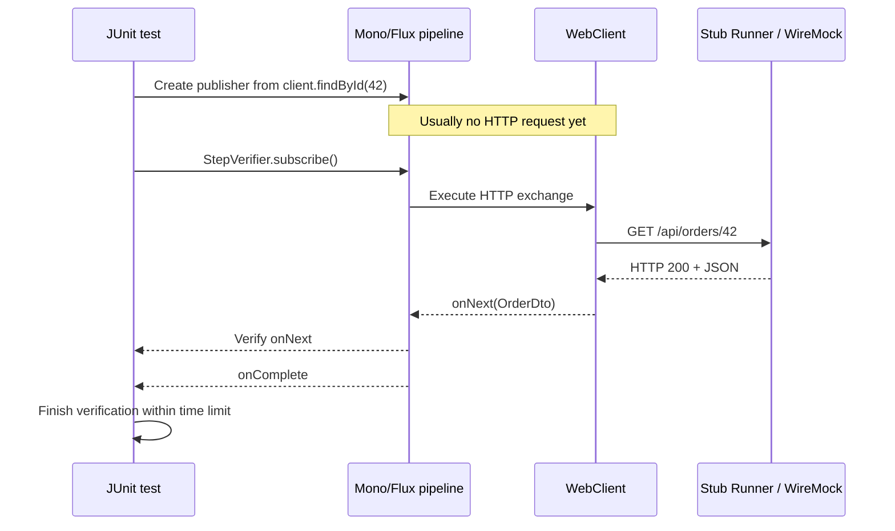
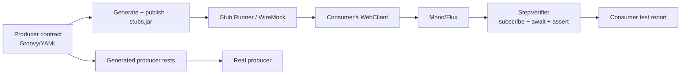
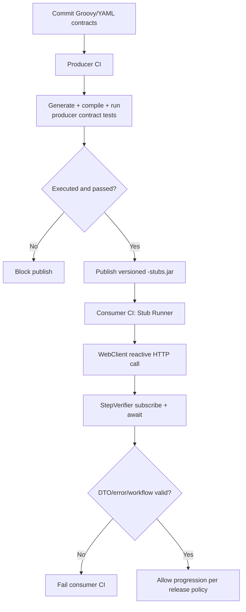

# Reactive Consumers and When to Wait for Calls to Complete

## 1. The Problem: A Consumer Test Can Finish Before the HTTP Request Is Even Sent

In **Spring Cloud Contract**, producer and consumer agree on behavior using the **Groovy DSL** or **YAML DSL**. The Verifier generates tests to verify the real producer and creates stubs; consumers can use **Stub Runner** to run stubs from published artifacts and test the application's own HTTP client. CI runs both sides to catch incompatible API changes.

When a consumer uses **Spring WebFlux WebClient** and Project Reactor, HTTP calls typically return **`Mono<T>`** or **`Flux<T>`** instead of returning an object immediately. This creates a trap:

```java
@Test
void testSai() {
    Mono<OrderDto> result = orderClient.findById(42L);
    // Not subscribed yet, so very likely no request was sent.
    // The test method finishes with no assertion on the result.
}
```

That test can appear "green" even when the stub is not running, the client targets the wrong URL, or the response has an incompatible schema. Even if you write:

```java
@Test
void testVanChuaOn() {
    orderClient.findById(42L).subscribe(order -> {
        assertThat(order.state()).isEqualTo("PAID");
    });
    // subscribe() returns immediately; JUnit does not wait for this callback.
}
```

it still does not guarantee a reliable test: assertions inside an asynchronous callback may execute **after the test method has already exited**, and exceptions thrown inside the callback may not be reported by JUnit as expected.

**Goal of this lesson:** understand **when a request actually begins**, **when a reactive stream is considered complete**, **how to wait with a timeout** in tests without distorting reactive design, and **when you must wait for additional side effects after the HTTP response**.

## 2. Reactive Execution Model: Assemble Pipeline, Subscribe, Receive Signals

In Reactor, a typical publisher follows this lifecycle:



Three key Reactive Streams signals:

| Signal | Meaning | What the Test Must Do |
|---|---|---|
| `onNext(value)` | A value was emitted | Assert DTO fields, ordering, or element count per contract |
| `onComplete()` | Publisher completed successfully | Verify no unexpected extra values or errors |
| `onError(error)` | Publisher terminated with an error | Verify exception type, HTTP status, business error code |

**`Mono<T>`** emits at most one value and completes, completes empty, or errors. **`Flux<T>`** can emit multiple values and may be finite or unbounded (such as Server-Sent Events). Lacking `onComplete` is not necessarily an error for a stream designed to stay open continuously.

### 2.1. Cold Publishers and Subscribing Multiple Times

Most `WebClient` pipelines are **cold**: each subscription can trigger **a new HTTP request**. For example:

```java
Mono<OrderDto> call = orderClient.findById(42L);

// Each block/subscribe call can send another request.
OrderDto first = call.block();
OrderDto second = call.block();
```

For `GET`, this may merely increment the request count. For a `POST` creating an order, **subscribing twice can trigger two side effects** if there is no idempotency. Do not call `block()` to "peek at the result" and then pass the same cold publisher to `StepVerifier.create(call)` without accounting for repeated API calls.

Operators like `map`, `filter`, and `doOnNext` only **declare the pipeline**; they do not subscribe automatically:

```java
Mono<OrderDto> observed = orderClient.findById(42L)
    .doOnNext(order -> log.debug("order={}", order.id()));

// No terminal subscription yet: insufficient to test HTTP.
```

## 3. Three Conditions for a Meaningful Reactive Consumer Test

A test should prove all three conditions:

1. **The publisher was subscribed to**: the HTTP exchange genuinely occurred.
2. **Signals were awaited and verified**: expected data and `onComplete`—or the expected error—arrived within a clear timeout.
3. **Consumer behavior is protected**: the client deserializes JSON, handles status/errors, and executes the logic the application depends on, rather than merely confirming WireMock returns sample data.



**Note:** the consumer branch does not replace the producer branch. The stub can return the described response even if the real producer changed incompatibly; generated producer tests must still **be executed and pass** before the stub is considered trustworthy.

## 4. Example HTTP Contract as the Stub Source

Suppose `order-service` exposes:

```http
GET /api/orders/42
Accept: application/json
```

Response:

```http
HTTP/1.1 200 OK
Content-Type: application/json

{"id":42,"state":"PAID","currency":"VND"}
```

### 4.1. Groovy DSL

```groovy
import org.springframework.cloud.contract.spec.Contract

Contract.make {
    description 'Reads a paid order'

    request {
        method GET()
        url '/api/orders/42'
        headers {
            header 'Accept', 'application/json'
        }
    }

    response {
        status OK()
        headers {
            contentType(applicationJson())
        }
        body(
            id: 42,
            state: 'PAID',
            currency: 'VND'
        )
    }
}
```

### 4.2. Equivalent YAML DSL

```yaml
description: Reads a paid order
request:
  method: GET
  url: /api/orders/42
  headers:
    Accept: application/json
response:
  status: 200
  headers:
    Content-Type: application/json
  body:
    id: 42
    state: PAID
    currency: VND
```

These two snippets are **two ways to express the same scenario**; do not store both simultaneously in the producer's contracts folder. When the generator builds stubs, WireMock will contain a mapping matching the request and returning the sample response. **In consumer tests, invoke the real WebClient** and await publisher completion instead of assuming the existence of a mapping means the client was tested.

## 5. Building a Reactive Consumer Client with WebClient

Java example using Spring WebFlux; the classes below are **illustrative code owned by the consumer project**, not Spring Cloud Contract APIs:

```java
package com.example.checkout.client;

public record OrderDto(long id, String state, String currency) {}
```

```java
package com.example.checkout.client;

import org.springframework.http.MediaType;
import org.springframework.web.reactive.function.client.WebClient;
import reactor.core.publisher.Mono;

public final class OrderReactiveClient {

    private final WebClient webClient;

    public OrderReactiveClient(String baseUrl) {
        this.webClient = WebClient.builder()
                .baseUrl(baseUrl)
                .build();
    }

    public Mono<OrderDto> findById(long id) {
        return webClient.get()
                .uri("/api/orders/{id}", id)
                .accept(MediaType.APPLICATION_JSON)
                .retrieve()
                .bodyToMono(OrderDto.class);
    }
}
```

Key points to note:

- `findById` returns **`Mono<OrderDto>`**, not `OrderDto` immediately.
- `retrieve().bodyToMono(OrderDto.class)` uses WebClient's decoder; with a Jackson JSON decoder and compatible configuration, the JSON body is parsed into the DTO.
- A `4xx/5xx` HTTP response from `retrieve()` is normally turned into an `onError` signal, such as `WebClientResponseException`, unless customized with `onStatus(...)`.
- The base URL is passed via constructor so tests can supply the **actual stub port**. In applications using Spring DI, you can supply the URL via a property, provided the property has its value before the WebClient/client bean is initialized.
- `OrderDto` uses `long` for `id`. If the producer switches from a JSON number to a string or drops the field, consumer deserialization and logic must be verified by tests.

To test the effect of error responses, later sections extend the client with `404` handling matching the consumer's error schema.

## 6. Using StepVerifier to Subscribe, Wait, and Verify

The **`reactor-test`** library provides `StepVerifier`. A Maven dependency declaration in test scope:

```xml
<dependency>
    <groupId>io.projectreactor</groupId>
    <artifactId>reactor-test</artifactId>
    <scope>test</scope>
</dependency>
```

Projects can use Gradle with `testImplementation("io.projectreactor:reactor-test")`. Manage versions compatibly with the application's Reactor/Spring Boot BOM.

### 6.1. Proper Test: Checking Value, Completion, and Timeout

```java
import java.time.Duration;
import org.junit.jupiter.api.Test;
import reactor.test.StepVerifier;

import static org.assertj.core.api.Assertions.assertThat;

@Test
void shouldReadPaidOrder() {
    OrderReactiveClient client = new OrderReactiveClient(stubBaseUrl);

    StepVerifier.create(client.findById(42L))
        .assertNext(order -> {
            assertThat(order.id()).isEqualTo(42L);
            assertThat(order.state()).isEqualTo("PAID");
            assertThat(order.currency()).isEqualTo("VND");
        })
        .expectComplete()
        .verify(Duration.ofSeconds(5));
}
```

`stubBaseUrl` is a variable **obtained by the test from WireMock/Stub Runner**, not a built-in library value. Key takeaways:

1. `StepVerifier.create(...)` prepares the verification scenario.
2. `verify(Duration.ofSeconds(5))` starts the subscription and **blocks the JUnit test thread** waiting for a terminal signal or timeout.
3. `assertNext(...)` validates the deserialized value.
4. `expectComplete()` requires the publisher to end **successfully**, emitting no further values or errors.
5. If the response violates the schema, returns an error status, or fails to complete before the timeout, the test **fails** instead of passing before HTTP is called.

**This waiting happens at the test layer**, not by turning production WebClient into a blocking client. The consumer pipeline remains non-blocking; only the **JUnit thread** awaits the outcome via StepVerifier.

### 6.2. Test Timeouts vs. Pipeline Timeouts

These two limits serve different roles:

```java
Mono<OrderDto> result = client.findById(42L)
    .timeout(Duration.ofSeconds(2));

StepVerifier.create(result)
    .assertNext(order -> assertThat(order.state()).isEqualTo("PAID"))
    .expectComplete()
    .verify(Duration.ofSeconds(5));
```

- `timeout(Duration.ofSeconds(2))` is a **Reactor operator**: if upstream does not emit in time, the pipeline terminates with `TimeoutException`.
- `verify(Duration.ofSeconds(5))` is **StepVerifier's wait limit**: the test will not hang forever if the pipeline never emits a terminal event.

These two numbers **are not production SLAs**. They are illustrative values that should be tuned to your environment and test policy—long enough to avoid flakiness, short enough to keep CI responsive.

### 6.3. Do Not Call `subscribe(...)` and Assume the Test Is Done

```java
@Test
void testKhongDangTin() {
    client.findById(42L).subscribe(order -> {
        assertThat(order.state()).isEqualTo("PAID");
    });

    // The test may return before the callback runs and miss failures.
}
```

In reactive HTTP tests, **return/await a single pipeline** via StepVerifier, WebTestClient, or an equivalent reactive testing mechanism. Never use `Thread.sleep(500)` hoping callbacks finished: CI machine speeds and scheduler timing are unpredictable.

## 7. Complete Consumer Test with Stub Runner and a Dynamic Port

Suppose the producer published:

```text
groupId    = com.example
artifactId = order-service
version    = 1.4.0
classifier = stubs
```

Stub Runner loads the JAR containing WireMock mappings and starts an HTTP stub server. With dynamic port allocation, the test must **look up the port after Stub Runner starts**:

```java
package com.example.checkout.contract;

import com.example.checkout.client.OrderDto;
import com.example.checkout.client.OrderReactiveClient;
import java.time.Duration;
import org.junit.jupiter.api.Test;
import org.springframework.boot.test.context.SpringBootTest;
import org.springframework.cloud.contract.stubrunner.StubRunnerProperties;
import org.springframework.cloud.contract.stubrunner.spring.AutoConfigureStubRunner;
import org.springframework.cloud.contract.stubrunner.spring.StubRunnerPort;
import reactor.test.StepVerifier;

import static org.assertj.core.api.Assertions.assertThat;

@SpringBootTest
@AutoConfigureStubRunner(
    ids = "com.example:order-service:1.4.0:stubs",
    stubsMode = StubRunnerProperties.StubsMode.LOCAL
)
class OrderReactiveConsumerContractTest {

    @StubRunnerPort("com.example:order-service")
    int stubPort;

    @Test
    void shouldDeserializePaidOrder() {
        // Construct client AFTER Stub Runner has started,
        // using the exact port of the order-service stub.
        String stubBaseUrl = "http://localhost:" + stubPort;
        OrderReactiveClient client =
            new OrderReactiveClient(stubBaseUrl);

        StepVerifier.create(client.findById(42L))
            .assertNext(order -> {
                assertThat(order.id()).isEqualTo(42L);
                assertThat(order.state()).isEqualTo("PAID");
                assertThat(order.currency()).isEqualTo("VND");
            })
            .expectComplete()
            .verify(Duration.ofSeconds(5));
    }
}
```

**Clarifying the scope:**

- `@AutoConfigureStubRunner` requires a compatible Stub Runner dependency and `com.example:order-service:1.4.0:stubs` installed in the **local Maven repository** when using `LOCAL`. With `REMOTE`, configure the repository and access permissions.
- `@StubRunnerPort` resolves the port of the **target producer stub**, not the consumer application's port.
- `OrderReactiveClient` is the consumer HTTP client from Section 5. In a real application, use the **actual production bean/client**; the simple constructor only demonstrates supplying the URL in tests.
- The test verifies **deserialized data and completion**. It does not by itself prove the real producer was tested; the producer must still run generated tests before publishing the stub.
- If the consumer already creates a `WebClient` bean with a base URL from configuration at context startup, you cannot retroactively swap its base URL using `stubPort`. Use a mechanism that **registers the URL before bean creation**, or design the client to accept test endpoint customization cleanly.

### 7.1. Stub Runner Does Not Need a Fixed Startup Port

Never silently assume `http://localhost:8080` in tests when Stub Runner assigns a random port. Parallel CI builds collide easily if everyone fixes `8080`; obtaining the runtime port reduces risk.

**Do not use another stub's port.** If the application depends on both `order-service` and `payment-service`, look up by explicit group/artifact, such as `@StubRunnerPort("com.example:order-service")`, rather than guessing server order in a list.

## 8. When the Client Is a Spring Bean: When to Supply the URL to Configuration

In a Spring Boot app, `OrderReactiveClient` may be a bean configured by a property:

```yaml
clients:
  orders:
    base-url: https://orders.example.internal
```

In tests using **WireMock directly**, you can start WireMock on port `0` and override the property:

```java
@SpringBootTest
@AutoConfigureWireMock(port = 0)
@TestPropertySource(properties = {
    "clients.orders.base-url=http://localhost:${wiremock.server.port}"
})
class CheckoutReactiveIntegrationTest {
    // @Autowired OrderReactiveClient bean already reads the test URL.
}
```

`@AutoConfigureWireMock` comes from Spring Cloud Contract WireMock, not Stub Runner. The `wiremock.server.port` property applies to the server managed by `@AutoConfigureWireMock`.

With **Stub Runner**, supported versions may expose a runtime property such as `stubrunner.runningstubs.order-service.port`. If using that approach, verify the **exact key name and registration timing** in your stack. Do not mistakenly use `wiremock.server.port` to guess Stub Runner's port.

### 8.1. Why `@BeforeEach` Can Be Too Late

`@BeforeEach` is invoked by JUnit **after the Spring application context has been built**. If the `WebClient` bean already baked in its `baseUrl` during initialization, updating a `stubBaseUrl` variable in `@BeforeEach` **does not change** the existing client's address.

Two practical options:

- Supply the test property during **context construction** when Stub Runner/WireMock integration supports it.
- Construct or configure the client **after obtaining the runtime URL**, while still exercising the exact same HTTP client code the consumer uses in production.

Never build an entirely separate test client with different deserialization or error-mapping logic and treat it as a complete consumer contract test.

### 8.2. Managing WireMock Directly with `@DynamicPropertySource`

Another approach is managing a dynamic-port server yourself:

```java
import com.github.tomakehurst.wiremock.WireMockServer;
import org.springframework.test.context.DynamicPropertyRegistry;
import org.springframework.test.context.DynamicPropertySource;

import static com.github.tomakehurst.wiremock.core.WireMockConfiguration.wireMockConfig;

static final WireMockServer WIREMOCK =
    new WireMockServer(wireMockConfig().dynamicPort());

static {
    // Must start before Spring resolves clients.orders.base-url.
    WIREMOCK.start();
}

@DynamicPropertySource
static void dynamicOrdersUrl(DynamicPropertyRegistry registry) {
    registry.add("clients.orders.base-url", WIREMOCK::baseUrl);
}
```

This is a **static-member snippet inside a test class**, not a standalone class. Add proper `WIREMOCK.stop()` teardown and manage Spring context caching/lifecycle carefully. With this approach, the test owns the mappings itself and **does not automatically consume the producer-published stub artifact** like Stub Runner does. Do not spin up unnecessary concurrent WireMock servers and point the consumer at the wrong one.

## 9. When Is a Call Truly Complete?

The answer depends on **what work the publisher represents**.

| Publisher / Flow | What the Completion Signal Means | What Is Not Automatically Guaranteed |
|---|---|---|
| `Mono<OrderDto>` from `bodyToMono` | Response received and decoded, DTO emitted, then completed | Other async side effects outside the pipeline |
| `Mono<Void>` from HTTP `204` | Request/response exchange completed in pipeline | No JSON value to assert |
| `Flux<OrderDto>` from finite JSON array | All elements emitted and completed | Ordering is only guaranteed if the API commits to it |
| `Flux<ServerSentEvent<?>>` | May never complete | Cannot await `onComplete` if stream is designed to stay open |
| Publisher after `retryWhen` | Completes when final attempt succeeds or retries exhaust with error | Does not guarantee only one HTTP request was sent |
| Pipeline using `flatMap` with further work | Completes after composed inner publishers complete | Side effects triggered via standalone `subscribe()` may still be running |

**Principle:** identify the work you need to verify and **compose it into the same reactive chain**. Never treat receiving an HTTP response as proof that related async workflows finished if the application fires them off in a *fire-and-forget* manner.

### 9.1. Example with `Mono<Void>`

If the consumer calls `DELETE /api/orders/42`, and the producer commits to `204 No Content`:

```java
public Mono<Void> deleteOrder(long id) {
    return webClient.delete()
        .uri("/api/orders/{id}", id)
        .retrieve()
        .bodyToMono(Void.class);
}
```

Test:

```java
StepVerifier.create(client.deleteOrder(42L))
    .expectComplete()
    .verify(Duration.ofSeconds(5));
```

Do not use `expectNext(null)` for `Mono<Void>`: the publisher simply **completes** without emitting a `null` value. If the consumer needs to distinguish `204` from another status, client/test code should inspect the status explicitly (such as via `exchangeToMono`) rather than inferring from `Mono<Void>` completion alone.

### 9.2. When You Must Wait for Another Side Effect

Suppose the consumer receives an order response and then persists a record via a reactive repository publisher:

```java
Mono<Void> workflow = client.findById(42L)
    .flatMap(order -> repository.save(
        CheckoutRecord.from(order)))
    .then();
```

If `repository.save(...)` is a genuine reactive publisher **composed with `flatMap`**, `workflow` completes only once saving finishes per the reactive contract. The test can do:

```java
StepVerifier.create(workflow)
    .expectComplete()
    .verify(Duration.ofSeconds(5));

// Afterwards, read/assert persisted data using the appropriate test mechanism.
```

By contrast, if code calls `repository.save(...).subscribe()` inside `doOnNext`, saving may still be running **after the outer publisher completes**. That makes both error propagation and ordering hard to control. Fix the **pipeline composition** rather than stretching `Thread.sleep(...)` in tests to hide uncomposed work.

## 10. Testing a Finite `Flux`: Count, Ordering, and Completion

If `GET /api/orders?state=PAID` returns a JSON array:

```json
[
  {"id": 42, "state": "PAID", "currency": "VND"},
  {"id": 43, "state": "PAID", "currency": "VND"}
]
```

The consumer may expose:

```java
public Flux<OrderDto> findPaidOrders() {
    return webClient.get()
        .uri("/api/orders?state=PAID")
        .retrieve()
        .bodyToFlux(OrderDto.class);
}
```

Test with StepVerifier:

```java
StepVerifier.create(client.findPaidOrders())
    .expectNextMatches(order ->
        order.id() == 42L && "PAID".equals(order.state()))
    .expectNextMatches(order ->
        order.id() == 43L && "PAID".equals(order.state()))
    .expectComplete()
    .verify(Duration.ofSeconds(5));
```

This scenario **locks in ordering** (`42` before `43`). Only do this when the API commits to ordering (for example `sort=id,asc`). If ordering is **not** part of the contract, collect and assert the set:

```java
StepVerifier.create(client.findPaidOrders().collectList())
    .assertNext(orders -> {
        assertThat(orders).hasSize(2);
        assertThat(orders)
            .extracting(OrderDto::id)
            .containsExactlyInAnyOrder(42L, 43L);
    })
    .expectComplete()
    .verify(Duration.ofSeconds(5));
```

Note: `collectList()` waits until the **Flux completes** before emitting the list. Never use it on an unbounded stream if you expect the test to terminate normally.

## 11. Unbounded Streams: SSE and Cases Requiring Cancellation

`WebClient` can consume **Server-Sent Events (SSE)** or long-lived streams. Such a `Flux` is designed **not to emit `onComplete` on its own**.

Example:

```java
public Flux<ServerSentEvent<OrderDto>> watchOrders() {
    return webClient.get()
        .uri("/api/orders/events")
        .accept(MediaType.TEXT_EVENT_STREAM)
        .retrieve()
        .bodyToFlux(new ParameterizedTypeReference<
            ServerSentEvent<OrderDto>>() {});
}
```

To verify the **first event**, you can write:

```java
StepVerifier.create(client.watchOrders())
    .assertNext(event -> {
        assertThat(event.data()).isNotNull();
        assertThat(event.data().state()).isEqualTo("PAID");
    })
    .thenCancel()
    .verify(Duration.ofSeconds(5));
```

Here `thenCancel()` cancels the test subscription after receiving enough data to verify. **It does not assert that the server closed the stream.** Never call `expectComplete()` on a stream designed to stay open indefinitely.

Another option is `take(2)`: the operator terminates the consumer-side publisher after two elements, though that does not prove upstream closes the connection on its own. Each test must explicitly express the **completion semantics** the consumer actually relies on.

## 12. Testing HTTP Errors and Reactive Client Error Mapping

A consumer handles more than `200`. If the producer returns `404` with a business body:

```json
{
  "code": "ORDER_NOT_FOUND",
  "message": "Order does not exist"
}
```

the client should translate it into an error understood by the consumer application, not merely propagate an opaque HTTP exception.

### 12.1. Mapping `404` to a Business Exception

Example:

```java
public record ApiError(String code, String message) {}

public final class OrderNotFoundException extends RuntimeException {
    private final String code;

    public OrderNotFoundException(String code, String message) {
        super(message);
        this.code = code;
    }

    public String code() {
        return code;
    }
}
```

Update the client method:

```java
public Mono<OrderDto> findById(long id) {
    return webClient.get()
        .uri("/api/orders/{id}", id)
        .retrieve()
        .onStatus(
            status -> status.value() == 404,
            response -> response.bodyToMono(ApiError.class)
                .defaultIfEmpty(new ApiError(
                    "UNKNOWN_ERROR", "Empty error response"))
                .map(error -> new OrderNotFoundException(
                    error.code(), error.message()))
        )
        .bodyToMono(OrderDto.class);
}
```

When the stub returns `404` and the error body, the method emits `onError(OrderNotFoundException)`. Test:

```java
StepVerifier.create(client.findById(9999L))
    .expectErrorSatisfies(error -> {
        assertThat(error).isInstanceOf(OrderNotFoundException.class);
        OrderNotFoundException notFound =
            (OrderNotFoundException) error;
        assertThat(notFound.code()).isEqualTo("ORDER_NOT_FOUND");
    })
    .verify(Duration.ofSeconds(5));
```

**Important:** a request sent to WireMock with the wrong URL can also get an **unmatched-mapping `404`**, which is not the business error `ORDER_NOT_FOUND`. Asserting `code` distinguishes the two. If the error body fails to parse, the test must fail visibly rather than accepting any arbitrary `404` as success.

### 12.2. Testing `503` and Network Failures

With `retrieve()` and no custom status handler for `503`, WebClient normally emits `WebClientResponseException`:

```java
StepVerifier.create(client.findById(42L))
    .expectErrorSatisfies(error -> {
        assertThat(error)
            .isInstanceOf(WebClientResponseException.class);
        var httpError = (WebClientResponseException) error;
        assertThat(httpError.getStatusCode().value())
            .isEqualTo(503);
    })
    .verify(Duration.ofSeconds(5));
```

This snippet assumes the stub is configured to **return HTTP 503** and the client method still uses `retrieve()`. If the connection fails completely, the error may be `WebClientRequestException` instead of `WebClientResponseException`, because **no HTTP response arrived**. Consumers may apply different retry policies for `503` vs. transport failures.

### 12.3. Do Not Swallow Errors with Overly Broad `onErrorResume`

Dangerous example:

```java
return webClient.get()
    .uri("/api/orders/42")
    .retrieve()
    .bodyToMono(OrderDto.class)
    .onErrorResume(error ->
        Mono.just(new OrderDto(42L, "PAID", "VND")));
```

If the stub returns `404` or malformed JSON, the client still emits a fake `PAID` DTO and tests may pass. A fallback can be a **valid business policy**, but it must be explicitly defined and tested for both the **underlying error** and **fallback behavior**. Never use silent default fallbacks that mask contract mismatches.

## 13. Retries: One Subscription Does Not Mean Only One Request

A pipeline using Reactor retries can **resubscribe** to the WebClient source:

```java
Mono<OrderDto> result = client.findById(42L)
    .retryWhen(
        Retry.fixedDelay(1, Duration.ofMillis(100))
            .filter(error ->
                error instanceof WebClientResponseException.ServiceUnavailable)
    );
```

In this example, if the first attempt hits `503` and the second succeeds, a single StepVerifier subscription to `result` can send **two HTTP requests**. Therefore:

- Do not always assert WireMock received exactly one request if the consumer retries per contract.
- Avoid retrying arbitrary `4xx` errors; validation/not-found errors rarely recover by resending the same request.
- For `POST` or state-changing actions, evaluate **idempotency** before retrying to avoid duplicate side effects.
- Bound retry counts and total duration; avoid unbounded pipelines.
- When using WireMock scenarios to simulate `503 → 200`, reset scenario state between tests.

### 13.1. When to Verify Request Counts

With an isolated HTTP stub, you can inspect the request journal:

```java
StepVerifier.create(result)
    .assertNext(order ->
        assertThat(order.state()).isEqualTo("PAID"))
    .expectComplete()
    .verify(Duration.ofSeconds(5));

// Only check the request count after the pipeline has completed.
wireMockServer.verify(
    2, getRequestedFor(urlEqualTo("/api/orders/42")));
```

**Prerequisite:** this assumes WireMock already has a scenario returning `503` first and `200` next, and the request journal was cleared before the test. With Stub Runner, use the appropriate API/harness to inspect the WireMock instance managed by Stub Runner; do not assume a `wireMockServer` variable is automatically available pointing to the right stub server.

## 14. StepVerifier Virtual Time: Use Within Its Proper Scope

Reactor Test provides `StepVerifier.withVirtualTime(...)` to simulate time for **Reactor operators/schedulers**. It is useful for retry/delay logic built purely with Reactor, for example:

```java
import java.time.Duration;
import java.util.concurrent.TimeoutException;
import reactor.core.publisher.Mono;
import reactor.test.StepVerifier;

StepVerifier.withVirtualTime(
        () -> Mono.never().timeout(Duration.ofSeconds(3)))
    .thenAwait(Duration.ofSeconds(3))
    .expectError(TimeoutException.class)
    .verify();
```

Time in this example advances immediately on the virtual scheduler without waiting three real seconds.

**Never assume virtual time controls WebClient sockets, WireMock servers, Reactor Netty, or real network I/O.** A real HTTP call through Stub Runner still uses real server, OS, and network resources and wall-clock time. Therefore:

- Use `withVirtualTime` for **pure Reactor logic** whose schedulers are under test control.
- Use `verify(Duration)` and real timeouts when verifying **real HTTP exchanges against stubs**.
- Do not casually mix virtual-time tests and socket tests in parallel if global schedulers are altered; follow Reactor Test lifecycle rules.

## 15. HTTP Response Completion Does Not Guarantee Background Side Effects Completed

Suppose `checkout-service` calls `order-service` to fetch an order, then writes a message to an outbox or sends a notification. There are two ways to structure it:

### 15.1. Side Effect Composed in the Same Reactive Chain

```java
Mono<Void> processPaidOrder(long orderId) {
    return orderClient.findById(orderId)
        .flatMap(order -> outboxRepository.save(
            OutboxMessage.forPaidOrder(order)))
        .then();
}
```

If `outboxRepository.save(...)` is a proper reactive publisher, `processPaidOrder` completes only after the composed save finishes. StepVerifier can await the entire workflow.

### 15.2. Side Effect Split Off via Internal `subscribe()`

```java
Mono<OrderDto> processPaidOrder(long orderId) {
    return orderClient.findById(orderId)
        .doOnNext(order -> {
            // Anti-pattern: side effect runs detached, errors rarely reach the caller.
            outboxRepository.save(
                OutboxMessage.forPaidOrder(order))
                .subscribe();
        });
}
```

The outer pipeline can emit `onComplete` **before** the outbox write finishes. A test calling `StepVerifier.verify(...)` only checks the **outer publisher** and does not wait for the separately subscribed publisher. Fix the design via composition (`flatMap`/`then`...) or, for genuinely background work, await an **observable condition** (such as with Awaitility) with proper timeouts and cleanup.

Never use `Thread.sleep(...)` as proof that side effects finished. When testing long-running workflows with separate queues/workers, define the business completion point and how to observe it.

## 16. Diagnosing Reactive Consumer Test Failures

| Symptom | Possible Cause | Where to Investigate |
|---|---|---|
| Test passes yet WireMock receives zero requests | Never subscribed; test only created `Mono` | Use StepVerifier and inspect request journal |
| Assertion callback runs after JUnit finishes | Fire-and-forget `subscribe(...)` | Await terminal signal with `verify(Duration)` |
| `StepVerifier` times out | Stub failed to start, wrong URL, upstream emits no signal | Check port/URL, logs, and reactor chain |
| `WebClientRequestException` | Cannot connect, wrong DNS/TLS/port | Check base URL and stub lifecycle |
| `WebClientResponseException.NotFound` | Stub/producer returned 404 | Distinguish business error from unmatched mapping |
| `onNext` never receives a value | Empty response body or `Mono.empty()` | Check status, `204`, decoder, client policy |
| Test expects `onComplete` but gets `onError` | Error status, decode failure, timeout, or business mapping | Read the underlying exception cause |
| Test expects one request but sees two | Retries or cold publisher subscribed twice | Inspect `retryWhen`, `block`, and subscription counts |
| Test hangs on SSE `Flux` | Stream is designed never to complete | Use `thenCancel()` or `take(n)` |
| Passes locally, fails in CI | Too-short timeout, port contention, different artifact version | Log resolved stub version; use dynamic ports |
| Outcome depends on test order | Shared mappings/journal/scenario state | Scope resets properly; isolate servers |
| DTO parses cleanly yet consumer business logic fails | Asserted only HTTP/DTO, not downstream logic | Test consumer workflow and side effects |

### 16.1. Ordered Troubleshooting Steps

1. **Was the publisher subscribed to?** Confirm the test calls `verify(...)` or a controlled terminal operation.
2. **Which signal is the test awaiting?** `onNext`, `onComplete`, `onError`, or **cancelling** the stream.
3. **Is there a timeout?** Avoid infinite waits; distinguish Reactor pipeline timeouts from StepVerifier timeouts.
4. **Which host/port is the client calling?** Use the WireMock/Stub Runner runtime port, never a default production URL.
5. **Which stub is serving?** Verify group/artifact/version/classifier when using Stub Runner.
6. **What was the actual response?** HTTP status, content type, JSON body/error schema.
7. **Did the pipeline retry or subscribe multiple times?** Check request journals and side effects.
8. **Is there work detached from the publisher?** If so, verify via a dedicated observation point; never treat `onComplete` as covering everything.
9. **Did producer verification run?** Passing stub tests are only half of contract testing.

## 17. CI for Reactive Consumers with Spring Cloud Contract

A trustworthy compatibility pipeline should distinguish:



**Essential control gates:**

- Producer CI **actually executes** generated contract tests; never merely generate sources/stubs or return `BUILD SUCCESS` when tests were skipped.
- Stub JARs have explicit versions/classifiers; consumer tests use the exact artifact selected for release.
- Consumers use the **application's real WebClient**, pointed to the stub's runtime port/URL.
- Tests **subscribe and await terminal signals** using StepVerifier (or an equivalent reactive test utility).
- Tests enforce sensible timeouts rather than relying on `Thread.sleep`.
- Tests cover success, deserialization, critical error paths, and retries when the consumer defines retry policies.
- When asserting counts/ordering, tests verify only guarantees committed by the API rather than locking onto unstable details.
- Mappings, request journals, and scenario states do not leak across test methods or parallel jobs.
- Retain JUnit reports, resolved artifact coordinates, and credential-redacted failure logs.

### 17.1. Post-Run Evidence Checklist

```text
Producer stub: com.example:order-service:1.4.0:stubs
Consumer base URL: http://localhost:<dynamic-port>
Reactive type: Mono<OrderDto>
Subscription: StepVerifier started
Observed signal: onNext(OrderDto) → onComplete
Assertions: id=42, state=PAID, currency=VND
Verification timeout: bounded
Producer generated tests: executed + passed
Consumer tests: executed + passed
```

This is a **recommended report template**, not default output from every Spring Cloud Contract or Reactor Test version.

## 18. Practice Lab: Fixing a "False-Green" Consumer Test

**Context:** `checkout-service` uses WebClient to call `order-service`. A developer wrote:

```java
@Test
void shouldReadOrder() {
    client.findById(42L).subscribe(order ->
        assertThat(order.state()).isEqualTo("PAID"));
}
```

The test sometimes passes even when the stub returns `404`; other times CI logs async errors while reports show no clear assertion failure.

### 18.1. Tasks

1. Confirm the producer has a `GET /api/orders/42` contract returning `200` and JSON `id=42`, `state=PAID`, `currency=VND`.
2. Ensure generated producer tests run and pass, then publish the `stubs` classifier artifact.
3. In the consumer, use `@AutoConfigureStubRunner` with a pinned version; retrieve the port via `@StubRunnerPort`.
4. Configure the **real OrderReactiveClient** using `http://localhost:<actual-port>`.
5. Replace `subscribe(...)` with `StepVerifier.create(...).assertNext(...).expectComplete().verify(Duration.ofSeconds(5))`.
6. Temporarily change `state` in a test stub to `PENDING` and confirm the assertion fails.
7. Add a `GET /api/orders/9999` scenario returning `404 + ORDER_NOT_FOUND`; use `expectErrorSatisfies` to verify the consumer-facing exception/error code.
8. If the client implements retries, use a WireMock scenario simulating `503 → 200` and verify **HTTP request counts after the publisher completes**.
9. If an endpoint returns a JSON array, use `Flux` and verify element count/completion; if an SSE stream never completes, define cancellation conditions instead of waiting forever for completion.
10. Run the full suite and CI, ensuring zero mapping/journal leaks or port collisions; save reports proving tests actually executed.

### 18.2. Self-Assessment Questions

| Question | Answer |
|---|---|
| Does calling `findById` to create a `Mono` automatically send an HTTP request? | **Not yet**; a subscription is required |
| Does `subscribe(...)` in a JUnit test automatically wait for callbacks? | **No** |
| What does `StepVerifier.verify(Duration)` do? | Subscribes and awaits assertions/terminal signals within the timeout |
| Does `Mono<Void>` emit a `null` value? | **No**; it normally completes without `onNext` |
| Does `onComplete` from WebClient prove all background jobs finished? | **No**, if jobs run detached from the pipeline |
| Can `retryWhen` generate multiple HTTP requests? | **Yes**, due to resubscription |
| Does `withVirtualTime` make WireMock network I/O run "virtually"? | **Not by default** |
| Should you call `expectComplete()` on an infinite SSE stream? | **No** if the stream does not commit to ending |
| Is an HTTP 404 from an unmatched mapping the same as business `ORDER_NOT_FOUND`? | **No**; verify error code/body |
| Does a passing consumer test prove the real producer is valid? | **No**; independent generated producer verification is required |

## 19. Review Checklist for Reactive Consumer Contract Tests

- [ ] Tests use the consumer's real WebClient/client rather than calling the stub directly with an ad hoc client.
- [ ] `Mono`/`Flux` is subscribed to in a controlled manner.
- [ ] StepVerifier/WebTestClient or equivalent is used to **await the result** rather than returning early.
- [ ] Timeouts are bounded, distinguishing pipeline timeouts from test verifier timeouts.
- [ ] Properly asserts `onNext`, `onComplete`, or `onError` per scenario.
- [ ] For `Mono<Void>`, asserts completion rather than expecting `null`.
- [ ] For finite `Flux`, checks item count, types, and ordering only when committed by the API.
- [ ] For SSE/continuous streams, tests use explicit cancellation or stopping conditions.
- [ ] Error branches verify status/error codes and never confuse unmatched `404`s with business errors.
- [ ] Retries are bounded and request counts are verified after the publisher completes.
- [ ] Never uses `Thread.sleep` or fire-and-forget `subscribe` callbacks as proof of test completion.
- [ ] Verified side effects are composed into the reactive chain or observed via dedicated bounded awaits.
- [ ] Base URL targets the runtime stub rather than hard-coding producer or other stub ports.
- [ ] Stub Runner uses exact group/artifact/version/classifier; stub artifacts were verified by the producer before publishing.
- [ ] Request journals, mappings, scenario states, and test fixtures are isolated/reset properly for parallel runs.
- [ ] CI archives reports and confirms both generated producer tests and reactive consumer tests executed and passed.

**Conclusion:** For reactive consumers, **creating a `Mono` or `Flux` does not execute the call**, and **calling `subscribe()` does not wait for the test to finish**. A trustworthy consumer contract test must subscribe, verify data or errors, and await the exact completion boundary with a timeout. Combined with Stub Runner, versioned artifacts, and generated producer verification in CI, results genuinely catch incompatible API changes rather than producing "false-green" tests.
