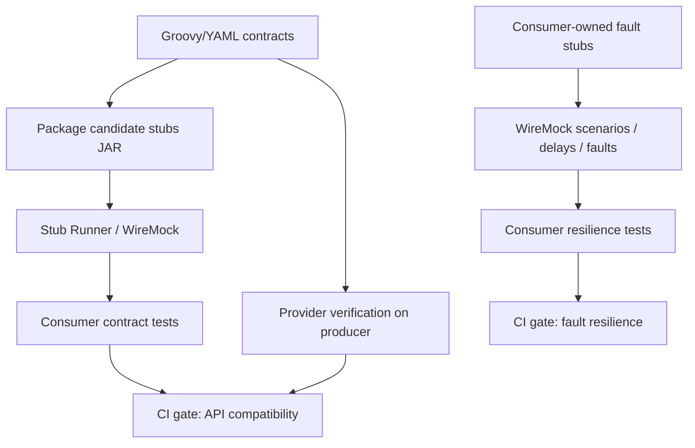
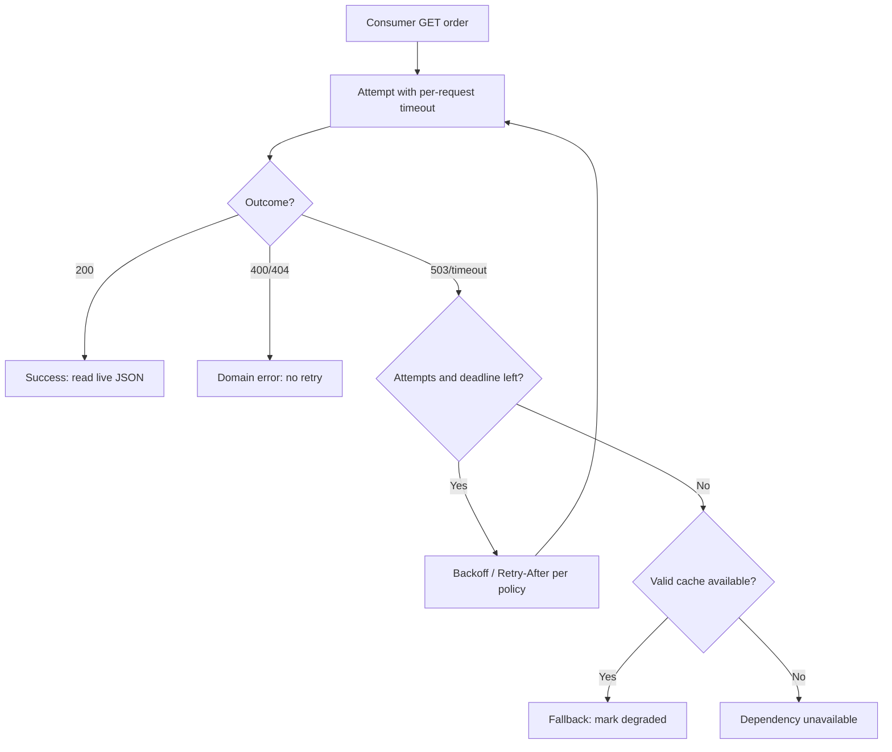
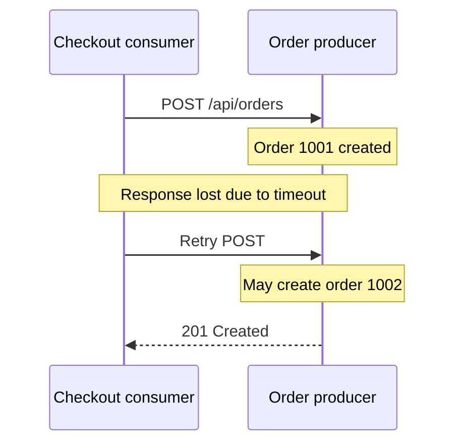
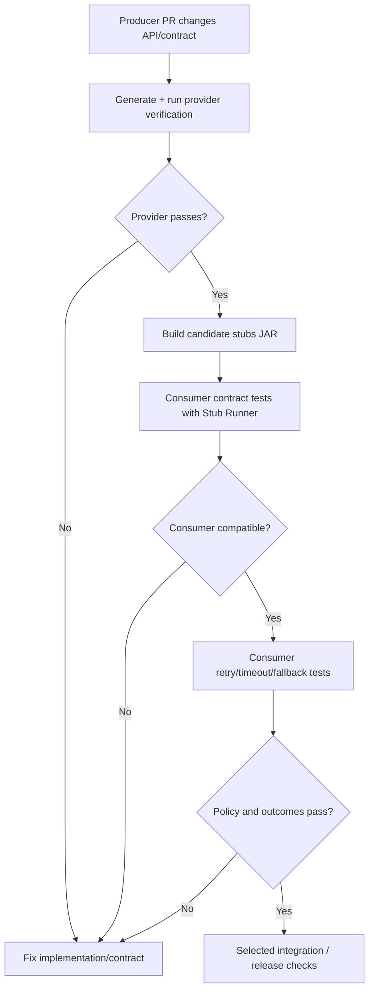

# Testing Timeouts, Retries, and Fallbacks with Supplemental Stubs in Spring Cloud Contract

A consumer can pass every communication test with **200 OK** responses and still fail when the producer responds slowly, returns transient errors, or drops connections. In production, those situations directly impact **latency, request volume, downstream load, and user experience**. Therefore, consumer testing does not stop at parsing valid JSON: it must also verify **timeouts, retries, and fallbacks**.

In **Spring Cloud Contract (SCC)**, the producer specifies HTTP or messaging contracts using the **Groovy/YAML DSL**, runs **provider verification tests**, and publishes a **stubs JAR**. The consumer uses **Stub Runner** to run agreed stubs, typically via **WireMock** for HTTP. To test infrastructure fault conditions that static contracts do not fully describe, teams can add **supplemental stubs that inject delays, drop connections, or return response sequences** in the consumer test suite.

This lesson in the **Consumer Testing** chapter focuses on how to create **supplemental stubs** without corrupting the contract source of truth, how to verify bounded retry and fallback policies, and how to structure CI to catch defects before deployment. The running example uses `checkout-consumer` calling `order-producer` via `GET /api/orders/{id}`.

## 1. Distinguishing the Three Mechanisms Under Test

**Timeouts** bound waiting time. When a request or overall operation exceeds its threshold, the consumer must terminate cleanly instead of waiting indefinitely.

**Retries** repeat an operation **after an error classified as recoverable**, within bounded attempts and delays. Retrying is not default Spring Cloud Contract behavior.

**Fallbacks** define how the consumer handles an unresponsive dependency or missing result: for example, serving a non-expired cached snapshot, returning a "temporarily unavailable" state, or enqueuing work for deferred processing. Fallbacks must preserve business meaning rather than merely hiding exceptions.

| Mechanism | Testing Question | Common Bug |
| --- | --- | --- |
| Per-request timeout | Does the client stop waiting when a single attempt takes too long? | Unconfigured read timeout; threads blocked indefinitely |
| Overall deadline | Does the whole retry chain stop within budget? | Per-attempt timeout exists, yet total duration is too long |
| Retry | Does it retry only eligible errors for the exact attempt count? | Retrying `400`, `404`, or every `500` |
| Backoff | Does it pause between retries? | Tight-loop retries amplifying downstream load |
| `Retry-After` | Does it respect server wait hints? | Retrying too early while the producer is overloaded |
| Fallback | Once recovery is exhausted, what does the consumer do? | Returning bogus data or treating failure as success |
| Idempotency | Does retrying a mutating request create duplicate records? | POST times out and creates two orders |

### 1.1. A Slow Request Should Not Necessarily Be Retried

If a consumer has a total SLA of 800 ms and the first request already took 700 ms, a retry with a 500 ms delay cannot finish within the SLA. The right policy may be to **stop and return a fallback** rather than sending a second attempt.

### 1.2. A 503 Response Does Not Trigger Retries Automatically

An HTTP client such as `RestClient` or `RestTemplate` does not automatically enable application-level retry policies. Retry rules usually live in resilience libraries, decorators, interceptors, or orchestration code defined by your team. **Spring Cloud Contract/Stub Runner simulate responses; they do not implement consumer policies.**

## 2. Scope of Contract Stubs vs. Supplemental Stubs

Distinguish the two stub sources:

| Stub Source | Who Owns It? | Purpose | Should It Be Treated as an API Commitment? |
| --- | --- | --- | --- |
| **Contract-derived stub** | Producer or contract owners | Simulates HTTP status/body/headers committed by the producer | Yes, when verified and published with an exact version |
| **Supplemental fault stub** | Consumer tests | Injects timeouts, connection resets, error/recovery sequences | Only if that behavior was separately agreed; the stub alone does not prove the real producer |
| **Stateful scenario stub** | Consumer resilience tests | Returns 503 then 200 or multi-step response sequences | Simulates a test scenario, not a contract by default |
| **Integration environment** | Deployment/test team | Runs real producer, gateway, broker, or dependencies | Verifies behavior across a broader boundary |

For example, contracts may only define:

```text
GET /api/orders/1001 -> HTTP 200 + valid JSON
GET /api/orders/9999 -> HTTP 404 + code ORDER_NOT_FOUND
```

To test that the consumer tolerates a 2-second slow response, you **do not need to declare in the public contract that the producer must always take 2 seconds**. You can define a supplemental WireMock stub **inside consumer tests** returning the same schema with a deliberate delay.

**Ownership rule:** public API behavior—especially error statuses and `Retry-After` headers the consumer relies on—should be agreed upon in contracts when it is truly part of the producer interface. Simulated network faults and consumer retry schedules belong in supplemental resilience tests.

### 2.1. Two Testing Tracks Should Coexist



If a suite uses a **separate WireMock server** for supplemental stubs, do not confuse it with the WireMock instance started by Stub Runner. The two servers have different lifecycles, ports, and mapping sources; the consumer client must point to the right server for each test.

## 3. Baseline Contracts: Agreed Success and Error Cases

Example success contract owned by `order-producer`:

```groovy
import org.springframework.cloud.contract.spec.Contract

Contract.make {
    description 'Reads an existing order returning 200 JSON'

    request {
        method GET()
        url '/api/orders/1001'
        headers {
            header('Accept', 'application/json')
        }
    }

    response {
        status OK()
        headers {
            contentType(applicationJson())
        }
        body(
            id: 1001,
            status: 'CREATED',
            currency: 'VND'
        )
    }
}
```

Equivalent YAML—pick **one** DSL in your contract build:

```yaml
description: "Reads an existing order returning 200 JSON"
request:
  method: GET
  url: /api/orders/1001
  headers:
    Accept: application/json
response:
  status: 200
  headers:
    Content-Type: application/json
  body:
    id: 1001
    status: CREATED
    currency: VND
```

If the public API commits to returning 503 when an underlying dependency is temporarily unavailable, define a **separate contract** for a reproducible fixture scenario:

```groovy
import org.springframework.cloud.contract.spec.Contract

Contract.make {
    description 'Order data source temporarily unavailable, returning 503 with Retry-After'

    request {
        method GET()
        url '/api/orders/9001'
    }

    response {
        status 503
        headers {
            contentType(applicationJson())
            header('Retry-After', '2')
        }
        body(
            code: 'ORDER_SOURCE_UNAVAILABLE',
            retryable: true
        )
    }
}
```

This contract verifies a **specific 503 response from the producer**. It **does not verify** whether the consumer waited 2 seconds, retried exactly twice, or triggered a fallback; that is the responsibility of consumer tests.

### 3.1. Do Not Create Overlapping Contracts Expecting a Response Sequence

Suppose you define both at once:

```text
Contract A: GET /api/orders/1001 -> 503
Contract B: GET /api/orders/1001 -> 200
```

If both match **the exact same request**, WireMock selects one mapping by priority/registration order rather than **automatically switching** from 503 to 200 after the first call. Use **WireMock scenarios** for multi-call sequences or differentiate independent contract requests using explicit fixtures/conditions.

## 4. Using Stub Runner in Consumer Contract Tests

Assume the producer ran provider verification and installed the stubs artifact into the local Maven repository. A consumer Spring Boot test:

```java
import org.springframework.boot.test.context.SpringBootTest;
import org.springframework.cloud.contract.stubrunner.spring.AutoConfigureStubRunner;
import org.springframework.cloud.contract.stubrunner.spring.StubRunnerProperties;

@SpringBootTest(properties = {
    "order.api.base-url=http://localhost:8085"
})
@AutoConfigureStubRunner(
    ids = "com.example:order-producer:1.0.0:stubs:8085",
    stubsMode = StubRunnerProperties.StubsMode.LOCAL
)
class OrderConsumerContractTest {
    // Inject the application's real client.
    // Call GET /api/orders/1001, assert DTO and business branch.
}
```

`com.example:order-producer:1.0.0:stubs:8085` is purely illustrative coordinates. `LOCAL` requires the JAR to be installed in the local Maven repository; multi-repository CI can use `REMOTE` with an artifact repository and pinned candidate versions.

In parallel suites, fixed ports can collide; consider dynamic ports as supported by Stub Runner and appropriate injection wiring.

**Never use Stub Runner to claim the real producer handles timeouts properly.** It runs contract-generated stubs, not the producer's implementation.

### 4.1. When Should You Use a Dedicated WireMock Server for Supplemental Stubs?

Use a standalone WireMock server in consumer tests when you need to:

- Inject delays exceeding expected timeouts.
- Reset connections or return controlled transient errors.
- Return a `503 → 503 → 200` sequence.
- Verify request counts via `verify(n, getRequestedFor(...))`.
- Reset state and fixtures between tests.
- Tune resilience-only scenarios without modifying producer contracts.

This does not mean abandoning Stub Runner. **Keep the contract suite backed by the stubs JAR** and maintain a **separate fault-injection suite backed by WireMock** if that gives the clearest ownership and reproducibility.

## 5. Setting Up a WireMock Server for Supplemental Scenarios

JUnit Jupiter example with WireMock Java DSL:

```java
import static com.github.tomakehurst.wiremock.client.WireMock.*;

import com.github.tomakehurst.wiremock.WireMockServer;
import org.junit.jupiter.api.AfterEach;
import org.junit.jupiter.api.BeforeEach;

class OrderResilienceTest {

    private WireMockServer wireMock;

    @BeforeEach
    void startStub() {
        wireMock = new WireMockServer(
            options().dynamicPort()
        );
        wireMock.start();
    }

    @AfterEach
    void stopStub() {
        if (wireMock != null) {
            wireMock.stop();
        }
    }

    // Test methods will invoke the consumer client with wireMock.baseUrl().
}
```

This class demonstrates the **server lifecycle** and omits test methods. Alternatively, use a JUnit WireMock extension if supported by your project's versions/dependencies.

Key points:

1. **Each test has independent state.** Start a fresh server or reset mappings/request journal/scenarios between tests.
2. **Use dynamic ports** to avoid CI port collisions.
3. **The consumer's real client** must read the test WireMock base URL rather than accidentally calling the real producer.
4. **Keep stub request matchers strict enough.** Do not return 200 for any URL or body.
5. **Tests must assert outcomes and interactions**, not merely that the server started.

If a Spring application context creates a singleton HTTP client bean, supply the test URL **before the bean is created**—for instance via test property injection/configuration—rather than changing the URL after the bean already holds an immutable value.

## 6. Testing Timeouts with Response Delays

### 6.1. Fixed Delay in WireMock

An HTTP stub can deliberately respond slower than the consumer's limit:

```java
wireMock.stubFor(
    get(urlEqualTo("/api/orders/1001"))
        .willReturn(
            okJson("{\"id\":1001,\"status\":\"CREATED\"}")
                .withFixedDelay(1500)
        )
);
```

`withFixedDelay(1500)` simulates a **1,500 ms** response delay at the stub using the corresponding WireMock API. If the consumer sets a per-request timeout of **250 ms**, this request must be handled as a timeout (or equivalent error per the client library).

**Note:** do not assume every client and environment measures time to exact millisecond precision. Timeouts can apply to connecting, receiving headers, reading the body, or the entire request; tests must exercise the **actual timeout configured by the application**.

### 6.2. Illustrating an HTTP Timeout with JDK HttpClient

A plain HTTP test demonstrating an actual timeout at the socket/client boundary:

```java
import static org.junit.jupiter.api.Assertions.assertThrows;

import java.net.URI;
import java.net.http.HttpClient;
import java.net.http.HttpRequest;
import java.net.http.HttpResponse;
import java.net.http.HttpTimeoutException;
import java.time.Duration;
import org.junit.jupiter.api.Test;

@Test
void clientTimesOutWhenStubResponseIsTooSlow() {
    wireMock.stubFor(
        get(urlEqualTo("/api/orders/1001"))
            .willReturn(
                okJson("{\"id\":1001}")
                    .withFixedDelay(1500)
            )
    );

    HttpClient http = HttpClient.newHttpClient();
    HttpRequest request = HttpRequest.newBuilder()
        .uri(URI.create(
            wireMock.baseUrl() + "/api/orders/1001"))
        .timeout(Duration.ofMillis(250))
        .GET()
        .build();

    assertThrows(HttpTimeoutException.class, () ->
        http.send(request, HttpResponse.BodyHandlers.ofString())
    );
}
```

The test above only checks **JDK HttpClient directly**; it does not prove timeout settings in your application's `OrderClient` if it uses another HTTP client. When testing real `checkout-consumer`, **call the client configured with production timeouts and error mapping** and assert the exception/domain outcome that client exposes.

### 6.3. Distinguishing Timeout Types

| Limit | What Happens | Why You Must Test the Right Type |
| --- | --- | --- |
| Connect timeout | Fails to establish connection in time | WireMock delay after receiving the request does not properly simulate connect timeout |
| Response/read timeout | Connected, but waiting too long for response or body | `withFixedDelay` is suitable for slow-response cases |
| Connection pool acquisition timeout | Waiting too long to lease a connection from pool | Requires pool/concurrency tests, not a single WireMock call |
| Per-attempt timeout | A single call blocks up to a cap | Retrying after timeouts can extend total duration |
| Overall deadline | Entire operation including attempts, backoff, and fallback is capped | Cannot be inferred from per-attempt timeout |

**Do not use `withFixedDelay` to claim connect timeout is tested**, since WireMock already accepted the connection and simply delayed the response. Simulating connection-establishment failures requires appropriate transport/network tests.

## 7. Simulating Connection Faults vs. 503

An HTTP 503 error means **an HTTP response was received**. A connection reset means transport failed, **potentially with no HTTP status code**.

WireMock supports fault injection, for example:

```java
import static com.github.tomakehurst.wiremock.http.Fault.CONNECTION_RESET_BY_PEER;

wireMock.stubFor(
    get(urlEqualTo("/api/orders/1001"))
        .willReturn(
            aResponse()
                .withFault(CONNECTION_RESET_BY_PEER)
        )
);
```

Depending on the WireMock version, HTTP client, and OS platform, the exact exception class may vary. Avoid assertions forcing every client to throw the exact same low-level exception class. Assert the normalized error type **exposed by the application adapter**, such as `DependencyConnectionFailure`, and inspect root causes in lower-level tests if needed.

Distinction:

| Condition | Simulation | What the Consumer Observes |
| --- | --- | --- |
| 503 Service Unavailable | `withStatus(503)` | HTTP status, headers, body |
| 429 Too Many Requests | `withStatus(429)` + `Retry-After` | Quota signal and wait hint |
| Slow response | `withFixedDelay(1500)` | Timeout when exceeding client limit |
| Connection reset | `withFault(...)` | IO/transport error |
| No listening server | Connect to unused port | Connection refused/timeout depending on network |
| Malformed JSON | `withBody("not-json")` with JSON content type | Deserialization error; usually not retried by default |

**JSON parse errors differ from 503 errors.** Do not lump all exceptions into one retry bucket; permanent schema errors rarely self-heal after a few hundred milliseconds.

## 8. Testing Successful Retries with a WireMock Scenario

A static contract/stub returns one response for a matching request. To build a sequence of **503 first, 200 next**, use a **WireMock scenario**.

```java
import static com.github.tomakehurst.wiremock.client.WireMock.*;
import static com.github.tomakehurst.wiremock.stubbing.Scenario.STARTED;

wireMock.stubFor(
    get(urlEqualTo("/api/orders/1001"))
        .inScenario("order-service-recovers")
        .whenScenarioStateIs(STARTED)
        .willReturn(
            aResponse()
                .withStatus(503)
                .withHeader("Retry-After", "0")
        )
        .willSetStateTo("RECOVERED")
);

wireMock.stubFor(
    get(urlEqualTo("/api/orders/1001"))
        .inScenario("order-service-recovers")
        .whenScenarioStateIs("RECOVERED")
        .willReturn(
            okJson("{\"id\":1001,\"status\":\"CREATED\"}")
        )
);
```

Explanation:

1. The scenario starts in state `STARTED`.
2. The first request matches the 503 stub; WireMock transitions the scenario to `RECOVERED`.
3. The next request to the same URL matches the 200 stub.
4. **WireMock does not send the second request itself.** The consumer receives 200 only if the **consumer's own client** decides to retry.
5. In `@AfterEach` or `@BeforeEach`, reset scenarios/mappings or spin up a new server so subsequent tests do not depend on prior state.

### 8.1. Consumer Assertions Matter More Than the Number of Declared Responses

Suppose the application defines `OrderGateway` with `getOrder(1001L)` and a 503 retry policy. In a consumer test:

```java
// Pseudocode: OrderGateway is the application-provided client.
// Construct gateway with wireMock.baseUrl() before calling.
OrderDto order = orderGateway.getOrder(1001L);

assertEquals(1001L, order.id());
assertEquals("CREATED", order.status());

wireMock.verify(2, getRequestedFor(
    urlEqualTo("/api/orders/1001")
));
```

This snippet is **integration-test pseudocode**; `OrderGateway` and `OrderDto` are not built-in SCC classes. It illustrates three things that must be proven:

- The real consumer sends a second request itself.
- The final response is parsed/handled properly.
- No extra requests are fired after succeeding.

If the test simply calls `HttpClient` twice directly in test code, you only proved WireMock switches responses by state—**not `OrderGateway`'s retry policy**.

### 8.2. Scenarios and Priorities Are Different Concepts

- **Scenario state:** determines which stub is eligible at a given point in a sequence of requests.
- **Priority:** determines which stub wins when multiple mappings **match simultaneously**.
- Defining a 503 stub with priority 1 and a 200 stub with priority 2 does **not** create a `503 → 200` sequence; the 503 stub can win every single time.
- If the server also has a catch-all mapping, it can shadow the scenario; inspect the full mapping set and request journal.

## 9. Testing Retry Exhaustion: Preventing Infinite Loops

Continuous `503` scenario:

```java
wireMock.stubFor(
    get(urlEqualTo("/api/orders/1001"))
        .willReturn(
            aResponse()
                .withStatus(503)
                .withHeader("Content-Type", "application/json")
                .withBody(
                    "{\"code\":\"ORDER_SOURCE_UNAVAILABLE\"}"
                )
        )
);
```

Suppose the team agreed on **at most 3 attempts total**, consisting of **1 initial attempt + at most 2 retries**. The consumer test should assert:

```text
Given: GET always returns 503
When: OrderGateway.getOrder(1001)
Then:
  - HTTP client sends exactly 3 requests total.
  - No 4th attempt is sent.
  - Consumer returns domain error or fallback per policy.
  - Total operation stays within the defined deadline.
  - Logs/metrics reflect retry exhaustion without hiding the root cause.
```

Example request-count verification:

```java
wireMock.verify(3, getRequestedFor(
    urlEqualTo("/api/orders/1001")
));
```

**Do not confuse `maxAttempts = 3` with "three retries after the initial attempt."** Counting conventions vary across libraries; application docs and tests must make this explicit.

### 9.1. Why Counting Attempts Alone Is Not Enough

A consumer might send exactly three requests as counted by the test, yet send them **back-to-back with zero wait**, hurting an overloaded producer's recovery. You must also verify backoff, jitter, deadlines, and error classification.

## 10. Testing Backoff with a Fake Clock or Scheduler

An illustrative exponential backoff policy:

```text
delayRetry(n) = min(baseDelay * 2^(n-1), maxDelay)
```

With `baseDelay = 200 ms`, `maxDelay = 2 s`, and at most three attempts total:

| Attempt | Condition | Delay Before Sending |
| --- | --- | --- |
| 1 | Initial attempt | 0 ms |
| 2 | After attempt 1 fails | 200 ms |
| 3 | After attempt 2 fails | 400 ms |

**Jitter** prevents many consumers from retrying at the exact same instant. When jitter is enabled, actual delays fall within an allowed window rather than exact 200/400 ms values.

### 10.1. Avoid Long Thread.sleep Calls in Every Unit Test

A problematic test pattern:

```java
Thread.sleep(2000);
assertEquals(3, attemptCount);
```

It slows down CI, depends on OS scheduling, and fails to prove the policy requested the right delays. A more deterministic approach is **injecting a sleeper/timer**, or using **virtual time** for reactive clients.

Example small interface in application code:

```java
@FunctionalInterface
interface Sleeper {
    void sleep(java.time.Duration delay)
        throws InterruptedException;
}
```

Fake implementation for unit tests:

```java
import java.time.Duration;
import java.util.ArrayList;
import java.util.List;

final class RecordingSleeper implements Sleeper {

    final List<Duration> requestedDelays = new ArrayList<>();

    @Override
    public void sleep(Duration delay) {
        requestedDelays.add(delay);
    }
}
```

A policy test can assert:

```java
// Pseudocode: RetryingOrderGateway accepts a Sleeper and fake transport.
RecordingSleeper sleeper = new RecordingSleeper();
RetryingOrderGateway gateway = createGateway(
    responses(503, 503, 200),
    sleeper,
    3
);

gateway.getOrder(1001L);

assertEquals(
    List.of(Duration.ofMillis(200), Duration.ofMillis(400)),
    sleeper.requestedDelays
);
```

`RetryingOrderGateway`, `createGateway`, and `responses(...)` are **custom test fixtures**, not SCC/WireMock APIs. This illustrates testing **requested wait intervals** without waiting in real wall-clock time.

### 10.2. Testing Overall Deadlines

A sound policy should enforce an **overall deadline** in addition to per-attempt timeouts. Suppose each attempt has a 1-second timeout, three attempts, and 200 + 400 ms delays; worst-case duration can span multiple seconds. If the use case only permits 2 seconds, the policy must stop early at the deadline.

Use a fake clock or scheduler to test boundary points:

- Remaining deadline allows the next attempt.
- Deadline expires just before starting a retry.
- Deadline expires mid-attempt.
- Required backoff exceeds remaining deadline.
- Whether the fallback completes or must also respect the deadline.

Never infer "configured a 1-second timeout" to mean the entire use case takes at most 1 second.

## 11. Retry-After: Contract for the Header, Separate Tests for Waiting Behavior

When the producer returns:

```http
HTTP/1.1 429 Too Many Requests
Retry-After: 2
Content-Type: application/json

{"code":"RATE_LIMITED"}
```

the `Retry-After` header is the **server's suggested wait duration** before the next request. It can be expressed in **seconds** or an **HTTP-date**.

If `429` with `Retry-After` is part of the public API, declare it in producer contracts. Then consumer tests must verify the **header-handling policy**, not merely that the header exists.

### 11.1. Supplemental Stub for Testing Retry-After

```java
wireMock.stubFor(
    get(urlEqualTo("/api/orders/1001"))
        .willReturn(
            aResponse()
                .withStatus(429)
                .withHeader("Retry-After", "2")
                .withHeader("Content-Type", "application/json")
                .withBody("{\"code\":\"RATE_LIMITED\"}")
        )
);
```

Consumer policy tests should verify:

1. A 429 response is classified per agreed rules.
2. The client parses `Retry-After: 2` into a wait duration.
3. If the policy retries, it does not retry earlier than requested by the server.
4. If waiting two seconds exceeds the **overall deadline**, the client stops or defers processing.
5. Missing, negative, huge, or malformed header values are handled safely within bounds.
6. Attempt counts still never exceed the maximum.

A test that only asserts `response.headers().firstValue("Retry-After")` equals `"2"` does not prove the client **actually waited**.

### 11.2. Retry-After Is Not a License for Unlimited Retries

If a producer is overloaded, endlessly retrying even while honoring `Retry-After` can worsen the outage. Once the deadline or attempt budget runs out, the consumer should stop/fallback per policy instead of shortening the server-requested wait just to chase a 200 response.

## 12. Classifying Errors Before Deciding to Retry

Not every status should be retried.

| Outcome | Retry by Default? | Reason |
| --- | --- | --- |
| `200/201` | No | Already succeeded; must stop |
| `400` / `422` | Typically no | Invalid input will not fix itself on resend |
| `401` / `403` | Do not retry identically | Requires updated auth/permissions, if a valid refresh flow exists |
| `404` | Typically no | Resource may genuinely not exist |
| `409` | Business-dependent | Conflict may resolve or require user/domain handling |
| `429` | Conditional | Rate limit; must respect `Retry-After` and deadline |
| `502` / `503` / `504` | Conditional | Transient error, but consider operation safety |
| `500` | Do not treat every 500 as retryable | May be a non-recoverable logic bug |
| Timeout / connection error | Conditional | Previous request may already have been processed by the server |
| JSON deserialize failure | Usually no | Schema mismatch rarely resolves on immediate retry |

### 12.1. Negative Tests Matter as Much as Positive Tests

Minimum test suite should cover:

```text
GET returns 400 -> 1 request, domain validation error
GET returns 401 -> 1 request, auth handling
GET returns 404 -> 1 request, not found
GET returns 503 then 200 -> 2 requests, success
GET returns 503 always -> max 3 requests, fallback/error
GET responds slowly -> timeout, handled properly by policy
GET returns malformed JSON -> no blind retry
```

A retry policy tested only with `503 → 200` could still mistakenly retry `400` and generate wasted load.

### 12.2. Difference Between HTTP Errors and Decoder Errors

Many Java HTTP clients throw dedicated exceptions for 4xx/5xx when using convenience APIs like `retrieve()`, whereas deserialization failures happen while reading the body. Retry policies should classify based on the **exception types actually produced by the adapter**, not merely substring checks on exception messages.

## 13. Testing Fallbacks: What Does Graceful Degradation Look Like?

When retries exhaust or do not apply, the consumer must respond deliberately. For example, a checkout app might keep a cached copy of an order solely to **display its latest known status**.

Valid fallbacks include:

- **Controlled stale cache:** return an older snapshot along with data provenance and timestamp.
- **Explicit domain error:** report "temporarily unable to load order," never pretending it succeeded with 200.
- **Deferred processing:** enqueue non-urgent work if durable storage and idempotency exist.
- **Bounded default value:** only when business accepts it and clearly marks untrusted fields.

A fallback **must never** turn a `404` for a non-existent resource into a "CREATED order" from cache without an explicit policy, nor allow proceeding with payment when order state is unverified.

### 13.1. Fallback Rules by Error Type

| Scenario | Potentially Suitable Fallback | What Must Be Verified |
| --- | --- | --- |
| GET timeout + valid cache | Serve cached snapshot | Marked `stale` and cache age bounded |
| Persistent 503 | Return temporarily unavailable status | Never fabricate data |
| 429 + long Retry-After | Stop / defer processing | Do not retry early and break quota |
| 404 genuinely missing resource | Do not serve stale cache casually | Return business not-found |
| 400 invalid input | Do not mask error with fallback | Surface validation error |
| POST order creation times out | Do not blindly resend | Idempotency and uncertain outcome handling |

### 13.2. Designing Results with Data Provenance

An illustrative internal DTO:

```java
record OrderView(
    long id,
    String status,
    String currency,
    boolean degraded,
    java.time.Instant cachedAt
) {}
```

When serving live data, `degraded=false`; when serving a cached snapshot due to 503, `degraded=true` and `cachedAt` must be meaningful. Consumer tests should assert **provenance** rather than checking only `status == "CREATED"`, since the same status string could come from a live producer or an expired cache.

### 13.3. Testing Fallback When No Cache Exists

Often overlooked: **empty or expired cache**. When the producer is unavailable, the consumer cannot invent a valid `OrderView`. Tests must verify a domain error or "unknown" status depending on design.

Never write a fallback returning a "default object `id=0/status=CREATED`" just to avoid throwing an exception; downstream callers could act on fabricated data.

## 14. Combining Timeouts, Retries, and Fallbacks in One Scenario

Suppose `OrderGateway` uses this policy:

- Per-attempt HTTP GET timeout: **300 ms**.
- Maximum **3 attempts** total, including the initial call.
- Backoff: **100 ms** then **200 ms**.
- Retry on HTTP `503` or transport timeout, but **never** retry `400`/`404`.
- Once attempts or deadline exhaust: serve non-expired cache if present; otherwise return a domain error.
- Overall use-case deadline: e.g., **1.5 seconds**.

These numbers are **assumptions for test design**, not SCC or any specific resilience library defaults.



### 14.1. Outcome Matrix

| Response Sequence / Condition | Expected Requests | Expected Outcome |
| --- | ---: | --- |
| Immediate `200` | 1 | Live success |
| `503 → 200` | 2 | Live success after retry |
| `503 → 503 → 200` | 3 | Live success on final attempt |
| `503 → 503 → 503`, valid cache | 3 | Cache fallback, `degraded=true` |
| `503 → 503 → 503`, empty cache | 3 | Domain dependency unavailable |
| `400` | 1 | Validation/domain error |
| `404` | 1 | Not found |
| Timeout before deadline, then 200 | Per policy | Success if budget remains |
| Timeout when deadline expired | Within budget | Fallback or error |

This is an **expectation matrix for an illustrative policy**, not default SCC/WireMock behavior. If your team applies a different policy, replace expectations with your agreed operational contract.

### 14.2. Assert All Three Dimensions

A retry/fallback test is only trustworthy when it checks all three at once:

1. **Business outcome:** live response, degraded cache, or domain error.
2. **Request count and eligibility:** never exceeds max attempts and never retries permanent errors.
3. **Wait schedule / time bounds:** backoff, `Retry-After`, and overall deadline behave properly.

Use WireMock `verify(...)` for request counts and a fake sleeper/clock for wait schedules. Never assert just one of the three and conclude the policy is complete.

## 15. POST and Idempotency: Risks of Retrying After Timeouts

`GET` is generally safer to retry because it does not create resources under HTTP semantics. For `POST /api/orders`, a timeout does not mean the producer did not process the request.



The consumer may accidentally create two orders. Therefore:

- Never mechanically copy GET retry policies onto POST.
- If the API supports `Idempotency-Key`, resend the **exact same key for the same logical request**.
- The producer must enforce durable deduplication and have tests for replays/concurrency.
- When uncertain whether the first attempt committed, the consumer should query state or report an indeterminate outcome rather than pretending the request was never processed.

Example:

```http
POST /api/orders HTTP/1.1
Content-Type: application/json
Idempotency-Key: create-order-cus42-001

{"customerId":"CUS-42","sku":"BOOK-01","quantity":2}
```

A contract can verify the `Idempotency-Key` request header and sample response. However, **you cannot infer from one static request/response contract that the producer avoids duplicates after two POSTs**. You need integration tests sending duplicate requests—potentially dropping the response after DB commit—and checking actual created resource counts.

## 16. Where to Place Supplemental Stubs Without Breaking Trustworthiness

A clean layout in a consumer project:

```text
checkout-consumer/
  src/test/java/
    .../contract/OrderConsumerContractTest.java
    .../resilience/OrderTimeoutTest.java
    .../resilience/OrderRetryTest.java
    .../resilience/OrderFallbackTest.java
  src/test/resources/
    resilience/
      expected-scenarios.md   # internal test documentation (optional)
```

These paths are a **suggested test organization**, not a directory layout mandated by SCC. Supplemental fault stubs can live in Java test setup or source-managed WireMock mappings depending on your framework.

### 16.1. Never Silently Alter the Producer's Stubs JAR

If you modify mappings inside the candidate stubs JAR to always return 503 when the contract specifies 200, consumer tests no longer simulate verified producer behavior. Instead:

1. Keep **contract-derived stubs** untouched for compatibility tests.
2. Maintain a separate set of **fault-injection stubs** for resilience tests.
3. If an error behavior belongs to the public API, ask the producer to add the contract and matching provider verification.
4. Pin artifact versions for compatibility tests and record source versions/builds.
5. Keep response/error formats consistent where the consumer relies on them; never use a body completely unlike the contract and call it a compatibility check.

### 16.2. When You Must Test Against the Same WireMock Server

Some projects add mappings directly into the WireMock instance managed by Stub Runner. This is possible **if your version/configuration exposes server access or the WireMock Admin API**, provided it is tightly managed:

- New mappings apply only within the intended test.
- Priorities and request matchers never shadow core contract mappings.
- Reset mappings/request journal/scenario states between tests.
- Never alter published artifacts unexpectedly.
- Subsequent tests never depend on earlier tests.
- Admin API ports and access stay strictly inside the test environment.

For learners, a **dedicated `WireMockServer`** is usually clearer and less prone to conflicts. Do not assume every Stub Runner version exposes the same API for adding stubs at runtime.

## 17. Stability of Consumer Resilience Tests

Network- and time-based tests easily flake if configuration is uncontrolled. Recommended practices:

| Issue | Risk Reduction |
| --- | --- |
| Port collisions in parallel runs | Use dynamic ports |
| Stale scenario state | Reset between tests |
| Exact wall-clock timing drift | Fake clock/sleeper for policy unit tests |
| Async results arriving late | Bounded condition awaits instead of arbitrary sleeps |
| Jitter causing variable delays | Fixed random seed or range assertions |
| HTTP client calling a URL other than the stub | Inject base URL before client construction |
| WireMock catch-all shadowing scenarios | Specific request matchers, clear priorities |
| Stale stub artifact in `~/.m2` | Pin candidate version, verify source |
| Dirty cache state | Per-test cache fixture creation/reset |
| Request counts leaking from other cases | Reset request journal or use separate servers |
| Timeouts too tight for busy CI runners | Choose discriminating thresholds and test policies with fake clocks |

**One real-network timeout test remains valuable** to prove the HTTP client is configured properly, yet you should not force an entire backoff matrix to sleep in real wall-clock time to test policy math.

### 17.1. Watch Out for WireMock Unmatched Requests

If WireMock returns HTTP 404, it could be:

- A matched **contract 404**.
- A **fallback mapping** returning 404.
- The **default unmatched response** because the request had the wrong method/URL/headers/body.

Use the request journal/Admin API and inspect matched mappings; never interpret every HTTP 404 as the producer committing to "order does not exist."

## 18. CI Strategy: Separating Compatibility Gates from Resilience Gates



If consumer resilience policies change independently of contracts, resilience tests still must run on consumer PRs. Across multiple repositories, the pipeline must identify the exact **candidate artifact version** and source commit of the stubs JAR.

### 18.1. Minimum CI Verification Set

- Generated producer tests actually generate and run for new contracts.
- Candidate stubs JAR contains mappings for the exact version.
- Consumer contract tests invoke the real HTTP client against Stub Runner.
- Supplemental fault stubs never accidentally replace contract behavior.
- Per-attempt timeouts are verified at the client boundary.
- Retry policies test both `503 → 200` and continuous `503`.
- Tests confirm **no retries** on `400`/`404`.
- Backoff, jitter, and overall deadlines are verified using fake time or appropriate hooks.
- Fallbacks return provenance-tagged/bounded data without masking business errors.
- POST retries are conditional and backed by producer idempotency tests where required.
- Metrics/logs distinguish retry exhaustion, timeouts, and fallbacks.
- CI never accepts a build merely because the WireMock process started cleanly.

### 18.2. Simple Mutation Tests

| Intentional Mutation | Test That Should Fail |
| --- | --- |
| Remove timeout from HTTP client | Timeout integration test |
| Change `maxAttempts` from 3 to 10 | Retry exhaustion count test |
| Retry `400` errors as well | Non-retryable 400 test |
| Remove backoff | Fake sleeper delay assertions |
| Ignore `Retry-After` | Header/clock policy test |
| Fallback serves expired cache | Cache expiry test |
| Fallback turns 404 into 200 | Domain error test |
| Return default object when cache is empty | Fallback unavailable test |
| Consumer calls wrong stub URL/version | Contract test against candidate artifact |
| Resend POST with a new key | Idempotency/duplicate integration test |

If a dangerous mutation leaves the pipeline green, inspect **which client** tests are calling, which server they hit, which generated mappings matched, and whether the resilience library is actually enabled in the test context.

## 19. Debugging When Resilience Tests Fail

Diagnostic order:

1. **Identify the server:** is this the Stub Runner server or the supplemental WireMock server?
2. **Identify the URL:** which hostname, path, and port is the consumer client calling?
3. **Check mappings:** did the request match the intended mapping?
4. **Check the response:** actual status, headers, body, or delay/fault returned.
5. **Check client timeouts:** connect, read/response, or overall deadline?
6. **Check retry decorator:** is the policy actually attached to the client under test?
7. **Inspect request journal:** is attempt count right? Any extra calls after success?
8. **Inspect scheduler:** were delays requested? Did `Retry-After` take effect?
9. **Check fallback:** did the result come from cache or live data, and was the cache fresh?
10. **Check artifacts:** are compatibility tests running the candidate stubs at the exact revision?

Common symptoms:

| Symptom | Common Cause |
| --- | --- |
| Timeout test does not time out | Calling wrong server or client timeout not configured |
| Retry test sends only 1 request | Retry decorator not applied, or status not classified as retryable |
| Retry test fires back-to-back | Missing or bypassed backoff |
| Test expects 503 then 200 but always gets 503 | Scenario not transitioning state or shadowed by another mapping |
| Test expects 3 attempts but sees 4 | Confusing max attempts with number of retries |
| Fallback triggers on HTTP 400 | Overly broad catch-all exception handler |
| Fallback serves stale cache beyond limit | Missing cache-age check |
| Passes locally, fails in CI | Port collision, wall-clock timing assertion, or shared state |
| Consumer contract test green despite API change | Old stub version or skipped provider tests |

### 19.1. Do Not Turn Resilience Bugs into Arbitrary Contract Edits

If a consumer retry test fails because the policy sent four calls instead of three, fix the policy/test or update the agreed rule. **Never edit the producer's Groovy/YAML contract just to "legitimize" the bug**, unless the producer interface itself genuinely needs to change and all parties agree.

## 20. Full Hands-On Lab

Set up `order-producer`, `checkout-consumer`, and compatible Spring Cloud Contract/Stub Runner/WireMock dependencies. Complete the following:

1. **Baseline contract:** write a contract for GET order 1001 returning 200 with JSON `id`, `status`, and `currency`.
2. **Producer verification:** run generated tests, temporarily change `status` to a wrong value to confirm tests fail.
3. **Stubs JAR:** build the candidate artifact with classifier `stubs` and run Stub Runner for consumer contract tests.
4. **Real client:** let `OrderGateway` take base URL and timeouts from application configuration rather than building a totally separate test-only client.
5. **Timeout:** add a supplemental WireMock stub with `withFixedDelay(1500)` and a 250 ms client timeout; verify proper error mapping.
6. **Successful retry:** use a `503 → 200` scenario; verify two requests and live result returned.
7. **Retry exhaustion:** stub returns 503 continuously; configure max three attempts and assert exact request count.
8. **Backoff:** inject a fake sleeper and assert `200ms`, `400ms` delays for the illustrative policy.
9. **Retry-After:** stub returns 429 with `Retry-After: 2`; verify header parsing and deadline enforcement.
10. **No wrong retries:** return 400 and 404; verify only one request each.
11. **Cache fallback:** on continuous 503 with valid cache, return result with `degraded=true`.
12. **Invalid cache:** when cache is expired/empty, return domain error instead of fabricating an object.
13. **POST:** simulate timeout after commit, use `Idempotency-Key` and producer integration tests to prevent duplicate orders.
14. **Isolation:** reset WireMock scenarios/request journal and cache fixtures between every test.
15. **CI:** run the compatibility suite against candidate stubs and the resilience suite against fault stubs; apply mutations to verify gates catch regressions.

Self-assessment table:

| Capability | Evidence |
| --- | --- |
| Distinguish stub sources | Understands difference between contract-derived and supplemental fault stubs |
| Timeout | Tests response delays and knows limits of connect vs. read timeouts |
| Retry | Verifies exact attempts, backoff, and stopping conditions |
| Scenario | Simulates `503 → 200` on the same request |
| Error classification | Does not retry 400/404 blindly |
| Retry-After | Tests honoring wait duration and overall deadline |
| Fallback | Avoids fabricated data or expired caches |
| Idempotency | Understands risks of retrying POST after timeout |
| CI | Candidate stubs, consumer tests, and resilience tests have clear provenance |

## 21. Key Takeaways: Supplemental Stubs Must Increase Confidence, Not Mask API Bugs

**Stub Runner and Spring Cloud Contract** answer: *is the consumer compatible with the producer's committed interface?* **Supplemental fault stubs** answer: *does the consumer behave safely when a dependency is slow, transiently failing, or unreachable?*

Keep both goals distinct yet coordinated:

- **Contract-derived stubs** originate from the producer and are verified by generated provider tests.
- **Supplemental WireMock stubs** simulate delays, network faults, response sequences, and controlled resilience scenarios.
- **Consumer assertions** verify business outcomes, request counts, backoff, deadlines, and fallbacks—not status codes alone.
- **Integration tests** supplement where needed to prove idempotency, gateways, brokers, transactions, or real producer behavior.
- **CI** must use the exact candidate artifact and prevent state/clock/port flakiness.

When these testing layers work together, teams both catch incompatible API changes early and prove the consumer **never retries endlessly, never hides business errors, and degrades gracefully** when dependencies fail.
