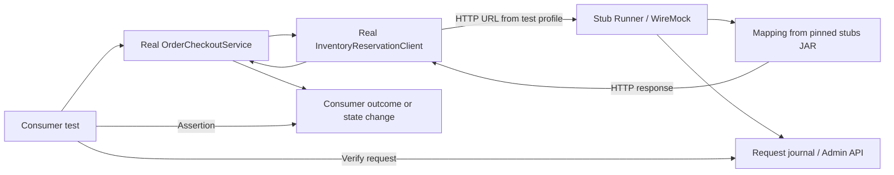
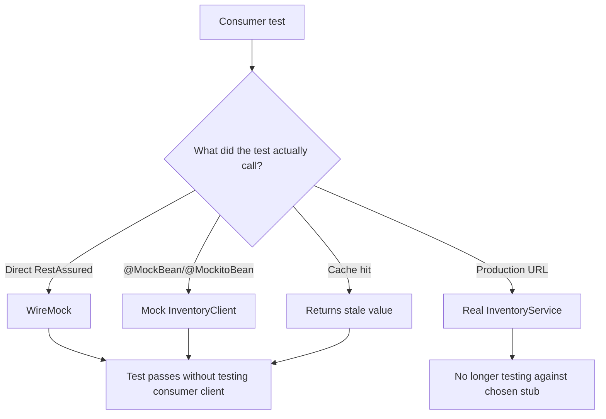
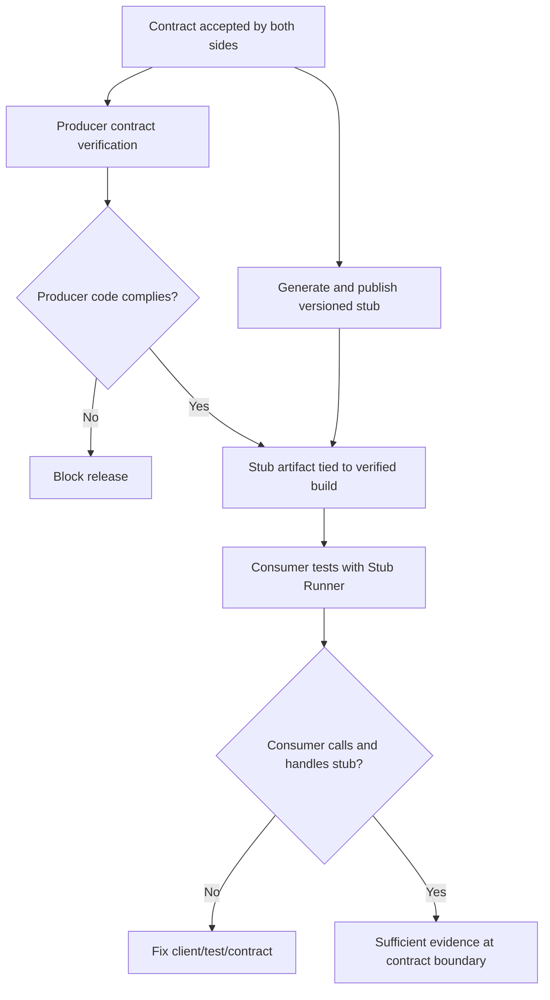
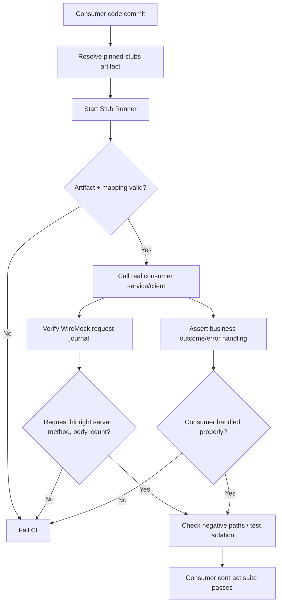

# Confirming Consumer Code Actually Goes Through the Expected Stub

In **Spring Cloud Contract**, producer and consumer agree on HTTP or messaging behavior using the **Groovy/YAML DSL**. From the contracts, the producer generates tests to verify its implementation, while the consumer uses stubs—typically via **Stub Runner** and **WireMock**—to test integration code without running the real producer. Yet an easily overlooked question remains: **does a green test actually execute the consumer code under test and hit the expected published stub?**

Suppose a test starts Stub Runner cleanly and then sends `curl` or RestAssured directly to WireMock and receives `201 Created`. That only proves **the stub served a matching request**; it does not prove `OrderService` used the right `InventoryReservationClient`, sent the right headers/body, parsed the JSON, handled errors, or even made an HTTP call at all. Consumer code might still point to a real URL, return a hardcoded response, be replaced by a mock, or skip the call because of a cache.

This lesson belongs to the **Consumer Testing** chapter of the **SPRING_CLOUD_CONTRACT** module. We will build verification with evidence across **three layers**: (1) tests execute **real consumer code paths**, (2) outgoing requests are recorded by WireMock inside the **right Stub Runner instance**, and (3) responses from the **right artifact/mapping** drive expected consumer behavior. Then we wire these checks into CI to detect incompatible APIs without creating a false sense of security.

After this lesson, you will be able to:

- Recognize common patterns of "test passes without the consumer calling the stub."
- Configure `@AutoConfigureStubRunner` with an explicit stub artifact/version and HTTP base URL.
- Write tests that boot real consumer beans and invoke business operations rather than calling WireMock directly.
- Inspect the **request journal**, call counts, URL, method, headers, body, and active mappings.
- Separate **right server/port** from **right mapping** and **right version**.
- Use negative controls to prove the consumer cannot silently bypass stubs or rely on fake data.
- Avoid pitfalls from caching, fallbacks, mocks, test isolation, async/retries, and multiple Stub Runner instances.
- Combine producer verification and consumer tests in CI with concrete evidence.

## 1. "The Stub Is Running" Does Not Mean "The Consumer Used the Stub"

Suppose `OrderService` needs to reserve stock via `InventoryService`:

```http
POST /api/v1/reservations HTTP/1.1
Content-Type: application/json

{"sku":"SKU-001","quantity":2}
```

An illustrative contract returns:

```http
HTTP/1.1 201 Created
Content-Type: application/json

{"reservationId":"RES-701","status":"HELD"}
```

A naive check:

```bash
curl -i -X POST http://127.0.0.1:8090/api/v1/reservations \
  -H "Content-Type: application/json" \
  -d '{"sku":"SKU-001","quantity":2}'
```

If that returns `201`, we know **some HTTP server** at `8090` served that request. However:

- That server might be a different WireMock instance, not the one started by Stub Runner for the test.
- The response might come from a hand-written mapping or fallback rather than a contract-generated mapping.
- No consumer code was ever invoked; `curl` itself sent the request.
- You do not know whether the consumer serializes `quantity` as a JSON number or string `"2"`.
- You do not know how the consumer handles `404`, `409`, or deserialization errors.

Therefore, **calling the stub directly is only a stub smoke test**—useful, yet no substitute for a **consumer contract test**.

### Three Levels of Evidence

| Level | Evidence | What Remains Unproven |
| --- | --- | --- |
| **A. Stub exists** | Artifact resolves, WireMock starts | Whether the consumer ever calls it |
| **B. Stub receives request** | Request journal records method/path/body from the test | Whether the request came through real consumer components if the test also makes direct calls |
| **C. Consumer processes response** | Test calls real service/client beans, verifies outcomes and side effects; stub records request | Whether the real producer satisfies the contract, if producer verification has not run |

For this lesson, the target is **both B and C together**. Add producer verification to achieve Spring Cloud Contract's two-sided assurance.

## 2. Diagramming the Path to Observe



To confirm this exact path occurred, inspect **both the consumer's output** and **request traces on the stub**. In particular, never have the test itself send the very HTTP request you use as evidence that the consumer sent it.

Examples of **misdirected** paths:



In a sound test, the consumer's HTTP adapter must be the **real bean** (or real class under test); only dependencies outside the integration boundary should use deliberate test doubles.

## 3. Starting from Source Contracts and Verified Stubs

A Groovy DSL contract for producer `InventoryService`:

```groovy
import org.springframework.cloud.contract.spec.Contract

Contract.make {
    name 'create_reservation_for_checkout'
    description 'OrderService requires a reservation ID and HELD status'

    request {
        method 'POST'
        url '/api/v1/reservations'
        headers {
            contentType(applicationJson())
        }
        body([
            sku     : 'SKU-001',
            quantity: 2
        ])
    }

    response {
        status 201
        headers {
            contentType(applicationJson())
        }
        body([
            reservationId: $(consumer('RES-701'),
                             producer(regex('RES-[0-9]+'))),
            status       : 'HELD'
        ])
    }
}
```

With this contract:

- **Producer tests** send the sample request to real producer code and verify `201`, `reservationId` format, and `status = HELD`.
- **Stub responses** return `RES-701` so consumer tests get deterministic data.
- Consumer tests should not assume production **always** returns `RES-701`; it is only a stub sample value.

Contracts can be written in YAML DSL instead of Groovy; the goal of generating producer tests and stubs is the same, though YAML matcher syntax is not identical to Groovy syntax.

### Identifying the Stub Artifact the Consumer Will Use

Assume after producer verification passes, the team publishes:

```text
groupId    = com.example
artifactId = inventory-service
version    = 1.4.2
classifier = stubs
type       = jar
```

The example artifact `inventory-service-1.4.2-stubs.jar` must contain the mapping with the agreed request/response. Having the JAR file alone **does not prove** the producer was verified: the producer pipeline must generate **and run** generated tests before publishing.

In a Maven project configured with Contract Verifier, a standard check step is:

```bash
mvn -B -ntp clean verify
```

The producer team must inspect test reports: ensure there are no `0 tests` or accidental skips. The consumer team must track exact verified artifact coordinates rather than blindly pulling an unpinned `latest`.

## 4. Configuring Stub Runner with an Explicit Version and Port

In a Spring Boot test environment, `@AutoConfigureStubRunner` starts HTTP stubs from the resolved artifact.

Example:

```java
import org.springframework.boot.test.context.SpringBootTest;
import org.springframework.cloud.contract.stubrunner.spring.AutoConfigureStubRunner;
import org.springframework.cloud.contract.stubrunner.spring.StubRunnerProperties;

@SpringBootTest(properties = {
    "inventory.base-url=http://localhost:8090"
})
@AutoConfigureStubRunner(
    ids = "com.example:inventory-service:1.4.2:stubs:8090",
    stubsMode = StubRunnerProperties.StubsMode.LOCAL
)
class CheckoutWithInventoryStubTest {
    // Test body will call consumer beans, not the stub directly.
}
```

**Meaning of each setting:**

| Setting | Effect |
| --- | --- |
| `com.example:inventory-service` | Identifies the producer stub artifact |
| `1.4.2` | Pinned version under test |
| `stubs` | Stub JAR classifier |
| `8090` at end of `ids` | Port Stub Runner uses to serve the HTTP stub |
| `StubsMode.LOCAL` | Resolves artifact from the local Maven repository |
| `inventory.base-url` | URL that **real consumer code** must call during tests |

In CI using a remote artifact repository, select the matching mode/configuration and supply repository URL and credentials per your Spring Cloud Contract version. Never confuse `repositoryRoot` (where the JAR is downloaded from) with the **HTTP base URL** the consumer calls.

### Drawbacks of a Fixed Port

Port `8090` makes the example easy to follow, yet it can collide when tests run in parallel. In real projects, let Stub Runner pick a random port and obtain the address via `StubFinder`, `@StubRunnerPort`, or matching test configuration. When using dynamic ports, ensure the **consumer client is constructed after the stub URL is known** or update the endpoint cleanly within the Spring context lifecycle.

Never switch Stub Runner to a random port while leaving `inventory.base-url=http://localhost:8090`. Otherwise, the consumer will hit an old server or fail to connect.

## 5. Which Consumer Code Needs to Be Tested?

To keep the example concrete, `OrderService` has two classes:

1. `InventoryReservationClient`, responsible for building HTTP requests, sending them, and deserializing responses.
2. `OrderCheckoutService`, which calls the client, checks `HELD`, and decides whether checkout can continue.

Example using Spring Framework 6.1+'s `RestClient` (common in Spring Boot 3.2+). On older versions, use your project's client following the same testing principle.

```java
package com.example.order;

import org.springframework.beans.factory.annotation.Value;
import org.springframework.http.MediaType;
import org.springframework.stereotype.Component;
import org.springframework.web.client.RestClient;

record ReserveRequest(String sku, int quantity) {}

record ReservationResponse(String reservationId, String status) {}

@Component
class InventoryReservationClient {

    private final RestClient http;

    InventoryReservationClient(
            RestClient.Builder builder,
            @Value("${inventory.base-url}") String baseUrl) {
        this.http = builder.baseUrl(baseUrl).build();
    }

    ReservationResponse reserve(String sku, int quantity) {
        return http.post()
            .uri("/api/v1/reservations")
            .contentType(MediaType.APPLICATION_JSON)
            .body(new ReserveRequest(sku, quantity))
            .retrieve()
            .body(ReservationResponse.class);
    }
}
```

Business service class:

```java
package com.example.order;

import org.springframework.stereotype.Service;

@Service
class OrderCheckoutService {

    private final InventoryReservationClient inventoryClient;

    OrderCheckoutService(InventoryReservationClient inventoryClient) {
        this.inventoryClient = inventoryClient;
    }

    ReservationResponse prepareCheckout(String sku, int quantity) {
        ReservationResponse reservation =
            inventoryClient.reserve(sku, quantity);

        if (reservation == null || !"HELD".equals(reservation.status())) {
            throw new IllegalStateException(
                "Cannot continue checkout without a held reservation"
            );
        }
        return reservation;
    }
}
```

This is a minimal example illustrating the **real consumer path**. In a production application, the service might update an order aggregate, emit an event, or call payment; in that case, assert those key effects rather than asserting only the returned DTO.

### Why Not Mock `InventoryReservationClient`?

If a test replaces that client with a Mockito mock and stubs:

```java
// Anti-pattern for this lesson's goal:
when(inventoryReservationClient.reserve("SKU-001", 2))
    .thenReturn(new ReservationResponse("RES-701", "HELD"));
```

then `OrderCheckoutService` can pass even if the consumer's HTTP URL, JSON serialization, headers, and deserialization are completely broken. Mocking fits a **unit test of the business service**, but it **does not** prove the client called Stub Runner/WireMock.

## 6. Integration Test Calling the Real Service and Checking Stub Traces

A JUnit 5 test combines these steps:

- Boot the consumer Spring context and Stub Runner.
- Call `OrderCheckoutService.prepareCheckout(...)`—never call `RestAssured.post(...)` directly.
- Assert the result returned by the service.
- Use WireMock verification to confirm the request **reached the right stub port** with the required method/path/body.

```java
package com.example.order;

import org.junit.jupiter.api.Test;
import org.springframework.beans.factory.annotation.Autowired;
import org.springframework.boot.test.context.SpringBootTest;
import org.springframework.cloud.contract.stubrunner.spring.AutoConfigureStubRunner;
import org.springframework.cloud.contract.stubrunner.spring.StubRunnerProperties;

import static com.github.tomakehurst.wiremock.client.WireMock.*;
import static org.assertj.core.api.Assertions.assertThat;

@SpringBootTest(properties = {
    "inventory.base-url=http://localhost:8090"
})
@AutoConfigureStubRunner(
    ids = "com.example:inventory-service:1.4.2:stubs:8090",
    stubsMode = StubRunnerProperties.StubsMode.LOCAL
)
class CheckoutWithInventoryStubTest {

    @Autowired
    OrderCheckoutService checkoutService;

    @Test
    void shouldCallExpectedStubThroughRealConsumer() {
        WireMock.configureFor("localhost", 8090);
        WireMock.resetAllRequests();

        ReservationResponse reservation =
            checkoutService.prepareCheckout("SKU-001", 2);

        assertThat(reservation.reservationId()).isEqualTo("RES-701");
        assertThat(reservation.status()).isEqualTo("HELD");

        WireMock.verify(1, postRequestedFor(
                urlPathEqualTo("/api/v1/reservations"))
            .withHeader("Content-Type", containing("application/json"))
            .withRequestBody(matchingJsonPath(
                "$.sku", equalTo("SKU-001")))
            .withRequestBody(matchingJsonPath(
                "$.quantity", equalTo("2"))));
    }
}
```

This is an **educational example**; it requires compatible WireMock/Stub Runner, RestClient, and Spring bean dependencies, as well as the `1.4.2` stub JAR in local Maven. Request-verification APIs must match the WireMock version bundled with Stub Runner in your project.

**Why are both assertions needed?**

- `reservation.status()` and `reservation.reservationId()` prove the consumer deserialized and used the sample response through the service path under test.
- `WireMock.verify(1, ...)` proves a request with matching method, path, headers, and body **reached WireMock on port 8090**.
- Ensuring the test **never sends direct HTTP calls itself** makes the request journal check meaningful proof about consumer code.

Note that `WireMock.configureFor(...)` mutates static WireMock client configuration, making it unsuitable when multiple tests run concurrently on different stub ports. With multiple instances, create a WireMock client configured **per instance** or call the Admin API on the exact port, preserving strict test isolation.

### Why Reset the Request Journal Before Calling?

If an earlier test already sent `POST /api/v1/reservations`, the request journal still holds that prior request. An assertion checking "at least one POST happened" would pass even if the current code path sent nothing. Resetting the **request journal** or starting a dedicated stub instance right before the action under test clears stale evidence.

**Do not confuse resetting the request journal with resetting all stub mappings.** Deleting mappings loaded by Stub Runner leaves the consumer without matching responses. Choose the exact reset API for your WireMock version and isolation scope.

## 7. "Right Port" Is Not Enough: It Must Be the Right Artifact and Mapping

Suppose the consumer genuinely calls `localhost:8090` and receives `201`, yet WireMock is serving a hand-written mapping:

```json
{
  "request": {
    "method": "POST",
    "url": "/api/v1/reservations"
  },
  "response": {
    "status": 201,
    "jsonBody": {
      "reservationId": "RES-701",
      "status": "HELD"
    }
  }
}
```

This mapping can produce the expected result **even if `inventory-service:1.4.2:stubs` was never loaded**. Check further:

1. Stub Runner logs confirm the artifact coordinates and **resolved version**.
2. The stubs JAR actually contains the mapping from the expected contract.
3. The WireMock runtime shows that **active mapping**.
4. The mapping is not shadowed or overridden by another manual/fallback mapping.
5. The test request matches the contract-generated criteria, not merely a broad fallback.

You can inspect runtime state via the WireMock Admin API:

```bash
curl http://127.0.0.1:8090/__admin/mappings
curl http://127.0.0.1:8090/__admin/requests
```

These commands inspect a **test-local instance**; use them only when Admin API access is permitted and never expose them publicly. On Windows PowerShell, use `curl.exe` or `Invoke-RestMethod` instead of POSIX shell curl syntax.

An active mapping can include a name, `id`, `request`, `response`, and `priority`. When multiple mappings match, WireMock can pick an unintended mapping based on priority. When investigating, cross-check **active mappings, request journal, and response** instead of concluding from HTTP status alone.

## 8. Pinpointing Exactly Which Mapping Served the Request

A request journal check shows **the request reached WireMock**, yet is not absolute proof of which mapping produced the response. With multiple mappings:

| Mapping | Condition | Response | Priority |
| --- | --- | --- | --- |
| Mapping generated from `create_reservation_for_checkout` | `POST`, `SKU-001`, quantity `2` | `201 HELD` | Per generator |
| Manual fallback | Any `POST /api/v1/reservations` | `201 HELD` | May equal or differ |
| Manual error | `POST` with `SKU-EMPTY` | `409 INSUFFICIENT_STOCK` | Per configuration |

The consumer receiving `201 HELD` on the first row **cannot distinguish the success mapping from the fallback mapping** when both return identical responses. To verify the right mapping:

1. Inspect mappings on the **WireMock instance under test** via `/__admin/mappings`.
2. Locate the expected contract mapping by `name`, URL, body matchers, and metadata/ID if provided by the generator.
3. Inspect the WireMock request journal or serve-event details for the matched stub mapping if your version exposes that field.
4. Send an additional request that fails the success contract to prove a fallback is not masking errors.
5. Remove or narrow duplicate hand-written mappings, especially ones with overly high priority.

**Never rely purely on JSON file ordering.** WireMock selects mappings by matching criteria and `priority`; **lower** priority numbers take precedence. When a broad manual mapping sits at higher priority than the generated mapping, consumer tests can pass on fake responses that differ from producer-verified commitments.

### Different Requests Returning the Same HTTP Status

Suppose the service sends:

```json
{"sku":"SKU-001","quantity":"2"}
```

instead of:

```json
{"sku":"SKU-001","quantity":2}
```

Both bodies look alike, yet one sends `quantity` as a **string** while the other sends a **number**. If an overly broad fallback mapping returns `201` for both, consumer tests can pass despite a schema violation.

Therefore, ensure:

- Request matchers in contracts are strict enough.
- Request verification checks JSONPath/data types appropriately.
- Negative tests cover wrong types or mismatched SKUs.
- Responses come from the **exact contract mapping**, not a default or fallback response.

For wire format, never assert only the string representation of a JSONPath when the consumer must send a JSON number. Inspect the raw request body or use JSON structure/equality matchers as needed.

## 9. Proving the Consumer Does Not Skip HTTP: Negative Control Checks

A good test must be able to **fail deliberately** when the integration path is broken. This validates the test itself, not a change to ship to production.

### Control A: Consumer Must Not Use Hardcoded Responses

Suppose someone accidentally edits `InventoryReservationClient.reserve` to:

```java
// Buggy code: completely bypasses HTTP.
return new ReservationResponse("RES-701", "HELD");
```

If the test only checks `reservation.status() == HELD`, it still passes. However, the check:

```java
WireMock.verify(1, postRequestedFor(
    urlPathEqualTo("/api/v1/reservations")));
```

will fail because the stub received zero requests **within the test's observation window**. This is why the request journal and pre-call journal reset are essential.

### Control B: Simulating a Specific Error Response

In an **independent test with controlled WireMock fixtures**, register a temporary mapping for a test-only SKU:

```java
// Code snippet executed after WireMock.configureFor("localhost", 8090).
WireMock.stubFor(post(urlEqualTo("/api/v1/reservations"))
    .atPriority(1)
    .withRequestBody(matchingJsonPath(
        "$.sku", equalTo("SKU-FAIL")))
    .willReturn(aResponse()
        .withStatus(503)
        .withHeader("Content-Type", "application/json")
        .withBody("{\"code\":\"STUB_SENTINEL_UNAVAILABLE\"}")));
```

When invoked:

```java
// Illustrative snippet; import assertThatThrownBy from AssertJ.
assertThatThrownBy(
    () -> checkoutService.prepareCheckout("SKU-FAIL", 2)
).isInstanceOf(org.springframework.web.client.RestClientResponseException.class);

WireMock.verify(1, postRequestedFor(
    urlPathEqualTo("/api/v1/reservations"))
    .withRequestBody(matchingJsonPath(
        "$.sku", equalTo("SKU-FAIL"))));
```

If consumer code silently returned hardcoded `HELD`, the error-expecting test fails. If the consumer genuinely called the stub, it must handle `503` per design. With the `RestClient.retrieve()` example earlier, `5xx` typically yields `RestClientResponseException` unless a custom error handler is configured.

**Do not treat this as an official contract saying the producer always returns `503` for `SKU-FAIL`.** This is a **consumer-side fault-injection simulation**. Mappings added via runtime APIs persist until reset; use a separate server instance/test setup or remove temporary mappings afterward to avoid affecting other tests.

### Control C: If the Stub Is Unavailable, the Test Must Reflect It

In a controlled environment, point the client to a port with no stub or stop the instance briefly. If the consumer service still reports success when policy forbids fallbacks, it signals:

- Response was cached from a previous call.
- Code has a fallback returning fake data or reporting success.
- Test is calling a mock client.
- Test never actually entered the HTTP branch.
- Exceptions were swallowed and converted into a default result.

Do not shut down a shared Stub Runner used concurrently by other tests. For this kind of check, isolate the test instance or use a dedicated fault mapping to verify the error path cleanly.

### Controls Only Have Meaning When Testing Behavior

"Change the stub and watch the test turn red" is a **sensitivity** check, not a trick to inflate coverage blindly. If the consumer has a valid fallback policy (e.g., returning `PENDING` for retry), the test should assert the **expected fallback** rather than necessarily expecting an exception. The goal is proving that the stub response **genuinely drives the consumer's outcome**.

## 10. Why Consumers Bypass Stubs

| Cause | Symptom | How to Verify and Fix |
| --- | --- | --- |
| Hard-coded URL in code | Test profile points to `8090`, yet client calls production URL | Inject base URL via config; check request journal |
| Misnamed property or overridden by another profile | Stub runs, yet journal is empty | Print/verify resolved property in test (never print secrets) |
| Client bean replaced by `@MockBean` or `@MockitoBean` | Test gets sample response with zero HTTP calls | Remove the mock at the boundary under test |
| Service returns static fixture value | Output test green, request count 0 | Assert call counts and run negative controls |
| Cache still holds result from prior test | No outgoing request this run | Clear cache or use distinct keys per test |
| Feature flag disables call path | Consumer skips branch under test | Set flag per scenario and assert branch |
| Circuit breaker/fallback is open | HTTP skipped, consumer returns fallback | Reset circuit breaker state; test fallback separately |
| Stub port differs from client config | Test hits wrong instance or connection fails | Check Stub Runner port and resolved base URL |
| Multiple Stub Runners for same producer | Requests hit different artifact/version | Pin artifacts/ports; inspect logs and active mappings |
| Client uses service discovery hostname | `inventory-service` resolves to another container/server | Deliberately override discovery/routing in tests |
| HTTP proxy/environment variable | Client routes through unexpected proxy | Isolate proxy settings; check WireMock journal |
| Request already sent during test setup | "At least one request" passes before consumer call | Reset request journal immediately before action |
| Test sends HTTP itself then verifies HTTP | Journal proves the test's call, not the consumer's | Call only consumer code in the main test |

### Checklist Order When the Request Journal Is Empty

1. Confirm Stub Runner resolved the exact coordinates/version.
2. Confirm Stub Runner's port and URL after startup.
3. Inspect the **actual** `inventory.base-url`/client configuration inside the Spring context.
4. Confirm the consumer HTTP client bean is real rather than a mock.
5. Confirm the code branch under test actually calls the client and is not blocked by cache/fallback/feature flags.
6. Confirm the request journal is enabled and reset at the right moment.
7. If still empty, add controlled logging/tracing around the client adapter to verify connection attempts.

Whenever tests could potentially touch real services, use an **isolated test environment** with no outbound route to production. Never "verify a stub" by letting tests accidentally send dummy payloads to a live API.

## 11. Configuring One Consumer with Multiple Producer Stubs

An `OrderService` may call both `InventoryService` and `PricingService`. When two stubs run together, ensure you know **which request goes to which instance**:

```java
@SpringBootTest(properties = {
    "inventory.base-url=http://localhost:8090",
    "pricing.base-url=http://localhost:8091"
})
@AutoConfigureStubRunner(
    ids = {
        "com.example:inventory-service:1.4.2:stubs:8090",
        "com.example:pricing-service:2.1.0:stubs:8091"
    },
    stubsMode = StubRunnerProperties.StubsMode.LOCAL
)
class CheckoutWithTwoStubsTest {
    // Call real OrderCheckoutService; verify requests on each port.
}
```

These two ports are illustrative; avoid collisions when CI runs concurrently. With two stub instances:

- Confirm `InventoryReservationClient` uses URL `8090`.
- Confirm `PricingClient` uses URL `8091`.
- Inspect **both** journals, not just one.
- Never claim `PricingService` was called merely because the test received a price from a mock.
- Pin **both** artifact versions; avoid letting one service float to `latest` while the other is pinned.

If a business flow should not call `PricingService` in a given scenario, the Pricing stub journal **must be empty** after reset. Assert the **absence of unexpected requests** whenever that is an important invariant.

## 12. Retries, Async, and Reactive: "Exactly One Request" Is Not Always Right

The `WireMock.verify(1, ...)` example in Section 6 fits a synchronous, non-retrying call. Real consumers may:

- Retry once on HTTP `503`.
- Send requests asynchronously via `@Async`.
- Use `WebClient` returning a `Mono` without subscribing.
- Enqueue requests for a worker to execute later.
- Call multiple times due to fallbacks or duplicate events.

In those cases, define the **expected call count and verification timing** accurately:

| Pattern | Expected Outcome | Common Pitfall |
| --- | --- | --- |
| Synchronous, no retry | One request; response handled | Verifying count before/after without isolation |
| Retry up to 3 times on transient errors | Multiple requests possible; passes/fails per policy | Hard-coding count = 1 fails valid retries |
| Reactive `Mono` | Request fires upon subscription | Test creates `Mono` without subscribing |
| Async event handler | Request appears after handler runs | Verifying too early causes flakiness |
| Cached response | Zero requests on cache hit | Needs separate cache hit vs. miss tests |

With reactive `WebClient`, if a method only builds:

```java
Mono<ReservationResponse> result =
    webClient.post()
        .uri("/api/v1/reservations")
        .bodyValue(new ReserveRequest("SKU-001", 2))
        .retrieve()
        .bodyToMono(ReservationResponse.class);
```

you cannot assume HTTP was sent yet. Subscribe or use `StepVerifier` to execute the publisher:

```java
StepVerifier.create(result)
    .assertNext(reservation ->
        assertThat(reservation.status()).isEqualTo("HELD"))
    .verifyComplete();
```

Only afterward should you verify the request journal. For async requests, use bounded polling/waits (such as Awaitility if included in the project) or check upon completion signals—**never use fixed `Thread.sleep` to mask race conditions**. Test retry counts separately and avoid mixing journals from other scenarios.

## 13. Message Stubs: "Trigger Succeeded" Does Not Mean the Consumer Received It

Spring Cloud Contract also supports **messaging contracts**, not only HTTP/WireMock. For messaging, Stub Runner can trigger a message by `label` using `StubTrigger`, yet the **WireMock HTTP request journal is not where you verify message delivery**.

Test concept:

```java
@SpringBootTest
@AutoConfigureStubRunner(
    ids = "com.example:inventory-service:1.4.2:stubs",
    stubsMode = StubRunnerProperties.StubsMode.LOCAL
)
class ReservationMessageConsumerTest {

    @Autowired
    StubTrigger stubTrigger;

    @Autowired
    OrderProjection orderProjection;

    @Test
    void shouldConsumeReservationCreatedEvent() {
        assertThat(stubTrigger.trigger("reservation_created")).isTrue();

        // If listener runs async: wait with a bounded timeout,
        // then assert the real state of OrderProjection.
        assertThat(orderProjection.statusOf("ORD-1001"))
            .isEqualTo("HELD");
    }
}
```

This is an **illustrative test fragment**. `OrderProjection` is an application class; imports/dependencies and Integration/Stream/AMQP adapters must match your Spring Cloud Contract version. If the listener executes asynchronously, use a bounded wait before asserting.

What must be proven:

1. Stub Runner found the **right label** in the target artifact version.
2. The message was dispatched to the **right destination/channel/broker adapter**.
3. The consumer's real listener received and processed it.
4. Consumer state/side effects reflect the expected payload.

`StubTrigger.trigger(...) == true` may only prove the trigger mechanism accepted the label. It **does not automatically prove the consumer received or deserialized it**, especially if adapters/transports are misconfigured or handlers run asynchronously. For messaging, observe the corresponding channel/listener/event store instead of trying to infer delivery from WireMock's `/__admin/requests`.

## 14. Do Not Mistake Stub Tests for Producer Verification

A stub-backed `OrderCheckoutService` test can catch:

- Client sending wrong method/URL, wrong headers, or wrong JSON.
- Client failing to decode the response schema.
- Consumer ignoring or mishandling status/error codes.
- Service picking the wrong business branch on received data.

It **does not by itself prove**:

- Real `InventoryService` actually returns `201` matching that contract.
- The producer successfully persists reservations in its database.
- The Kafka/RabbitMQ broker routes events accurately.
- The producer handles concurrent requests, idempotency, or real timeouts.
- Deployed production runs the same producer version that was verified.

Hence **two-sided verification** is required:



Even when both directions pass, workflows spanning beyond contract scope—such as create → confirm → get, transactions, or network faults—still require risk-based integration/E2E tests.

## 15. Test Business Outcomes, Not Just DTOs

In Section 5's example, `prepareCheckout` simply returned `ReservationResponse` if status was `HELD`. That illustrates the client path, yet is insufficient to protect a real checkout workflow.

For instance, the consumer may also need to:

- Attach `reservationId` to the active `Order`.
- Transition `Order` to `AWAITING_PAYMENT` when `status = HELD`.
- Skip creating a payment request when the producer returns `409 INSUFFICIENT_STOCK`.
- Store correlation between `orderId` and `reservationId`.
- Never leak reservation data belonging to another order.

In consumer tests, assert **observable business outcomes** instead of inspecting only a DTO:

```text
Given:
  Order ORD-1001 is in state CREATED
  Stub inventory-service:1.4.2 has successful POST mapping
When:
  Call OrderCheckoutService.startCheckout("ORD-1001", "SKU-001", 2)
Then:
  Exactly 1 POST /api/v1/reservations hits the inventory stub
  Request body has sku and quantity with proper types
  Order ORD-1001 stores reservationId = RES-701
  Order transitions to AWAITING_PAYMENT
  Insufficient-stock error branch is not invoked
```

This is an **illustrative scenario**, not the exact API from the earlier snippet. When testing real consumer repositories via test databases or observable fakes, verify state after the call. If a test only checks `RES-701` while code never persists the ID, payment can still fail downstream.

### Observe Both Boundaries

| Boundary | What to Check | Suitable Tool |
| --- | --- | --- |
| **Outbound from consumer** | HTTP method, URL, headers, JSON body, request count | WireMock request journal / verify |
| **Inbound to consumer** | Deserialization, business state, error codes, retries, or side effects | Assertions on consumer services/repositories/events |

These two assertion groups complement each other. Inspecting only the request journal does not prove code processed the response; inspecting only business state does not prove the result came from the right stub.

## 16. Error Scenarios Must Verify Both the Response **and** the Consumer Branch

Suppose the producer has an error contract when `SKU-EMPTY` lacks stock:

```groovy
import org.springframework.cloud.contract.spec.Contract

Contract.make {
    name 'create_reservation_insufficient_stock'
    description 'OrderService must not proceed to payment when stock is insufficient'

    request {
        method 'POST'
        url '/api/v1/reservations'
        headers {
            contentType(applicationJson())
        }
        body([
            sku     : 'SKU-EMPTY',
            quantity: 2
        ])
    }

    response {
        status 409
        headers {
            contentType(applicationJson())
        }
        body([
            code: 'INSUFFICIENT_STOCK'
        ])
    }
}
```

A thorough consumer test for this error branch needs at least:

1. Calling the **real service** with `SKU-EMPTY`.
2. Stub Runner serving the `409` mapping from the pinned artifact.
3. WireMock journal recording the request with the right SKU and quantity.
4. Consumer mapping `409`/error code per rules: throwing a domain exception, surfacing the error, or setting an out-of-stock state.
5. Consumer **not** proceeding to payment/confirmation or producing unwanted success side effects.

If consumer code catches every HTTP exception and returns `ReservationResponse("RES-701","HELD")`, tests covering only success responses miss the bug. Error branches need dedicated expectations.

### When an Unmatched Request Still Returns `404`

WireMock HTTP servers can return a default `404` when no mapping matches. If a `404` contract is tested solely by asserting status `404`, the test can pass **even when the error mapping was never loaded**.

To avoid false positives:

- Assert the specific error code/body, such as `RESERVATION_NOT_FOUND`.
- Inspect the request journal and the active mapping that served the request.
- Keep the distinction clear between a **WireMock unmatched 404** and a contract **business 404**.
- Never treat any `404` as proof that the producer defines a matching error contract.

Some WireMock versions provide unmatched-request and near-miss diagnostics for debugging; use those APIs when a request matches the path yet misses headers or body constraints.

## 17. Counter-Checks Using Sentinel Mappings Without Polluting Release Artifacts

One way to increase test confidence is a **sentinel value that exists only in a stub** in an isolated scenario:

```json
{
  "name": "consumer-only-sentinel",
  "priority": 1,
  "request": {
    "method": "POST",
    "url": "/api/v1/reservations",
    "bodyPatterns": [
      { "matchesJsonPath": "$[?(@.sku == 'SKU-SENTINEL')]" }
    ]
  },
  "response": {
    "status": 201,
    "headers": {
      "Content-Type": "application/json"
    },
    "jsonBody": {
      "reservationId": "RES-TEST-ONLY",
      "status": "HELD"
    }
  }
}
```

**Purpose:** a dedicated consumer test calls with `SKU-SENTINEL` and verifies `RES-TEST-ONLY` flows through the adapter into the business layer. If the response still comes back as `RES-701` from a cache or mock, the test fails.

**Important limitations:**

- This is a **hand-written mapping to verify routing**, not a commitment that the real producer returns `RES-TEST-ONLY`.
- Register it at test runtime or on a separate fake server; never slip sentinel mappings into release stub artifacts if they alter the official interface.
- If contract-generated mappings have broad request matchers, watch for overlap and `priority`; never use overrides to mask bugs in main consumer contract tests.
- Delete/reset runtime-only mappings after the test or use isolated server instances so other tests are unaffected.
- A sentinel response only proves execution flowed through the **runtime that loaded the sentinel mapping**; it does not replace testing the producer's release artifact.

For complete assurance, maintain **tests running the verified producer stub artifact** alongside **isolated fault/sentinel tests** proving consumer path sensitivity.

## 18. Managing Resolved URLs, Ports, and Actual Versions

Using a fixed port like `8090` keeps tests simple yet invites collisions. In multi-job or multi-developer environments, Stub Runner can allocate dynamic ports; the consumer must learn the **actual address** before creating its client.

Common approaches depending on version:

- Retrieve the stub address via `StubFinder` or inject the port via `@StubRunnerPort`.
- Configure the test service URL from that value before initializing HTTP client beans.
- Use a test configuration with lazy URL resolution if the client looks up endpoints on call.
- Reserve a fixed port **only inside an isolated job/test instance** when readability is prioritized.

What to log/verify in CI:

| Value | What You Need to Know |
| --- | --- |
| Stub artifact coordinates | `groupId:artifactId:version:stubs` |
| Stub Runner mode | LOCAL/REMOTE/classpath per test |
| Resolved artifact version | Exact pinned version, no accidental snapshot/latest |
| HTTP port/URL | Matches the endpoint used by the real consumer client |
| Contract/mapping name | Expected behavior mapping is loaded |
| Test request count | Reflects code branch and retry policy |
| Consumer result | Matching service state/response/error |

Never log tokens, secrets, or real user data while verifying URLs. For WireMock request journals, limit or sanitize test payloads, especially when tests send `Authorization` headers.

### Version Pinning and Caching

Consumer tests using `inventory-service:1.4.2:stubs` are far more reliable than `+` in a reproducible release gate. However, if a release repository allows artifact overwrites, **the same version string can still change contents**. A sound release process should:

1. Pin producer/stub versions.
2. Record the producer commit and contract revision used to build the artifact.
3. Verify/checksum resolved artifacts when traceability is required.
4. Never overwrite published release artifacts.
5. Ensure producer build tests pass before publishing stubs.

For SNAPSHOTs, record metadata and resolved timestamps if the organization needs exact reproducibility of past CI runs.

## 19. CI: Proving Tests Do More Than Start Stub Runner

A consumer pipeline typically runs these stages:



In a Maven project already wired with Stub Runner and a test runner, the common verification command is:

```bash
mvn -B -ntp clean verify
```

**The command itself does not perform the assertions in the diagram.** Those assertions must be implemented in tests authored by your team and enforced by CI configuration; a green build with 0 tests or skipped tests is a process failure.

Example GitHub Actions workflow for the consumer:

```yaml
name: Verify consumer against pinned stubs

on:
  pull_request:
  push:
    branches: [main]

jobs:
  verify-consumer:
    runs-on: ubuntu-latest
    steps:
      - uses: actions/checkout@v4
      - uses: actions/setup-java@v4
        with:
          distribution: temurin
          java-version: '21'
          cache: maven

      - name: Execute consumer integration tests
        run: mvn -B -ntp clean verify

      - name: Upload JUnit reports
        if: always()
        uses: actions/upload-artifact@v4
        with:
          name: consumer-test-reports
          path: target/surefire-reports/
```

This illustrative workflow assumes Maven tests, Java 21 compatible with your project, and Stub Runner configuration present in test sources. In multi-module projects, set the right working directory and also collect Failsafe reports if integration tests run during `verify` via Failsafe.

To serve as a **trustworthy CI gate**, also verify:

- The suite has **tests actually executing**, not excluded or skipped.
- Stub Runner resolves the **exact artifact version**, rather than a stray artifact sitting in a CI runner's local cache.
- The consumer **calls real services/clients** without mocking the HTTP/messaging boundary under test.
- Request journals are reset/queried on the exact port.
- Assertions on both requests and business responses pass.
- Negative branches, invalid requests, and retries are tested per consumer needs.
- Jobs do not depend on production services or unexpected external networks.

### Consumer CI and Producer CI Must Coordinate

| Pipeline | What It Must Prove | Outcome |
| --- | --- | --- |
| **Producer CI** | Source contracts generate tests; real producer complies; stubs tied to verified build | Publishes trustworthy stub version |
| **Consumer CI** | Real consumer code calls exact stub version and handles agreed responses | Catches client/integration logic regressions |
| **Deployment smoke/integration** | Live deployed producer is compatible with target consumer | Catches out-of-contract version/config/runtime mismatches |

A green consumer test against an old stub **does not prove** compatibility with a newer producer version. Bump stubs intentionally or run compatibility jobs when producers publish new versions.

## 20. When Should You Add Tests Against the Real Producer?

Stub Runner is great because consumers do not have to boot the producer's database or broker. Yet for multi-step business workflows, static mappings may fail to model state transitions.

For example:

```text
POST /reservations -> 201 HELD, reservationId=RES-701
POST /reservations/RES-701/confirm -> 200 CONFIRMED
GET /reservations/RES-701 -> 200 CONFIRMED
```

If three independent mappings each return their sample, consumer tests can pass even if the real producer fails to update state on confirm. Therefore:

- Keep consumer tests to protect how the client invokes and handles each individual response.
- Write multi-step producer integration tests passing the real ID from create to confirm and get.
- Use WireMock Scenarios or stateful fakes when **consumer logic** depends on sequences, resetting state between tests.
- Test transactions, authorization, idempotency, timeouts, and broker delivery with dedicated tests.

**Never add a hand-written mapping to "patch" a real producer that violates its contract.** If an endpoint is an official commitment, update the source contracts and producer verification.

## 21. Diagnostic Table for False-Green or Confusing Failures

| Symptom | Possible Cause | Verification Step |
| --- | --- | --- |
| Test passes even with no HTTP code in client | Test calls stub directly or uses hardcoded response | Call real service; verify request journal after reset |
| Stub Runner starts, yet request count = 0 | Wrong URL, mocked client, cache, feature flag, fallback | Inspect real bean, resolved URL, call branch |
| Right HTTP response, yet mapping is not from artifact | Fallback/manual mapping shadows generated mapping | Check `/__admin/mappings`, matched mapping, priority |
| Test gets expected `404` without a 404 contract | WireMock unmatched requests also return 404 | Assert specific error code/body |
| Passes first time, fails next time | Journal/state/cache not reset | Isolate servers; reset request journal/scenarios |
| Request count exceeds 1 | Retries, double invocation, or leftover request from prior test | Check retry policy and journal reset |
| Request count = 0 with WebClient | Publisher never subscribed | Use StepVerifier/subscribe |
| Fails in parallel runs | Fixed port occupied; static WireMock client port collision | Use isolated instances/ports and per-instance clients |
| Passes locally, CI missing stub | Artifact not installed in CI local repo | Publish/fetch exact version; check mode/repository |
| Consumer calls production API | Base URL overridden by profile/env | Block outbound calls in test env; check config |
| Status passes, yet JSON deserializer is broken | Only HTTP smoke test ran, bypassing real client | Call real consumer client/service and check DTO |
| Consumer returns stale data despite stub change | Cache/fallback/hardcoding | Clear cache or run dedicated sentinel test |
| Right stub version, different content | Release overwritten; stale cache | Compare SHA/manifest and resolved coordinates |
| Message trigger succeeds, yet listener never runs | Wrong channel/broker adapter; async timing | Check destination and consumer state/side effects |
| Build green, yet integration tests skipped | Misconfigured Surefire/Failsafe/Gradle | Check test reports, skip counts, and discovery |
| Consumer mishandles `409` | Missing error contract/test; overly broad catch-all | Add test calling real service and asserting error branch |

## 22. Checklist to Confirm Consumer Code Actually Goes Through the Stub

- [ ] Producer Groovy/YAML contracts accurately describe the requests/responses the consumer needs.
- [ ] Producer verification generated and ran tests successfully before publishing stubs.
- [ ] Stub JAR has explicit coordinates/version traceable to a producer build.
- [ ] Stub Runner resolves the exact artifact and starts required HTTP runtime/adapters.
- [ ] The **real consumer bean's** URL points to the exact Stub Runner instance and port.
- [ ] Tests invoke the **consumer service/client**, not merely RestAssured/curl directly against the stub.
- [ ] The HTTP/messaging client boundary under test is not mocked.
- [ ] Caches, feature flags, fallbacks, and circuit breakers do not silently skip the request.
- [ ] Request journal is reset or test instances are isolated before the measured action.
- [ ] Assertions cover method, path, headers, JSON body, and expected call counts.
- [ ] Assertions verify deserialization, business state, error handling, or consumer side effects.
- [ ] **Active mappings** are inspected to rule out fallback/manual mapping shadowing.
- [ ] Negative controls prove tests fail when requests/responses diverge from contracts.
- [ ] For async/retries, bounded waits and exact expected request counts are asserted.
- [ ] For messaging, listener/side effects are verified after `StubTrigger`, not just `trigger == true`.
- [ ] Tests never reach production systems unexpectedly and never leak secrets into journals.
- [ ] CI records executed test counts and resolved stub coordinates/version.
- [ ] Consumer tests against the stub version matching the producer to be deployed, not an arbitrary `latest`.

### Hands-On Exercise

You are building `OrderService`, which calls `InventoryService` via `POST /api/v1/reservations`. The producer published `com.example:inventory-service:1.4.2:stubs`; the success contract accepts `SKU-001`, quantity `2`, and returns `201` with `reservationId=RES-701`, `status=HELD`.

Complete the following:

1. Diagram the path from `OrderCheckoutService` → `InventoryReservationClient` → Stub Runner/WireMock → consumer response handling.
2. Write a Groovy/YAML contract for the success request and a `409 INSUFFICIENT_STOCK` error contract.
3. Configure `@AutoConfigureStubRunner` with a **pinned version** on port 8090 in an isolated test; bind `inventory.base-url` on the consumer bean.
4. Write a test calling `OrderCheckoutService.prepareCheckout("SKU-001", 2)` instead of calling RestAssured directly.
5. Assert the deserialized response; use the WireMock request journal to verify `POST`, URL, JSON body, and count.
6. Temporarily edit `InventoryReservationClient.reserve` to return hardcoded `RES-701/HELD` without HTTP. Demonstrate that business assertions might pass while request verification fails.
7. Temporarily make the client send `quantity` as a JSON string. Confirm the test catches the wire-format error instead of being masked by a fallback mapping.
8. Add a test for `SKU-EMPTY` returning `409`; confirm the consumer **does not** proceed to payment.
9. Add a fault mapping returning `503` for `SKU-FAIL`, prove the consumer handles the error branch properly, then clean/reset the mapping.
10. Switch Stub Runner to a dynamic port or add a `PricingService` stub; confirm each client uses its own instance URL.
11. If using WebClient, verify the publisher is subscribed to; if retrying, assert request counts per policy rather than assuming one.
12. Simulate a test calling the stub directly and asserting `201`. Explain why that is only a stub smoke test.
13. Inspect the artifact JAR and runtime mappings to prove tests used mappings generated from the **right producer version**, not a manual fallback.
14. Integrate the tests into CI, verifying executed test counts, stub artifact version, isolation, and publish/deploy gates.

**Completion criteria:** you prove simultaneously that **real consumer code ran**, **the right HTTP request/message reached the right stub version/destination**, and **the consumer genuinely processed the response/event**. Without any one of these pieces of evidence, a green result is not enough to claim the consumer was tested through the expected stub.

## References

- [Spring Cloud Contract — Reference](https://docs.spring.io/spring-cloud-contract/reference/): Contract Verifier, producer verification, Stub Runner, and integration.
- [Spring Cloud Contract — HTTP Contracts](https://docs.spring.io/spring-cloud-contract/reference/project-features-contract/http.html): HTTP DSL definitions and request/response matchers.
- [WireMock — Verifying Requests](https://wiremock.org/docs/verifying/): request journal and verifying received request counts.
- [WireMock — Request Matching](https://wiremock.org/docs/request-matching/): URL, header, JSON body, and request matching rules.
- [WireMock — Stubbing](https://wiremock.org/docs/stubbing/): mapping priority, responses, and admin API.
- [Spring Framework — REST Clients](https://docs.spring.io/spring-framework/reference/integration/rest-clients.html): `RestClient`/`WebClient` and HTTP client strategies.
- [Project Reactor — Testing](https://projectreactor.io/docs/core/release/reference/testing.html): `StepVerifier` for testing reactive publishers.
