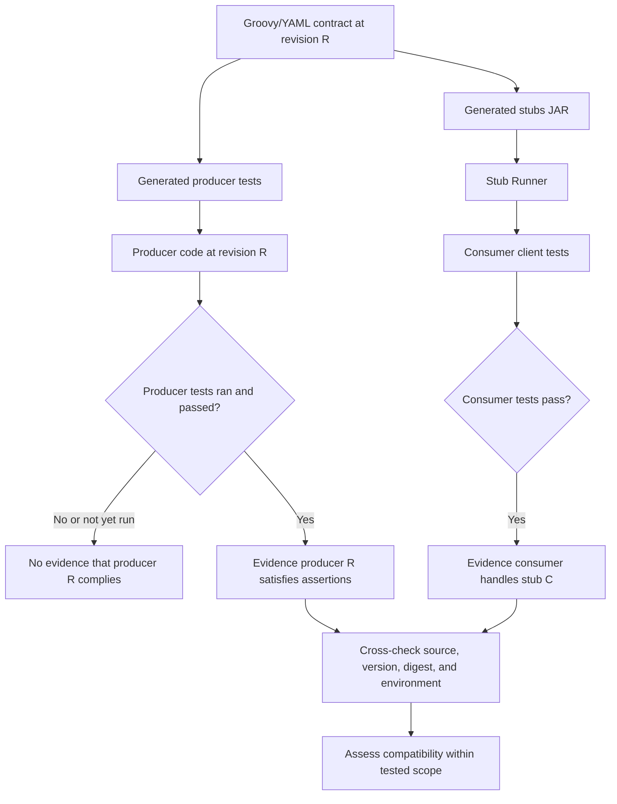
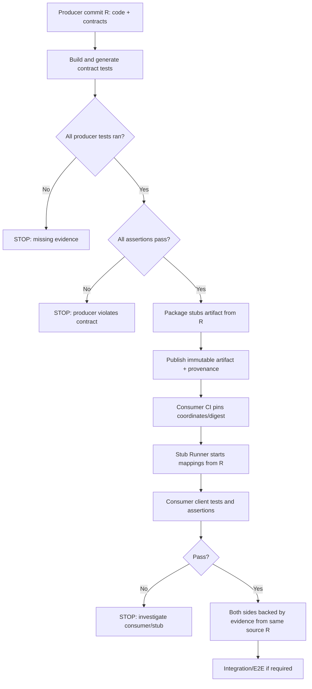
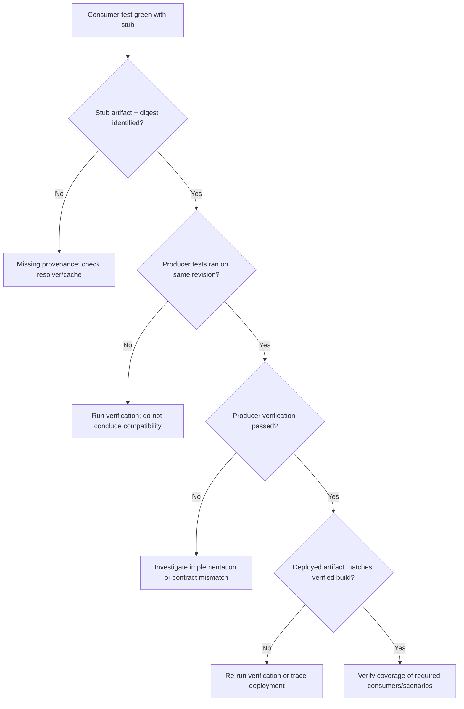

# Scope Limits When Producer Tests Have Not Run on the Same Version

## 1. A Green Consumer Test Does Not Prove the Current Producer Is Compatible

In **Spring Cloud Contract**, producer and consumer use **Groovy/YAML DSL** contracts to agree on HTTP or messaging behavior. From the contracts, **Contract Verifier** can generate tests that verify the **real producer**; the same source also builds **stubs** for consumers to run via **Stub Runner**. Integrating both sides into CI helps detect incompatible API changes before deployment.

Consider a familiar scenario:

- `checkout-service` calls `order-service` to retrieve an order's status.
- Consumer integration tests use Stub Runner to load `order-service:1.4.0:stubs`.
- The stub returns JSON with `orderId` and `status`; the consumer handles it properly and all tests pass.
- On a new development branch, `order-service` renames `status` to `state`, yet **producer verification has not run against the new code**.

In that case, **the green consumer test is real, yet its scope of evidence is narrow**: it proves the consumer handles a sample HTTP message from the **loaded stub**, not that the new producer version emits that content.

> **Core principle:** To claim "producer version X satisfies contract C," you need evidence that **producer tests generated from C actually ran and passed against exact code/artifact X**, within the documented test environment. A consumer test using C's stub is separate evidence—complementary, not a replacement.

This lesson teaches how to identify evidence levels, trace links across contract → stub → producer commit → artifact version → consumer test, and build CI quality gates so `BUILD SUCCESS` is never mistaken for verified compatibility.

## 2. Two Different Questions Require Two Testing Layers

| Question | Who Answers It Reliably? | Test That Must Execute |
| --- | --- | --- |
| Does the consumer send the right method, path, query, headers, and body? | **Consumer test** with strict stub matchers | Consumer's real HTTP client → Stub Runner/WireMock |
| Does the consumer parse JSON and handle errors properly? | **Consumer test** | Stub returns success and error scenarios; assert client logic |
| Does the producer return the contracted status/headers/body? | **Producer verification** | Generated contract test → real producer implementation |
| Does the producer emit the right message destination/headers/payload? | **Producer messaging verification** | Trigger/input → message test adapter → real producer output |
| Were contracts and stubs generated from the same source? | **Build/publish provenance** | Verify source revision, test report, stubs artifact |
| Does the deployed production producer match what was tested? | **Release/deployment traceability** | Match artifact digest, image tag, deployment record |
| Are DB transactions, broker delivery, or idempotency correct? | **Integration/E2E tests** | Run real dependencies matching business scope |

Consumer tests are not "fake tests": they are vital for request construction, deserialization, and client error handling. Yet **simulation is not producer execution**. A WireMock response only shows what the *loaded mapping* returns, even if the real producer changed completely.



To conclude compatibility, connect both branches through a **traceable contract source and version**, rather than just observing two green checkmarks on unrelated pipelines.

## 3. What Does "Same Version" Mean?

The word "version" in a project can refer to several distinct things:

| Term | Example | Role |
| --- | --- | --- |
| **Contract revision** | Git commit `c7e90d1` | Exact DSL content serving as the promise |
| **Producer source revision** | Git commit `c7e90d1` | Producer code exercised by verification tests |
| **Producer artifact version** | `1.5.0` | Built JAR/image version |
| **Stubs artifact coordinates** | `com.example:order-service:1.5.0:stubs` | Stub downloaded by consumer CI |
| **Artifact digest** | SHA-256 of JAR/image | Distinguishes two byte payloads even with the same version/tag |
| **Spring Cloud Contract version** | E.g., tool version 4.x | Version of plugin/DSL/test generator, not API version |
| **Deployed version** | Currently running image digest | Actual code running post-deployment |

**Matching version strings alone do not prove identical bytes.** A snapshot can be rebuilt/republished; even a misconfigured release repository can allow overwriting artifacts. Conversely, two different version names might share a schema while lacking proof that the corresponding implementation passed.

For a trustworthy conclusion, maintain an **immutable link** connecting contract source, producer source/build revision, test reports, stubs JAR, and deployed artifact. Git commits, build IDs, digests, and non-overwriting repository policies establish that link.

### Cases Commonly Mislabeled as "Same Version"

1. Consumer pulls `1.5.0:stubs`, yet producer deployment is `1.6.0`.
2. Producer tests passed at commit A; a developer edits the controller at commit B and only re-runs consumer tests against A's stub.
3. CI uses `1.5.0-SNAPSHOT`, and consumer and producer pull artifacts at different times.
4. Both pipelines print `1.5.0`, yet one reads an older cached artifact.
5. The plugin builds stubs from a new contract revision while producer verification runs against different contracts or code due to misconfigured source roots, caches, or filters.

Do not try to resolve this by comparing version strings in logs while ignoring build history. Know **which tests ran against which exact bytes**.

## 4. Running Example: Old Stub Stays Green When Producer Renames a Field

Contract for `order-service` v1:

```http
GET /api/orders/42 HTTP/1.1
Accept: application/json
```

Committed response:

```json
{
  "orderId": "ord-42",
  "status": "CONFIRMED"
}
```

Consumer `checkout-service` deserializes into a DTO with field `status`. Assume producer `1.4.0` genuinely passed verification and published `1.4.0:stubs`. When the consumer runs tests against this stub, passing results accurately reflect **1.4.0's simulated interface**.

Later, a developer modifies the producer to return:

```json
{
  "orderId": "ord-42",
  "state": "CONFIRMED"
}
```

If the new producer has not run tests generated from the original contract, consumer tests using `1.4.0:stubs` **still receive `status`**. They cannot detect `state` in the new code because they never call the new code.

| Observation | What Can Be Concluded | What **Cannot** Be Concluded |
| --- | --- | --- |
| Consumer + stub `1.4.0` passes | Client handles 1.4.0 stub for tested scenarios | Producer 1.5.0 still returns `status` |
| Producer 1.5.0 build passes with no contract tests | Build compiles/passes other tests | Contract compatibility was preserved |
| Producer 1.5.0 generated test from old contract fails | Implementation diverged from promise | Consumer should immediately change its DTO |
| Producer 1.5.0 verification passes with matching contract | Producer meets assertions in test environment | All production DB/broker behavior is valid |
| Consumer 1.5.0 uses stubs from same verified revision and passes | Two-sided complementary interface evidence exists | Every scenario outside contracts is protected |

**Compatible fix:** if consumers still rely on `status`, the producer should keep `status` or provide an agreed transition window. Never edit the contract to `state` merely to turn producer CI green while ignoring live consumers.

## 5. Three Distinct Types of "Green"

| Green Signal | Actual Scope |
| --- | --- |
| **Consumer CI green with stub** | Consumer logic handles the described sample requests/responses or messages |
| **Producer unit/build green** | Only whichever tests/tasks ran in that pipeline—possibly zero contract tests |
| **Generated producer verification green** | Producer running in test setup satisfies assertions for generated and executed contracts |

If a pipeline lacks **same-revision contract/stub traceability**, placing the first two green signals side by side still does not prove producer–consumer compatibility. If generated producer tests were never discovered or were skipped, even the third green signal can be false.

### How to Report Missing Producer Verification

State: "Consumer version A passed against stubs artifact B for scenarios C." Never state: "Producer version X is definitely compatible" without evidence that X passed verification against the matching contracts.

For a release gate requiring producer verification, the right status is **insufficient evidence / release gate not met**, rather than automatically claiming **the producer is broken**. Missing tests are not proof of behavioral failure; they are a **verification gap** that must be closed.

## 6. Shared Contract: Single Source for Producer Tests and Consumer Stubs

Suppose `order-service` stores a contract at:

```text
src/test/resources/contracts/orders/get-confirmed-order.groovy
```

Groovy DSL content:

```groovy
import org.springframework.cloud.contract.spec.Contract

Contract.make {
    description 'Looks up a confirmed order'

    request {
        method GET()
        url '/api/orders/42'
        headers {
            accept(applicationJson())
        }
    }

    response {
        status OK()
        headers {
            contentType(applicationJson())
        }
        body([
            orderId: 'ord-42',
            status : 'CONFIRMED'
        ])
    }
}
```

This contract describes **one deterministic scenario**: GET on the exact path, HTTP 200, and a body with two fields the consumer relies on. It **does not** prove the producer supports every `orderId`, every order status, or every error case. If the consumer also uses 404 or `CANCELLED`, add corresponding contracts/tests.

A YAML version with the same meaning:

```yaml
description: Looks up a confirmed order
request:
  method: GET
  url: /api/orders/42
  headers:
    Accept: application/json
response:
  status: 200
  headers:
    Content-Type: application/json
  body:
    orderId: "ord-42"
    status: "CONFIRMED"
```

**Groovy and YAML are two alternative formats**; do not place both files describing the same scenario in a scanned source root without a specific reason. Either way, use the **exact contract source** to generate producer tests and stubs; never maintain a separate manual JSON mock file and treat it as evidence for the same contract.

### Both Generated Outputs Must Be Cross-Checked

```text
Source contract C at revision R
       |
       +--> Generated producer test T(C,R)
       |      -> calls producer at revision R
       |      -> asserts HTTP 200 / status=CONFIRMED
       |
       +--> Stubs artifact S(C,R)
              -> mapping GET /api/orders/42
              -> returns sample JSON with status=CONFIRMED
```

Do not match only by **contract name**; ensure tests and stubs come from the **same revision and build configuration**. A `.groovy` file existing on disk does not guarantee the plugin scanned the right directory or that generated producer tests ran.

## 7. Producer Verification: Generating Tests Differs from Running Tests

An easily overlooked bug is generating tests that **never compile or execute**:

```text
Contract source exists                 YES
Generated source file exists          YES
Generated test class compiled         NO
Generated tests executed              0
Producer verification result          NOT VERIFIED
```

`BUILD SUCCESS` in that situation may simply reflect other tasks. Whenever a producer must be verified before publishing stubs, **0 contract tests** must never count as passing.

### Checking Every Gate

| Gate | Question | Required Evidence |
| --- | --- | --- |
| **Discover** | Did the plugin find the contract files? | Source root, include/exclude config, contract discovery logs |
| **Parse** | Is Groovy/YAML valid? | Zero DSL/parser errors; schema matches version |
| **Generate** | Were tests actually generated? | Generated source contains scenarios to protect |
| **Compile** | Did generated tests and base class compile? | Zero classpath, package, or JUnit errors |
| **Execute** | Did tests actually call the real producer? | Test report shows executed methods, not skipped |
| **Assert** | Were expected/actual compared properly? | Verifies status, headers, body, and DSL matchers |
| **Publish** | Was the artifact produced after the gates above passed? | Stubs JAR from same revision, build ID/digest |

For a Maven producer configured with the Contract Verifier plugin and test base class:

```bash
./mvnw -B clean verify
```

With Gradle, check which tasks your plugin version registers:

```bash
./gradlew tasks --all
./gradlew clean check
```

**Never assume** every setup binds generated contract tests to `verify` or `check`. Open the test reports and task/goal logs to verify **executed** test counts. Per this lesson's guidelines, these commands are illustrative examples for learners, **not commands executed on the current workspace**.

### Test Base Classes Can Narrow Evidence More Than Expected

Generated producer tests typically rely on a base class to spin up controllers/servers, fixtures, mocked dependencies, and test auth. If the base class returns canned responses directly without calling the real resource/controller, tests can pass even when real code is broken. If services below the controller are mocked, tests may verify the controller's HTTP layer while **not** verifying DB queries, transactions, or event publishing.

Document explicitly: in **which test scope** producer tests run, whether requests pass through the target implementation layers, and which dependencies are mocked.

## 8. Consumer Uses the Right Stub, Yet Sees Only Simulated Data

Once the producer has published its artifact, a Spring Boot consumer can use `@AutoConfigureStubRunner`:

```java
import org.junit.jupiter.api.Test;
import org.springframework.beans.factory.annotation.Autowired;
import org.springframework.boot.test.context.SpringBootTest;
import org.springframework.cloud.contract.stubrunner.StubRunnerProperties;
import org.springframework.cloud.contract.stubrunner.spring.AutoConfigureStubRunner;

import static org.assertj.core.api.Assertions.assertThat;

@SpringBootTest(properties =
    "clients.orders.base-url=http://localhost:9090")
@AutoConfigureStubRunner(
    ids = "com.example:order-service:1.5.0:stubs:9090",
    stubsMode = StubRunnerProperties.StubsMode.LOCAL
)
class OrdersConsumerContractTest {

    @Autowired
    OrdersClient ordersClient;

    @Test
    void readsConfirmedOrderFromStub() {
        OrderDto order = ordersClient.findById("42");
        assertThat(order.orderId()).isEqualTo("ord-42");
        assertThat(order.status()).isEqualTo("CONFIRMED");
    }
}
```

`OrdersClient` and `OrderDto` are **illustrative application types**; the code compiles and runs only once the client bean, DTO, dependencies, and URL property exist. `clients.orders.base-url` is likewise a **consumer application** property, not defined by Spring Cloud Contract.

What the test must guarantee: `ordersClient.findById("42")` **genuinely sends HTTP to WireMock on port 9090**; WireMock loads mappings from the right stubs artifact; the consumer parses the response and asserts outcomes. If the client still calls `http://order-service:8080` due to another profile, the test fails to test what it claims.

**Limitation remains:** WireMock's response is not generated by running producer code. A stub can return `status = CONFIRMED` even when current producer code has already switched to `state`.

### "LOCAL" Does Not Mean "Same Revision"

`LOCAL` resolves artifacts from the local Maven repository. A `1.5.0:stubs` installed yesterday may differ from the producer revision a developer checked out today. Running consumer tests repeatedly without rebuilding/installing the artifact produces **consistent yet stale** results.

`REMOTE` does not automatically prove the right revision either: pin coordinates, verify publication, permissions, and build metadata. `CLASSPATH` can carry outdated stub fixtures if not updated from source contracts. **Where stubs are loaded from never replaces source traceability and producer verification.**

## 9. Evidence Matrix by Verification Status

| Producer Tests for Revision Under Review | Consumer Test with Same-Revision Stubs | Sound Assessment |
| --- | --- | --- |
| **Not run** | Pass | Consumer compatible with stub; **producer unverified** |
| **0 tests due to misconfiguration** | Pass | Missing coverage gate; fix build/test gate |
| **Fail** | Pass | Producer currently violates at least one promise; consumer pass does not override failure |
| **Pass** | Not run | Producer satisfies tested contracts; consumer untested against stub |
| **Pass** | Pass | Both sides have evidence for verified contracts and revision |
| **Pass at older revision** | Pass with older stub | Valid for older revision only; new revision unverified |
| **Pass at different revision or unknown build artifact** | Pass | No trustworthy provenance link between the two results |
| **Pass with base class mocking wrong layer** | Pass | Review what producer scope was actually verified |

Across all rows, **"Pass/Pass" still does not mean every endpoint or business state is guaranteed**. It protects the defined scenarios and assertions within the executed test environments.

### How to Record Incomplete Evidence

A release report should separate:

```text
Consumer compatibility (with published stubs): PASS
Producer contract verification (same revision): NOT RUN
Provenance link between stub and producer revision: UNKNOWN
Release evidence status: INCOMPLETE
```

This is a **reporting template** for learners to adopt, not official Spring Cloud Contract output. That clarity beats a generic green checkmark that hides which parts were actually tested.

## 10. Sources of False Positives When Trusting Consumer Tests Alone

A **false positive** here does not necessarily mean the test framework lied. The test may satisfy its own assertions while **readers overgeneralize its conclusion**.

### 10.1. Stale Stubs JAR in Local Maven

A developer previously ran `./mvnw install` for `order-service:1.4.0:stubs`, then switched producer branches and changed the controller while keeping `version` unchanged. `LOCAL` consumer tests keep picking up the stale JAR in the local repository if not reinstalled.

**Symptom:** Consumer tests pass after the producer changed HTTP responses. **Fix:** verify the loaded artifact, build ID/commit/digest, and version. Never rely solely on file timestamps. Use immutable versions for release-evidence builds, or strictly manage snapshots.

### 10.2. Hand-Written Stubs Drifted from Contracts

The consumer has a manual WireMock mapping:

```json
{
  "request": {
    "method": "GET",
    "urlPath": "/api/orders/42"
  },
  "response": {
    "status": 200,
    "jsonBody": {
      "orderId": "ord-42",
      "status": "CONFIRMED"
    }
  }
}
```

This mapping is a valid fixture for **isolated consumer tests**, yet without generation or cross-checking against producer-verified contracts, it **cannot prove the producer ever promised** that response. When the producer switches to `state`, the hand-written fixture keeps `status` indefinitely.

**Fix:** use stubs published from verified contract sources; if manual mappings exist for special test cases, label them clearly as *test fixtures*, not producer-verified stubs.

### 10.3. Consumer Never Actually Calls Stub Runner

`@AutoConfigureStubRunner` may start WireMock while the HTTP client still targets another environment due to profiles, Feign properties, discovery clients, or un-overridden base URLs.

**Fix:** inspect actual target URLs in request logs/HTTP interceptors, allocated WireMock ports, and mappings receiving traffic. A test mocking the service directly instead of running the deployed HTTP client also carries a different scope of evidence.

### 10.4. Unmatched-Mapping 404 Mistaken for a Business Error

If a consumer test only expects HTTP `404`, a wrong-path request receives WireMock's default 404 and passes. Nothing proves the real producer returns `ORDER_NOT_FOUND`.

**Fix:** assert status **and** `Content-Type` and key error codes/bodies; check the request journal to confirm the business mapping matched.

### 10.5. Overly Broad Stub Matchers

A mapping matching only `GET /api/orders` accepts requests missing `?status=CONFIRMED`. Consumer tests pass even when the client omits a filter required by the real producer.

**Fix:** compare generated stub request matchers against source contracts. If contracts require methods, URLs, queries, headers, or bodies, verify they appear in mappings or add supplementary checks.

### 10.6. Producer Tests Generated But Never Executed

A pipeline may generate classes in `target/` or `build/` without running them in JUnit. Reviewers see generated sources and assume contracts were verified.

**Fix:** gate on **execution reports**: total contract tests, failures/skips, and key scenario classes/methods. If a module requiring contract verification executes 0 tests, mark it failed.

### 10.7. Testing New Stub Version Against Old Producer Code

One build may generate stubs from new contracts while the producer test job runs an old container image or different module. Matching version labels cannot compensate for mismatched code.

**Fix:** derive producer code, contracts, and generated outputs from the **same workspace revision**, recording commits and artifact digests; if testing images, pin the image digest built from that revision.

## 11. Provenance: What to Store Alongside the Stubs Artifact

When a consumer downloads `com.example:order-service:1.5.0:stubs`, minimal metadata should answer:

1. **Source:** Which Git commit holds the contract DSL and producer code?
2. **Build:** Which job/build ID generated tests and stubs?
3. **Verification:** Which producer contract tests ran and passed, and how many were skipped?
4. **Artifact:** Which group/artifact/version/classifier and SHA-256 digest of the stubs JAR were published?
5. **Environment:** Which JDK, Spring Cloud Contract/plugin version, test profile, and base class ran?
6. **Consumer:** Did consumer CI download that **exact artifact**, not a similarly named stub from cache?

An **illustrative** manifest for CI or artifact metadata:

```yaml
service: order-service
producerRevision: c7e90d1
contractRevision: c7e90d1
producerArtifact: "com.example:order-service:1.5.0"
stubsArtifact: "com.example:order-service:1.5.0:stubs"
buildId: "producer-ci-1284"
contractVerification:
  status: PASS
  executed: 12
  failed: 0
  skipped: 0
stubsSha256: "<sha256-from-build>"
```

This is **not a default metadata schema auto-generated by Spring Cloud Contract**. Projects can use Maven build-info, CI artifacts, SBOM/attestations, or other provenance tools. The key point is that facts must be **recorded and verified**, not guessed from filenames.

### Artifact Immutability Matters More Than Names

If a repository lets `1.5.0` be overwritten with different contents, re-running consumer tests can fetch a different JAR than the first run. SHA-256 digests or immutable repositories prevent confusion.

For `SNAPSHOT`s, bind to **specific timestamped snapshots/builds** when reproducibility is needed; using `LATEST` or `+` can pull different contracts today than yesterday. Dynamic versions can still be useful for early drift detection, yet are unsuitable as immutable release evidence without recording the exact resolved artifact.

### Multiple Consumers Depending on One Producer

One producer may serve multiple consumers running different versions. Publishing `1.5.0` and seeing a new consumer pass against `1.5.0:stubs` does not prove older consumers built against `1.4.0` remain compatible. Run the **supported consumer matrix**, especially when changing fields, URLs, validation, or message destinations.

## 12. Two-Sided CI: Minimum Sequence to Close the Evidence Loop

A trustworthy pipeline connects **producer verification**, **stub publication**, and **consumer compatibility**:



### Producer Gate

Allow publishing a stub as *verified* only when:

- Contract sources were scanned by the plugin, with no scenarios lost to misconfigured includes/excludes.
- Generated tests compile and **actually execute**, covering mandatory scenarios.
- All results pass; any skipped/disabled tests follow an explicit review policy.
- Test base classes invoke producer implementations at the committed layer.
- Stubs JAR is produced from the **exact same source revision** with version/digest attached.

If generated producer tests fail, never publish a new stubs JAR as "verified." An experimental artifact may be retained internally for debugging, provided it is **labeled unverified** and excluded from release gates.

### Consumer Gate

Consumer CI must:

- Receive the exact coordinates/digest of the producer-verified stubs artifact.
- Start Stub Runner with `LOCAL`, `REMOTE`, or `CLASSPATH` matching environment rules.
- Confirm the real client targets the stub host/port and requests match mappings.
- Test success paths, errors, validation, and message events the consumer relies on.
- Report outcomes tied to the **exact stubs version**, not just "consumer tests pass."

### Deployment Gate

Even when both sides pass, the release pipeline still needs to know **the deployed producer artifact matches the verified revision**. If code changes after verification and an image is rebuilt, re-run verification gates on the new artifact or use reproducible build attestations. Contract verification cannot protect changes made **after** tests finished.

## 13. Producer and Consumer Developed in Two Repositories

With independent microservices, not every pipeline runs at the exact same time. Coordinate as follows:

| Event | Producer CI | Consumer CI | What to Record |
| --- | --- | --- | --- |
| Producer opens PR | Verify candidate code + contracts | Optionally run consumer tests against candidate stubs | Candidate is for testing only, not release |
| Producer merges | Verify merged revision, publish approved version | Select that artifact in compatibility matrix | Build ID, digest, test report |
| Consumer opens PR | No need to rebuild producer if an immutable verified artifact exists | Run client against target producer version's stubs | Stub coordinates and consumer version |
| Producer releases | Verify artifact slated for deployment | Consumer compatibility gate across supported versions | Release provenance |
| Breaking change detected | Inspect failed producer/consumer contract tests | Identify impacted consumers | Migration/versioning policy |

Consumers can run against the "latest verified candidate" for early warning, yet **never mix those results with release compatibility passes** unless the candidate is pinned and provenance-verified.

### Where Do Contracts Live?

In **producer-owned contracts**, the producer stores the DSL, generates verification tests, and builds stubs. Consumers pull published stubs.

In **consumer-driven contracts**, consumers can propose contracts reflecting real needs; the producer still must **run verification** against its target implementation before the promise is trusted. Repository location never changes the rule that **the producer must prove its own implementation**.

If a consumer-proposed contract has not yet been accepted by the producer or executed by the verifier, label it an **expected requirement/proposal**, not a producer-verified commitment.

## 14. Compatible Changes vs. Breaking Changes

When a producer changes, consumer tests against an old stub can keep passing even though the new API is incompatible. Review **all supported consumers** and the contract scope they rely on.

| Producer Change | Compatible by Default? | Action Required |
| --- | --- | --- |
| Add JSON field `description` | **Potentially** compatible | Check whether consumers ignore unknown fields; run consumer matrix |
| Rename `status` to `state` | Usually breaks older consumers | Keep old field during migration or introduce new API version |
| Change `orderId` from string to number | High breaking risk | Test schemas/deserializers and cross-side contracts |
| Change HTTP `201` to `200` | Potentially breaking | Check which statuses consumers rely on |
| Remove error field `code` from 404 response | Potentially breaking | Protect error contracts and consumer error handling |
| Move `GET /api/orders/{id}` to a new path | Breaking if clients still call old path | Alias/deprecation period or version migration |
| Relax request validation | Depends | Test client scenarios and business semantics |
| Tighten validation, rejecting previously valid input | Easily breaking | Producer tests old inputs and consumer scenarios |
| Change message destination / `eventType` header | High breaking risk | Messaging contract verification and broker integration |

**Additive changes are not always safe.** A consumer with a strict JSON deserializer may reject new fields. Similarly, changes to default query behavior, pagination, or array ordering can break clients even when all fields exist. Only testing actual scenarios proves compatibility for those behaviors.

### Safe Process for Renaming `status` to `state`

1. Identify consumers still using `status` via contracts, production logs, and ownership records.
2. When feasible, have the producer emit **both `status` and `state`** during a versioned transition window.
3. Write contracts covering both older and newer consumers rather than deleting the old field prematurely.
4. Run producer verification on the updated revision and publish candidate stubs tied to that revision.
5. Run consumer tests for supported consumers against candidate stubs.
6. Once migration completes and policy permits breaking changes, version/remove the old field and re-run quality gates.

Never edit YAML/Groovy contracts just to mirror new code and treat a green build as proof that every consumer is ready. **Compatibility is a relationship between a producer version and a target set of consumers**, not a standalone property of one contract file.

## 15. Diagnosing Conflicting Producer and Consumer Signals

| Symptom | What May Be Happening | First Step |
| --- | --- | --- |
| Consumer passes, producer tests never ran | Simulated stub exists, yet current code is unverified | Fetch producer revision and run generated contract tests |
| Consumer passes, producer tests fail | Implementation violates contract; stub still serves valid sample | Inspect expected/actual on producer; never ignore failures |
| Consumer passes, producer report shows 0 tests | Test task/goal never ran or filters excluded contracts | Check source roots, task graph, plugins, and test runner |
| Consumer passes, producer passed on older commit | Evidence does not cover the new commit | Re-run producer tests on the target revision |
| Producer passes, consumer fails with 404 | Wrong stub version, URL, method, or matcher | Inspect artifact and WireMock request journal |
| Producer passes, consumer fails deserialization | DTO/client rejects committed response | Compare sample response against consumer logic/serializer |
| Both pass, production fails on database | Contract tests did not protect persistence | Strengthen integration tests and inspect environment |
| Both pass, production fails on auth/gateway | Tests bypassed security/proxy chain | Add API gateway/security tests |
| Same stub version, different hash across jobs | Artifact overwritten, cached, or non-immutable publish | Compare digests, repository metadata, and build provenance |
| Consumer CI passes on `LATEST`, different prod deployed | Tested version differs from deployed version | Pin artifact digest/version and verify deployment |

### Short Diagnostic Decision Tree



This diagram does not claim "same commit" automatically makes all test data or production environments identical. It simply establishes **necessary source and execution prerequisites** before drawing conclusions within contract scope.

## 16. Evidence Limits Apply Equally to Messaging

This issue is not unique to HTTP. In messaging:

- `payment-service` has a contract emitting `PaymentCompleted` to destination `payments.completed`.
- Consumer `notification-service` invokes `StubTrigger.trigger("payment_completed")` and processes the sample payload cleanly.
- New producer code might have changed the `eventType` header, destination, or serializer, yet messaging producer verification has not run.

In that scenario, the consumer test only confirms the listener handles **a message emitted by the stub adapter**. It does not prove new producer code emits the right message, nor that the real broker routes it properly.

### An Illustrative Event Contract

```groovy
import org.springframework.cloud.contract.spec.Contract

Contract.make {
    description 'Emits PaymentCompleted'
    label 'payment_completed'

    input {
        triggeredBy('completePayment()')
    }

    outputMessage {
        sentTo('payments.completed')
        headers {
            header('eventType', 'PaymentCompleted')
            messagingContentType(applicationJson())
        }
        body([
            paymentId: 'pay-900',
            orderId: 'ord-42',
            status: 'COMPLETED'
        ])
    }
}
```

Producer verification needs a base class executing `completePayment()` on the real business path and an adapter capturing application output. Consumer tests only trigger sample events via Stub Runner in an appropriate messaging test setup. Without producer verification on the new revision, **never treat a green consumer test as proof that production events preserve headers/payload/destination**.

With brokers like Kafka or RabbitMQ, **ordering, acknowledgments, retries, duplicates, and real routing** still require integration tests when business rules depend on them, even when both producer contract tests and consumer stub tests pass.

## 17. Practice Exercise: One Stub, Three Different Conclusions

### Context

The team owns two repositories:

```text
order-service (producer):
  revision A: API returns orderId + status
  revision B: DTO changed status -> state

checkout-service (consumer):
  reads OrderDto(orderId, status)
  Stub Runner downloads com.example:order-service:1.4.0:stubs
```

Consumer tests currently pass with:

```json
{
  "orderId": "ord-42",
  "status": "CONFIRMED"
}
```

Meanwhile, producer at revision B (unverified) returns:

```json
{
  "orderId": "ord-42",
  "state": "CONFIRMED"
}
```

### Part A. Classifying Evidence

Fill in your conclusion for each question:

1. Can the consumer handle the response from stub 1.4.0?
2. Has producer revision B proven compliance with contract 1.4.0?
3. Given the green consumer test, can we claim deploying B will not break checkout?
4. If producer tests once passed on revision A, does that result protect commit B?

**Answer hints:** (1) Yes, within the executed test scope. (2) No, because B has not been verified. (3) No. (4) No; verification must run against B and the matching contract revision.

### Part B. Fixing the Pipeline

Design a pipeline for producer B:

1. Check out the same Git revision for both contracts and producer code.
2. Generate tests from `GET /api/orders/42` and verify tests compile and execute.
3. Because producer B returns `state` instead of `status`, **expect the generated test to fail**.
4. Block publishing `1.5.0:stubs` as a verified release while producer tests fail.
5. Fix the producer or establish a consumer-approved migration plan.
6. Once passing, package an immutable versioned stubs JAR, recording commit/digest and test reports.
7. Consumer CI pulls that exact artifact and tests against the real `OrdersClient`.

### Part C. Testing Provenance Failures

| Trial Fault | Expected Evidence Assessment |
| --- | --- |
| Uses stubs 1.4.0 while producer 1.5.0 is unverified | Consumer may still pass; release evidence incomplete |
| Generates stub 1.5.0 without running generated tests | Do not mark stub as verified |
| Producer tests passed at commit A, code deployed from commit B | Cannot conclude commit B is compatible |
| Same stubs JAR version, changed digest | Investigate publish/cache; artifact is not immutable |
| Consumer test uses manual mock instead of producer artifact | Result reflects only the manual fixture |
| Producer passes; consumer sends wrong query yet overly broad mapping matches | Consumer test can false-pass; tighten request matchers |
| Producer and consumer pass from same source, yet 404 is untested | Consumer handling of 404 branch remains unproven |

### Part D. Writing the Release Report

A good report is more than a single "Passed" badge. Document:

```text
Contract source revision: R
Producer code revision / artifact digest: R / <digest>
Producer generated tests executed: 12
Producer contract verification: PASS
Stubs artifact version / digest: 1.5.0 / <digest>
Consumer test revision: C
Consumer loaded stubs: exact 1.5.0 artifact
Consumer scenarios passed: GET 200, GET 404, POST validation
Known limitations: database transaction and gateway auth not tested here
```

All values in this block are **illustrative placeholders for practice**, not a generated report. In a real system, fill in `PASS` and test counts only after jobs actually executed. If producer verification has not run, mark `NOT RUN` or `INCOMPLETE` and state clearly that the release gate is unmet.

### Extension Questions

Suppose the producer wants to release a **new API version** introducing `state`, while older consumers are supported through the end of next quarter. How would you:

- Preserve backward compatibility by returning both `status` and `state` during the transition period?
- Create a new endpoint/message version while keeping the old interface?
- Run a consumer test matrix before removing the old field?
- Verify builds/digests before deployment?

There is no single right answer for every system; the chosen approach must reflect commitments to active consumers, real data, and your team's versioning policy.

## 18. FAQ on Compatibility Evidence

### 18.1. Is a Consumer Test Passing Against the "Latest" Stubs JAR Enough?

**Not necessarily.** You must know which artifact "latest" resolved to, which commit produced it, whether producer tests on that exact revision ran and passed, and whether that version matches the target producer to deploy. With dynamic versions, log the exact digest/identifier downloaded so future runs remain reproducible.

### 18.2. If Producer Tests Pass After Updating the Contract to a New Field, Is Everything Compatible?

**The producer passes against the new contract**, yet existing consumers may still expect the old field. You still need **consumer compatibility tests** across supported consumer versions and a migration plan. Tests cannot protect an expectation removed from contracts unless another contract/test retains it.

### 18.3. Do Producer Tests Need to Run for Every Consumer Change?

Not necessarily if the consumer only changed its own code and tests against an **immutable, producer-verified artifact/stub**. The consumer must still run tests against the target artifact/version. Whenever producer code or contracts change, concluding the new producer revision is compatible requires producer verification on that revision.

### 18.4. Can Production Still Fail Even When Producer Tests Pass?

Certainly. Contract tests only verify scenarios/assertions within the configured test environment. Bugs in transactions, brokers, caches, proxies, security, concurrency, or unspecified behaviors can still slip through. Supplement with risk-appropriate **integration, E2E, and monitoring**—neither undervaluing contract tests nor overstating their scope.

### 18.5. Can Consumers Run Before Producer Verification?

**Yes**, as early feedback against a **candidate stub** or unverified fixture so consumers can develop in parallel. However, never label those results as proof that the producer satisfies the contract. By the release gate, you need producer verification on target code plus provenance linking to the stub the consumer tested.

### 18.6. Should Consumer Tests Be Deleted Once Producer Verification Passes?

**No.** Producer tests verify emitted responses/messages, while consumer tests verify the client sends valid requests, deserializes payloads, and handles outcomes properly. They catch different failure modes. Removing one layer reopens gaps the other layer cannot close.

### 18.7. What Happens When the Deployed Artifact Differs from the Verified Artifact?

The claim "the deployed producer is compatible" **is not backed by verification results from a different artifact**. Identify differences between the two artifacts, re-run verification, or use build/attestation controls proving both correspond to the same approved source and environment.

## 19. Checklist Before Declaring Producer–Consumer Compatibility

- [ ] Exact **contract source revision** used to generate producer tests and stubs is known.
- [ ] Target producer source/code revision or artifact digest is identified.
- [ ] Generated producer tests are generated, compiled, and **genuinely executed**—not omitted by filters/tasks/runners.
- [ ] Test reports list executed, failed, skipped counts and mandatory scenarios.
- [ ] Verification passed against the exact producer code under review, with clearly scoped base classes/environments.
- [ ] Stubs JAR was built from the **same verified contract revision**.
- [ ] `group:artifact:version:stubs` coordinates and digest/build ID are traceable and cannot be overwritten silently.
- [ ] Consumer tests load the **exact target artifact**, not stale stubs from cache/`LOCAL` or `CLASSPATH`.
- [ ] Real consumer HTTP client or messaging listener is tested, not an anonymous fixture alone.
- [ ] Request matchers strictly check method, path, query, headers, and body without broad mappings masking errors.
- [ ] Consumer assertions cover success, errors, and fields/status codes the client depends on.
- [ ] Consumer CI results record the stubs version and executed scenarios.
- [ ] All supported consumers/versions are evaluated, not only the newest consumer.
- [ ] Final deployed producer artifact is the exact verified build or attested equivalent.
- [ ] Out-of-contract invariants like DB transactions, messaging delivery, security, and concurrency have dedicated integration/E2E tests where needed.
- [ ] If **producer verification has not run on the same revision**, report **INCOMPLETE / NOT VERIFIED** explicitly instead of turning a consumer PASS into a production guarantee.

**Key takeaway:** A green consumer test with Stub Runner answers **"Does the consumer work properly against the loaded stub?"** It **does not by itself answer** **"Does the target producer version actually emit that response or message?"** For trustworthy evidence, connect **source contracts → executed generated producer tests → provenance-tracked stubs artifact → consumer tests → deployed artifact** via traceable revisions, versions, and digests. Whenever producer verification is missing, state that limitation explicitly instead of declaring the system compatible.
