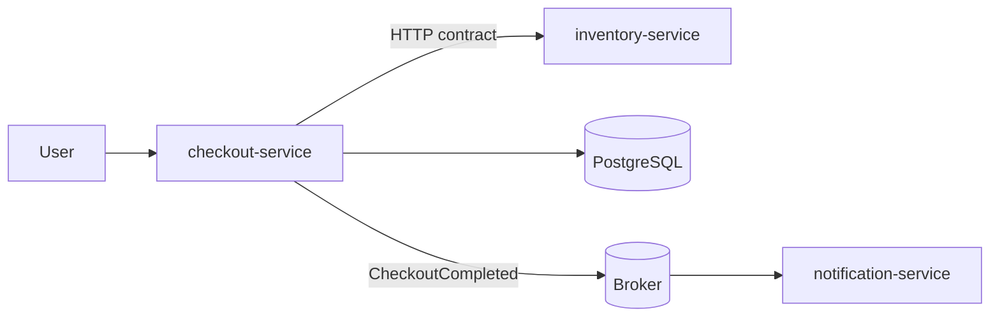
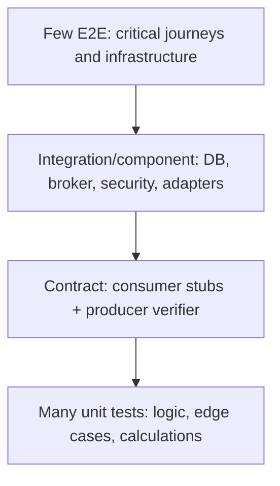
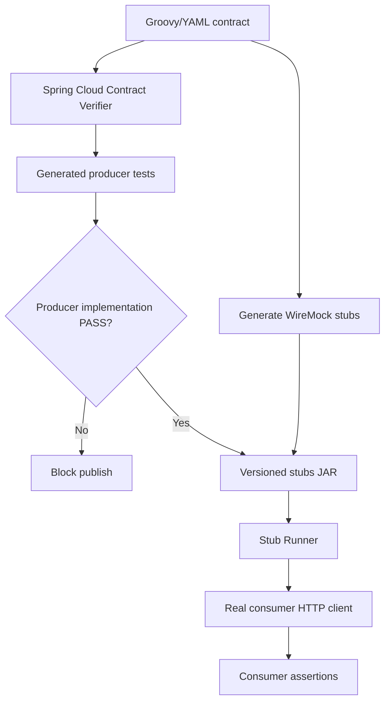
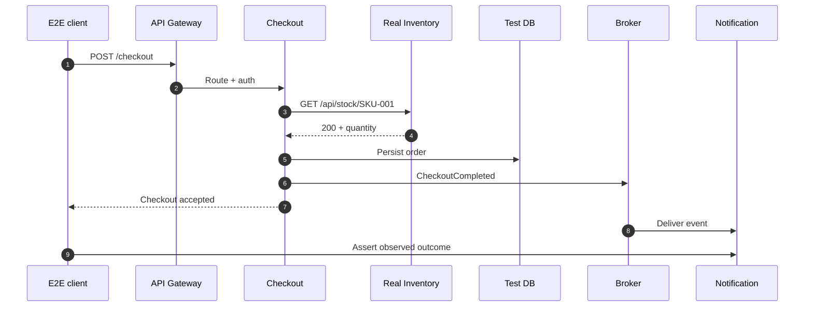
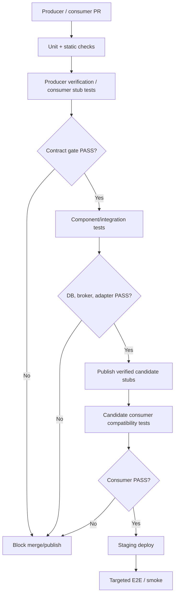
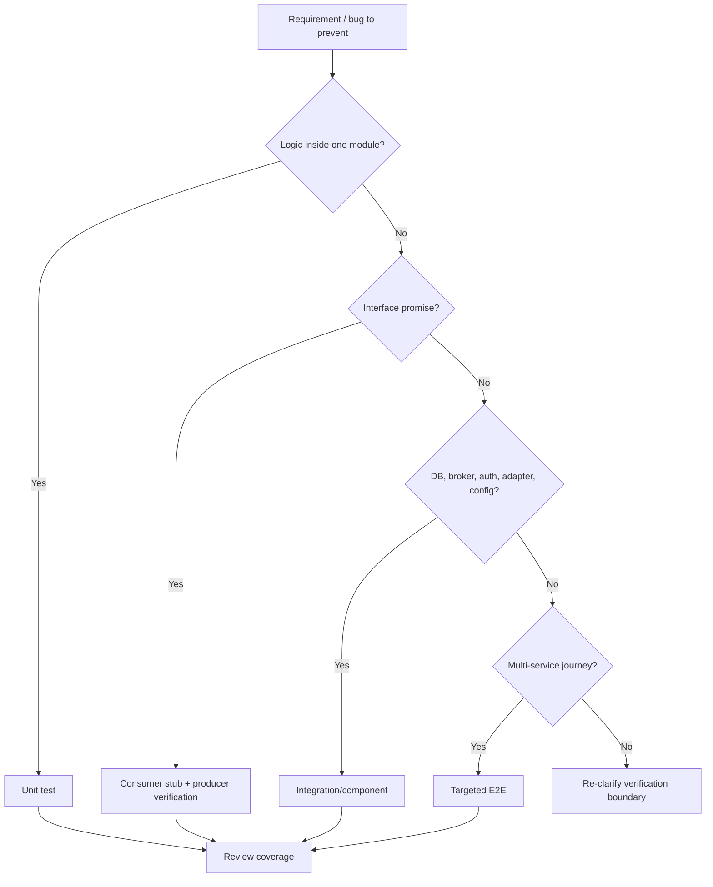

# Coordinating Contract Tests with Integration and End-to-End Tests

> **Chapter:** Consumer Testing  
> **Module:** Spring Cloud Contract (`SPRING_CLOUD_CONTRACT`) — learning contract testing between producer and consumer with Groovy/YAML DSL for HTTP or messaging, generating producer tests, publishing stubs, using Stub Runner, and integrating CI to detect incompatible API changes.

## Learning Objectives

After this lesson, you will be able to:

1. Distinguish **consumer contract tests**, **producer contract verification**, **integration/component tests**, and **end-to-end (E2E) tests** by the question each answers.
2. Use one shared HTTP contract to both generate producer tests and exercise the **consumer's real client** with Stub Runner.
3. Identify what remains unverified even when both producer verification and consumer stub tests PASS.
4. Add integration tests for **databases, HTTP adapters, security, brokers, retries/timeouts, and wiring** without making every test depend on the whole system.
5. Design a small, high-value set of E2E tests that track real business outcomes across deployed services.
6. Build a test coverage matrix for API changes, business errors, and infrastructure faults—picking the cheapest layer capable of catching each one.
7. Manage stub versions, producer artifacts, and consumer releases in CI to prevent "tests passing against stale stubs."
8. Design a pipeline with quality gates and evaluate breaking-change detection via intentional trials.

## 1. One System, Many Different Questions

Suppose a checkout flow consists of:

- `checkout-service`: receives purchase requests from the frontend; acts as **consumer** of inventory.
- `inventory-service`: exposes stock over HTTP; acts as **producer** of the inventory API.
- PostgreSQL: persists checkouts/orders.
- Message broker: delivers `CheckoutCompleted` events.
- `notification-service`: consumes the event and sends notifications.

The consumer calls:

```http
GET /api/stock/SKU-001 HTTP/1.1
Accept: application/json
```

The producer commits to returning:

```http
HTTP/1.1 200 OK
Content-Type: application/json

{
  "sku": "SKU-001",
  "available": true,
  "quantity": 4
}
```

For a request to buy `2` units, there are at least four independent questions:

- **Contract on consumer:** does the checkout client send `GET /api/stock/SKU-001`, parse the boolean/number, and make the right stock decision?
- **Contract on producer:** does the inventory implementation return the committed method/path/status/headers/body?
- **Integration:** does the HTTP adapter configure auth/timeouts properly; does the repository persist the order; can producer/consumer connect to DB/broker?
- **E2E:** can a user complete checkout through order persistence and real notification delivery (within the test environment)?

With only a green consumer contract test, you only know checkout works against the **stub**; the producer or infrastructure may have changed. With only a green happy-path E2E test, you may miss subtle regressions like `quantity` turning from a JSON number into a string if a parser silently coerces types.

**The best strategy splits responsibilities instead of piling every expectation onto one test type.**



## 2. Role of Each Test Type

| Type | What Executes? | Catches Effectively | Does Not Prove |
| --- | --- | --- | --- |
| **Unit test** | One function/class with suitable fakes/mocks | Formulas, edge cases, retry decision logic | HTTP wiring, network, database |
| **Consumer contract test** | **Real** consumer HTTP client/handler + collaborator stubs | Wrong requests, URLs, headers, DTO decoding, consumer response handling | Latest producer and production infrastructure |
| **Producer contract verification** | Generated tests calling producer implementation in test | Producer changing method, status, headers, JSON shape/values against contract | Whether consumer clients use the response properly |
| **Integration test** | Real components across one specific boundary | Adapters, databases, brokers, transactions, security, serialization | Full user journey |
| **Component test** | One mostly real service + isolated collaborators | HTTP endpoints, service logic, persistence, configuration | Integration across all real services |
| **End-to-end test** | Journey spanning selected services/infrastructure | Routing, auth, orchestration, final business outcomes | Every data variant/edge case or full production |

### 2.1. Two Notes on Naming

**A consumer contract test is often a consumer integration test**, because it connects the real HTTP client to a stub server. "Contract" describes the **source of expectations**, while "integration" describes the **scope of combined components**. They are not strictly disjoint layers.

**Producer verification is also often an integration/component test**, since generated tests may run against MockMvc, a Spring context, or a real HTTP server. What makes it distinct is that assertions come from the **shared contract**, rather than standards invented solely by the producer.

Do not force every test into a single rigid box; ask **which bugs need to be caught**, **which boundary is being exercised**, and **which parts are real vs. simulated**.

### 2.2. Intentional Cost Allocation



This is purely a **model balancing speed and coverage**, with no mandatory percentages. Adding more E2E tests will not solve issues if contracts fail to specify fields or error behaviors the consumer depends on.

## 3. One Shared Contract for Both Sides

Suppose inventory's contract lives at `src/test/resources/contracts/stock_available.yml` in the producer:

```yaml
name: stock_available
request:
  method: GET
  url: /api/stock/SKU-001
  headers:
    Accept: application/json
response:
  status: 200
  headers:
    Content-Type: application/json
  body:
    sku: SKU-001
    available: true
    quantity: 4
```

The same interaction can be written in Groovy DSL:

```groovy
org.springframework.cloud.contract.spec.Contract.make {
    name 'stock_available'
    request {
        method 'GET'
        url '/api/stock/SKU-001'
        headers {
            header 'Accept': 'application/json'
        }
    }
    response {
        status 200
        headers {
            contentType(applicationJson())
        }
        body(
            sku: 'SKU-001',
            available: true,
            quantity: 4
        )
    }
}
```

**When running the lab, keep only one version—either YAML or Groovy.** Placing two equivalent definitions in the contracts folder can cause the plugin to generate duplicate tests/stubs.

The contract commits to:

- HTTP method `GET` and path `/api/stock/SKU-001`.
- Request header `Accept: application/json`.
- Response `200` and `Content-Type: application/json`.
- `available` as boolean, `quantity` as JSON number, `sku` as string.
- In this sample scenario, `available = true`, `quantity = 4`.

The contract **does not by itself describe** inventory for every SKU, database correctness, or production auth policies. Other requirements need matching contracts or tests.

### 3.1. Same Contract, Two Pieces of Evidence



Producer verification verifies that producer code implements the contract; Stub Runner lets the consumer test against **responses simulated from that exact contract**. Both pieces of evidence complement each other.

### 3.2. Consumer-Driven Does Not Mean "Consumer Edits Contracts Unilaterally"

Consumers propose behaviors they genuinely depend on; producers review, accept, and verify them. Contracts may live in the producer repo or a dedicated contracts repo, provided there is a **single source of truth**, a review process, and versioned artifacts.

If a producer serves multiple consumers, one new consumer agreeing to API v2 **does not** guarantee older consumers upgraded. Evaluate compatibility across all supported contracts.

## 4. Consumer Tests Must Call the Real HTTP Client

### 4.1. HTTP Adapter Used in the Application

Java 17+ example with `RestClient` (Spring Framework 6.1+/Boot 3.2+ or compatible version):

```java
package com.example.checkout;

import org.springframework.beans.factory.annotation.Value;
import org.springframework.http.MediaType;
import org.springframework.stereotype.Component;
import org.springframework.web.client.RestClient;

@Component
public class InventoryClient {

    private final RestClient http;

    public InventoryClient(
        RestClient.Builder builder,
        @Value("${inventory.base-url}") String baseUrl
    ) {
        this.http = builder.baseUrl(baseUrl).build();
    }

    public Stock fetch(String sku) {
        Stock response = http.get()
            .uri("/api/stock/{sku}", sku)
            .accept(MediaType.APPLICATION_JSON)
            .retrieve()
            .body(Stock.class);

        if (response == null) {
            throw new IllegalStateException("Empty inventory response");
        }
        return response;
    }

    public record Stock(
        String sku, boolean available, int quantity
    ) {}
}
```

This client handles path-variable substitution, adds `Accept`, and deserializes JSON. In production, `inventory.base-url` points to the real service; in tests, it points to WireMock managed by Stub Runner.

Some JSON mappers **coerce types silently** (turning string `"4"` into integer `4`). When a contract requires a strict JSON number, use both producer assertions and appropriate consumer parser/schema checks rather than assuming a Java `int` field alone catches every wire-format bug.

### 4.2. Logic Consuming the Client's Data

```java
package com.example.checkout;

import org.springframework.stereotype.Service;

@Service
public class CheckoutService {

    private final InventoryClient inventory;

    public CheckoutService(InventoryClient inventory) {
        this.inventory = inventory;
    }

    public boolean canCheckout(String sku, int amount) {
        if (amount <= 0) return false;

        InventoryClient.Stock stock = inventory.fetch(sku);
        return sku.equals(stock.sku())
            && stock.available()
            && stock.quantity() >= amount;
    }
}
```

With `SKU-001` having 4 units in stock: buying 2 is allowed, buying 5 is rejected. Unit tests verify `stock.quantity() >= amount` across boundary values, while consumer contract tests verify the **real HTTP client** fetches that data.

### 4.3. Consumer Contract Test Using Stub Runner

Assuming the producer published:

```text
com.example:inventory-service:1.2.0:stubs
```

JUnit 5 example:

```java
package com.example.checkout;

import org.junit.jupiter.api.Test;
import org.springframework.beans.factory.annotation.Autowired;
import org.springframework.boot.test.context.SpringBootTest;
import org.springframework.cloud.contract.stubrunner.spring.AutoConfigureStubRunner;
import org.springframework.cloud.contract.stubrunner.spring.StubRunnerProperties;

import static org.junit.jupiter.api.Assertions.*;

@SpringBootTest(
    properties = "inventory.base-url=http://localhost:8090"
)
@AutoConfigureStubRunner(
    ids = "com.example:inventory-service:1.2.0:stubs:8090",
    stubsMode = StubRunnerProperties.StubsMode.LOCAL
)
class CheckoutInventoryContractTest {

    @Autowired
    CheckoutService checkout;

    @Test
    void clientDocResponseVaQuyetDinhDung() {
        assertTrue(checkout.canCheckout("SKU-001", 2));
        assertFalse(checkout.canCheckout("SKU-001", 5));
    }
}
```

**Prerequisites to run:** the producer generated and installed/published the stubs, the consumer registers `CheckoutService`/`InventoryClient` beans, web/test/Stub Runner dependencies are compatible, and port 8090 is free. In parallel CI, prefer dynamic ports obtained via `StubFinder.findStubUrl(...)` or an appropriate port-injection mechanism.

This test exercises the **real client**, not the real `inventory-service`. Never call it full E2E.

### 4.4. Why Not Mock `InventoryClient` Itself?

If this test wrote:

```java
when(inventoryClient.fetch("SKU-001"))
    .thenReturn(new InventoryClient.Stock("SKU-001", true, 4));
```

the checkout logic might still PASS, yet you **bypassed** URLs, headers, JSON serialization/deserialization, and client HTTP status handling. That makes a fine unit test for `CheckoutService`, not a consumer contract test.

Place mocks **outside the boundary under test**—never mock the very component you need to verify.

## 5. Producer Verification Must Call the Implementation

The producer reads the same contract and generates tests. A MockMvc base test can wire up a real controller:

```java
package com.example.inventory;

import io.restassured.module.mockmvc.RestAssuredMockMvc;
import org.junit.jupiter.api.BeforeEach;

public abstract class ContractTestBase {
    @BeforeEach
    public void setup() {
        RestAssuredMockMvc.standaloneSetup(new StockController());
    }
}
```

Minimal controller:

```java
package com.example.inventory;

import org.springframework.http.HttpStatus;
import org.springframework.http.MediaType;
import org.springframework.web.bind.annotation.*;
import org.springframework.web.server.ResponseStatusException;

@RestController
@RequestMapping("/api/stock")
public class StockController {

    @GetMapping(
        value = "/{sku}",
        produces = MediaType.APPLICATION_JSON_VALUE
    )
    public Stock get(@PathVariable String sku) {
        if (!"SKU-001".equals(sku)) {
            throw new ResponseStatusException(
                HttpStatus.NOT_FOUND, "SKU not found"
            );
        }
        return new Stock(sku, true, 4);
    }

    public record Stock(
        String sku, boolean available, int quantity
    ) {}
}
```

This is a **minimal producer fixture** without a database. In a real application, the base test may need a Spring context, controller advice, Security, or mocked external gateways; preserve the **behavior committed to the consumer** within the real scope.

Illustrative Maven plugin configuration:

```xml
<!-- Inside <dependencies> -->
<dependency>
    <groupId>org.springframework.cloud</groupId>
    <artifactId>spring-cloud-starter-contract-verifier</artifactId>
    <scope>test</scope>
</dependency>

<!-- Inside <build><plugins> -->
<plugin>
    <groupId>org.springframework.cloud</groupId>
    <artifactId>spring-cloud-contract-maven-plugin</artifactId>
    <version>${spring-cloud-contract.version}</version>
    <extensions>true</extensions>
    <configuration>
        <testFramework>JUNIT5</testFramework>
        <testMode>MOCKMVC</testMode>
        <baseClassForTests>com.example.inventory.ContractTestBase</baseClassForTests>
    </configuration>
</plugin>
```

This is a **POM fragment**: a project needs a compatible parent/BOM, version property, Spring MVC, and test dependencies. `testMode=MOCKMVC` must match a base test using `RestAssuredMockMvc`.

When running:

```bash
mvn clean verify
```

inspect the **test reports** to confirm generated tests were generated, compiled, and **actually executed**. A green build with `0 contract tests` is not proof that the implementation satisfies the contract.

### 5.1. Trying an Intentional Breaking Change

Change the producer to return:

```java
return new Stock(sku, true, 0);
```

while keeping `quantity: 4` in the contract. Generated producer verification **must FAIL**. If not, check whether the plugin read the contract file, tests ran, the base class booted the real controller, and body assertions exist.

This tests **pipeline quality**, not a Content QA step on this article.

### 5.2. Handling Dynamic Fields

If the producer generates a fresh `requestId` every call, do not force the real response to match one sample UUID:

```yaml
response:
  status: 200
  body:
    sku: SKU-001
    available: true
    quantity: 4
    requestId: 55145a90-f0a1-4c47-bcdf-550d89023902
  matchers:
    body:
      - path: $.requestId
        type: by_regex
        predefined: uuid
```

This is an **independent response variant**, applicable only if the API exposes `requestId`. The matcher relaxes only the ID—never `quantity`, `sku`, or `available`.

## 6. Why Both Contract Tests Passing Is Still Not Enough

A real-world situation can occur:

1. `inventory-service` PASSES producer verification with fixtures.
2. `checkout-service` PASSES consumer tests using `inventory-service:1.2.0:stubs`.
3. The deployed system still fails to complete checkout.

| Incident | Why Contracts Could Still PASS | Layer Needed |
| --- | --- | --- |
| Wrong DNS/service discovery | Consumer test called localhost WireMock | Deployment smoke/integration |
| Gateway strips or blocks headers | Stub test bypassed production gateway | Security/network integration |
| Token wrong scope or expired | Contracts did not test real auth | Auth integration/E2E |
| Checkout DB fails to commit | Consumer contract test did not hit real repository | DB/component integration |
| Kafka wrong topic/serializer | HTTP contract does not cross broker | Messaging/broker integration |
| Timeouts, retries sending duplicates | Contract describes one normal response | Adapter resilience/integration |
| New producer differs from old stub | Consumer pinned `1.2.0` artifact | Release/version compatibility gate |
| Bad data or cross-service transaction | Stub fixtures are static | Integration/E2E |

**Contract tests reduce the risk of "two sides misunderstanding the interface."** They do not automatically test deployment, persistence, authentication, networking, brokers, or end-to-end orchestration.

## 7. Integration Tests: Verifying One Real Boundary

### 7.1. HTTP Adapter Integration

An adapter test can use WireMock/verified stubs to test `InventoryClient`:

- URI, path/query, headers, and auth are constructed properly.
- `404` maps to the appropriate domain exception.
- `503` or timeouts trigger retries/fallbacks per policy.
- Call counts stay bounded; mutating POSTs are never retried carelessly.
- The decoder does not silently accept JSON missing required fields.

When injecting faults/delays solely for robustness where the producer makes no contract promise, call this an **adapter resilience test**. Never rewrite producer contracts to contain every artificial fault.

Example adding a dedicated contract for a non-existent SKU:

```yaml
name: stock_not_found
request:
  method: GET
  url: /api/stock/SKU-404
  headers:
    Accept: application/json
response:
  status: 404
  headers:
    Content-Type: application/json
  body:
    code: SKU_NOT_FOUND
    message: Stock item not found
```

Add this contract only when the real producer **commits** to returning `404` with this structure. If the controller lacks an exception handler producing that body, implement it before expecting producer verification to PASS. Consumer tests must assert **client behavior** on `404`, not merely that WireMock returned 404.

### 7.2. Database Integration

To verify order persistence, transaction rollbacks, and unique constraints, test against a real database such as PostgreSQL managed by Testcontainers:

```java
@Testcontainers
@SpringBootTest
class CheckoutPersistenceIT {

    @Container
    static PostgreSQLContainer<?> postgres =
        new PostgreSQLContainer<>("postgres:16-alpine");

    @DynamicPropertySource
    static void properties(DynamicPropertyRegistry props) {
        props.add("spring.datasource.url", postgres::getJdbcUrl);
        props.add("spring.datasource.username", postgres::getUsername);
        props.add("spring.datasource.password", postgres::getPassword);
    }

    // @Autowired CheckoutRepository repository;
    // @Test: save order, read back, verify constraints/transactions.
}
```

This is a **test skeleton** (omitting imports, entities/schema, and fixtures). It requires Spring Boot Test/Testcontainers dependencies, a Docker-compatible runtime, and JPA/migration setup. Spring Boot versions supporting `@ServiceConnection` can also auto-configure connection details.

A **repository integration test** does not need to call inventory. A **checkout component test** using a real DB can still stub inventory to isolate upstream. Make boundaries explicit.

### 7.3. Messaging Integration

When checkout emits:

```json
{
  "eventType": "CheckoutCompleted",
  "checkoutId": "CHK-0042",
  "total": 240000,
  "currency": "VND"
}
```

Message contract tests verify event types, payloads, headers, and destinations. Stub Runner can drive consumer listeners with sample events. Yet to protect **Kafka/RabbitMQ/JMS bindings, serializers, partitions/offsets, ACKs, retries, and DLQs**, write integration tests against an appropriate broker or test adapter.


If using an in-memory test binder, never infer the real broker is verified. Use dedicated topics/queues/consumer groups and await asynchronous processing with a **bounded timeout**, avoiding arbitrary `Thread.sleep` guesses.

## 8. Component Tests: One Real Service, Isolated Collaborators

A `checkout-service` component test might include:

- Real controllers, services, validation, and Spring configuration.
- PostgreSQL Testcontainers.
- Inventory/payment upstreams via verified stubs or test doubles.
- A test broker or controlled adapter.
- HTTP entry point via an embedded server on a random port.

It protects checkout's **wiring, HTTP responses, business logic, and persistence** without standing up all microservices.

```text
CheckoutComponentIT
  REAL: CheckoutController, CheckoutService, PostgreSQL
  STUB: inventory-service, payment gateway
  ASSERT: HTTP status/body, persisted order, expected event
```

If checkout returns `201` without saving the order, inventory's consumer contract test cannot catch it; a DB-backed component test will.

**Never label this component test a full-system E2E** if key upstreams remain stubbed.

## 9. E2E Tests: Cross-Service Business Journeys

E2E tests verify a journey from a realistic entry point to an **observable business outcome**, traversing services and infrastructure within the target environment scope.

Happy-path checkout journey:

1. Provision dedicated test accounts, stock, and test data.
2. Call checkout through the test environment's API gateway/ingress.
3. Checkout calls the **real deployed inventory-service**.
4. Checkout writes the order to the database.
5. Payment runs against a sandbox or test gateway **explicitly marked as sandbox**.
6. `CheckoutCompleted` is published to the broker and processed by notification.
7. Test verifies both order completion **and** recorded notification delivery.



Keep E2E tests to a **reasonable number** of high-value flows; do not repeat dozens of data-type variations already verified cheaply by contract and unit tests.

### 9.1. Do Not Assert Only HTTP 200

For asynchronous workflows, a `202` from checkout does not prove notification was sent. Poll with a timeout:

```java
await().atMost(Duration.ofSeconds(10))
    .untilAsserted(() -> {
        NotificationStatus status =
            notificationProbe.findByCheckoutId("CHK-0042");
        assertEquals(NotificationStatus.SENT, status);
    });
```

This is an **illustrative snippet** using Awaitility and a probe provided by the test environment, not a built-in Spring Cloud Contract API. Assert final outcomes through an authorized observation channel rather than fixed sleeps.

### 9.2. Common Causes of Flaky E2E Tests

- Shared staging data mutated by other tests.
- Delayed event processing overlapping into the next run.
- Expired tokens/secrets or sandbox rate limits.
- Desynchronized clocks/timezones and timestamps.
- Uncommitted transactions when assertions execute.
- Unreset Stub Runner scenario states in hybrid setups.
- Parallel runs colliding on the same order IDs, topics, or databases.

Generate per-run data with proper cleanup/isolation, use idempotency keys where applicable, tune timeouts, and log correlation IDs. Never turn on CI retries just to hide test contamination.

## 10. Risk-Based Coverage Matrix

| Risk | Unit | Consumer Contract | Producer Verification | Integration/Component | E2E |
| --- | :---: | :---: | :---: | :---: | :---: |
| Wrong `quantity >= requested` rule | **Primary** | Yes | Optional | Possible | Selective |
| Client wrong URL/header | No | **Primary** | Producer side | Yes | Yes |
| Producer turns number into string | Insufficient | Parser-dependent | **Primary** | Yes | Possible |
| Dropped `available` field | Insufficient | Yes | **Primary** | Yes | Possible |
| HTTP status violates contract | Insufficient | Yes | **Primary** | Yes | Yes |
| Client mishandles `404` | Domain unit | **Primary** | Verifies error contract | Yes | One error path |
| Wrong token/auth scope | Insufficient | Insufficient | Setup-dependent | **Primary** | Yes |
| DB fails to persist order | No | No | No | **Primary** | Yes |
| Broken Kafka routing/ACK | No | Assisted by message contract | Assisted by message contract | **Primary** | Yes |
| Post-deploy proxy/TLS/discovery mismatch | No | No | No | Possible | **Primary** |
| End-to-end checkout flow fails | Partial | Partial | Partial | Partial | **Primary** |

"Primary" marks where the defect should be caught first; "Yes" marks complementary evidence. Do not repeat identical assertions at every layer unless doing so adds detection power.

### 10.1. Minimum Useful Test Suite

For checkout–inventory:

1. Unit tests for stock sufficiency decisions, boundary quantities, and null/invalid inputs.
2. Consumer stub tests for success and critical upstream errors.
3. Producer verification for every accepted contract.
4. Component/integration tests for checkout DB persistence, security/client retries, and key broker paths.
5. A handful of E2E/smoke journeys through real deployment paths.

After every production incident, add a regression test **at the cheapest layer capable of seeing that exact failure**.

## 11. Breaking Changes: Which Test Must Turn Red?

| Producer Change | Producer Contract | Consumer Using Old Stub | Real E2E |
| --- | --- | --- | --- |
| Remove `available` | **FAIL** if field is committed | May PASS | Likely fails |
| `quantity: 4` becomes `quantity: "4"` | **FAIL** if type assertion holds | May PASS | Parser may coerce |
| `GET` becomes `POST` | **FAIL** | Client still sends GET to stub | Likely 405 |
| `200` becomes `204` | **FAIL** | May PASS | Client gets empty body |
| Add optional response field | Usually compatible if contract permits | Usually PASSES | Usually PASSES |
| Add mandatory request header | Must test old request contracts | Old stub may PASS | Old consumers fail |
| Change gateway auth scope | May PASS if Security is off in test | May PASS | Likely FAILS |

### 11.1. Three False-Confidence Scenarios

**Stale stub:** Producer moves to v1.3 while consumer still tests against `inventory-service:1.2.0:stubs`. Green consumer tests tell you nothing about the new deployment.

**Contract edited to match broken code:** Producer changes `available` to a string and a developer edits the contract to turn tests green. Old consumers still require a boolean; skipping CDC review ships a breaking change.

**Narrow E2E:** The happy path stays green while the producer's `404` error body changed. Because E2E never hits the error branch, you need a dedicated **error contract** and consumer error-handling tests.

## 12. Stub Versions and Backward Compatibility

Stub coordinates need complete details:

```text
com.example:inventory-service:1.2.0:stubs
```

- `LOCAL` reads artifacts from the **consumer runner's own** local Maven repo.
- `REMOTE` downloads artifacts from a configured Maven-compatible repository.
- Dynamic `+` is useful for **a pipeline probing the latest candidate**, yet lacks the reproducibility of a pinned version.
- CI runners rarely share `~/.m2`; `mvn install` on a producer machine does not transfer stubs to a consumer runner.

Two critical version axes: **the producer build/commit that ran verification** and **the stub version the consumer actually resolved**. CI reports must record both.

### 12.1. Compatible Evolution Path: Expand → Migrate → Contract

1. Producer keeps supporting the old endpoint/field while **expanding** with the new field or endpoint.
2. Producer verifies both old and new contracts and publishes new candidate stubs.
3. Consumers update and run tests against the candidate.
4. Consumers deploy on their own schedule while old consumers are monitored.
5. Remove old behavior only once versioning policy and usage telemetry allow it.

Producer and consumer do not need synchronized lockstep deployments when APIs evolve backward-compatibly.

### 12.2. Multiple Consumers

Spring Cloud Contract supports **stubs per consumer** to load only scenarios relevant to a specific consumer. That keeps consumer tests focused, yet **never** permits a producer to ignore accepted contracts of other consumers.

## 13. CI: Fast Feedback Early, Selective Broad Checks



This diagram illustrates **quality gate logic**, not a mandate to run every job sequentially; independent steps can run in parallel as long as publishing happens only after required checks pass.

### 13.1. Producer Pull Request

- Generate and run contract tests from the DSL.
- Inspect test reports; **never accept 0 generated tests** unexpectedly.
- Never alter contracts to fit broken output without reviewing consumer compatibility.
- Block publishing when contract verification fails or is skipped.
- When ready, produce candidate stubs tied to the exact commit/build.

```bash
mvn clean verify
```

### 13.2. Consumer Pull Request

- Run logic unit tests and consumer tests against collaborator stubs.
- Ensure tests invoke the **real consumer client/handler**.
- Verify success responses, error responses, and fields the consumer uses.
- Record stub version/coordinates in CI reports.
- Add integration tests whenever changes touch DB, security, brokers, retries, or network adapters.

### 13.3. Candidate Release and Staging

1. Producer builds stubs from a **verified build**.
2. Consumer compatibility suite runs against the **exact candidate stubs**.
3. Archive reports tagged with both sides' versions.
4. Deploy to staging and run targeted E2E over real paths.
5. Monitor post-deploy with a rollback plan ready.

Never publish "verified" stubs if producer tests ran with `-DskipTests`. The mere presence of a stub JAR does not prove the real application passed contract verification.

### 13.4. Reference Cadence

| Trigger | Prioritized Tests |
| --- | --- |
| Every commit/PR | Unit tests, producer verifier, fast consumer stub tests |
| PR touching DB/broker/config | Relevant component/integration tests |
| Candidate release | Cross-service compatibility with candidate stubs |
| Staging/post-deploy | Core journey smoke/E2E |
| Nightly/scheduled | Broader E2E, resilience, migrations as needed |

## 14. Isolation: Keeping Results Trustworthy

At every test layer, leftover state can produce false PASSes:

- **Database:** an earlier test saved `ORD-1001`; the next test reads it and PASSes even if the new service failed to save.
- **Broker:** leftover messages from an earlier test are consumed by the next test's listener.
- **WireMock Scenario:** `Confirmed` state left over from a previous run makes GET return the wrong response.
- **Application context:** leftover mocks/spies/singletons and scheduled jobs from earlier tests.
- **Shared E2E environment:** concurrent suites mutating the same account/SKU.

Rules:

1. Isolate test data, topics/queues, and destinations **per test** whenever possible.
2. Reset fixtures **before** tests; inspect and clean up cleanly **after** tests.
3. Stop or await async tasks cleanly so delayed messages do not bleed across tests.
4. Use bounded polling instead of arbitrary `Thread.sleep(...)`.
5. Never purge queues/topics in shared or production environments.
6. If tests share indivisible state, do not run them in uncontrolled parallel.

## 15. Process for Choosing the Test Layer for a New Requirement

Answer four questions:

1. **What must hold true?** Calculation, HTTP schema, client parsing, DB transaction, network security, or business workflow?
2. **Who owns it?** Consumer, producer, adapter, repository/broker, or a group of services?
3. **What is the cheapest layer that catches the fault?** Unit, contract, integration/component, or E2E?
4. **Do existing tests already protect it?** What new evidence does the new test add?



## 16. Anti-Patterns and Fixes

| Anti-Pattern | Risk | Action |
| --- | --- | --- |
| Consumer only mocks `InventoryClient` | Real HTTP/DTO never tested | Use real client with Stub Runner |
| Producer mocks `StockController` to return canned responses | Implementation never tested | Wire real controller/service at appropriate scope |
| Asserting only status 200 | Wrong body/types slip through | Assert key fields and semantics |
| Only consumer contract tests exist | Stubs may go stale | Add producer verification + version gate |
| Only happy-path E2E tests exist | Error branches go untested | Add error contracts + component tests |
| E2E using all stubs labeled "production E2E" | Overstates coverage | Explicitly document real vs. stub boundaries |
| Dynamic stub versions on release | Non-reproducible tests | Pin versions/candidate metadata |
| Editing contracts to match buggy code for green CI | Breaks old consumers | Consumer CDC review + migration |
| Publishing stubs when verifier was skipped | Unverified stubs | Block publish; inspect reports |
| CI retries masking flaky tests | Unfixed races/state leaks | Isolate data and set explicit timeouts |
| Shared DB/broker without cleanup | False PASSes, order dependency | Test-owned resources + cleanup |

## 17. Practice Exercises

**Exercise 1 — Risk Classification.** Pick the primary layer for: (a) `quantity` changes from number to string; (b) checkout fails to save order; (c) client omits `Accept`; (d) wrong gateway token; (e) notification misses event; (f) wrong stock-sufficiency formula.

**Exercise 2 — Real Consumer.** Using `InventoryClient` and `CheckoutService` from Section 4, write a Stub Runner test verifying buying 2 is allowed and buying 5 is rejected. Why not mock the HTTP client?

**Exercise 3 — Producer Verification.** Generate tests from `stock_available.yml`. Change the controller to return `quantity: 0`. Which test must turn red? If CI stays green, which steps should you inspect?

**Exercise 4 — Error Contract.** Write a contract for `GET /api/stock/SKU-404` returning `404` with body `code: SKU_NOT_FOUND`. How must the producer implementation/error handler change to pass? What must the consumer assert?

**Exercise 5 — DB Integration.** Outline a `CheckoutPersistenceIT` using PostgreSQL Testcontainers: setup, fixtures, behavior, transaction assertions, and cleanup. Why can't inventory's Stub Runner replace this test?

**Exercise 6 — Messaging.** Checkout emits `CheckoutCompleted`. Design the message payload contract and a Kafka/RabbitMQ/JMS integration test protecting serialization, routing, ACK, or retries.

**Exercise 7 — E2E.** Design a happy-path checkout flow with real inventory, checkout DB, broker, and notification. Note payment sandbox/mock boundaries, observable outcomes, and timeouts.

**Exercise 8 — Stub Drift.** Producer bumps to `1.3.0` and drops `available`, while consumer stays on `1.2.0:stubs`. Explain the false PASS that can occur and the compatibility gate needed.

**Exercise 9 — Matrix.** Build a Unit/Consumer contract/Producer verification/Integration/E2E table for 8 risks in an application you know. Give each risk one **primary layer** and optional secondary layers.

**Exercise 10 — CI.** Split a pipeline into producer PR, consumer PR, candidate release, and staging smoke. Identify where to block the build when generated producer tests fail to run.

### Suggested Answers

1. (a) Producer contract; (b) DB/component integration; (c) consumer contract; (d) security integration/smoke; (e) message/broker integration; (f) unit logic.
2. Exercise the real HTTP adapter and service decision; mocking the client skips wire format and request mapping.
3. Producer generated test must FAIL; inspect plugin, base class, test reports, and body assertions.
4. Dedicated error contract, implementation returning the committed body, client translating the response into a proper domain error.
5. Test against a real DB to verify persistence/transactions; HTTP stubs cannot replace it.
6. Contracts protect schema/destination; broker integration protects connectivity, serialization, and ACK/retries.
7. Assert final persisted state/processed notification with bounded waits, documenting real vs. stubbed components.
8. Old stubs cannot see new producer changes; verify old contracts and run consumer compatibility against new candidates.
9. Do not duplicate every assertion at every layer; pick the cheapest layer that catches the defect.
10. Block publishing when producer verification fails or skips; verify stub versions on candidates and E2E through deployed paths.

## 18. Project Adoption Checklist

**Before writing a contract:**

- Which consumers depend on this behavior?
- Which fields are required vs. dynamic; to what detail are status/headers/error bodies committed?
- Who reviews contracts and governs incompatible changes?
- Which real producer components will producer tests exercise?

**Before merge:**

- Did generated producer tests generate and run in expected counts?
- Do consumer stub tests invoke the real HTTP client?
- Are stub coordinates and versions explicit?
- Do error contracts cover branches the client genuinely handles?
- Do DB/broker/security/adapter changes have matching tests?
- Could any test PASS falsely due to stale state or overly broad mocks?

**Before release:**

- Do candidate stubs come from a verified producer build?
- Did consumer compatibility tests run against the exact candidate?
- Are there E2E/smoke checks over real deployment paths, not just localhost WireMock?
- Are test data, secrets, timeouts, and cleanup managed?
- Is there a backward-compatibility/rollback plan for older consumers?

## 19. Summary

**Contract tests, integration tests, and E2E tests must work together rather than replacing one another.** Spring Cloud Contract protects promises at the HTTP/messaging boundary: **Producer Contract Verifier** verifies producer code, while **Consumer Stub Runner** tests the consumer's real client or handler against published stubs. When both sides PASS, interface drift risk drops substantially, yet databases, brokers, auth, proxies, service discovery, and orchestration still require dedicated verification.

Use **unit tests** for logic, **contract tests** for APIs, **integration/component tests** for wiring and infrastructure, and **a few high-value E2E tests** for user journeys. In CI, verify that generated tests actually run, govern stubs/versions strictly, and block publishing whenever the producer breaks its contract. A strong test suite does not make every component real in every test; it ensures **every critical risk has evidence at the right boundary**.

## References

- [Spring Cloud Contract — Consumer Driven Contracts](https://docs.spring.io/spring-cloud-contract/reference/getting-started/cdc.html) — managing contracts across both sides.
- [Spring Cloud Contract — Getting Started](https://docs.spring.io/spring-cloud-contract/reference/getting-started/first-application.html) — producer verification and stub artifacts.
- [Spring Cloud Contract — Stub Runner Core](https://docs.spring.io/spring-cloud-contract/reference/project-features-stubrunner/stub-runner-core.html) — HTTP consumer stubs and artifacts.
- [Spring Cloud Contract — Stubs Per Consumer](https://docs.spring.io/spring-cloud-contract/reference/project-features-stubrunner/stub-runner-stubs-per-consumer.html) — supporting multiple consumers.
- [Spring Cloud Contract — Dynamic Properties](https://docs.spring.io/spring-cloud-contract/reference/project-features-contract/dsl-dynamic-properties.html) — matchers for dynamic values.
- [Spring Boot — Testing Spring Boot Applications](https://docs.spring.io/spring-boot/reference/testing/spring-boot-applications.html) — Spring tests and test slices.
- [Spring Boot — Testcontainers](https://docs.spring.io/spring-boot/reference/testing/testcontainers.html) — containerized integration infrastructure.
- [Spring Cloud Contract — Messaging](https://docs.spring.io/spring-cloud-contract/reference/project-features-messaging.html) — message contracts, producer verifier, and messaging stubs.
