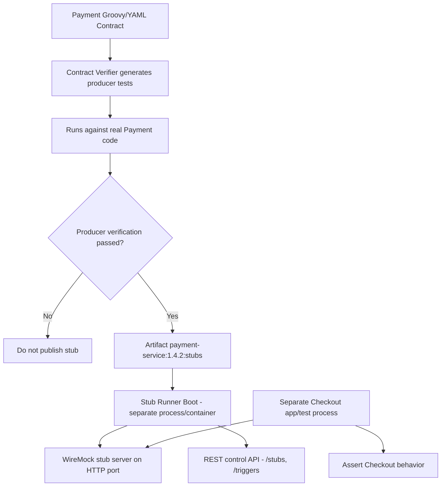
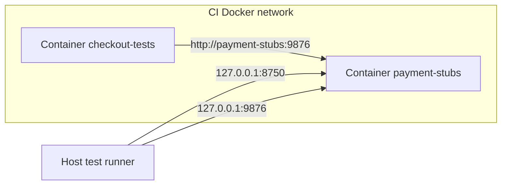
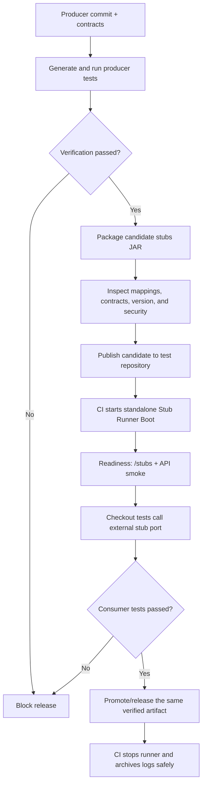

# Running Stubs Outside the Consumer Test Process

## 1. Why Do We Need a Standalone Stub Server?

Suppose `checkout-service` (consumer) calls `payment-service` (producer) to check whether an order has been paid. Checkout needs to test its ordering flow without depending on Payment, real banks, or real databases. The Payment team has defined the HTTP behavior with **Spring Cloud Contract**, written contracts in the **Groovy or YAML DSL**, run **producer verification tests**, and published an artifact containing the stubs.

There are two common ways to consume that stub:

- **Running inside the consumer test process:** Spring/JUnit tests use `@AutoConfigureStubRunner` or `StubRunnerExtension`. Stub Runner starts HTTP stub servers within the lifecycle of the test.
- **Running outside the consumer test process:** a **Stub Runner Boot** application, a Docker container, or a standalone WireMock server downloads and serves the stubs. Checkout runs as a separate application/test process and connects to the stub's HTTP address over the network.

In the second approach, the consumer **does not need to depend on the Stub Runner library to launch stubs inside its JVM**. All the consumer needs is the **base URL** of the mocked endpoint. This is very useful for testing with Postman/Newman, Playwright, Node.js/Python/.NET applications, UI testing, multi-process runs, or CI pipelines with a separate infrastructure startup step.

However, running a stub out-of-process **does not automatically make it more accurate**. Reliability comes from a clear chain: contracts verified by the producer → stub artifact with the right version → standalone runner loads the right artifact → client sends HTTP requests to the right stub → consumer tests verify business outcomes.

### Lesson Objectives

After this lesson, you will be able to:

1. Distinguish between Stub Runner in the test JVM and a separately running Stub Runner Boot/Docker instance.
2. Understand that Stub Runner Boot's **control port** is different from the **WireMock stub port** called by the consumer.
3. Use artifact coordinates `groupId:artifactId:version:classifier:port`, choose `LOCAL` or `REMOTE`, and pin versions.
4. Start a standalone stub, inspect `GET /stubs`, and call a sample API over real HTTP.
5. Connect a consumer running on the host or in another container to the right stub address.
6. Establish rules for readiness, state reset, security, and cleanup in CI.
7. Understand what standalone stubs prove — and what still requires producer verification or real integration tests.

## 2. Architecture Components



**Two HTTP paths serve different purposes:**

- Stub Runner Boot's **Control API** reports which stubs the runner has loaded, which ports they are listening on, and which messaging labels can be triggered.
- The **Business stub HTTP API** simulates Payment's endpoint, such as `GET /api/payments/PAY-1001`; this is where Checkout must send its requests.

Do not configure Checkout to call `http://localhost:8750/api/payments/...` just because Stub Runner Boot manages port `8750`. If the actual payment stub runs on `9876`, Checkout needs to call `http://localhost:9876/api/payments/...` when both run on the same host.

## 3. Comparing Ways to Run Stubs

| Approach | Lifecycle | Mapping Source | When It Fits |
| --- | --- | --- | --- |
| `@AutoConfigureStubRunner` | Consumer's Spring TestContext; usually stops with the test. | SCC `stubs` artifact. | Local Spring Boot/JUnit tests with minimal external infrastructure. |
| `StubRunnerExtension` | JUnit extension orchestrating while tests run. | SCC `stubs` artifact. | Java unit/integration tests without needing the full Spring context. |
| **Standalone Stub Runner Boot** | Independent application/process managed by shell/CI/container. | SCC `stubs` artifact from local/remote repository. | Consumers in a different JVM or language, UI/E2E tests. |
| **Stub Runner Boot Docker** | Standalone container, usable with Docker Compose. | SCC `stubs` artifact and repository config inside container. | Multi-service CI, isolated environments, polyglot tests. |
| **Plain standalone WireMock** | Independent process managed by the user. | User-supplied WireMock `mappings/`/`__files`. | Standalone HTTP mocking without needing SCC artifact loading or messaging labels. |

**Important distinction:** a standalone WireMock JAR knows how to read WireMock mappings; it **does not automatically** understand Maven `:stubs` coordinates, version selection, or provide Stub Runner Boot's control API and messaging triggers. If the goal is to **consume stubs verified and packaged by the producer**, prefer Stub Runner Boot or a runtime that loads artifacts via the equivalent mechanism.

Stub Runner inside the consumer JVM still opens an HTTP port for WireMock, but **the orchestrator and runner lifecycle live inside the test process**. This lesson moves the orchestrator itself into **a separate process/container**.

## 4. Building an HTTP Contract as Input

Agreed API example: `GET /api/payments/PAY-1001` returns HTTP `200` and status `PAID`.

### Groovy DSL

```groovy
import org.springframework.cloud.contract.spec.Contract

Contract.make {
    name 'get_paid_payment'
    description 'Look up a paid payment transaction'

    request {
        method 'GET'
        urlPath '/api/payments/PAY-1001'
        headers {
            header 'Accept': 'application/json'
        }
    }

    response {
        status 200
        headers {
            contentType(applicationJson())
        }
        body([
            paymentId: 'PAY-1001',
            orderId: 'ORD-2001',
            status: 'PAID',
            amount: 250000,
            currency: 'VND'
        ])
    }
}
```

### Equivalent YAML DSL

```yaml
description: Look up a paid payment transaction
name: get_paid_payment
request:
  method: GET
  urlPath: /api/payments/PAY-1001
  headers:
    Accept: application/json
response:
  status: 200
  headers:
    Content-Type: application/json
  body:
    paymentId: PAY-1001
    orderId: ORD-2001
    status: PAID
    amount: 250000
    currency: VND
```

These are **two alternative representations** of one contract; a project normally keeps only one as the single source of truth to avoid generating duplicate tests/stubs. Do not put hostnames, developer machine ports, or Artifactory URLs inside the request contract: those details belong to the runtime environment, not the API path guarantee.

**Producer verification** must send the request to the real Payment implementation and verify status, headers, and body. Data like `PAY-1001` needs deterministic fixtures or an appropriate test adapter. Once tests pass, the plugin converts the contract into WireMock HTTP mappings and packages the stub artifact. Merely writing a JSON mapping by hand and running it with a standalone server **does not prove the producer honors the contract**.

## 5. Stub Artifacts and How to Specify a Server

A hypothetical Maven artifact:

```text
groupId    = com.example
artifactId = payment-service
version    = 1.4.2
classifier = stubs
type       = jar

Example file:
payment-service-1.4.2-stubs.jar
```

Spring Cloud Contract Stub Runner uses **Ivy notation**:

```text
groupId:artifactId:version:classifier:port
```

Example:

```text
com.example:payment-service:1.4.2:stubs:9876
```

This means: load the stub for `payment-service` version `1.4.2`, classifier `stubs`, and have the HTTP stub server listen on **port 9876**. The `port` segment is the **WireMock port for the stub**, not Stub Runner Boot's management REST port. If the port is omitted, Stub Runner can pick a port from the configured `minPort/maxPort` range; in that case, the consumer must **discover the actual port** before calling it.

`version` or `classifier` can be omitted under default conventions, but for release CI you should **lock both version and classifier**. The `+` version notation or version ranges are handy for exploratory development, not a good choice for a reproducible release gate.

### What Is Inside the JAR?

Typical layout:

```text
META-INF/
└── com.example/
    └── payment-service/
        └── 1.4.2/
            ├── contracts/
            │   └── http/get-paid-payment.groovy
            └── mappings/
                └── http/get-paid-payment.json
```

This is a **conceptual** example; file names and layout depend on the plugin/version. When a mapping references a body file, the artifact must bundle the required resources. You can use `jar tf payment-service-1.4.2-stubs.jar` to inspect the entry list before the runner loads it. An empty JAR or one missing the required contracts/mappings can still exist on disk as a file.

## 6. Choosing the Stub Source: LOCAL, REMOTE, or CLASSPATH?

| Mode | Where Does the Runner Read Stubs From? | Key Considerations |
| --- | --- | --- |
| **LOCAL** | The Maven local repository of **the runner process/container itself**. | Does not mean `~/.m2` on another host; a container needs an appropriate volume mount or copy. |
| **REMOTE** | Configured artifact repository, e.g., Nexus or Artifactory. | Requires URL, version, network access, and permissions; avoid secrets in command logs. |
| **CLASSPATH** | Stubs already on the runner's classpath via supported mechanisms. | Not the same as automatically downloading a Maven artifact from a remote repository. |

The configuration properties described in the Stub Runner documentation typically share this prefix:

```properties
spring.cloud.contract.stubrunner.ids=com.example:payment-service:1.4.2:stubs:9876
spring.cloud.contract.stubrunner.stubsMode=REMOTE
spring.cloud.contract.stubrunner.repositoryRoot=https://repo.example.test/maven/releases
```

The repository URL here is **fictional**, not a live endpoint. In a project where the property binder uses relaxed binding, names like `stubs-mode`/`repository-root` may appear in kebab-case; when configuring via CLI/environment variables, follow **the syntax compatible with the Stub Runner version you are using**.

### Why Does LOCAL Often Cause Confusion in Docker?

You ran `mvn install` on the host machine, so you have:

```text
Host: /home/developer/.m2/repository/.../payment-service-1.4.2-stubs.jar
```

However, a Docker container has **a different filesystem**. If you enable `LOCAL` without mounting or copying the Maven repository properly, Stub Runner Boot may report that the artifact cannot be found. Conversely, running `REMOTE` without configuring a valid `repositoryRoot` or credentials will fail during download. The mode must be chosen deliberately rather than picking one and "guessing" where the files are.

## 7. Starting Stub Runner Boot via Docker

According to current Spring Cloud Contract documentation, **the Stub Runner Boot Docker image is the preferred standalone approach**. The documentation also notes that due to artifact publishing tooling constraints, **the executable Stub Runner Boot JAR is not published from the 4.1.6 line onward**; older fat JAR download commands only apply to versions where the artifact actually exists or when you build the application yourself. Do not grab a historical `wget` command and assume it works for every newer release.

A pattern for consumer tests running **on the same Docker host**, with the stub artifact already published to a repository reachable by the container:

```bash
docker run --rm --name payment-stubs \
  -e SERVER_PORT=8750 \
  -e SPRING_CLOUD_CONTRACT_STUBRUNNER_STUBS_MODE=REMOTE \
  -e SPRING_CLOUD_CONTRACT_STUBRUNNER_IDS=com.example:payment-service:1.4.2:stubs:9876 \
  -e SPRING_CLOUD_CONTRACT_STUBRUNNER_REPOSITORY_ROOT=https://repo.example.test/maven/releases \
  -p 127.0.0.1:8750:8750 \
  -p 127.0.0.1:9876:9876 \
  spring-cloud/spring-cloud-contract-stub-runner:REPLACE_WITH_COMPATIBLE_TAG
```

**This is a template command to adapt, not an executed command.** Choose an image tag that actually exists and is compatible with the producer's Spring Cloud Contract stack. The environment variable names follow modern Spring Boot properties with the `SPRING_CLOUD_CONTRACT_STUBRUNNER_...` prefix. Some legacy docs/images use shorter variables like `STUBRUNNER_IDS` or `STUBRUNNER_STUBS_MODE`; check the documentation for **the exact image tag** instead of mixing two configuration generations.

When running successfully:

- **Port 8750 inside the container:** Stub Runner Boot's REST control API because `SERVER_PORT=8750` is set.
- **Port 9876 inside the container:** HTTP WireMock stub server for `payment-service`.
- **Host loopback 127.0.0.1:8750:** operators on the same host can query the control API.
- **Host loopback 127.0.0.1:9876:** tests or apps on the same host can call the simulated Payment API.
- **Repository URL:** the container must have the required DNS/routing/TLS and credentials to download `com.example:payment-service:1.4.2:stubs`.

Binding both ports to `127.0.0.1` restricts access from external networks in simple test environments. If the consumer runs in another container, it **cannot** call the host's `127.0.0.1`; use a shared Docker network and service name as shown in section 10.

### Local Mode in a Container

When no artifact repository is available, you can use `LOCAL` and mount the local Maven repository directory into **the exact home/repository path used by the image**:

```text
STUBS_MODE = LOCAL
Container Maven repository = path mounted from host
Stub ID = com.example:payment-service:1.4.2:stubs:9876
```

The Spring Cloud Contract Docker guide shows mounting `.m2` into the user's home inside the image. The actual container path and file permissions can vary by image tag, so verify the user/home/repository path of the version in use. For distributed CI, **REMOTE** is usually more convenient because there is no need to share a filesystem across jobs.

## 8. Two Ports: Runner Management and HTTP Stub

This is where many people get confused when starting integration:

| Example Address | Target | Appropriate Request |
| --- | --- | --- |
| `http://127.0.0.1:8750/stubs` | **Stub Runner Boot control API** | List loaded stubs. |
| `http://127.0.0.1:8750/stubs/payment-service` | **Control API** | Return the port of the matching stub by supported ID. |
| `http://127.0.0.1:8750/triggers` | **Control API** | List messaging labels available to trigger. |
| `http://127.0.0.1:9876/api/payments/PAY-1001` | **Payment HTTP stub** | Consumer calls this just like the Payment API. |
| `http://127.0.0.1:9876/__admin/mappings` | Stub's **WireMock admin API** | Inspect mappings for debugging on a trusted test server. |

Before running consumer tests, you can verify:

```bash
# Control plane: which artifacts did the runner load?
curl -i http://127.0.0.1:8750/stubs

# Query stub port by artifactId if supported by the endpoint:
curl -i http://127.0.0.1:8750/stubs/payment-service

# Business plane: call the simulated Payment endpoint:
curl -i \
  -H "Accept: application/json" \
  http://127.0.0.1:9876/api/payments/PAY-1001
```

Expected simulated response from the last command:

```http
HTTP/1.1 200 OK
Content-Type: application/json

{
  "paymentId": "PAY-1001",
  "orderId": "ORD-2001",
  "status": "PAID",
  "amount": 250000,
  "currency": "VND"
}
```

**Do not assume `/actuator/health` always exists**: the Actuator endpoint requires its own dependency and configuration, whereas `GET /stubs` is documented by Stub Runner Boot. If the runner has not finished downloading the artifact, the port might not be ready yet even though the container has started; wait for readiness at the runtime layer and verify with a business request.

### Dynamic Port Discovery

If the Stub Runner ID **omits the port**, WireMock can run on a port picked from a range. On the same network where the control API is reachable, the consumer/test harness can:

1. Call `GET /stubs` to retrieve stub IDs and opened ports.
2. Pick the entry for `com.example:payment-service:1.4.2:stubs`.
3. Feed host + port into the consumer's `payment.base-url` configuration.
4. Send a smoke request to prove the stub is ready.

Reading just the port number from the control API **does not automatically determine the hostname** the consumer must use from another container. The host must come from network configuration, such as the DNS name of the Stub Runner service. When using Docker with dynamic published ports, you also need the host port mapped by Docker; therefore, in simple examples we pick `9876` explicitly.

## 9. Running Stub Runner Boot as a Standalone Spring Boot App

If the project cannot use Docker, you can build a Spring Boot application **whose sole purpose is running stubs**. Per Spring Cloud Contract documentation, this uses the Stub Runner starter and `@EnableStubRunnerServer`:

```java
import org.springframework.boot.SpringApplication;
import org.springframework.boot.autoconfigure.SpringBootApplication;
import org.springframework.cloud.contract.stubrunner.server.EnableStubRunnerServer;

@SpringBootApplication
@EnableStubRunnerServer
public class ExternalStubRunnerApplication {

    public static void main(String[] args) {
        SpringApplication.run(ExternalStubRunnerApplication.class, args);
    }
}
```

This snippet illustrates the application architecture, **not a complete project**: the annotation package name and server registration need to be checked against the exact Spring Cloud Contract version in use; the project must include the Spring Boot plugin, `spring-cloud-starter-stub-runner`, dependency management, and the required configuration.

Example `application.yml` for the **separate runner application**, not Checkout:

```yaml
server:
  port: 8750

spring:
  cloud:
    contract:
      stubrunner:
        stubsMode: REMOTE
        repositoryRoot: https://repo.example.test/maven/releases
        ids:
          - "com.example:payment-service:1.4.2:stubs:9876"
```

Once you build an executable JAR of **your own runner application**, you can run:

```bash
java -jar external-stub-runner.jar
```

This option **does not depend on whether Spring publishes a pre-built executable Stub Runner Boot fat JAR**, because the team builds the application itself. However, you must manage the runner's source, dependencies, versioning, and security like a dedicated test utility, and never deploy it to production.

### Using Pre-Published Fat JARs in Older Docs

Older documentation shows examples like:

```bash
java -jar stub-runner.jar \
  --server.port=8750 \
  --spring.cloud.contract.stubrunner.ids=com.example:payment-service:1.4.2:stubs:9876 \
  --spring.cloud.contract.stubrunner.stubsMode=REMOTE \
  --spring.cloud.contract.stubrunner.repositoryRoot=https://repo.example.test/maven/releases
```

This is a pattern for an **existing, runnable JAR**. On many newer Spring Cloud Contract lines, the pre-built executable JAR is not published; choose Docker or build your own runner instead of trying to download a nonexistent artifact coordinate.

## 10. Consumer Running in Another Container: Don't Misuse localhost

When Checkout also runs in Docker, `localhost` **inside the Checkout container** points to the Checkout container itself, **not** the Stub Runner container.

Docker Compose architecture example:



Illustrative Compose snippet:

```yaml
services:
  payment-stubs:
    image: spring-cloud/spring-cloud-contract-stub-runner:REPLACE_WITH_COMPATIBLE_TAG
    environment:
      SERVER_PORT: "8750"
      SPRING_CLOUD_CONTRACT_STUBRUNNER_STUBS_MODE: REMOTE
      SPRING_CLOUD_CONTRACT_STUBRUNNER_IDS: "com.example:payment-service:1.4.2:stubs:9876"
      SPRING_CLOUD_CONTRACT_STUBRUNNER_REPOSITORY_ROOT: "https://repo.example.test/maven/releases"
    ports:
      - "127.0.0.1:8750:8750"
      - "127.0.0.1:9876:9876"

  checkout-tests:
    image: your-private-checkout-test-image:REPLACE_WITH_TAG
    environment:
      PAYMENT_BASE_URL: "http://payment-stubs:9876"
    depends_on:
      - payment-stubs
```

This is a **configuration blueprint**, not a ready-to-run Compose file: the two image tags, private repository URL, and test image must be supplied; do not store real credentials in the file. Services on the same default network can resolve the DNS name `payment-stubs`. Consumer tests running from inside a container **do not need ports published to the host**; the `ports` mapping is only for debugging commands from the host.

**Important:** startup-order `depends_on` **does not by default guarantee** that the stub has downloaded its artifact or that WireMock is listening. Tests still need a bounded readiness check/retry against `GET /stubs` or a business HTTP request before running the main suite. On a CI host running multiple concurrent jobs, use isolated projects/networks, dynamic ports, or omit host port publishing to avoid collisions on `8750`/`9876`.

### Consumer Running on the Host Instead of a Container

When the runner has published both ports as in the Docker example:

```text
PAYMENT_BASE_URL=http://127.0.0.1:9876
```

When Checkout runs inside Compose:

```text
PAYMENT_BASE_URL=http://payment-stubs:9876
```

Same stub, **different hostname due to a different network namespace**. A classic bug is tests passing on a developer laptop using `localhost`, then failing in Docker CI with `Connection refused` even though the runner is healthy.

## 11. Connecting the Consumer's Real HTTP Client to the Stub

Do not hard-code test base URLs in business code. Externalize it via configuration, for example in the Spring Boot consumer:

```yaml
payment:
  base-url: ${PAYMENT_BASE_URL:http://127.0.0.1:9876}
```

This belongs in Checkout's **application-test.yml**, not the runner's configuration. CI can set `PAYMENT_BASE_URL=http://payment-stubs:9876`; production uses the real Payment address from separately managed configuration.

Example HTTP client using Spring WebClient:

```java
@Component
public class PaymentGatewayClient {
    private final WebClient http;

    public PaymentGatewayClient(
            WebClient.Builder builder,
            @Value("${payment.base-url}") String baseUrl) {
        this.http = builder.baseUrl(baseUrl).build();
    }

    public Mono<PaymentView> getPayment(String id) {
        return http.get()
            .uri("/api/payments/{id}", id)
            .accept(MediaType.APPLICATION_JSON)
            .retrieve()
            .bodyToMono(PaymentView.class);
    }
}
```

This example requires imports for Spring WebFlux, Reactor, `@Value`, `@Component`, and Checkout's `PaymentView` DTO. The **real** HTTP client is exercised here; do not mock `PaymentGatewayClient` itself if your goal is to verify Checkout's compatibility with the stub.

A JUnit 5 test running in the **Checkout process**, independent of the stub process:

```java
@SpringBootTest
class CheckoutStandaloneStubIT {

    @Autowired PaymentGatewayClient paymentClient;

    @Test
    void readsPaidPaymentFromExternalStub() {
        PaymentView payment = paymentClient
            .getPayment("PAY-1001")
            .block(Duration.ofSeconds(3));

        assertThat(payment.paymentId()).isEqualTo("PAY-1001");
        assertThat(payment.orderId()).isEqualTo("ORD-2001");
        assertThat(payment.status()).isEqualTo("PAID");
        assertThat(payment.currency()).isEqualTo("VND");
    }
}
```

Using `block(Duration)` here is **only to illustrate synchronous assertions on a reactive client**, not a recommendation to block inside production WebFlux HTTP handlers. If Checkout uses Reactor, you can use `StepVerifier` for assertions. More importantly, this test **has no `@AutoConfigureStubRunner`** — the runner must be started beforehand in a separate process/container.

If you want to test full Checkout logic, invoke Checkout's entry point and assert that the order is confirmed only when Payment returns `PAID`. Checking only the DTO verifies decoding and HTTP routing.

## 12. Using Readiness Checks Instead of a Fixed Sleep

A container can be marked `running` by Docker before:

1. The Stub Runner Boot application finishes starting up.
2. The `payment-service:1.4.2:stubs` artifact is downloaded and unpacked.
3. The WireMock server has registered mappings and started listening on port `9876`.

Therefore, `sleep 5` is not a reliable criterion: it might be enough on a laptop, while slow CI networks may need longer; sleeping too long slows tests down unnecessarily.

A readiness gate should have a **deadline and fail clearly**:

```text
1. GET http://runner:8750/stubs
2. Verify the list contains payment-service:1.4.2:stubs and the expected port
3. GET http://runner:9876/api/payments/PAY-1001
4. Verify status 200, Content-Type JSON, business status PAID
5. If not ready yet: retry briefly within the timeout; past deadline -> FAIL
```

In practice, once a smoke request returns the expected payload, the specific mapping needed is already ready. `GET /stubs` remains useful to confirm **the exact version/artifact** was loaded, preventing cases where the runner opens a port but serves the wrong stub.

**Do not equate a WireMock HTTP `404` for a missing mapping with a `404 PAYMENT_NOT_FOUND` response promised by Payment**. To test business errors, there must be a dedicated error contract verified by producer verification.

## 13. Multiple Stubs in One Runner

Stub Runner Boot can load multiple producer artifacts, for example:

```yaml
spring:
  cloud:
    contract:
      stubrunner:
        stubsMode: REMOTE
        repositoryRoot: https://repo.example.test/maven/releases
        ids:
          - "com.example:payment-service:1.4.2:stubs:9876"
          - "com.example:inventory-service:2.3.0:stubs:9877"
          - "com.example:shipping-service:3.0.1:stubs:9878"
```

Each HTTP stub server gets **its own port**, while Stub Runner Boot's control API is a shared management endpoint. The consumer can receive three different base URLs:

```text
PAYMENT_BASE_URL   = http://payment-stubs:9876
INVENTORY_BASE_URL = http://payment-stubs:9877
SHIPPING_BASE_URL  = http://payment-stubs:9878
```

In this example `payment-stubs` is the shared runner container name. In a real project, you can give the service a neutral name like `contract-stubs`; the container name **does not have to match** the artifactId. Do not point all three clients to one port expecting Stub Runner to route by microservice name automatically.

Pros: one container can serve multiple dependencies for a suite. Cons: multiple tests share mappings, the request journal, or scenario state per WireMock server; one test resetting state carelessly can break others. When running parallel suites with different fixtures, **each job should have its own runner** or a clear isolation strategy.

## 14. Messaging Labels When Running Stub Runner Boot Out-of-JVM

Beyond HTTP, Stub Runner Boot provides **REST endpoints to trigger messaging contracts by label**, for example Payment emitting a `PaymentCaptured` event:

```groovy
import org.springframework.cloud.contract.spec.Contract

Contract.make {
    name 'payment_captured_event'
    label 'payment_captured_1001'

    input {
        triggeredBy('emitPaymentCaptured()')
    }

    outputMessage {
        sentTo('payments.captured')
        body([
            eventId: 'EVT-1001',
            eventType: 'PaymentCaptured',
            paymentId: 'PAY-1001',
            orderId: 'ORD-2001',
            amount: 250000,
            currency: 'VND'
        ])
        headers {
            messagingContentType(applicationJson())
        }
    }
}
```

On the **producer verification** side, `triggeredBy('emitPaymentCaptured()')` must invoke real producer code and verify the event. On the **consumer** side, the standalone runner can emit the sample event by label via the control API:

```bash
# View available messaging labels:
curl -i http://127.0.0.1:8750/triggers

# Trigger a registered label:
curl -i -X POST \
  http://127.0.0.1:8750/triggers/payment_captured_1001
```

When multiple stub artifacts are loaded, the API supports the form:

```text
POST /triggers/{ivy}/{label}
```

Here `ivy` selects the producer stub; the path segment must be properly URL-encoded when containing special characters, and artifactId can be used where supported by the API. Do not assume identical labels from two producers will resolve to the right one if you only pass the label.

**Note:** a successful REST trigger does not mean the consumer received and processed the event. Stub Runner must have the **appropriate messaging integration/binder**, the `payments.captured` destination must be wired to where the consumer listens, and tests must assert business outcomes after processing. If the consumer is in another process/container, delivering messages over a real broker or test middleware requires separate configuration and network routing. Successfully running HTTP stubs **does not automatically enable messaging**.

## 15. Lifecycle and State Reset of Standalone Stubs

A standalone runner can outlive a single test method or test class. As a result, WireMock's request journal, scenario state, and mappings can persist across tests. The risks include:

- Test A called POST; test B checks call counts, but the journal still contains A's request.
- Test A transitions a scenario from `PENDING` to `PAID`; test B expects to start in the initial state.
- Test A adds a runtime mapping, causing test B to receive a different response than the published mapping.
- One suite clears all mappings via the WireMock Admin API, causing another suite to report missing stubs.

**Usage rules:**

1. Prefer **a dedicated runner per independent job/suite**, especially when tests run in parallel.
2. When sharing a runner within a suite, perform explicit fixture setup/reset and do not rely on test method execution order.
3. For the request journal, only clear logs after request-count assertions finish, and ensure no other test is using the same server concurrently.
4. For scenario state, reset the specific scenario when needing to restart from the beginning.
5. **Do not indiscriminately call a full WireMock mappings reset** on a stub server managed by Stub Runner; mappings loaded from the artifact may not re-register cleanly.
6. When the job ends, stop/remove the started container or process to free ports and resources.

WireMock Admin APIs such as `GET /__admin/mappings` or `GET /__admin/requests` can help debug **on the stub server** at port `9876`. Do not confuse them with Stub Runner Boot's control API at `8750`, and do not expose Admin endpoints to untrusted environments.

A Spring Cloud Contract stub artifact can contain stateful mappings. The standalone runtime **simulates the declared state**, without providing transactional semantics, idempotency, or durable storage like the real producer; those guarantees require dedicated business/integration tests.

## 16. Security: Standalone Stubs Must Not Operate as Production Services

Spring Cloud Contract documentation emphasizes that **Stub Runner Boot is not secured out of the box with authentication/authorization** and is intended only for trusted test environments. It can expose multiple control endpoints and start HTTP stub servers with mock data.

Minimum rules:

| Risk | Mitigation |
| --- | --- |
| Unintended access to Control API or WireMock Admin | Bind only to loopback or use a private Docker/CI network; never publish ports to the internet. |
| Artifact contains customer data | Use synthetic fixtures and scan for secrets/PII before publishing stubs. |
| Repository requires a token | Provide via secret manager/CI secret injection; avoid plaintext in committed YAML or Docker logs. |
| Container image from unknown source | Use images from trusted sources, **pin tags/digests** per policy, and verify compatibility. |
| Long-lived stub reused outside test lifecycle | Limit lifetime, auto-stop containers/jobs, and do not build a shared "real staging" out of stubs. |
| Accidental use of stub endpoint in production | Separate production and test configuration, and validate client base URLs during deployment. |
| HTTP tests hitting live dependencies | Isolate outbound calls and never place production secrets in stub fixtures. |

**Do not deploy Stub Runner Boot to production or a public environment with port mappings like a regular service.** If stubs must be shared across teams, enforce network isolation and clear access policies; Stub Runner Boot itself is not designed as a public API gateway.

## 17. Diagnosing Common Failures

| Symptom | Possible Cause | How to Verify and Fix |
| --- | --- | --- |
| Container runs but `/stubs` is empty | Wrong `ids`, artifact not downloaded, wrong mode/repository. | Check startup logs, coordinates, repository, and auth; fail readiness. |
| `/stubs` lists Payment but Checkout gets connection refused | Wrong port, hostname/network namespace, or WireMock not ready. | Check control port vs. business stub port, base URL, and Docker DNS. |
| Host can reach it, test container cannot | Consumer uses `localhost` inside another container. | Use the Docker service name and container port. |
| Stub returns 404 without error JSON | Request does not match any mapping. | Check method/path/headers/query; do not treat this as a business 404 contract. |
| LOCAL reports artifact not found | Runner container lacks local Maven repository. | Mount/copy the proper repository or switch to REMOTE. |
| REMOTE fails to download artifact | Wrong URL, TLS, credentials, network, or version. | Verify URL with a trusted client, pin version, fix permissions. |
| Tests pick up an unexpected stub version | Using `+`/latest, repository cache, or overwritten artifact. | Pin version and compare checksum/artifact identity. |
| `/triggers` lists label but consumer never receives it | Missing messaging binder, wrong destination, consumer handler inactive. | Inspect middleware/test binder, connections, and business assertions. |
| Stub returns different responses across tests | Leftover scenario state/journal/runtime mapping from prior test. | Use a dedicated runner or proper targeted reset ensuring mappings stay intact. |
| Port 9876 already in use | Two runners/jobs bind the same fixed host port. | Use isolated CI networks, dynamic ports, or avoid host port publishing. |
| Fat JAR fails to download on newer Maven versions | Executable Stub Runner Boot JAR is not published in lines from 4.1.6 onward. | Use the Docker image or build your own Boot runner. |
| Consumer build is green while production Payment breaks | Only consumer ran against stubs; producer verification was skipped. | Run producer tests before publishing stubs. |
| Admin port reachable from external network | Docker publishes `0.0.0.0:8750` or missing network policy. | Bind `127.0.0.1` or private network; never use in production. |

### Recommended Debugging Order

1. Confirm the producer-verified artifact and specific version/commit.
2. Check whether the runner reads `LOCAL`, `REMOTE`, or `CLASSPATH`, and whether the repository is reachable.
3. Identify the running **control API port** and **business stub port**.
4. Verify `GET /stubs` lists the right Payment artifact/version.
5. Call `GET /api/payments/PAY-1001` directly against the stub port.
6. Verify Checkout's HTTP client uses the right base URL for its network namespace.
7. Inspect WireMock mappings/unmatched requests if needed, without blindly resetting.
8. Run consumer business assertions and confirm the producer verification report.

## 18. Integrating Standalone Stubs into CI/CD

A pipeline can cleanly separate **producer verification**, **artifact publishing**, and **consumer tests**.



**Example deployment sequence:**

1. Producer CI generates/runs tests from Groovy/YAML contracts, records executed test counts, and ensures no supported contracts were skipped.
2. Build the candidate JAR from **the same contract/commit**, inspecting layout, HTTP mappings, messaging contracts, body resources, and secret scanning.
3. Publish the candidate artifact with an explicit version to a **test repository** or use an isolated mounted LOCAL repo. This is not yet the final release publish.
4. Consumer CI starts Stub Runner Boot in a dedicated container configured with REMOTE/LOCAL and a Stub ID containing the specific version.
5. Wait for the runner to load stubs via a bounded readiness check, and verify an HTTP smoke request returns valid data.
6. Supply `PAYMENT_BASE_URL` to the Checkout process and run real consumer tests over HTTP.
7. When both sides pass, promote **that exact tested artifact** to the release repository or verify bytes/checksums remain unchanged.
8. Stop the container, revoke test credentials, retain necessary logs, and never leave the server open beyond the job lifecycle.

### Why Restrict Ports and Versions in CI?

When multiple pull requests run concurrently on one machine, fixing host port `9876` can cause bind errors or, worse, cause a consumer to call **another PR's stub**. Isolated container networks, dedicated runner instances, and explicit port discovery prevent cross-talk. At release time, pinning versions stops a PR from accidentally pulling a newer untested stub against consumer code.

### Don't Call It a "Green Build" Just Because the Server Started

Success criteria must include:

- Producer verification ran and passed, not 0 tests.
- Runner loaded the exact stub JAR and expected mappings.
- Consumer **sent real HTTP requests** to the standalone stub process/container.
- Consumer verified status/body and the application's business decisions.
- Stub candidate checksum matches the published/promoted artifact.
- Test infrastructure is cleaned up whether the job succeeds or fails.

## 19. Hands-On Exercise: Testing Checkout with Standalone Stub Runner Boot

You are given:

```text
Producer artifact: com.example:payment-service:1.4.2:stubs
Control API port: 8750
Payment HTTP stub port: 9876

Endpoint A: GET /api/payments/PAY-1001
             -> 200 + status=PAID + orderId=ORD-2001

Endpoint B: GET /api/payments/PAY-9999
             -> 404 + error.code=PAYMENT_NOT_FOUND

Consumer: checkout-service, HTTP client reads base URL from PAYMENT_BASE_URL
```

Assume both A and B have **contracts verified by producer verification**.

**Tasks:**

1. Write a Groovy or YAML contract for endpoint A with explicit status/body and Content-Type. Explain why the contract does not include `localhost:9876`.
2. Describe the contents of `payment-service-1.4.2-stubs.jar`: artifact coordinates, contracts, and mappings.
3. Write a Stub Runner Boot configuration in `REMOTE` mode pulling exact version `1.4.2`, opening the control API on `8750` and the Payment stub on `9876`.
4. Run the standalone runner with Docker and publish both ports only to `127.0.0.1`. Explain why the control API should not be published to the internet.
5. Use `GET /stubs` to confirm Payment is loaded, then send a curl request to `GET /api/payments/PAY-1001` on the **stub port**. How do the two requests differ?
6. Run Checkout in another container. What should `PAYMENT_BASE_URL` be set to? Why is `http://localhost:9876` wrong inside the Checkout container?
7. Write a Checkout integration test without `@AutoConfigureStubRunner` that calls the real HTTP client against the external stub and asserts an order is confirmed only if `status=PAID`.
8. Build a readiness gate with a timeout instead of `sleep 10`; describe how to detect an unloaded artifact or an unmatched request mapping.
9. Test endpoint B: distinguish a contract-defined `404 PAYMENT_NOT_FOUND` from WireMock's `404 No matching stub`.
10. Describe a CI scenario running two pull requests on the same host, both using port 9876. Propose an isolation strategy so consumers cannot hit the wrong stub.
11. If the producer adds a messaging contract with `label=payment_captured_1001`, show how Stub Runner Boot lists and triggers the label, and the conditions for the consumer to receive the event.
12. Explain why passing consumer tests against a standalone stub while producer verification on Payment code fails **forbids releasing** that artifact.

**Self-check:** a solid solution clearly distinguishes **process, container, control API, business stub port, artifact version, URL per network namespace**, and the boundary between consumer tests and producer verification.

## 20. Key Takeaways

- **Standalone stubs** run outside the consumer test process, typically via **Stub Runner Boot Docker** or a self-packaged Spring Boot runner.
- With Spring Cloud Contract, stubs must come from **producer-verified contracts**, packaged as versioned artifacts; running a hand-written WireMock mapping does not replace this step.
- The ID format `groupId:artifactId:version:classifier:port` sets the **HTTP stub port**; Stub Runner Boot's `server.port` is a separate **control API port**.
- `GET /stubs` inspects loaded artifacts/ports, while consumers call **business endpoints on the stub port**. `GET /triggers`/`POST /triggers/{label}` serve messaging when integration is configured.
- `LOCAL` reads the runner's Maven repository, while `REMOTE` downloads from an artifact repository; in Docker, pay attention to filesystems, DNS, TLS, and credentials.
- Other containers **do not use Stub Runner's `localhost`**; use service DNS and container ports on the Docker network or published host endpoints.
- Stub Runner Boot is **not secured out of the box for public operation**: use it only in trusted test environments with network restrictions and cleanup.
- CI needs readiness + smoke tests + business assertions, pinned artifact versions, and a producer verification gate; **starting the server successfully does not prove compatibility**.

### References

- [Spring Cloud Contract — Using the Stub Runner Boot Application](https://docs.spring.io/spring-cloud-contract/reference/project-features-stubrunner/stub-runner-boot.html): standalone server, executable JAR status, REST control endpoints, and security notes.
- [Spring Cloud Contract — Docker Project](https://docs.spring.io/spring-cloud-contract/reference/docker-project.html): Docker Stub Runner Boot, environment variables, and connecting from other applications.
- [Spring Cloud Contract — Stub Runner Common Properties](https://docs.spring.io/spring-cloud-contract/reference/project-features-stubrunner/stub-runner-common.html): `ids`, `stubsMode`, repository, classifier, port, and version.
- [Spring Cloud Contract — Stub Runner](https://docs.spring.io/spring-cloud-contract/reference/project-features-stubrunner.html): consuming producer stub artifacts.
- [Spring Cloud Contract — Publishing Stubs as JARs](https://docs.spring.io/spring-cloud-contract/reference/project-features-stubrunner/stub-runner-publishing-stubs-as-jars.html): packaging and publishing artifacts.
- [WireMock — Stub Mappings](https://wiremock.org/docs/stubbing/): HTTP mappings and request/response inspection tools.
