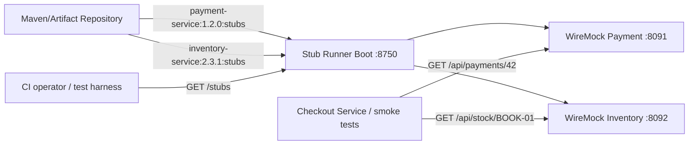
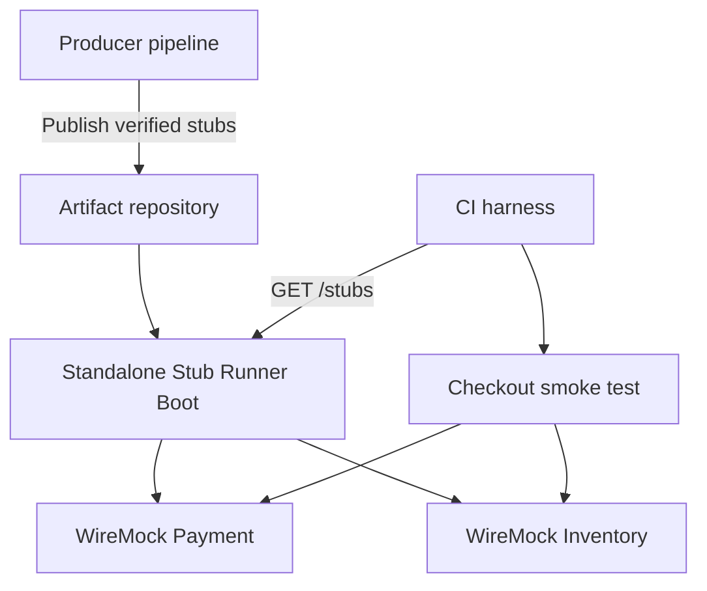

# Stub Runner Boot and How to Configure Producer Stubs

## 1. The Problem: Running Multiple Producer Stubs Without Starting Every Microservice

Suppose `Checkout Service` needs to call both `Payment Service` and `Inventory Service` to complete an order. If every smoke test run had to spin up both producers along with their databases and supporting infrastructure, setup time could exceed the test execution time itself.

With **Spring Cloud Contract**, each producer can describe its HTTP or messaging behavior using the Groovy/YAML DSL, generate **producer verification tests**, and publish a **stub artifact** after verification. Consumers use those stubs to verify requests, responses, serialization, and error handling without running the real producers.

**Stub Runner Boot** is a **standalone** Spring Boot application that downloads, registers, and serves stubs from multiple producers over simulated HTTP servers (typically WireMock). It also exposes REST endpoints to inspect the stub list and trigger messaging labels when messaging integration is configured. It is useful for shared test environments, consumers written in non-JVM languages, post-packaging smoke tests, or CI pipelines needing network-accessible mock services.

Objectives of this lesson:

1. Understand how Stub Runner Boot differs from `@AutoConfigureStubRunner`, WireMock, and Contract Verifier.
2. Declare multiple **producer stub IDs**, repositories, versions, classifiers, and HTTP ports for each producer.
3. Distinguish `CLASSPATH`, `LOCAL`, and `REMOTE`; understand when `repository-root` is required.
4. Run a Stub Runner Boot application via Docker or a custom Spring Boot app matching your version.
5. Correctly use both endpoint types: the **Stub Runner control port** and **each producer's WireMock port**.
6. Diagnose errors such as failed JAR downloads, wrong versions, wrong ports, unmatched requests, and messaging stubs not firing.
7. Design safe, reproducible CI environments without mistaking stub tests for producer verification.

## 2. Architecture: One Control Server, Multiple HTTP Stub Servers

When running standalone, Stub Runner Boot can manage multiple producers simultaneously:



In this diagram:

- **Port 8750** is the HTTP port of the **Stub Runner Boot application**. For example, configured via `server.port: 8750`.
- **Port 8091** is the HTTP server simulating `Payment Service`.
- **Port 8092** is the HTTP server simulating `Inventory Service`.
- These ports are **illustrative values** and must actually be opened/mapped in your runtime environment.

**Do not send `GET /api/payments/42` to port 8750.** The control port exposes management endpoints like `/stubs`; business requests must go to the producer's WireMock port, e.g., `http://localhost:8091/api/payments/42`.

### 2.1. Comparing Three Ways to Use Stub Runner

| Approach | Lifecycle | Best Suited For |
| --- | --- | --- |
| `@AutoConfigureStubRunner` in Spring tests | Stubs start alongside the consumer's test context | JVM JUnit/integration tests with URLs injected per test |
| **Standalone Stub Runner Boot** | Independent application managing stubs for multiple consumers/test harnesses | Smoke tests, Docker/CI, Python/Node.js clients, shared test environments |
| Direct WireMock | Test author manually loads/creates mappings | Specialized HTTP client tests, fault simulation, no Contract artifact loading needed |

Stub Runner Boot **does not** author new contracts or generate producer tests. It only consumes existing stub artifacts from producer builds or a configured stub source.

## 3. Prerequisite: Producer Has Published the Stub Artifact

Before configuring a producer stub, verify:

1. Which producer owns the API and which contracts have been agreed upon with which consumers.
2. The producer build has **generated and executed Contract Verifier tests** against the real implementation.
3. Producer tests passed before publishing the stub artifact; avoid using unverified snapshots.
4. The stub JAR can be downloaded from a local Maven repository or an appropriate artifact repository.
5. Exact `groupId`, `artifactId`, `version`, and `classifier` coordinates.

Hypothetical example assuming two artifacts exist:

```text
com.example:payment-service:1.2.0:stubs
com.example:inventory-service:2.3.1:stubs
```

Typical corresponding JAR filenames:

```text
payment-service-1.2.0-stubs.jar
inventory-service-2.3.1-stubs.jar
```

Example HTTP contract in `Payment Service`:

```groovy
import org.springframework.cloud.contract.spec.Contract

Contract.make {
    description 'Look up completed payment'
    request {
        method GET()
        url '/api/payments/42'
        headers {
            header('Accept', 'application/json')
        }
    }
    response {
        status OK()
        headers {
            contentType(applicationJson())
        }
        body(paymentId: 42, status: 'PAID')
    }
}
```

Hypothetical YAML contract in `Inventory Service`:

```yaml
description: Check stock quantity
request:
  method: GET
  url: /api/stock/BOOK-01
response:
  status: 200
  headers:
    Content-Type: application/json
  body:
    sku: BOOK-01
    available: 12
```

When producer verification passes, stub mappings are packaged so the consumer receives `200` and sample data. **Stub Runner Boot does not call the two real producers to validate those responses.**

## 4. Producer Stub ID Syntax: Ivy/Maven Coordinates and Port

Stub Runner accepts a list of `ids` in the format:

```text
groupId:artifactId:version:classifier:port
```

Example:

```text
com.example:payment-service:1.2.0:stubs:8091
com.example:inventory-service:2.3.1:stubs:8092
```

| Field | Example | Meaning |
| --- | --- | --- |
| `groupId` | `com.example` | Maven group of the producer |
| `artifactId` | `payment-service` | Artifact of the producer, **not the consumer** |
| `version` | `1.2.0` | Version of the stub artifact to download |
| `classifier` | `stubs` | Distinguishes the stubs JAR from the regular application JAR |
| `port` | `8091` | HTTP stub server port assigned to that producer |

The version, classifier, and port segments can be omitted depending on the syntax supported by your Stub Runner version. Defaults typically use classifier `stubs` and pick a free port from the configured range when no port is specified. If version is omitted, some versions default to `+` to fetch the latest release.

**CI recommendation:** declare an **explicit version** and consider fixed ports when accessing from outside a container. Using `+` is convenient during exploration but breaks reproducibility if a newer artifact appears between builds.

### 4.1. Fixed Port or Random Port?

- **Fixed port:** convenient for Docker `-p`, Node.js smoke tests, and systems without a `StubFinder` client; you must prevent port conflicts in parallel runs.
- **Random port:** convenient for parallel JUnit tests on one machine; tests must look up the port from Stub Runner instead of hard-coding it.

`spring.cloud.contract.stubrunner.min-port` and `max-port` define the automatic port-selection range. They **do not override** explicit ports placed at the end of `ids`.

## 5. `stubs-mode`: Choosing Where Stubs Are Loaded From

Three common modes:

| Mode | Stub Source | When to Use |
| --- | --- | --- |
| `CLASSPATH` | Stubs reside on the app/test classpath per configuration | Projects bundling artifacts directly on the classpath |
| `LOCAL` | Accessible Maven local repository on the filesystem | Local development, CI where stub JARs were pre-installed |
| `REMOTE` | Artifact repository or supported remote source | CI/containers, teams using Nexus/Artifactory |

**`LOCAL` does not mean Stub Runner searches the producer's Git repository for contract sources.** It requires an appropriate artifact in the Maven local repository (e.g., installed via a local build/publish step).

**`REMOTE` does not mean enabling an HTTP proxy to the real producer.** It only specifies how to **download stub artifacts**, after which WireMock simulates the producer's API.

### 5.1. LOCAL Configuration in `application.yml`

Example configuration for a custom Stub Runner Boot application:

```yaml
server:
  port: 8750

spring:
  application:
    name: standalone-stub-runner
  cloud:
    contract:
      stubrunner:
        stubs-mode: LOCAL
        ids:
          - "com.example:payment-service:1.2.0:stubs:8091"
          - "com.example:inventory-service:2.3.1:stubs:8092"
```

Prerequisites for this configuration to work:

1. Payment and Inventory stub JARs are already in the **Maven local repository of the Stub Runner Boot process itself**.
2. Ports 8750, 8091, and 8092 are not occupied by other processes.
3. Mappings inside the JARs follow a structure Stub Runner can read.
4. Consumers are configured to point to the **stub ports**, not the real producers.

Illustrative local artifact tree:

```text
~/.m2/repository/com/example/payment-service/1.2.0/
    payment-service-1.2.0-stubs.jar
~/.m2/repository/com/example/inventory-service/2.3.1/
    inventory-service-2.3.1-stubs.jar
```

When running via Docker, the host's `~/.m2` directory **does not automatically appear inside the container**. You must mount it to the local Maven repo location used by the image with proper read permissions, and avoid exposing unnecessary Maven credentials inside the container.

### 5.2. REMOTE Configuration for Nexus or Artifactory

```yaml
server:
  port: 8750

spring:
  cloud:
    contract:
      stubrunner:
        stubs-mode: REMOTE
        repository-root: "https://artifacts.example.test/repository/maven-releases/"
        ids:
          - "com.example:payment-service:1.2.0:stubs:8091"
          - "com.example:inventory-service:2.3.1:stubs:8092"
```

The domain `artifacts.example.test` is **purely illustrative**, not a real Maven repository. In practice, replace it with the Nexus/Artifactory URL your CI has read access to.

If the repository requires authentication, Stub Runner provides corresponding `username` and `password` properties. Supply them via a **secret manager/environment variables** at runtime rather than committing them into YAML:

```text
SPRING_CLOUD_CONTRACT_STUBRUNNER_USERNAME
SPRING_CLOUD_CONTRACT_STUBRUNNER_PASSWORD
```

This configuration is for **artifact download**; it does not apply HTTP Basic or JWT authentication to the producer's stub endpoints.

### 5.3. CLASSPATH Mode

With `CLASSPATH`, stubs must actually be present on the classpath. If packaging a custom JAR or relying on the classpath in another environment, verify that `mappings` and contract resources are visible to Stub Runner.

Do not conflate "JAR is on the classpath" with "JAR is installed in the Maven local repository." Both loading paths locate artifacts differently; set `stubs-mode` explicitly to avoid depending on version-specific defaults.

## 6. Running Stub Runner Boot via Docker: Preferred for Newer Releases

**Important release note:** Current Spring Cloud Contract documentation warns that from version **4.1.6** onward, the executable `spring-cloud-contract-stub-runner-boot` JAR could not be published through the current repository release process. The Docker Stub Runner Boot image is the **recommended** approach, or teams can build the application from source. Therefore, **do not assume downloading a recent fat JAR from Maven Central will succeed**.

Current Docker documentation lists the standalone image:

```text
spring-cloud/spring-cloud-contract-stub-runner
```

Tags/versions and registry paths can change across releases; verify the published image/tag for **your matching Spring Cloud Contract version** before running. Some older examples use `springcloud/spring-cloud-contract-stub-runner`; do not assume the two names are always equivalent aliases.

### 6.1. Example: Starting Two Producer Stubs from a Remote Repository

The following command is a **template to run after replacing the image tag, repository address, and real artifact coordinates**:

```bash
docker run --rm --name contract-stub-runner \
  -e SERVER_PORT=8750 \
  -e SPRING_CLOUD_CONTRACT_STUBRUNNER_STUBS_MODE=REMOTE \
  -e SPRING_CLOUD_CONTRACT_STUBRUNNER_REPOSITORY_ROOT=https://artifacts.example.test/repository/maven-releases/ \
  -e SPRING_CLOUD_CONTRACT_STUBRUNNER_IDS="com.example:payment-service:1.2.0:stubs:8091,com.example:inventory-service:2.3.1:stubs:8092" \
  -p 127.0.0.1:8750:8750 \
  -p 127.0.0.1:8091:8091 \
  -p 127.0.0.1:8092:8092 \
  spring-cloud/spring-cloud-contract-stub-runner:<compatible-tag>
```

Explanation:

| Option | Meaning |
| --- | --- |
| `SERVER_PORT=8750` | Sets Spring Boot's management HTTP port |
| `STUBS_MODE=REMOTE` | Downloads stub artifacts from a remote source |
| `REPOSITORY_ROOT` | Artifact repository URL |
| `IDS` | Two producers and two fixed WireMock ports |
| `-p 127.0.0.1:8750:8750` | Exposes the control API only to localhost on the host |
| `-p 127.0.0.1:8091:8091` | Exposes the Payment HTTP stub to localhost |
| `-p 127.0.0.1:8092:8092` | Exposes the Inventory HTTP stub to localhost |

Depending on the image/release, `IDS` may need to be represented as a list using the proper environment binding syntax. Check startup logs to confirm **both IDs were parsed as two entries** rather than treated as one single string. To avoid ambiguity, you can mount a YAML config or pass `SPRING_CLOUD_CONTRACT_STUBRUNNER_IDS_0`, `..._IDS_1` according to your Spring Boot binder version.

**This example is for Linux/macOS shells that support `\` line continuation.** In Windows PowerShell, use a single line or PowerShell's line continuation character rather than copying trailing `\` characters verbatim.

### 6.2. Docker LOCAL Requires Mounting a Maven Local Volume

If both artifacts are already installed in the host's Maven local repository, choose `LOCAL` and mount it:

```bash
docker run --rm --name contract-stubs-local \
  -e SERVER_PORT=8750 \
  -e SPRING_CLOUD_CONTRACT_STUBRUNNER_STUBS_MODE=LOCAL \
  -e SPRING_CLOUD_CONTRACT_STUBRUNNER_IDS="com.example:payment-service:1.2.0:stubs:8091" \
  -v "$HOME/.m2:/home/scc/.m2:ro" \
  -p 127.0.0.1:8750:8750 \
  -p 127.0.0.1:8091:8091 \
  spring-cloud/spring-cloud-contract-stub-runner:<compatible-tag>
```

`/home/scc/.m2` is a **container path used in documentation examples for certain images**; verify the actual image/tag and container user before applying it. If the container's local Maven repo lives elsewhere, mount that path or configure `maven.repo.local`.

If the host does not yet have the stub JAR, mounting an empty directory will not make `LOCAL` download from Artifactory. You must run a producer build to install the JAR locally or switch to `REMOTE`.

### 6.3. Do Not Expose the Control API to Untrusted Networks

Stub Runner Boot is **not designed with security enabled by default**. Official documentation warns against running the fat JAR or Docker image on untrusted network locations. Management endpoints can reveal active stubs or trigger messages.

Therefore:

- Run only on **developer machines, CI networks, or isolated test environments**.
- Bind host ports to `127.0.0.1` when used only from the same machine.
- For multi-container CI, use a private network and restrict inbound traffic; never expose the control port to the internet.
- Never download JARs from untrusted sources or leave WireMock administration open to everyone.
- Never bake artifact repository credentials into images or commit them to repositories.

## 7. Building Your Own Stub Runner Boot Server with Spring Boot

If you cannot use the pre-built image, you can create a dedicated Spring Boot application compatible with your project's Spring Cloud Contract version.

Core dependency per documentation:

```groovy
dependencies {
    implementation 'org.springframework.cloud:spring-cloud-starter-stub-runner'
}
```

This is a **snippet inside `build.gradle`**, not a complete project. It still needs the Spring Boot plugin, dependency management/BOM, and compatible versions.

Illustrative Boot application:

```java
@SpringBootApplication
@EnableStubRunnerServer
public class StandaloneStubRunnerApplication {

    public static void main(String[] args) {
        SpringApplication.run(StandaloneStubRunnerApplication.class, args);
    }
}
```

Imports are omitted to focus on the structure; use the `@EnableStubRunnerServer` annotation provided by **your project's Stub Runner library version**. When packaging, build an executable Spring Boot JAR with the corresponding build plugin and configure `application.yml` as shown in section 5.

**Important distinction:** building your own `@EnableStubRunnerServer` app is not the same as downloading a recent `spring-cloud-contract-stub-runner-boot` executable JAR from Maven Central. These are **two different distribution methods**: self-building a Boot application vs. using a prebuilt binary.

### 7.1. Running the Custom JAR with CLI Arguments

Once your team's Boot app is built:

```bash
java -jar standalone-stub-runner.jar \
  --server.port=8750 \
  --spring.cloud.contract.stubrunner.stubs-mode=LOCAL \
  --spring.cloud.contract.stubrunner.ids="com.example:payment-service:1.2.0:stubs:8091"
```

`standalone-stub-runner.jar` is a hypothetical filename **built by your team**, not a claim that this file exists out of the box or is an official Spring Cloud Contract artifact name.

### 7.2. Legacy Guides: Fat JAR or Spring Cloud CLI

Older guides/releases show:

```bash
java -jar spring-cloud-contract-stub-runner-boot-<old-version>.jar \
  --spring.cloud.contract.stubrunner.ids="com.example:payment-service:1.2.0:stubs:8091"
```

or Spring Cloud CLI with `spring cloud stubrunner`. Both are **historical/tool-dependent instructions**: before choosing them, verify artifact, CLI, and version availability. For newer releases, the docs recommend Docker or building your own runner.

## 8. Stub Runner Boot Management REST Endpoints

When the application starts on port `8750`, it exposes endpoints to inspect running stubs and trigger messaging labels (depending on integration/version):

| Method | Endpoint on Control Server | Purpose |
| --- | --- | --- |
| `GET` | `/stubs` | List running producer stubs and ports |
| `GET` | `/stubs/{ivy}` | Look up a producer's port by supported ID/shorthand coordinates |
| `GET` | `/triggers` | List triggerable messaging labels |
| `POST` | `/triggers/{label}` | Trigger a message stub by label |
| `POST` | `/triggers/{ivy}/{label}` | Trigger a label for a specific producer |

These endpoints are **Stub Runner Boot's API**, not Payment/Inventory business APIs. `{ivy}` represents the producer stub ID; some versions allow using just `artifactId` when unique and unambiguous.

### 8.1. Querying Started Stubs

```bash
curl -s http://localhost:8750/stubs
```

Illustrative response:

```json
{
  "com.example:payment-service:1.2.0:stubs": 8091,
  "com.example:inventory-service:2.3.1:stubs": 8092
}
```

**This is a data-shape example**, not a guarantee that key names, ordering, or formatting are identical across every version. Rely on the actual `/stubs` output to confirm producer-to-port mappings.

Query Payment individually using the shorthand form if supported by the server:

```bash
curl -s http://localhost:8750/stubs/payment-service
```

When the ID exists, expect a positive port number such as `8091`. If multiple stubs share an `artifactId` with different groups or versions, use the full coordinates or an unambiguous identifier, and URL-encode special characters.

### 8.2. Calling a Producer Stub's HTTP API

```bash
curl -i -H "Accept: application/json" \
  http://localhost:8091/api/payments/42
```

Example response:

```http
HTTP/1.1 200 OK
Content-Type: application/json

{"paymentId":42,"status":"PAID"}
```

Inventory:

```bash
curl -i http://localhost:8092/api/stock/BOOK-01
```

If `GET /stubs` shows `8091` but `curl` from another machine cannot reach that port, the issue likely lies in **Docker port publishing, network namespaces, firewalls, or host addresses**, not the contract content.

## 9. Messaging Labels and Triggers in a Standalone Server

Stub Runner Boot does not only manage HTTP stubs. With suitable messaging integration, it also exposes message trigger endpoints.

Example messaging contract:

```groovy
import org.springframework.cloud.contract.spec.Contract

Contract.make {
    description 'Notify payment completed'
    label 'payment_completed'

    input {
        triggeredBy('completePaymentAndPublish()')
    }

    outputMessage {
        sentTo('payments.completed')
        body(
            eventType: 'PaymentCompleted',
            paymentId: 42,
            status: 'PAID'
        )
    }
}
```

Once this stub artifact is loaded and **Stub Runner Boot has the appropriate message verifier/binder or broker adapter**, you can view labels:

```bash
curl -s http://localhost:8750/triggers
```

Then trigger a label:

```bash
curl -i -X POST http://localhost:8750/triggers/payment_completed
```

**Understand accurately:**

- The `/triggers` API only orchestrates sending the stub message; the message is emitted to **the configured transport**.
- A `200` from `POST /triggers/payment_completed` **does not prove** Notification Service received and processed the event.
- If multiple producers share a label name, use `/triggers/{ivy}/{label}` to specify the source.
- Starting Stub Runner Boot does not magically provide a running Kafka/RabbitMQ broker; messaging requires the right dependencies, binder, destination, and connection settings.
- HTTP WireMock does not replace a message broker, and Stub Runner Boot does not verify retries, ordering, or exactly-once delivery.

For example, Docker may require `MESSAGING_TYPE` per image documentation alongside `SPRING_KAFKA_BOOTSTRAP_SERVERS` or `SPRING_RABBITMQ_ADDRESSES`. Cross-check options against your image version and actual messaging setup.

## 10. Selecting consumer-name When a Producer Has Multiple Contract Groups

A producer can package multiple contract groups:

```text
contracts/
  checkout-service/
    payment_status.groovy
  reporting-service/
    payment_report.groovy
```

Enabling **stubs-per-consumer** lets Stub Runner filter mappings for a single consumer instead of loading everything.

```yaml
spring:
  cloud:
    contract:
      stubrunner:
        stubs-per-consumer: true
        consumer-name: checkout-service
```

Unlike `@AutoConfigureStubRunner` inside a test context, a standalone server serving **multiple consumers concurrently** requires thought: setting `consumer-name: checkout-service` globally means Reporting's mappings may not be loaded. If different consumer groups are needed in the same test environment, provision separate Stub Runner Boot instances or an appropriate filtering strategy.

**`consumer-name` is not a caller authentication mechanism.** It only selects which mappings get loaded; it does not verify which consumer sent a request. Never use it in place of authorization or tenant isolation.

## 11. Service Discovery and Multi-Service Smoke Tests

One purpose of Stub Runner Boot is running smoke tests right after a consumer application is packaged/deployed: running only the real consumer alongside a set of producer stubs rather than deploying every microservice.

If the consumer calls downstream services by `serviceId` through service discovery/load balancing instead of fixed URLs, there are two strategies:

1. **Configure direct URLs in the test profile** pointing to Payment/Inventory stub ports.
2. **Integrate Stub Runner Boot with service discovery** using the mechanism supported by Spring Cloud Contract and your discovery backend so clients resolve the stubs.

Example using direct URLs:

```yaml
payment:
  client:
    base-url: http://localhost:8091
inventory:
  client:
    base-url: http://localhost:8092
```

This is **consumer configuration** for a smoke test environment, not Stub Runner's `ids` configuration. In Docker Compose/Kubernetes, the consumer's `localhost` is **not** the Stub Runner container's localhost; use the shared network hostname/service name and port.

If using real discovery, check the `serviceId` name, how Stub Runner registers fake instances, TTL/health checks, and whether the load balancer returns the stub endpoint. Having `artifactId=payment-service` in `ids` does not guarantee the registry publishes that same name if the application uses a different `serviceId`.

## 12. Designing a Docker Compose or CI Environment

### 12.1. Minimum Components



A reliable CI workflow can look like:

1. Producer build runs **generated contract verification** against the real implementation.
2. Only when passing, producer publishes the artifact with classifier `stubs`.
3. CI resolves the required version of each producer stub.
4. CI starts Stub Runner Boot in an isolated test network.
5. Check `GET /stubs` to confirm all producers and ports are present.
6. Run a few verification requests against HTTP mappings / messaging labels.
7. Start the consumer/smoke-test application with downstream URLs routed to the stubs.
8. Run consumer business tests and collect logs on failure.
9. Stop/remove the stub environment so test servers never linger beyond their scope.

### 12.2. Data and Versions Must Be Reproducible

Example test configuration record:

```yaml
contract-test-environment:
  consumer-build: checkout-service-2.8.0
  producers:
    payment-service: 1.2.0
    inventory-service: 2.3.1
  stub-runner:
    server-port: 8750
    payment-port: 8091
    inventory-port: 8092
```

This is an **illustrative CI metadata model**, not an `application.yml` file automatically read by Spring Boot. You can store corresponding values as pipeline variables or a build manifest to reproduce the environment when failures occur.

Never use dynamic versions like `+` when you need to reproduce a failure accurately. When multiple pipelines run in parallel, assign separate ports/networks or use random ports with discovery to prevent collisions.

### 12.3. Separating Testing Responsibilities

| Step | What It Proves | What It Does Not Prove on Its Own |
| --- | --- | --- |
| Producer Verifier | Producer matches the contracts that were executed | All business/E2E flows work |
| Stub Runner Boot startup | Artifact can be loaded and stub servers are running | Real producer or database is healthy |
| Consumer smoke test with stubs | Client calls the stub correctly and handles sample payloads | Production network, DNS, auth, or broker behave identically |
| Integration/E2E tests | Flow is exercised in closer-to-real infrastructure | Coverage of scenarios outside the test scope |

Just because `GET /stubs` returns two producers and HTTP ports does not mean every request in the contracts matches or that the current producer is compatible.

## 13. Diagnosing Producer Stub Configuration Errors

| Symptom | Common Cause | How to Fix |
| --- | --- | --- |
| `/stubs` returns an empty list | `ids` not parsed, no artifacts, or config not loaded | Check environment binding, effective properties, and stub loading logs |
| Cannot load stub JAR in `LOCAL` | Process's local Maven repo lacks the artifact | Build/publish locally or mount the right container repo path |
| Cannot download stub JAR in `REMOTE` | Wrong repository URL/credentials/network, missing version | Check `repository-root`, read permissions, proxy, and coordinates |
| JAR downloaded but no HTTP mappings | JAR missing mappings or wrong layout/classifier | Inspect the published artifact structure |
| `/stubs` shows port but curl gets connection refused | Stub server bound to another interface, Docker port not published | Check process, container ports, and firewall |
| `/stubs/payment-service` returns no port | Artifact name/ID mismatch, multiple versions causing ambiguity | Use full coordinates |
| Curl returns 404 even though stub is registered | URL, method, headers, or JSON body do not match | Check request journal and WireMock mapping |
| Consumer gets wrong response | Stale stub version, conflicting mappings, or another consumer's stub | Pin version, check `stubs-per-consumer` and mappings |
| Two producers request the same port | Duplicate port in `ids` configuration | Assign distinct ports or use dynamic ports |
| Docker running but unreachable from consumer container | Pointing to consumer container's own localhost | Use Stub Runner's shared-network hostname |
| Messaging trigger sends no event | Missing or wrong binder/broker/label/destination | Check `/triggers`, message adapter, and broker config |
| Tests pass while producer schema changed | Consumer uses old stub JAR or producer tests were skipped | Run producer verification on the new code/version |

### 13.1. Distinguishing "No Mapping" from a Business 404 Response

A request to `http://localhost:8091/api/payments/999` returning `404` can happen because:

- The stub genuinely has a `PAYMENT_NOT_FOUND` contract returning `404` with the agreed error body.
- WireMock found no matching mapping and returned an unmatched-request error.

Inspect **body/headers** and WireMock diagnostics rather than assuming a `404` status means the producer API returned a business error.

### 13.2. Stub Runner Boot Is Running, Yet Consumer Still Hits Real Producer

Usually caused by consumer configuration failing to override the URL or service discovery. Stub Runner cannot intercept an HTTP client arbitrarily calling a production host; configure the test profile or discovery integration properly.

Check the actual target URL of outbound requests, without **logging real tokens/PII** in debug output. For each producer, maintain a clear mapping: `artifact ID → stub port → consumer URL`.

### 13.3. Wrong Service Name, Version, or Classifier

```text
Expected: com.example:payment-service:1.2.0:stubs
Actual:   com.example:payment-api:1.2.0
```

A mismatched `artifactId` or missing `classifier=stubs` can load the wrong artifact or fail to load altogether. Do not rename `ids` to the consumer's name (e.g., `checkout-service`) just to "match" the Spring application name.

### 13.4. Loading Multiple Producers When One Fails

A stub server starting successfully does not prove **all** `ids` loaded properly. Compare `/stubs` against the **entire expected list** and fail CI if any required producer is missing. Check artifact download logs, ID parsing, and whether another mode or profile overrides the list.

## 14. Hands-On Exercise: Running Two Producer Stubs for One Consumer

Suppose `Booking Service` (consumer) needs:

- `Room Service`: `GET /api/rooms/101`, returning `{"roomId":101,"available":true}`.
- `Pricing Service`: `GET /api/prices/101`, returning `{"roomId":101,"nightlyPrice":850000,"currency":"VND"}`.

Producers have verified and published:

```text
com.example:room-service:1.4.0:stubs
com.example:pricing-service:2.1.0:stubs
```

### 14.1. Requirements

1. Choose two HTTP stub ports `8093`, `8094` and control port `8750`.
2. Write `application.yml` to run Stub Runner Boot in `LOCAL` mode with both producer IDs.
3. Propose Booking consumer configuration to send both requests properly.
4. Write commands to inspect `/stubs` and call both sample APIs.
5. Explain what happens when the local Maven repository does not contain `pricing-service-2.1.0-stubs.jar`.
6. Switch the configuration to `REMOTE` if CI uses Nexus/Artifactory.
7. If the Booking app runs in a different container from Stub Runner Boot, why is `localhost:8093` the wrong address?

### 14.2. Suggested YAML Solution

```yaml
server:
  port: 8750
spring:
  cloud:
    contract:
      stubrunner:
        stubs-mode: LOCAL
        ids:
          - "com.example:room-service:1.4.0:stubs:8093"
          - "com.example:pricing-service:2.1.0:stubs:8094"
```

In consumer tests running on the same host:

```yaml
room:
  client:
    base-url: "http://localhost:8093"
pricing:
  client:
    base-url: "http://localhost:8094"
```

Prerequisite: the real application's `RoomClient` and `PricingClient` must be configured to read these exact two keys.

### 14.3. Verification Commands

```bash
curl -s http://localhost:8750/stubs
curl -i http://localhost:8093/api/rooms/101
curl -i http://localhost:8094/api/prices/101
```

If `pricing-service` is missing from local Maven, you must **install the stub artifact** or switch to `REMOTE` with valid artifact coordinates and repository settings. Switching to REMOTE does not guarantee success if the artifact has not been published or CI lacks read permissions.

In Docker Compose, Booking needs to point to the Stub Runner service hostname (e.g., `http://stub-runner:8093`) on the shared network, not the Booking container's own localhost.

### 14.4. Critical Thinking Exercises

| Question | Hint |
| --- | --- |
| Does port 8750 serve `/api/rooms/101`? | No; that is the control port, and business APIs live on the Room stub port |
| Producer changed `available` from boolean to string, yet consumer tests on the old stub still pass; why? | Old stub JAR does not reflect the new implementation; producer verification and a version bump are needed |
| What are the pros and cons of using `+` instead of a specific version? | Convenient for fetching the latest, but destroys reproducibility |
| Does Stub Runner Boot verify Kafka retries/DLQ? | No; message integration/broker tests are required |
| Should `/triggers` be exposed to the internet? | No; Stub Runner Boot is not designed with default security |

## 15. Checklist Before Using Stub Runner Boot in CI

- Have you separated the **control port** from each producer's HTTP stub port?
- Were producer stub artifacts **producer-verified** before publishing?
- Do `ids` follow `groupId:artifactId:version:classifier:port` with pinned versions?
- Was `CLASSPATH`/`LOCAL`/`REMOTE` chosen deliberately?
- Are `repository-root` and credentials correct, without storing secrets in the repository?
- If using Docker, did you pick a compatible image/tag, publish the needed ports, and mount the Maven repo for LOCAL?
- Does `GET /stubs` show **every required producer**?
- Do consumer HTTP clients point to the right stub servers rather than accidentally calling real producers?
- Are `stubs-per-consumer` and `consumer-name` set appropriately when artifacts contain multiple mapping groups?
- If using messaging, are the binder/broker/adapter and matching `label` configured?
- Is the Control API restricted to a trusted test network and never exposed to the internet?
- Does CI clean up containers, reset state, and preserve enough logs to diagnose failures?
- Are security/integration/E2E tests kept for things Stub Runner Boot cannot prove?

**Official documentation for reference and version verification:**

- [Spring Cloud Contract — Stub Runner Boot Application](https://docs.spring.io/spring-cloud-contract/reference/project-features-stubrunner/stub-runner-boot.html).
- [Spring Cloud Contract — Stub Runner Common Properties](https://docs.spring.io/spring-cloud-contract/reference/project-features-stubrunner/stub-runner-common.html).
- [Spring Cloud Contract — Docker Project](https://docs.spring.io/spring-cloud-contract/reference/docker-project.html).
- [Spring Cloud Contract — Stub Runner Spring Cloud](https://docs.spring.io/spring-cloud-contract/reference/project-features-stubrunner/stub-runner-cloud.html).
- [Spring Cloud Contract — Stub Runner Stubs Per Consumer](https://docs.spring.io/spring-cloud-contract/reference/project-features-stubrunner/stub-runner-stubs-per-consumer.html).

**Remember:** **Stub Runner Boot is a standalone stub orchestration application**: it downloads producer stub artifacts by Maven coordinates, starts one HTTP stub server per producer, and exposes `/stubs` and `/triggers` on its management port. For effective testing, pin versions, configure modes/repositories/ports accurately, verify every stub is running, and point consumers to the proper ports. Stub Runner Boot **does not verify producer implementations**, is not a production service, and must never be deployed on untrusted networks.
