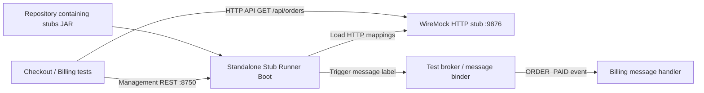
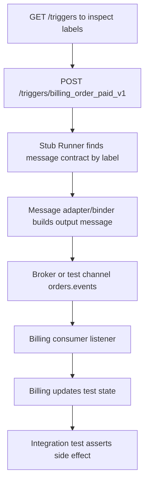
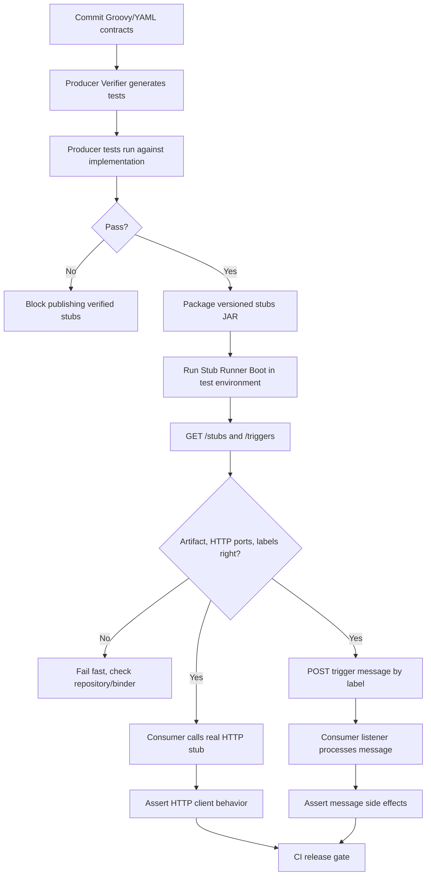

# Querying Running Stubs and Triggering Messages

In microservices systems, a consumer often needs to use multiple **stubs** at once: making HTTP calls to a simulated producer and receiving events that producer is expected to emit. When stubs run **standalone** in a separate process or container, the tester must know **which stubs have started, which HTTP port serves each one, which message labels can be triggered, and how to confirm the consumer received the event**.

**Spring Cloud Contract Stub Runner Boot** solves this with an independent orchestration application. It downloads **stubs artifacts** generated from **Groovy/YAML DSL** contracts, starts the corresponding HTTP stub servers, and exposes **management REST endpoints** to query running stubs and available labels. For message contracts, it can also trigger sample messages by `label` when the proper messaging mechanism is configured.

This lesson belongs to the **Standalone Stubs** chapter of the **SPRING_CLOUD_CONTRACT** track: learning contract testing between producers and consumers, generating producer tests, packaging stubs, running Stub Runner, and integrating with CI to detect incompatible API changes. It focuses on **querying running stubs and triggering messages**, including using standalone Stub Runner's REST API, distinguishing the two port types, preparing brokers/binders, verifying outcomes, and troubleshooting configuration errors.

## 1. When Do You Need Standalone Stub Runner?

There are two common models:

| Model | Where Does Stub Runner Live? | How Does the Consumer Access It? |
|---|---|---|
| **Inside the test application** | Same Spring test context, usually via `@AutoConfigureStubRunner` | Tests can inject `StubFinder`/`StubTrigger` |
| **Standalone Stub Runner Boot** | A separate Spring Boot process or Docker container | Calls management REST `/stubs`, `/triggers`, and HTTP stub ports |
| **Manual WireMock** | A server created and configured directly by the test | Calls the WireMock port; does not come with Stub Runner Boot's management REST API |

**Standalone** is useful when a test suite prefers not to launch Stub Runner inside every consumer application, when smoke-testing multiple services, or when consumers written in non-Java languages need to share the same stub set.

However, **the Stub Runner Boot application is not a stateful business simulator of the producer**. It serves mappings and message samples from contracts; it does not run the real Order Service/Inventory Service, does not connect to producer databases, and does not replace producer contract verification.

### 1.1. Three Layers to Keep Distinct



This example involves **three distinct ports/addresses**:

- `localhost:8750` — **Stub Runner Boot management** port: serves `/stubs` and `/triggers`.
- `localhost:9876` — **Order Service HTTP stub** port: serves `/api/orders/ORDER-42`.
- **Broker address** (if messaging tests actually use Kafka, RabbitMQ, JMS, or another adapter): where messages are sent and consumed.

Do not send `GET /api/orders/ORDER-42` to `localhost:8750` and conclude a contract mapping is missing. Likewise, do not send `POST /triggers/...` to port `9876` — that is the WireMock stub port, not the management REST API.

## 2. Prerequisites Before Running Standalone

Suppose:

- Producer: **Order Service**, Maven coordinates `com.example:order-service:1.4.0`.
- HTTP consumer: **Checkout Service**.
- Message consumer: **Billing Service**.
- Stubbing artifact: `com.example:order-service:1.4.0:stubs`.
- Stub Runner Boot management port: `8750`.
- Order Service HTTP stub port: `9876`.
- Message contract label: `billing_order_paid_v1`.
- Output destination: `orders.events`.

### 2.1. Input Prerequisites

1. The producer has **Groovy/YAML contracts** describing the agreed requests/responses or events.
2. The Spring Cloud Contract plugin has **generated and executed producer contract tests** against Order Service's real implementation.
3. The producer build packaged a **stubs JAR** with classifier `stubs`.
4. The stubs artifact is present in a local Maven repository or a remote repository accessible to Stub Runner.
5. The Stub Runner Boot version is compatible with Java, Spring Boot/Spring Cloud Contract, and the artifact layout.
6. If testing messaging, the test broker/binder and consumer listener are set up and connected properly.
7. The management port is exposed only to a **trusted test environment**.

**Artifact distinction:** `order-service-1.4.0.jar` is the application artifact; `order-service-1.4.0-stubs.jar` typically contains contracts and mappings. Standalone Stub Runner **does not launch Order Service's application JAR**.

### 2.2. Example HTTP Contracts

Groovy DSL for an interaction Checkout relies on:

```groovy
import org.springframework.cloud.contract.spec.Contract

Contract.make {
    name 'checkout_get_paid_order_200'

    request {
        method GET()
        url '/api/orders/ORDER-42'
        headers {
            header 'Accept', 'application/json'
        }
    }

    response {
        status OK()
        headers {
            contentType(applicationJson())
        }
        body(
            id: 'ORDER-42',
            status: 'PAID',
            totalAmount: 125000
        )
    }
}
```

Another YAML contract for a missing order case:

```yaml
name: checkout_get_missing_order_404
request:
  method: GET
  url: /api/orders/ORDER-MISSING
  headers:
    Accept: application/json
response:
  status: 404
  headers:
    Content-Type: application/json
  body:
    code: ORDER_NOT_FOUND
```

These two contracts only require producer verification and a stubs artifact; once Stub Runner loads the mappings, Checkout can exercise both `200` and `404` without running the real producer.

## 3. Message Contracts and `label` for Triggering

Suppose Order Service emits `ORDER_PAID` when an order transitions to paid status. Billing wants to test its real listener against a sample event.

Groovy message contract:

```groovy
import org.springframework.cloud.contract.spec.Contract

Contract.make {
    name 'billing_order_paid_event_v1'
    label 'billing_order_paid_v1'

    input {
        triggeredBy('publishOrderPaid()')
    }

    outputMessage {
        sentTo('orders.events')
        headers {
            header('contentType', 'application/json')
            header('eventType', 'ORDER_PAID')
        }
        body(
            eventId: 'EVENT-ORDER-42',
            eventType: 'ORDER_PAID',
            orderId: 'ORDER-42',
            totalAmount: 125000
        )
    }
}
```

Role of each element:

| Element | Role |
|---|---|
| `name 'billing_order_paid_event_v1'` | Contract / generated test name |
| `label 'billing_order_paid_v1'` | Label used to trigger the message stub on the consumer side |
| `triggeredBy('publishOrderPaid()')` | Hook provided by the **producer** base test to emit a real event during producer verification |
| `outputMessage.sentTo('orders.events')` | Destination of the output message |
| `outputMessage.headers` and `body` | Values Billing needs to deserialize and inspect |

**`label` is not `eventId`**. The label is a stable scenario identifier inside the stub suite, whereas `eventId` is a payload field that changes with each event instance in production.

### 3.1. Producer Verification vs. Consumer-Side Trigger

When verifying the **producer**, generated tests typically invoke `publishOrderPaid()` on the base class and verify that the real Order Service emits an event matching the contract. When running **standalone Stub Runner**, triggering by label uses the sample message from the **stubs artifact** to send a simulated event; it **does not invoke** the real producer's `publishOrderPaid()` method.

A YAML message contract can express equivalent information in supported versions:

```yaml
name: billing_order_paid_event_v1
label: billing_order_paid_v1
input:
  triggeredBy: publishOrderPaid()
outputMessage:
  sentTo: orders.events
  headers:
    contentType: application/json
    eventType: ORDER_PAID
  body:
    eventId: EVENT-ORDER-42
    eventType: ORDER_PAID
    orderId: ORDER-42
    totalAmount: 125000
```

YAML message DSL structure, header conversion, and message trigger generation **depend on the version**. Verify that your selected Verifier version accepts the schema and that the stubs JAR contains the matching label. Do not place **equivalent Groovy and YAML files for the same scenario** in the same source set unintentionally.

## 4. Preparing the Stubs Artifact and Version

Illustrative stubs JAR:

```text
order-service-1.4.0-stubs.jar
└── META-INF/
    └── com.example/
        └── order-service/
            └── 1.4.0/
                ├── contracts/
                │   ├── checkout/
                │   │   └── get_paid_order_200.groovy
                │   └── billing/
                │       └── order_paid_event_v1.groovy
                └── mappings/
                    └── checkout/
                        └── checkout_get_paid_order_200.json
```

This is an **illustrative layout**, not a mandatory path across every version/plugin. Message stubs may require **the source contract inside the artifact**, not just a WireMock JSON mapping. Stub Runner reads the message contract and builds the message trigger pipeline via the messaging integration.

Producer-side steps:

1. Author contracts agreed upon with consumers.
2. Configure the Spring Cloud Contract Verifier/plugin, base test class, and fixtures.
3. Generate and **execute** producer tests.
4. Package the stubs artifact.
5. Verify classifier, version, contracts, and mappings.
6. `install` into the local Maven repository or `publish` to a remote Maven repository.

Example Maven commands in a **configured producer project**:

```bash
./mvnw clean verify
./mvnw install
jar tf target/order-service-1.4.0-stubs.jar
```

Running these three commands does not guarantee every project produces that exact filename: tasks, plugin goals, file paths, and `finalName` depend on the build. Never pass `-DskipTests` and treat the resulting stubs artifact as **producer-verified**.

### 4.1. Stub Coordinates in Stub Runner

A common declaration:

```text
com.example:order-service:1.4.0:stubs:9876
```

Fields:

```text
groupId       = com.example
artifactId    = order-service
version       = 1.4.0
classifier    = stubs
stubHttpPort  = 9876
```

Port `9876` at the end is the **stub server's HTTP port**, not part of the Maven artifact identity. When dynamic ports are desired, some configurations/versions allow omitting the port or require a dedicated port-selection strategy; in that case, you must **query the port after startup** rather than hardcoding URLs.

## 5. Starting Standalone Stub Runner Boot

You can run Stub Runner Boot via its **Docker image**, a self-packaged Stub Runner Server application, or an executable JAR **if published for that version**.

**Version note:** official Spring Cloud Contract documentation notes that **starting with 4.1.6**, publishing the executable Stub Runner Boot JAR was suspended due to artifact release tooling limitations; the **Docker Stub Runner Boot image** is recommended instead. Therefore, do not write guides assuming `stub-runner-boot-x.y.z.jar` can be downloaded for every version. Before running, check the distribution options for **your chosen project version**.

### 5.1. Docker Example Using a Remote Maven Repository

The command below illustrates running in a test environment with management port `8750` and HTTP stub port `9876`:

```bash
docker run --rm --name order-contract-stubs \
  -e STUBRUNNER_IDS=com.example:order-service:1.4.0:stubs:9876 \
  -e STUBRUNNER_STUBS_MODE=REMOTE \
  -e STUBRUNNER_REPOSITORY_ROOT=https://repo.example.test/maven-releases \
  -p 8750:8750 \
  -p 9876:9876 \
  springcloud/spring-cloud-contract-stub-runner:COMPATIBLE_VERSION
```

**This is a configuration template**, not an executed command. Replace `COMPATIBLE_VERSION` with an existing compatible image tag, and replace the example URL with your test environment's artifact repository containing `order-service:1.4.0:stubs`. Verify default environment variable names and ports against the actual **Docker tag and Spring Cloud Contract version**.

Requirements for this command to succeed:

- The registry hosts the matching image and the Docker engine is running.
- The repository serves the stubs artifact with proper access permissions and secure credentials if needed.
- Ports `8750` and `9876` are free on the host.
- The HTTP stub inside the container actually listens on port `9876`.
- The management port is never exposed to untrusted networks.

Docker may need to reach the broker by hostname within the **same Docker network**, rather than `localhost` inside the container. `localhost` inside a container refers to that container itself.

### 5.2. Using the Local Maven Repository

If the producer just ran `./mvnw install` and the stub is already in local Maven, you can use `LOCAL` mode. With Docker, mount the local Maven repository **to the image user's home location**. In several Spring Cloud Contract sample images, the documented mount target is `/home/scc/.m2`:

```bash
docker run --rm --name local-contract-stubs \
  -v "$HOME/.m2:/home/scc/.m2:ro" \
  -e STUBRUNNER_IDS=com.example:order-service:1.4.0:stubs:9876 \
  -e STUBRUNNER_STUBS_MODE=LOCAL \
  -p 8750:8750 \
  -p 9876:9876 \
  springcloud/spring-cloud-contract-stub-runner:COMPATIBLE_VERSION
```

Verify the container user's home directory, permissions, and Maven settings for the specific image—especially on Docker Desktop on Windows. Do not assume mounting to an arbitrary path will be picked up by Stub Runner.

### 5.3. Packaging Your Own Stub Runner Server

Some versions provide `@EnableStubRunnerServer` so a Spring Boot application acts as the management server. Structural example:

```java
import org.springframework.boot.SpringApplication;
import org.springframework.boot.autoconfigure.SpringBootApplication;
import org.springframework.cloud.contract.stubrunner.server.EnableStubRunnerServer;

@SpringBootApplication
@EnableStubRunnerServer
public class ContractStubServerApplication {
    public static void main(String[] args) {
        SpringApplication.run(ContractStubServerApplication.class, args);
    }
}
```

This is an **architectural pattern whose packages/imports must be checked against your version**; the project needs the proper Stub Runner Server starter/dependencies, builds an executable artifact, and supplies configuration properties. Never copy the annotation and assume classpath, version, or security need no checking.

A Spring Boot configuration can use the common properties:

```yaml
server:
  port: 8750
spring:
  cloud:
    contract:
      stubrunner:
        ids:
          - com.example:order-service:1.4.0:stubs:9876
        stubs-mode: LOCAL
```

Property names in a **standalone distribution/image** may appear under the `stubrunner` prefix in documentation for other versions; inspect the **effective configuration** of the version you run. Never mix two configuration styles without knowing precedence rules, only to end up debugging a server whose stubs never loaded.

## 6. Management Port and HTTP Stub Port Are Two Different Services

The following table is the centerpiece of this lesson:

| Port | Owner | Example URL | Purpose |
|---|---|---|---|
| `8750` | Stub Runner Boot | `GET /stubs` | List running stubs |
| `8750` | Stub Runner Boot | `GET /stubs/order-service` | Look up a specific stub's port |
| `8750` | Stub Runner Boot | `GET /triggers` | List message labels |
| `8750` | Stub Runner Boot | `POST /triggers/billing_order_paid_v1` | Trigger a message |
| `9876` | WireMock for Order Service | `GET /api/orders/ORDER-42` | Return sample HTTP response |
| Dedicated broker | Messaging integration | `orders.events` | Deliver message to Billing listener |

If `GET /stubs` works, that proves the **management API** is running; it does not prove every mapping loaded properly or that consumers can reach the stub port from their own network.

If `GET /triggers` returns labels, that proves **Stub Runner recognizes the label**; it does not prove a broker is running or that Billing consumed the event.

## 7. Listing All Running HTTP Stubs: `GET /stubs`

In Stub Runner Boot, the management endpoint:

```http
GET http://localhost:8750/stubs
```

Per the documentation, the response returns **a list/map of running stubs in Ivy notation mapped to their port numbers**.

Test it:

```bash
curl -sS http://localhost:8750/stubs
```

Illustrative response:

```json
{
  "com.example:order-service:1.4.0:stubs": 9876,
  "com.example:inventory-service:2.1.0:stubs": 9877
}
```

**Note:** this is an example response assuming two configured artifacts, not live environment output. Resolved versions and key formatting are produced by the actual Stub Runner instance; inspect the returned JSON rather than matching an immutable literal string.

### 7.1. Using the Result to Configure the Client

When Stub Runner manages multiple stubs, the consumer should not assume every artifact stays on a fixed port. Recommended flow:

1. Call `GET /stubs`.
2. Find the key for the needed producer.
3. Extract the corresponding port.
4. Configure the test client to point to the HTTP stub `host:port`.
5. Call the business endpoint through the real client.
6. Assert the response against the contract.

**Never use the management URL as the client's base URL.** For example, Checkout must call `http://localhost:9876/api/orders/ORDER-42`, not `http://localhost:8750/api/orders/ORDER-42`.

### 7.2. When `/stubs` Returns an Empty Map

Possible causes:

- `ids` was not configured.
- The stubs artifact could not be downloaded from the local/remote Maven repository.
- Wrong classifier/version, or the artifact contains no mappings.
- Stub Runner started without any HTTP stubs to run.
- Bootstrapping errors or stub mappings were skipped per configuration.
- The application is calling a different server or port by mistake.

Inspect startup logs and resolved `stubs`, rather than assuming the producer's controller is broken.

## 8. Looking Up a Single Stub's Port: `GET /stubs/{ivy}`

Instead of fetching the entire map, you can query the port of a specific artifact:

```http
GET http://localhost:8750/stubs/order-service
```

Example:

```bash
curl -sS http://localhost:8750/stubs/order-service
```

The result can be a port number such as:

```text
9876
```

Per Stub Runner Boot docs, `{ivy}` can be the artifact's **Ivy notation** or just its **`artifactId`**. Thus, if only one `order-service` exists among loaded stubs, the shorthand form is convenient.

### 8.1. When Is the Full Name Needed?

If multiple artifacts share the same `artifactId` across different groups or versions, do not pass bare `order-service` assuming Stub Runner picks the one you meant. Use an identifier specific enough for that version's endpoint matching.

Illustrative example:

```bash
curl -sS 'http://localhost:8750/stubs/com.example:order-service:1.4.0:stubs'
```

Colons inside a path segment are normally accepted by HTTP clients, though URL encoding or proxies may handle them differently. If errors occur, query `GET /stubs` and use the key/notation confirmed by your version's routing docs.

### 8.2. If the Stub Is Not Running

Example lookup attempt:

```bash
curl -i http://localhost:8750/stubs/not-existing-service
```

With Stub Runner Boot, querying a non-existent stub can return `404` from the management API. **This is different** from Order Service stub's `404 ORDER_NOT_FOUND` on port `9876`.

Both `404`s must be reported differently:

- Management `404`: the requested **stub artifact/port** was not found.
- Business stub `404`: a business request had no mapping or matched a contract-defined error response.

## 9. Calling the HTTP Stub on the Discovered Port

Once `GET /stubs/order-service` returns `9876`, Checkout calls the business API:

```bash
curl -i \
  -H 'Accept: application/json' \
  http://localhost:9876/api/orders/ORDER-42
```

Sample response:

```http
HTTP/1.1 200 OK
Content-Type: application/json

{"id":"ORDER-42","status":"PAID","totalAmount":125000}
```

To test a business error:

```bash
curl -i \
  -H 'Accept: application/json' \
  http://localhost:9876/api/orders/ORDER-MISSING
```

Expected if the `404` mapping was packaged and loaded:

```http
HTTP/1.1 404 Not Found
Content-Type: application/json

{"code":"ORDER_NOT_FOUND"}
```

**Do not assert only HTTP status `404`.** WireMock also returns `404` when a request **matches no mapping**, for example due to a missing `Accept` header or wrong URL. Verify the contract-defined error body, request matchers, and loaded mappings in the stub server when needed.

### 9.1. Do Not Call the Stub Directly with curl and Conclude Consumer Compatibility

`curl` is a diagnostic tool for ports and mappings. **Consumer integration tests** must go through **Checkout's real HTTP client** to verify path construction, authentication headers, deserialization, and application logic.

Ports may differ between local runs and Docker networks. If Checkout runs in a separate container, `localhost:9876` inside the Checkout container is **not** the Docker host or the Stub Runner container. Resolve hostnames, port publishing, and Docker networking properly.

## 10. Listing Message Labels: `GET /triggers`

Given a message contract with:

```groovy
label 'billing_order_paid_v1'
```

Standalone Stub Runner Boot exposes:

```http
GET http://localhost:8750/triggers
```

Command:

```bash
curl -sS http://localhost:8750/triggers
```

**Illustrative** response:

```json
{
  "com.example:order-service:1.4.0:stubs": [
    "billing_order_paid_v1"
  ]
}
```

Per the documentation, the endpoint returns labels grouped by **Ivy artifact notation → list of labels**. When an artifact has multiple message contracts, the list holds multiple labels.

### 10.1. Distinguishing a Missing Label from a Missing Consumer Listener

If `GET /triggers` returns `{}` or omits `billing_order_paid_v1`, check:

1. Does the stubs JAR contain the message contract?
2. Does the contract define `label` or only `name`?
3. Are the artifact and version correct?
4. Did Stub Runner enable or initialize messaging integration?
5. Is the matching framework/binder present on the classpath/image?
6. Are multiple messaging frameworks present, causing Stub Runner to pick the wrong adapter?

**A missing label in the registry** is an issue before triggering. By contrast, **the label being listed while the consumer receives no event** points to the broker, binding/destination, listener, or observation timing.

### 10.2. `GET /triggers` Only Queries—It Does Not Emit Messages

Calling the GET endpoint alone **does not trigger an event**. To send a sample message, you must **POST** to a specific trigger endpoint. Never write a consumer test assuming "because `GET /triggers` lists the label, the handler must have executed."

## 11. Triggering a Message by Label: `POST /triggers/{label}`

To ask Stub Runner to emit a sample message:

```http
POST http://localhost:8750/triggers/billing_order_paid_v1
```

Test command:

```bash
curl -i -X POST \
  http://localhost:8750/triggers/billing_order_paid_v1
```

If the label is valid and the messaging infrastructure is working, Stub Runner locates the scenario in the stubs artifact and fires that contract's **message stub output**.

### 11.1. What Actually Happens?



**A successful POST return does not mean Billing has finished processing the event.** The REST call only confirms the trigger request succeeded at the management layer; the message still must travel through the broker, converters, and asynchronous listener.

Consumer tests should assert **receiving/decoding/processing outcomes** rather than only asserting the HTTP status of `POST /triggers/...`.

### 11.2. Label Names Must Be Stable

Use clear, meaningful labels such as `billing_order_paid_v1` or `billing_order_cancelled_v1`. Never embed random UUIDs or timestamps in labels; if a label changes on every build, consumer tests cannot know which endpoint to trigger.

**Do not confuse:**

- `billing_order_paid_event_v1` — contract name.
- `billing_order_paid_v1` — label registered by Stub Runner.
- `EVENT-ORDER-42` — `eventId` inside the payload.
- `orders.events` — message destination.
- `order-service` — `artifactId` of the producer holding the stub.

## 12. Triggering by Artifact and Label: `POST /triggers/{ivy}/{label}`

When multiple producers could share a label like `payment_completed_v1`, calling only:

```text
POST /triggers/payment_completed_v1
```

may not clarify which artifact's stub you want to fire. Stub Runner Boot supports an endpoint with **Ivy notation or `artifactId`**:

```http
POST http://localhost:8750/triggers/order-service/billing_order_paid_v1
```

Example:

```bash
curl -i -X POST \
  http://localhost:8750/triggers/order-service/billing_order_paid_v1
```

In environments with multiple artifacts sharing an `artifactId`, you can use the full Ivy identifier as supported by your version's docs:

```bash
curl -i -X POST \
  'http://localhost:8750/triggers/com.example:order-service:1.4.0:stubs/billing_order_paid_v1'
```

URL-encoding the Ivy notation segment must be compatible with your HTTP client/proxy. The safest way to determine the exact key is to **query `GET /triggers`** and use the notation published by Stub Runner, cross-checked with your version's routing docs.

### 12.1. Which Form Should You Prefer?

| Scenario | How to Call |
|---|---|
| Single producer, unique label | `POST /triggers/{label}` |
| Multiple producers, disambiguate source | `POST /triggers/{ivy}/{label}` |
| Inspect labels first | `GET /triggers` |
| Find producer HTTP port | `GET /stubs/{ivy}` |
| Call business API | Send request to the **stub HTTP port**, not `/triggers` |

Never use `GET` to fire a trigger, and do not pass a new JSON payload to the endpoint if the API only triggers **the payload defined in the stub contract**. To test multiple payloads, define multiple scenarios/labels or use a customization mechanism supported by your version.

## 13. Messaging Requires a Real Binder, Transport, and Consumer

This is a point learners frequently overlook: **the trigger REST endpoint may exist, yet messages will never reach Billing without messaging infrastructure**.

Depending on your stack, you may need:

- Spring Cloud Stream or Spring Integration adapters, or RabbitMQ/Kafka/JMS integrations compatible with Stub Runner.
- A running test broker reachable from the standalone Stub Runner container.
- Destinations such as `orders.events` created and mapped properly.
- Content types, serializers, and message headers compatible with the Billing listener.
- The Billing application or test handler subscribed before triggering.
- Consumer groups, correlation keys, and state isolated between runs.
- Asynchronous wait logic with explicit timeouts.

### 13.1. Docker Image and `MESSAGING_TYPE`

Docker Stub Runner documentation describes the `MESSAGING_TYPE` variable to select middleware, such as `rabbit` or `kafka` in image versions that support it. Broker settings are typically passed via corresponding environment variables, for example:

```text
MESSAGING_TYPE=rabbit
SPRING_RABBITMQ_ADDRESSES=rabbitmq:5672
```

Or:

```text
MESSAGING_TYPE=kafka
SPRING_KAFKA_BOOTSTRAP_SERVERS=kafka:9092
```

These are **illustrative** values; verify the image version, bundled binders/dependencies, destination provisioning, and actual broker hostnames. When running both Stub Runner and the broker in Docker, both containers need a network that resolves `rabbitmq` or `kafka`.

**Do not assume** setting `MESSAGING_TYPE` alone is enough for the consumer to receive messages; you still need the adapter, routes, bindings, broker, and listener. When multiple messaging frameworks exist on the classpath, configure framework selection explicitly per your version's docs to avoid misrouting.

### 13.2. Can Messaging Be Tested Without a Real Broker?

Some tests can use **in-memory** Spring Integration channels or test binders if supported by the version and configuration, making consumer logic tests faster. However, a standalone Docker image and a consumer application **do not share an in-memory channel** when running in two separate processes.

If a test genuinely involves **two independent processes**, getting events from Stub Runner to Billing requires a transport **accessible to both processes** or an explicitly configured bridge. Never expect an in-memory `MessageChannel` bean inside container A to magically appear inside container B.

## 14. Verifying That the Billing Handler Received the Message

A complete consumer test should include:

1. A Billing fixture in a state where `EVENT-ORDER-42` has not yet been processed.
2. The Billing listener actively running and subscribed to the right destination.
3. Stub Runner loaded with label `billing_order_paid_v1`.
4. The test calling `POST /triggers/order-service/billing_order_paid_v1`.
5. The test awaiting the **side effect** in Billing (e.g., invoice transitioning to `PAID`) within a timeout.
6. The test asserting exact `orderId`/`eventId` values, not just total event count.
7. Cleanup of broker/DB state so subsequent test runs remain deterministic.

Example side-effect check using **Awaitility**:

```java
import java.time.Duration;
import org.junit.jupiter.api.Test;
import static org.awaitility.Awaitility.await;
import static org.junit.jupiter.api.Assertions.assertEquals;

class BillingEventConsumerIT {

    @Test
    void handlesOrderPaidEvent() throws Exception {
        // Assumptions:
        // 1. Billing test context and listener are running.
        // 2. billingRepository is an injected test helper.
        // 3. Event EVENT-ORDER-42 has not been processed yet.
        // 4. stubRunnerManagementClient actually calls POST /triggers/...

        stubRunnerManagementClient.trigger(
            "order-service",
            "billing_order_paid_v1"
        );

        await().atMost(Duration.ofSeconds(10))
            .untilAsserted(() -> {
                var invoice = billingRepository
                    .findByOrderId("ORDER-42");
                assertEquals("PAID", invoice.status());
            });
    }
}
```

**This snippet illustrates test flow**, not a standalone compilable JUnit class: `stubRunnerManagementClient`, `billingRepository`, and the `invoice` type must be implemented/injected by the learner; add Spring Boot test configuration, an HTTP client helper, and the Awaitility dependency.

### 14.1. Avoiding False Positives from Leftover State

If `invoice.status` is already `PAID` **before triggering**, the test can pass even if the message never arrives. Seed an initial `PENDING` state or a unique correlation/event ID, then verify the transition to `PAID` caused by the current event.

In at-least-once delivery systems, a message may arrive more than once. If the consumer requires idempotency, add a test triggering the same label repeatedly and verifying no duplicate invoice or charge is created.

### 14.2. Checking That Messages Reach the Right Destination

If `GET /triggers` lists the label and `POST` succeeds yet Billing does not update:

- Check that destination `orders.events` is mapped properly by the binder.
- Check that the listener subscribes to the right topic/queue and consumer group.
- Check the `contentType` header and JSON converter.
- Check broker ACLs, addresses, credentials, and connectivity.
- Check whether another listener is competing on a shared queue.
- Check publisher/trigger logs and dead-letter/error channels.
- Do not randomly alter `label` assuming the bug is in the Groovy/YAML DSL.

## 15. Java API in Embedded Tests: `StubFinder` and `StubTrigger`

When Stub Runner runs **inside the same Spring test context** rather than standalone, tests can use the Java API directly.

In matching versions, `StubFinder` lets you **look up running stub URLs**, and because it extends `StubTrigger`, it also exposes trigger/label methods.

Illustrative example:

```java
import java.net.URL;
import org.springframework.beans.factory.annotation.Autowired;
import org.springframework.cloud.contract.stubrunner.StubFinder;

class CheckoutContractTest {

    @Autowired
    StubFinder stubFinder;

    void inspect() {
        URL url = stubFinder.findStubUrl(
            "com.example",
            "order-service"
        );

        var availableLabels = stubFinder.labels();

        boolean triggered = stubFinder.trigger(
            "order-service",
            "billing_order_paid_v1"
        );

        // Verify url, availableLabels, and corresponding side effects.
    }
}
```

This snippet illustrates the API only; injecting `StubFinder` requires Stub Runner test configuration such as `@AutoConfigureStubRunner` and matching dependencies. Never try to use this Java API from a **separate** process when only a standalone server is running; in that case use the **HTTP management API** `/stubs` and `/triggers`.

### 15.1. REST Management API vs. Java API

| Task | Standalone Boot REST | Embedded Java Test |
|---|---|---|
| List HTTP stubs | `GET /stubs` | `StubFinder` or corresponding URL lookup API |
| Look up URL/port | `GET /stubs/{ivy}` | `findStubUrl(...)` |
| View labels | `GET /triggers` | `labels()` |
| Trigger by label | `POST /triggers/{label}` | `trigger(label)` |
| Trigger by artifact | `POST /triggers/{ivy}/{label}` | `trigger(ivy, label)` |
| Execution location | Separate process/container | Test JVM/Spring context |

**Do not confuse** calling `POST /triggers` with calling the zero-argument `trigger()` method in the Java API. Boot REST docs publish **POST-by-label** endpoints; `StubTrigger.trigger()` in Java can fire all scenarios on the interface, but never assume Boot exposes `POST /triggers` to fire everything unless documented for your version.

## 16. Security: Never Expose Stub Runner Boot Management to Untrusted Networks

Spring Cloud Contract documentation emphasizes that **Stub Runner Boot is insecure by design** and **is not meant to run in untrusted production environments**. The reason is that it serves multiple test stubs without forcing a unified authentication layer on every mock endpoint.

Measures to apply:

- Run standalone Stub Runner only in **internal test environments**.
- Publish port `8750` only to trusted hosts/networks, e.g., bind `127.0.0.1` for local testing.
- Never expose `/triggers` to the internet; any client reaching it could attempt to trigger message stubs.
- Never include tokens, Maven repository credentials, broker passwords, or real customer data in contracts or logs.
- Enforce network policies, firewalls, container network isolation, and secrets management in CI.
- Never use Stub Runner as an API gateway or producer substitute in production.
- Clean up containers, ports, and test brokers after pipelines finish.

### 16.1. Safer Port Publishing for Local Testing

In local Docker, you can bind the management port strictly to the host's loopback:

```bash
docker run --rm --name order-stubs-local \
  -e STUBRUNNER_IDS=com.example:order-service:1.4.0:stubs:9876 \
  -e STUBRUNNER_STUBS_MODE=LOCAL \
  -v "$HOME/.m2:/home/scc/.m2:ro" \
  -p 127.0.0.1:8750:8750 \
  -p 127.0.0.1:9876:9876 \
  springcloud/spring-cloud-contract-stub-runner:COMPATIBLE_VERSION
```

This pattern fits a **developer workstation** with a compatible image/network. If consumer tests run in another container, binding to host loopback can make it **unreachable** from that container; in that case use secure container-to-container network routing rather than opening ports publicly.

## 17. Layer-by-Layer Troubleshooting

| Symptom | Common Cause | Investigation Steps |
|---|---|---|
| Cannot reach `localhost:8750` | Standalone runner not started or wrong port mapping | Container/process logs, `server.port`, Docker `-p` |
| `GET /stubs` returns empty map | Artifact unresolved, empty `ids`, or no HTTP stubs | Repository, classifier, version, startup logs |
| `GET /stubs/order-service` returns `404` | Artifact not running or wrong lookup name | Cross-check keys from `GET /stubs` |
| Port exists but `GET /api/orders/...` fails | Client hit management port or mapping mismatch | Call the right stub port, check path/headers |
| HTTP stub returns unexpected `404` | Unmatched request or missing mapping | WireMock mappings, error body, request journal |
| `GET /triggers` lacks label | Contract missing `label`, stale artifact, or messaging not loaded | Stubs JAR, version, messaging config |
| `POST /triggers/{label}` fails | Wrong label or no matching route | `GET /triggers`, label name, logs |
| POST succeeds but Billing gets no message | Broker/binder/listener misconfigured | Destination, network, consumer group, serialization |
| Billing receives message but misbehaves | Payload/header/schema mismatch or consumer bug | Message body, listener logs, side effects |
| Two stubs share `artifactId` | Short-name lookup ambiguous across versions/groups | Use full Ivy notation |
| Docker runs `LOCAL` yet cannot find JAR | Maven local not mounted or wrong path/permissions | Volume mapping, user home in image |
| `REMOTE` resolution fails | Repo URL, credentials, TLS, or unpublished artifact | Repository metadata and logs |
| Tests fail only in parallel runs | Port collisions, shared broker/DB state, or cross-triggers | Isolate containers, ports, topics, and fixtures |
| Container has labels but no HTTP port | Message-only artifact or no HTTP mappings | Distinguish `/stubs` from `/triggers` |
| Tests pass even with listener stopped | Leftover side effects from a previous run | Seed initial state and unique correlation IDs |

### 17.1. Quick Debugging Sequence

1. **Is management running?** Call `GET /stubs` and `GET /triggers` on the management port.
2. **Right artifact?** Check resolved `groupId:artifactId:version:stubs`.
3. **Where is the HTTP stub?** Fetch the port from `GET /stubs/{ivy}`.
4. **Does the mapping match?** Call the right stub port, path, and headers.
5. **Does the label exist?** Inspect `GET /triggers`.
6. **Did you POST the right label?** Use the `artifactId`-qualified endpoint to avoid ambiguity.
7. **Did the broker receive the message?** Check routes/destinations, networking, and converters.
8. **Did the consumer process it?** Assert side effects with the matching `eventId`/correlation.
9. **Which version is active?** Record the stub artifact version and image tag.
10. **Any leftover test state?** Reset fixtures/brokers and reinitialize if needed.

Do not start editing Order Service's controller when `GET /stubs` is empty: that is an **artifact discovery/bootstrap** failure, not a producer implementation bug.

## 18. CI: Querying Stubs, Triggering Messages, and Verifying Consumers

Illustrative pipeline:



### 18.1. CI Checklist

- [ ] Producer generated contract tests **actually ran**, without being skipped.
- [ ] Stubs JAR has classifier `stubs`, exact version, and contains mappings/contracts.
- [ ] Standalone image/JAR version is compatible with the artifact/plugin.
- [ ] Repository and broker credentials are injected via secrets, never hardcoded.
- [ ] Management and HTTP stub ports do not collide across jobs.
- [ ] `GET /stubs` displays the right artifact and port.
- [ ] Test clients use the right HTTP stub `host:port`.
- [ ] `GET /triggers` lists the expected label.
- [ ] `POST /triggers/{ivy}/{label}` is called after the listener and broker are ready.
- [ ] Consumer assertions verify **side effects from the new event**, not just the POST status.
- [ ] Timeouts/deadlines bound waiting for messages and test results.
- [ ] Broker/topic/DB state is isolated or reset between jobs.
- [ ] No real tokens or PII exist in stubs or logs.
- [ ] After tests, containers, topics, DB fixtures, and temporary ports are cleaned up.
- [ ] Test reports record producer artifact version, Stub Runner image tag, and triggered labels.

### 18.2. Avoid Arbitrary `latest` Usage

If consumer stub tests depend on `com.example:order-service:+:stubs` or an unpinned image tag, every CI run may load a different contract set. To keep failures reproducible, pin artifact versions and image tags; for snapshots, record the matching build/commit.

Never mark a build **verified** just because Docker started cleanly. The release gate needs both **producer verification** and **consumer tests** on the exact same artifact/version.

## 19. Hands-On Exercise: One HTTP Stub and One Event Stub

Goal: use **standalone Stub Runner Boot** so Checkout reads an order and Billing receives `ORDER_PAID` without running the real Order Service.

### Step 1 — Prepare Contracts

1. Create contract `GET /api/orders/ORDER-42` returning `200` and JSON `status=PAID`.
2. Create contract `GET /api/orders/ORDER-MISSING` returning `404 ORDER_NOT_FOUND`.
3. Create message contract `ORDER_PAID` with `label=billing_order_paid_v1`, `sentTo=orders.events`.
4. Seed producer fixtures for all three scenarios.
5. Generate and run producer contract tests before packaging stubs.

### Step 2 — Package and Start

1. Inspect stubs artifact `com.example:order-service:1.4.0:stubs`.
2. Choose a compatible Stub Runner Boot image/tag.
3. Start standalone with management port `8750` and HTTP stub port `9876`.
4. Use `LOCAL` if the stubs JAR in local Maven is properly mounted; use `REMOTE` if using a Maven repository.
5. Keep the management port inside a trusted test network.

### Step 3 — Query HTTP Stubs

1. Call `GET http://localhost:8750/stubs`.
2. Record the `order-service` key and returned port.
3. Call `GET /stubs/order-service` to query the port.
4. Call the HTTP API on the stub port and verify both `200` and `404` return the right bodies.
5. Intentionally try calling port `8750` by mistake to observe how management and business HTTP ports differ.

### Step 4 — Query Labels and Trigger Messages

1. Start a compatible broker/test messaging infrastructure.
2. Start the Billing test listener and seed `PENDING` state.
3. Call `GET http://localhost:8750/triggers`.
4. Confirm `billing_order_paid_v1` appears under the Order Service artifact.
5. Send `POST /triggers/order-service/billing_order_paid_v1`.
6. Wait for Billing to update status to `PAID`, verifying exact `orderId`/`eventId`.
7. Try triggering a nonexistent label and observe the separate management error.

### Step 5 — Test Common Failure Modes

1. Change the classifier or version to an artifact missing from the repository; inspect `/stubs` and logs.
2. Point the client to the Stub Runner management port instead of the HTTP stub port; observe how the client fails.
3. Trigger without starting the broker/listener; explain why the label can exist while no side effect occurs.
4. Misconfigure `consumerName` or destination if your tests use per-consumer filtering; observe which mappings/labels actually load.
5. Reset Billing data and repeat the test with consistent results.

### Step 6 — Integrate with CI

1. Pin the image tag and stubs artifact version.
2. Run producer verification before packaging.
3. Run Stub Runner Boot in an isolated environment.
4. Run readiness/discovery checks via `/stubs` and `/triggers`.
5. Run Checkout HTTP integration tests and Billing message consumer tests.
6. Clean up containers, brokers, and test state after the pipeline finishes.

**Completion criteria:** you can distinguish the management port from the HTTP stub port, query loaded stubs and labels, trigger the right event by label, prove the Billing handler processed the new event, and avoid treating a successful REST trigger as proof that the real producer or full broker works end-to-end.

## 20. Pitfalls to Avoid

**"Knowing port 8750 is enough to call the producer API."** No. `8750` is the management port; HTTP stubs run on their own ports.

**"`GET /triggers` sends messages."** No. It lists labels; `POST` is required to trigger.

**"Contract name and label are always identical."** No. `name` identifies the scenario; `label` triggers the message stub.

**"POST trigger returning 200 means Billing finished processing."** No. The consumer might not be subscribed, might fail deserialization, or the message may still sit in the broker.

**"Having a label means a broker is automatically running."** No. You still need the messaging adapter/binder and transport.

**"Standalone runs the producer's Java service."** No. It serves stubs from the artifact, not the implementation.

**"Just download the newest executable Stub Runner Boot JAR from Maven."** No. Newer release lines no longer publish an executable JAR; check Docker/source distribution options for your version.

**"ArtifactId alone distinguishes every stub."** Not when multiple groups or versions share an `artifactId`; use specific Ivy notation.

**"Stub Runner Boot is safe to expose publicly on the internet."** No. Management endpoints are insecure by design; deploy only in trusted test networks.

**"An in-memory message in one container reaches a consumer in another container."** No. Two separate processes need a shared transport.

**"Consumer stub tests passing means producer verification passed."** No. Producer tests must run against the real implementation before stubs are considered verified.

## 21. Self-Check Questions

1. **What is standalone Stub Runner Boot's role?** Running and managing stubs independently, exposing REST endpoints for HTTP stub discovery and message triggering.
2. **What does `GET /stubs` return?** A list/map of Ivy artifact notations mapped to HTTP stub ports.
3. **What is `GET /stubs/{ivy}` used for?** Finding the port of a specific stub.
4. **Can you use `artifactId` instead of full Ivy notation?** Yes in supported versions, but avoid ambiguity when multiple artifacts share a name.
5. **How do ports `8750` and `9876` differ?** `8750` manages Stub Runner; `9876` serves the simulated HTTP API.
6. **Does `GET /triggers` emit an event?** No, it lists labels.
7. **What is the REST syntax to trigger a label?** `POST /triggers/{label}`.
8. **How do you specify both artifact and label?** `POST /triggers/{ivy}/{label}`.
9. **Is `label` the same as `eventId`?** No; `label` identifies the scenario, while `eventId` is message data.
10. **Is the producer's `triggeredBy` called when a consumer POSTs a trigger?** No; standalone emits the stub sample message without running real producer logic.
11. **If the label exists yet Billing receives no message, what should you check?** Broker/binder, destination, listener, JSON converter, and test fixtures.
12. **Is a successful POST trigger enough to pass the test?** No; you must assert the consumer's side effects.
13. **Why reset Billing state before tests?** To prevent false positives from stale events.
14. **What does Docker `LOCAL` mode require?** Stubs artifacts in local Maven and proper volume mounts/permissions for the image.
15. **What does `REMOTE` mode require?** A valid repository, exact artifact coordinates, and credentials/trust configuration.
16. **Why shouldn't the management API be public?** Stub Runner Boot has no built-in security by design.
17. **What if `GET /stubs` is empty while `GET /triggers` has labels?** The artifact may contain only message stubs or lack HTTP mappings; check outputs and logs.
18. **Does standalone Stub Runner replace producer contract verification?** No; producer tests must run against the implementation.
19. **When do you use `StubFinder`/`StubTrigger`?** Inside a test context with the Stub Runner Java API, unlike out-of-process REST calls.
20. **What must CI verify before release?** Producer verification, stubs artifact/version, discovery, trigger execution, consumer side effects, and isolation.

## 22. References and Version Boundaries

The endpoints covered in this lesson are documented in the **official Spring Cloud Contract documentation — Using the Stub Runner Boot Application**, including:

- `GET /stubs`
- `GET /stubs/{ivy}`
- `GET /triggers`
- `POST /triggers/{label}`
- `POST /triggers/{ivy}/{label}`

Further reading:

- [Spring Cloud Contract — Using the Stub Runner Boot Application](https://docs.spring.io/spring-cloud-contract/reference/project-features-stubrunner/stub-runner-boot.html)
- [Spring Cloud Contract — Messaging](https://docs.spring.io/spring-cloud-contract/reference/project-features-messaging.html)
- [Spring Cloud Contract — Stub Runner Core](https://docs.spring.io/spring-cloud-contract/reference/project-features-stubrunner/stub-runner-core.html)
- [Spring Cloud Contract — Docker Project](https://docs.spring.io/spring-cloud-contract/docs/current/reference/html/docker-project.html)
- [Spring Cloud Contract — Configuration Properties](https://docs.spring.io/spring-cloud-contract/reference/configprops.html)

**Note:** details regarding Docker images, executable JARs, property names, message adapters, artifact layouts, and dependencies must be verified against your **pinned Spring Boot / Spring Cloud Contract version**. This lesson teaches the workflow and documented management APIs, without claiming a single Docker sample configuration works identically across every release train.

## Conclusion

To use **standalone stubs** reliably, you must get two things right: **query the stubs and labels that Standalone Stub Runner Boot is actually serving**, and **trigger messages by the right label over the configured messaging infrastructure**. The `/stubs` and `/triggers` management REST endpoints separate the **management port**, **HTTP stub port**, and **message destination**; however, a successful `POST` call never proves the consumer finished processing the event.

Combining **Groovy/YAML contracts**, **generated producer tests**, **versioned stubs JARs**, **Standalone Stub Runner Boot**, brokers/binders, consumer side-effect assertions, and a **CI release gate** lets teams verify HTTP and messaging integrations without running real producers in every test cycle—while still catching incompatible API changes.
