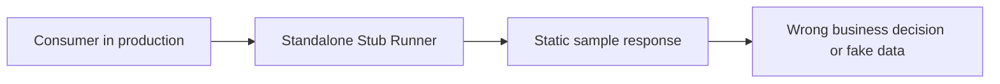
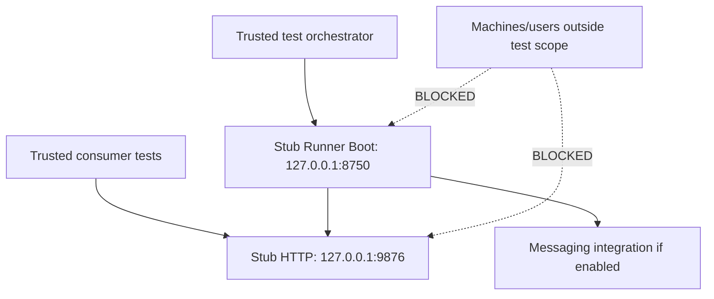
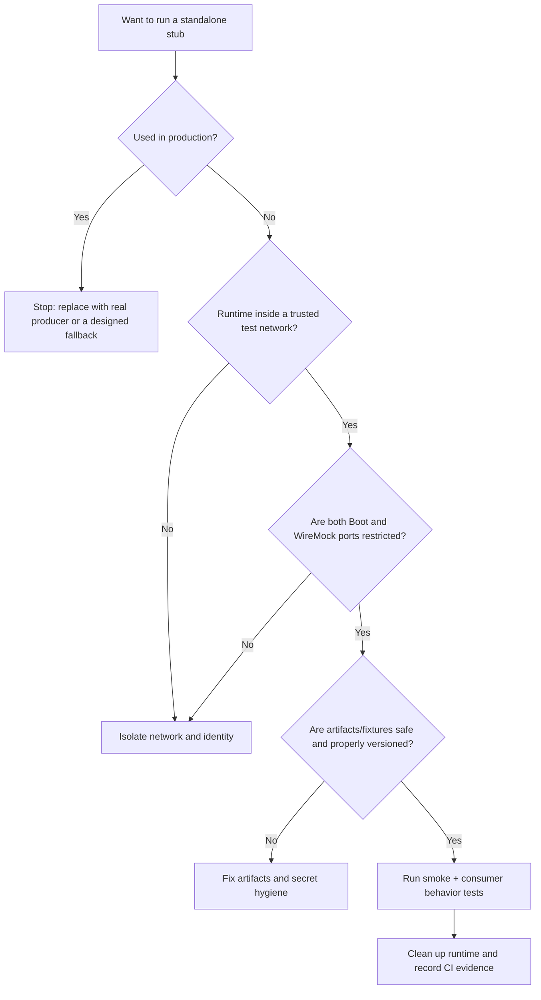

# Restricting Access and Avoiding Using Stubs as Production Services

## 1. What Problem Do Standalone Stubs Solve?

In the **SPRING_CLOUD_CONTRACT** module, Spring Cloud Contract helps producers and consumers agree on HTTP or messaging behavior using the **Groovy/YAML DSL**. Contract Verifier generates producer tests to verify real behavior; afterward, contracts are packaged into versioned stubs. Consumers can use **Stub Runner** and CI to detect incompatible API changes **without always having to start the real producer**.

**Standalone Stub Runner** (often called *Stub Runner Boot* or run via the corresponding Docker image) opens HTTP stub servers and exposes control APIs to list stubs, look up ports, or trigger messages by label. As a result, a frontend team, mobile app, or system written in a language other than Java can use the stub as a **mock dependency in a test environment**.

However, this convenience creates risk if operators let a stub serve like a real service:

- Stubs **do not necessarily enforce authentication and authorization** like the producer.
- Responses may be **static sample data** that do not reflect database state.
- Stubs generally lack the operational properties of a production system: durable storage, transactions, retries, monitoring, SLAs, or access controls.
- Standalone Stub Runner also exposes **control APIs** and may allow triggering sample messages.
- When ports are exposed to broad networks, people outside the testing group can call simulated endpoints, inspect fixtures, or treat a mock response as if it were a real business outcome.

**Security principle:** Stub Runner Boot is a **testing utility**, not an application hardened to operate on untrusted networks. Official Spring Cloud Contract documentation explicitly warns that it *is not secured out of the box* and **is not intended for production**. Only trusted clients inside test environments should be allowed access.

### Lesson Objectives

After this lesson, you will be able to:

1. Distinguish **Standalone Stub Runner's management port** from the **WireMock HTTP ports** it starts.
2. Restrict access using localhost, container networks, firewalls, and CI boundaries.
3. Identify control endpoints such as `/stubs`, `/triggers`, and WireMock admin endpoints.
4. Manage artifact versions, sample data, secrets, and logs safely.
5. Separate **development/test/CI** from **controlled staging** and **production**.
6. Design smoke tests, consumer contract tests, and security checks when running Docker/JARs.
7. Explain why a stub can never replace the real producer, even when all stub-based integration tests pass.

## 2. A Stub Is a Simulation Tool, Not the Real Producer

Suppose Orders Producer has an HTTP contract:

```http
GET /api/orders/ord-1001 HTTP/1.1
Accept: application/json
```

Sample response:

```json
{
  "id": "ord-1001",
  "status": "CREATED",
  "totalAmount": 125000,
  "currency": "VND"
}
```

With Spring Cloud Contract, you can write a Groovy contract:

```groovy
import org.springframework.cloud.contract.spec.Contract

Contract.make {
    name 'get_order_created'

    request {
        method GET()
        url '/api/orders/ord-1001'
        headers {
            header 'Accept': 'application/json'
        }
    }

    response {
        status 200
        headers {
            contentType(applicationJson())
        }
        body([
            id         : 'ord-1001',
            status     : 'CREATED',
            totalAmount: 125000,
            currency   : 'VND'
        ])
    }
}
```

After producer verification, the stub mapping can always return this sample order when the request matches. That **does not prove** order `ord-1001` exists in the production database, nor does it prove the caller is authorized to read the order or that the endpoint handles heavy load.

| Aspect | Real Producer | Standalone HTTP Stub |
| --- | --- | --- |
| Data state | Real database/cache/event store | Typically fixture-based; may have simulated scenario state |
| AuthN/AuthZ | Per Spring Security / application architecture | Only if mappings or an external guard explicitly model it |
| Business logic | Runs validation, transactions, and service code | Matches requests and returns simulated responses |
| Persistence | Per production design | Not present by default |
| Availability / SLA | Has dedicated operational targets and monitoring | No equivalent production guarantees |
| Primary purpose | Serves real users/systems | Consumer and integration testing |
| Messaging | Real application broker/serializer/bindings | Message stubs via configured integration |

A stub **can** simulate errors, latency, stateful scenarios, or complex matcher rules; yet those remain **staged scenarios**, not the full rules and risks of the real producer.

### 2.1. Architectural Mistake to Avoid



Never point a production application's `orders.base-url` at a stub merely because the producer is temporarily unavailable. Especially for payments, inventory, authentication, and order fulfillment, fake results can cause the system to **accept transactions that never occurred**.

If operations must continue during producer failures, design **intentional fallbacks** inside the application (TTL caches, circuit breakers, "unconfirmed" states, pending queues, recovery workflows), instead of putting a test stub in the production path.

## 3. Which Ports and Endpoints Does Standalone Stub Runner Open?

A standalone setup typically exposes **two distinct HTTP surfaces**:

1. **Stub Runner Boot server**: the control application's port, such as `8750` in this lesson.
2. **WireMock server**: the port serving simulated API endpoints, such as `9876` for the Orders API.



This is the **target model**, not a description of the default networking of every Docker image/JAR. Actual ports depend on runtime configuration; verify both after startup.

### 3.1. Stub Runner Boot Management API

Official documentation describes typical paths:

| Method/Path | Function | Why Restrict It? |
| --- | --- | --- |
| `GET /stubs` | List running stubs | Reveals dependency list and versions |
| `GET /stubs/{ivy}` | Look up a stub's port by identifier | Allows discovering simulated HTTP ports |
| `GET /triggers` | List available messaging labels | Reveals internal event/scenario types |
| `POST /triggers/{label}` | Trigger a message stub by label | Can emit test events into the attached transport |
| `POST /triggers/{ivy}/{label}` | Trigger a specific stub's label | Must prevent access outside authorized groups |

In the table, `{ivy}` is the artifact identifier notation in Stub Runner syntax; it is not an immutable application name.

**Sensitive point:** `/triggers` is an **action-producing API**, not just a health check. If the messaging stub connects by mistake to a broker shared with a real environment, triggering can send **fake events to unintended consumers**. Use an isolated broker/topic/test binding.

### 3.2. WireMock Also Has Its Own Admin Endpoints

In addition to Stub Runner Boot's API, a WireMock HTTP stub server typically exposes an admin API at:

```text
http://127.0.0.1:9876/__admin/mappings
http://127.0.0.1:9876/__admin/requests
```

Depending on version and configuration, the admin API can expose mappings, the request journal, and administrative actions. It can leak:

- Sample data or mocked fields.
- Endpoints, headers, query parameters, and API structure.
- **Fake** tokens or data in the request journal if tests send them.
- Special responses and scenario trigger conditions.

Never place WireMock behind a public ingress just because Stub Runner Boot's API was blocked. **Both ports must be protected**.

### 3.3. Both Ports Do Not Share a Default Access Policy

If you only restrict `server.address=127.0.0.1` for the **Boot application**, do not assume all WireMock servers listen solely on loopback too. How WireMock binds sockets can depend on its own library and configuration.

Verify in practice:

- Which ports are listening and **each process's bind address**.
- Docker host port mappings for **both management and stub ports**.
- Whether host firewalls/network policies block traffic outside the test scope.
- Which clients/containers are allowed access over internal networks.

With containers, `127.0.0.1` **inside the container** differs from `127.0.0.1` **on the host**. Restricting host-side publishing is usually clearer than arbitrarily changing internal container bind addresses.

## 4. Access Restriction Principles by Environment

| Environment | Appropriate Deployment | What to Strictly Avoid |
| --- | --- | --- |
| Developer workstation | Ephemeral run, loopback access only; stop when idle | Publishing ports on public Wi-Fi/shared networks |
| Dedicated CI runner | Ephemeral container/job, narrowly scoped test network | Sharing unmanaged stubs across multiple pipelines |
| Kubernetes test namespace | Internal Service, restricted NetworkPolicy/identity | Uncontrolled public Ingress/LoadBalancer/NodePort |
| Controlled staging | Used solely for smoke/contract tests by authorized test clients | Mixing with production data or credentials |
| Production | **Never deploy Standalone Stub Runner** | Pointing real user-facing apps to stubs |

**Prefer the simplest isolation:** if all tests run on one machine, use loopback. If tests run across multiple containers, use an isolated job-only network. If multiple machines are needed, use a restricted test network, firewall, and a proper access-control layer rather than opening ports straight to the internet.

### 4.1. Restricting Access Is More Than Enabling Authentication

Even if a reverse proxy adds Basic Auth or TLS, Standalone Stub Runner still does not become a production app: fake responses, non-durable state, lack of auditing/availability, and contract coverage limits all remain.

A defense-in-depth model fits better:

1. **Network isolation**: only trusted test clients can see the ports.
2. **Never expose control endpoints**: especially `/triggers` and WireMock `/__admin`.
3. **Safe data**: synthetic fixtures only, no real secrets or PII.
4. **Least-privilege accounts**: scoped strictly to downloading artifacts and accessing test environments.
5. **Short lifecycle**: spin up stubs per job and tear down upon completion.
6. **Test-level observability**: record stubs, versions, ports, and failures without treating them as production monitoring.

## 5. Running Standalone Docker Exposing Ports Only on localhost

Spring Cloud Contract documentation provides a Docker image example for Stub Runner Boot. For newer versions, the docs also warn that **the Stub Runner Boot executable JAR may not be published from version 4.1.6 onward due to publishing tooling limits**, and recommend using the Docker image or building from source if a JAR is truly needed. Thus **never assume a fat JAR can always be downloaded for every version**.

The Bash example below illustrates the **host-port restriction principle**. Repository and image version values are **placeholders** that must be replaced with approved sources and versions:

```bash
docker run --rm --name scc-stub-isolated \
  -e SERVER_PORT=8750 \
  -e STUBRUNNER_IDS=com.example:orders-producer:1.4.2:stubs:9876 \
  -e STUBRUNNER_STUBS_MODE=REMOTE \
  -e STUBRUNNER_REPOSITORY_ROOT=https://repository.example.invalid/maven-releases \
  -p 127.0.0.1:8750:8750 \
  -p 127.0.0.1:9876:9876 \
  springcloud/spring-cloud-contract-stub-runner:PINNED_VERSION
```

**Conditions for this example:**

- `PINNED_VERSION` must be replaced with an existing compatible image tag; pin the digest in pipelines requiring high reproducibility.
- `repository.example.invalid` is an **illustrative address and cannot download real artifacts**. Replace it with a Maven-compatible repository holding producer-verified stubs.
- `STUBRUNNER_IDS` contains `groupId:artifactId:version:classifier:port`; `9876` is the **WireMock** port.
- `SERVER_PORT=8750` indicates the **Stub Runner Boot application** port in this example.
- Both `-p 127.0.0.1:...` flags publish ports only on the **host's loopback interface**, not all interfaces.
- The specific Docker image/version must support those environment variables; inspect runtime logs and verify ports after startup.
- Never pass real usernames/passwords or secrets directly in shell commands like configuration examples. Use your CI and repository resolver's secure secret/mount/config mechanisms.

### 5.1. Crucial Difference Between `-p 9876:9876` and `-p 127.0.0.1:9876:9876`

```bash
# Do not use carelessly on machines attached to untrusted networks:
docker run ... -p 9876:9876 ...

# Bind strictly to host loopback:
docker run ... -p 127.0.0.1:9876:9876 ...
```

The first form can publish the port on all host network interfaces depending on Docker configuration. The second restricts publishing to loopback; on certain older Docker setups or specialized networks you should still verify real reachability and firewall rules. **Do not treat this syntax as a complete substitute for verifying network isolation.**

### 5.2. Inspecting Docker Port Mappings

```bash
docker port scc-stub-isolated
```

Conceptually expected output:

```text
8750/tcp -> 127.0.0.1:8750
9876/tcp -> 127.0.0.1:9876
```

Exact output depends on Docker/runtime. Beyond checking mappings, you can test connectivity from an authorized **out-of-scope machine** to confirm the ports are unreachable; do not run unauthorized scans across your organization's network.

### 5.3. Checking Both HTTP Planes

```bash
# Stub Runner Boot control plane:
curl -i http://127.0.0.1:8750/stubs

# WireMock stub data plane, if the contract defines this endpoint:
curl -i -H "Accept: application/json" \
  http://127.0.0.1:9876/api/orders/ord-1001
```

A successful `/stubs` response alone does not prove the `GET /api/orders/ord-1001` mapping loaded; check the **business endpoint** as well. Conversely, a working data plane does not mean the control plane should be exposed externally.

### 5.4. Docker Networks and Container-to-Container Traffic

When the consumer app runs in another container, `http://127.0.0.1:9876` from that container points to **itself**, not the Stub Runner container. The right approach is:

- Place the consumer test container and Stub Runner on an **isolated test Docker network**.
- Have the consumer connect via the **internal service/container name** and stub port, e.g., `http://stub-runner:9876` when configured and resolvable.
- Avoid publishing these ports to the host if all traffic stays on the Docker network.
- If the runner must download artifacts from a repository, restrict **egress** to the required source; never connect test containers to production databases or brokers.

Avoid `--network host` just to fix a localhost issue, because it bypasses container network boundaries and can expose stub ports more broadly than intended.

## 6. Running a Standalone JAR: Securing Both Boot and WireMock

In versions with a valid JAR or when a team builds Stub Runner Boot from source, it can be started with `java -jar`:

```bash
java -jar stub-runner-boot.jar \
  --server.address=127.0.0.1 \
  --server.port=8750 \
  --spring.cloud.contract.stubrunner.ids=com.example:orders-producer:1.4.2:stubs:9876 \
  --spring.cloud.contract.stubrunner.stubsMode=LOCAL
```

This is a conceptual example for a compatible Spring Boot app, **not a claim that `stub-runner-boot.jar` is available for every version**. If your project uses legacy property names or another image/CLI, verify against the matching version docs.

**Warning:** `server.address=127.0.0.1` only ensures the **Boot** app binds to that address; it **does not automatically secure WireMock port `9876`**. When running directly on the host, inspect WireMock's bind address and use a host firewall or network policy to block unauthorized access to stub ports. If you cannot verify those restrictions, prefer running in containers on an isolated network.

### 6.1. Do Not Try to "Secure for Production" by Tweaking Contracts

A contract with:

```groovy
request {
    method GET()
    url '/api/orders/ord-1001'
    headers {
        header 'Authorization': 'Bearer fake-test-token'
    }
}
```

may cause WireMock to serve the mapping only when the request includes that exact header string. Yet that is merely a **request matching condition**, not real authentication:

- Stubs do not validate JWT signatures, expiry, issuer, or permissions unless a custom mechanism is configured.
- A static test token string is **not a secure secret**; anyone inspecting the mapping can read it.
- If another mapping omits that header requirement, requests may still match that branch.

Never use "the stub requires an Authorization header" as an excuse to expose the endpoint on untrusted networks.

## 7. Accounts and Artifact Repositories: Limiting Download Privileges

Standalone Stub Runner typically fetches stub JARs from a Maven-compatible repository (or local Maven repo / classpath). Example coordinates:

```text
com.example:orders-producer:1.4.2:stubs
```

A safe setup must control **both** how artifacts are fetched and the data inside those artifacts:

| Risk | Mitigation |
| --- | --- |
| Pulling a stub from a rogue source | Use only approved repositories with valid HTTPS/TLS |
| Consumer runs an unintended stub version | Pin versions/releases; never silently use `+` or `latest` |
| Repository token leaked in logs/commands | Use a secret store; avoid logging commands with credentials |
| Over-privileged repository account | Give Stub Runner a **read-only** account |
| Production credentials mounted into container | Supply test-scoped credentials and configs only |
| Artifact mutated under the same version | Forbid overwriting releases; verify provenance/checksums per policy |
| Mounting an entire personal `~/.m2` | Mount only minimal required repos/configs; strip `settings.xml` of unrelated secrets |

### 7.1. CLASSPATH, LOCAL, and REMOTE Are Different

| Mode | Stub Source | Practical Constraint |
| --- | --- | --- |
| `CLASSPATH` | Stubs already on the classpath | Right artifact version must be placed on the test classpath |
| `LOCAL` | Local Maven repository | Containers/CI have their own repository and do not automatically see host `~/.m2` |
| `REMOTE` | Configured repository | Requires network/TLS/minimal read permissions to the artifact store |

Choosing a mode affects the **artifact supply chain**, not Stub Runner's endpoint security. Even in `LOCAL` mode, if HTTP ports are publicly open, unauthorized access remains a risk.

### 7.2. Stub Data Also Requires Review

Contracts and mappings can contain:

- Order IDs, emails, addresses, customer names.
- `Authorization`/`Cookie` headers used in tests.
- Event payloads or JSON/XML samples.
- Hostnames or internal URLs used in examples.

**Use only synthetic or de-identified data**; never copy real production requests/responses into artifacts. If sensitive data accidentally enters a stub JAR, changing server permissions is not enough; remediate the artifact, artifact store, and logs under your organization's data security process.

## 8. Never Connect Standalone Stubs to Production Resources

A critical mistake is keeping Stub Runner in a test network while letting it **access production brokers, databases, or webhooks**. That breaks the safety boundary completely.

### 8.1. HTTP-Only Stubs

With standard WireMock HTTP mappings, stubs return mock data and must never query a production database to "make responses more realistic." If consumers need realistic data, build safe fixtures or an anonymized dataset in the test environment; never hide a production endpoint behind a stub.

### 8.2. Messaging Stubs

Given a contract with:

```groovy
Contract.make {
    name 'payment_succeeded_event'
    label 'payment_succeeded'

    input {
        triggeredBy('publishPaymentSucceeded()')
    }

    outputMessage {
        sentTo('payments.events')
        body([
            paymentId: 'pay-test-1001',
            status   : 'SUCCEEDED'
        ])
        headers {
            messagingContentType(applicationJson())
        }
    }
}
```

When consumer tests call `POST /triggers/payment_succeeded` on Stub Runner Boot, the stub message can be emitted over the configured messaging integration. If the destination/broker matches production, a real consumer could process a **fake payment event**.

Therefore:

1. Use a **test-only** broker or binder.
2. Use isolated topic/queue namespaces when a test broker is shared across teams.
3. Use an identity/service account without permission to publish to production topics.
4. Restrict network egress from Stub Runner to the test broker.
5. Ensure no production consumer group subscribes to simulated events.
6. Clean up messages and test state when finished.

Never assume changing the event ID to `pay-test-1001` is enough; many systems route and process events by **topic, schema, and `eventType`** without checking ID prefixes.

## 9. Securing Management Endpoints and Admin APIs

Standalone Stub Runner Boot exposes control APIs; WireMock exposes an admin API depending on configuration. Even in test environments, enforce **least privilege so only necessary actors can operate them**.

| API | Minimum Access in Test Network | Impact if Exposed |
| --- | --- | --- |
| `GET /stubs` | Test orchestrator / diagnostics | Leaks stub names and versions |
| `GET /triggers` | Authorized test orchestrator | Leaks internal message label list |
| `POST /triggers/{label}` | Specific responsible test runner | Triggers out-of-band fake messages |
| `GET /__admin/mappings` | Authorized developer/test debugger | Leaks API structure and fixtures |
| `POST /__admin/mappings` (if enabled) | Authorized test admin tooling | Can alter running stub behavior |
| Stub `/api/...` HTTP endpoints | Consumer tests that actually call them | Serves simulated data to unintended clients |

**Never expose management/admin ports to the internet**. If an organization genuinely needs remote control inside a test environment, place it behind a restricted management network, authenticated/TLS proxy, firewall rules, and explicit permissions; still, **never turn that environment into production**.

### 9.1. Do Not Treat `/stubs` as a Strong-Enough Health Check

`GET /stubs` returns the list of running stubs (once the API is ready). It confirms the control app started, but does not prove:

- The required HTTP contract has a mapping.
- Requests actually match the matchers.
- Response headers and bodies match the right version.
- The consumer can decode and handle the response.
- External networks are blocked.

Therefore, include at least **one business HTTP smoke test**, plus **consumer behavior tests** and network boundary checks.

## 10. Example Safe Testing Workflow with Standalone Stub Runner

Suppose Checkout Consumer needs to call Orders API in CI.

### 10.1. Artifact Preparation Step

Producer has contracts:

```text
get_order_created.groovy       -> GET /api/orders/ord-1001 -> 200
get_order_not_found.groovy     -> GET /api/orders/ord-missing -> 404
```

Before using the stub, the producer must:

1. Generate and **run** Contract Verifier tests against the real producer with proper fixtures.
2. Convert HTTP contracts into WireMock mappings.
3. Package artifact `com.example:orders-producer:1.4.2:stubs`.
4. Publish an immutable release version or install into the test's local Maven repository.

**Never turn unverified contracts directly into a public service.**

### 10.2. Ephemeral Deployment Step

In CI, start a Stub Runner container with:

- Pinned image version/digest.
- Management and stub ports accessible only on the test network.
- Read-only repository credentials.
- Fixed artifact version.
- No production secrets, databases, or broker routes.

When the job completes, stop the container and clean up test data. Depending on your runner, use `--rm` or orchestrator lifecycle hooks so stubs never linger quietly for days after testing finishes.

### 10.3. Verification Step

Example Bash smoke test when ports are published on loopback:

```bash
curl -fsS http://127.0.0.1:8750/stubs

curl -i -H "Accept: application/json" \
  http://127.0.0.1:9876/api/orders/ord-1001

curl -i -H "Accept: application/json" \
  http://127.0.0.1:9876/api/orders/ord-missing
```

For error branches, assert not only status `404` but also the published business error code in the body, such as `ORDER_NOT_FOUND`. A `404` from **WireMock having no matching stub** does not prove the producer defined an error branch.

After smoke tests, run **real consumer code**:

```java
// Illustration in a consumer test with the HTTP client pointed at the stub.
CheckoutView view = checkoutService.load("ord-1001");

assertThat(view.orderId()).isEqualTo("ord-1001");
assertThat(view.canPay()).isTrue();
```

`CheckoutView`/`checkoutService` are hypothetical consumer APIs. This assertion is meaningful only when `checkoutService` genuinely invokes its HTTP client against the stub and applies business rules; never mock the client being verified.

### 10.4. Access-Restriction Verification Step

Before signing off on the setup:

1. Check all host port mappings with `docker port` or equivalent tooling.
2. Confirm both management **and** stub ports are not exposed publicly on the host.
3. Verify clients inside the test network can reach them while out-of-scope clients cannot.
4. Confirm no production hosts or brokers appear in runtime configuration.
5. Check logs to ensure no credentials or real personal data are printed.

**Being able to call the stub is not enough to conclude the setup is safe**. You must verify that **unauthorized** parties cannot reach it.

## 11. Using CI Namespaces or Kubernetes Across Multiple Teams

When pipelines run in Kubernetes, avoid creating a `LoadBalancer` Service or public Ingress just to make stubs convenient to reach. A better architecture:

```text
Namespace: consumer-contract-test-<job-id>
  - Checkout consumer test pod
  - Stub Runner Boot pod
  - Test-only messaging broker (if needed)
  - ClusterIP service for internal stub ports
  - NetworkPolicy allowing only test pods to communicate
  - ServiceAccount and secret scoped to downloading stubs
  - TTL/cleanup job after completion
```

Here `<job-id>` is a placeholder for an ephemeral namespace, not a literal name. NetworkPolicy enforcement only works if your CNI and cluster support it; verify empirically instead of assuming creating a policy blocks all traffic.

### 11.1. Public Ingress Is Not the Default Choice

If consumer tests must call from outside the cluster, use an authenticated, network-restricted temporary connection per company policy—such as a tightly scoped port-forward or dedicated test gateway—rather than exposing Stub Runner Boot's APIs to the internet.

### 11.2. Shared Test Environments Also Carry Risks

A shared staging environment can suffer from:

- Team A's tests altering mappings and breaking Team B.
- Messaging scenarios sharing a single topic and consumer group.
- Unpinned artifact versions updating silently mid-test.
- Leftover data from earlier runs causing false passes.
- Request logs across teams containing data that shouldn't be shared.

Therefore, whenever possible, **each CI job should have its own stub runtime**. If sharing is unavoidable, enforce strict namespace, permission, port/destination, and version isolation.

## 12. Behavioral Limitations of Stubs That Must Be Made Explicit

A stub cannot capture every characteristic of a producer. When designing a test strategy, call out these limits to avoid **false confidence**.

| Capability | What Stubs Usually Cover | What Still Needs Other Tests |
| --- | --- | --- |
| HTTP method/path/headers/body | Matches a subset of requests per DSL | Full real validation and authorization |
| Success/failure branches | Returns sample `200`/`400`/`404`/`409` | Real data conditions, transactions, race conditions |
| Response format | Checks sample JSON/XML and headers | Real-wire serializers, schemas, and encoding |
| Dynamic data | Regex/matchers and static stub values | Uniqueness, DB relations, ID generation rules |
| Stateful stubs | Simulates a few scenario steps | Production consistency and persistence |
| Response times | Deliberate delay/fault simulation | Performance and behavior under high load |
| Messaging | Emits sample messages by label | Delivery, ordering, retries, idempotency, broker security |
| Error handling | Consumer handles sample error responses | Network drops, DNS, TLS, half-open connections, real timeouts |

### 12.1. Never Treat a Stub's HTTP 200 as a "Successful Transaction" Signal

Dangerous example:

```text
POST /api/payments -> 200 {"status":"PAID"}
```

If any real environment treats a stub response as confirmation of a real payment, users may receive goods or services when no transaction occurred. Contracts only verify **the shape and simulated behavior** of responses for sample scenarios, not real payment-provider outcomes.

### 12.2. Never Use a Stub as a Fallback During Outages

When Orders Producer goes down, the consumer application must never silently switch its base URL to Stub Runner. Doing so serves fake data and can trigger invalid business actions. If a demo environment intentionally uses mock data, it must:

- Be clearly labeled **DEMO/TEST**.
- Have no real payment or notification side effects.
- Have zero connectivity to production data.
- Never serve real users who could mistake simulated results for real ones.

## 13. Common Mistakes and How to Fix Them

| Symptom | Risk / Root Cause | Remediation |
| --- | --- | --- |
| Someone outside dev network reaches `/stubs` | Control plane port published too broadly | Restrict host bind, firewall, and test network |
| Blocked `8750` yet `9876` remains reachable | Protected Boot but forgot WireMock | Check **all** stub ports |
| `POST /triggers/...` emits events to shared broker | Messaging stub wired to wrong environment | Use isolated test broker/topic/identity; block prod egress |
| Production config points `orders.base-url` to stub | Environment separation failed | Block via deployment policy; validate config pre-rollout |
| Stub returns real customer emails | Fixture copied from production unredacted | Replace with synthetic data; purge old artifacts/logs |
| Repository password appears in logs | Secret passed via logged CLI/config | Use a secret store; never print credentials |
| Local test passes yet CI pulls wrong artifact | Dynamic version or stale cache | Pin versions and log resolved coordinates |
| Test container stays alive after job ends | Missing cleanup | Use `--rm`, lifecycle/TTL, and network teardown |
| HTTP stub returns expected `404` with wrong body | Likely WireMock no-match `404` | Assert business error body; inspect loaded mappings |
| Consumer test keeps passing when producer changes | Using stale stub or only asserting fixtures | Run producer verification and consumer tests on candidate artifact |
| Used `--network host` to fix localhost | Breaks container isolation | Use dedicated Docker networks or internal service discovery |
| WireMock admin exposed to internet | Allows viewing/mutating mappings | Never make admin public; block WireMock ports too |

### 13.1. Ordered Troubleshooting Flow



## 14. Hands-On Exercise: Running an Orders Stub in a Test Network

### 14.1. Context

Checkout Consumer needs to simulate two Orders Producer branches:

| Contract | Request | Response |
| --- | --- | --- |
| `get_order_created` | `GET /api/orders/ord-1001` | `200`, `status=CREATED` |
| `get_order_not_found` | `GET /api/orders/ord-missing` | `404`, `code=ORDER_NOT_FOUND` |

The producer has verified and published a **hypothetical** artifact:

```text
com.example:orders-producer:1.4.2:stubs
```

The exercise is to run the standalone stub for consumer tests **without exposing the mock service to untrusted networks**.

### 14.2. Tasks

1. Prepare the `-stubs.jar` artifact from an approved repository at the exact producer-verified version.
2. Start Stub Runner Boot in an ephemeral environment with **management port `8750`** and **Orders WireMock port `9876`**.
3. If running Docker on a workstation, publish both ports only on `127.0.0.1`; record `docker port` output.
4. Check `GET http://127.0.0.1:8750/stubs` to confirm the stub loaded.
5. Call `GET http://127.0.0.1:9876/api/orders/ord-1001`; assert HTTP `200` and the committed body fields.
6. Call `GET http://127.0.0.1:9876/api/orders/ord-missing`; assert **both HTTP `404` and `ORDER_NOT_FOUND`**, not just the status.
7. Run tests against **real Checkout Consumer code** with its client pointed to port `9876`; verify `canPay` rules and not-found handling.
8. Confirm from an out-of-scope client (under authorized network testing policy) that management/stub ports are **unreachable**.
9. Inspect runtime config and ensure **no production databases or brokers** are wired.
10. Stop the container/job and verify no leftover listeners or test resources remain.

### 14.3. An Intentionally Dangerous Configuration to Spot

```bash
# Anti-pattern example: DO NOT run outside an isolated test environment.
docker run --rm \
  -e STUBRUNNER_IDS=com.example:orders-producer:1.4.2:stubs:9876 \
  -p 8750:8750 \
  -p 9876:9876 \
  springcloud/spring-cloud-contract-stub-runner:PINNED_VERSION
```

**Why is it dangerous?** Both `-p` flags without a host IP can publish ports across broad network interfaces. If the host has a public IP or sits on a multi-user network, people outside the test group can call the mock APIs and control APIs.

**Minimal host-only fix:** use `-p 127.0.0.1:8750:8750` and `-p 127.0.0.1:9876:9876`, while also verifying listen port configuration, image tag, and artifact download settings per section 5. For container-to-container setups, avoid host publishing altogether and use an internal test network.

### 14.4. Self-Check Questions

**Q1.** Is restricting `server.address=127.0.0.1` for Stub Runner Boot enough to protect every WireMock stub?

**Answer:** No. WireMock servers may bind to their own addresses/ports; inspect and restrict those ports as well.

**Q2.** Why is `POST /triggers/payment_succeeded` more sensitive than a static read endpoint?

**Answer:** It can emit sample messages over messaging integration. If the broker points to the wrong environment, fake messages can reach unintended consumers.

**Q3.** If all consumer tests pass against stubs, can the stub be deployed to production instead of Orders Producer?

**Answer:** No. Stubs lack the full logic, data, authentication, operational readiness, and production guarantees of the real producer.

**Q4.** Does setting `STUBRUNNER_STUBS_MODE=LOCAL` automatically protect HTTP endpoints from outsiders?

**Answer:** No. `LOCAL` only defines **where artifacts are loaded from**; port access still requires separate control.

**Q5.** If the container only serves fake data, can `/stubs` be published to the internet?

**Answer:** No. Stub Runner Boot is not secured out of the box; the management API leaks stub/version details and exposes control actions. Fake data does not make a test utility safe for public exposure.

**Q6.** Why shouldn't a developer's entire `~/.m2` directory be mounted into a shared container?

**Answer:** That directory can contain internal artifacts, `settings.xml` credentials, or unrelated metadata. Provide only the minimal required artifacts/configs with appropriate read-only permissions.

## 15. Checklist Before Using Standalone Stubs

- [ ] Stub Runner is used strictly for **development, testing, CI, or controlled staging**.
- [ ] No production consumer points its base URL to a stub.
- [ ] Producer verification ran and the exact versioned stub artifact was verified.
- [ ] Standalone Stub Runner Boot is **not treated as secured-by-default**.
- [ ] Both the management port and all WireMock HTTP ports are restricted.
- [ ] With Docker, no unintended broad port publishing exists; verified via `docker port`.
- [ ] With JARs, did not restrict only `server.address` while forgetting WireMock bind/networking.
- [ ] With Kubernetes, no public Ingress or LoadBalancer exists for stubs.
- [ ] `/stubs`, `/triggers`, and WireMock admin APIs are reachable only by authorized test clients.
- [ ] Message stubs connect only to test-environment brokers/topics/test binders.
- [ ] No production databases, secrets, webhooks, or service accounts are attached.
- [ ] Only synthetic fixtures are used—no PII or real secrets in contracts, JARs, or request journals.
- [ ] Repository is trusted; stub-download account has least privilege; versions are pinned.
- [ ] Tests verify **real consumer behavior**, not just fixture statuses/bodies.
- [ ] Error branches are tested, distinguishing WireMock no-match `404` from business `404`.
- [ ] Cleanup/TTL exists so stub containers never linger silently after tests finish.
- [ ] CI archives evidence: artifact ID/version, ports, test results—without printing credentials.
- [ ] Network boundaries were verified on the actual runtime in use.

### References

- [Spring Cloud Contract — Using the Stub Runner Boot Application](https://docs.spring.io/spring-cloud-contract/reference/project-features-stubrunner/stub-runner-boot.html): security warnings, executable JAR limitations, `/stubs` and `/triggers` APIs.
- [Spring Cloud Contract — Stub Runner Common Properties](https://docs.spring.io/spring-cloud-contract/reference/project-features-stubrunner/stub-runner-common.html): `ids`, `stubsMode`, `repositoryRoot`, WireMock ports, and artifact versions.
- [Spring Cloud Contract — Docker Project](https://docs.spring.io/spring-cloud-contract/docs/current/reference/html/docker-project.html): standalone Stub Runner Docker image and environment/messaging configuration.
- [WireMock — Administration API](https://wiremock.org/docs/standalone/admin-api-reference/): WireMock admin endpoints and request journal.
- [Docker — Publishing and exposing ports](https://docs.docker.com/get-started/docker-concepts/running-containers/publishing-ports/): port publishing semantics, host IP binding, and container networking.

**Remember:** **a standalone stub is a testing tool, not a production service**. Restrict access simultaneously across **Stub Runner Boot**, **WireMock ports**, and **messaging transports**; use safe artifacts/fixtures, explicit versions, isolated networks, and short lifecycles. Stubs verify HTTP/message commitments, while only producer verification and proper integration/operational tests provide evidence of real behavior in production.
