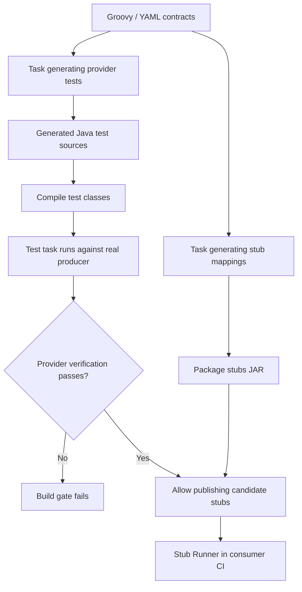
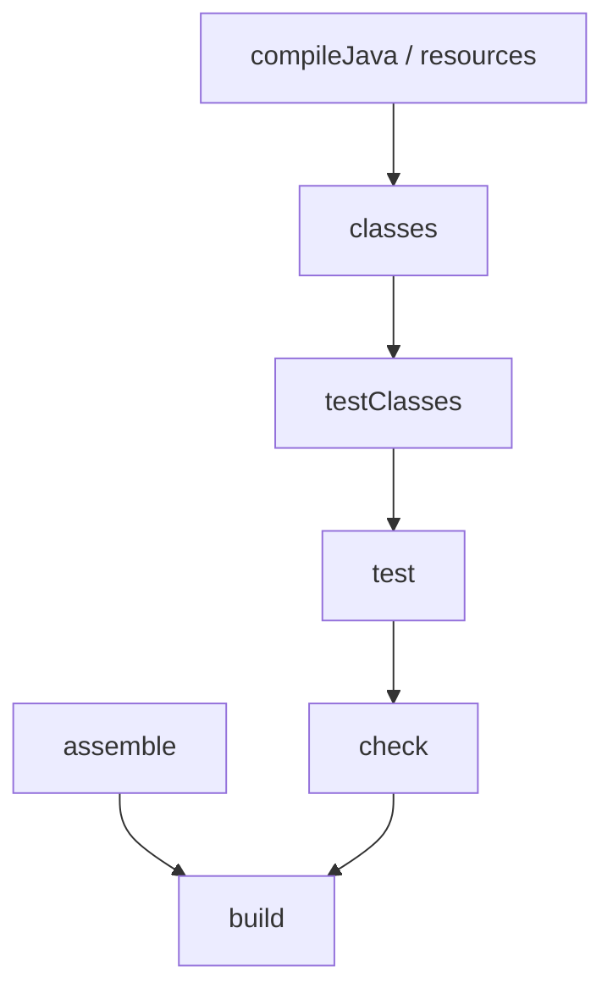
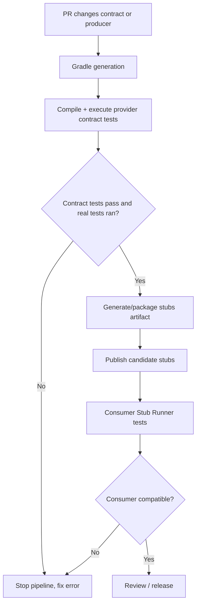

# Test Generation Tasks and Their Relationship to the Gradle Test Lifecycle

**Spring Cloud Contract (SCC)** supports contract testing between **producer** and **consumer**: development teams declare HTTP or messaging behavior using **Groovy/YAML DSL**, generate tests to verify the producer, package stubs, and run **Stub Runner** on the consumer. When a project uses **Gradle**, declaring contracts is only the first step. Equally important is knowing **which task generates test code, which task compiles and executes that code, which task produces stubs, and which tasks run in the `test → check → build` lifecycle**.

A very common misconception is seeing `generateContractTests` succeed and concluding the producer complies with the contract. **Generating tests is not running tests.** Another misconception is thinking `./gradlew test` or `./gradlew build` always executes all contract tests in every plugin version. In practice, you must inspect the **task graph** and **test reports of the active build**, especially in multi-module projects or custom configurations.

This lesson in the **Gradle Integration** chapter explains the build flow, common tasks, relationships with the Gradle Java lifecycle, producer test configuration, stub packaging, and CI design to detect incompatible API changes. The running example uses `order-producer` with endpoint `GET /api/orders/1001` and `checkout-consumer` consuming its stubs.

## 1. Learning Objectives

After this lesson, you will be able to:

1. Explain the differences between **contract sources**, **generated test sources**, **compiled test classes**, **executed provider tests**, and the **stubs JAR**.
2. Identify SCC Gradle tasks, especially `generateContractTests`, `contractTest`, and `verifierStubsJar` in plugin versions that provide them.
3. Distinguish the standard `test`, `check`, and `build` tasks of the Gradle Java plugin from contract testing tasks added by the plugin.
4. Inspect the task dependency graph using `tasks --all`, `help --task`, and `--dry-run` instead of guessing.
5. Configure the base class for generated tests and ensure compatible test framework/classpath setup.
6. Avoid publishing stubs without evidence that producer verification passed.
7. Integrate tests and stub artifacts into multi-module or multi-repository CI with clear versioning.

**Core message:** to trust a Gradle build result, you must verify **contracts exist → tests were generated → tests ran → provider complies → properly versioned stubs were packaged**. No single step automatically proves all the others.

## 2. Five Different Outcomes in a Build Cycle

Suppose the contract source includes `src/test/resources/contracts/http/get-order.groovy`. The logical flow consists of:



This diagram illustrates the **desired procedural relationship**. The arrows **do not guarantee that any arbitrary plugin version automatically registers all dependencies/ordering between tasks**. Publishing candidate stubs must be blocked by CI if provider verification fails.

| Outcome | What does it mean? | What does it NOT prove? |
| --- | --- | --- |
| Contract file exists | A DSL document exists in the repository | That the DSL is discovered by the plugin or valid |
| Generated test sources created | The plugin read the contracts and wrote test code | That tests were compiled or executed |
| Generated tests compile | The Java/Groovy test code has no compile errors | That the producer returns the right response |
| Contract test task passes | Executed tests succeeded | That all contracts were discovered or no tests were skipped |
| Stubs JAR created | An interface-simulating artifact exists for distribution | That the producer implementation was verified if tests did not run |
| Consumer Stub Runner tests pass | The consumer handles sample responses/messages | That the production provider and real infrastructure work properly |

**A `BUILD SUCCESSFUL` is necessary but not sufficient**: you must know **which tasks** ran in that build, how many tests executed, and which contract/stubs version was used.

## 3. Gradle Java Lifecycle: What Do `test`, `check`, and `build` Normally Do?

Before adding SCC, the Gradle Java plugin already defines standard tasks:

| Common Java/Gradle task | Role |
| --- | --- |
| `compileJava` | Compiles main Java code |
| `processResources` | Prepares main resources |
| `classes` | Aggregates main class outputs |
| `compileTestJava` | Compiles test Java for the standard source set |
| `processTestResources` | Prepares test resources |
| `testClasses` | Aggregates built test sources |
| `test` | Executes tests in the standard source set/test suite |
| `check` | Aggregation point for quality-check tasks registered in the lifecycle |
| `assemble` | Builds standard build artifacts |
| `build` | Combines both `assemble` and `check` paths of the Java lifecycle |

Simplified relationship:



The arrows here **simplify a real task graph**; many tasks have additional dependencies, and Gradle only runs tasks required by the plugin configuration.

When adding Spring Cloud Contract, the contract generation and verification tasks must be **wired into this graph** so that test sources are generated before compilation, contract tests run in the right quality gate, and stub artifacts are published at the right time.

### 3.1. Questions You Should Never Skip

Does `./gradlew test` run your project's generated contract tests? **Never guess.** The plugin may create a separate source set and `contractTest` task apart from `test`. Check your plugin version, task list, generated test classes, and XML/HTML test reports.

Does `./gradlew build` definitely run `contractTest`? **Only if that task is wired into the `check`/`build` path or invoked explicitly.** Appearing in the task list does not mean it is a dependency of `check`.

## 4. Setting Up the Gradle Plugin on the Producer

An illustrative configuration using **Groovy DSL `build.gradle`**:

```groovy
plugins {
    id 'java'
    id 'org.springframework.cloud.contract' version 'YOUR_COMPATIBLE_SCC_VERSION'
}

dependencies {
    testImplementation 'org.springframework.cloud:spring-cloud-starter-contract-verifier'
    testImplementation 'org.springframework.boot:spring-boot-starter-test'
}

contracts {
    baseClassForTests = 'com.example.order.contract.OrderContractBase'
}

tasks.withType(Test).configureEach {
    useJUnitPlatform()
}
```

**This is a configuration skeleton, not a ready-to-run build file verbatim.** `YOUR_COMPATIBLE_SCC_VERSION` must be replaced with a plugin version compatible with your project's Spring Boot, Spring Cloud BOM, Gradle, and Java versions. Without dependency management/BOM, dependencies also need explicit versions. Choose the same generation of SCC/Boot/test framework rather than mixing arbitrary versions.

Some legacy projects apply plugins via `buildscript`/`apply plugin` instead of the `plugins` DSL. This does not change task graph principles, though it can affect how the plugin is resolved and how the extension is configured.

### 4.1. Why Use `tasks.withType(Test)`?

Because a project may have more than one task of type `Test`, the configuration:

```groovy
tasks.withType(Test).configureEach {
    useJUnitPlatform()
}
```

aligns the test engine across `Test` tasks, **including `contractTest` if it is registered as a `Test` task**. If the generated tests of your plugin/version use JUnit 4 or Spock, adjust the framework and test engine for compatibility. Do not force `useJUnitPlatform()` and assume JUnit 4 tests will automatically run without the appropriate engine.

### 4.2. What Is Needed Beyond `build.gradle`

- The Spring Boot application or producer component actually being verified.
- Contracts placed in the path configured for the plugin.
- A base class preparing the HTTP test mode or message verifier.
- Test dependencies and classpath containing helpers/assertions called by generated tests.
- Data/fixtures capable of reproducing the declared scenarios.
- CI access to required Gradle dependencies and repositories.

**Gradle only orchestrates the work.** If a producer test requires mocking a dependency and the base class fails to create that mock, adding task dependencies will never make the contract test pass correctly on its own.

## 5. Organizing Contract Sources and Generated Test Sources

A typical producer layout:

```text
order-producer/
├── build.gradle
├── settings.gradle
├── gradlew
├── gradlew.bat
└── src/
    ├── main/java/com/example/order/...
    └── test/
        ├── java/com/example/order/contract/
        │   └── OrderContractBase.java
        └── resources/contracts/http/
            └── get-order.groovy
```

From that contract, the generation task creates **test code** in a corresponding `build/generated...` area, depending on the plugin version and configuration. Conceptually:

```text
src/test/resources/contracts/http/get-order.groovy
    -> [generateContractTests]
    -> build/.../generated-test-sources/.../ContractTest.java
    -> [compile generated tests]
    -> [contractTest or configured Test task]
    -> report: pass / fail
```

**Do not hand-write or edit generated test sources in `build/` as a permanent fix.** The `build/` directory is Gradle output and can be wiped by `clean`. The sources to edit are usually the contract DSL, base test, fixtures, or plugin configuration.

### 5.1. Output Paths Depend on Configuration

SCC versions may provide options for the contracts directory, generated test directory, stubs output, and test package. To customize them, check the extension API **of the exact version in use**, as property names can change.

Do not hardcode every document to a single path like `build/generated-test-sources/contracts` and assume the plugin failed if the actual output sits elsewhere. Use Gradle task outputs and project configuration to determine the real path.

## 6. The `generateContractTests` Task: Generates Test Code, Does Not Execute It

In many versions of the **Spring Cloud Contract Gradle plugin**, this task is named `generateContractTests`. Its purpose is to read Groovy/YAML contracts and **generate provider verification tests**.

Example to trigger test generation:

```bash
./gradlew generateContractTests
```

On Windows PowerShell, the wrapper is typically invoked with:

```powershell
.\gradlew.bat generateContractTests
```

If the task exists and is properly configured, the output is typically test code under `build/`. However, **the generation task does not send HTTP requests to the producer or run assertions inside the generated class**.

### 6.1. Errors That Generation Can Catch

- Groovy DSL fails to parse or compile.
- YAML does not conform to the supported schema.
- Contract uses declarations invalid for the plugin version.
- Plugin cannot generate test code due to misconfiguration.
- Contract path is configured differently than expected.

And errors that may **not** be caught by generation alone:

- The endpoint returns `500` instead of `200`.
- The real response body is missing the `status` field.
- The base class lacks the right fixture needed by generated tests.
- A security filter blocks the test request due to missing tokens/headers.
- The consumer still deserializes according to an old schema.
- Zero tests were generated because the contracts directory is effectively empty or mis-scanned.

**Especially dangerous:** `generateContractTests` completes yet produces **0 tests**. Without checking the number of discovered contracts/tests, CI can turn green while the entire interface goes unprotected.

### 6.2. Verifying Output After Generation

Answer three questions:

1. Was a test generated for `get-order.groovy`?
2. Does the generated test use the right base class and test mode?
3. Which execution task is the test registered with?

If code is generated but no task compiles and runs it, the most critical part of contract verification has not happened.

## 7. Sample HTTP Contract to See What Generated Tests Need to Do

File `src/test/resources/contracts/http/get-order.groovy`:

```groovy
import org.springframework.cloud.contract.spec.Contract

Contract.make {
    description 'GET existing order returns status and currency'

    request {
        method GET()
        url '/api/orders/1001'
        headers {
            header('Accept', 'application/json')
        }
    }

    response {
        status OK()
        headers {
            contentType(applicationJson())
        }
        body(
            id: 1001,
            status: 'CREATED',
            currency: 'VND'
        )
    }
}
```

This contract requires the producer to return `200`, with JSON containing `id=1001`, `status=CREATED`, and `currency=VND`. A generated test performs these **logical steps**:

```text
prepare request:
  GET /api/orders/1001
  Accept: application/json

execute request against producer test context

assert:
  HTTP status == 200
  Content-Type JSON
  body.id == 1001
  body.status == CREATED
  body.currency == VND
```

This is **pseudocode**, not exact generated Java code; actual syntax depends on test mode, framework, and SCC version.

### 7.1. Does Using YAML DSL Change the Task Graph?

Equivalent YAML contract:

```yaml
description: "GET existing order returns status and currency"
request:
  method: GET
  url: /api/orders/1001
  headers:
    Accept: application/json
response:
  status: 200
  headers:
    Content-Type: application/json
  body:
    id: 1001
    status: CREATED
    currency: VND
```

Choose **only one version** for the same scenario in a real build to avoid duplicate generated tests and stubs.

Gradle still needs **generation → compile → run**. The difference between Groovy and YAML lies mainly in the DSL parser and contract representation; it does not turn the generation task into an execution task.

## 8. Compiling and Running Contract Tests: `contractTest`

In many SCC Gradle plugin releases, the producer has a contract testing task named `contractTest`. Inspect your own project's task list to confirm the actual task name and type.

Common command:

```bash
./gradlew contractTest
```

When configured properly, this task needs:

- Generated tests or specified test sources.
- Appropriate compilation tasks having run beforehand.
- The producer classpath/application context.
- The base class extended by generated tests.
- An appropriate test engine (JUnit Jupiter, JUnit 4, etc.).
- Stable fixtures to produce responses/messages matching the contract.

### 8.1. Base Test for an HTTP Producer

Example Java class at `src/test/java/com/example/order/contract/OrderContractBase.java`:

```java
package com.example.order.contract;

import io.restassured.module.mockmvc.RestAssuredMockMvc;
import org.junit.jupiter.api.BeforeEach;
import org.springframework.beans.factory.annotation.Autowired;
import org.springframework.boot.test.autoconfigure.web.servlet.AutoConfigureMockMvc;
import org.springframework.boot.test.context.SpringBootTest;
import org.springframework.test.web.servlet.MockMvc;

@SpringBootTest
@AutoConfigureMockMvc(addFilters = true)
public abstract class OrderContractBase {

    @Autowired
    private MockMvc mockMvc;

    @BeforeEach
    public void setUpContractHttp() {
        RestAssuredMockMvc.mockMvc(mockMvc);
    }
}
```

**This is an example for when generated tests use a MockMvc-based test mode**, not a mandatory base class for every project. Depending on the plugin/testMode, you may need to configure REST Assured against an HTTP server or another web test client.

If endpoints use Spring Security, keeping the filter chain enabled and supplying proper credential fixtures can decide whether provider tests verify the real interface accurately. `@AutoConfigureMockMvc(addFilters=false)` can cause tests to bypass rules enforced by security filters; passing tests in that case do not prove the production endpoint is properly protected.

### 8.2. Why Can Generated Tests Fail to Compile?

For example, the contract uses `byCommand('assertValidOrderId($it)')` but the base class has no `assertValidOrderId` method. In that case, the generated code may fail to compile or the test may fail.

This is a **classpath/signature/base class** issue, not a WireMock issue. Check the generated Java test, inheritance, method signature, and compile task dependencies.

### 8.3. Always Inspect Test Reports

If `contractTest` is a `Test`-type task following Gradle conventions, test reports may appear in corresponding folders under `build/reports/tests/` and `build/test-results/`. Exact paths depend on configuration.

Do not just look for the `:contractTest` task name in console output; check **the number of tests executed, pass/fail/skip counts, and that generated tests actually appear in the report**.

## 9. `test` vs. `contractTest`: Why They Must Not Be Equated

In a producer project, the two test groups serve different purposes:

| Group | Example | Purpose |
| --- | --- | --- |
| Standard unit/integration tests | `OrderServiceTest`, `OrderControllerTest` | Application logic |
| Generated provider contract tests | `get-order.groovy` → generated test | Producer fulfills the interface consumers depend on |

The Java plugin's `test` task runs tests for its configured source set/suite. `contractTest` (when the plugin creates a separate task) runs generated contract tests according to its own configuration. **Invoking `test` does not always imply invoking `contractTest`.**

### 9.1. Three Possible Scenarios

**Scenario A — the plugin wires contract tests into `check` automatically:** `./gradlew check` runs both regular tests and contract tests.

**Scenario B — the plugin creates `contractTest`, but the project has not wired it into `check`:** `./gradlew check` may not run contract tests.

**Scenario C — the project customized source sets/test suites:** generated tests may run through a separate `Test` task whose name varies by configuration.

Do not guess from the plugin name. **Check the graph with `--dry-run` and verify via test reports.**

### 9.2. When to Run Which Task?

| Goal | Illustrative command | Notes |
| --- | --- | --- |
| Check contract syntax / generation task | `./gradlew generateContractTests` | Does not execute producer assertions |
| Run standard unit tests | `./gradlew test` | Does not automatically include all generated contract tests by default |
| Run contract tests directly | `./gradlew contractTest` | If the plugin/version registers that task |
| Run all wired checks | `./gradlew check` | Must verify it depends on the contract test task |
| Run build per Java lifecycle | `./gradlew build` | Includes assemble/check, depending on actual task graph |
| Package stubs artifact | `./gradlew verifierStubsJar` | Verify the task exists in your plugin/version |

If a task does not exist, **do not invent task names by guessing**; check your plugin version and the tasks registered by the plugin.

## 10. Inspecting the Task Graph Properly

Several commands help you understand a build without editing source code:

```bash
./gradlew tasks --all
./gradlew help --task generateContractTests
./gradlew help --task contractTest
./gradlew check --dry-run
./gradlew build --dry-run
```

For multi-project builds, add the project prefix, for example:

```bash
./gradlew :order-producer:tasks --all
./gradlew :order-producer:check --dry-run
./gradlew :order-producer:contractTest --dry-run
```

**Meaning of each flag/command:**

- `tasks --all`: lists tasks in the project, including many omitted from the default summary.
- `help --task`: prints information about a task if the Gradle version supports this syntax.
- `--dry-run`: prints **tasks scheduled to execute** in the dependency graph without **running actual task actions**.
- `--info` or `--debug`: increases log verbosity for build diagnostics.
- `--rerun-tasks`: forces Gradle to re-execute tasks rather than relying on normal up-to-date checks.

**Do not treat `--dry-run` as proof that provider tests passed**, since it executes no assertions. Use it to verify relationships, then run the real build and inspect reports.

### 10.1. Finding Tasks Left Out of the Lifecycle

Suppose `./gradlew check --dry-run` output only lists:

```text
:compileJava SKIPPED
:classes SKIPPED
:compileTestJava SKIPPED
:test SKIPPED
:check SKIPPED
```

This is **illustrative output**, not real output from a project. If `contractTest` is absent from the graph, investigate: did the plugin fail to create the task, was the task renamed, or is it not wired into `check`?

Note that `SKIPPED` in `--dry-run` is Gradle's way of indicating tasks are not executed in dry-run mode; it **does not mean tests ran and were skipped**.

## 11. Wiring `contractTest` into `check` When Needed

If your plugin version **provides the `contractTest` task** yet `check` does not depend on it, the project can wire it explicitly:

```groovy
tasks.named('check') {
    dependsOn tasks.named('contractTest')
}
```

This snippet assumes `check` and `contractTest` are actually registered in the project where `build.gradle` applies. In a multi-module project, the task may belong to a specific subproject, so place the configuration in the right project.

If the plugin **already wires** `contractTest` into `check`, there is no need to duplicate the configuration just for aesthetics. What matters is the **actual task graph**.

### 11.1. `dependsOn`, `mustRunAfter`, and `finalizedBy` Differ

| Gradle mechanism | Meaning | Pulls the other task into the graph automatically? |
| --- | --- | --- |
| `dependsOn` | Task depends on another task, which must run first | **Yes** |
| `mustRunAfter` | Enforces ordering only if both tasks are already in the graph | **No** |
| `shouldRunAfter` | Suggests ordering, not guaranteed in all situations | **No** |
| `finalizedBy` | Runs a finalizer after the specified task per Gradle rules | Does not replace testing dependencies before publish |

For example, if you only declare:

```groovy
tasks.named('verifierStubsJar') {
    mustRunAfter tasks.named('contractTest')
}
```

then **invoking `verifierStubsJar` alone does not trigger `contractTest`**. `mustRunAfter` is an ordering constraint, not a requirement to run the other task. This is a very easy misconfiguration that lets CI publish unverified stubs.

To make testing a mandatory condition before packaging, consider `dependsOn` on the right task/stage while checking for cycles; or **split into two CI stages**, running packaging/publishing only after the test stage passes.

### 11.2. Example of a Clear Quality Gate

A simple CI sequence when `contractTest` exists:

```bash
./gradlew --no-daemon clean test contractTest
./gradlew --no-daemon verifierStubsJar
```

Both commands **must run in a pipeline that checks exit codes**: if the first command fails, do not run the second or publish artifacts. These are illustrative commands, not a claim that every project automatically has those exact two task names.

## 12. Generating Stubs vs. Running Provider Verification

Alongside the task that generates provider tests, the SCC Gradle plugin in many versions also provides tasks to generate stub mappings and package the artifact, commonly named:

- `generateClientStubs`: generates client stub descriptions/mappings from contract sources.
- `verifierStubsJar`: packages the artifact containing stubs and required resources according to plugin configuration.
- Additional contract preparation/copying or internal tasks created by the plugin.

**Always check `./gradlew tasks --all` and `help --task` on the version you use.** Not every online tutorial matches the exact task names or wiring of your current SCC/Gradle version.

### 12.1. Test Generation Tasks and Stub Packaging Tasks Have Different Goals

```text
get-order.groovy
  ├── generateContractTests
  │     └── generated provider test
  │           └── compile + execute
  │                 └── assert producer really returns 200
  │
  └── stub generation
        └── WireMock mapping
              └── verifierStubsJar
                    └── stubs artifact for consumer
```

If a contract has valid syntax yet the producer implementation has not been updated, **mappings can still be generated**. Consequently, a stubs JAR could advertise `CREATED` while the real producer returns `PAID`, unless the pipeline enforces passing provider verification.

### 12.2. Inspecting the Artifact After Packaging

The stub artifact is usually identified by Maven coordinates equivalent to:

```text
groupId    = com.example
artifactId = order-producer
version    = 1.0.0
classifier = stubs
```

Illustrative JAR filename:

```text
order-producer-1.0.0-stubs.jar
```

Do not merely check that `verifierStubsJar` reported success. Inspect the actual JAR to confirm it contains the needed HTTP mappings or message stubs, and verify that the artifact version/classifier used by consumers matches the build under review.

### 12.3. Packaging Does Not Mean Publishing

The task that creates the stubs JAR does not automatically put the artifact into Maven local or a remote repository. With Gradle, publishing is usually configured separately via `maven-publish` or your organization's artifact workflow.

**Building the artifact**, **verifying the artifact**, **publishing the artifact**, and **consumer artifact resolution** are distinct steps. Never treat a stubs JAR on a developer laptop as proof that consumer CI used that exact build.

## 13. Connecting the Gradle Test Lifecycle with Stub Runner on the Consumer

A consumer can use `Stub Runner` to launch the stubs JAR published by the producer, for example:

```java
import org.springframework.boot.test.context.SpringBootTest;
import org.springframework.cloud.contract.stubrunner.spring.AutoConfigureStubRunner;
import org.springframework.cloud.contract.stubrunner.spring.StubRunnerProperties;

@SpringBootTest(properties = {
    "order.api.base-url=http://localhost:8085"
})
@AutoConfigureStubRunner(
    ids = "com.example:order-producer:1.0.0:stubs:8085",
    stubsMode = StubRunnerProperties.StubsMode.LOCAL
)
class CheckoutConsumerContractTest {
    // Call real OrderClient, assert responses/error handling.
}
```

This is an example of a **consumer test class**, not a task auto-generated by the Gradle SCC plugin. The consumer can run it via the Gradle Java plugin's `test` task or a dedicated test suite configured by the project.

Both sides must be verified independently:

| Producer build | Consumer build |
| --- | --- |
| Generate and run provider tests | Resolve stubs artifact |
| Verify implementation complies with contract | Start Stub Runner / WireMock |
| Package stubs JAR with exact version | Point real client to stub URL |
| Block publish if tests fail | Assert consumer deserialization / error mapping |
| Publish candidate stubs after verification | Test against the **candidate**, not an old artifact |

A consumer test passing against an older `1.0.0` release stub **does not prove** consumer compatibility with producer candidate `1.1.0`. The consumer's Gradle task graph does not automatically discover which producer commit to test; CI must pass the exact candidate coordinates.

### 13.1. HTTP and Messaging Follow the Same Build Principles

For messaging, contracts typically include `label`, `input.triggeredBy`, `outputMessage.sentTo`, headers, and body. Generation produces provider verification according to the test mode/message verifier; stubs can be triggered by Stub Runner via `StubTrigger`.

Whether HTTP or messaging, **generating tests is not running tests**, and **stubs only protect the described scenarios**—they do not automatically verify broker ack/retry/DLQ, transactions, or API gateways.

## 14. Incremental Builds, Up-to-Date Checks, and Caching: Why Reading Logs Matters

Gradle optimizes builds using **incremental tasks** and **up-to-date checks**; some builds also enable the **build cache**. As a result, a task may skip executing its action if Gradle determines inputs/outputs are unchanged.

Common statuses:

| Log status | Typical meaning | Question to ask |
| --- | --- | --- |
| `UP-TO-DATE` | Task did not re-run its action because tracked inputs/outputs were unchanged | Are contracts and base class inputs declared accurately? |
| `FROM-CACHE` | Outputs were restored from a valid cache entry | Does the cache key include all critical inputs? |
| `NO-SOURCE` | Task found no source inputs to process | Is the contracts or generated tests path wrong? |
| `SKIPPED` | Task did not run due to a condition or setting | Was it blocked by `onlyIf`, disabled, or excluded? |
| `FAILED` | Task execution failed | Is it a generation, compile, runtime assertion, or repository error? |

Do not treat `UP-TO-DATE` as an automatic bug, since it is a valid Gradle optimization. However, if changing a contract **fails to re-trigger the needed generation/test tasks**, investigate input/source-set declarations and caching.

### 14.1. How to Investigate Suspected Caching or Skipped Tasks

```bash
./gradlew clean generateContractTests
./gradlew contractTest --rerun-tasks --info
./gradlew check --dry-run
```

These commands only apply when the project actually defines those tasks. They aid debugging:

- `clean` clears local build outputs per lifecycle so everything regenerates.
- `--rerun-tasks` forces selected tasks to re-execute instead of relying on normal up-to-date state.
- `--info` increases logging to inspect test classes, task skipping, and source detection.
- `--dry-run` only inspects the graph; **it does not prove assertions ran**.

**Do not slap `--rerun-tasks` onto every CI run just to hide an uninvestigated wiring bug.** The goal is accurate input/output modeling and a sound task graph; forcing full re-runs should be reserved for diagnosis or special control needs.

### 14.2. Why Is `NO-SOURCE` More Dangerous Than `UP-TO-DATE`?

A contract test task can report `NO-SOURCE` because no tests were generated or its source set is empty. In that case, the CI gate might turn green with zero provider verification checks run. Add a dedicated assertion/check verifying **discovered contract count or executed generated test count** for API-protected modules.

## 15. Configurations That Can Nullify Contracts Even on a Green Build

In Gradle, there are many ways tests can fail to execute:

- Running `./gradlew build -x test` to exclude `test`.
- Running `./gradlew build -x contractTest` when `contractTest` exists.
- Setting `enabled = false` or `onlyIf { false }` on a key task.
- Configuring a test filter that excludes generated class names.
- Missing the JUnit engine or test discovery failing to pick up generated classes.
- Plugin not applied in the producer module.
- Contract files placed in an unscanned path.
- `check` does not depend on `contractTest`.
- Running only `generateContractTests` and `verifierStubsJar` without running producer assertions.
- Running only `--dry-run` and interpreting it as passing tests.

### 15.1. Execution Verification Checklist

Before trusting a pipeline, gather evidence that:

1. The Gradle plugin is applied to the **right module** containing contracts.
2. Generated test source files actually appear after generation.
3. A compilation task compiles the generated test classes.
4. The right `Test` execution task runs in CI.
5. The test report contains at least the expected contract scenarios.
6. Tests were not skipped or dropped due to a missing test engine.
7. Intentionally breaking a producer response causes the test to fail.
8. After reverting, tests pass and the new artifact is published.
9. Consumer tests with the candidate stub detect API-scoped breaking changes.

Step 7 is especially valuable: **manual mutation testing** proves the quality gate actually enforces the contract rather than merely proving Gradle runs without crashing.

## 16. Multi-Project Gradle: Do Not Run the Wrong Module

In a Gradle monorepo, you might have:

```text
root/
├── settings.gradle
├── build.gradle
├── order-producer/
│   └── build.gradle
└── checkout-consumer/
    └── build.gradle
```

Each project's tasks have a **fully qualified path**:

```text
:order-producer:generateContractTests
:order-producer:contractTest
:order-producer:verifierStubsJar
:checkout-consumer:test
```

These are **illustrative task names** if they exist in the respective projects. Commands explicitly targeting the producer:

```bash
./gradlew :order-producer:generateContractTests
./gradlew :order-producer:contractTest
./gradlew :order-producer:verifierStubsJar
```

A root command like `./gradlew test` may select multiple tasks via Gradle's multi-project name matching, but **do not rely on that to assume every contract test across every subproject ran**. For strict control, use project-qualified paths in CI and verify the graph.

### 16.1. The Plugin Must Be in the Right Subproject

If the root build declares the plugin without applying it to `order-producer`, SCC tasks may not appear in that subproject. Check:

- Which project has the plugin applied?
- Which project directory is the contract path resolved relative to?
- Which module's package does `baseClassForTests` point to?
- Does the generated test `runtimeClasspath` include the producer module's dependencies?
- Which project's group/version does the stubs JAR inherit?

Do not copy contracts into the root project just so the task "finds them", as that easily corrupts artifact ownership.

### 16.2. Producer and Consumer in the Same Build

Even in the same monorepo, consumer tests using Stub Runner need to target the **candidate stub artifact**. You can structure the pipeline to build the producer first, create/publish stubs to a test/local repository, and then run consumer tests. Do not let consumers silently pick up a stale JAR left over in a developer's Maven local repo.

## 17. CI Configuration: Testing Must Gate Publishing

A typical pipeline has these stages:



Here **stage gating** is essential: if producer verification fails, do not publish candidate stubs as a verified artifact. If consumer tests against the candidate version fail, coordinate producer/consumer changes or a compatible versioning strategy before release.

### 17.1. Example Pseudo-Pipeline Using the Gradle Wrapper

```text
Stage A — producer verification
  ./gradlew --no-daemon :order-producer:clean
  ./gradlew --no-daemon :order-producer:test :order-producer:contractTest
  Assert: generated contract tests count > 0

Stage B — package candidate stubs
  ./gradlew --no-daemon :order-producer:verifierStubsJar
  Assert: stubs JAR contains expected mappings

Stage C — distribute candidate artifact
  Publish/install candidate stubs using configured mechanism
  Record: producer revision + group:artifact:version:stubs

Stage D — consumer verification
  Run checkout-consumer tests with Stub Runner on that exact candidate
  Assert: use cases and error handling pass
```

This is a **conceptual workflow**, not CI YAML or commands guaranteed to work verbatim on every version. If `contractTest` is named differently, or if the plugin wires it into `check` automatically, adapt commands to the verified task graph.

### 17.2. Do Not Use Generated Artifacts Out of Lifecycle Order

A common release mistake:

```text
./gradlew verifierStubsJar
publish stubs
./gradlew contractTest
```

If the final test fails after the artifact has already been published to an official repository, other consumers may pull a stub with no proof of provider verification. **Invert the order to verify → publish**, and use a candidate repository with appropriate lifecycle and permissions.

### 17.3. Recording Traceability

CI should record:

- Producer commit/revision and generated test status.
- Gradle version (Gradle Wrapper) and SCC plugin version.
- Test reports, executed test counts, and skipped counts.
- Artifact name, version, classifier, and checksum if available.
- Source repository of the candidate stubs.
- Consumer commit/version and test results against that candidate artifact.
- Any excluded tests and their justification.

Traceability helps distinguish a **real breaking change** from a build pulling the wrong dependency or stub version.

## 18. Testing with Intentional Faults

Several simulated changes to verify the Gradle/SCC gate:

| Intentional change | Which task/test should catch it? |
| --- | --- |
| Malformed YAML contract structure | Generation task if schema is validated |
| Deleting contract files while build stays green | Contract/generated test count check |
| Producer returns 500 instead of 200 | Executed provider contract test |
| Producer changes `status=CREATED` to `PAID` | Provider test if contract remains exact |
| Wrong base class name | Compilation/setup of generated tests |
| Missing `byCommand` method | Compilation or runtime of generated test |
| Changing JUnit engine so tests are not discovered | Test execution/report count gate |
| Running only `generateContractTests` | CI must not treat this as passing provider verification |
| Removing `contractTest` from `check` | Task graph verification |
| Stubs artifact missing required mapping | Artifact inspection |
| Consumer still pins old release stub | Candidate version validation |
| Producer changes URL and consumer is not updated | Consumer Stub Runner tests with candidate stubs |

**Do not write tests merely to make every task always pass.** Quality gates must be able to **fail when the implementation violates the contract**. Break one scenario deliberately in a controlled check before trusting the pipeline.

## 19. Layer-by-Layer Troubleshooting

| Symptom | What to check first |
| --- | --- |
| `Task 'generateContractTests' not found` | Is the plugin applied to the right project? What is the task name in this version? |
| `Task 'contractTest' not found` | Does this plugin/version create that task, or use another test suite? |
| `generateContractTests UP-TO-DATE` despite YAML edit | Contract directory/input tracking and scanned source files |
| `contractTest NO-SOURCE` | Generation path, source set, and test class discovery |
| Generated Java test compile failure | Base class, imports, dependencies, generated test framework |
| Generated test fails with 401/403 | Security filters/test fixtures/headers and test mode |
| Generated test fails with 404 | URL, context path, controller mapping, or MockMvc setup |
| Generated test fails JSON assertion | Body/headers, serializer, regex/matcher, or fixture |
| `check` is green despite obvious producer bug | Task graph, exclusions, reports, test count |
| `verifierStubsJar` lacks expected artifact | Task output, archive classifier, build config |
| Consumer Stub Runner cannot resolve stub | Group/artifact/version/classifier/repository |
| Build fails only in CI | Gradle/Java version, timezone/locale, secrets, port, or shared state |

Good diagnostic sequence:

1. Identify the **module** and applied SCC plugin version.
2. Inspect the task list and actual task graph.
3. Verify contract files are included in generation inputs.
4. Generate tests and open the generated sources.
5. Inspect the test classpath and base class.
6. Run the real test task and inspect test reports.
7. Inspect the stubs artifact after packaging.
8. Run consumer tests with the exact candidate stub version.
9. Only then adjust plugin tasks or lifecycle wiring.

**Do not skip `contractTest` with `-x` just to make the build green.** If test setup is broken, skipping it simply blinds your compatibility safeguard.

## 20. Hands-On Exercise: Tracing from Contract to Gradle Build

Prepare a Spring Boot producer with a compatible Spring Cloud Contract Gradle plugin and a consumer with Stub Runner.

1. **Create a contract:** Define `GET /api/orders/1001` returning `200` and JSON with `id`, `status`, and `currency` in Groovy; then try an equivalent YAML file on a separate branch.
2. **Explore tasks:** Run `./gradlew tasks --all` and note the available SCC tasks.
3. **Generate tests:** Run `generateContractTests` if supported by your version, locate the generated Java test, and inspect its request/assertions.
4. **Distinguish generate vs. run:** Have the producer return a wrong field; generation may still succeed, while the executed provider test must fail.
5. **Base test:** Configure `baseClassForTests`, HTTP test mode, and deterministic fixtures; verify the generated test extends the right class.
6. **Run contract tests:** Run `contractTest` or your project's equivalent task; check the report for test count and status.
7. **Task graph:** Use `check --dry-run` to confirm whether contract tests are included in `check`.
8. **Wire if missing:** Add `dependsOn` in the right project when needed, avoiding cycles and never using `mustRunAfter` as a substitute for a dependency.
9. **Compare test vs. build:** Compare `test`, `check`, and `build` and list which tasks actually run in each command.
10. **Artifact:** Build `verifierStubsJar` if available, and verify the stubs JAR contains the mapping for `GET /api/orders/1001`.
11. **Consumer:** Use Stub Runner to load the exact candidate stubs and verify the client parses `CREATED`.
12. **Cache:** Observe `UP-TO-DATE`, then modify the contract and verify Gradle updates task outputs when inputs change.
13. **NO-SOURCE:** Intentionally point to a wrong contracts path on a test branch; verify CI catches zero executed tests.
14. **CI:** Design stages for producer verification, packaging/publishing candidate stubs, and consumer tests, each with clear pass criteria.
15. **Mutation:** Change the producer response from `CREATED` to `PAID`; verify the pipeline blocks release, then revert the code.

### 20.1. Self-Assessment Table

| Competency | Evidence of completion |
| --- | --- |
| Understand task roles | Distinguishes generation, compilation, execution, and packaging |
| Understand `test`/`contractTest` | Knows which task runs provider tests in the project |
| Understand `check`/`build` | Verified the task graph rather than guessing |
| Know Gradle Wrapper usage | Has matching commands for Linux/macOS and Windows |
| Configure base class | Generated tests compile and run |
| Inspect outputs | Uses test reports, not only generated sources |
| Detect false greens | Catches `NO-SOURCE`/test skips/wrong contract directory |
| Manage stubs JAR | Artifact contains right mappings and exact version |
| Consumer compatibility | Stub Runner uses candidate artifact |
| CI | Producer verification gates publish/release |

## 21. Conclusion: Gradle Orchestrates, Contract Tests Verify Behavior

In Spring Cloud Contract, **test generation tasks** are a critical link, yet **not proof that the producer fulfills the contract**. You must **compile and execute generated provider tests** with the proper application/test context. After verifying the producer, the team can **package the stubs JAR**, have consumers run **Stub Runner**, and wire these checks into CI to detect incompatible API changes.

Remember:

- **`generateContractTests`**: creates test code from Groovy/YAML contracts; **does not run assertions by itself**.
- **`contractTest`** or the equivalent execution task: must actually run provider verification, not just exist in the Gradle task list.
- **`test`, `check`, `build`**: belong to the Gradle lifecycle; their relationship with contract tests requires **inspecting the actual graph** because it varies by plugin, version, and project configuration.
- **`verifierStubsJar`** and stub-related tasks: create the consumer artifact; **do not replace verifying the producer**.
- **`dependsOn`** creates a real dependency, whereas **`mustRunAfter`** only constrains ordering when both tasks are already scheduled.
- **Reliable CI** must confirm executed test counts, block publishing when producer verification fails, and run consumer tests against the **exact candidate stub version**.

When you understand the task graph instead of blindly memorizing `./gradlew build`, you know what Gradle is **generating, running, skipping, and publishing**—which is the foundation for using Spring Cloud Contract effectively and avoiding false-green quality gates.
