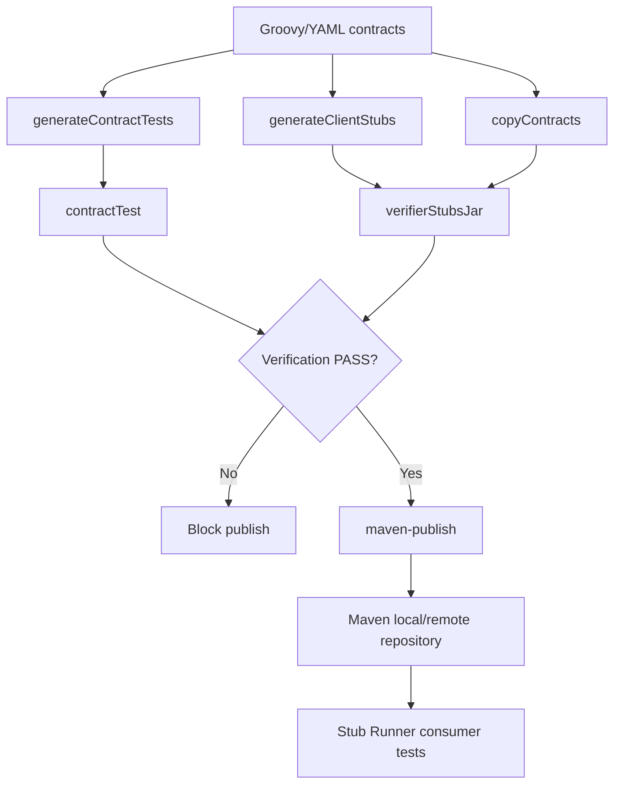
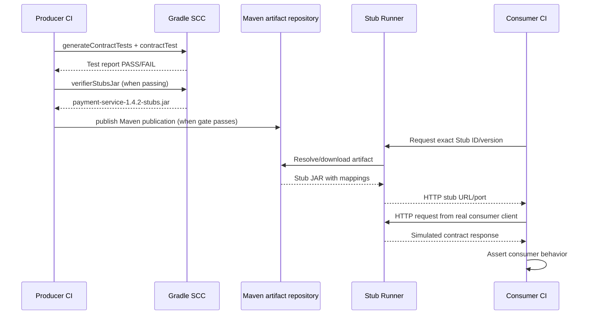

# Stub Generation, Packaging, and Artifact Publishing Tasks

## 1. Objectives and Expected Outcomes

In **Spring Cloud Contract (SCC)**, producers and consumers agree on HTTP or messaging behavior using **Groovy/YAML DSL**. The producer uses the Gradle plugin to generate **verification tests**, create **stub mappings**, and package them into an artifact. The consumer uses **Stub Runner** to fetch the right stub artifact and run tests on its HTTP client or message handler. CI connects both sides to detect incompatible API changes.

This lesson belongs to the **Gradle Integration** chapter and focuses on the lifecycle **stub generation → JAR packaging → artifact publishing**, going beyond merely writing a syntactically valid contract.

Running example:

- Producer: `payment-service` with Maven coordinates `com.acme.billing:payment-service:1.4.2`.
- Consumer: `checkout-service`.
- Interface: `GET /api/payments/PAY-42` returns `200` and `state: CAPTURED`.
- Expected stub JAR: `payment-service-1.4.2-stubs.jar`.
- Consumer-side Stub Runner uses `com.acme.billing:payment-service:1.4.2:stubs`.

After this lesson, you will be able to distinguish the main Gradle tasks, configure contract and output locations, run producer verification, package a stub JAR with the `stubs` classifier, configure Maven Publish and a CI gate that ensures **tests run on the right build before publishing**, and diagnose artifact/mapping issues.

> **Principle:** Successful mapping generation and JAR packaging **do not automatically** mean generated producer tests ran and passed. You must wire these steps into a verified CI gate.

## 2. Key Tasks in the SCC Gradle Plugin



This is the **desired CI workflow diagram**, not an assertion that the plugin pre-wires every dependency in the task graph. Individual tasks serve distinct roles:

| Task/lifecycle | Function | Evidence/output |
|---|---|---|
| `generateContractTests` | Generates producer tests from DSL | Generated Java/Groovy tests |
| `contractTest` | Executes generated producer tests | PASS/FAIL test report |
| `generateClientStubs` | Creates WireMock JSON mappings for HTTP contracts | Generated stub mappings |
| `copyContracts` | Copies original DSL into the packaging area | Groovy/YAML inside stub output |
| `verifierStubsJar` | Packages mappings and contracts | `stubs`-classifier JAR |
| `check` | Gradle verification lifecycle, integrating SCC tasks | Meaningful only when tests actually run |
| `publishToMavenLocal` | Publishes Maven publications to the local Maven repo | Artifact in `~/.m2/repository` |
| `publish` | Publishes Maven publications to configured repositories | Artifact in Nexus/Artifactory/Maven repo |
| `pushStubsToScm` | Publishes stubs to SCM via a separate mechanism | Git/SCM, **not Maven Publish** |

**`generateClientStubs` and `verifierStubsJar` are not test runners.** `contractTest` is what verifies the producer implementation against the contract. According to SCC documentation, `verifierStubsJar` depends on `generateClientStubs` and `copyContracts`; **you cannot assume it depends on `contractTest` by default**. Add an explicit check when publishing.

### 2.1. Inspecting a Real Project's Task Graph

```bash
./gradlew tasks --all
./gradlew verifierStubsJar --dry-run
./gradlew publish --dry-run
```

`tasks --all` lists tasks registered by the plugin/version, and `--dry-run` prints the planned task graph without executing actions. To prove tests actually ran, inspect `contractTest` output and test reports, not just dry-run output.

## 3. Where to Place Contracts in a Gradle Project

Modern Spring Cloud Contract Gradle plugin documentation describes the default directory:

```text
src/contractTest/resources/contracts
```

Illustrative producer layout:

```text
payment-service/
  build.gradle
  settings.gradle
  src/
    main/java/com/acme/payment/...
    contractTest/
      java/com/acme/payment/contract/ContractTestBase.java
      resources/
        contracts/
          payments/
            payment-captured.yml
            payment-not-found.yml
```

Distinctions:

- `src/contractTest/resources/contracts`: Groovy/YAML DSL source by Gradle default.
- `src/contractTest/java`: common location for the base class of generated producer tests in the Gradle source set.
- `src/test/resources/contracts`: layout found in older docs/Maven; Gradle documentation notes this path has been **deprecated for Gradle since SCC 3.0**.
- If changing the directory, explicitly configure `contractsDslDir`. Do not expect the generator to scan the entire repository automatically.

Contracts are organized into subdirectories so the plugin generates structured test classes; verify that generated sources, packages, and base class inheritance match configuration.

## 4. Sample Contract: Same DSL Generates Both Tests and Stubs

Illustrative file `src/contractTest/resources/contracts/payments/payment-captured.yml`:

```yaml
name: payment_captured
description: "Consumer reads a completed payment"
request:
  method: GET
  url: /api/payments/PAY-42
  headers:
    Accept: application/json
response:
  status: 200
  headers:
    Content-Type: application/json
  body:
    paymentId: "PAY-42"
    state: "CAPTURED"
    amount: 150000
    currency: "VND"
```

The plugin uses this contract in two directions:

- **Producer verification test:** calls the producer API and asserts the promised status, headers, and body.
- **Consumer HTTP stub:** creates a mapping so WireMock returns the sample response when the request matches.

YAML does not automatically seed the `PAY-42` record in the producer's database. The base test/fixture must put the producer into a state that has that payment before the request runs; otherwise the generated test may return `404` due to missing data.

**Messaging differs from HTTP:** `input`/`outputMessage` can create messaging/trigger stub definitions for Stub Runner, and do not necessarily turn into HTTP JSON mappings. This lesson focuses on **stub JARs for HTTP**, though the principles of publishing versioned artifacts apply to supported messaging definitions as well.

## 5. Configuring `build.gradle` for the Producer

Example in **Gradle Groovy DSL**, choosing Spring MVC, JUnit 5, and the SCC plugin. This is a **core skeleton**, not a file runnable on every version combination: replace version placeholders and configure dependency management/BOM to match your Spring Boot and Spring Cloud versions.

```groovy
plugins {
    id 'java'
    id 'org.springframework.boot' version 'REPLACE_WITH_BOOT_VERSION'
    id 'org.springframework.cloud.contract' version 'REPLACE_WITH_SCC_VERSION'
    id 'maven-publish'
}

group = 'com.acme.billing'
version = '1.4.2'

repositories {
    mavenCentral()
}

dependencies {
    implementation 'org.springframework.boot:spring-boot-starter-web'
    testImplementation 'org.springframework.boot:spring-boot-starter-test'
    testImplementation 'org.springframework.cloud:spring-cloud-starter-contract-verifier'
}

contracts {
    contractsDslDir = file('src/contractTest/resources/contracts')
    baseClassForTests = 'com.acme.payment.contract.ContractTestBase'
    testFramework = 'JUNIT5'
    testMode = 'MockMvc'
    stubsOutputDir = file('build/stubs')
}

tasks.withType(Test).configureEach {
    useJUnitPlatform()
}
```

Explanation:

- `org.springframework.cloud.contract` is a **build-time** plugin for creating generated tests and stub mappings.
- `spring-cloud-starter-contract-verifier` belongs on the **test classpath**, not packaged in the production application.
- `maven-publish` only enables Gradle's publishing mechanism; **it does not automatically publish `verifierStubsJar`** unless a publication is declared.
- `testFramework` and `testMode` decide which JUnit version and HTTP test client generated producer tests use.
- `baseClassForTests` must match the fully qualified class name that generated tests extend.
- `stubsOutputDir` is the generator's **output** directory, not the source DSL directory.

Spring Cloud/Boot/Gradle plugins may provide different conventions and classpaths across versions. If the project uses `build.gradle.kts`, Kotlin DSL syntax differs from Groovy DSL; do not paste the block above verbatim into Kotlin DSL. With Kotlin DSL, use `id("maven-publish")` in `plugins {}` and configure extensions/tasks per your plugin version's API.

## 6. `generateContractTests` vs. `contractTest`

Two commands serve two goals:

```bash
./gradlew generateContractTests
./gradlew contractTest
```

- `generateContractTests`: generates producer test code from Groovy/YAML DSL. **Does not prove the producer API responds correctly.**
- `contractTest`: executes the generated tests so the test framework compares the producer's real response against the contract.

Illustrative JUnit 5 base test:

```java
@SpringBootTest
public abstract class ContractTestBase {
    @Autowired
    private WebApplicationContext context;

    @Autowired
    private PaymentContractFixture fixture;

    @BeforeEach
    void prepare() {
        fixture.resetIsolatedTestPayments();
        fixture.saveCapturedPayment("PAY-42", 150000L, "VND");
        RestAssuredMockMvc.webAppContextSetup(context);
    }
}
```

`PaymentContractFixture` is a helper **implemented by the project**, not a built-in SCC API. The snippet omits package/imports to focus on lifecycle. Never run `resetIsolatedTestPayments()` against a production or shared database; tests require an isolated database, schema, or fixture.

Before concluding verification PASSED, verify:

1. Generated tests exist in the build output.
2. Generated tests extend the right `ContractTestBase`, matching JUnit 5 and `MockMvc`.
3. The test runner reports **an actual executed test count**, not `0 tests`.
4. Fixtures are in the right state before the request runs.
5. Wrong status/headers/body actually cause tests to fail.

## 7. `generateClientStubs`: Creating WireMock Mappings

Task:

```bash
./gradlew generateClientStubs
```

converts HTTP contracts into **WireMock stub mappings**. Exact output locations depend on `stubsOutputDir`, plugin version, and layout.

```text
contractsDslDir  -> Groovy/YAML sources
stubsOutputDir   -> generated mappings/stubs output
```

A meaningful mapping must reflect the HTTP method, URL, request headers/body matchers, and response status, headers, and JSON body defined in the DSL.

**Trap:** the task succeeds while the contracts directory is empty or misconfigured; Gradle may fail to create the expected mappings. Check **source contract count and output mapping count**, rather than relying solely on exit code 0.

If a contract uses dual-sided values or regex matchers, cross-check the generated mapping against producer tests: do not loosely widen fields to `.*` and mask schema changes.

## 8. `copyContracts` and `verifierStubsJar`: Packaging

According to the SCC Gradle plugin docs, `verifierStubsJar` packages stub outputs with dependencies on `generateClientStubs` and `copyContracts`. Command:

```bash
./gradlew verifierStubsJar
```

Typical output:

```text
build/libs/payment-service-1.4.2-stubs.jar
```

The actual filename may differ if the project customizes Gradle archive attributes. **The `stubs` classifier is critical** so consumers pick the right artifact, distinct from the main application JAR.

### 8.1. JAR Layout Expected by Stub Runner

Stub Runner documentation describes a structure like:

```text
payment-service-1.4.2-stubs.jar
└── META-INF/
    └── com.acme.billing/
        └── payment-service/
            └── 1.4.2/
                ├── contracts/
                │   └── payments/payment-captured.yml
                └── mappings/
                    └── ...mapping.json
```

If you customize the JAR task yourself, preserve the `groupId/artifactId/version` layout that Stub Runner searches; do not dump JSON files at the JAR root and assume classpath scanning will understand them.

### 8.2. Inspecting the Actual JAR

```bash
./gradlew verifierStubsJar
jar tf build/libs/payment-service-1.4.2-stubs.jar
```

Look for contracts and WireMock mappings inside the right artifact. If the JDK `jar` tool is unavailable, use an equivalent ZIP/JAR viewer. Never hand-edit build output to "add" a missing mapping; fix the DSL or generator configuration and rebuild.

**Reminder:** `verifierStubsJar` creates the stub package; it does not run `publish` and is not proof that producer verification PASSED.


## 9. Maven Publish: Adding `verifierStubsJar` to a Publication

**Since Spring Cloud Contract 3.0**, automatic internal stub publication setup has been disabled per documentation. Therefore, when using `maven-publish`, **you must explicitly declare that the publication includes `verifierStubsJar`**. Having the SCC plugin and running `verifierStubsJar` does not automatically publish the JAR.

A Groovy DSL example **added to `build.gradle` from Section 5**:

```groovy
publishing {
    publications {
        mavenJava(MavenPublication) {
            // Standard Java component of the producer.
            from components.java

            // Attach the stub JAR with the 'stubs' classifier.
            artifact(tasks.named('verifierStubsJar'))
        }
    }

    repositories {
        maven {
            name = 'internal'
            url = uri(
                'https://repo.example.org/repository/maven-releases/'
            )
            credentials {
                username = providers.environmentVariable(
                    'MAVEN_REPO_USER').orNull
                password = providers.environmentVariable(
                    'MAVEN_REPO_PASSWORD').orNull
            }
        }
    }
}
```

**Understand this clearly:**

- `mavenJava(MavenPublication)` is a **project-declared publication**; `mavenJava` is not an SCC task name.
- `from components.java` adds the standard Java component. With Spring Boot, verify **plain JAR vs. executable bootJar** according to your project's publishing strategy; this snippet does not automatically make `bootJar` the primary artifact.
- `artifact(tasks.named('verifierStubsJar'))` attaches a second artifact to that publication. The stub artifact uses the classifier produced by `verifierStubsJar`, usually `stubs`.
- `repositories.maven` is the **Maven repository address**, not the producer's API URL.
- Username/password come from environment variables **at CI Gradle runtime**, never hard-coded in source.
- `payment-service-1.4.2-stubs.jar` can be published alongside `payment-service-1.4.2.jar` when the Java component is configured appropriately.

This is an **adaptable configuration example**, not a standalone runnable file. The project needs the Java/SCC/Maven Publish plugins applied and a Gradle version supporting `tasks.named` and `providers.environmentVariable`. If using a separate snapshot repository, route `-SNAPSHOT` versions to the right repo instead of pushing snapshots into a release repository against policy.

### 9.1. Maven Coordinates of the Publication

With:

```groovy
group = 'com.acme.billing'
version = '1.4.2'
```

and project name `payment-service`, the publication typically contains:

```text
Main Java artifact:
  com.acme.billing:payment-service:1.4.2

Attached stub artifact:
  com.acme.billing:payment-service:1.4.2:stubs

Sample files:
  payment-service-1.4.2.jar
  payment-service-1.4.2-stubs.jar
```

**Do not rename `artifactId` to `payment-service-stubs` if you want Stub Runner to keep using `payment-service:1.4.2:stubs`.** A publication with `artifactId` `payment-service-stubs` and classifier `stubs` yields different coordinates, such as `com.acme.billing:payment-service-stubs:1.4.2:stubs`; the consumer would have to specify those exact coordinates or you would need to change how it is published.

### 9.2. Should You Use a Separate Publication for Stubs?

You can create a publication containing only `verifierStubsJar` without adding the Java component if your goal is a stubs-only repository. However, avoid **two publications sharing the same `groupId:artifactId:version` while publishing inconsistent POMs/artifacts to the same repository**. The clearest pattern in this example is **one Maven publication for Java + the attached `stubs` classifier**.

If your organization has a separate mechanism for publishing the application/bootJar, you can tailor the publication deliberately. In that case, verify the POM, artifact files, classifier, and consumer resolution rather than just checking the `publish` task name.

## 10. Forcing Publishing to Depend on Verification

This is a commonly overlooked point.

According to Gradle plugin documentation, `verifierStubsJar` has dependencies to create mappings and copy contracts. **It does not by itself prove `contractTest` ran and PASSED.** A pipeline invoking `publish` directly can publish unverified stubs if the task graph omits producer verification.

You can append **at the end of the sample build script**:

```groovy
tasks.named('publish') {
    dependsOn(tasks.named('contractTest'))
}

tasks.named('publishToMavenLocal') {
    dependsOn(tasks.named('contractTest'))
}
```

This illustrative configuration creates a **task dependency**, so invoking `publish` or `publishToMavenLocal` forces Gradle to run `contractTest` and abort if tests fail. If the project defines multiple publication/release tasks, gate **every publish task that CI actually calls**.

**Limitation of this approach:** it cannot stop someone from uploading a JAR to a repository outside Gradle publishing via another tool. CI and repository write permissions must still enforce the "verified artifacts only" policy.

### 10.1. Why Not Rely Only on `mustRunAfter`?

`mustRunAfter` controls **ordering** when both tasks are present, yet **does not add `contractTest` to the task graph**. For the goal "do not publish unless tests ran", `dependsOn` is appropriate.

```groovy
// NOT ENOUGH to protect publishing:
tasks.named('publish') {
    mustRunAfter(tasks.named('contractTest'))
}
```

If someone runs only `./gradlew publish`, `contractTest` may not be in the graph at all. Therefore, do not look only at task ordering; ensure **producer verification is truly a dependency of the publish gate**.

### 10.2. `finalizedBy` Does Not Replace a Verification Gate Either

`finalizedBy` is typically used for cleanup/reporting tasks, even when the main task fails. It is unsuitable for enforcing "run tests before publish" as a mandatory precondition. Never attach publish after tests using `finalizedBy` and assume publishing happens only on test PASS.

### 10.3. `check` May Already Include `contractTest`

The SCC Gradle plugin may hook contract tests into the `check` lifecycle. However, if CI invokes publish tasks directly or customizes source sets, inspect the real graph. **Explicit dependencies or conditional CI stages** make intent easier to review.

## 11. Publishing to the Local Maven Repository

Once the publication is declared, you can install artifacts to the local Maven repository with:

```bash
./gradlew clean contractTest verifierStubsJar publishToMavenLocal
```

Once `publishToMavenLocal.dependsOn(contractTest)` is configured, the command can be shortened to `./gradlew publishToMavenLocal`; during learning and verification, however, calling tasks explicitly makes every step clear.

Typical output:

```text
~/.m2/repository/com/acme/billing/payment-service/1.4.2/
  payment-service-1.4.2.pom
  payment-service-1.4.2.jar
  payment-service-1.4.2-stubs.jar
```

This is the **typical Maven local repository path**, which can vary with Gradle/Maven settings.

**Do not confuse `mavenLocal()` in `repositories` with `publishToMavenLocal`.** `mavenLocal()` tells Gradle to **read dependencies from the local repo**; `publishToMavenLocal` is the task that **writes Maven publications to the local repo**.

### 11.1. Consumer Testing a LOCAL Artifact

On the consumer side, once the artifact is in the local Maven repo and Stub Runner is configured:

```java
@AutoConfigureStubRunner(
    ids = "com.acme.billing:payment-service:1.4.2:stubs",
    stubsMode = StubRunnerProperties.StubsMode.LOCAL
)
```

Stub Runner can resolve `payment-service-1.4.2-stubs.jar`. Consumer HTTP tests run against the stub server started by Stub Runner; they **do not run the real producer**.

If the consumer cannot find the JAR, check **group/artifact/version/classifier**, the actual local repository, and whether Gradle published the **right publication**. Do not tweak `stubsMode` randomly before the artifact is even created.

## 12. Publishing to a Remote Repository

After declaring `publishing.repositories` and configuring credentials securely:

```bash
./gradlew contractTest publish
```

or if the task graph already enforces the dependency:

```bash
./gradlew publish
```

Gradle executes the publication tasks generated by `maven-publish`, such as `publishMavenJavaPublicationToInternalRepository` if the publication is named `mavenJava` and the repository is `internal`. The **exact task name** depends on your chosen publication and repository names.

In the remote Maven repository, artifacts are typically laid out as:

```text
com/acme/billing/payment-service/1.4.2/
  payment-service-1.4.2.pom
  payment-service-1.4.2.jar
  payment-service-1.4.2-stubs.jar
```

Running `publish` does not mean consumers have successfully downloaded and run the stub. After publishing, verify **resolving the artifact from a consumer test** using Stub Runner in `REMOTE` mode.

### 12.1. Consumer Downloading Stubs from a Remote Repository

```java
@AutoConfigureStubRunner(
    ids = "com.acme.billing:payment-service:1.4.2:stubs",
    stubsMode = StubRunnerProperties.StubsMode.REMOTE,
    repositoryRoot =
        "https://repo.example.org/repository/maven-releases/"
)
```

`repositoryRoot` specifies the **artifact repository**; this URL is not the payment API base URL. The consumer HTTP client must fetch the URL/port of the **started stub server** (via `@StubRunnerPort` or `StubFinder`) to call `/api/payments/PAY-42`.

### 12.2. Distinguishing `publish`, `build`, and `bootJar`

| Command | Goal | Uploads stubs to Maven repository? |
|---|---|---|
| `./gradlew build` | Build/test per Gradle lifecycle | **No by default** |
| `./gradlew bootJar` | Packages executable Spring Boot application | **No** |
| `./gradlew verifierStubsJar` | Packages stub JAR | **No** |
| `./gradlew publishToMavenLocal` | Publishes publications to Maven local | **Yes**, if stubs are attached |
| `./gradlew publish` | Publishes publications to configured repository | **Yes**, if stubs are attached |
| `./gradlew pushStubsToScm` | Pushes stubs to Git/SCM via SCC | **Not Maven publish** |

Having `build/libs/payment-service-1.4.2-stubs.jar` locally is **not enough** for Stub Runner in `REMOTE` mode to find the artifact if it has not been published or the repository has not updated.

## 13. Security and Artifact Immutability

**Repository credentials** belong in a secret manager or CI secrets, not in source code. For secure deployment:

- Use environment variables or appropriate Gradle credentials providers; never hard-code tokens.
- Grant **publish** permissions only to required pipelines/roles; consumers only need **read** access.
- Verify repository HTTPS/certificates according to internal policy.
- Never log usernames, passwords, or tokens in build output.
- Use **immutable release versions**; avoid overwriting artifacts under the same version.
- For `SNAPSHOT`, define retention/cache policies and record the resolved version/checksum for investigation.
- Tie publishing to the exact verified commit and test report, avoiding building artifacts from a different revision than what was tested.

**Never work around credential failures by publishing to a public repository or disabling TLS verification.** That changes distribution scope and security posture rather than fixing the plugin setup.

### 13.1. What Risks Does Dynamic `+` Versioning Carry on the Consumer?

Stub Runner can resolve `+` versions depending on the artifact source. However, when the repository updates, the same consumer commit can pull different stubs across two CI runs. For release gates, **prefer pinned versions**, such as `1.4.2`. If a team runs a "latest" check job, log the **exact resolved version**.

### 13.2. Do Not Double-Encode the Classifier in `artifactId`

If a publication sets `artifactId = payment-service-stubs` and the JAR task sets classifier `stubs`, the coordinates become `payment-service-stubs:1.4.2:stubs` — different from `payment-service:1.4.2:stubs`. Pick one convention and align **POM, JAR filenames, repository metadata, and Stub Runner IDs**.

## 14. Custom JAR Task: When Should You Replace `verifierStubsJar`?

The SCC plugin creates `verifierStubsJar` with default settings; Gradle lets you customize `Jar` tasks like any other Gradle task.

For example, adding **non-sensitive** metadata:

```groovy
tasks.named('verifierStubsJar', Jar) {
    manifest {
        attributes(
            'Contract-Producer': project.name,
            'Contract-Version': project.version.toString()
        )
    }
}
```

The manifest aids traceability, yet **does not replace the `META-INF/group/artifact/version` path scanned by Stub Runner**.

If you define a brand-new `stubsJar` task, you must:

1. Configure `archiveClassifier.set('stubs')`.
2. Ensure the task depends on mapping/contract generation tasks.
3. Place contracts and mappings in a layout Stub Runner supports.
4. Attach the **exact new task** to the Maven publication.
5. Ensure `contractTest` runs before publish.
6. Verify consumers can actually download the new artifact.

Do not attach two JARs with the same classifier to one publication, as Gradle may report conflicts/duplicate artifacts. Unless you have special requirements, using the built-in `verifierStubsJar` is simpler and lower-risk.

## 15. Multi-Module Gradle Projects: Targeting the Right Project Publication

Suppose a repository has multiple modules:

```text
root/
  settings.gradle
  payment-service/
    build.gradle
    src/contractTest/resources/contracts/...
  checkout-service/
    build.gradle
```

Then these commands target different scopes:

```bash
./gradlew :payment-service:contractTest
./gradlew :payment-service:verifierStubsJar
./gradlew :payment-service:publishToMavenLocal
```

**The plugin must be applied in the producer module** (or applied properly via a convention plugin). Applying SCC only in a root project that lacks the expected contracts/source sets may leave tasks missing in the module or reading the wrong directory.

Likewise, the subproject's `project.group`, `project.name`, and `project.version` must match `com.acme.billing:payment-service:1.4.2`. Do not assume `artifactId` comes from the root project name or `spring.application.name`.

### 15.1. Sharing Publication Configuration via a Convention Plugin

With multiple producers, teams can use a Gradle convention plugin to standardize:

- SCC plugin/version and `contractsDslDir`.
- `maven-publish`, `stubs` classifier, and repository settings.
- `contractTest` gate before publishing.
- Version and repository credential rules.
- CI logging, test reports, and artifact metadata.

However, a convention plugin should not force consumer modules to generate producer tests when a consumer only needs Stub Runner. Clearly separate **which producer module owns which contracts and stub publications**.


## 16. When Contracts Live in an External Repository Outside the Producer

Some teams store contracts alongside producer code, while others store them in a shared repository or separate Git repo. That is a **contract source** decision, distinct from **where stub artifacts are published**.

The SCC Gradle plugin provides **`contractDependency`** or **`contractRepository`** configuration to fetch contracts from external sources, conceptually:

```groovy
contracts {
    contractDependency {
        stringNotation =
            'com.acme.contracts:payment-contracts:1.4.2:stubs'
    }
    contractsPath = 'contracts/payments'
}
```

**This is a conceptual configuration**: path, classifier, and version must match the actual contracts artifact published by your team, not copied blindly from the `payment-service` example. Official documentation describes `contractDependency` with `groupId`, `artifactId`, `version`, `classifier`, and `contractsPath` to select nested locations. For Git, `contractRepository.repositoryUrl` mechanisms are available.

Workflow with external sources:

1. Producer Gradle plugin **fetches the exact contract revision**.
2. Generates tests/stub mappings from that revision.
3. Runs `contractTest` on the current producer build.
4. Packages `verifierStubsJar`.
5. Publishes the stub artifact with **clearly linked version/revision**.

**Warning:** Do not confuse `contractDependency` (contract input) with `verifierStubsJar` (producer output) or `repositoryRoot` in consumer Stub Runner (where stubs are downloaded from). Three components serve three different stages.

If the DSL configuration does not match your SCC version, inspect generated sources and task logs instead of guessing unsupported plugin options.

## 17. Publishing Stubs to Git/SCM Instead of a Maven Repository

SCC documentation also supports workflows using **SCM as the storage for contracts/stubs**, via the `pushStubsToScm` task and corresponding repository configuration.

Example command from the Gradle Project docs:

```bash
./gradlew pushStubsToScm
```

Points to understand:

- This is a **different publishing flow** from `maven-publish`.
- It may require `contractRepository.repositoryUrl`, `contractsMode`, `contractsPath`, and Git authentication.
- Do not assume this task pushes to `origin` of the source repository; the target URL comes from SCM configuration.
- How-to docs and SCC versions may use different publication names/options, so inspect `./gradlew tasks --all` on your exact project/plugin version.
- **Never** automatically treat pushing to SCM as passing producer verification; a dedicated gate is still required.

If your team uses Maven artifacts for Stub Runner `LOCAL/REMOTE`, focus on `verifierStubsJar` + `maven-publish` first. Choose SCM only when your contract workflow and consumer downloader actually use that source.

## 18. Building a Verifiable CI Pipeline

For `payment-service`, a clear pipeline should separate:

### Stage A — Generate and Verify

```bash
./gradlew clean generateContractTests contractTest
```

There must be **generated tests actually running**, with a test report and the ability to fail if the producer alters status/headers/body against the contract. Do not merely check that `generateContractTests` completed.

### Stage B — Package and Inspect Artifact

```bash
./gradlew verifierStubsJar
jar tf build/libs/payment-service-1.4.2-stubs.jar
```

Verify the JAR exists, carries classifier `stubs`, and contains mappings/DSL in the right layout. Across Linux/Windows CI runners, use an equivalent JAR inspection tool if needed. Never check only the filename while ignoring contents.

### Stage C — Conditional Publishing

```bash
./gradlew publish
```

This stage must run **only if Stage A passed** and the Stage B artifact corresponds to the **exact same commit/version**. If stages run on different runners, transfer artifacts with verified checksums/build metadata rather than silently rebuilding from a different revision.

### Stage D — Consumer Verification with Stub Runner

Consumer `checkout-service` uses:

```text
com.acme.billing:payment-service:1.4.2:stubs
```

and `REMOTE` pointing to the published repository. Stub Runner downloads the package, starts the HTTP stub, and the consumer HTTP client calls `GET /api/payments/PAY-42` and asserts business outcomes. If the stub cannot be resolved or mappings do not match, consumer CI fails.



### 18.1. Do You Need Both `check` and `contractTest`?

Depending on the Gradle SCC plugin/version, `check` may already depend on `contractTest`. If both are invoked, Gradle normally executes the same task once per invocation. Still, to avoid misunderstandings, verify the task graph and test reports. Transparent CI configuration means knowing **which task actually executes producer tests**, rather than relying on generic lifecycle names.

### 18.2. Preventing Gradle Publish Tasks from Running Prematurely

Safeguards:

- `tasks.named('publish') { dependsOn(tasks.named('contractTest')) }`.
- Similar configuration for `publishToMavenLocal` or specific publication tasks in the build.
- Pipeline stages that run publish only when the test stage succeeds.
- Repository permissions so only approved pipelines have release write access.

Both **build-graph-level** and **CI/repository-policy-level** protections complement one another. `dependsOn` cannot stop someone from manually calling a repository API to upload a JAR if they hold out-of-band permissions.

### 18.3. Tracing Versions via Metadata

A useful CI record includes:

| Element | Example |
|---|---|
| Producer commit | `abc1234` |
| Contract source/revision | `payment-contract-1.4.2` |
| SCC plugin version | Compatible version locked by the project |
| Generated contract tests | Executed test count, PASS/FAIL |
| Stub artifact | `com.acme.billing:payment-service:1.4.2:stubs` |
| Artifact checksum | SHA-256 of the published package |
| Repository | Specific release/staging repository |
| Consumer build/version | Corresponding `checkout-service` version |
| Stub Runner version/resolution | Actual package version downloaded by consumer |
| Consumer test report | PASS/FAIL and covered scenarios |

You do not have to store all of this in one build file; use build metadata, CI artifact provenance, or an appropriate release dashboard. What matters is ensuring **consumer tests never silently use a stale stub** and falsely declare a new producer compatible.

## 19. Troubleshooting Gradle Stub Publication

| Symptom | Common cause | How to check |
|---|---|---|
| `generateClientStubs` missing | SCC plugin not applied to the right module | Check `plugins {}`, `tasks --all`, subproject |
| `generateContractTests` generates no files | Wrong `contractsDslDir` or invalid contract | Inspect DSL directory, logs, generated sources |
| `contractTest` did not run | CI invoked only `verifierStubsJar`/`publish` | Check test report and add publication gate |
| Generated tests fail to compile | Missing Verifier/JUnit/test classpath | Check `testFramework`, dependency graph/source set |
| Test returns `404` when contract expects `200` | Fixture not seeded or controller bug | Separate setup from implementation |
| `generateClientStubs` PASSES with zero mappings | Contracts not found or wrong output dir | Check source dir and `stubsOutputDir` |
| No `-stubs.jar` produced | `verifierStubsJar` not called, task missing, or error | Inspect `tasks --all` and `build/libs` |
| JAR exists but Stub Runner finds no mappings | Wrong `META-INF` layout or empty JAR | Run `jar tf`, check group/artifact/version |
| `publish` does not upload stubs | Missing `artifact(verifierStubsJar)` in Maven publication | Check `publishing.publications` and repo artifacts |
| Main JAR exists but stub classifier is missing | Publication includes only `components.java` | Attach `verifierStubsJar` task properly |
| `publishToMavenLocal` has JAR, `REMOTE` does not | Written only to `~/.m2`, not published remotely | Run the right publish task/repository |
| Remote repository returns 401/403 | Missing credentials/permissions | Check secret injection/permissions |
| Remote repository returns 404 | Wrong GAV/classifier/version or repo URL | Cross-check exact artifact metadata |
| Published `payment-service-stubs` but consumer uses `payment-service:...:stubs` | Changed `artifactId` and added classifier inconsistently | Standardize the naming convention |
| Parallel CI overwrites two contents under one version | Non-immutable versions | Use distinct release versions and reject overwrites |
| Consumer test passes while new producer is broken | Consumer uses stale stub or producer tests skipped | Run producer verification on the right commit/version |
| `publish` runs without `contractTest` | Missing dependency gate | Use `dependsOn` or CI stage condition |
| SCM push task does not exist | Task name/plugin version differs | Check version docs and `tasks --all` |

### 19.1. Helpful Debugging Order

**Step 1 — Contract input.** Are files in the right `contractsDslDir`? How many definitions did the plugin read?

**Step 2 — Generation.** Did `generateClientStubs` produce JSON mappings? Did `generateContractTests` produce test sources?

**Step 3 — Verification.** Did `contractTest` run and pass against the real producer in its test context?

**Step 4 — Packaging.** Does `verifierStubsJar` contain mappings/contracts under the right paths and classifier?

**Step 5 — Publication.** Are POM/JAR present in Maven local or remote? Do group/artifact/version/classifier match?

**Step 6 — Consumer.** Does Stub Runner resolve the package and start the HTTP stub? Does the consumer client call the right stub URL and assert business logic?

Never edit a contract just to dodge a Maven credentials error, and never loosen producer assertions to mask a repository configuration issue.

## 20. Hands-On Exercise: Publishing `inventory-service` Stubs

### 20.1. Context

Producer `inventory-service` uses Gradle and Spring MVC, publishing artifact:

```text
groupId    = com.acme.catalog
artifactId = inventory-service
version    = 2.1.0
classifier = stubs
```

Consumer `order-orchestrator` needs to verify:

- `GET /api/stock/SKU-100` → `200` with `available: true` and `quantity: 8`.
- `GET /api/stock/SKU-404` → `404` with `code: SKU_NOT_FOUND`.

### 20.2. Requirements

1. Create `src/contractTest/resources/contracts/inventory` and two YAML HTTP contracts.
2. Configure the Gradle SCC plugin with `testFramework=JUNIT5`, `testMode=MockMvc`, and an appropriate `baseClassForTests`.
3. Write a test fixture ensuring `SKU-100` exists and `SKU-404` does not exist in the test database.
4. Run `generateContractTests` and `contractTest`, and inspect generated sources/test reports.
5. Run `generateClientStubs` and inspect the mappings.
6. Run `verifierStubsJar`; verify `inventory-service-2.1.0-stubs.jar` has a valid `META-INF` layout.
7. Configure `maven-publish` with a Maven publication attaching `verifierStubsJar`.
8. Make `publish` and `publishToMavenLocal` depend on `contractTest`.
9. Run `publishToMavenLocal`, then run consumer Stub Runner `LOCAL`.
10. When CI has a remote Maven repo, publish with credentials from secrets and test consumer `REMOTE`.
11. Explain how to detect the case where `publish` "PASSES" yet the test report records `0 tests`.

### 20.3. Success Contract Hint

```yaml
name: stock_available
description: "Warehouse has eight units of SKU-100 in stock"
request:
  method: GET
  url: /api/stock/SKU-100
response:
  status: 200
  headers:
    Content-Type: application/json
  body:
    sku: "SKU-100"
    available: true
    quantity: 8
```

### 20.4. Publishing Hint

```groovy
publishing {
    publications {
        mavenJava(MavenPublication) {
            from components.java
            artifact(tasks.named('verifierStubsJar'))
        }
    }
}

tasks.named('publish') {
    dependsOn(tasks.named('contractTest'))
}

tasks.named('publishToMavenLocal') {
    dependsOn(tasks.named('contractTest'))
}
```

This is an **add-on snippet** for a build that already applies `maven-publish` and the SCC plugin. For remote publishing, add `publishing.repositories.maven` with valid URL/credentials. If the project wants to publish only stubs without the main JAR, design a dedicated publication and check POM/GAV to prevent artifact conflicts.

### 20.5. Self-Check Criteria

- Contracts are discovered by the plugin, and generated tests actually run.
- Producer verification fails when the controller intentionally returns the wrong status or JSON.
- JSON mappings exist and the stub JAR is non-empty.
- Artifact publication attaches the `stubs` classifier with the right `groupId:artifactId:version`.
- `publish` cannot succeed if `contractTest` fails via the configured task graph.
- Stub Runner `LOCAL` and `REMOTE` resolve the right artifact after each respective publish step.
- The real consumer HTTP client receives responses and handles both `200`/`404` branches.
- Build/release logs allow tracing contract revision and artifact checksum/version.

## 21. Pre-Merge Checklist

- [ ] `org.springframework.cloud.contract` plugin is applied to the **right Gradle producer module**.
- [ ] `contractsDslDir` points to the exact Groovy/YAML DSL directory.
- [ ] Base class is in the right source set and generated tests extend the right class.
- [ ] `generateContractTests` generates tests, `contractTest` runs real tests, with no unintended `0 tests`.
- [ ] `generateClientStubs` produces mappings matching the HTTP contracts.
- [ ] `copyContracts` is integrated and contract sources are traceable.
- [ ] `verifierStubsJar` produces a JAR with classifier `stubs`.
- [ ] Stub JAR contains `META-INF/groupId/artifactId/version/contracts` and `mappings` supported by Stub Runner.
- [ ] `maven-publish` defines a publication attaching `verifierStubsJar`.
- [ ] `group`, `project.name/artifactId`, and `version` match the consumer's stub ID.
- [ ] `publish`/`publishToMavenLocal` is gated on producer verification.
- [ ] Repository credentials use secrets, never hard-coded values.
- [ ] Release artifacts are never arbitrarily overwritten under the same version.
- [ ] If multi-module, the right `:producer:` module is published, not the root project.
- [ ] Consumer Stub Runner resolves stubs with the right `CLASSPATH`/`LOCAL`/`REMOTE` mode for the source.
- [ ] CI fails if the JAR is missing, mappings are missing, verification is missing, or publishing is misconfigured.
- [ ] Consumer tests invoke the real HTTP client against the stub and assert critical branches.
- [ ] Reports record artifact version, commit/contract revision, and test results.

## 22. Key Takeaways and References

**Stub generation, packaging, and artifact publishing are three distinct responsibilities:**

- `generateClientStubs` turns contracts into mappings.
- `copyContracts` brings DSL into output for packaging.
- `verifierStubsJar` creates the JAR, usually with classifier `stubs`.
- `maven-publish` + `artifact(verifierStubsJar)` ensures the Maven publication contains that package.
- `contractTest` verifies the producer implementation and must participate in the CI gate **before publishing**.
- `publishToMavenLocal` and `publish` target two different publication destinations.
- **Stub Runner** on the consumer uses the exact `groupId:artifactId:version:stubs` to run tests against the simulated interface.

An artifact existing and being downloadable **does not mean the producer has been verified**. Reliable evidence must connect the contract, generated producer tests, producer build, stub classifier, artifact version, and consumer tests.

**Official documentation to consult for your project's version:**

- [Spring Cloud Contract — Gradle Project: tasks, contracts, verifierStubsJar, and publishing](https://docs.spring.io/spring-cloud-contract/reference/gradle-project.html).
- [Spring Cloud Contract — Stub Runner Core: download, classpath scanning, and META-INF layout](https://docs.spring.io/spring-cloud-contract/reference/project-features-stubrunner/stub-runner-core.html).
- [Spring Cloud Contract — Publishing Stubs as JARs](https://docs.spring.io/spring-cloud-contract/reference/project-features-stubrunner/stub-runner-publishing-stubs-as-jars.html).
- [Spring Cloud Contract — How to Use Git as Storage for Contracts and Stubs](https://docs.spring.io/spring-cloud-contract/reference/howto/how-to-use-git-as-storage.html).
- [Gradle User Manual — Maven Publish Plugin](https://docs.gradle.org/current/userguide/publishing_maven.html).
- [Gradle User Manual — Task Dependencies](https://docs.gradle.org/current/userguide/controlling_task_execution.html).
