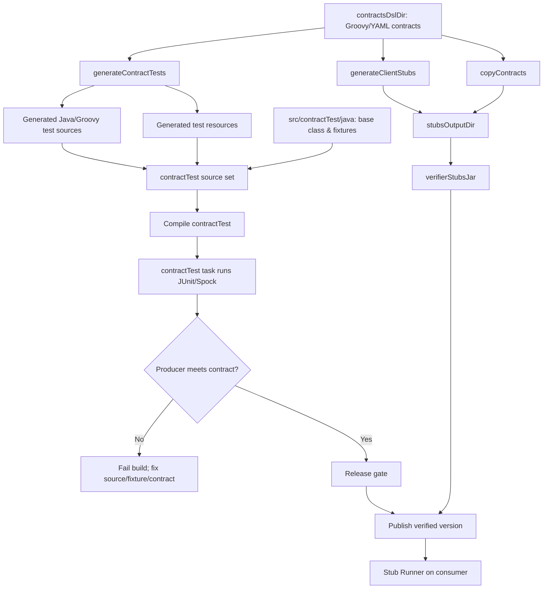
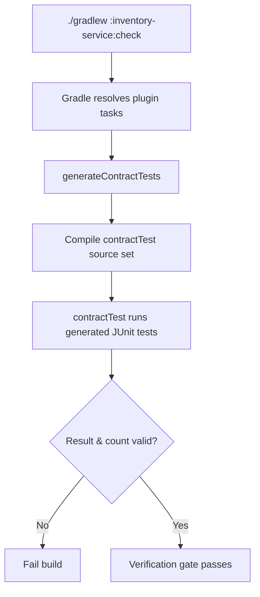

# Configuring Source Sets, Input Directories, and Output Directories

A Groovy or YAML contract file may describe the HTTP API accurately, yet **Spring Cloud Contract Verifier** still fails to protect the producer if Gradle cannot find that file, generates tests into a directory the compiler ignores, or runs the `test` task instead of `contractTest`. Similarly, a `build/stubs` directory full of JSON mappings does not guarantee it has become an artifact that the consumer's **Stub Runner** can download and use.

This lesson belongs to the **Gradle Integration** chapter of the **SPRING_CLOUD_CONTRACT** module. The module covers contract testing between producer and consumer with **Groovy/YAML DSL**, producer test generation, stub publishing, and CI integration to catch incompatible API changes. This topic focuses on **Gradle source sets**, **input paths**, and **plugin output types**, explaining how to wire them into compilation, test execution, and stub packaging.

In this lesson, `InventoryService` is the HTTP producer and `OrderService` is the consumer. Project and API names are illustrative only; **do not assume a real build already contains those files**. Examples are primarily written in **Gradle Groovy DSL** (`build.gradle`); for Gradle Kotlin DSL (`build.gradle.kts`), syntax and some property types differ.

After this lesson, you will be able to:

- Explain the `main`, `test`, and `contractTest` source sets in Gradle.
- Distinguish `contractsDslDir`, `generatedTestJavaSourcesDir`, `generatedTestGroovySourcesDir`, `generatedTestResourcesDir`, and `stubsOutputDir`.
- Choose the right locations for source contracts, hand-written base classes, and generated tests.
- Configure the Spring Cloud Contract Gradle plugin with JUnit 5 and MockMvc.
- Verify the `generateContractTests`, `contractTest`, `generateClientStubs`, and `verifierStubsJar` tasks.
- Migrate contracts from the legacy `src/test/resources/contracts` convention to `src/contractTest/resources/contracts` in a controlled way.
- Handle custom source sets, multi-module builds, caching, and artifacts in CI.
- Prove that generated tests actually **executed** rather than merely existing on disk.

## 1. Why Do Gradle Source Sets Matter for Contract Testing?

In the Gradle Java plugin, a **source set** groups source code, resources, dependency configurations, and compiled output class files for a specific purpose. The key source sets are:

| Source set | Purpose | Examples |
| --- | --- | --- |
| `main` | Production application code | `src/main/java`, `src/main/resources` |
| `test` | Standard unit/integration tests | `src/test/java`, `src/test/resources` |
| `contractTest` | Generated producer contract tests and their base classes when the Spring Cloud Contract Gradle plugin is configured per current conventions | `src/contractTest/java`, `src/contractTest/resources/contracts` |

The `contractTest` name is not an identical Maven directory convention. In the Spring Cloud Contract Gradle plugin from **3.x onward**, `contractTest` is the default source set documented by the plugin for verification. Older projects may organize directories differently; consult the documentation for your exact version rather than inferring paths from a Maven example.

### A Source Set Is Not the Same as the Contract DSL Directory

`contractsDslDir` tells the plugin **where to read contract definitions**; `contractTest` is the source set used for **compiling and running tests**, including base classes and generated code wired into the build by the plugin. The two are related, yet **not the same setting**.

For example:

```text
src/contractTest/resources/contracts/   # Input DSL: .groovy / .yml files
src/contractTest/java/                  # Hand-written base classes and helpers
build/generated-test-sources/...        # Generated tests: created by the plugin
build/classes/...                       # Bytecode: created by the compiler
build/test-results/contractTest/        # XML results from the contractTest task
```

If you put a contract into `src/contractTest/java` like a JUnit test file without configuring the DSL source directory, the plugin will not automatically know to read it as a contract. Conversely, if test source files are merely written into `build/generated-test-sources` without being wired into the source set and test task, they **may never be compiled or executed**.

## 2. Flow: Input → Generated Output → Verification → Artifact



This diagram is a **logical model**, not an order Gradle enforces automatically for every task. For example, invoking `verifierStubsJar` directly can generate a JAR even if you **have not run `contractTest`**. CI policy must enforce passing producer verification before publishing stubs.

Distinguish five groups of assets:

1. **Source DSL**: hand-written contracts requiring review and version control.
2. **Test base/fixtures**: hand-written test code to initialize the application and test data.
3. **Generated test sources/resources**: ephemeral generator outputs rebuilt from the DSL.
4. **Stub mappings/contract packaging output**: contents staged for JAR packaging.
5. **Reports and final artifact**: test execution results plus the classified/versioned JAR for consumers.

Never manually edit a generated file inside `build` and treat that edit as the source of truth: the next plugin run will overwrite it.

## 3. Where Should a Gradle Project Structure Start?

Following current Spring Cloud Contract Gradle plugin conventions, a Spring MVC producer can be laid out as:

```text
inventory-service/
├── settings.gradle
├── build.gradle
├── gradlew
├── gradlew.bat
├── gradle/wrapper/...
└── src/
    ├── main/
    │   ├── java/com/example/inventory/...
    │   └── resources/application.yml
    ├── test/
    │   ├── java/...                   # Standard unit tests
    │   └── resources/...
    └── contractTest/
        ├── java/com/example/inventory/
        │   └── ContractVerifierBase.java
        └── resources/
            └── contracts/
                └── reservations/
                    ├── create-reservation-success.groovy
                    └── insufficient-stock.yml
```

The two contract files under `reservations/` illustrate two **distinct scenarios**, not duplicating the same success contract in both Groovy and YAML and accidentally generating tests twice.

### Organization Rules

- `src/main` holds real producer code.
- `src/test` is for the project's other tests, not the recommended location for the **new default Gradle contract DSL**.
- `src/contractTest/java` holds hand-written base classes and helpers; these classes must be tracked in Git.
- `src/contractTest/resources/contracts` holds DSL sources.
- `build` is Gradle/plugin-generated output and is normally **not committed**.

Generated directories can be reconfigured; do not treat paths from a single tutorial as universal across every plugin version.

## 4. Major Caveat When Migrating from Gradle Plugin 2.x to 3.x+

The default contract path changed across major generations:

| Documentation line | Common DSL directory | Default source set to note |
| --- | --- | --- |
| Gradle plugin 2.x configs | `src/test/resources/contracts` | Some versions used `test` |
| Gradle plugin 3.x+ in official docs | `src/contractTest/resources/contracts` | `contractTest` |
| Maven plugin | `src/test/resources/contracts` per Maven convention | Does **not** use Gradle source sets |

During the transition, Gradle plugin versions from 3.0 supported reading contracts from the old `src/test/resources/contracts` location while emitting a **deprecation warning**. Do not rely indefinitely on the legacy search path or treat the warning as harmless: when upgrading toolchains, contracts may stop being picked up as before. See the [Spring Cloud Contract Gradle documentation](https://docs.spring.io/spring-cloud-contract/reference/gradle-project.html).

Migration procedure:

1. Record the current plugin version, Gradle Wrapper, and input paths.
2. Pick a single source of truth for contracts; avoid keeping equivalent files in both old and new paths.
3. Move DSL files to `src/contractTest/resources/contracts`, preserving appropriate packages/groups.
4. Move base classes and helpers from `src/test/java` to `src/contractTest/java`, or explicitly configure classpath/source sets if intentionally shared.
5. Update `contractsDslDir` and `baseClassForTests` if previously overridden.
6. Run `generateContractTests` and verify the expected number of generated classes/methods.
7. Run `contractTest` and verify compilation, fixtures, and JUnit discovery.
8. Generate stubs and inspect JAR contents after migration.

Moving the base class matters: generated tests might find the DSL yet **fail to compile** because the superclass remains in `test`, which `contractTest` cannot see.

## 5. Key Path Properties of the Gradle Plugin

| Property in `contracts { ... }` | Input/Output | Role |
| --- | --- | --- |
| `contractsDslDir` | Input | Directory containing Groovy/YAML contracts |
| `sourceSet` | Test organization | Selects the source set used by the plugin for contract tests; defaults to `contractTest` when unset |
| `generatedTestJavaSourcesDir` | Output | Java/JUnit tests created by the generator |
| `generatedTestGroovySourcesDir` | Output | Groovy/Spock tests created by the generator |
| `generatedTestResourcesDir` | Output | Resources supporting generated tests |
| `stubsOutputDir` | Output | Stub mappings and packaging data |
| `basePackageForTests` | Generated package | Package of generated tests |
| `baseClassForTests` | Class reference | Hand-written base class extended by generated tests |
| `packageWithBaseClasses` | Class convention | Resolves base classes based on contract structure |
| `baseClassMappings` | Class mapping | Maps specific contract packages to a base class |

**Important:** `generatedTestSourcesDir` is a legacy option now **deprecated** in current Gradle plugin documentation. For new configurations, use `generatedTestJavaSourcesDir` and `generatedTestGroovySourcesDir` accordingly; do not set the deprecated option while expecting it to always override newer settings.

Per the "Default Setup" section of the 5.0 plugin documentation, the default paths are typically:

```text
Input:
  <projectDir>/src/contractTest/resources/contracts

Outputs (illustrative model for default buildDir):
  <buildDir>/generated-test-sources/contractTest/java
  <buildDir>/generated-test-sources/contractTest/groovy
  <buildDir>/generated-test-resources/contracts
  <buildDir>/stubs
```

Some parts of the docs render `generatedTestResourcesDir` as `.../contracts` and others as `.../contractTest`. **When checking in CI, prefer the actual resolved extension value from your active plugin**, or configure your project's output directories explicitly rather than guessing one universal default.

### Why Keep Generated Outputs Inside the Build Directory?

- `./gradlew clean` wipes stale outputs before regenerating.
- Prevents accidentally committing generated tests alongside hand-written tests.
- Allows Gradle to manage outputs in the task graph and build cache properly when inputs/outputs are declared.
- Reduces the risk of the generator overwriting hand-written files.
- Makes it easy to trace the path from contract sources to generated files to reports.

Do not set `generatedTestJavaSourcesDir` to `src/contractTest/java` just so your IDE sees files: that mixes generated code with hand-written base classes and complicates Git diffs, clean builds, and plugin upgrades.

## 6. Example `build.gradle`: Defining Inputs and Outputs Explicitly

The snippet below is a **reference configuration excerpt** to combine with your existing Spring Boot build and dependency management. Replace `SCC_VERSION_COMPATIBLE` with a Spring Cloud Contract version compatible with your project's Spring Boot, JDK, and Gradle Wrapper versions.

```groovy
plugins {
    id 'java'
    id 'org.springframework.cloud.contract' version 'SCC_VERSION_COMPATIBLE'
}

repositories {
    mavenCentral()
}

dependencies {
    // Versions are managed by the project's BOM/platform or build setup.
    contractTestImplementation 'org.springframework.cloud:spring-cloud-starter-contract-verifier'
    contractTestImplementation 'org.springframework.boot:spring-boot-starter-test'
    contractTestRuntimeOnly 'org.junit.platform:junit-platform-launcher'
}

contracts {
    // Source contract DSL: not the generated directory.
    contractsDslDir = file('src/contractTest/resources/contracts')

    // Test framework and transport; here a Spring MVC producer.
    testFramework = 'JUNIT5'
    testMode = 'MockMvc'
    baseClassForTests = 'com.example.inventory.ContractVerifierBase'

    // Generator outputs. Placed under build/ so they can be cleaned and regenerated.
    generatedTestJavaSourcesDir =
        layout.buildDirectory.dir('generated-test-sources/contractTest/java').get().asFile
    generatedTestGroovySourcesDir =
        layout.buildDirectory.dir('generated-test-sources/contractTest/groovy').get().asFile
    generatedTestResourcesDir =
        layout.buildDirectory.dir('generated-test-resources/contracts').get().asFile
    stubsOutputDir = layout.buildDirectory.dir('stubs').get().asFile
}

tasks.named('contractTest', Test) {
    useJUnitPlatform()
    testLogging {
        events 'passed', 'failed', 'skipped'
    }
}
```

**Read carefully before running:**

1. This is **Groovy DSL**; `build.gradle.kts` requires the corresponding Kotlin API and syntax.
2. Unversioned artifacts in the example require a **BOM/platform/dependency management** setup or valid explicit versions configured in your project. The snippet cannot run standalone without them.
3. `contractTestImplementation`/`contractTestRuntimeOnly` are configurations attached to the `contractTest` source set. They exist once the plugin creates that source set. On very old plugin versions, confirm the actual source set.
4. `testMode = 'MockMvc'` is for Spring MVC. For Spring WebFlux, messaging, or a real HTTP server, adjust the test mode and base class.
5. `layout.buildDirectory.dir(...).get().asFile` provides a `File` to plugin properties using Gradle Groovy DSL syntax. Official docs also show `project.file("$buildDir/...")`; the layout API approach is cleaner, though compatibility depends on Gradle/plugin versions.
6. `useJUnitPlatform()` is applied to the `contractTest` task, **not only to the `test` task**.

If the project uses Spock, you need the `groovy` plugin, compatible `spock-core`/`spock-spring` dependencies, the Spock test framework setting, and `src/contractTest/groovy`. Do not copy the JUnit 5 portions of this example directly for Spock without adjustments.

## 7. The Base Class Must Be on the Right Classpath

An MVC producer might have:

```java
package com.example.inventory;

import io.restassured.module.mockmvc.RestAssuredMockMvc;
import org.junit.jupiter.api.BeforeEach;
import org.springframework.beans.factory.annotation.Autowired;
import org.springframework.boot.test.context.SpringBootTest;
import org.springframework.web.context.WebApplicationContext;

@SpringBootTest
public abstract class ContractVerifierBase {
    @Autowired
    WebApplicationContext context;

    @BeforeEach
    void setup() {
        RestAssuredMockMvc.webAppContextSetup(context);
    }
}
```

Place this file at:

```text
src/contractTest/java/com/example/inventory/ContractVerifierBase.java
```

It is **hand-written code** that can prepare SKU fixtures, clocks, databases, or test doubles as needed. It does not live under `build/generated-test-sources`, because that is plugin output.

Classpath notes:

- `baseClassForTests` is a **fully qualified class name** (package + class), not a filesystem path.
- `basePackageForTests` controls the package of generated tests; it **does not** automatically put the base class onto the classpath.
- If the base class uses Spring Test, RestAssured MockMvc, or test utilities, those dependencies must be on the `contractTest` compile/runtime classpath.
- If the base class sits in `src/test/java` without proper sharing/inclusion, generated tests may hit `cannot find symbol` or `ClassNotFoundException`.
- If the real controller uses validation, security, or Jackson customizations, the test context setup must provide the beans required by the contract's scope.

**Never fix compilation errors by editing generated Java files.** Fix the source set, base class path, dependencies, or plugin configuration, then regenerate.

## 8. Groovy/YAML Source Contracts and Generated Tests

Example file:

```text
src/contractTest/resources/contracts/reservations/create-success.groovy
```

```groovy
import org.springframework.cloud.contract.spec.Contract

Contract.make {
    name 'create_reservation_success'
    description 'OrderService reserves 2 units of SKU-001'

    request {
        method 'POST'
        url '/api/v1/reservations'
        headers {
            contentType(applicationJson())
        }
        body([
            sku     : 'SKU-001',
            quantity: 2
        ])
    }

    response {
        status 201
        headers {
            contentType(applicationJson())
        }
        body([
            reservationId: $(consumer('RES-701'),
                             producer(regex('RES-[0-9]+'))),
            status: 'HELD'
        ])
    }
}
```

This contract promises the sample request must be handled by the producer with `201`, JSON containing an ID matching the pattern, and `status=HELD`. The generator turns the DSL into producer test assertions while also creating a stub returning `RES-701` to the consumer.

### Same Idea in YAML

```yaml
name: create_reservation_success
description: OrderService reserves 2 units of SKU-001
request:
  method: POST
  url: /api/v1/reservations
  headers:
    Content-Type: application/json
  body:
    sku: SKU-001
    quantity: 2
response:
  status: 201
  headers:
    Content-Type: application/json
  body:
    reservationId: RES-701
    status: HELD
```

This is a **basic alternative representation**; this YAML uses the literal `RES-701` and is **not yet equivalent in dynamic matching** to the Groovy version above. To make it equivalent, add matchers using the Spring Cloud Contract YAML syntax for your version. Never place both files for the same scenario in the source directory, causing the generator to emit duplicate tests and mappings.

Because the DSL file lives under `reservations/`, the plugin may use the directory layout to name the generated test class/package by convention; exact names depend on `basePackageForTests`, `name`, and generator version. Do not write CI test filters that rely rigidly on an assumed generated class name.

## 9. Gradle Task Graph: Generating Files vs. Running Tests

The Spring Cloud Contract Gradle plugin registers specialized tasks. Common names in official documentation:

| Task | Purpose | Does it verify the producer? |
| --- | --- | --- |
| `generateContractTests` | Reads contracts and generates producer tests | **Not yet**; only creates source |
| `contractTest` | Compiles/runs contract tests via source set and test runner | **Yes**, if tests are actually discovered and run |
| `generateClientStubs` | Generates stub mappings from contracts | **No** |
| `copyContracts` | Copies contract definitions into stub packaging area | **No** |
| `verifierStubsJar` | Packages stub output into a JAR | **No by default** |
| `check` | Gradle verification lifecycle; plugin usually hooks contract tests here | Yes, **if the task graph is wired properly** |

Note: these task names come from the referenced plugin versions. A project with other plugins, custom test suites, or a different Spring Cloud Contract version must inspect its real task graph rather than assuming from this table.

### Inspection Commands — Not a Substitute for Checking Results

```bash
# Run in the directory containing the Gradle Wrapper.
./gradlew tasks --all

# Only generates producer tests; does not prove implementation compliance:
./gradlew generateContractTests --info

# Compiles and runs producer contract tests:
./gradlew contractTest --info

# Generates HTTP stub mappings:
./gradlew generateClientStubs --info

# Packages the stub artifact:
./gradlew verifierStubsJar

# Runs checks wired into the Gradle verification lifecycle:
./gradlew clean check
```

On Windows use `gradlew.bat`; in multi-module builds, prefer project-qualified task paths such as `:inventory-service:contractTest`. You do not necessarily need to run every command sequentially in CI: a lifecycle task may already trigger prerequisites. **What must be confirmed is which tasks actually executed**, not how many commands were invoked.

### Ideal Task Flow



Gradle plugin docs state that the plugin hooks into `check` and provides `contractTest` to execute generated tests. However, creating or saving the `verifierStubsJar` JAR may not depend on test status. Therefore, **the publish pipeline must use `check`/`contractTest` as an explicit gate**.

## 10. Generated Java Output vs. Compiled Bytecode

After running `generateContractTests`, you may find a Java file at:

```text
build/generated-test-sources/contractTest/java/
└── org/springframework/cloud/contract/verifier/tests/
    └── ...GeneratedTest.java
```

This Java code normally extends the test base class and contains assertions matching the contract. Under `build`, you may also see:

```text
build/
├── generated-test-sources/contractTest/java/  # Generated sources
├── generated-test-resources/contracts/        # Generated resources
├── classes/java/contractTest/                 # Compiled source set classes
├── test-results/contractTest/                 # JUnit XML reports
└── reports/tests/contractTest/                # HTML report if generated by Gradle
```

**Do not conflate output layers:**

- Java sources in `generated-test-sources` prove the generator produced code.
- Class files in `classes` prove the code compiled.
- Test reports prove the runner **executed** specific tests.
- Passing assertions exercising the producer implementation support concluding that the producer obeys the contract.

Class/report output paths are influenced by Gradle version, language, test suites, and custom tasks. The paths above represent a **common layout**, not a guarantee that every Gradle build uses identical paths.

### Why Must Gradle Know the Generated Source Directory?

The test compiler only compiles files belonging to configured source sets/tasks. If the generator writes to a different folder than the source set uses:

1. Java files are generated successfully.
2. `compileContractTestJava` or the corresponding task **does not see those files**.
3. `contractTest` runs zero tests, or runs only hand-written tests.
4. `check` may turn green while part of the contracts went unverified.

Therefore, when customizing `generatedTestJavaSourcesDir`, verify that the plugin actually updates source sets and task dependencies; never assume Gradle automatically discovers every folder named `generated`.

## 11. The `contractTest` Source Set and Dependency Configurations

The Java plugin creates `testImplementation`/`testRuntimeOnly` for the `test` source set. When the Spring Cloud Contract plugin creates `contractTest`, you also need to understand configurations such as:

```text
contractTestImplementation
contractTestCompileOnly
contractTestRuntimeOnly
contractTestRuntimeClasspath
```

Exact available configurations and `extendsFrom` relationships depend on the applied source sets and plugins. Do not assume adding a library to `testImplementation` automatically makes it visible to generated `contractTest` sources.

### Example of Missing Dependencies

A base class:

```java
import org.springframework.boot.test.context.SpringBootTest;
import org.junit.jupiter.api.BeforeEach;
import io.restassured.module.mockmvc.RestAssuredMockMvc;
```

If `contractTestCompileClasspath` lacks the corresponding Spring Test/JUnit/RestAssured MockMvc libraries, compiling generated tests can fail even when unit tests under `src/test` run fine.

Declare dependencies in the right configuration, for example:

```groovy
dependencies {
    contractTestImplementation 'org.springframework.cloud:spring-cloud-starter-contract-verifier'
    contractTestImplementation 'org.springframework.boot:spring-boot-starter-test'
    contractTestRuntimeOnly 'org.junit.platform:junit-platform-launcher'
}
```

This is a **Gradle snippet** assuming `contractTest` already exists and versions are managed. In projects with convention plugins or custom dependency constraints, `extendsFrom` may be used instead of repeating every dependency, as long as you verify which configurations are inherited.

### Commands to Inspect Source Set Dependencies

```bash
./gradlew dependencies --configuration contractTestCompileClasspath
./gradlew dependencies --configuration contractTestRuntimeClasspath
./gradlew dependencyInsight --configuration contractTestRuntimeClasspath \
  --dependency junit-jupiter
```

These commands target the Gradle Wrapper in a Unix shell; on PowerShell, rewrite the line continuation in the last example on a single line. The goal is to confirm dependencies **actually resolved**, rather than only reading the `dependencies { ... }` block in a build script.

## 12. Changing the Source Set: Do Not Merely Rename Folders

Sometimes teams want generated tests placed in `test` or another integration test source set instead of `contractTest`. The Spring Cloud Contract Gradle extension provides a `sourceSet` option to pick the desired source set.

A **directional example** for a project with existing source sets:

```groovy
contracts {
    // sourceSet is a Gradle SourceSet object, not a path String.
    // Only use after confirming your plugin/version supports it properly.
    sourceSet = sourceSets.test

    // The contract DSL directory is still configured separately:
    contractsDslDir = file('src/contractTest/resources/contracts')
}
```

Items to verify after switching:

1. Which **source set** owns the generated Java/Groovy sources?
2. Is the base class on that source set's compile/runtime classpath?
3. Does `test` or `contractTest` actually **execute generated tests**?
4. How does `check` change? Are tests run twice?
5. Where are XML/HTML reports written?
6. If test tasks run in parallel, do they share fixtures/databases/ports causing flaky results?

**Do not assume setting `sourceSet = sourceSets.test` automatically moves `contractsDslDir` back to `src/test/resources/contracts`.** Those are two separate concerns: one controls source/test classpath layout, and the other controls where contract definitions are loaded from.

### Why Is Keeping a Separate Source Set Usually Better?

- Test frameworks and dependencies can be tailored specifically for contract verification.
- `contractTest` can be run independently during diagnostics.
- Contract test reports stay separated from unit test reports.
- Base classes and fixtures remain distinct from regular tests.
- CI can easily enforce generated test count checks and detect skips.

However, a separate source set adds classpath and test lifecycle management overhead. In complex multi-module setups, use a consistent convention plugin so modules do not diverge.

## 13. What Do Generated Test Resources Contain?

Some contracts reference test fixtures, request/response body files, or supporting resources that the generator needs when compiling/running tests. `generatedTestResourcesDir` is where the plugin can emit **resources for generated tests**.

Distinctions:

| Directory | Typical contents | Who owns it? |
| --- | --- | --- |
| `src/contractTest/resources/contracts` | Groovy/YAML DSL contracts | Developer, reviewed via Git |
| `src/contractTest/resources` outside `contracts` | Hand-written test fixtures, test configs | Developer |
| `build/generated-test-resources/...` | Resources generated by the plugin | Plugin |
| `build/resources/contractTest` | Processed/copied resources for test runtime | Gradle |
| `build/stubs` | Stub mappings/contract definitions staged for packaging | Plugin/build |

A JSON body file used by producer tests and a JSON body file used by a WireMock stub may look identical in content yet serve **different roles**. Do not accidentally copy WireMock's `__files` into test resources and assume the plugin loads them uniformly across all setups.

### When Using External Payload Files

For example, when a contract references `order-created-request.json` or `reservation-response.json` via the corresponding helper/DSL, ensure:

- Original files are under version control.
- The generator knows where to read those files from.
- Generated tests can load the resources at runtime, not just during source generation.
- Stub packaging includes body files when mappings use `bodyFileName`.
- Paths inside the JAR and on the filesystem match runtime expectations.

Seeing a filename in the repository **does not** prove both producer tests and consumer stubs can read it.

## 14. Stubs Output vs. Tests Output

`stubsOutputDir` is not where generated JUnit tests go. It holds WireMock/Stub Runner assets such as JSON mappings and copied contracts for packaging.

Illustrative layout:

```text
build/
├── generated-test-sources/contractTest/java/...
├── generated-test-resources/contracts/...
└── stubs/
    └── META-INF/
        └── com.example/
            └── inventory-service/
                └── 1.4.2/
                    ├── mappings/
                    │   └── create_reservation_success.json
                    └── contracts/
                        └── create-success.groovy
```

The `META-INF/...` structure reflects Spring Cloud Contract artifact conventions, **not a guarantee** that every Gradle plugin version and custom task uses the exact same layout. Directory paths inside the JAR can be configured in `copyContracts`/`verifierStubsJar`; the only way to be sure is inspecting the final artifact.

### Checking with Gradle Commands and JDK Tools

```bash
./gradlew generateClientStubs
./gradlew verifierStubsJar

# Verify the actual filename created in build/libs before running below.
jar tf build/libs/inventory-service-1.4.2-stubs.jar
```

If `jar tf` shows no mappings or contracts, do not manually rename a file to `-stubs.jar` and call it done. Inspect `stubsOutputDir`, the `Jar` task inputs, `copyContracts`, and the artifact publication paths.

**Critical limitation:** `generateClientStubs` and `verifierStubsJar` **do not prove the producer implementation complies with the contract**. Before releasing, CI must run `contractTest` and other verification gates.

## 15. Packaging Stubs with Gradle and Controlled Publishing

Spring Cloud Contract Gradle documentation describes `verifierStubsJar` for packaging stub outputs alongside `copyContracts` for placing contract definitions into the artifact. Since Spring Cloud Contract 3.0, **default automatic publication has been disabled**, so developers must define an appropriate publication explicitly.

Example **`build.gradle` snippet**:

```groovy
plugins {
    id 'maven-publish'
}

publishing {
    publications {
        producer(MavenPublication) {
            from components.java
            artifact tasks.named('verifierStubsJar')
        }
    }
}
```

This snippet assumes the `java` and Spring Cloud Contract Gradle plugins are already applied from the earlier configuration and `verifierStubsJar` is registered. With Spring Boot, whether you publish a plain `jar` or `bootJar` must match your producer's actual configuration. Verify the publication has the **right primary artifact and stub classifier**, rather than just checking the publication name.

To adjust JAR contents using the Gradle-native task API, you can add **non-sensitive** metadata:

```groovy
tasks.named('verifierStubsJar', Jar) {
    // Illustrative example; metadata must be generated by the build for the right version.
    from(layout.buildDirectory.dir('generated-metadata')) {
        include 'git.properties'
    }
}
```

If the metadata file does not exist, Gradle simply adds nothing to the artifact; this is **not a mandatory step** in Spring Cloud Contract. Verify `jar tf` and checksums when publishing.

### Why Not Publish Immediately After `generateClientStubs`?

Stubs are generated from the **promises in the DSL**. A stub can still return `201 HELD` even when producer code has changed to `200`, because the stub generator never invokes the real controller. Therefore, the logical release order must be:

```text
Commit producer code + contract
  -> Gradle generateContractTests
  -> Compile / execute contractTest
  -> Verify required integration tests
  -> Generate client stubs
  -> Package verifierStubsJar
  -> Publish versioned artifact
  -> Consumer Stub Runner resolves the exact version
```

The Gradle task graph may generate stubs at a different time for performance, yet **the publish gate must never bypass producer verification**.

## 16. Multi-Module Gradle: Which Project Owns Relative Paths?

In a multi-service repository, `rootProject.projectDir` and `project.projectDir` usually differ. This is a common root cause of "only producer A generates tests, producer B cannot find contracts."

Example:

```text
platform-services/
├── settings.gradle
├── build.gradle
├── inventory-service/
│   ├── build.gradle
│   └── src/contractTest/resources/contracts/...
├── order-service/
│   ├── build.gradle
│   └── src/test/java/...
└── pricing-service/
    ├── build.gradle
    └── src/contractTest/resources/contracts/...
```

In `inventory-service/build.gradle`:

```groovy
contracts {
    // file(...) resolves relative to the subproject.
    contractsDslDir = file('src/contractTest/resources/contracts')
    stubsOutputDir = layout.buildDirectory.dir('stubs').get().asFile
}
```

When intentionally using a **shared** contracts directory at the root, point explicitly to the root path:

```groovy
contracts {
    // Only an example when an organization INTENTIONALLY centralizes contracts.
    contractsDslDir = rootProject.file(
        'contracts/inventory-service'
    )
}
```

**Do not point every module to `rootProject.file('src/contractTest/...')`.** Otherwise multiple producers may accidentally read the same contract set or a nonexistent root directory.

### Use Fully Qualified Task Paths

```bash
./gradlew :inventory-service:generateContractTests
./gradlew :inventory-service:contractTest
./gradlew :inventory-service:verifierStubsJar
./gradlew :pricing-service:contractTest
./gradlew :inventory-service:check
```

Benefits:

- Know exactly which producer's tests just ran.
- Inspect the right `inventory-service/build/...` outputs.
- Avoid confusing artifacts from another subproject.
- Easily split CI jobs when producers are independent.
- Choose full or incremental builds based on changed modules.

In multi-module setups, do not report a single `TOTAL CONTRACT TESTS=10` if Inventory has 10 and Pricing unexpectedly has 0. Report counts per **producer module** before aggregating.

## 17. Contracts in an External Repository or Artifact

Not every organization stores contracts alongside producer code. The Gradle plugin supports configuring contract sources via an external artifact dependency or repository.

A **structural sample** of the extension:

```groovy
contracts {
    contractDependency {
        // Illustrative coordinates; must point to an existing artifact.
        stringNotation = 'com.example:inventory-contracts:1.4.2:contracts'
    }
    // Path inside the artifact must match the actual layout.
    contractsPath = 'com/example/inventory-service'
}
```

Depending on the version, the plugin also offers `contractRepository`, `contractsMode`, or cache/download options. Never use a floating branch name or `latest` as the contract source for release builds if reproducibility is required.

### Why Are Source Sets and External Contracts Still Separate Concerns?

Even when the DSL is downloaded from another JAR or repository:

- Gradle still generates Java/Groovy producer tests **into the source set of the module being verified**.
- Base classes and fixtures still live in the producer project or a test support module.
- `contractTest` dependencies still need everything required to compile and run tests.
- `stubsOutputDir` remains an output of the producer build.
- CI must record both the **producer code revision** and the **contract artifact/revision** to prove which exact pair was verified.

If a consumer supplies contracts from a separate repository, two builds of the same producer commit can yield different results if the build always pulls the latest content without pinning a revision.

## 18. Build Cache and Incremental Execution: Avoid Stale Outputs

Gradle provides incremental tasks, up-to-date checks, and optional local/remote build caches. These speed up builds, but for trustworthy contract tests, inputs and outputs must be tracked accurately.

### Critical Inputs

- Contract source files and the `contractsDslDir` directory.
- `contracts { ... }` settings such as test framework, test mode, and base class mappings.
- Plugin version and dependencies used when generating and compiling tests.
- Base class, fixtures, and producer code.
- Environment/test properties needed for test execution.
- Externally fetched contracts and their exact resolved revision.

### Critical Outputs

- `generatedTestJavaSourcesDir` or `generatedTestGroovySourcesDir`.
- `generatedTestResourcesDir`.
- `stubsOutputDir`.
- Compiled test classes.
- Test reports and `verifierStubsJar`.

If task inputs change yet generator outputs are erroneously reused, Gradle may verify the producer against an **old contract**. While investigating, run clean/re-run commands as supported by your tooling:

```bash
# Regenerate producer test outputs in the module under check:
./gradlew :inventory-service:clean :inventory-service:contractTest --rerun-tasks

# Diagnose whether the build cache is masking stale outputs:
./gradlew :inventory-service:contractTest --no-build-cache --info
```

**Do not disable caching permanently.** The real fix is proper input/output declarations and compatible plugin tasks. `clean` helps diagnose problems, yet it will not fix a misconfigured task graph.

### Habits to Avoid

- Committing `build/generated-test-sources` and then forgetting to regenerate after editing contracts.
- Copying generated tests from one branch to another just so the compiler finds them.
- Caching the entire `build` folder under a key based only on JDK version while ignoring contract revisions.
- Running the generation task once locally while CI runs stale test sources.
- Treating `UP-TO-DATE` as proof that the producer was verified on the current code.

When Gradle reports `UP-TO-DATE`, it only means the task evaluated inputs/outputs per declared metadata. To draw the right conclusion, confirm the task **tracks all relevant inputs** and retain verification evidence from a valid build.

## 19. Missing Contracts vs. Zero Executed Tests: Two Distinct Failure Modes

The Spring Cloud Contract Gradle plugin provides `failOnNoContracts`, which defaults to `true` in recent documentation. You can set it explicitly:

```groovy
contracts {
    failOnNoContracts = true
    failOnInProgress = true
}
```

Still, **having contracts does not guarantee JUnit executed tests**. A pipeline should also check executed test counts:

| Signal | Possible cause | Action needed |
| --- | --- | --- |
| No contracts found | Wrong `contractsDslDir`, `projectDir`/`rootDir` mix-up, or wrong legacy path | Fix input path and check plugin logs |
| Generator emits 0 Java/Groovy files despite DSL | Contracts ignored/filtered or config error | Check file counts/contract list and generation logs |
| Generated sources exist but no class files | Source set does not include output or compile fails | Inspect `compileContractTestJava/Groovy` and classpath |
| Class files exist yet `contractTest` runs 0 tests | Wrong JUnit Platform, test discovery, or filters | Inspect task config, reports, and JUnit dependencies |
| `test` runs unit tests but not contract tests | Wrong source set or task invoked | Run `contractTest` or properly wired `check` |
| Tests run but all are skipped | Tests disabled or skip flags active | Fail CI on unauthorized skips |
| Generated tests pass when producer returns fake responses | Base class mocks away the implementation under test | Fix setup/test boundary and add integration tests |

An **illustrative** test count check in Gradle Groovy DSL:

```groovy
tasks.named('contractTest', Test) {
    useJUnitPlatform()

    afterSuite { descriptor, result ->
        if (descriptor.parent == null) {
            logger.lifecycle(
                "contractTest: total={}, passed={}, failed={}, skipped={}",
                result.testCount,
                result.successfulTestCount,
                result.failedTestCount,
                result.skippedTestCount
            )
            if (result.testCount == 0) {
                throw new GradleException(
                    'No contract tests were executed'
                )
            }
        }
    }
}
```

This snippet catches the case where **the task ran yet reported 0 tests**, assuming an active test suite. It does not replace `failOnNoContracts`, does not automatically check whether **each individual contract produced a test**, and must be reviewed for compatibility with your Gradle/test task version. For modules intentionally having no contracts, apply an explicit policy rather than enabling a check that fails unconditionally.

**The CI gate must also verify whether `contractTest` was scheduled at all.** If the task never runs, its `afterSuite` callback never fires either; ensure `check` or the CI job **explicitly depends** on `contractTest`.

## 20. Configuring CI When Gradle Is the Source of Truth for the Task Graph

An **illustrative** GitHub Actions workflow:

```yaml
name: Verify producer contracts with Gradle

on:
  pull_request:
  push:
    branches: [main]

jobs:
  verify-contracts:
    runs-on: ubuntu-latest
    steps:
      - uses: actions/checkout@v4
      - uses: actions/setup-java@v4
        with:
          distribution: temurin
          java-version: '21'

      - name: Setup Gradle
        uses: gradle/actions/setup-gradle@v4

      - name: Verify producer and build stubs
        run: |
          ./gradlew --no-daemon \
            :inventory-service:clean \
            :inventory-service:check \
            :inventory-service:verifierStubsJar

      - name: Keep contract test reports
        if: always()
        uses: actions/upload-artifact@v4
        with:
          name: inventory-contract-test-reports
          path: |
            inventory-service/build/test-results/contractTest/
            inventory-service/build/reports/tests/contractTest/
```

This is a **reference workflow**, not a complete ready-made config for every repository. Adjust JDK, paths, Gradle Wrapper permissions, dependencies, Gradle version, and CI triggers to match your repository. For subprojects with other names, replace `:inventory-service:...` and the corresponding artifact paths.

### Conditions to Verify Beyond the Build Command

1. The generator locates contract files from `contractsDslDir` or a pinned external revision.
2. `contractTest` executes a meaningful number of tests (not 0 or unexpectedly skipped).
3. Tests exercise real producer code, fixtures, and meaningful assertions—not merely a mock returning canned responses.
4. Generated stubs and contract definitions appear inside `verifierStubsJar`.
5. No copy/merge step leaves mappings from an old commit/contract inside the stub artifact.
6. Only a protected publish job pushes producer/stub versions to repositories.
7. Consumer CI uses the **exact stub version** via Stub Runner.

### Do Not Publish on Every Pull Request

Generating and packaging the JAR in a PR validates the pipeline logic, yet **publishing** can pollute the release repository or allow consumers to pull an artifact not officially verified by the producer.

Normally split into:

- **PR verify**: `check` + validate JAR + archive test reports.
- **Release publish**: from an approved commit/tag, verify tests on that exact revision and publish an immutable versioned artifact.
- **Consumer compatibility**: run consumer tests with a pinned stub version and verify request/response handling.

In systems requiring reproducibility, record the producer Git commit, contract revision, Spring Cloud Contract plugin version, Gradle Wrapper version, test results, and stub JAR checksum.

## 21. When the Producer Uses Spock/Groovy Instead of JUnit/Java

Source sets and generated outputs follow the same principles, while the test language changes:

| Aspect | JUnit 5 / Java | Spock / Groovy |
| --- | --- | --- |
| Base class | `src/contractTest/java` | `src/contractTest/groovy` |
| Generated source | `generatedTestJavaSourcesDir` | `generatedTestGroovySourcesDir` |
| Framework | `JUNIT5` | `SPOCK` (pick per version/plugin) |
| Dependencies | Spring Test, JUnit Platform, verifier | Groovy, Spock core/spring, verifier |
| Test task | `contractTest` + appropriate JUnit Platform | `contractTest` with appropriate Spock/JUnit Platform |

Example of an **illustrative** Spock base class:

```groovy
package com.example.inventory

import io.restassured.module.mockmvc.RestAssuredMockMvc
import spock.lang.Specification

abstract class ContractVerifierBaseSpec extends Specification {
    def setup() {
        RestAssuredMockMvc.standaloneSetup(
            new ReservationController(new FakeReservationService())
        )
    }
}
```

`ReservationController` and `FakeReservationService` are **illustrative application classes**, not framework-provided classes. For complex production logic, standalone setup tests only the controller boundary; test at another layer if contracts cover state or side effects replaced by the fake.

Do not take this Spock snippet and assume adding `id 'groovy'` makes every dependency compatible automatically. Pin Groovy/Spock/Spring Boot/Spring Cloud Contract versions according to the release train.

## 22. WebFlux and Messaging Cases

In Spring Cloud Contract, test source directories must still be configured properly even when contracts are not HTTP servlet calls. However, how **generated test code works** changes:

- **Spring MVC/MockMvc**: the base class can initialize `RestAssuredMockMvc` and the controller/web context.
- **Spring WebFlux/WebTestClient**: choose the matching test mode, base class, and reactive HTTP client; do not copy MockMvc setup from MVC.
- **Messaging**: generated tests need a message verifier adapter, matching sources/destinations, trigger fixtures, and Spring Integration/Stream/AMQP support if used.

In all cases:

1. `contractsDslDir` is the Groovy/YAML DSL input.
2. Generated test sources/resources must reach the right source set and classpath.
3. `contractTest` or the configured test task must **execute**.
4. `stubsOutputDir` is output for consumer stubs, not proof of producer behavior.

When combining HTTP and messaging contracts in the same module, one shared base class may not suffice. You can use `baseClassMappings` or `packageWithBaseClasses` so contract groups receive appropriate setup by package. Verify that generated tests extend the right base class after running the generator.

## 23. Diagnosing at the Right Layer of the Build System

If `./gradlew check` fails or looks suspiciously green, trace sequentially from **inputs** to **test execution**, rather than editing generated sources as a long-term fix.

| Symptom | Common failure layer | What to check |
| --- | --- | --- |
| No contracts found | Input DSL | `contractsDslDir`, subproject paths, legacy path, and case sensitivity |
| Plugin warns about `src/test/resources/contracts` | Convention/migration | Move contracts to `src/contractTest/resources/contracts` and confirm single source |
| `generateContractTests` runs but generated Java is empty | Generator/config | Whether contracts are excluded by `ignored`, `ignoredFiles`, or in-progress filters |
| Generated tests appear in an unexpected folder | Output config | `generatedTestJavaSourcesDir` and `layout.buildDirectory` value |
| Java files generated but compiler misses them | Source set | `contractTest` source roots, task dependencies, and compilation |
| `ContractVerifierBase` not found | Source set or package | `src/contractTest/java`, `baseClassForTests`, dependencies |
| `RestAssuredMockMvc` not found | Dependency | Whether `contractTestCompileClasspath` has the right starter/verifier runtime |
| `contractTest` reports No tests found | Test discovery | JUnit 5 engine, `useJUnitPlatform`, include/exclude filters |
| `test` is green while `contractTest` fails | Wrong task run | Run `contractTest` or properly plugin-wired `check` |
| `check` is green with 0 generated tests | Skip/generation/test discovery | `failOnNoContracts`, test count, actual task graph |
| JSON mappings generated but `-stubs.jar` missing | Packaging | `stubsOutputDir`, `copyContracts`, `verifierStubsJar`, and publication |
| Stub JAR contains stale mappings | Cache or contract revision | Clean/re-run, inspect source commit and generator inputs |
| CI fails only on Linux | Path/case/line endings | Folder names, case sensitivity, and encoding |
| IntelliJ runs tests differently from Gradle | IDE source roots/runner | Delegate tests to Gradle; inspect generated roots and test task |
| Only root module generates stubs | Multi-module path | Whether plugin is applied to the right subproject and input path uses its `projectDir` |

### 7-Step Procedure When No Generated Tests Exist

1. Open the `contractsDslDir` configured by the **producer module**; confirm DSL sources actually live there.
2. Run `tasks --all` and confirm `generateContractTests`/`contractTest` appear in the task graph.
3. Run the generator with `--info` to see whether the plugin detects contracts and the target generated dir.
4. Inspect generated Java/Groovy sources without editing them directly; confirm meaningful class/method counts.
5. Check the hand-written base class in the right source set along with its dependency classpath.
6. Run `contractTest` and check JUnit XML reports for test counts, failures, and skips.
7. Re-run `check`/CI gates and confirm no skip branch or unverified module exists.

### 6-Step Procedure When the Stub JAR Lacks Mappings

1. Run `generateClientStubs` and inspect `stubsOutputDir`.
2. Verify the corresponding source contract files were read by the generator.
3. Verify `copyContracts` copies contract definitions into the expected output.
4. Run `verifierStubsJar` and inspect `jar tf`.
5. Confirm the publication registers `verifierStubsJar` with the right coordinates/version.
6. Load the new JAR into a **clean Stub Runner instance** and send a representative request to confirm mappings load.

## 24. Comparing Gradle and Maven on Inputs and Outputs

This comparison helps avoid copying a Maven snippet and applying its paths verbatim to Gradle:

| Concern | Gradle plugin (modern convention) | Common Maven plugin |
| --- | --- | --- |
| Contract source directory | `src/contractTest/resources/contracts` | `src/test/resources/contracts` |
| Path configuration | `contractsDslDir` | `contractsDirectory` or equivalent per Maven plugin version |
| Source set | `contractTest` | Maven test sources/lifecycle |
| Generated Java sources | `build/generated-test-sources/contractTest/java` (common) | `target/generated-test-sources/contracts` (common) |
| Generated resources | `generatedTestResourcesDir` under `build` | Output resources per Maven plugin |
| Running producer verification | `./gradlew contractTest` / `check` | `mvn test`/`verify` per config |
| Generating stubs | `generateClientStubs` | Corresponding Maven plugin goal/lifecycle |
| Packaging stubs | `verifierStubsJar` and Gradle Jar task | Attached artifact/assembly configured by Maven plugin |
| Publishing | Gradle `maven-publish`/SCM per config | Maven `deploy` or repository mechanism |

Exact path values depend on plugin version; this comparison table is **conceptual**, not a claim that every plugin version fixes identical paths.

## 25. Checklist Before Approving Gradle Configuration

- [ ] Identified the producer module, Gradle Wrapper version, and Spring Cloud Contract plugin version.
- [ ] Groovy/YAML contract sources sit in `contractsDslDir`, not misplaced in the Maven path.
- [ ] No duplicate contracts exist across legacy and modern paths.
- [ ] The `contractTest` source set (or another intentional source set) contains hand-written base classes/fixtures.
- [ ] `baseClassForTests` is the exact FQN visible on the classpath.
- [ ] `generatedTestJavaSourcesDir`/`generatedTestGroovySourcesDir` reside in build output.
- [ ] `generatedTestResourcesDir` is configured/resolved for the active plugin version.
- [ ] `stubsOutputDir` is dedicated to stub output, containing no hand-written test code.
- [ ] Generated source directories are properly picked up by compiler and test tasks.
- [ ] `contractTestImplementation`/runtime classpath contains required verifier, JUnit/Spock, and Spring Test dependencies.
- [ ] If using JUnit 5, `contractTest` enables JUnit Platform.
- [ ] `./gradlew generateContractTests` generates test sources from version-controlled contracts.
- [ ] `./gradlew contractTest` actually executes tests and asserts the producer implementation.
- [ ] `check`/CI depends on test verification, not merely `generateClientStubs`.
- [ ] Safeguards fail the build when contracts or generated tests are unexpectedly missing.
- [ ] The plugin produced stub mappings and `verifierStubsJar` contains expected contents.
- [ ] Publishing and Stub Runner agree on version and classifier.
- [ ] In multi-module builds, each project uses its own `projectDir`/`buildDir` and reports per module.
- [ ] Caching does not hide DSL/plugin/fixture edits; clean/re-run commands are available for diagnostics.
- [ ] Generated sources from `build` are not committed and generated mappings are not edited directly.
- [ ] CI archives reports, artifact versions, and traceable revisions.

### Hands-On Exercise

Suppose a Gradle project `inventory-service` provides stock reservation capabilities for `order-service`. Sample API:

```text
POST /api/v1/reservations
Request:  {"sku":"SKU-001","quantity":2}
Response: 201 {"reservationId":"RES-701","status":"HELD"}
```

Perform these steps in order:

1. Create the directory tree with `src/main/java`, `src/test/java`, `src/contractTest/java`, and `src/contractTest/resources/contracts/reservations`; explain the role of each part.
2. Write a Groovy contract for the successful `POST` API, using a sample ID for the consumer and a regex for the producer.
3. Write a separate YAML contract for `SKU-EMPTY` returning `409 INSUFFICIENT_STOCK`; do not duplicate the success scenario.
4. Declare the `org.springframework.cloud.contract` plugin with a compatible version and verify via `tasks --all`.
5. Point `contractsDslDir` to the right source directory; explicitly configure `generatedTestJavaSourcesDir`, `generatedTestResourcesDir`, and `stubsOutputDir`.
6. Write `ContractVerifierBase` under `src/contractTest/java`; prepare fixtures with `SKU-001` in stock and `SKU-EMPTY` out of stock.
7. Declare dependencies on `contractTestImplementation`; configure `contractTest` to use JUnit Platform.
8. Run `generateContractTests`; identify where generated Java classes live and why they should not be committed.
9. Run `contractTest` and inspect the test report to confirm the executed test count. Intentionally change the controller to return `200` instead of `201` and observe the test fail.
10. Move contracts to `src/test/resources/contracts` as a migration experiment; inspect actual plugin warnings/behavior and move them back to the proper source location.
11. Run `generateClientStubs`/`verifierStubsJar`, list the JAR contents, and prove mappings exist for both success and error cases.
12. Create a `pricing-service` subproject with its own contracts; use `:inventory-service:contractTest` and `:pricing-service:contractTest` task paths to prove no cross-reading occurs.
13. Enable a CI check that catches 0 generated tests or 0 executed tests. Intentionally point `contractsDslDir` to an empty directory and observe the result.
14. Run `clean contractTest --rerun-tasks` when suspecting stale cache; compare outputs/reports.
15. Add a release gate that publishes stubs only when producer contract tests and required integration tests pass; consumer tests pin versions via Stub Runner.

**Completion criteria:** you can pinpoint **where Gradle reads source contracts from**, **where generated tests are written and compiled**, **which task ran them**, **where stub mappings/JARs are produced**, and **that CI verified the real producer** rather than merely producing output files. Without proving this chain, a green build is insufficient to publish compatible stubs.

## References

- [Spring Cloud Contract — Gradle Project](https://docs.spring.io/spring-cloud-contract/reference/gradle-project.html): plugin DSL, contract sources, `contractTest` source set, generated outputs, tasks, and publishing.
- [Spring Cloud Contract — Contract DSL](https://docs.spring.io/spring-cloud-contract/reference/project-features-contract.html): Groovy/YAML contract sources and test/stub generation.
- [Spring Cloud Contract — Reference](https://docs.spring.io/spring-cloud-contract/reference/): overview of producer verification and Stub Runner.
- [Gradle — Testing in Java & JVM Projects](https://docs.gradle.org/current/userguide/java_testing.html): source sets, test tasks, compile/runtime classpaths, and test discovery.
- [Gradle — Java Plugin](https://docs.gradle.org/current/userguide/java_plugin.html): `main`, `test`, compilation, resources, and lifecycle tasks.
- [Gradle — Maven Publish Plugin](https://docs.gradle.org/current/userguide/publishing_maven.html): publications, artifact classifiers, and repositories.
- [Gradle — Incremental Build](https://docs.gradle.org/current/userguide/incremental_build.html): inputs, outputs, up-to-date checks, and caching.
