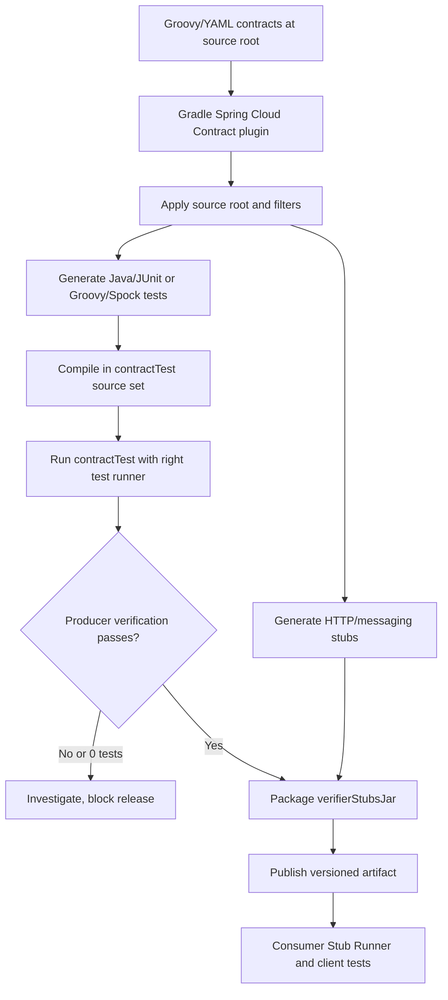
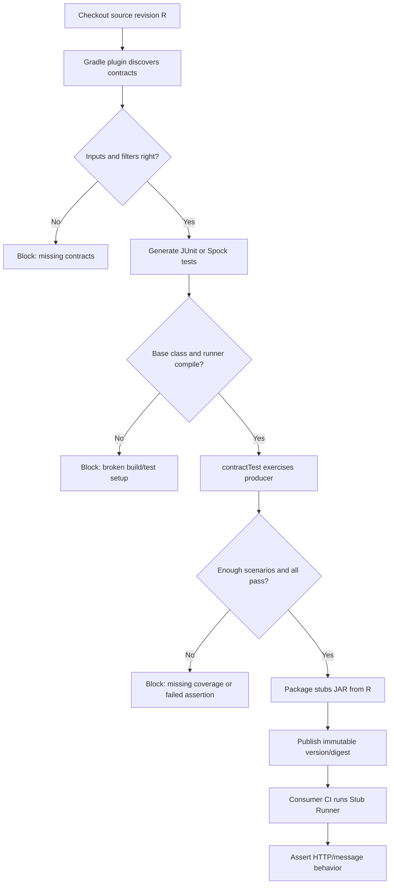

# Choosing Test Framework, Base Class, and Contract Filters

## 1. Three Decisions That Shape Contract Testing with Gradle

In **Spring Cloud Contract**, producers and consumers agree on HTTP or messaging behavior using **Groovy/YAML DSL** contracts. From the same contract source, **Contract Verifier** can generate producer verification tests and generate stubs for consumers to run via **Stub Runner**. Integrating this into CI detects incompatible API changes before a new version goes live.

For a **Gradle** project, three configuration groups determine whether generated tests actually verify the right producer and the right contracts:

1. **Test framework**: are generated tests written for **JUnit 5**, **JUnit 4**, or **Spock**; does the Gradle test task have the matching runner and dependencies?
2. **Base class and test mode**: which class do generated tests extend to initialize controllers, HTTP servers, security, test data, or messaging adapters? Do requests actually hit the implementation layer that needs protection?
3. **Contract filters and source roots**: where does the plugin read contracts from, which files does it exclude, and do generated tests cover every scenario that must be verified?

A green build does not automatically prove the producer fulfills its contracts: Gradle might run `test` successfully while `contractTest` never executed, or critical contracts may have been filtered out. Conversely, a valid contract can fail because the base class targets the wrong server/port or the test framework is not discovered.

**Lesson objectives:** deliberately configure those three areas; understand how they work with the Spring Cloud Contract plugin; design base classes for HTTP/messaging; choose safe contract filters; verify generated and executed test counts; and build CI with end-to-end traceability from source contracts to stub artifacts.

## 2. From Source Contracts to the Stubs JAR: What Does Gradle Run?

A typical producer flow:



Common tasks in the Gradle plugin include `generateContractTests`, `contractTest`, `generateClientStubs`, and `verifierStubsJar`. These tasks serve distinct goals:

| Task or phase | Purpose | What it does NOT prove by itself |
| --- | --- | --- |
| `generateContractTests` | Generates producer test code from contracts | That generated tests ran or passed |
| `contractTest` | Executes the contract test suite per source set/runner config | Any business behavior outside contracts |
| `generateClientStubs` | Generates HTTP stub mappings or supported stub content | That the producer currently complies with contracts |
| `verifierStubsJar` | Packages the stub artifact, usually with classifier `stubs` | That the artifact was published or producer verification passed if pipeline lacks gating |
| `check` / `build` | Runs lifecycle tasks per the task graph | Executed contract test count if configuration was altered |

Gradle plugin docs describe `contractTest` as the task to run for producer verification; this task may be wired into `check` in default setups. **Always inspect the actual task graph of your active plugin version and module**, rather than guessing from the `build` command name. Running only `generateContractTests` and concluding tests passed skips the most important phase.

## 3. Initial Gradle Configuration: Choosing a Consistent Setup

Example `build.gradle` in **Groovy DSL** for a Spring Boot producer using Spring MVC and JUnit 5:

```groovy
plugins {
    id 'java'
    id 'org.springframework.boot' version 'REPLACE_WITH_COMPATIBLE_BOOT_VERSION'
    id 'org.springframework.cloud.contract' version 'REPLACE_WITH_COMPATIBLE_SCC_VERSION'
}

repositories {
    mavenCentral()
}

dependencies {
    testImplementation 'org.springframework.boot:spring-boot-starter-test'
    testImplementation 'org.springframework.cloud:spring-cloud-starter-contract-verifier'
}

contracts {
    testFramework = 'JUNIT5'
    testMode = 'MockMvc'
    baseClassForTests = 'com.example.orders.contract.OrderContractBase'
    contractsDslDir = file('src/contractTest/resources/contracts')
}

tasks.withType(Test).configureEach {
    useJUnitPlatform()
}
```

**This is an illustrative skeleton, not a complete ready-to-run build file.** Both version placeholders must be replaced with compatible **Spring Boot, Spring Cloud, Spring Cloud Contract, and Gradle/JDK** versions; proper dependency management/BOM is also needed. Dependencies and runners used by the generated `contractTest` source set must be properly wired by the plugin/build; do not assume `testImplementation` automatically resolves every classpath issue in a customized build.

Choices in the example:

| Setting | Meaning |
| --- | --- |
| `testFramework = 'JUNIT5'` | Generates Java tests using JUnit Jupiter |
| `testMode = 'MockMvc'` | Dispatches HTTP requests through Spring MVC MockMvc per plugin mode |
| `baseClassForTests` | Generated tests extend this shared setup class |
| `contractsDslDir` | Where the plugin locates source contracts |
| `useJUnitPlatform()` | Enables Gradle test tasks to run JUnit 5; verify the actual `contractTest` task |

**Do not conflate concepts:** `testFramework` selects how tests are **written/executed**; `testMode` selects how requests are **sent to/observed on the producer**. JUnit 5 can still be used with real HTTP (`EXPLICIT`) or MockMvc; `MockMvc` does not imply JUnit 4.

## 4. Choosing a Test Framework Matching Your Team's Runtime

Spring Cloud Contract Verifier supports these common options depending on version:

| Option | Generated test language | Runner and dependencies | When appropriate |
| --- | --- | --- | --- |
| **JUnit 5** — `JUNIT5` | Java | JUnit Jupiter, Gradle `useJUnitPlatform()` | Modern Spring Boot/JUnit projects |
| **JUnit 4** — `JUNIT` | Java | JUnit 4, matching runner or Vintage if run on Platform | Legacy maintenance, incremental migrations |
| **Spock** — `SPOCK` | Groovy | Groovy + Spock, matching Spock 1/2 engine | Teams using specification-style tests and Groovy |

The default `testFramework` in several documentation lines is **JUnit 4**. Therefore, **explicitly configure `JUNIT5`** if your project uses JUnit Jupiter, rather than assuming the Spring Boot test starter automatically makes the plugin emit JUnit 5.

### 4.1. JUnit 5: A Maintainable Choice for Modern Spring Boot

```groovy
contracts {
    testFramework = 'JUNIT5'
    baseClassForTests = 'com.example.orders.contract.OrderContractBase'
}
tasks.named('contractTest', Test) {
    useJUnitPlatform()
}
```

Trial run:

```bash
./gradlew :order-service:generateContractTests
./gradlew :order-service:contractTest
```

`order-service` is an illustrative module name; for a single-module project, omit the `:order-service:` prefix. After the first command, check whether generated code uses `org.junit.jupiter.api.Test`. After the second command, inspect the test report to confirm tests **actually executed**, not just compiled.

If an older plugin version rejects this setup or the source set lacks a `contractTest` task, run `./gradlew tasks --all` to find the actual task name and adapt to your plugin version rather than creating an empty dummy task with the same name.

### 4.2. JUnit 4: Keeping Annotations and Runners Aligned

```groovy
contracts {
    testFramework = 'JUNIT'
    baseClassForTests = 'com.example.orders.contract.LegacyOrderBase'
}
```

Generated tests may use `org.junit.Test` and `@Before`/`@After` lifecycle hooks. If the Gradle test task runs **JUnit Platform with only the Jupiter engine**, JUnit 4 tests may **not be discovered** without the Vintage engine or a compatible runner. Do not mix `@BeforeEach` into a JUnit 4 base class expecting lifecycle hooks to work automatically.

### 4.3. Spock: Using the Groovy Source Set and Matching Engine

```groovy
plugins {
    id 'groovy'
    id 'org.springframework.cloud.contract' version 'REPLACE_WITH_COMPATIBLE_SCC_VERSION'
}

contracts {
    testFramework = 'SPOCK'
    testMode = 'MockMvc'
    baseClassForTests = 'com.example.orders.contract.OrderContractSpecBase'
}
```

Spock 2 runs on JUnit Platform; older Spock 1/Groovy combinations have different requirements. Add dependencies and configure runners compatible with your chosen **Spock/Groovy/JDK/Spring Boot versions**. Setting `testFramework = 'SPOCK'` alone without configuring Groovy/Spock or wiring generated Groovy tests into compilation leads to test compile/execution failures.

### A "Smoke Check" for the Framework

Before writing hundreds of contracts, create just **one** small GET contract, run `generateContractTests` and `contractTest`, and confirm:

1. The generated file uses the expected language.
2. Test/lifecycle annotations match the chosen framework.
3. The base class is extended and visible on the test classpath.
4. The Gradle report shows at least **1 test executed**, not 0.
5. Intentionally returning the wrong HTTP status makes the test **fail**.

Such a smoke test catches a wrong JUnit runner early rather than staring at a green pipeline without knowing whether generated tests ever ran.

## 5. Test Framework and Test Mode Are Two Independent Axes

After picking JUnit or Spock, decide **how generated tests reach the producer**:

| Common `testMode` | How requests are sent | When to use | What the base class prepares |
| --- | --- | --- | --- |
| `MockMvc` | Rest Assured MockMvc / Spring MVC test pipeline | Spring MVC producer, testing HTTP controller layer without opening a real port | MockMvc, controller/application context, fixtures |
| `EXPLICIT` | Real HTTP to a test-configured address | Embedded HTTP server, another JAX-RS runtime, or needing real servlet/filters | Start server, host/port, Rest Assured, data |
| `WEBTESTCLIENT` / `WebTestClient` | WebTestClient per supported integration | WebFlux/reactive producer | WebTestClient or reactive test infrastructure |
| `JAXRSCLIENT` / `JaxRsClient` | JAX-RS test client per plugin | When supported by SCC version and JAX-RS runtime | JAX-RS server and client target, providers |

Exact identifier spellings and casing may vary by plugin version; **check the accepted settings and generated code of your project's version**. Example names `MockMvc` and `EXPLICIT` represent two execution strategies, not two test frameworks.

### Example: Same JUnit 5, Switching from MockMvc to Real HTTP

```groovy
contracts {
    testFramework = 'JUNIT5'
    testMode = 'EXPLICIT'
    baseClassForTests = 'com.example.orders.contract.HttpContractBase'
}
```

This change does **not** alter source contracts, yet generated tests may require an entirely different base class. Changing only `testMode` while leaving a base class configured for `RestAssuredMockMvc` can cause HTTP tests to hit a default port, fail with `Connection refused`, or accidentally talk to another server.

### When to Choose Real HTTP?

- The API is served by **Jersey, CXF/JAX-RS**, or a runtime that does not use Spring MVC's `DispatcherServlet`.
- You need to test real **HTTP boundary** filters/serializers/routers rather than simulated MVC routing.
- Consumers care about context paths or headers produced by the server/filters.

Real HTTP does not automatically verify databases, brokers, authentication gateways, or the entire distributed system. Verification depth depends on **what components are started inside the test**.

## 6. JUnit 5 Base Class for Spring MVC / MockMvc

Suppose producer `order-service` has a real controller handling `GET /api/orders/42`. We configure:

```groovy
contracts {
    testFramework = 'JUNIT5'
    testMode = 'MockMvc'
    baseClassForTests = 'com.example.orders.contract.OrderContractBase'
}
```

Example Java base class:

```java
package com.example.orders.contract;

import io.restassured.module.mockmvc.RestAssuredMockMvc;
import org.junit.jupiter.api.BeforeEach;
import org.springframework.beans.factory.annotation.Autowired;
import org.springframework.boot.test.autoconfigure.web.servlet.AutoConfigureMockMvc;
import org.springframework.boot.test.context.SpringBootTest;
import org.springframework.test.web.servlet.MockMvc;

@SpringBootTest
@AutoConfigureMockMvc
public abstract class OrderContractBase {

    @Autowired
    private MockMvc mvc;

    @BeforeEach
    void configureVerifierClient() {
        RestAssuredMockMvc.mockMvc(mvc);
    }
}
```

This class supplies **MockMvc bound to the Spring application context**. When generated tests use Rest Assured MockMvc, requests flow through the Spring MVC web layer under test. This example has explicit imports and lifecycle hooks, yet still requires the right Rest Assured MockMvc dependency and alignment with the API generated by **your plugin version**. If the generator emits a different client structure, inspect the generated code and adjust accordingly.

### Test Data Is Part of the Base Class

The `GET /api/orders/42` contract assumes order `42` exists in status `CONFIRMED`. You can add setup:

```java
@BeforeEach
void prepareFixture() {
    // Seed order 42 in the test database or stub a service dependency.
    // Data must match the preconditions of the DSL scenario under verification.
}
```

Do not assume every test starts with clean data when using a shared database. If a `GET /api/orders/999` contract tests `404`, ensure fixtures **do not** contain that order. If a `POST` test mutates data, clean up between tests.

**Do not mock away the behavior being verified:** Contract tests for `POST /api/orders` prove nothing about the controller if the base class mocks the controller itself to always return sample JSON. Mocking dependencies below the controller can be sensible for HTTP contracts, while DB transactions and mocked business logic still need separate tests.

### Package and Source Location

The name `com.example.orders.contract.OrderContractBase` in `baseClassForTests` is the **fully-qualified name** of the real class. It must live on the **compile/runtime classpath of the generated contract tests' source set**. In Gradle, default plugin sources usually belong to `contractTest`; placing the base class only in `src/test/java` does not guarantee `contractTest` can see it if custom classpath setup separates the two source sets.

An illustrative layout:

```text
src/
  contractTest/
    java/com/example/orders/contract/OrderContractBase.java
    resources/contracts/http/orders/get-confirmed-order.groovy
```

This layout matches the **example using `contractTest`**. If your project configures a different source set, update both the contract DSL location and how Gradle compiles/loads the base class. Never guess package names solely from directory names.

## 7. Base Class for `EXPLICIT` Mode: Real HTTP Server

When tests require real HTTP, the base class must start the server on a known port and pass that port to the client. Example JUnit 5 + embedded Spring Boot:

```java
package com.example.orders.contract;

import io.restassured.RestAssured;
import org.junit.jupiter.api.BeforeEach;
import org.springframework.boot.test.context.SpringBootTest;
import org.springframework.boot.test.web.server.LocalServerPort;

@SpringBootTest(webEnvironment = SpringBootTest.WebEnvironment.RANDOM_PORT)
public abstract class HttpContractBase {

    @LocalServerPort
    int port;

    @BeforeEach
    void configureHttpClient() {
        RestAssured.baseURI = "http://localhost";
        RestAssured.port = port;
        RestAssured.basePath = "";
    }
}
```

Gradle configuration:

```groovy
contracts {
    testFramework = 'JUNIT5'
    testMode = 'EXPLICIT'
    baseClassForTests = 'com.example.orders.contract.HttpContractBase'
}
```

Note that `@LocalServerPort` had a different package in some older Spring Boot versions; consult your active version. `RestAssured` holds static global state within the JVM: when running tests in parallel against multiple servers/ports, use an isolation strategy or per-request specifications compatible with the generator.

If the producer is a **JAX-RS deployment outside Spring Boot**, the base class must manage its own server/container, wait for readiness, and configure the base URL; `@SpringBootTest` cannot launch an out-of-process application server. For deployments with a context path like `/shop`, decide which part belongs in the contract's `request.url` versus the environment's base path to avoid accidentally calling `/shop/shop/api/orders`.

## 8. Spock and JUnit 4 Base Classes: Do Not Mix Lifecycles

### Spock

In Spock, the base class is a Groovy `Specification`:

```groovy
package com.example.orders.contract

import spock.lang.Specification
import io.restassured.module.mockmvc.RestAssuredMockMvc

abstract class OrderContractSpecBase extends Specification {

    def setup() {
        // Simple example: OrderController is the application's real controller.
        RestAssuredMockMvc.standaloneSetup(new OrderController())
    }
}
```

This example is a **skeleton**: a real controller with service dependencies cannot always be constructed with a no-arg constructor. Replace it with Spring context setup or bean injection as needed. What matters is that tests generated from `testFramework = 'SPOCK'` extend a proper **Spock** base class, rather than a Java base class annotated only for JUnit 5.

### JUnit 4

```java
import org.junit.Before;

public abstract class LegacyOrderContractBase {
    @Before
    public void setUp() {
        // Set up HTTP test client and fixtures for JUnit 4.
    }
}
```

In JUnit 4, `@Before` is used instead of `@BeforeEach`. If Gradle runs tests via JUnit Platform, the Vintage engine may be needed to discover JUnit 4 tests, or a JUnit 4 runner must be used. Projects mid-migration may keep both JUnit 4 and Jupiter, but must verify **which test engine actually runs the generated classes**.

### Framework Mismatch Matrix

| Symptom | Likely cause to investigate |
| --- | --- |
| `No tests found` | Runner/test engine does not recognize generated annotations |
| `ClassNotFoundException` for base class | Wrong FQN, or base class is missing from `contractTest` classpath |
| `NoClassDefFoundError: Specification` | Missing Spock/Groovy dependency |
| `@BeforeEach` never runs | Tests are generated/run as JUnit 4 or lifecycle mismatch |
| Groovy Spock tests fail to compile | Missing `groovy` plugin or wrong source set |
| MockMvc unconfigured | Base class failed to initialize request client or runtime is not Spring MVC |
| `Connection refused` in EXPLICIT | HTTP server not started, or wrong host/port |

**Fix at the source:** adjust `testFramework`, dependencies, base class, and Gradle test task. Never edit individual generated tests under `build/`, as the next generation run will overwrite your edits.

## 9. When One Base Class Is Not Enough: Mapping HTTP and Messaging

A producer may serve HTTP via controllers while also publishing messages via Spring Cloud Stream or Spring Integration. Putting all contracts under one MockMvc base class leaves generated **messaging tests** without proper adapter/trigger setup; using a messaging base class for HTTP leaves the request client uninitialized.

Spring Cloud Contract supports selecting base classes per contract group. In Gradle:

```groovy
contracts {
    testFramework = 'JUNIT5'
    baseClassForTests = 'com.example.contract.DefaultContractBase'

    baseClassMappings {
        baseClassMapping('.*http.*', 'com.example.contract.HttpContractBase')
        baseClassMapping('.*messaging.*', 'com.example.contract.MessagingContractBase')
    }
}
```

**`baseClassMapping` applies regexes against the contract package/grouping path determined by the plugin**, not HTTP URLs or body regexes. Names like `http` and `messaging` here are illustrative folder conventions; **inspect generated class packages** and superclass names to verify regexes actually match the right groups.

Example structure:

```text
src/contractTest/resources/contracts/
  http/
    orders/
      get-confirmed-order.groovy
      create-order.yml
  messaging/
    orders/
      order-confirmed.groovy
```

Intended classification:

| Contract group | Base class | Responsibility |
| --- | --- | --- |
| `http/orders/**` | `HttpContractBase` | MockMvc/HTTP server, order data, auth |
| `messaging/orders/**` | `MessagingContractBase` | Message verifier adapter, triggers, test binder/queue |
| Matches no mapping | `DefaultContractBase` | Validly configured fallback, or explicit test failure |

### Precedence Order of Base Class Selection Mechanisms

Gradle plugin docs describe three mechanisms:

1. **`baseClassMappings`**: regex-to-FQN mapping, highest priority when matched.
2. **`packageWithBaseClasses`**: convention-based selection from package/folder names.
3. **`baseClassForTests`**: global base class or fallback when no higher-priority rule applies.

If two regex mappings could match the same contract group, do not rely on declaration order as a stable policy: make **regexes mutually distinct** and verify generated classes. When a contract matches no mapping, the fallback base class must either be valid or intentionally fail the build so misgrouped contracts are never masked.

### Why Not Just Use a Global `baseClassForTests`?

With 5–10 contracts sharing one HTTP mode, a single shared base class is easy to maintain. However, if a service combines MockMvc controllers and event publishers, a single base class must set up both—making tests slower, coupling too many beans, increasing flakiness, and obscuring where failures originate. **Splitting by contract group and focused base classes** usually makes debugging much cleaner.

## 10. `packageWithBaseClasses`: Convention-Based Selection

If contract groups follow a stable folder tree, you can configure:

```groovy
contracts {
    packageWithBaseClasses = 'com.example.orders.contract.base'
    baseClassForTests = 'com.example.orders.contract.FallbackBase'
}
```

For example, a contract placed in `foo/bar/baz` yields a corresponding package segment; by Spring Cloud Contract's convention, the plugin can derive a class `BarBazBase` inside the specified package. The rule uses the trailing package/folder segments plus the `Base` suffix, provided **the corresponding class exists on the test classpath**.

Strengths: no regex declarations per group; scales smoothly with naming conventions. Weakness: renaming or adding folder levels changes the expected base class name. If generated tests suddenly report `BarBazBase` not found after reorganizing contracts, check the naming convention rather than modifying the implementation.

**Which approach should you pick?** For a single test type, use `baseClassForTests`. For a few clear groups needing explicit control, use `baseClassMappings`. For large systems with uniform folder hierarchies, consider `packageWithBaseClasses`, while enforcing conventions and checking generated sources. Do not enable all three at once without understanding precedence.

## 11. Setting the Source Root Right: `contractsDslDir` Is Not `sourceSet`

Per Gradle plugin docs, a typical default layout is:

```text
src/contractTest/
  resources/
    contracts/
      orders/
        get-order.groovy
        missing-order.yml
  java/
    com/example/contract/OrderContractBase.java
```

The `contractsDslDir` property chooses **the directory containing contract DSL files**. Meanwhile, `sourceSet` relates to **the source/test code** Gradle uses for generated tests and their classpaths. These two settings must be verified separately.

```groovy
contracts {
    contractsDslDir = file('src/contractTest/resources/contracts')
}
```

If a legacy project places contracts in the Maven layout:

```text
src/test/resources/contracts/orders/get-order.groovy
```

then Gradle can be configured to point there:

```groovy
contracts {
    contractsDslDir = file('src/test/resources/contracts')
}
```

**Do not copy Maven defaults into Gradle from memory.** Current Gradle docs specify `src/contractTest/resources/contracts` in typical setups, whereas many Maven guides use `src/test/resources/contracts`. What matters most is **checking the actual resolved extension value in your project** and counting which files the plugin scans.

### Changing `contractsDslDir` Does Not Necessarily Change the Generated Test Source Set

When pointing DSL from `src/contractTest/resources/contracts` to `src/test/resources/contracts`, generated Java/Groovy tests may still belong to the `contractTest` source set. If the base class lives in `src/test/java` and `contractTest` lacks a dependency/classpath entry for it, generated tests will fail to compile. Check:

- `contractsDslDir` (DSL input);
- `sourceSet` and source directories (where test code is compiled);
- `generatedTestJavaSourcesDir`, `generatedTestGroovySourcesDir`, `generatedTestResourcesDir` if customized;
- compile/runtime classpaths of `contractTest` and the active test runner.

Avoid hand-editing generated folders under `build/`: they are **ephemeral outputs** overwritten by `clean` or `generateContractTests`.

## 12. Contract Filtering in Gradle: Excluding Intentionally

In the Gradle extension, a key documented filtering mechanism is **`ignoredFiles`**, using **Ant-style patterns** to exclude files from processing.

For example, excluding draft contracts:

```groovy
contracts {
    contractsDslDir = file('src/contractTest/resources/contracts')
    ignoredFiles = [
        '**/draft/**',
        '**/archived/**'
    ]
}
```

Illustrative tree:

```text
contracts/
  http/orders/get-order.groovy       # Should be processed
  http/orders/create-order.yml      # Should be processed
  draft/orders/future-api.groovy    # Intentionally skipped
  archived/old-error-contract.yml   # Intentionally skipped
```

`ignoredFiles` **does not alter contract DSL syntax**; it only narrows what the build processes. Read logs and generated outputs to verify each pattern in your plugin version, because relative paths seen by the matcher and stub/test generation can be affected by other settings.

### Especially: Do Not Confuse Gradle `ignoredFiles` with Maven `includedFiles`/`excludedFiles`

Maven plugin guides often mention `includedFiles` and `excludedFiles`. **Do not copy those property names into Gradle's `contracts { ... }`** assuming the Gradle plugin supports them identically. Gradle plugin docs describe `ignoredFiles` and `contractsDslDir`; if you need **include-only** filtering, organize separate contract source roots/folders or check the exact filtering API of your plugin version.

| Goal | Right approach in Gradle | What to verify |
| --- | --- | --- |
| Scan only one folder tree of contracts | Point `contractsDslDir` to that root | Required contracts reside under that root |
| Skip drafts/retired legacy contracts | `ignoredFiles` with Ant patterns | Those files are actually excluded |
| Pick base class per group | `baseClassMappings` | Generated tests extend the right class |
| Run only a few tests while debugging | Gradle `--tests` or `Test` task filter | Never treat filtered runs as a release gate |
| Fail builds with zero contracts | `failOnNoContracts` per plugin version | Job fails when no contracts are found |
| Reject in-progress contracts | `failOnInProgress` when supported | Stubs for unfinished contracts are not published |

### Risk of Filtering Out Protection Coverage

If a producer has two scenarios—`GET /api/orders/42` succeeding and `GET /api/orders/999` returning 404—yet a pattern accidentally excludes the `errors` directory, CI may stay green on the remaining tests. That result **does not prove the producer handles errors properly**.

To prevent this, maintain an **expected inventory** of required groups/scenarios and inspect generated tests rather than checking only that total count > 0. `failOnNoContracts` catches scanning 0 contracts, yet **cannot automatically detect that 2 out of 20 required contracts were filtered out**.

## 13. `failOnNoContracts` and `failOnInProgress`: Guarding Against Lost Coverage

Depending on the Gradle plugin version, two important properties are:

```groovy
contracts {
    failOnNoContracts = true
    failOnInProgress = true
}
```

Meaning:

- `failOnNoContracts`: fails the build if zero contracts are found, preventing false "success" after misconfiguring a source root or applying an overly broad filter. Gradle plugin docs state the default is `true` in documented setups.
- `failOnInProgress`: prevents contracts still marked **in progress** from silently being treated as ready commitments. Docs for supported lines also describe `true` as the default.

Do not rely on these alone as a substitute for reviewing the contract inventory. A project with dozens of contracts that accidentally omits the one endpoint a consumer depends on still passes a "non-zero contracts" check.

### What Should You Do with an In-Development Contract?

You do not need to delete a work-in-progress contract just to keep the build green. You can keep it in a convention-managed `draft` area using `ignoredFiles` if project policy permits, or manage its in-progress flag as supported by the plugin. However, **clearly separate** contracts committed by the producer from unfinished proposals. Never publish stubs for an unverified contract as an official promise.

## 14. End-to-End Example: HTTP and Messaging in One Producer

Suppose `order-service` serves an order lookup endpoint while also emitting order-confirmation events. We have:

```text
src/contractTest/resources/contracts/
  http/
    orders/
      get-confirmed-order.groovy
      get-missing-order.yml
  messaging/
    orders/
      order-confirmed.groovy
  draft/
    orders/
      future-pagination.groovy
```

Goals:

- Generate producer tests for **two** HTTP contracts and **one** messaging contract.
- Do not generate tests/stubs for the draft `future-pagination.groovy`.
- HTTP tests extend `HttpContractBase`; messaging tests extend `MessagingContractBase`.
- Both test types run under JUnit 5.

Gradle example:

```groovy
contracts {
    testFramework = 'JUNIT5'
    contractsDslDir = file('src/contractTest/resources/contracts')

    ignoredFiles = ['**/draft/**']
    failOnNoContracts = true
    failOnInProgress = true

    baseClassForTests = 'com.example.contract.DefaultContractBase'
    baseClassMappings {
        baseClassMapping('.*http.*', 'com.example.contract.HttpContractBase')
        baseClassMapping('.*messaging.*', 'com.example.contract.MessagingContractBase')
    }
}
```

**Important note on `testMode`:** A single `testMode` value in the plugin can apply to **all generated HTTP tests as a group**. Mapping base classes by package **does not automatically switch `testMode`** per contract. If HTTP and messaging need different delivery/observation mechanisms, configure an appropriate messaging verifier adapter/base class; if conflicting HTTP modes (such as `MockMvc` and `EXPLICIT`) are required, consider **splitting modules/source sets or generation tasks** rather than expecting `baseClassMappings` alone to handle it.

### HTTP Contract in Groovy

```groovy
import org.springframework.cloud.contract.spec.Contract

Contract.make {
    description 'GET returns confirmed order'

    request {
        method GET()
        url '/api/orders/42'
        headers {
            accept(applicationJson())
        }
    }
    response {
        status OK()
        headers {
            contentType(applicationJson())
        }
        body([
            orderId: 42,
            status: 'CONFIRMED'
        ])
    }
}
```

### Error HTTP Contract in YAML

```yaml
description: Order 999 not found
request:
  method: GET
  url: /api/orders/999
response:
  status: 404
  headers:
    Content-Type: application/json
  body:
    code: "ORDER_NOT_FOUND"
    message: "Order does not exist"
```

### Messaging Contract in Groovy

```groovy
import org.springframework.cloud.contract.spec.Contract

Contract.make {
    description 'Emits OrderConfirmed event'
    label 'order_confirmed'
    input {
        triggeredBy('confirmOrder()')
    }
    outputMessage {
        sentTo('orders.confirmed')
        headers {
            messagingContentType(applicationJson())
            header('eventType', 'OrderConfirmed')
        }
        body([
            orderId: 42,
            status: 'CONFIRMED'
        ])
    }
}
```

The messaging base class must provide `confirmOrder()` and configure a **message verifier/test binder** that observes real producer output. Simply naming a class `MessagingContractBase` is not enough; if tests fail to send/receive messages, inspect the adapter, trigger, destination, and fixtures. In some versions, runtime-specific annotations/configuration such as `@AutoConfigureMessageVerifier` are required.

### Expected Outcome After Generation

| Contract file | Generate test? | Expected base class |
| --- | --- | --- |
| `http/orders/get-confirmed-order.groovy` | Yes | `HttpContractBase` |
| `http/orders/get-missing-order.yml` | Yes | `HttpContractBase` |
| `messaging/orders/order-confirmed.groovy` | Yes | `MessagingContractBase` |
| `draft/orders/future-pagination.groovy` | No | No generated test |

This represents the **goal of the illustrative configuration**, not a recorded run on a live repository. Inspect the actual generated sources to confirm base class regexes and `ignoredFiles` patterns match as intended; otherwise adjust configuration to fit your plugin version and the paths seen by the matchers.

## 15. Reading Generated Tests to Verify Gradle Chose Correctly

After configuring, use these commands in practice:

```bash
# List tasks in the producer module
./gradlew :order-service:tasks --all

# Generate tests only to inspect framework/base class
./gradlew :order-service:generateContractTests

# Run generated contract tests on the producer
./gradlew :order-service:contractTest
```

These commands are **learner instructions**, not commands executed while writing this guide. `order-service` is an illustrative module name; in a single-module build, omit `:order-service:`.

In the documented default Gradle layout, generated Java tests may appear around:

```text
build/generated-test-sources/contractTest/java/
```

Generated Spock/Groovy tests usually land around `generated-test-sources/contractTest/groovy`. **Do not hardcode this path across every version:** `generatedTestJavaSourcesDir`, `generatedTestGroovySourcesDir`, `sourceSet`, and custom Gradle layouts can change output paths. Check task logs and actual source directories.

### Lines to Look For in Generated Tests

```java
// PSEUDOCODE: illustrative format, not verbatim SCC-generated code.
class GetConfirmedOrderTest extends HttpContractBase {

    @Test
    void validateGetConfirmedOrder() {
        // GET /api/orders/42
        // Assert HTTP 200
        // Assert $.orderId == 42
        // Assert $.status == "CONFIRMED"
    }
}
```

Read the generated class to answer:

1. Does the class extend the **right base class**? If not, check package regexes/conventions.
2. Is the test annotation `org.junit.jupiter.api.Test`, `org.junit.Test`, or a Spock feature?
3. Does the test use `RestAssuredMockMvc`, HTTP Rest Assured, or another client? Does it match `testMode`?
4. Does the test initialize the context/server and seed data before sending the request?
5. Do assertions reflect the status, headers, JSONPath, and matchers from the contract source?
6. Is there a generated test for **every mandatory contract**, or did a filter drop some?

### Distinguish "No Tests Generated" from "Tests Exist but Never Ran"

| Symptom | Initial diagnosis | Where to look |
| --- | --- | --- |
| Contract file exists, no generated class | Discovery/filter/generation issue | `contractsDslDir`, `ignoredFiles`, parse errors |
| Generated class exists, fails to compile | Framework/base class/classpath mismatch | FQN, JUnit/Spock dependencies, source set |
| Generated class compiles, report shows 0 tests | Wrong runner/task selection/engine | `contractTest`, JUnit Platform/Vintage, filters |
| Test runs and fails with HTTP 404 | URL/MockMvc/server/data setup | Actual request, controller, fixtures |
| Test runs and fails body assertion | Producer response differs from contract | Expected/actual, serializer, matchers |
| Test passes using a mock controller returning canned body | Test setup fails to verify target implementation | Redesign base class and test boundaries |

A successful `generateContractTests` Gradle task only proves the generator **can emit code from the selected inputs**, not that those assertions actually ran against the producer.

## 16. Debugging Source Sets, Test Filters, and Gradle Task Selection

Gradle has **two different kinds of filters** that are easy to confuse:

- **Contract source filter (`ignoredFiles`)**: affects which **input DSL files** the generator considers.
- **Gradle test filter (`--tests`, include/exclude on `Test` tasks)**: affects which **compiled tests** get selected to run.

Example debug command running just one class/method:

```bash
./gradlew :order-service:contractTest --tests '*GetConfirmedOrder*' --info
```

This is useful when isolating a specific failure, yet **is not a full release gate**; other contracts may remain unexecuted. Never pass `--tests` and conclude `contractTest` verified the entire module.

### Coverage Verification Template

```text
Input DSL files in target scope:       4
Intentionally ignored drafts:         1
Expected active contracts:            3
Generated verification scenarios:     >= 3 (depending on DSL structure)
Executed contract test scenarios:     >= 3
Failed required scenarios:            0
```

This is an **illustrative checklist**, not default Gradle/SCC output. One DSL file can contain multiple scenarios, so file count does not always equal test method count. What matters is knowing **which scenarios are protected**.

### Why Not Share the Same Class/Test Names Across Two Frameworks?

If one build generates JUnit tests while also holding Spock tests with colliding names/packages or wrong source sets, the result can be duplicate classes, compile errors, or filtered-out tests. Choose one consistent test framework per generated-test pipeline, or cleanly separate modules/source sets and artifacts during migration.

### Inspect the Task Graph Instead of Guessing

```bash
./gradlew :order-service:contractTest --dry-run
./gradlew :order-service:contractTest --info
```

`--dry-run` only shows **which tasks Gradle plans to run**; it runs no assertions and provides no proof the producer passes. `--info` provides richer logs to inspect generated sources and source sets, while you still must check **test reports** to confirm how many tests executed.

## 17. From Producer Verification to Stubs JAR and Stub Runner

Gradle not only generates tests; it can also package stubs for consumers. However, **generating the JAR** and **verifying the producer** are two separate stages. A `verifierStubsJar` can still be built whenever contracts are valid DSL even if the producer implementation fails generated tests, unless the pipeline enforces a gate.

### Generation and Packaging Commands

```bash
# When inspecting each stage separately
./gradlew :order-service:generateContractTests
./gradlew :order-service:contractTest
./gradlew :order-service:generateClientStubs
./gradlew :order-service:verifierStubsJar
```

Task names depend on Gradle plugin/version. Run `tasks --all` before putting commands into CI. To run builds via the full task graph, configure dependencies and release gates so **publishing cannot start if producer contract tests fail**.

### Publications Must Be Declared Explicitly

Gradle plugin docs note that in newer Spring Cloud Contract versions, internal stub publication **is no longer automatically enabled as before**; teams should use `maven-publish` and attach `verifierStubsJar` to an appropriate publication.

Illustrative Gradle Groovy DSL excerpt:

```groovy
plugins {
    id 'maven-publish'
}

publishing {
    publications {
        mavenJava(MavenPublication) {
            from components.java
            artifact tasks.named('verifierStubsJar')
        }
    }
}
```

This is only **an example of attaching the artifact**; it does not by itself guarantee `contractTest` runs before publish. Depending on Gradle/SCC version and task setup, you may need to adjust `artifact`/task provider, classifier, and publication. Before releasing, verify the output archive actually carries classifier `stubs` and contains the required mappings/contracts.

Consumers can use:

```java
@AutoConfigureStubRunner(
    ids = "com.example:order-service:1.5.0:stubs:9090",
    stubsMode = StubRunnerProperties.StubsMode.LOCAL
)
```

`LOCAL` requires the artifact in the local Maven repository; independent CI setups can use `REMOTE` with a configured artifact repository. Consumer tests passing against stubs only prove the consumer handles simulated responses/messages—they never replace proof that **generated producer tests ran on the same revision**.

### Wrong Source Roots or Filters Can Produce Incomplete Stubs

For instance, if `ignoredFiles` accidentally excludes all of `http/errors`, the stubs JAR may contain only success mappings. A consumer test for `404 ORDER_NOT_FOUND` will then lack the right business response; WireMock may return a default 404 for unmatched requests, creating a **false pass** if the test only asserts status codes. Verify error codes/bodies and inventory which contracts actually landed in the JAR.

## 18. CI Gate: Verifying Framework, Base Class, and Coverage Together



### Checks to Place in the Pipeline

| Gate | Condition | Risk if omitted |
| --- | --- | --- |
| Contract discovery | `contractsDslDir` contains required contract groups | Missed APIs |
| Contract filter | `ignoredFiles` excludes only permitted files | Filter silently deletes critical error groups |
| Test generator | Test framework and source set generate properly | Generated tests fail to compile or run |
| Base class | FQN, dependencies, lifecycle, and test mode match | Requests bypass the target implementation |
| Test execution | `contractTest` actually runs mandatory scenarios | 0 tests yet CI stays green |
| Assertions | Status/headers/body/matchers pass | Producer violates contract |
| Stub publication | Artifact matches source revision, traceable version/digest | Consumer runs against stale/mismatched stub |
| Consumer CI | Stub Runner downloads exact artifact and client handles responses | Consumer fails on promised API |

### Illustrative Commands for Producer CI

```bash
# Inspect task graph when validating pipeline
./gradlew :order-service:tasks --all

# Run full verification, never narrow with --tests
./gradlew :order-service:contractTest

# Run remaining lifecycle checks
./gradlew :order-service:check
```

This is a **reference workflow**, not a claim that commands were executed here. In a real pipeline, archive test reports, artifacts, and build metadata rather than relying solely on exit code `0`. If a module intentionally has no required contracts, document an explicit policy exception instead of disabling `failOnNoContracts` globally.

### When a Project Uses Caching and Incremental Builds

Gradle may mark tasks `UP-TO-DATE` or restore outputs from the build cache. That does not mean the tool is cheating; however, for release evidence, ensure **cache keys reflect contract sources, producer code, dependencies, and test configuration**. When suspecting the cache reused stale generated sources, run a controlled clean re-run:

```bash
./gradlew :order-service:clean :order-service:contractTest --rerun-tasks
```

This command is for **diagnostics**; you do not necessarily need `--rerun-tasks` on every CI build. Records to keep remain test names, executed/skipped/failed counts, and the artifact/version built from the tested revision.

### Never Let "Scanned 1 Contract" Hide "Missing 10 Contracts"

If three groups—`http/orders`, `http/errors`, and `messaging`—are expected, a strong gate checks a mandatory list or reports coverage per group. `failOnNoContracts = true` catches a total of zero, yet cannot replace **scope quality checks**. Changing a pattern from `**/draft/**` to `**/http/**` can wipe out all HTTP contracts while messaging tests still keep the build green.

## 19. Hands-On Exercise: JUnit 5 + Two Base Classes + Safe Filters

### Context

A producer named `order-service` uses Gradle and Spring Cloud Contract to verify:

1. `GET /api/orders/42` returns HTTP 200 and JSON with `orderId = 42`, `status = CONFIRMED`.
2. `GET /api/orders/999` returns HTTP 404 and `code = ORDER_NOT_FOUND`.
3. Confirming an order emits an `OrderConfirmed` message to destination `orders.confirmed`.
4. A pagination contract is still a draft and **must not be published as a verified contract**.

Groups are organized under `http`, `messaging`, and `draft`. The team uses JUnit 5 for generated tests and MockMvc for HTTP.

### Part A — Complete `build.gradle`

Configure:

- Java plugin, Spring Cloud Contract plugin, and compatible dependencies.
- `contracts.testFramework = 'JUNIT5'`; `tasks.named('contractTest', Test) { useJUnitPlatform() }`.
- `contractsDslDir` pointing to `src/contractTest/resources/contracts`.
- `ignoredFiles = ['**/draft/**']`; `failOnNoContracts` enabled.
- `baseClassMappings` for HTTP and messaging, with `baseClassForTests` fallback.

**Goal:** running `generateContractTests` produces three active scenarios; the draft contract has no generated test. Inspect actual outputs rather than just staring at the config file.

### Part B — Verify Framework and Base Classes

1. Inspect the generated class for HTTP `GET /api/orders/42`. Confirm it uses JUnit Jupiter and extends `HttpContractBase`.
2. In `HttpContractBase`, initialize MockMvc wired to the application context and seed order 42 data.
3. Inspect the generated messaging test and confirm it extends `MessagingContractBase`.
4. In `MessagingContractBase`, provide `confirmOrder()` and a message verifier adapter observing output.
5. Run `contractTest` and verify the test report lists all executed scenarios.

### Part C — Try Intentional Faults

| Action | Expected outcome | Proper fix |
| --- | --- | --- |
| Switch `testFramework` to `JUNIT` while keeping Jupiter-only runner | Tests may not be discovered | Align framework/runner or enable Vintage appropriately |
| Set base class to wrong package | Compile fails with missing class | Fix FQN or source set/classpath |
| Wrong HTTP mapping regex | Generated HTTP test picks fallback | Inspect regex against contract package |
| Point `contractsDslDir` to empty directory | Discovery fails via `failOnNoContracts` | Point to the right source root |
| Change `ignoredFiles` to `**/http/**` | HTTP contracts disappear from active set | Restore filter and inventory check |
| Controller returns `state` instead of `status` | Generated HTTP test must fail | Fix implementation or agreed migration |
| Messaging trigger sends no output | Messaging contract test must fail/timeout | Fix publisher/adapter/test setup |
| Run only `generateContractTests` | Generated sources exist but no producer verification | Run `contractTest` and inspect reports |
| Publish stubs before running verification | Artifact exists without proof producer passed | Add CI gate before publishing |

### Part D — Evaluate a CI Report

Suppose a job reports:

```text
Gradle build: SUCCESS
Generated HTTP test classes: 2
Generated messaging test classes: 1
Executed contract tests: 0
Published stubs artifact: order-service-1.5.0-stubs.jar
```

**Question:** Can this artifact be used as proof that producer 1.5.0 is compatible with consumers?

**Answer:** **No.** Generated sources and an artifact exist, yet **zero producer verification tests executed**. You must inspect the runner, source set, and task graph and re-run `contractTest` on the right revision. If `0 tests` occurred because JUnit 5 did not run or another Gradle filter excluded all tests, publishing must be blocked until fixed.

### Part E — Extension Exercise

The producer switches HTTP tests from MockMvc to **EXPLICIT** because requests must pass through real servlet filters. Steps:

1. Change `testMode = 'EXPLICIT'`.
2. Build a new `HttpContractBase` that starts the server on a random port and configures Rest Assured.
3. Ensure `baseClassMappings` still match the right contract groups.
4. Confirm generated tests send HTTP to the right port rather than calling MockMvc by mistake.
5. Re-run producer tests and consumer Stub Runner tests with the new stubs only after verification passes.

If the application uses JAX-RS/Jersey/CXF, check integration support for your exact Spring Cloud Contract version. Do not expect changing `testFramework` alone to switch from Spring MVC to JAX-RS.

## 20. Quick Diagnostic Table for Gradle Configuration Errors

| Symptom | Likely error | First thing to inspect |
| --- | --- | --- |
| `UnknownPluginException` | Wrong plugin ID/version/repository | `plugins`, plugin portal/internal mirror, compatibility |
| `Could not find ... contract-verifier` | Wrong dependency management or repository | BOM, version, `repositories`, dependency tree |
| No `contractTest` task | Plugin not applied to the right module or different version | `tasks --all` of the **producer module** |
| Contracts exist but no generated tests | Wrong `contractsDslDir` or `ignoredFiles` | Source root, patterns, plugin logs |
| Generated tests extend unexpected base class | `baseClassMappings` mismatch or convention precedence | Generated class package, regex, `packageWithBaseClasses` |
| `cannot find symbol BaseClass` | Wrong base class/FQN/source set | Java/Groovy file, package, and compile classpath |
| `No tests found` | Gradle test task/engine/filter misses tests | JUnit 5 Platform, JUnit 4 runner, Spock engine, `--tests` |
| Spock tests fail to compile | Missing `groovy` plugin or Spock/Groovy mismatch | Test classpath, compiler source set |
| MockMvc tests return 404 | Wrong controller/context/fixture | Route, `@AutoConfigureMockMvc`, request path |
| EXPLICIT tests fail with `Connection refused` | Server/port not started or wrong | `@LocalServerPort`, Rest Assured base URI, readiness |
| Test runs but JSON field mismatches | Producer DTO/serializer changed | Expected/actual and DSL response matchers |
| Messaging contract times out | Missing trigger or adapter misses output | Messaging base class, destination, listener/test binder |
| Generated tests exist yet 0 executed | Runner or task selection mismatch | `contractTest` report; test filters/classpath |
| `verifierStubsJar` exists but consumer cannot download | `stubs` artifact not attached/published | `maven-publish` publication, classifier, repository |
| Passes locally, fails on CI build server | Different version/cache/port/fixture | Gradle/JDK lock, source revision, test profile |

A helpful root-cause question: **Did the failure happen during discovery, generation, compilation, execution, assertion, or publication?** If tests were not generated, do not edit the controller to fix it; if tests did not run, do not loosen contract matchers; if the producer response is wrong, do not edit generated sources under `build/`.

## 21. Pre-Completion Configuration Checklist

- [ ] Locked compatible Gradle, Spring Boot, Spring Cloud Contract, and JDK versions.
- [ ] `org.springframework.cloud.contract` plugin is declared **in the producer module** that generates tests.
- [ ] `testFramework` is explicitly chosen: `JUNIT5`, `JUNIT`, or `SPOCK` matching the project.
- [ ] Appropriate test engine/dependencies are present and `contractTest` discovers generated tests.
- [ ] `testMode` matches the runtime: MockMvc, EXPLICIT, WebTestClient, or JAX-RS per version support.
- [ ] `baseClassForTests` has the right FQN and the base class sits on the test classpath.
- [ ] Base class provides the right server/controller, request client, fixtures, and lifecycle.
- [ ] With multiple contract groups, `baseClassMappings` or `packageWithBaseClasses` is verified in **generated classes**.
- [ ] `contractsDslDir` points to the right DSL source; Gradle defaults are not mixed with Maven layouts.
- [ ] `ignoredFiles` excludes only permitted contracts; critical error cases are not accidentally filtered out.
- [ ] Understand how `ignoredFiles` differs from `baseClassMappings` and Gradle `--tests`.
- [ ] `failOnNoContracts`/`failOnInProgress` are configured per policy and plugin version.
- [ ] `generateContractTests` actually generates the expected tests/contracts.
- [ ] `contractTest` runs all mandatory scenarios, reporting **executed/failed/skipped** counts.
- [ ] Performed a negative smoke test: intentionally changing producer status/body makes generated tests **fail**.
- [ ] If messaging contracts exist, adapters/triggers/outputs are properly verified.
- [ ] Stubs JAR contains expected mappings/contracts and is built after producer verification.
- [ ] `maven-publish` publication attaches the right artifact/version/digest, and consumer Stub Runner downloads that exact build.
- [ ] CI never treats `BUILD SUCCESS` or `UP-TO-DATE` without test execution proof as compatibility success.
- [ ] Guarantees outside contracts (DB, broker, security, concurrency) have dedicated integration/E2E tests as needed.

## 22. Checking Official Docs by Version

When configuring in practice, consult the documentation matching the exact Spring Cloud Contract branch locked in your build:

- [Spring Cloud Contract — Gradle Project](https://docs.spring.io/spring-cloud-contract/reference/gradle-project.html): `contracts` extension, `testFramework`, `testMode`, `contractsDslDir`, `ignoredFiles`, base class mappings, `contractTest`, and `verifierStubsJar`.
- [Spring Cloud Contract — How-to Guides](https://docs.spring.io/spring-cloud-contract/docs/current/reference/html/howto.html): `baseClassMappings` configuration examples, using JUnit 5, and managing contracts across workflows.
- [Spring Cloud Contract — Project Features](https://docs.spring.io/spring-cloud-contract/docs/current/reference/html/project-features.html): how generated tests, stubs, and communication types integrate.

`current`/`reference` URLs can evolve over time; if your project pins an older branch, consult **versioned docs** before relying on specific property names, test modes, or APIs. This lesson teaches methodology and configuration examples; **it does not replace testing the build on your actual version**.

**Key takeaway:** In Gradle, **test framework** decides whether generated tests use JUnit or Spock; **test mode and base class** decide which producer environment those tests run against; **source root and filters** decide which contracts are actually protected. For meaningful CI, connect all three decisions to **`contractTest` having executed and passed**, and only then publish the stubs artifact for consumers using Stub Runner. A green build missing contracts, using the wrong base class, or skipping generated tests is not proof of producer compatibility.
