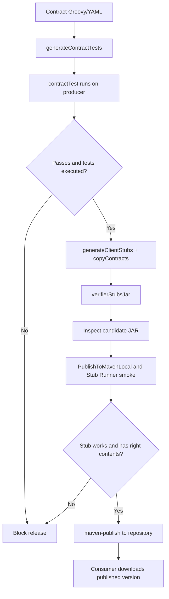

# Integrating Maven Publish for Stub Artifacts

## 1. The Problem: The Producer Has Contracts, How Does the Consumer Download Stubs?

Suppose a team builds `payment-service` with Spring Boot and Gradle. `checkout-service` needs to test calling Payment without running a real database, payment gateway, and the entire live system. Both teams agree on the API using **Spring Cloud Contract**: writing Groovy/YAML DSL, generating **producer verification tests**, and then creating a **stub JAR** for Checkout to use with **Stub Runner**.

On a developer machine, running `generateClientStubs` successfully only produces simulation files locally. For other consumers to download stub versions consistently, you must **package and publish the artifact** to a Maven-compatible repository, such as Maven Local during experiments, or an internal Nexus/Artifactory/GitHub Packages instance in CI.

Gradle provides the **`maven-publish`** plugin for this purpose. The Spring Cloud Contract Gradle plugin provides the **`verifierStubsJar`** task to package generated stubs and required contracts. Since Spring Cloud Contract **3.0.0**, internal stub publication is no longer enabled automatically by default: the project must **include `verifierStubsJar` in a `MavenPublication` it owns**.

A misconfiguration can leave the producer build green while consumers still encounter:

- `com.example:payment-service:1.4.2:stubs` not found in the repository;
- Maven contains only `payment-service-1.4.2.jar` without `payment-service-1.4.2-stubs.jar`;
- The JAR has the right classifier yet contains mappings from a previous build;
- Stub Runner downloads the right JAR filename yet fails to find contracts/mappings inside;
- CI runs `publish` even though generated producer tests never ran;
- The Maven publication changes `artifactId` to `payment-service-stubs`, breaking the consumer's coordinates.

**Lesson objectives:** configure Gradle Groovy DSL with `maven-publish`, add `verifierStubsJar` to a publication, verify `groupId/artifactId/version/classifier` coordinates, run producer verification before publishing, use `publishToMavenLocal` and remote repositories properly, verify artifacts with Stub Runner, and establish a release gate in CI.

## 2. Distinguishing Test Generation, Stub Generation, JAR Packaging, and Publishing

These steps are not one and the same:

| Step | Role | Typical output |
| --- | --- | --- |
| **Contract source** | Defines HTTP or messaging behavior between producer and consumer. | `.groovy`/`.yml` files in the contracts directory. |
| **`generateContractTests`** | Generates producer test code. | Generated test sources under `build/`. |
| **`contractTest`** | Runs generated tests against the producer implementation. | Test report confirming the real API or event matches the contract. |
| **`generateClientStubs`** | Converts contracts into stub content usable by consumers. | HTTP WireMock mappings and related resources. |
| **`copyContracts`** | Copies source contract files into the packaging area. | Contract DSL included in the stub artifact, useful for messaging. |
| **`verifierStubsJar`** | Creates a JAR with stub contents and default classifier, usually `stubs`. | `payment-service-1.4.2-stubs.jar`. |
| **`publishToMavenLocal`** | Installs the publication into the local Maven repository. | Artifact + metadata under `~/.m2/repository/`. |
| **`publish...To...Repository`** | Uploads the publication to a configured repository. | Versioned artifact for CI and other consumers to download. |

**Building the JAR does not prove the producer complies with the contract.** Per Gradle plugin docs, the stub packaging task depends on client stub generation and copying contracts; that **does not mean** the publish command itself always runs full producer verification. Before publishing, verify `contractTest` actually executed and passed.



In a real project, Gradle can schedule tasks according to the dependency graph; this diagram shows the **desired gate conditions**, without requiring strictly sequential execution of every internal task. A project may run a fast check on PRs while ensuring the release gate covers every supported contract.

## 3. Maven Coordinates: What Identifies the Right Stub Artifact?

Suppose a producer has:

```text
group       = com.example
project.name = payment-service
version     = 1.4.2
```

With the common publishing pattern of **sharing `groupId/artifactId/version` and adding classifier `stubs`**, files in the Maven repository look like:

```text
com/example/payment-service/1.4.2/
├── payment-service-1.4.2.pom
├── payment-service-1.4.2.jar
├── payment-service-1.4.2-stubs.jar
└── [other metadata depending on tool/repository]
```

Breakdown:

- **`com.example`** — `groupId`, forming dot-separated directory segments in Maven.
- **`payment-service`** — `artifactId`, usually the producer module name, though it can be overridden.
- **`1.4.2`** — publication `version`; must match the tested contract/producer version.
- **`stubs`** — `classifier`, distinguishing the stub JAR from the application JAR at the same coordinates.
- **`jar`** — packaging type containing the stubs.

Stub Runner typically uses the notation:

```text
com.example:payment-service:1.4.2:stubs
```

To bind a specific port in tests:

```text
com.example:payment-service:1.4.2:stubs:6565
```

**Port `6565` belongs only to Stub Runner configuration**, not to the published JAR filename or Maven coordinates. In parallel test environments, use dynamic ports and pass the resolved address to the HTTP client.

### Do Not Confuse Classifier with `artifactId`

These two approaches are **not equivalent**:

| Publishing approach | Sample file | Consumer coordinate |
| --- | --- | --- |
| Same `artifactId`, **`stubs` classifier** | `payment-service-1.4.2-stubs.jar` | `com.example:payment-service:1.4.2:stubs` |
| `artifactId` changed to `payment-service-stubs`, no classifier | `payment-service-stubs-1.4.2.jar` | Must match the new coordinates; does not resolve via the notation above. |

For a producer that already publishes its application under `com.example:payment-service`, **attaching the `stubs` classifier to the same publication** is the cleanest layout for consumers. If your organization deliberately uses a separate `artifactId`, standardize the format and downloader configuration; never add both a `-stubs` suffix to `artifactId` **and** a `stubs` classifier without a clear reason.

## 4. Creating a Source Contract So There Is Something Real to Publish

Sample Payment API:

```http
GET /api/payments/PAY-1001 HTTP/1.1
Accept: application/json
```

Agreed response:

```json
{
  "paymentId": "PAY-1001",
  "orderId": "ORD-2001",
  "status": "PAID",
  "amount": 250000,
  "currency": "VND"
}
```

### Groovy DSL

```groovy
import org.springframework.cloud.contract.spec.Contract

Contract.make {
    name 'get_paid_payment'
    description 'Look up a successful payment transaction'

    request {
        method 'GET'
        urlPath '/api/payments/PAY-1001'
        headers {
            header 'Accept': 'application/json'
        }
    }

    response {
        status 200
        headers {
            contentType(applicationJson())
        }
        body([
            paymentId: 'PAY-1001',
            orderId: 'ORD-2001',
            status: 'PAID',
            amount: 250000,
            currency: 'VND'
        ])
    }
}
```

### Equivalent YAML DSL

```yaml
description: Look up a successful payment transaction
name: get_paid_payment
request:
  method: GET
  urlPath: /api/payments/PAY-1001
  headers:
    Accept: application/json
response:
  status: 200
  headers:
    Content-Type: application/json
  body:
    paymentId: PAY-1001
    orderId: ORD-2001
    status: PAID
    amount: 250000
    currency: VND
```

These are **two ways to express the same scenario**. In a real repository, keep either Groovy **or** YAML as the source contract to avoid generating duplicate tests and mappings.

The modern Spring Cloud Contract Gradle plugin usually looks for contracts under:

```text
src/contractTest/resources/contracts/
└── payment/
    └── get-paid-payment.groovy
```

Some older docs use `src/test/resources/contracts`; the plugin provides compatibility mechanisms, yet current docs recommend the `contractTest` source set. If using another path, explicitly declare `contractsDslDir` instead of assuming Gradle scans the entire repository automatically.

**The source contract must be verified by producer verification** with an appropriate `PAY-1001` fixture. Packaging this file into a JAR does not prove the real implementation returns `PAID`; that is the job of generated producer tests.

## 5. Declaring the Required Gradle Plugins

With **Gradle Groovy DSL** in `build.gradle`, the three core plugins are:

```groovy
plugins {
    id 'java'
    id 'maven-publish'
    id 'org.springframework.cloud.contract' version 'REPLACE_WITH_COMPATIBLE_SCC_VERSION'
}

group = 'com.example'
version = '1.4.2'
```

This is an **illustrative configuration excerpt**, not an immediately runnable `build.gradle` since the plugin version is a placeholder. A real Spring Boot application also needs the Boot plugin, compatible dependency management/BOM, repositories, test libraries, and a base class for generated contract tests.

Typically, configuration includes:

```groovy
dependencies {
    testImplementation 'org.springframework.boot:spring-boot-starter-test'
    testImplementation 'org.springframework.cloud:spring-cloud-starter-contract-verifier'
}

contracts {
    contractsDslDir = file('src/contractTest/resources/contracts')
    testFramework = 'JUNIT5'
    testMode = 'MOCKMVC'
    baseClassForTests =
        'com.example.payment.contract.ContractBase'
}
```

**These dependencies are also partial**: they need versions via BOM/dependency management, a compatible Gradle plugin/JDK environment, test runtime, and matching test framework. For WebFlux apps, choose `WEBTESTCLIENT`; for real HTTP sockets, choose `EXPLICIT`. Those are **test modes**, not publication choices.

In the Gradle source set layout, the base class usually resides under `src/contractTest/java` or `src/contractTest/groovy` per configuration. Do not leave the base class only in the regular `test` source set and assume generated tests will automatically see it without checking classpath/source-set wiring.

## 6. Integrating `maven-publish` into an Application Publication

This is the core step. Spring Cloud Contract creates the `verifierStubsJar` task; Gradle Maven Publish must be explicitly told to publish that artifact.

```groovy
publishing {
    publications {
        mavenJava(MavenPublication) {
            // GAV normally inherits from project.group/name/version.
            groupId = project.group.toString()
            artifactId = project.name
            version = project.version.toString()

            // Publish the Java component (application/library code).
            from components.java

            // Attach the stub JAR created by Spring Cloud Contract.
            artifact verifierStubsJar

            pom {
                name = 'Payment Service'
                description = 'Payment API and verified stubs'
            }
        }
    }
}
```

**This snippet is recommended to understand the principle**, suitable for projects with a `java` component and a `verifierStubsJar` task registered by the Spring Cloud Contract plugin. In Spring Boot apps, `from components.java` may publish a **plain JAR** rather than an executable `bootJar`, depending on Boot plugin version/configuration. If the project wants to publish the executable application JAR, configure that artifact separately per Spring Boot/Gradle rules; do not assume `components.java` always equals `bootJar`.

Key takeaways:

1. `mavenJava(MavenPublication)` defines a **publication named `mavenJava`**; this name determines the names of generated Gradle publish tasks.
2. `from components.java` attaches the Java component to the publication, typically bringing along its artifact and dependency metadata.
3. `artifact verifierStubsJar` attaches the **second artifact** built by the Contract plugin.
4. The `verifierStubsJar` task normally gets its classifier from `contracts.stubsSuffix`, which defaults to `stubs`.
5. The Maven repo stores **the same GAV** with distinct JAR files via classifiers; Stub Runner must fetch the **JAR with the `stubs` classifier**, not the application JAR.

Spring Cloud Contract docs state clearly that **since 3.0.0 internal stub publication is disabled by default** and recommend declaring `artifact verifierStubsJar` inside an application-managed publication. Do not expect merely applying `org.springframework.cloud.contract` to make `publish` upload the stub JAR automatically.

### When Modern Gradle Uses Lazy Task Providers

In some setups, tasks are registered lazily. Gradle can accept task notations by name or provider, so use **the form accepted by your actual plugin/Gradle version**; official docs show `artifact verifierStubsJar`. If you hit an unresolved property error on `verifierStubsJar` during configuration, verify the plugin is applied, the task is actually registered, and the Provider/Task syntax is compatible—never create an empty dummy JAR of the same name just to make the build green.

## 7. Can You Publish Only the Stub JAR Without the Application JAR?

Yes. A publication can declare a custom artifact **without `from components.java`**:

```groovy
publishing {
    publications {
        stubsOnly(MavenPublication) {
            groupId = project.group.toString()
            artifactId = project.name
            version = project.version.toString()

            artifact verifierStubsJar
        }
    }
}
```

Points to understand:

- This is a **publication named `stubsOnly`**, with no Java component; the generated POM may omit application dependency metadata.
- The JAR artifact still needs the `stubs` classifier. If the plugin is configured with another suffix, inspect the filename and update the Stub Runner notation.
- **Do not** simultaneously publish both `mavenJava` and `stubsOnly` with the **same GAV** to the **same repository** in one build if both emit conflicting POMs/metadata. Pick **one publication strategy** or assign distinct GAVs deliberately and align consumers.
- A "stubs-only" package does not replace the producer's application artifact; you need a separate pipeline if the application itself must still be published.

In typical microservice systems, **one publication carrying the Java component + `stubs` classifier** is usually the easiest to track by version. `stubsOnly` is useful when an organization runs a dedicated pipeline for test artifacts with agreed coordinate conventions.

## 8. Do Not Arbitrarily Alter `verifierStubsJar` Classifiers or Contents

The Spring Cloud Contract Gradle plugin registers a JAR task named `verifierStubsJar`; it gathers generated stub contents, copies source contracts, and applies the configured suffix.

Conceptually per plugin docs:

```groovy
// Conceptual structure; DO NOT re-register this task in your project.
tasks.register('verifierStubsJar', Jar) {
    dependsOn 'generateClientStubs'
    // Copying contracts is another dependency.
    archiveClassifier = 'stubs'
    from(/* stub output directory managed by the plugin */)
}
```

This snippet **only illustrates the idea**; never paste it into a `build.gradle` that already applies the Contract plugin—registering a duplicate task name will fail or override the plugin's built-in wiring.

When you need to add non-sensitive metadata to the JAR, customize the **existing task**:

```groovy
tasks.named('verifierStubsJar', Jar) {
    from(layout.buildDirectory.dir('resources/main')) {
        include 'git.properties'
    }
}
```

This example only works if `git.properties` is actually produced by the build at that path; do not pull arbitrary source/metadata directories. The filename is illustrative only; strictly avoid putting credentials, tokens, or real customer data into the artifact.

### Check the Layout Stub Runner Expects Before Adding Resources

The stub JAR typically has this layout:

```text
META-INF/
└── com.example/
    └── payment-service/
        └── 1.4.2/
            ├── contracts/
            │   └── payment/get-paid-payment.groovy
            └── mappings/
                └── payment/get-paid-payment.json
```

This is an illustrative layout, not the sole structure for every version and stub source. Stub Runner needs its loader to recognize the exact `groupId/artifactId/version` and locate mappings/contracts. **Changing GAV in the Maven publication without updating the JAR layout** can prevent Stub Runner from finding contents even when the file publishes cleanly.

When publishing artifacts per consumer or from an external contract repository, layout and contract selection may differ. What matters is **inspecting the real JAR**, not merely reading `build.gradle` syntax.

## 9. Tracing the Path of a Gradle Publish Task

With a publication named `mavenJava`, `maven-publish` creates these tasks:

| Task | Purpose |
| --- | --- |
| `generatePomFileForMavenJavaPublication` | Generates the Maven POM for the publication. |
| `publishMavenJavaPublicationToMavenLocal` | Installs that specific publication into the local Maven repository. |
| `publishToMavenLocal` | Aggregate: publishes **all** declared publications to Maven Local. |
| `publishMavenJavaPublicationToReleasesRepository` | Publishes `mavenJava` to a repository named `releases`, if configured. |
| `publish` | Aggregate: publishes publications to **configured repositories**, not Maven Local by default. |

Example command sequence **for practicing on a fully configured project**:

```bash
# Generated producer verification tests.
./gradlew clean contractTest

# Generate/package the candidate stub JAR.
./gradlew verifierStubsJar

# Install only the mavenJava publication to Maven Local.
./gradlew publishMavenJavaPublicationToMavenLocal
```

**Do not confuse `publishToMavenLocal` with `publish`:** the former writes to the local Maven cache; the latter uploads to repositories configured inside `publishing.repositories`. When a project defines multiple publications, using publication-specific task names avoids unintended publishing.

Publish tasks may automatically trigger dependencies needed to assemble artifacts. However, **there is no universal guarantee that publish tasks always run producer verification**; the release gate must still require `contractTest` to execute and pass on the exact same code/contract revision.

### Clean Whenever Changing Scope

During development, if yesterday you generated stubs only for HTTP and today you re-enabled all messaging contracts, stale generated outputs can make results confusing unless configuration/caching is tightly managed. Running `clean` at the release gate reduces that risk. If CI uses the build cache, ensure cache keys reflect contract files, plugin versions, generated sources, and input configuration.

Never treat `generateClientStubs` or `verifierStubsJar` succeeding as proof tests ran; check the **`contractTest` test report**.

## 10. Inspecting Maven Local After Publishing

Once `publishMavenJavaPublicationToMavenLocal` succeeds, check:

```text
~/.m2/repository/com/example/payment-service/1.4.2/
├── payment-service-1.4.2.pom
├── payment-service-1.4.2.jar
└── payment-service-1.4.2-stubs.jar
```

If `from components.java` is configured differently, the application file may carry another classifier or be omitted; the listing above reflects **expectations for the illustrative publication**. Inspect the actual file list rather than asserting every Spring Boot project emits one primary JAR like this.

### A POM Is Not the Stub JAR

The POM contains **Maven metadata**: groupId, artifactId, version, dependencies, and publication info. The `stubs` classifier belongs to the **artifact filename and download coordinate**, not a JSON field inside the POM listing mapping contents.

Abbreviated POM example:

```xml
<project xmlns="http://maven.apache.org/POM/4.0.0">
  <modelVersion>4.0.0</modelVersion>
  <groupId>com.example</groupId>
  <artifactId>payment-service</artifactId>
  <version>1.4.2</version>
</project>
```

This is illustrative; a real Gradle-published POM also includes metadata and dependencies if the publication originates from a Java component. **Do not conclude the classifier is missing just because the POM has no `<classifier>stubs</classifier>` element.**

### Inspecting JAR Contents

Using the JDK tool:

```bash
jar tf build/libs/payment-service-1.4.2-stubs.jar
```

Locate contract files and mappings under the right namespace. Do not insist that mapping count equals contract file count in every situation, since one DSL file can hold multiple scenarios and messaging contracts are not necessarily represented as WireMock mappings.

Behavioral checks:

1. Do HTTP mappings have the right method, URL, and path?
2. Are matchers present for request headers, query params, and body where business logic depends on them?
3. Do status, headers, and response JSON match the contract?
4. Are referenced external/binary body files packaged where the loader can read them?
5. Do messaging contracts have the right `label` and `sentTo` destination?
6. Are stale, `inProgress`, or `ignored` contracts/mappings accidentally being published as verified?
7. Is any sensitive information exposed in headers/bodies, fixture files, or metadata?

The JAR from `verifierStubsJar` might not sit in `build/libs` if the project customized output paths; the command above follows standard Gradle layout and should be adjusted to your real file path.

## 11. Smoke-Testing the Locally Published Artifact with Stub Runner

Goal of the smoke test: prove **the consumer can actually load the packaged stub**, not merely that a `.jar` file exists in Maven Local.

Example consumer `checkout-service` running a Spring Boot test:

```java
@SpringBootTest(properties = {
    "payment.base-url=http://localhost:6565"
})
@AutoConfigureStubRunner(
    ids = "com.example:payment-service:1.4.2:stubs:6565",
    stubsMode = StubRunnerProperties.StubsMode.LOCAL
)
class CheckoutPaymentStubTest {

    @Autowired
    PaymentGatewayClient paymentClient;

    @Test
    void readsCapturedPayment() {
        PaymentView payment = paymentClient
            .getPayment("PAY-1001");

        assertThat(payment.paymentId()).isEqualTo("PAY-1001");
        assertThat(payment.status()).isEqualTo("PAID");
        assertThat(payment.currency()).isEqualTo("VND");
    }
}
```

**This illustrative test** assumes `PaymentGatewayClient` is Checkout's real HTTP client returning `PaymentView` synchronously; if using reactive `WebClient`, use `StepVerifier` or controlled blocking in tests. Include imports and dependencies for `spring-cloud-starter-contract-stub-runner`, Spring Boot Test, JUnit/AssertJ, and application classes.

This test should pass once the local Maven repository holds the exact artifact published by Gradle. However, the local repository might already contain **an older JAR at the same version**. Therefore:

- Do not overwrite release version `1.4.2` repeatedly across incompatible commits.
- Use a dedicated candidate version or an **isolated per-job Maven Local/cache**.
- Verify which exact file Stub Runner actually resolved, not just the test name.
- Compare the SHA-256 checksum of the candidate JAR and the resolved repository file when byte-for-byte identity is required.
- Include requests that **must not match** in the smoke suite to avoid overly permissive mappings.

**A WireMock `404 No matching stub` is not the same as a business-error contract `404 PAYMENT_NOT_FOUND`.** To test the producer's `404` behavior, write a dedicated error contract and have generated producer tests verify it.

## 12. Configuring a Remote Maven Repository for Publication

So CI and other consumers can download stubs, configure a Maven-compatible repository:

```groovy
publishing {
    repositories {
        maven {
            name = 'releases'
            url = uri(
                providers.gradleProperty('publishUrl')
                    .orElse('https://repo.example.invalid/maven/releases')
                    .get()
            )
            credentials {
                username = providers.environmentVariable(
                    'MAVEN_REPO_USER').orNull
                password = providers.environmentVariable(
                    'MAVEN_REPO_PASSWORD').orNull
            }
        }
    }
}
```

**The URL above is a non-functional placeholder**; replace it with your organization's approved repository URL and pass `-PpublishUrl=...` or equivalent configuration. Credentials come from CI environment variables and never appear in source. In real releases, the pipeline must ensure environment variables exist with proper permissions; if missing, publishing must fail loudly.

Command for **one publication** and **one repository**:

```bash
./gradlew publishMavenJavaPublicationToReleasesRepository \
  -PpublishUrl=https://repo.example.invalid/maven/releases
```

Do not run this example command as a real deployment before replacing the URL with a valid repository. In Gradle, task names derive from the `MavenPublication` name (`mavenJava` here) and repository name (`releases` here). Changing them to `stubsOnly` or `snapshots` changes the task name too.

### Snapshots and Releases

An organization can pick repositories by version:

```groovy
def snapshotBuild = project.version.toString()
    .endsWith('-SNAPSHOT')

publishing {
    repositories {
        maven {
            name = 'internal'
            url = uri(snapshotBuild
                ? 'https://repo.example.invalid/maven/snapshots'
                : 'https://repo.example.invalid/maven/releases')
        }
    }
}
```

This is an **illustrative repository selection snippet**, not a complete credentials and IAM configuration. Snapshots may be published repeatedly depending on repository policy; **release versions should be immutable** so consumers re-downloading them always receive identical bytes.

Never use dynamic `+` versions in consumer CI release gates; results cease to be reproducible once newer stubs are published. Pin an exact version so you know which producer/contract was verified.

## 13. Multi-Module Gradle: Which Module Owns the Publication?

Suppose a repository contains:

```text
platform/
├── settings.gradle
├── build.gradle
├── payment-service/
│   ├── build.gradle
│   └── src/contractTest/resources/contracts/
├── inventory-service/
│   ├── build.gradle
│   └── src/contractTest/resources/contracts/
└── checkout-service/
    └── build.gradle
```

If the root and every subproject unnecessarily apply `maven-publish` and Spring Cloud Contract, unwanted publications or colliding GAVs can occur. Instead:

- Apply `org.springframework.cloud.contract` and `maven-publish` to **producer modules that own contracts needing stub generation/publishing**.
- Set exact `group`, `version`, and `artifactId` per producer module.
- Configure base class, test framework, and test mode suited to each producer's code.
- Repository configuration can be shared via a convention plugin, without auto-publishing modules that have no contracts.

Module-scoped task examples:

```bash
./gradlew :payment-service:contractTest
./gradlew :payment-service:verifierStubsJar
./gradlew :payment-service:publishMavenJavaPublicationToMavenLocal
```

These commands assume the Gradle module is actually named `payment-service` and the publication is named `mavenJava`. If the root project shares `version` yet a module overrides `version` or `artifactId`, verify filenames, POMs, and JAR layouts together.

**Do not publish stubs from the Checkout module** just because Checkout uses Spring Cloud Contract Stub Runner. Consumers **consume producer artifacts**, whereas producers are where Contract Verifier runs and stubs are packaged.

## 14. Blocking "Publish Succeeded Without Producer Tests Running"

Suppose a pipeline only runs:

```bash
./gradlew verifierStubsJar publish
```

It can **build and publish the JAR** if the task graph allows, even though `contractTest` never ran in that job. That is dangerous because the stub might advertise behavior Payment does not actually support.

### Minimum Gate Policy

1. Pin the producer commit and contract revision.
2. `./gradlew clean contractTest` must execute **generated producer tests** and pass.
3. The test report must show the expected executed test count; reject `NO-SOURCE`, unauthorized `SKIPPED` tasks, or zero tests.
4. Confirm `inProgress`/`ignored` contracts do not silently slip in under a verified stub label.
5. Build the candidate JAR and verify it contains every contract/mapping intended for release.
6. Run a Stub Runner smoke test on **that exact candidate** (isolated LOCAL or candidate repo).
7. Only after every gate passes, publish to the release repository.
8. After publishing, compare checksums/coordinates to prove the remote artifact is the tested candidate.

This is a **CI workflow**, not Gradle's default task graph. If you want to force publish tasks to depend on verification, add an appropriate task dependency in your project's build conventions while still inspecting test/coverage reports; adding a task dependency alone does not prove every contract was discovered and executed.

### Never Skip Tests to Release

Flags like `-x contractTest`, `-DskipTests` in relevant tools, or disabling test tasks to speed up builds may help temporary local experiments, yet **are invalid as compatibility gate evidence** without passing tests recorded from the exact same source revision.

Split fast PR jobs (possibly running a subset) from full release jobs if the project has many contracts. Still, any artifact promoted as "verified stubs" must reflect the **full contract suite verified by the producer**.

## 15. Checking Metadata and Artifact Integrity

A release record might capture:

```text
Producer source commit    : abc1234 (illustrative)
Contract source           : src/contractTest/resources/contracts
Contract Verifier version : per pinned BOM/plugin
Publication               : mavenJava
Maven coordinates         : com.example:payment-service:1.4.2
Stub classifier           : stubs
Stub candidate filename   : payment-service-1.4.2-stubs.jar
Stub candidate SHA-256    : checksum computed by CI
Producer verification     : executed/passed/failed/skipped test counts
Stub Runner smoke         : PASS
Remote artifact SHA-256   : matches candidate
```

Values are **illustrative**, not pre-existing metadata in any specific project. A JAR can include extra commit metadata if needed, provided it contains no secrets/PII and does not break Stub Runner's layout loader.

### Why Do Both POM and Checksum Matter?

- The POM defines GAV identity and dependency metadata usable by Maven/Gradle.
- The artifact filename with classifier selects the **exact stub file** Stub Runner must download.
- Checksums compare **actual byte contents**; two files sharing the same name/version are not guaranteed identical if a repository permits overwrites.
- Generated test reports prove producer code was checked against contracts at **build time**.

Gradle's `publishToMavenLocal` does not necessarily write the same checksum sidecar files as remote Maven publications. To compare checksums, hash the candidate JAR and the locally/remotely resolved file directly rather than waiting for Maven Local to generate `.sha256` files.

## 16. Special Scenarios

### 16.1. HTTP and Messaging in One Stub Artifact

HTTP stubs are loaded by WireMock from mappings, whereas messaging stubs may require **contract definitions with `label` and `sentTo`**. Therefore, do not simply count `*.json` files under `mappings/` to conclude every behavior was published.

Messaging contract example:

```groovy
import org.springframework.cloud.contract.spec.Contract

Contract.make {
    name 'payment_captured_event'
    label 'payment_captured_1001'
    input {
        triggeredBy('emitPaymentCaptured()')
    }
    outputMessage {
        sentTo('payments.captured')
        body([
            eventType: 'PaymentCaptured',
            paymentId: 'PAY-1001',
            orderId: 'ORD-2001'
        ])
    }
}
```

When publishing, verify `contracts/` contains the needed definitions, producer messaging verification runs properly, and consumer Stub Runner can trigger the label. A WireMock JSON mapping never proves broker routing, delivery, or consumer functions work on their own.

### 16.2. Stub-per-Consumer

If a producer keeps separate contracts per consumer, inspect the layout and configure **stubs-per-consumer** according to your plugin/runner version. Never publish a package meant only for Reporting and let Checkout resolve it as Payment's full stubs. Artifact coordinates/versions and scope must be communicated clearly.

### 16.3. Source Contracts in a Separate Artifact or Repository

The Gradle plugin supports loading contracts from a shared source via `contractDependency` or a repository. In that case, pin the source version and appropriate `contractsPath`:

```groovy
contracts {
    contractDependency {
        stringNotation =
            'com.example.contracts:payment-contracts:1.4.2'
    }
    contractsPath = '/'
}
```

This example must be adapted to your plugin version and actual artifact structure. **Never verify contract version A while packaging stubs from contract version B.** When changing contract sources, cross-check selected contracts, generated tests, and JAR outputs rather than only watching the publish command.

### 16.4. Customizing the Classifier to Organization Standards

Spring Cloud Contract normally sets the stub suffix via `contracts.stubsSuffix`. To use something other than `stubs`, update **all three**: the JAR classifier, the publication, and the Stub Runner notation. Never rename the file manually after the build; Gradle publication metadata will not know about the manual rename.

## 17. Common Errors When Integrating Maven Publish

| Symptom | Possible cause | Remediation |
| --- | --- | --- |
| `publish` succeeds with no `-stubs.jar` | Forgot `artifact verifierStubsJar`, wrong publication, or different classifier. | Inspect publications, task outputs, and actual repo files. |
| Gradle reports `verifierStubsJar` not found | Contract plugin not applied, or plugin/task API differs by version. | Check version and task registration; use matching notation. |
| `publishToMavenLocal` has stub but `publish` does not | Missing `publishing.repositories` or published wrong publication. | Check repository/publication names and executed tasks. |
| Repo has `payment-service-stubs-1.4.2.jar` while Stub Runner seeks `payment-service:1.4.2:stubs` | Changed `artifactId` instead of using a classifier. | Align GAV/classifier or revert to sharing `artifactId`. |
| Publish returns HTTP 401/403 | Bad credentials or missing repository write permission. | Inject scoped CI secret; never hard-code credentials. |
| Publish returns 409 Conflict | Repository forbids overwriting released versions. | Bump to a new version; never overwrite existing releases. |
| JAR downloads from repo yet stub fails to run | Wrong `META-INF` layout, missing mappings, or missing body files. | Inspect `jar tf`, run WireMock/Stub Runner smoke test. |
| Stub Runner returns stale responses | Local Maven cache or artifact version was not bumped. | Pin candidate version and verify SHA-256. |
| `contractTest` reports `NO-SOURCE` | Wrong `contractsDslDir`, missing base test, or generated tests missed. | Check source set, generator, and executed test count. |
| POM does not list `stubs` classifier | Classifier is not represented in the POM the way the user expected. | Check artifact filenames and resolver; classifier belongs to download coordinates. |
| Release bundles `inProgress` contracts | Stubs generated from contracts not verified by producer. | Enforce blocking policy or preview label; never call verified. |
| Multi-module publishes colliding GAVs | Missing distinct `artifactId` or overly broad plugin application. | Configure publications on the right producer modules only. |
| CI publishes when tests fail | Publish job lacks explicit dependency/gate. | Add pipeline gate or task dependency and check failure reports. |

### Concise Debugging Order

1. Verify `group`, `project.name`, `version`, publication, and classifier.
2. Verify contract DSL is read from the right directory/source.
3. Run `contractTest` and confirm tests actually executed.
4. Confirm `verifierStubsJar` produces a non-empty archive.
5. Verify `publishing.publications` includes `artifact verifierStubsJar`.
6. Publish locally using the **specific publication task**, and inspect both POM and `-stubs.jar`.
7. Run Stub Runner loading that **exact artifact** and send a real request through the consumer.
8. Verify remote repository contents, permissions, checksums, and versions after publishing.

## 18. CI/CD: verify → package → inspect → smoke → publish

Conceptual workflow sketch (not verbatim GitHub Actions/GitLab/Jenkins syntax):

```yaml
jobs:
  producer-contract-verification:
    commands:
      - "./gradlew clean contractTest"
    required:
      - generated_tests_executed
      - all_supported_contracts_pass

  candidate-stub:
    needs: producer-contract-verification
    commands:
      - "./gradlew verifierStubsJar"
    required:
      - jar_has_expected_contracts_and_mappings
      - classifier_is_stubs
      - no_missing_body_files
      - no_secrets_in_fixtures

  consumer-smoke:
    needs: candidate-stub
    commands:
      - "./gradlew publishMavenJavaPublicationToMavenLocal"
      - "run Stub Runner against candidate in isolated Maven local"
    required:
      - correct_artifact_coordinates
      - expected_HTTP_and_messaging_behaviors

  publish-release:
    needs: consumer-smoke
    command: "./gradlew publishMavenJavaPublicationToReleasesRepository"
    required:
      - same_source_and_contract_version
      - same_candidate_checksum
      - release_repository_permission
```

**Key point:** release publishing must depend on **all preceding stages**, not merely on `verifierStubsJar` at the task level. If CI jobs run on separate machines, pass artifacts and test reports between jobs in a way that guarantees **identical bytes**; never rebuild a JAR from modified sources and call it the smoke-tested candidate.

When testing against a remote repository before an official release, publish the candidate to a **staging/snapshot repository**, run consumer tests, and promote that exact artifact to the release repository. Never reuse a non-overwritable release coordinate for multiple distinct candidates.

### Checking Pipeline Output Status

| Stage | PASS criteria | On FAIL |
| --- | --- | --- |
| **Generate/Test** | Contracts picked up, generated tests run against producer and all pass. | Stop; fix implementation/fixture/contract. |
| **Package** | JAR exists with right classifier, GAV, and layout. | Stop; fix task/publication/sources. |
| **Inspect** | Required behaviors present, bodies/headers right, no leaked data. | Stop; do not hand artifact to consumers. |
| **Smoke** | Stub Runner loads exact candidate and consumer calls it cleanly. | Stop; check local cache/port/contract. |
| **Publish** | Repo receives exact bytes, immutable version, matching metadata. | Stop; fix credentials/repository/version. |

## 19. Hands-On Exercise: Publishing Stubs for `inventory-service`

You have a Gradle producer `inventory-service` and a consumer `checkout-service`. API:

```text
GET /api/inventory/SKU-001

Response:
HTTP 200
Content-Type: application/json
{"sku":"SKU-001","available":true,"quantity":12}
```

Project info:

```text
group       = com.example
project.name = inventory-service
version     = 2.3.0
Source      = src/contractTest/resources/contracts
Desired artifact:
  com.example:inventory-service:2.3.0:stubs
```

**Requirements:**

1. Write a Groovy or YAML contract for the API above. Explain why the contract file contains neither a hostname nor a Stub Runner port.
2. Configure the `org.springframework.cloud.contract` Gradle plugin and source set to produce generated producer tests; choose an appropriate base class.
3. Add `maven-publish` and a `mavenJava` publication to publish the Java component **alongside** `artifact verifierStubsJar`.
4. Predict the files in the local Maven repository under `com/example/inventory-service/2.3.0/`. Which file contains mappings? Which file is the POM?
5. Write commands to run producer verification first, build the JAR second, and then publish only the `mavenJava` publication to Maven Local.
6. Use `jar tf` to inspect `META-INF/.../contracts` and `mappings` entries. If the JAR has the right classifier yet empty mappings, which step must fail?
7. Write a Checkout test using Stub Runner with ID `com.example:inventory-service:2.3.0:stubs:6565` and assert `available=true`, `quantity=12`.
8. Hypothetically change the publication to `artifactId='inventory-service-stubs'` while keeping classifier `stubs`. Can the consumer's old notation still download it? Explain how to fix it.
9. Configure a remote Maven repository with credentials from CI secrets. Why should passwords never be stored directly in `build.gradle`?
10. Describe a scenario where `./gradlew publish` succeeds while `contractTest` was skipped. Why is the artifact not eligible for release?
11. Design a pre-release gate checking exact version, body files, messaging contracts if present, checksums, and executed producer test counts.
12. Explain how to handle a consumer needing old stub `2.2.0` while the producer is releasing `2.3.0`: should the old artifact be overwritten?

**Self-assessment:** a sound answer distinguishes **producer verification**, **`verifierStubsJar`**, **`MavenPublication`**, **classifier**, **Maven Local/remote**, and **Stub Runner**—especially never labeling an artifact "verified stubs" when producer tests have not executed.

## 20. Key Takeaways

- In Gradle, Spring Cloud Contract provides **`verifierStubsJar`** to package stubs; `generateClientStubs` creates mappings and `copyContracts` puts source contracts into the package per plugin wiring.
- Since Spring Cloud Contract **3.0.0**, internal stub publication is **not enabled automatically**; add **`artifact verifierStubsJar`** to a `MavenPublication` under `maven-publish`.
- A common convention is publishing under the **same GAV** as the application with the **`stubs` classifier**, e.g., `com.example:payment-service:1.4.2:stubs`.
- `publishToMavenLocal` writes publications to the local Maven repository; `publish` uploads to declared repositories. Exact task names depend on publication and repository names.
- **Never treat a successful JAR or publish task as producer verification.** Before releasing, `contractTest` must run and test reports must confirm supported contracts pass.
- Inspect the **real JAR, POM, metadata, contracts/mappings, body files, and checksums**, then run Stub Runner against the exact candidate artifact.
- In CI, protect secrets and repository permissions, pin artifact versions, never overwrite releases, and enforce the **verify → package → inspect → smoke → publish** gate.

### References

- [Spring Cloud Contract — Gradle Project](https://docs.spring.io/spring-cloud-contract/reference/gradle-project.html): plugin configuration, `contractTest`, `verifierStubsJar`, and stub publishing in Gradle.
- [Spring Cloud Contract — Publishing Stubs as JARs](https://docs.spring.io/spring-cloud-contract/reference/project-features-stubrunner/stub-runner-publishing-stubs-as-jars.html): workflow for publishing stubs via a Maven repository.
- [Spring Cloud Contract — Stub Runner](https://docs.spring.io/spring-cloud-contract/reference/project-features-stubrunner.html): consuming stub artifacts on the consumer side.
- [Gradle — The Maven Publish Plugin](https://docs.gradle.org/current/userguide/publishing_maven.html): `MavenPublication`, `artifact`, `publishToMavenLocal`, repositories, POMs, and publish tasks.
- [Spring Cloud Contract — HTTP Contracts](https://docs.spring.io/spring-cloud-contract/reference/project-features-contract/http.html): Groovy/YAML DSL, request/response, and matchers.
