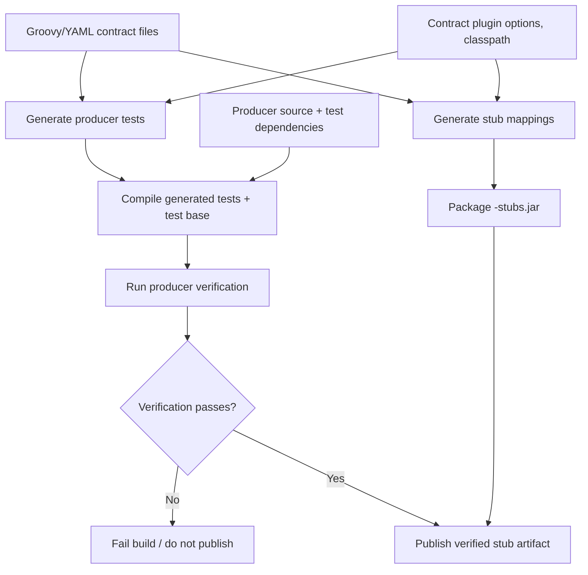
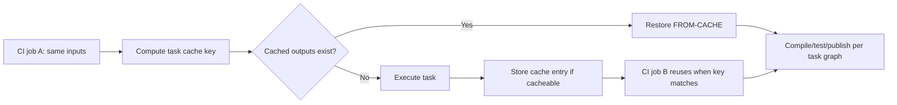
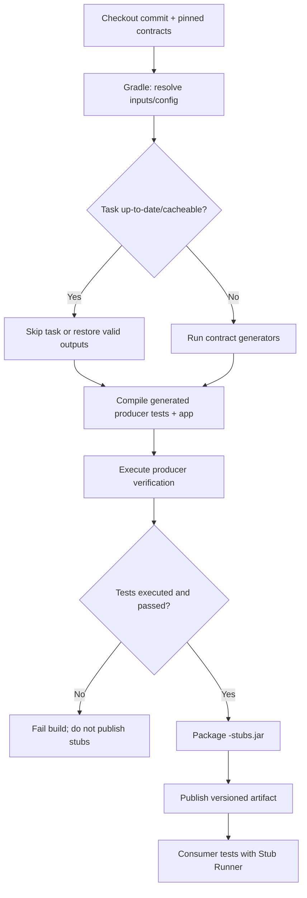

# Incremental Builds, Build Cache, and Tracked Inputs

## 1. Scenario: Why Can a Small Contract Change Make Builds Expensive?

In a microservices system, `Order Service` (producer) uses **Spring Cloud Contract** to define HTTP or messaging interactions with **Groovy/YAML DSL**. The Gradle plugin generates producer tests, builds stubs, and packages an artifact with classifier `stubs`; `Checkout Service` (consumer) uses **Stub Runner** and its own tests to detect incompatible API changes.

In a project with hundreds of contracts, a single build may parse DSL files, generate Java code, compile, run tests, generate WireMock mappings, and package the stub JAR. Yet not every edit requires redoing everything:

- Editing only `README` docs leaves contracts unchanged.
- Editing one HTTP contract may require regenerating only the affected test and stub.
- Editing only a controller implementation can leave generated sources untouched, while producer tests must re-run against the new class.
- Changing `testFramework`, `testMode`, `baseClassForTests`, or the plugin version can affect **all generated outputs**.
- Upgrading dependency versions or changing CI settings can invalidate old caches.

Gradle provides mechanisms to skip unnecessary work. However, **faster only matters when the result remains correct**. If a contract file or generator option is not declared as an input, a task may falsely evaluate as `UP-TO-DATE` and publish stale stubs.

This lesson belongs to the **Gradle Integration** chapter and focuses on:

1. Distinguishing **up-to-date checks**, **incremental execution**, **build cache**, and **configuration cache**.
2. Understanding the Spring Cloud Contract task graph.
3. Knowing which **inputs and outputs** Gradle must observe when generating producer tests and stubs.
4. Understanding relationships between DSL files, options, plugin classpath, test base class, and output artifacts.
5. Reading Gradle logs to investigate `UP-TO-DATE`, `FROM-CACHE`, `NO-SOURCE`, and re-executed tasks.
6. Designing reproducible CI where caching never masks API changes.

## 2. Four Gradle Concepts Often Lumped Together as "Cache"

| Concept | Purpose | Example outcome | Condition for correctness |
| --- | --- | --- | --- |
| **Up-to-date checks** | Skips a task if inputs/outputs are unchanged since the previous run | `UP-TO-DATE` | Task declares all inputs and outputs completely |
| **Incremental execution** | When inputs change, processes only the **changed files** if supported by the task | Task runs and receives added/modified/removed sets | Task uses incremental APIs like `InputChanges` with proper handling |
| **Build cache** | Restores outputs from a prior run sharing the same cache key | `FROM-CACHE` | Task is truly cacheable; inputs/outputs and environment are modeled accurately |
| **Configuration cache** | Reuses the result of the **task graph configuration** phase | `Reusing configuration cache` | Build logic and plugins are compatible with configuration cache |

These are **four distinct mechanisms**:

- `UP-TO-DATE` means Gradle skips running the task because state is already valid in the **current workspace**.
- `FROM-CACHE` means Gradle fetched **task outputs** from a local or remote build cache.
- A task can execute **incrementally** even if not cacheable; conversely, a cacheable task may have to recompute all outputs on a cache miss.
- Configuration cache speeds up configuration, **not meaning** test or stub code was updated.

**Do not assume passing `--build-cache` makes every Spring Cloud Contract task cacheable.** Cacheability depends on the implementation and metadata of **each task in your exact plugin version**.

### 2.1. Example of Two Consecutive Runs

Suppose a build defines `generateContractTests` and standard test tasks:

```text
Run 1:
  > Task :generateContractTests
  > Task :compileTestJava
  > Task :test

Run 2, with no source edits:
  > Task :generateContractTests UP-TO-DATE
  > Task :compileTestJava UP-TO-DATE
  > Task :test UP-TO-DATE
```

This is an **illustrative log**, not guaranteed output. In reality, tasks may always re-run, report `NO-SOURCE`, disable caching, or have changing inputs due to plugin/configuration details. Read `--info` to see why Gradle chose that outcome.

## 3. Spring Cloud Contract Task Graph in Gradle

Conceptual flow:



Common tasks in the **Spring Cloud Contract Gradle plugin** ecosystem include `generateContractTests`, `generateClientStubs`, and `verifierStubsJar`. **Exact task names, types, dependency graphs, and default wiring depend on the plugin version**; never rely on word-of-mouth task lists instead of inspecting the real project.

In a configured Gradle project, inspect with:

```bash
./gradlew tasks --all --console=plain
./gradlew help --task generateContractTests
./gradlew generateContractTests --dry-run
./gradlew test --dry-run
```

`--dry-run` only shows **planned tasks in the graph**; it executes no tests and proves nothing about cache correctness. Before designing CI or optimizing builds, verify which task generates tests, which generates stubs, and whether `test`/`check` depends on the required stages.

### 3.1. Regenerating Sources Does Not Mean the Producer Is Verified

A task generating `Validate_create_order.java` and WireMock mappings can succeed even when the producer implementation has changed or fails to compile. Contract verification only has value when **generated tests are compiled and executed against the current producer code**.

Therefore, never equate:

- "`generateContractTests` is `UP-TO-DATE`" with "producer API is still valid".
- "Stub JAR came from cache" with "producer verification on the current commit passed".
- "Consumer tests with Stub Runner passed" with "the latest producer satisfies all contracts".

## 4. Inputs to Track When Generating Code and Stubs

A task can be skipped or restored from cache **only when every piece of data affecting its output is modeled**. For Spring Cloud Contract, distinguish inputs of the **generator** from inputs of **producer testing**.

| Component | Affects | Why must it be tracked? |
| --- | --- | --- |
| `*.groovy`, `*.yml`, `*.yaml` files in contracts directory | Test/stub generation | Changes method, URL, headers, body, or matchers |
| Adding/removing/renaming contract files or folders | Test/stub generation | Generated classes and mappings must be created/removed properly |
| `testMode`, `testFramework` | Generated tests | Generates corresponding MockMvc, REST Assured, or JUnit code |
| `baseClassForTests`, `baseClassMappings` | Generated tests | `extends` clause and related packages can change |
| Package/test naming, output layout, source language | Generated sources/stubs | Affects class names, file locations, and references |
| Spring Cloud Contract libraries/plugin and generator classpath | Test/stub generation | Newer versions may emit different code or mappings |
| Contracts fetched from external sources, if any | Generator inputs | Version/revision must be pinned rather than silently changing remote data |
| Mapping/stub customization parameters, templates/extensions if used | Stub generation | WireMock response structure and request matchers can differ |
| Java/Kotlin test base class and fixtures | Producer compile/test | Does not necessarily change generated sources, yet affects compile or test outcomes |
| Controller/service/security implementation | Producer tests | Can alter actual responses **without requiring test regeneration** |
| Test runtime dependencies, profiles, database fixtures | Producer test execution | Alters pass/fail outcomes, especially in integration tests |

**Subtle distinction:** Editing logic inside `HttpContractBase.java` can legitimately leave the generator `UP-TO-DATE`, because the superclass FQN string did not change. Yet `compileTestJava` or `test` **must** observe that edit. Conversely, changing `baseClassForTests` from `PublicBase` to `InternalBase` requires **generated sources** to be rewritten because the `extends` clause changes.

### 4.1. Example: Editing a Contract Must Affect Both Outputs

Initial contract:

```groovy
response {
    status OK()
    body(orderId: 42, status: 'CREATED')
}
```

Later the consumer requests adding `currency`:

```groovy
response {
    status OK()
    body(orderId: 42, status: 'CREATED', currency: 'VND')
}
```

When the DSL file changes, Gradle must detect the changed input so it:

1. Regenerates the producer assertion for `currency` per matcher config.
2. Regenerates/updates the stub response containing `currency`.
3. Runs producer verification, catching if the producer implementation does not yet return `currency`.
4. Packages the stub at the right revision and publishes only after required tests pass.

If a task is skipped due to a missing input declaration, the stale stub may keep returning a response missing `currency`. That is a **build correctness bug**, not merely a performance issue.

## 5. File Inputs: Both Content and Relative Path Can Matter

Gradle supports declaring file-based inputs:

- `@InputFile`: a single file.
- `@InputFiles`: a collection of files.
- `@InputDirectory`: a directory.
- `@Classpath`: classpath-style collection with Java-aware normalization.
- `@CompileClasspath`: compile classpath with specialized ABI comparison.

Correspondingly, outputs can be declared via `@OutputFile`, `@OutputFiles`, `@OutputDirectory`, or task builder properties.

When tracking DSL files, file **content** matters, yet **relative paths** often carry meaning too. For example:

```text
src/test/resources/contracts/
  public_http/create_order.groovy
  internal_http/create_order.groovy
```

Two identically named files in different subdirectories may select **different base class groups** or consumer-specific stub groups. If a task only checksums contents while ignoring paths, moving a file may fail to invalidate outputs properly.

### 5.1. `PathSensitivity` and Cache Portability

Gradle provides path sensitivity options:

| Mode | How input paths are viewed | When to pay attention |
| --- | --- | --- |
| `ABSOLUTE` | Treats absolute path as part of input identity | Cache rarely portable across different workspaces |
| `RELATIVE` | Uses relative path under input root | Useful for contract trees with meaningful directory structure |
| `NAME_ONLY` | Relies mainly on filename | Insufficient when consumer/package folder names matter |
| `NONE` | Ignores path information | Use only if the algorithm is truly location-independent |

For contracts grouped by package or consumer, `RELATIVE` is usually much more meaningful than `NONE` or `NAME_ONLY` **when the task relies on directory layout to produce output**.

**Do not arbitrarily alter a plugin task's path normalization just to boost cache hits.** Which paths the generator reads and depends on is part of the task's semantics. Understand the implementation and verify outputs before customizing.

### 5.2. Adding, Removing, and Moving Files Differs from Editing Content

| Operation | What output may need to do |
| --- | --- |
| Edit `create_order.groovy` | Regenerate affected test/mapping |
| Add `delete_order.yml` | Generate new test/mapping |
| Delete `old_payment.groovy` | Remove generated test/mapping that **no longer has a contract** |
| Move from `public_http/` to `internal_http/` | Re-select base class/package/mapping group |
| Rename from `.groovy` to `.yml` | Parse different format; update identity and output |

A proper incremental task must also handle **removed inputs**. Creating new files without cleaning obsolete outputs allows expired JSON stubs to remain packaged inside `-stubs.jar`.

## 6. Example Configuration of the Spring Cloud Contract Gradle Plugin

Illustrative `build.gradle` snippet (Groovy DSL):

```groovy
plugins {
    id 'java'
    id 'org.springframework.cloud.contract' version '<compatible-scc-version>'
}

contracts {
    testFramework = 'JUNIT5'
    testMode = 'MOCKMVC'
    baseClassForTests = 'com.example.contract.OrderHttpContractBase'
    contractsDslDir = file('src/test/resources/contracts')
}
```

This is a **conceptual configuration example**, not a standalone runnable Gradle project: you still need the Spring Boot plugin, dependency management/BOM, Contract Verifier dependencies, test framework setup, and a real **version** compatible with Spring Boot/Cloud. In some plugin releases, `contractsDslDir` assignment, framework/mode enums, or property names differ; check your active version's extension API.

For producers with multiple contract groups, explicit mappings can be configured:

```groovy
contracts {
    baseClassMappings {
        baseClassMapping(
            '.*public_http.*',
            'com.example.contract.PublicHttpContractBase'
        )
        baseClassMapping(
            '.*messaging.*',
            'com.example.contract.MessagingContractBase'
        )
    }
}
```

When adding a new group or changing a regex, **configuration inputs** change. The generator must update corresponding test superclasses. Tracking only `*.groovy`/`*.yml` is insufficient; plugin configuration also determines outputs.

### 6.1. Environment Variables and Command-Line Properties

Suppose CI sets `CONTRACT_TEST_MODE=EXPLICIT` while local machines use `MOCKMVC`. If build logic reads this variable to choose generator behavior, it is a **semantic input** to the task. Gradle must observe the active value when computing cache keys or configuring tasks.

If a custom task quietly calls `System.getenv('CONTRACT_TEST_MODE')` inside `doLast` without declaring `@Input` or `inputs.property`, Gradle may remain unaware when that input changes.

For Groovy DSL tasks, an illustrative declaration:

```groovy
tasks.register('printContractMode') {
    def mode = providers.environmentVariable('CONTRACT_TEST_MODE')
        .orElse('MOCKMVC')

    inputs.property('contractTestMode', mode)

    doLast {
        println "Contract mode: ${mode.get()}"
    }
}
```

The task above **only prints a value** and declares no outputs, so it is not an example of a build-cacheable task. The takeaway is reading configuration via the **Provider API** and declaring inputs before consuming values in the task action.

## 7. Illustrating a Custom Task with Declared Inputs and Outputs

To see clearly how Gradle decides `UP-TO-DATE`, let's write a simple task that **lists contract filenames** as a report. It does not generate producer tests or stubs; it only illustrates change tracking.

In Groovy DSL `build.gradle`:

```groovy
import org.gradle.api.tasks.PathSensitivity

tasks.register('contractInputManifest') {
    def contractRoot = file('src/test/resources/contracts')
    def contractFiles = fileTree(contractRoot) {
        include '**/*.groovy', '**/*.yml', '**/*.yaml'
    }
    def destination = layout.buildDirectory.file(
        'reports/contracts/manifest.txt'
    )

    // Both contents and relative paths are task inputs.
    inputs.files(contractFiles)
        .withPathSensitivity(PathSensitivity.RELATIVE)

    // Gradle can verify whether the output is still valid.
    outputs.file(destination)

    doLast {
        def names = contractFiles.files.collect { file ->
            contractRoot.toPath()
                .relativize(file.toPath())
                .toString()
                .replace('\\', '/')
        }.sort()

        def outputFile = destination.get().asFile
        outputFile.parentFile.mkdirs()
        outputFile.setText(names.join('\n') + '\n', 'UTF-8')
    }
}
```

Trial run in a project that already has a contracts directory:

```bash
./gradlew contractInputManifest --info
./gradlew contractInputManifest --info
```

If inputs and outputs remain untouched, the second run will typically report `UP-TO-DATE`. When adding, removing, or moving a contract file, the task must re-run because the input set changed.

**Technical note:** this is a simple example of **up-to-date checking**, not a claim that `contractInputManifest` is automatically **build-cacheable**. Ad-hoc `doLast` tasks should not be advertised as cacheable without proper annotations/metadata and determinism checks. Furthermore, this example outputs only filenames, not DSL contents; while editing file content triggers re-execution, the filename list output stays identical—which fits the report's goal.

### 7.1. `@CacheableTask` vs. `inputs.files`

When writing a serious **custom Gradle task type**, declare inputs and outputs via annotated properties:

```groovy
@CacheableTask
abstract class GenerateContractCatalog extends DefaultTask {
    @InputFiles
    @PathSensitive(PathSensitivity.RELATIVE)
    abstract ConfigurableFileCollection getContractFiles()

    @Input
    abstract Property<String> getCatalogFormatVersion()

    @OutputFile
    abstract RegularFileProperty getCatalogFile()

    // @TaskAction must produce the output deterministically
    // from the declared properties.
}
```

This is a **design skeleton**, not a standalone runnable class because `@TaskAction` and imports are omitted. `@CacheableTask` is appropriate only when outputs do not depend on hidden state, arbitrary absolute paths, non-deterministic network calls, wall clocks, or undeclared external data.

For tasks provided by the **Spring Cloud Contract plugin**, prefer configuring official extension/plugin options; never copy a custom task type to replace the generator merely to see `FROM-CACHE`.

## 8. Cache Keys: What Changes Must Invalidate the Cache?

Think of the build cache as holding a **key** computed from the task implementation and its relevant inputs:

```text
cache key ~ task implementation
          + task properties
          + input files / normalized paths
          + relevant classpaths
          + Gradle task modeling factors
```

This is a **conceptual model**, not the official hash formula. When all declared factors match and the task is cacheable, Gradle can restore outputs from cache; if anything changes, it must re-execute or look up a different cache entry.

### 8.1. Changes That Must Affect Cache Keys

| Change | Which tasks must be affected? | Risk if untracked |
| --- | --- | --- |
| Edit URL in `create_order.yml` | Test and stub generators | Tests/stubs keep using old endpoint |
| Add `order_cancelled.groovy` | Test and stub generators | Missing new test/stub |
| Delete deprecated contract | Generator and packaging | Obsolete stub still gets published |
| Edit `baseClassMappings` | Test generator | Tests extend wrong base class |
| Edit `testMode` | Test generator | Generated code uses old client/framework |
| Upgrade SCC plugin version | Generator implementation | New output does not reflect newer generator |
| Edit controller implementation | Producer compile/test | Tests fail to re-run despite broken API |
| Upgrade Jackson dependency in producer | Compile/test and runtime serialization | Real JSON responses may change |
| Change artifact version/classifier | Packaging/publishing | Consumers download wrong stub |

**Important:** changing the artifact version affects packaging and publishing, yet does not necessarily change the body of a WireMock JSON mapping. Gradle should model inputs on the right tasks rather than forcing every task to re-run on version bumps that do not affect their outputs.

### 8.2. Watch Out for External Contract Repositories

Some projects fetch contracts from an external repository or `contracts` artifact. In that case, sources may be copied/downloaded before the generator runs. Using floating references like `+`, `SNAPSHOT`, an unpinned Git branch, or a URL returning mutable data without an explicit revision can yield different outputs across two runs even though Gradle sees identical configuration strings.

A safer workflow:

1. Pin contract artifact versions or Git commits/revisions.
2. Download/copy contracts through a task with explicit inputs and outputs.
3. Never let the generator make hidden network calls inside a task action unobserved by Gradle.
4. Ensure fetched files are wired as inputs to the generator.
5. Record provenance (revision/artifact coordinates) in CI logs or metadata.

Never treat a **remote build cache** as a fix for an **unstable remote contract source**. Caching is only sound when source revisions are controlled.

## 9. When a Task Truly Supports Incremental Execution

Suppose there are 100 contracts and only `payment_created.yml` changes. An ideal generator could regenerate only that file's outputs. Yet Gradle cannot know **which input file maps to which output file** unless the task implementation supplies that algorithm.

An incremental task typically uses `InputChanges` to inspect deltas:

```text
ADDED:    contracts/payment_refunded.yml
MODIFIED: contracts/payment_created.yml
REMOVED:  contracts/payment_legacy.groovy
```

This is a **conceptual data view**, not default Spring Cloud Contract logging. The implementation must:

- Emit new outputs for added files.
- Update corresponding outputs for modified files.
- **Delete stale outputs** when source files are removed.
- Handle global configuration changes that require full regeneration.

A task can be marked `UP-TO-DATE` by Gradle when nothing changed, yet **regenerate everything** when any input changes. Thus it supports up-to-date checks, **not necessarily per-file incremental execution**.

**Do not claim `generateContractTests` or `generateClientStubs` supports per-file incremental processing in every version.** Check the actual task implementation and logs. When a task lacks per-file incremental handling, regenerating all outputs on input change can still be the right behavior.

## 10. Reading Gradle Logs When Tasks Run or Get Skipped

Common task outcomes:

| Status | Brief interpretation | Action needed |
| --- | --- | --- |
| `UP-TO-DATE` | Inputs/outputs unchanged per Gradle tracking | Normal when no real edits occurred |
| `FROM-CACHE` | Task outputs restored from build cache | Verify task is cacheable and keys are complete |
| `NO-SOURCE` | Task found no input sources to process | Check contract paths and include patterns |
| `SKIPPED` | Task skipped via `onlyIf`, disabled flag, or similar | Inspect reason, especially for producer verification |
| No outcome suffix | Task likely executed | Check `--info` to understand why |
| `FAILED` | Task execution failed | Read assertions, test reports, and stack traces |

Useful diagnostic commands:

```bash
./gradlew generateContractTests --info --console=plain
./gradlew test --info --console=plain
./gradlew test --build-cache --info
```

If the main task has a different name in your plugin version, substitute the name listed by `./gradlew tasks --all`. These commands are **practice instructions**, not commands executed while authoring this guide.

### 10.1. Using `--rerun-tasks` to Test Hypotheses

```bash
./gradlew generateContractTests --rerun-tasks --info
```

`--rerun-tasks` forces selected tasks and their dependencies to execute again instead of relying on normal up-to-date or cache outcomes. It helps distinguish "generated file is stale" from "DSL content is wrong". Avoid enabling it permanently in CI, as doing so discards incremental build benefits.

`--no-build-cache` disables **build cache lookups**, which **is not the same** as disabling up-to-date checks. Conversely, `clean` deletes workspace outputs so tasks cannot be `UP-TO-DATE` based on prior local outputs, yet they can still resolve `FROM-CACHE` if the build cache is enabled and has a matching entry.

### 10.2. An Easy-to-Interpret Verification Sequence

1. Run once to populate full outputs.
2. Re-run **with no edits** and observe which tasks report `UP-TO-DATE`.
3. Edit one DSL field, re-run, and see which generator/test/stub tasks react.
4. Revert, then delete one contract and ensure old generated outputs are no longer packaged.
5. Change a generator property like `baseClassForTests` and verify generated `extends` clauses update.
6. Test `--build-cache` if supported by the tasks to observe whether `FROM-CACHE` occurs.
7. Run `--rerun-tasks` if suspecting stale outputs, and compare results.

If you see "DSL changed yet generator stayed `UP-TO-DATE`", first inspect **input/contract source paths**, include patterns, and effective plugin configuration. Do not immediately edit generated source files by hand.

## 11. Local Build Cache, Remote Build Cache, and CI Reusability

Gradle can use a **local build cache** on the current machine and a **remote build cache** shared across CI workers when configured.



An illustrative shared Gradle setting:

```properties
# gradle.properties in appropriate project scope
org.gradle.caching=true
```

Then run:

```bash
./gradlew test --build-cache --info
```

**Warning:** these lines only enable **cache lookup/storage for tasks that support it**. They **do not turn** any Spring Cloud Contract task into a cacheable task and do not guarantee you will see `FROM-CACHE`. A plugin may mark a task non-cacheable by design or because of unmodeled side effects.

### 11.1. Why Should Some Tasks Not Be Cached?

A task **must not** be cached if its outputs depend on undeclared data, such as:

- Mutable state of a network endpoint, external service, or database.
- Current timestamps written into generated files.
- Unseeded random IDs.
- Absolute paths or CI runner hostnames embedded in outputs.
- Unpinned floating versions of external contracts or dependencies.
- Secrets injected into outputs at runtime without safe modeling.

Never apply `outputs.cacheIf { true }` to "force" caching on a plugin task without proving determinism and complete input modeling. A false cache hit can leave the stub JAR out of sync with current contracts.

### 11.2. Cached Artifacts Can Carry Security Risks

If contract tests embed real tokens, cookies, or PII and a task packages them into stub responses, **the build cache can store that sensitive data too**. Therefore:

- Use only synthetic fixtures or anonymized data.
- Restrict read/write permissions on the remote cache.
- Be cautious about allowing untrusted pull-request pipelines to **write** into a shared cache.
- Never use the build cache as the sole store for released artifacts.
- Version and publish stub artifacts through a controlled registry rather than treating Gradle's task cache as an "artifact repository".

## 12. Configuration Cache Is a Separate Story

The configuration cache stores the build's configuration state so subsequent invocations avoid re-evaluating every `build.gradle` and plugin script. Test it with:

```bash
./gradlew tasks --configuration-cache
./gradlew tasks --configuration-cache
```

If plugins and tasks are compatible, the second run can report **reusing configuration cache**. If a build script or task performs incompatible operations (holding `Project` references inside task actions, reading external state improperly, etc.), Gradle emits warnings or refuses to store the cache entry.

**Do not call this "caching test generation results".** Even when the configuration cache is reused, `generateContractTests` must still undergo Gradle's input/output checks to become `UP-TO-DATE`, execute, or restore `FROM-CACHE` independently.

Specifically for the Spring Cloud Contract Gradle plugin, **configuration cache compatibility depends on plugin and Gradle versions**. Check release notes and project build logs; never force execution by silencing warnings without evaluating results.

## 13. Non-File Inputs: Dependencies, Toolchains, Environment, and Build Parameters

More than DSL files affect build outputs. For example:

| Input category | Examples | Layer that cares |
| --- | --- | --- |
| Gradle plugin implementation | Spring Cloud Contract plugin version | Generator / cache key |
| Dependency classpath | Spring Cloud Contract Verifier, Jackson, Spring Test | Code generation, compile/test |
| Java toolchain | JDK target/version | Compiler and test runtime |
| Test framework | JUnit 5 vs. alternatives | Generator / test runner |
| Test mode | MockMvc vs. explicit HTTP test | How generated tests send requests |
| Build/system properties | Test profiles, locale, timezone when relevant | Producer verification |
| Credentials/endpoints | Test database or stub repository | Test runtime, artifact retrieval |
| Artifact classifier/version | `stubs`, `1.2.0` | Packaging/publishing, consumer resolution |

**Not every environment variable is a generator input.** For instance, a password used to **publish artifacts** should never affect generated Java test sources. Conversely, a variable selecting the test mode or altering stub JSON contents does affect outputs and must be modeled accurately.

### 13.1. Test Dependencies Differ from Generator Dependencies

Editing implementation code in `src/main/java` does not necessarily require re-running the test generator, yet it must trigger producer compilation and testing with the new classes. If CI only runs `generateContractTests` and publishes stubs, it skips the critical verification step.

Likewise, changing the Jackson version can alter the producer's **real response serialization**. Tests must re-run to inspect real JSON even when contracts and stub mappings are unchanged.

## 14. Optimizing the Task Graph Without Breaking Producer Verification

Practical principles:

1. **Do not make every task `dependsOn clean`**: that destroys up-to-date benefits on every run.
2. **Place outputs under `build/`** or plugin-designated paths; avoid writing generated code into `src/test/java` uncontrolled.
3. **Do not commit generated files** as source of truth when they are regenerated and your workflow does not require them.
4. **Never edit generated outputs directly**: edit contracts or plugin configuration.
5. **Do not point multiple tasks to write into the same output directory** without explicit coordination, as Gradle struggles to track output ownership.
6. **Ensure producer verification gates publishing** in CI, even when code-generation tasks restore outputs from cache.
7. **Add test count checks** to prevent `NO-SOURCE` or `SKIPPED` from causing false-green pipelines.
8. **Separate staging/source contract directories from output directories** when copying contracts from external sources.

### 14.1. When Tests Fail After a Cache Hit

Example:

```text
> Task :generateContractTests FROM-CACHE
> Task :compileTestJava
> Task :test FAILED
```

This can be a **completely valid outcome**: test sources came from cache because DSL files did not change, yet the new producer implementation changed behavior so assertions failed. **Never disable generator caching merely because producer tests caught a bug.**

Conversely:

```text
> Task :generateContractTests UP-TO-DATE
> Task :verifierStubsJar UP-TO-DATE
```

immediately after editing a contract can be a bad sign if the pipeline saw no impact. Verify **whether the edited file belongs to the input set**, whether the plugin reads the right `contractsDslDir`, and whether copying external contracts happens before the generator runs.

## 15. Common Build Cache Failure Scenarios

| Symptom | Possible cause | How to investigate |
| --- | --- | --- |
| Edited `*.groovy` yet task stays `UP-TO-DATE` | Plugin points to wrong directory, include pattern skips file, or missing input tracking | Inspect effective contracts dir, `--info`, generated sources |
| Added contract yet no test generated | Reading wrong DSL source, task `NO-SOURCE` | Check `contractsDslDir`, include patterns, and task graph |
| Deleted contract yet old stub remains in JAR | Stale outputs or missing cleanup | Inspect generated mapping dir and packaging inputs |
| Upgraded plugin yet output unexpectedly unchanged | Build cache/config did not invalidate, or another plugin version resolved | Check resolved plugin version and cache key diagnostics |
| `--build-cache` passed yet never sees `FROM-CACHE` | Task not cacheable, cache miss, differing inputs, or cache disabled | Read reasons in `--info`; never force caching |
| Passes locally, fails in CI due to differing generated class | Absolute paths, JDK, locale, or plugin/dependency mismatch | Pin toolchains/versions; inspect inputs and paths |
| Gradle task `SKIPPED` yet CI is green | Task disabled/`onlyIf` or test task filtered | Check executed test count and build logic |
| Stub artifact contains old contract version | Packaging lacks generator dependency or uses stale source | Check task dependencies, file inputs, and JAR contents |
| Tests read stale data from database | Uncontrolled external state | Isolate fixtures or disable caching for side-effecting tasks |
| Configuration cache reports error | Plugin/custom task retains `Project` state or reads invalid data | Read Gradle report; fix task logic or disable intentionally |

### 15.1. If You Suspect a "Poisoned" Build Cache

Follow a low-destruction diagnostic sequence:

1. Read `--info` to see why the task was skipped or restored from cache.
2. Inspect contract sources and generated outputs in the current workspace.
3. Run `--no-build-cache` to isolate build cache effects.
4. Run `--rerun-tasks` on relevant tasks to force execution.
5. Compare generated sources/mappings against current contracts.
6. Fix missing input/output declarations or misconfigurations at the **build logic source**, rather than simply clearing caches and calling it fixed.

Avoid wiping global caches or shared remote caches as a knee-jerk reaction; the root cause will likely recur.

## 16. Designing CI with Caching While Still Catching Incompatibilities



CI can follow these principles:

1. **Pin Spring Boot, Spring Cloud, Gradle wrapper, and plugin versions**.
2. **Pin contract sources** to an explicit artifact version or commit.
3. **Enable Gradle build cache** for tasks marked cacheable by the plugin; never force it on side-effecting tasks.
4. **Run real producer verification**, validating executed test counts rather than just generator success.
5. **Block stub publishing** if contract tests fail.
6. **Package and publish artifacts by version**, never using Gradle's build cache as a stub distribution registry.
7. **Run consumer tests via Stub Runner** against the recorded producer stub version.
8. **Track cache hit/miss rates and build times**, prioritizing correctness and output explainability.

For pull request pipelines from untrusted sources, avoid granting jobs **write** access to shared remote caches without an appropriate cache isolation model. Shared caches across builds must be governed similarly to downloadable executable artifacts.

## 17. Hands-On Exercise: Predicting Which Tasks Need to Re-Run

Suppose `Order Service` has these contracts:

```text
src/test/resources/contracts/
  public_http/get_order.yml
  public_http/create_order.groovy
  messaging/order_created.groovy
```

The team uses `baseClassMappings` to map `public_http` to `HttpContractBase` and `messaging` to `MessagingContractBase`. Generated tests run when Gradle's `test`/verification workflow runs.

### 17.1. Scenarios

1. No changes made; re-run the same Gradle command on the same workspace.
2. Change `response.status` in `get_order.yml` from `200` to `404`.
3. Edit only `OrderController` implementation without touching contracts.
4. Change `baseClassMappings` so the HTTP group extends a different base class.
5. Delete `messaging/order_created.groovy`.
6. Upgrade the Spring Cloud Contract Gradle plugin to a newer compatible version.
7. Run CI on a fresh runner with identical sources and versions, with remote build cache enabled.
8. Run `./gradlew test --no-build-cache` after a task previously reported `UP-TO-DATE`.

### 17.2. Guided Answers

| Scenario | Reasonable expectation | What to verify |
| --- | --- | --- |
| 1 | Tasks can be `UP-TO-DATE` | Real inputs and outputs are unchanged |
| 2 | Regenerates assertion/mapping and producer test | Stub/producer reflect new status |
| 3 | Producer compile/test must see new code; generator can stay unchanged | Tests still verify real response |
| 4 | Generated test must extend new base class | Mapping config is a generator input |
| 5 | Stale outputs must be cleaned, removing obsolete event stub | Task handles removed inputs and packaging |
| 6 | Generator implementation may change, requiring proper invalidation | Cache key reflects plugin version |
| 7 | Cacheable tasks may hit `FROM-CACHE`; other tasks still run | Restore only when cache key suffices and output is valid |
| 8 | Disables build cache lookups, yet up-to-date checks can still apply | `--no-build-cache` is not `--rerun-tasks` |

### 17.3. Deliberate Experimentation

On a dedicated test branch of your project:

```bash
# Baseline
./gradlew test --info

# Repeat without changing inputs
./gradlew test --info

# Observe behavior with build cache enabled
./gradlew test --build-cache --info

# Force re-execution to test stale-output hypotheses
./gradlew test --rerun-tasks --info
```

Then change a field in the DSL and check: do generated producer tests contain the new assertion, do stub mappings/JARs carry the new response, and does producer verification fail if the implementation is not updated yet? **These commands are practice suggestions; they were not executed while writing this guide.**

## 18. Checklist Before Merging Build Logic Changes

- Have you distinguished **up-to-date**, **incremental**, **build cache**, and **configuration cache**?
- Have you identified the exact tasks provided by the Spring Cloud Contract plugin in your **actual version**?
- Are DSL files, relative paths, and contract additions/deletions/moves tracked?
- Are `testMode`, `testFramework`, base class mappings, and other generator options modeled?
- Have you distinguished **base test class source** (compile/test input) from **base FQN config** (generator input)?
- Are external contract sources pinned by version/revision and copied via tasks with explicit inputs/outputs?
- Do code-generation tasks write to dedicated outputs under `build/`, preventing stale generated files from leaking into artifacts?
- Are non-deterministic tasks or tasks with undeclared network/clock/random/external state left uncached?
- Have you inspected `UP-TO-DATE`, `FROM-CACHE`, `NO-SOURCE`, and `SKIPPED` logs using `--info`?
- Does CI confirm generated producer tests **actually executed** and fail when the implementation violates the contract?
- Are stub JARs published only after producer verification passes, with consumers pinning the exact version via Stub Runner?
- Are build caches/remote caches access-controlled and free of sensitive data?

**Official documentation to consult for your project's version:**

- [Gradle — Incremental Builds](https://docs.gradle.org/current/userguide/incremental_build.html).
- [Gradle — Build Cache](https://docs.gradle.org/current/userguide/build_cache.html).
- [Gradle — Tasks and Inputs/Outputs](https://docs.gradle.org/current/userguide/implementing_custom_tasks.html).
- [Gradle — Configuration Cache](https://docs.gradle.org/current/userguide/configuration_cache.html).
- [Spring Cloud Contract — Gradle Project](https://docs.spring.io/spring-cloud-contract/reference/gradle-project.html).
- [Spring Cloud Contract — Reference](https://docs.spring.io/spring-cloud-contract/reference/).

**Key takeaway:** **Gradle skips tasks or restores cached outputs safely only when every input affecting the result is tracked.** With Spring Cloud Contract, not only DSL files matter, but also **contract group paths, generator options, plugin versions, and task graph wiring**. `UP-TO-DATE` does not equal per-file incremental processing, `--build-cache` does not make every task cacheable, and stub generation never replaces **producer verification executed against the current implementation**. Build optimization must always preserve API guarantees before publishing artifacts to consumers.
