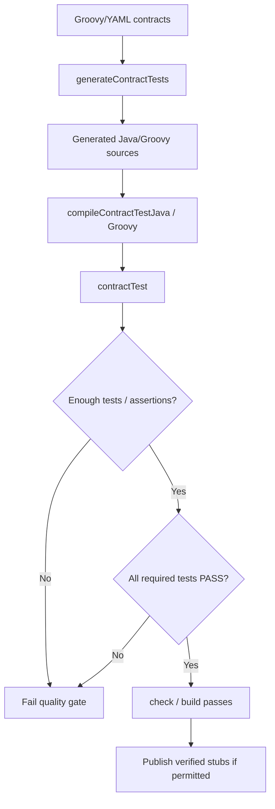
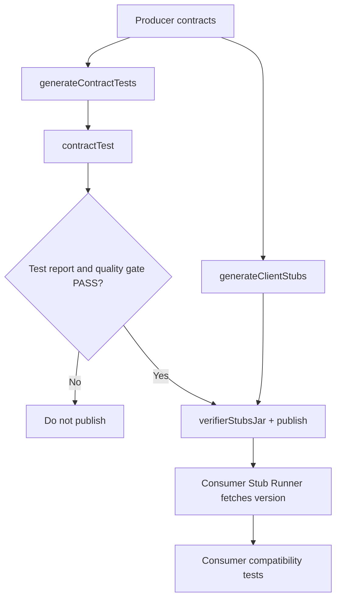

# Verifying a Clean Build Actually Generates and Runs All Tests

> **Chapter:** Gradle Integration  
> **Module:** `SPRING_CLOUD_CONTRACT` — learn contract testing between producer and consumer with Groovy/YAML DSL for HTTP or messaging; generate producer verification tests, package stubs, run Stub Runner, and wire quality gates into CI to detect incompatible API changes.

## Learning Objectives

After this lesson, you will be able to:

1. Explain why **a passing `./gradlew clean build` does not automatically prove all contract tests were generated and executed**.
2. Identify the default contract source of the **Gradle plugin** as `src/contractTest/resources/contracts`, unlike the layout often seen in Maven guides.
3. Understand the `generateContractTests → compileContractTestJava → contractTest → check/build` chain and recognize that `generateClientStubs` serves a separate role.
4. Configure `testFramework = 'JUNIT5'`, `testMode = 'MockMvc'`, `baseClassForTests`, and `useJUnitPlatform()` accordingly.
5. Read task outcomes (`SUCCESS`, `UP-TO-DATE`, `FROM-CACHE`, `NO-SOURCE`, `SKIPPED`) and know when to pass `--rerun-tasks` together with `--no-build-cache` for fresh execution evidence.
6. Verify **three levels of evidence**: contracts were discovered, generated test code compiled, and **tests actually executed and were recorded in reports**.
7. Write a Gradle quality gate checking test counts, skipped counts, and `build/test-results/contractTest/` reports—even when zero reports exist.
8. Design CI for producer verification and publish stubs only after all mandatory contracts PASS.
9. Use an intentional API-breaking change to test whether the pipeline actually catches failures instead of staying green.

## 1. The Problem: `BUILD SUCCESS` Yet Contracts Were Never Verified

A producer `inventory-service` uses Gradle to build the application and Spring Cloud Contract to specify its stock-check API. A developer runs:

```bash
./gradlew clean build

# BUILD SUCCESSFUL
```

This message **only confirms that the tasks actually included in the build finished under the current configuration**. Dangerous situations may exist:

- No contract files were found by the plugin because they sit in the wrong directory.
- The test generation task ran yet generated zero tests due to a filter/ignored-file configuration.
- Generated Java tests exist, yet the `contractTest` task never executed in the actual workflow.
- The test class compiled, yet JUnit Jupiter discovered zero test methods.
- A task has `onlyIf { false }`, `enabled = false`, or was explicitly excluded.
- The build restored outputs from cache or marked tasks up-to-date, so **no fresh verification ran on that machine**.
- Gradle ran unit tests (`test`) successfully yet **did not run the `contractTest` source set**.
- The test report contains tests, yet all of them are `skipped`.
- The plugin was removed or the build script changed so `check` no longer pulls in contract verification as expected.

**The right standard:** inspect **the exact tasks and results**, not just the exit code of `build`.

### 1.1. Three Levels of Evidence

| Level | Question | Required evidence |
| --- | --- | --- |
| **A — Discovery** | Did the plugin see the right contracts? | Contract paths and scenario counts verified; `generateContractTests` ran |
| **B — Generation and compilation** | Were generated tests created and compiled? | Java/Groovy tests exist under `build/generated-test-sources/...`; source set compilation task succeeded |
| **C — Execution** | Did assertions actually run against the real producer? | `contractTest` executed and produced JUnit XML/HTML reports showing executed, PASS/FAIL, and skipped counts |

Levels A + B alone are not enough. A stub JAR can also be packaged without Level C evidence if the publish pipeline lacks an adequate quality gate.



## 2. The Gradle Plugin Creates a Dedicated `contractTest` Source Set

In a Gradle project using modern Spring Cloud Contract Verifier, the plugin looks for contracts by default at:

```text
inventory-service/
├── build.gradle
├── gradlew
└── src/
    ├── main/java/com/example/inventory/
    │   └── StockController.java
    ├── test/java/com/example/inventory/
    │   └── StockControllerUnitTest.java
    └── contractTest/
        ├── java/com/example/inventory/
        │   └── ContractTestBase.java
        └── resources/contracts/
            └── stock/
                ├── stock_available.yml
                └── stock_empty.yml
```

**Differences to remember:**

- For **Gradle**, Spring Cloud Contract 5.x docs specify the default source as `src/contractTest/resources/contracts` and base test classes under `src/contractTest/java` or the Groovy equivalent.
- `src/test/resources/contracts` was previously supported for migration, yet has been marked **deprecated in the Gradle plugin since Spring Cloud Contract 3.0.0**. Do not rely on this path when designing new projects.
- You can change the path via `contractsDslDir` if your project uses a custom layout, provided the plugin and CI team use **one shared source**.
- Generated tests are typically grouped by **contract directory**, so **a folder with two files does not necessarily produce two test classes**; it often produces one class with multiple test methods.

Two files inside `stock/` are expected to yield **two producer verification cases** (assuming neither is ignored or in-progress), though the exact test method count must be verified from generated sources/reports of the active plugin version.

### 2.1. Why Looking Only at `src/test` Is Dangerous

Suppose a developer creates `src/test/resources/contracts/stock_available.yml` by copying a Maven tutorial. If the Gradle project no longer relies on the legacy fallback, `generateContractTests` may fail to see the file.

A green build with zero contract tests is not a signal that contracts hold. The fix is **inspecting the real contract source and failing when contracts are absent**.

## 3. Sample Contract Set to Test Clean Builds

Inside `src/contractTest/resources/contracts/stock/`, create **two separate files**.

### 3.1. `stock_available.yml`

```yaml
name: stock_available
description: "SKU-001 in stock"

request:
  method: GET
  url: /api/stock/SKU-001
  headers:
    Accept: application/json

response:
  status: 200
  headers:
    Content-Type: application/json
  body:
    sku: SKU-001
    available: true
    quantity: 4
```

### 3.2. `stock_empty.yml`

```yaml
name: stock_empty
description: "SKU-002 out of stock"

request:
  method: GET
  url: /api/stock/SKU-002
  headers:
    Accept: application/json

response:
  status: 200
  headers:
    Content-Type: application/json
  body:
    sku: SKU-002
    available: false
    quantity: 0
```

These contracts test **exactly two committed scenarios**, not every SKU in the database. Consumer `checkout-service` can rely on `available` being a boolean and `quantity` being a JSON number to decide whether to allow placing an order.

### 3.3. An Equivalent Groovy DSL Contract

If the project uses Groovy DSL instead of YAML, `stock_available.groovy` can be:

```groovy
org.springframework.cloud.contract.spec.Contract.make {
    name 'stock_available'

    request {
        method 'GET'
        url '/api/stock/SKU-001'
        headers {
            header 'Accept': 'application/json'
        }
    }

    response {
        status 200
        headers {
            contentType(applicationJson())
        }
        body(
            sku: 'SKU-001',
            available: true,
            quantity: 4
        )
    }
}
```

**Do not store both YAML and Groovy describing the exact same scenario in one build** if you expect exactly two contract tests. Duplication makes test counts and stub mappings hard to reason about.

## 4. Producer Implementation So Generated Tests Have Something to Verify

A minimal controller:

```java
package com.example.inventory;

import org.springframework.http.MediaType;
import org.springframework.web.bind.annotation.GetMapping;
import org.springframework.web.bind.annotation.PathVariable;
import org.springframework.web.bind.annotation.RequestMapping;
import org.springframework.web.bind.annotation.RestController;

@RestController
@RequestMapping("/api/stock")
public class StockController {

    @GetMapping(
        value = "/{sku}",
        produces = MediaType.APPLICATION_JSON_VALUE
    )
    public StockResponse getStock(@PathVariable String sku) {
        if ("SKU-001".equals(sku)) {
            return new StockResponse("SKU-001", true, 4);
        }
        if ("SKU-002".equals(sku)) {
            return new StockResponse("SKU-002", false, 0);
        }
        throw new IllegalArgumentException("Unknown SKU: " + sku);
    }

    public record StockResponse(
        String sku, boolean available, int quantity
    ) {}
}
```

This example controller **only implements the two success branches**. The exception branch has no `@ControllerAdvice` yet, so no HTTP error contract is defined for unknown SKUs. To verify `404` with a structured body, implement exception mapping and a corresponding contract.

In real projects, the controller may call services/repositories. Tests may mock integration ports **outside the boundary under verification**, while keeping the real code producing the promised responses.

## 5. Base Class in the Right `contractTest` Source Set

Create `src/contractTest/java/com/example/inventory/ContractTestBase.java`:

```java
package com.example.inventory;

import io.restassured.module.mockmvc.RestAssuredMockMvc;
import org.junit.jupiter.api.BeforeEach;

public abstract class ContractTestBase {

    @BeforeEach
    public void prepareMvc() {
        RestAssuredMockMvc.standaloneSetup(
            new StockController()
        );
    }
}
```

With `testMode = 'MockMvc'`, generated producer tests use `RestAssuredMockMvc` to call the endpoint. `@BeforeEach` prepares the environment before each JUnit 5 test.

**This is not a consumer stub test**: it runs against the **real producer controller**, merely avoiding opening a real HTTP socket. For applications relying on Spring Security, custom serialization, filters, and controller advice, use a Spring context-backed base test or another test mode if those components determine contract behavior.

### 5.1. If the Base Class Is in the Wrong Place

When the plugin generates tests extending `com.example.inventory.ContractTestBase` yet the `contractTest` source set does not contain that class, you may see:

```text
cannot find symbol: class ContractTestBase
```

Never "fix" this by deleting `baseClassForTests` just to make tests compile without HTTP setup. Check the package, the `src/contractTest/java` path, source set dependencies, and compilation tasks.

## 6. Verifiable Gradle Plugin Configuration

Example **Groovy DSL `build.gradle` fragment** for a producer that already has Spring Boot and compatible dependency management/BOM configured:

```groovy
plugins {
    id 'groovy'
    id 'org.springframework.cloud.contract' version '5.0.3'
}

repositories {
    mavenCentral()
}

dependencies {
    // Spring Boot project already manages compatible dependency versions.
    contractTestImplementation(
        'org.springframework.cloud:spring-cloud-starter-contract-verifier'
    )
}

contracts {
    testFramework = 'JUNIT5'
    testMode = 'MockMvc'
    baseClassForTests = 'com.example.inventory.ContractTestBase'
    contractsDslDir = file('src/contractTest/resources/contracts')

    // Never allow 0 contracts silently.
    failOnNoContracts = true
}

tasks.named('contractTest', Test) {
    useJUnitPlatform()

    testLogging {
        events 'passed', 'skipped', 'failed'
        exceptionFormat 'full'
    }

    reports {
        junitXml.required = true
        html.required = true
    }
}
```

**This is not a complete `build.gradle`**, because it still needs the appropriate Spring Boot/Java plugins, `spring-boot-starter-web`, and project-wide version management. Plugin version `5.0.3` is a Spring Cloud Contract reference milestone; do not mix it arbitrarily with any Spring Boot/Gradle/JDK version. Pick a **compatible version set** for your project.

Meaning:

- `org.springframework.cloud.contract`: plugin that generates verification tests and stubs.
- `contractsDslDir`: explicitly pins the Groovy/YAML contract source, avoiding misplaced assumptions about default locations.
- `testFramework = 'JUNIT5'`: generates JUnit Jupiter tests.
- `testMode = 'MockMvc'`: routes HTTP requests through `RestAssuredMockMvc` in tests.
- `baseClassForTests`: generated tests inherit the producer setup.
- `contractTestImplementation`: required dependency inside the **`contractTest` source set**.
- `tasks.named('contractTest', Test) { useJUnitPlatform() }`: instructs the Gradle test engine to discover JUnit 5 tests.
- Enables both XML and HTML reports so CI preserves proof after test execution.

**Distinguish `contractTest` from `test`:** they are separate tasks and source sets. Configuring only `tasks.test { useJUnitPlatform() }` may **not suffice** for `contractTest`. Configure the exact task that executes generated tests.

### 6.1. What About Gradle Kotlin DSL?

If your project uses `build.gradle.kts`, syntax differs from Groovy DSL. **Conceptually equivalent sketch**, not a verbatim copy:

```kotlin
plugins {
    java
    id("org.springframework.cloud.contract") version "5.0.3"
}

dependencies {
    add(
        "contractTestImplementation",
        "org.springframework.cloud:spring-cloud-starter-contract-verifier"
    )
}

contracts {
    testFramework = "JUNIT5"
    testMode = "MockMvc"
    baseClassForTests = "com.example.inventory.ContractTestBase"
    contractsDslDir = file("src/contractTest/resources/contracts")
    failOnNoContracts = true
}

tasks.named<Test>("contractTest") {
    useJUnitPlatform()
}
```

This snippet illustrates the configuration structure; type/accessor compatibility for `contracts` in Kotlin DSL depends on the plugin version, imports, and how the plugin exposes its extension. Check the DSL API when applying it; **do not assume Groovy closures are valid Kotlin DSL**.

### 6.2. Do Not Change `testMode` Accidentally

| Setting | Expected generated test client | Matching base test setup |
| --- | --- | --- |
| `MockMvc` | RestAssuredMockMvc | `standaloneSetup` or `webAppContextSetup` |
| `Explicit` | HTTP client to test server | Start embedded HTTP server and set base URI/port |
| `WebTestClient` | Reactive test client | Base setup for WebFlux |

Do not set `testMode = 'Explicit'` while your base class only calls `RestAssuredMockMvc.standaloneSetup(...)`: generated tests will use a different request mechanism than your setup.

## 7. Understanding the Task Graph: Generating Code Is Not Running Tests

The Spring Cloud Contract Gradle plugin provides `generateContractTests` solely to generate verification code. The `contractTest` source set has its own test task. Official docs note that the plugin hooks into the `check` lifecycle.

```bash
# Inspect actual tasks configured in your project.
./gradlew tasks --all

# Inspect task graph only; DOES NOT execute tasks.
./gradlew clean build --dry-run

# Only generates Java/Groovy tests from DSL.
./gradlew generateContractTests

# Runs producer contract tests integrated by the plugin.
./gradlew contractTest

# Full build per lifecycle and quality gates.
./gradlew clean build
```

**Do not assume `generateContractTests` finishing means `contractTest` ran.** The generate task only emits sources. Likewise, `generateClientStubs` creates WireMock stub mappings rather than replacing producer verification.

### 7.1. Typical Task Sequence

Exact names may vary across Gradle, plugin versions, and source sets, yet the roles are typically:

| Activity / task | Responsibility | Evidence |
| --- | --- | --- |
| `generateContractTests` | Reads DSL and generates test sources | Java/Groovy test files in `build/` |
| `compileContractTestJava` / `compileContractTestGroovy` | Compiles generated tests and base class | Class files in source set output |
| `contractTest` | **Executes** JUnit/Spock tests of the source set | Test XML/HTML reports |
| `check` | Aggregates Gradle quality gates; plugin attaches verification | Task graph and test task outcomes |
| `build` | `assemble` + `check` per lifecycle | Overall build result |
| `generateClientStubs` | Generates stub mappings from DSL | Stub/mapping outputs |
| `verifierStubsJar` | Packages the stub JAR per plugin config | `*-stubs.jar` |

In multi-module projects, task paths look like `:inventory-service:contractTest`. Running `./gradlew test` from the root **does not prove** `:inventory-service:contractTest` executed.

### 7.2. Using `--dry-run` Properly

```bash
./gradlew clean build --dry-run --console=plain
```

`--dry-run` prints the task graph and tells you whether `generateContractTests`, `compileContractTestJava`, and `contractTest` are in the planned execution path. However, **it executes no tasks**. `SKIPPED` lines in dry-run output cannot be cited as proof that tests ran.

If `contractTest` does not appear in the graph, inspect the Gradle plugin, source set configuration, and `check` wiring before assuming "the contract build is protected".

## 8. A Clean Build That Really Runs: Using Flags with Clear Intent

### 8.1. Basic Command

```bash
./gradlew clean build --console=plain
```

`clean` deletes outputs in the project's `build/` directory per Gradle configuration, preventing confusion with generated files from prior runs. However, `clean` **does not wipe Gradle User Home**, artifact caches, or remote build caches.

Therefore, some tasks may still restore outputs from the **build cache** rather than re-running their work.

### 8.2. Verification Command That Reuses No Task Outputs

When you want proof of a **fresh execution on the current machine/runner**:

```bash
./gradlew clean build \
  --rerun-tasks \
  --no-build-cache \
  --console=plain \
  --info
```

Breakdown:

- `clean`: clears previous build outputs.
- `--rerun-tasks`: ignores up-to-date task state; forces Gradle to re-execute tasks.
- `--no-build-cache`: neither reads from nor writes to the build cache for this run.
- `--console=plain`: produces logs easy to archive and search in CI.
- `--info`: increases logging enough to see what each task did, without turning on `--debug` which may expose sensitive details.

**On Windows PowerShell**, you can run:

```powershell
.\gradlew.bat clean build --rerun-tasks --no-build-cache --console=plain --info
```

Both commands are instructions **for learners to run in their own projects**; they were not executed while authoring this STEP 4 lesson.

### 8.3. Interpreting Outcomes Accurately

| Outcome/log | Meaning | Was it freshly executed? |
| --- | --- | --- |
| `SUCCESS` / task completed normally | Task executed and succeeded per Gradle | Still inspect test counts and assertions separately |
| `UP-TO-DATE` | Gradle saw unchanged inputs and outputs | **No**, reused existing local outputs |
| `FROM-CACHE` | Outputs restored from build cache | **No** fresh execution on this machine |
| `NO-SOURCE` | Task had no source inputs to process | **No**, major warning sign for `contractTest` |
| `SKIPPED` | Task skipped due to condition/flag/config | **No** |
| `FAILED` | Task execution/configuration failed | Inspect source, compile, or assertion errors |

Important distinction: `UP-TO-DATE` or `FROM-CACHE` **are not necessarily CI bugs** when the build cache is trustworthy and provenance is tracked. Yet when performing a **"truly fresh" clean-build verification**, never cite them as evidence that tests just ran.

`NO-SOURCE` is especially critical to watch for: the plugin may have generated zero tests, the source set may be misconfigured, or the task found zero classes to run.

## 9. Inspecting Generated Files After Execution

With modern Gradle configurations, outputs typically appear in directories like:

```text
build/
├── generated-test-sources/
│   └── contractTest/
│       ├── java/
│       │   └── .../Stock.java
│       └── groovy/
├── classes/
│   └── java/
│       └── contractTest/
├── test-results/
│   └── contractTest/
│       └── TEST-...Stock.xml
└── reports/
    └── tests/
        └── contractTest/
            └── index.html
```

Paths and filenames may vary by plugin/version because `generatedTestJavaSourcesDir` or reporting directories can be customized. Prefer **inspecting your active configuration** rather than hardcoding one default path across all projects.

### 9.1. Inspecting Generated Classes and Methods

The plugin typically groups contracts by directory. With two files under `contracts/stock/`, you will likely see one generated class representing `stock` with methods for `stock_available` and `stock_empty`.

In the generated test, look for:

- HTTP `GET` calls with URLs containing `SKU-001` or `SKU-002`.
- Request header `Accept: application/json`.
- HTTP status `200` assertion.
- Response `Content-Type` and JSON body assertions.
- `quantity = 4`, `available = true` for the in-stock scenario.
- `quantity = 0`, `available = false` for the out-of-stock scenario.
- Correct JUnit test annotations and `ContractTestBase` superclass.

**Counting Java files does not substitute for counting test methods.** One class can hold multiple cases; conversely, a contract list can generate multiple test cases depending on the DSL.

### 9.2. Inspecting Compiled Output

If generated sources exist yet `compileContractTestJava` fails because `ContractTestBase` is not found, the pipeline **never reached assertions**. Fix the source set, package, or dependencies first rather than editing contracts to dodge compiler errors.

If the build succeeds with no compiled classes or test reports, check whether it ran `contractTest` or only `generateContractTests`.

## 10. Test Reports Are Stronger Evidence Than `BUILD SUCCESS`

Gradle `Test` tasks emit JUnit XML and HTML reports. For `contractTest`, you typically find:

```text
build/test-results/contractTest/TEST-<test-class>.xml
build/reports/tests/contractTest/index.html
```

An illustrative JUnit XML report:

```xml
<testsuite
    name="com.example.inventory.Stock"
    tests="2"
    skipped="0"
    failures="0"
    errors="0">
    <testcase name="stock_available" classname="com.example.inventory.Stock"/>
    <testcase name="stock_empty" classname="com.example.inventory.Stock"/>
</testsuite>
```

This is **illustrative XML for learning how to read reports**; real class and method names depend on the generator. Never claim "2 tests ran" just because two YAML files exist—verify against the **actual XML or Gradle report**.

### 10.1. What to Extract from Reports

| Metric | Why it matters |
| --- | --- |
| `tests` | Number of test cases reported by Gradle/JUnit |
| `failures` | Tests that failed assertions |
| `errors` | Runtime/setup errors |
| `skipped` | Tests that were skipped |
| `tests - skipped` | Cases that had a chance to execute rather than being skipped (verify report/test engine) |
| `classname + name` | Matches exact scenarios, not just total count |

**Two passing tests in `test` say nothing about the `contractTest` source set.** In projects with multiple test suites, read **the exact report directory for that task**.

### 10.2. Gradle 9: Is Failing When No Tests Are Discovered Enough?

Starting in **Gradle 9.0**, `Test.failOnNoDiscoveredTests` defaults to `true`: when **test sources exist** yet the test engine discovers zero tests, Gradle fails the task. This is a helpful safeguard.

However, it **does not solve every zero-contract-test case**:

- If the `contractTest` source set has zero sources/classes, the task may end as `NO-SOURCE` and **skip test discovery entirely**.
- If a task is skipped, test discovery never gets a chance to run.
- If the task contains other tests while missing mandatory generated scenarios, the count can still exceed 0.
- If tests are filtered, fail/no-match behavior depends on filter/task configuration.

On older Gradle versions, zero-test detection differs. **Never disable `failOnNoDiscoveredTests` just to make CI green** without documenting why an empty suite is valid.

### 10.3. Checking by Case Identity, Not Only Count

If a project requires three cases—`available`, `empty`, and `notFound`—a "minimum 3 tests" check can PASS if one required case disappears while another unrelated test is added. A stronger quality gate includes:

1. A reviewed manifest of **mandatory** contracts.
2. Checking contract sources contain the expected files/scenarios.
3. Inspecting generated test sources to see which cases were emitted.
4. Reading XML `classname` and `name` after execution and matching mandatory identifiers.
5. Failing if any required case is skipped, missing, or lacks key assertions.

Avoid writing counting rules based solely on Java filenames; contract-to-method mapping can vary across plugin versions.

## 11. Fail-Fast When `contractTest` Runs 0 Cases

A practical check inspects the test total inside the callback of the **`contractTest` task itself**:

```groovy
tasks.named('contractTest', Test) {
    useJUnitPlatform()

    afterSuite { descriptor, result ->
        if (descriptor.parent == null) {
            long ran = result.successfulTestCount + result.failedTestCount

            if (ran == 0) {
                throw new GradleException(
                    'contractTest executed no test cases'
                )
            }

            if (result.skippedTestCount > 0) {
                throw new GradleException(
                    'contractTest skipped ' +
                    result.skippedTestCount + ' case(s)'
                )
            }
        }
    }
}
```

This checks outcomes when **the task executed through its suite completion callback**. It is **not enough** if `contractTest` ends with `NO-SOURCE` or `SKIPPED` completely, because the callback never runs. Therefore, add a post-`contractTest` quality gate verifying **reports exist and executed case counts meet requirements**.


## 12. Quality Gate Inspecting XML, Even When the Task Is `NO-SOURCE`

Add a **supplementary task** to the producer's `build.gradle`. It depends on `contractTest` and parses XML reports. Goal: if reports are missing or executed cases fall below the required minimum, **fail the build**.

```groovy
tasks.register('verifyContractExecution') {
    dependsOn tasks.named('contractTest')

    doLast {
        File reportDir = layout.buildDirectory
            .dir('test-results/contractTest')
            .get().asFile

        Set<File> reports = fileTree(reportDir) {
            include 'TEST-*.xml'
        }.files

        if (reports.isEmpty()) {
            throw new GradleException(
                'No contractTest XML reports found. ' +
                'Check task NO-SOURCE / SKIPPED / test discovery.'
            )
        }

        int total = 0
        int skipped = 0
        int failures = 0
        int errors = 0

        def factory =
            javax.xml.parsers.DocumentBuilderFactory.newInstance()

        reports.each { File xmlFile ->
            def doc = factory.newDocumentBuilder().parse(xmlFile)
            def suite = doc.documentElement

            total += Integer.parseInt(suite.getAttribute('tests'))
            skipped += Integer.parseInt(
                suite.getAttribute('skipped') ?: '0'
            )
            failures += Integer.parseInt(
                suite.getAttribute('failures') ?: '0'
            )
            errors += Integer.parseInt(
                suite.getAttribute('errors') ?: '0'
            )
        }

        int executed = total - skipped
        int requiredMinimum = 2 // stock_available and stock_empty

        if (executed < requiredMinimum ||
            skipped > 0 || failures > 0 || errors > 0) {
            throw new GradleException(
                'Contract verification incomplete: ' +
                "total=" + total + ", executed=" + executed +
                ", skipped=" + skipped + ", failures=" + failures +
                ", errors=" + errors
            )
        }

        logger.lifecycle(
            "Verified contractTest cases: " + executed
        )
    }
}

tasks.named('check') {
    dependsOn tasks.named('verifyContractExecution')
}
```

**Why this example is useful:**

- `verifyContractExecution` depends on `contractTest`, so it runs only after the test task completes (or is skipped).
- With `NO-SOURCE`, no fresh XML report exists after `clean`; the check task **fails**.
- `total - skipped` excludes skipped cases from the count of actually executed cases.
- `requiredMinimum = 2` reflects the **local commitment of the example suite**.
- `check` depends on this quality gate, so `build` cannot succeed unless the gate passes.

**Important limitation:** this gate checks total count; it **does not verify every assertion** and does not prove those exact two cases ran if unrelated tests live in the same source set. For strict CI, assert the mandatory case list in JUnit XML and generated sources. Additionally, the simple XML parser assumes Gradle's standard `testsuite` XML format; if your pipeline customizes XML output, adapt the parser accordingly.

### 12.1. Why Is `afterSuite` Alone Insufficient?

If `contractTest` ends as `NO-SOURCE`, `afterSuite` is not guaranteed to run. A `dependsOn` task inspecting XML detects the **absence** of evidence.

If the pipeline skips `check` altogether and runs only `generateContractTests`, `verifyContractExecution` never runs either. Therefore, **CI must run the right quality gate** rather than only test generation.

### 12.2. A Stronger Guard When Many Cases Exist

For example, when adding `stock_not_found.yml`:

- Raise `requiredMinimum` if additional generated tests are genuinely expected.
- Maintain the list of mandatory scenarios in a test plan.
- Extract class/test names from XML and assert set membership.
- Confirm any `ignored`/`in-progress` files are explicitly permitted by policy.
- Test mutations on each critical scenario to prove assertions catch faults.

Never raise thresholds arbitrarily if some YAML files serve only as stub helpers or if one DSL file defines multiple scenarios. **Thresholds must derive from mandatory behaviors.**

## 13. Failure Modes to Distinguish

| Stage | Symptom | Common root cause | How to verify |
| --- | --- | --- | --- |
| Contract discovery | 0 contracts | Wrong `contractsDslDir`; mistakenly used `src/test` | Check DSL path and generator logs |
| Generation | `generateContractTests` has no output | Sources ignored/in-progress, or plugin not applied | Inspect task outcome and generated directories |
| Compilation | `cannot find ContractTestBase` | Base class in wrong source set/package | Check `src/contractTest/java` and classpath |
| Test framework | JUnit tests not discovered | Missing `useJUnitPlatform()` or engine | Read `contractTest` report; check Gradle version |
| Task graph | `contractTest` missing from graph | Ran only `test`/`assemble`; custom lifecycle | `./gradlew build --dry-run` |
| No source | `:contractTest NO-SOURCE` | No generated/compiled tests | XML gate fails after `clean` |
| Skip | `contractTest SKIPPED` | `-x contractTest`, `enabled=false`, `onlyIf` | Check CI flags and task config |
| Cache | `FROM-CACHE` | Task output restored from cache | Re-run with `--no-build-cache --rerun-tasks` for fresh proof |
| Execution | Expected 200, actual 404 | Wrong method/path/controller setup | Inspect generated test and producer response |
| Assertion | `quantity expected 4 but 0` | Producer violates contract or wrong fixture | Mutation / fixture / readback check |
| Report | Tests pass yet no report uploaded | CI archived only `test` XML | Archive `contractTest` XML/HTML |
| Publish | Stubs JAR exists yet verifier never ran | Publish does not depend on `check`/gate | Configure release job gating |

**Never edit a contract to match broken output just to turn the build green.** Separate pipeline configuration errors from API breaking changes; sometimes a base test fixture is wrong, and sometimes the real producer broke its promise to consumers.

## 14. Intentionally Breaking the Contract to Prove the Pipeline Works

Suppose the controller originally returns `quantity = 4` for `SKU-001`. Make an intentional change on a test branch:

```java
if ("SKU-001".equals(sku)) {
    return new StockResponse("SKU-001", true, 0);
}
```

Keep `quantity: 4` in YAML. Run on **your project**:

```bash
./gradlew clean build --rerun-tasks --no-build-cache --console=plain
```

**Expected:**

1. `generateContractTests` generates the test from `stock_available.yml`.
2. `contractTest` actually runs.
3. The generated assertion fails because the response has `quantity = 0` instead of `4`.
4. `check/build` fails; verified stubs are not published.
5. After restoring `quantity = 4`, the build returns to PASS.

If the build stays green:

- Is `contractTest` missing from the task graph?
- Is `contractTest` `SKIPPED` or `NO-SOURCE`?
- Is the plugin scanning the wrong contracts directory?
- Does the generated test lack an assertion on `quantity`?
- Is the test calling a **fake controller** or mock service returning canned data regardless of producer code?
- Is CI reading artifacts/caches from a different commit?

**Mutation testing checks the test signal**, not an academic QA exercise. Its goal is proving the pipeline turns red whenever the implementation breaks the contract.

### 14.1. Testing Missing Contracts

Another check is temporarily moving all contracts into an unscanned folder. With `failOnNoContracts = true` and the quality gate, the build must FAIL. If it still PASSES, you cannot claim CI protects contracts.

**Do this only on a test branch/workspace**; never move production contracts or delete another module's files.

### 14.2. Testing a Skipped Mandatory Case

Suppose `stock_empty.yml` is marked ignored or disappears. The project must detect the **missing scenario**. With `requiredMinimum = 2` in this lesson, the XML gate FAILS when only one case executes.

In larger projects, replace simple counting with a mandatory case list or XML name matching so another unrelated test cannot accidentally mask a missing scenario.

## 15. Multi-Module Gradle: Do Not Test the Wrong Project

A monorepo might look like:

```text
platform/
├── settings.gradle
├── inventory-producer/
│   └── build.gradle
├── checkout-consumer/
│   └── build.gradle
└── notification-service/
    └── build.gradle
```

When running from the root:

```bash
./gradlew :inventory-producer:clean :inventory-producer:build \
  --no-build-cache --rerun-tasks --console=plain
```

Look at the task paths:

```text
:inventory-producer:generateContractTests
:inventory-producer:compileContractTestJava
:inventory-producer:contractTest
:inventory-producer:verifyContractExecution
```

Do not confuse `:checkout-consumer:test` with producer verification. They verify **opposite sides** of the contract:

- Producer `contractTest`: Inventory's implementation obeys the contract.
- Consumer test with `Stub Runner`: Checkout's client calls and parses the verified stub properly.

If a project uses custom source sets or composite builds, verify the **actual task graph** after applying the plugin rather than forcing identical report paths across every repository.

## 16. Generate Stubs and Publish Only After Verification Passes

The Gradle plugin has `generateClientStubs` to create WireMock mappings and `verifierStubsJar` to package the stub JAR (depending on configuration/version). Neither task **replaces `contractTest`**.



Since Spring Cloud Contract 3.x, **the Gradle plugin does not auto-configure stub publishing by default as before**; declare `maven-publish` explicitly to publish artifacts to a Maven-compatible repository.

Publication skeleton example for a producer that already has an appropriate Maven publication:

```groovy
plugins {
    id 'maven-publish'
}

publishing {
    publications {
        mavenJava(MavenPublication) {
            // Add producer's primary components/artifacts per project.
            artifact tasks.named('verifierStubsJar')
        }
    }
}
```

**This is a fragment**, not a complete publication with primary components/metadata for every app. Depending on Gradle version, task provider access and packaging must match your project's API. Most importantly: **CI must never run `publish` before `check`/`verifyContractExecution` quality gates pass**.

### 16.1. A Stub JAR Existing Is Not Enough

A Gradle build can generate `*-stubs.jar` via `generateClientStubs` without ever testing the implementation. Therefore:

- Producer CI runs verification **before** publishing artifacts.
- Never skip tests via `-x contractTest` or `enabled = false` in release jobs.
- Tie stub versions to the passing commit/build.
- Consumer tests pin exact artifact versions rather than defaulting to latest.
- If CI splits work across separate runners, transfer artifacts via repository or CI artifact storage.

## 17. Example CI with Explicit Quality Gates

With GitHub Actions (example; Linux runner with Java/Gradle wrapper):

```yaml
name: producer-contract-verification

on:
  pull_request:
  push:
    branches: [main]

jobs:
  contract-verification:
    runs-on: ubuntu-latest
    steps:
      - uses: actions/checkout@v4

      - uses: actions/setup-java@v4
        with:
          distribution: temurin
          java-version: '17'

      - name: Verify clean build and contract execution
        run: |
          ./gradlew clean build \
            --rerun-tasks --no-build-cache \
            --console=plain --info

      - name: Upload contract test results
        if: always()
        uses: actions/upload-artifact@v4
        with:
          name: contract-test-reports
          path: |
            **/build/test-results/contractTest/**
            **/build/reports/tests/contractTest/**
```

This is a **reference pipeline**. If your Gradle plugin/Boot version requires JDK 21, adjust the toolchain accordingly. Never run `./gradlew publish` inside the same job before `build` and quality gates PASS.

### 17.1. Example Rules for a Dedicated Release Job

A release pipeline can follow this sequence:

```text
checkout
  -> clean build + contract verification + XML gate
  -> verify commit/version provenance
  -> publish app + stubs artifact
  -> consumer CI downloads candidate stubs
  -> consumer tests / smoke
```

With multiple branches, never publish to a fixed artifact name/version from different commits without provenance controls. Pick distinct version/candidate IDs so consumer tests do not silently pull shifting artifacts over time.

### 17.2. Should You Cache Gradle in CI?

Yes. Gradle dependency caches and build caches cut normal build times; that is completely fine. Just distinguish:

- **Normal CI:** can use trusted caches for speed, while still enforcing quality gates and provenance.
- **"Really ran" diagnostic runs:** add `--rerun-tasks --no-build-cache` to prove tasks and tests executed freshly.
- **Never:** treat `FROM-CACHE` as proof that tests just executed on the current runner.

There is no need to ban caching permanently across all pipelines simply because one verification check requires a clean run.

## 18. Quick Diagnosis by Symptom

| Symptom | First check | Resolution |
| --- | --- | --- |
| `BUILD SUCCESSFUL` yet no `contractTest` seen | `./gradlew build --dry-run` | Check plugin/task graph and `check` |
| `generateContractTests NO-SOURCE` | `contractsDslDir` / contract sources | Place in `src/contractTest/resources/contracts` |
| Generated Java empty | Contract parser / ignored files | Inspect generator logs and `failOnNoContracts` |
| Generated sources exist yet compile fails | Base class / dependencies | Put base class in `src/contractTest/java` |
| `contractTest` runs 0 tests | JUnit Platform, source set, classpath | `useJUnitPlatform()` and XML gate |
| `contractTest NO-SOURCE` | Missing compiled test classes | Check generate + compile; fail gate |
| `contractTest SKIPPED` | `-x`, `onlyIf`, `enabled` | Remove skips in mandatory CI |
| `contractTest FROM-CACHE` | Task output cache | Re-run with `--rerun-tasks --no-build-cache` |
| XML test count lower than expected | Contract deleted/ignored, class missed | Cross-check scenario manifest and generated cases |
| All tests `skipped` yet build green | JUnit annotations/conditions | Fail quality gate and investigate |
| JSON assertion failure | Producer code/fixture mismatch | Inspect generated test and real response |
| Stub JAR exists yet producer test red | Publish lacks verification dependency | Block publishing |
| Passes locally, fails in CI | Different JDK/Gradle/OS/env | Align toolchain, deps, reports, and logs |
| Consumer Stub Runner 404 | Wrong stub version/mapping or client request | Inspect artifact/version/method/path/headers |

## 19. Guided Exercises

### Exercise 1 — Verifying Sources and Task Graph

Create two YAML contracts under `src/contractTest/resources/contracts/stock/`. Verify the base class sits under `src/contractTest/java`. Run:

```bash
./gradlew tasks --all
./gradlew clean build --dry-run
```

Record the tasks participating in the build. Why is seeing only `generateContractTests` in the graph without `contractTest` insufficient?

### Exercise 2 — Clean Build with Evidence

Run:

```bash
./gradlew clean build --rerun-tasks --no-build-cache --console=plain --info
```

Save logs for `generateContractTests`, `compileContractTestJava`, and `contractTest`. Read the JUnit XML and record `tests`, `skipped`, `failures`, and executed case count.

### Exercise 3 — Zero-Contract Scenario

On a **practice branch**, temporarily point `contractsDslDir` to an empty folder. What must happen when `failOnNoContracts` is enabled? If `contractTest` reports `NO-SOURCE`, does the XML quality gate from Section 12 catch it?

### Exercise 4 — Broken JUnit Discovery

Remove `useJUnitPlatform()` from `contractTest` on a separate branch. Observe task and test reports on your Gradle version. Why can having source files with zero executed tests indicate a misconfigured test engine?

### Exercise 5 — Intentional Breaking Change

Change the controller to return `quantity = 0` for `SKU-001` while keeping `4` in the contract. Which generated producer test must FAIL? If it does not, list at least four hypotheses about the pipeline and how to verify them.

### Exercise 6 — Never Equate File Count with Test Count

Suppose `stock/` holds two YAML contracts and one Groovy contract containing multiple definitions. Compare generated test classes/methods against the file count; explain why a "one file = one test" guard can be inaccurate.

### Exercise 7 — Quality Gate

Add `verifyContractExecution` to inspect XML. Test four cases: 0 reports, 1 test, 2 tests with 1 skipped, and 2 tests both PASSING. What should the gate output in each case?

### Exercise 8 — Do Not Confuse Caching

Run the build twice with caching enabled. Note `UP-TO-DATE` or `FROM-CACHE` (if observed). Then run with `--rerun-tasks --no-build-cache`. What can you conclude about a **fresh execution**?

### Exercise 9 — Multi-Module

In a root Gradle build with `inventory-producer` and `checkout-consumer`, run `:inventory-producer:clean :inventory-producer:build`. Verify the `inventory-producer/build/test-results/contractTest` report. Why does a passing `checkout-consumer:test` not prove producer contract tests ran?

### Exercise 10 — Release Gate

Design producer CI that verifies generated tests, asserts the scenario list, publishes a versioned `verifierStubsJar` after PASS, and triggers consumer CI with Stub Runner. State what must block publishing if tests are skipped or `contractTest` is `NO-SOURCE`.

### Answer Hints

1. `generateContractTests` only emits sources; `contractTest` is what runs generated tests and produces reports.
2. Three levels are needed: contract discovery, generated source/compile, and executed tests; real XML is Level C evidence.
3. `failOnNoContracts` blocks missing contracts; the independent XML gate also fails when no reports exist after `clean`.
4. JUnit 5 needs `useJUnitPlatform()` on the **right** `Test` task; Gradle version affects warnings/failures.
5. The `quantity = 4` assertion must FAIL; if not, check task graph, sourceSet, fixtures, assertions, skips/caching.
6. One folder can generate one class with multiple methods; contract DSLs can contain lists/definitions; use manifests and reports instead of merely counting files.
7. 0 reports / 1 test / 1 skipped must FAIL when minimum is 2; only 2 executed PASSES succeed.
8. Up-to-date/cache is not a fresh run; flags prove fresh compilation/execution within the runner.
9. Each subproject has its own source sets/tasks/reports; consumer and producer tests are two separate quality gates.
10. Publish only after `contractTest` + quality gate; never use `-x contractTest` or skip XML verification.

## 20. Checklist Before Accepting `BUILD SUCCESS`

- [ ] `src/contractTest/resources/contracts` (or explicitly configured `contractsDslDir`) holds all mandatory contracts.
- [ ] `failOnNoContracts` is not disabled against policy.
- [ ] Base test class is in the right source set and package, and generated tests extend it.
- [ ] `testFramework` matches the test runner; JUnit 5 sets `useJUnitPlatform()` on `contractTest`.
- [ ] `generateContractTests` emits sources for the expected scenarios.
- [ ] Generated test sources compile cleanly.
- [ ] `contractTest` appears in the `check/build` task graph.
- [ ] The test task is not `NO-SOURCE`, `SKIPPED`, or unexpectedly filtering out cases.
- [ ] `build/test-results/contractTest` reports contain executed test cases.
- [ ] Executed case count meets threshold, with zero required tests skipped.
- [ ] Mandatory scenario list appears in generated sources/reports (when applying stricter gates).
- [ ] Mutation check on a critical response field turns the build red.
- [ ] Release job publishes verified stub artifacts only after all quality gates PASS.
- [ ] CI archives JUnit XML/HTML reports to trace failures without guessing from `BUILD SUCCESSFUL`.

## 21. Summary

**A clean build is meaningful only when you see the right layers of evidence.** With the Spring Cloud Contract Gradle plugin, contracts live under the `contractTest` source set; `generateContractTests` **emits sources**, compilation **creates classes**, and `contractTest` **executes assertions** against the producer implementation. `check/build` is merely the lifecycle entry point; inspect the task graph and real outcomes.

A high-confidence verification run uses `clean build --rerun-tasks --no-build-cache` when fresh execution is needed, watches for `NO-SOURCE/SKIPPED/UP-TO-DATE/FROM-CACHE`, inspects `build/test-results/contractTest`, and enforces a quality gate that fails if reports are missing or case counts drop below mandatory contracts. **`BUILD SUCCESS` without executed generated tests is not producer verification.**

Only after producer verification genuinely PASSES should you package/publish stubs for consumers to use with Stub Runner, paired with appropriate integration/E2E tests for boundaries outside contracts. That is how you turn contract testing from **a plugin sitting in a build script** into **a verifiable safeguard against breaking changes**.

## References

- [Spring Cloud Contract 5.0.3 — Gradle Project](https://docs.spring.io/spring-cloud-contract/reference/gradle-project.html) — `contractTest` source set, `generateContractTests`, `contractTest`, plugin config, `failOnNoContracts`, and `verifierStubsJar`.
- [Spring Cloud Contract — Contract DSL](https://docs.spring.io/spring-cloud-contract/reference/project-features-contract.html) — Groovy/YAML contracts and generated producer verification tests.
- [Spring Cloud Contract — Stub Runner Core](https://docs.spring.io/spring-cloud-contract/reference/project-features-stubrunner/stub-runner-core.html) — consumer testing with verified stub artifacts.
- [Gradle — Testing in Java & JVM Projects](https://docs.gradle.org/current/userguide/java_testing.html) — Test task, JUnit Platform, test discovery, XML/HTML reports, and source set configuration.
- [Gradle — Upgrading to 9.0](https://docs.gradle.org/current/userguide/upgrading_major_version_9.html) — `failOnNoDiscoveredTests` and test discovery changes.
- [Gradle — Command-line Interface](https://docs.gradle.org/current/userguide/command_line_interface.html) — `--rerun-tasks`, `--no-build-cache`, `--dry-run`, and logging.
