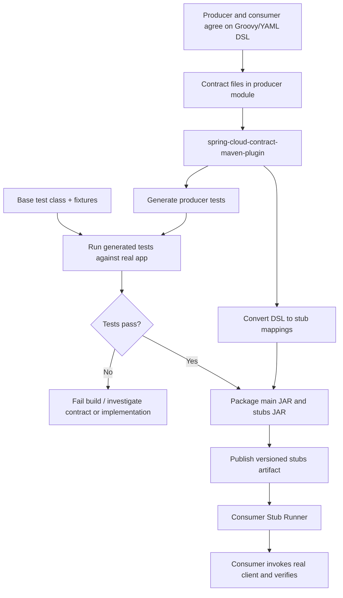
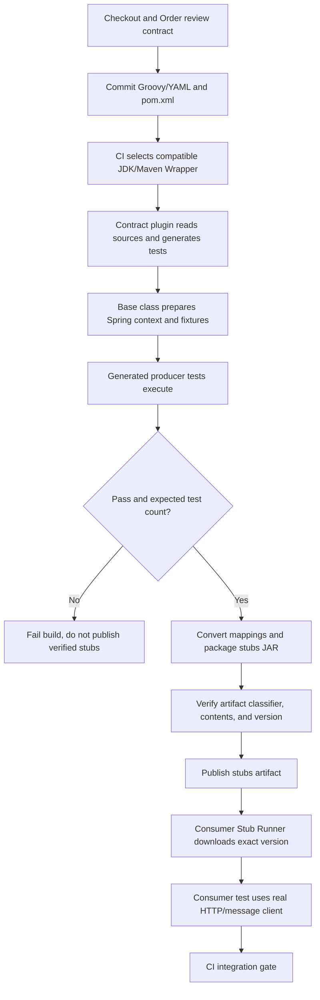

# Declaring spring-cloud-contract-maven-plugin

**Spring Cloud Contract Maven Plugin** is the component that connects **Groovy/YAML DSL contracts** with the build lifecycle of a producer using Maven. Once the producer and consumer teams agree on an API or message, the plugin can read the contracts, **generate producer-side tests**, convert the definitions into **stub mappings**, and package an artifact with the `stubs` classifier for the consumer to use through **Stub Runner**.

This lesson belongs to the **Maven Integration** chapter of the **SPRING_CLOUD_CONTRACT** learning path. The focus is on how to properly declare `org.springframework.cloud:spring-cloud-contract-maven-plugin` in `pom.xml`, choose a compatible version, wire the **base test class**, understand the Maven goals, and verify that generated tests **actually run** before releasing stubs. The examples assume the producer is a **Spring Boot MVC** application named `order-service` and the consumer is `checkout-service`; for WebFlux, messaging, or another Spring Cloud Contract version, you must adjust the test mode and infrastructure accordingly.

## 1. Where does the plugin sit in the contract testing workflow?

Before configuring Maven, it helps to distinguish the components:

| Component | Created by | Purpose |
|---|---|---|
| **Contract DSL** | Agreed upon by producer and consumer | Defines requests, responses, matchers, or messages |
| **Maven plugin** | Declared by producer team in `pom.xml` | Converts contracts into generated tests and stubs |
| **Base test class** | Written by producer | Initializes Spring context, HTTP client, fixtures, or message adapter |
| **Generated producer tests** | Generated by Contract Verifier | Verifies that the real producer implementation satisfies the DSL |
| **Stubs JAR** | Packaged by plugin | Provides mappings/contracts for Stub Runner |
| **Consumer integration tests** | Written by consumer | Calls real client via Stub Runner to verify compatibility |

Overall flow:



**Core principle:** The Maven plugin is a **generation and build-integration tool**. It does not write business implementations on its own, does not automatically create database records for every contract, and does not replace consumer tests. If the plugin generates tests without executing them, the build has not proven that the producer complies with the contract.

## 2. Things to check before editing `pom.xml`

Because Spring Boot, Spring Cloud, and Spring Cloud Contract are released on different version lines, you **should not randomly mix** a new plugin version with an old starter version.

Before declaring it:

1. Identify the **JDK version** used by the project and CI.
2. Check the **Maven Wrapper** (`mvnw` and the wrapper configuration already present in the project).
3. Identify the **Spring Boot version** and compatible **Spring Cloud release train**.
4. Choose a **Spring Cloud Contract version** compatible with the above stack.
5. Check whether the producer is **Spring MVC**, **Spring WebFlux**, **JAX-RS**, or a messaging-based application.
6. Confirm whether source contracts are managed **inside the producer module** or fetched from an external artifact/repository.
7. Identify whether the project uses **JUnit Jupiter/JUnit 5** or another test framework.
8. Check how the producer creates and resets **fixtures** before each generated test.

Consult current versions from the [Spring Cloud Contract](https://docs.spring.io/spring-cloud-contract/reference/), [Spring Cloud](https://spring.io/projects/spring-cloud), and [Spring Boot](https://docs.spring.io/spring-boot/system-requirements.html) documentation. **The version placeholders below are not valid artifact versions; they must be replaced with concrete versions before building.**

### 2.1. Maven Wrapper should be preferred

Commands on Linux/macOS:

```bash
./mvnw -version
./mvnw clean verify
```

On Windows PowerShell:

```powershell
.\mvnw.cmd -version
.\mvnw.cmd clean verify
```

The wrapper ensures local and CI environments use Maven according to project configuration. `mvn -version` is also useful, though it may point to a different Maven installation. The Java version that Maven **actually runs** may differ from `java -version` in the terminal if `JAVA_HOME` or toolchains are configured differently.

## 3. `pom.xml` skeleton containing the Maven plugin

A complete example of **where to declare** it (using Spring MVC/JUnit 5 per the lesson's assumptions):

```xml
<project xmlns="http://maven.apache.org/POM/4.0.0"
         xmlns:xsi="http://www.w3.org/2001/XMLSchema-instance"
         xsi:schemaLocation="http://maven.apache.org/POM/4.0.0
             https://maven.apache.org/xsd/maven-4.0.0.xsd">

    <modelVersion>4.0.0</modelVersion>

    <parent>
        <groupId>org.springframework.boot</groupId>
        <artifactId>spring-boot-starter-parent</artifactId>
        <version>APPROPRIATE_BOOT_VERSION</version>
        <relativePath/>
    </parent>

    <groupId>com.example</groupId>
    <artifactId>order-service</artifactId>
    <version>1.4.0-SNAPSHOT</version>

    <properties>
        <java.version>APPROPRIATE_JAVA_VERSION</java.version>
        <spring-cloud-contract.version>APPROPRIATE_CONTRACT_VERSION</spring-cloud-contract.version>
    </properties>

    <dependencyManagement>
        <dependencies>
            <dependency>
                <groupId>org.springframework.cloud</groupId>
                <artifactId>spring-cloud-contract-dependencies</artifactId>
                <version>${spring-cloud-contract.version}</version>
                <type>pom</type>
                <scope>import</scope>
            </dependency>
        </dependencies>
    </dependencyManagement>

    <dependencies>
        <dependency>
            <groupId>org.springframework.boot</groupId>
            <artifactId>spring-boot-starter-web</artifactId>
        </dependency>

        <dependency>
            <groupId>org.springframework.boot</groupId>
            <artifactId>spring-boot-starter-test</artifactId>
            <scope>test</scope>
        </dependency>

        <dependency>
            <groupId>org.springframework.cloud</groupId>
            <artifactId>spring-cloud-starter-contract-verifier</artifactId>
            <scope>test</scope>
        </dependency>
    </dependencies>

    <build>
        <plugins>
            <plugin>
                <groupId>org.springframework.cloud</groupId>
                <artifactId>spring-cloud-contract-maven-plugin</artifactId>
                <version>${spring-cloud-contract.version}</version>
                <extensions>true</extensions>
                <configuration>
                    <baseClassForTests>
                        com.example.order.contract.OrderContractTestBase
                    </baseClassForTests>
                    <testMode>MOCKMVC</testMode>
                </configuration>
            </plugin>

            <plugin>
                <groupId>org.springframework.boot</groupId>
                <artifactId>spring-boot-maven-plugin</artifactId>
            </plugin>
        </plugins>
    </build>
</project>
```

**This is a learning template, not a POM verified across all release trains.** You must replace `APPROPRIATE_BOOT_VERSION`, `APPROPRIATE_JAVA_VERSION`, and `APPROPRIATE_CONTRACT_VERSION` with compatible versions. Additionally, a production project may need a Spring Cloud BOM, repositories, security/data dependencies, plugin configuration, or different test infrastructure. Do not push placeholders to CI and expect Maven to pick the latest versions automatically.

### 3.1. Why are both a dependency and a plugin declared?

| Declaration | Role | Scope / Section |
|---|---|---|
| `spring-boot-starter-test` | JUnit/Spring Test and testing infrastructure | `test` |
| `spring-cloud-starter-contract-verifier` | Tooling/runtime needed for producer contract verification | `test` |
| `spring-cloud-contract-dependencies` | BOM managing versions of Spring Cloud Contract dependencies | `dependencyManagement` |
| `spring-cloud-contract-maven-plugin` | Maven goals to generate tests, convert DSL, and package stubs | `build/plugins` |
| `spring-boot-maven-plugin` | Packages or runs the Spring Boot application depending on the goal | `build/plugins` |

**A BOM manages dependency versions; it does not replace the Maven plugin version configuration.** Having a dependency with the right version is not enough for Maven to generate contract tests automatically: the plugin must be declared and applied to the producer module's lifecycle.

### 3.2. What role does `<extensions>true</extensions>` play?

Official Spring Cloud Contract Maven guides typically include:

```xml
<extensions>true</extensions>
```

in the plugin declaration to integrate the plugin's capabilities into the Maven build lifecycle as supported by the project/version. Do not treat this flag as a substitute for `baseClassForTests`, test dependencies, the contracts directory, or generated test execution.

If the project already has explicit plugin executions or a custom parent POM, check against the documentation for the **exact plugin version**; do not add duplicate executions just to "be sure," as doing so can generate tests twice or cause differences across environments.

## 4. `build/plugins` vs `pluginManagement`

In Maven, **`pluginManagement`** is used to manage plugin versions and default configuration for child modules; it **does not have the same effect as activating the plugin in `build/plugins`**.

For example, a parent POM managing the version:

```xml
<build>
    <pluginManagement>
        <plugins>
            <plugin>
                <groupId>org.springframework.cloud</groupId>
                <artifactId>spring-cloud-contract-maven-plugin</artifactId>
                <version>${spring-cloud-contract.version}</version>
            </plugin>
        </plugins>
    </pluginManagement>
</build>
```

If a child module wants to execute goals according to the plugin configuration/lifecycle, it must actually declare the plugin—for example:

```xml
<build>
    <plugins>
        <plugin>
            <groupId>org.springframework.cloud</groupId>
            <artifactId>spring-cloud-contract-maven-plugin</artifactId>
            <extensions>true</extensions>
            <configuration>
                <baseClassForTests>
                    com.example.order.contract.OrderContractTestBase
                </baseClassForTests>
            </configuration>
        </plugin>
    </plugins>
</build>
```

In the case above, the version can be inherited from the resolved parent `pluginManagement`. Check the **effective POM** to confirm that Maven actually uses the expected version and configuration.

**Common mistake:** declaring the plugin only in the parent's `pluginManagement` and assuming every producer module already generates contract tests. When the generated test count is 0, check whether the plugin is in `build/plugins` of the effective producer module.

## 5. Key configuration parameters

The plugin has many parameters. For a simple producer module, you typically start with:

```xml
<configuration>
    <contractsDirectory>
        ${project.basedir}/src/test/resources/contracts
    </contractsDirectory>
    <baseClassForTests>
        com.example.order.contract.OrderContractTestBase
    </baseClassForTests>
    <testMode>MOCKMVC</testMode>
    <testFramework>JUNIT5</testFramework>
</configuration>
```

Several parameters here already have **corresponding default values in certain versions** and can be omitted for a cleaner configuration; for example, `contractsDirectory` typically defaults to `src/test/resources/contracts` and `testMode` defaults to `MOCKMVC` in the 4.x plugin documentation. However, enum names, defaults, and support must be confirmed for the **actual version** in use.

| Parameter | Purpose | What to check |
|---|---|---|
| `contractsDirectory` | Directory containing Groovy/YAML contracts | Is the path inside the producer module correct? |
| `baseClassForTests` | Fully qualified name of the test base class | Are the package, class name, and test classpath correct? |
| `testMode` | Selects adapter/mode for generated HTTP tests | Are `MOCKMVC`, `EXPLICIT`, `WEBTESTCLIENT`, etc. supported by your version? |
| `testFramework` | Selects the generated test framework | `JUNIT5`, Spock, or another JUnit version per plugin version |
| `basePackageForTests` | Package containing generated tests | Are there any class/package collisions or visibility issues? |
| `baseClassMappings` | Maps contract groups to different base classes | Do the regex and FQN mappings match? |
| `packageWithBaseClasses` | Rule to infer base class by package/folder name | Used when setup needs to be split by contract type |
| `contractDependency` | Source contracts packaged as an external artifact | Only used when the project stores contracts externally |
| `contractsPath` | Path to contracts inside an external artifact | Does it match the published package/layout? |
| `failOnNoContracts` | Behavior when no contracts are found | CI should fail when contracts are expected |
| `skip` / skip flags | Skips part of plugin/test execution | Avoid in a verified release pipeline |

**Do not configure every parameter at once** unless needed. A simple POM with clear generated tests and complete test reports is usually easier to maintain than a complex POM with many unverified overrides.

## 6. Contract source: `src/test/resources/contracts`

In a producer module, the typical structure looks like this:

```text
order-service/
├── pom.xml
├── src/
│   ├── main/java/com/example/order/
│   │   ├── OrderServiceApplication.java
│   │   └── OrderController.java
│   └── test/
│       ├── java/com/example/order/contract/
│       │   ├── OrderContractTestBase.java
│       │   └── OrderContractFixtures.java
│       └── resources/contracts/
│           └── checkout/
│               ├── get_paid_order_200.groovy
│               └── get_missing_order_404.yml
└── target/                  # Generated by Maven after build
```

Each contract should describe one clear scenario. For example, `GET /api/orders/ORDER-42` returning `200` and `GET /api/orders/ORDER-MISSING` returning `404` are two distinct scenarios.

**Subdirectories** can affect how the plugin generates test packages/classes and organizes mappings. Do not infer from folder names that Maven automatically knows the actual consumer: check the plugin's rules and mapping output.

### 6.1. Sample Groovy DSL contract

```groovy
import org.springframework.cloud.contract.spec.Contract

Contract.make {
    name 'checkout_get_paid_order_200'
    description 'Checkout reads a paid order'

    request {
        method GET()
        url '/api/orders/ORDER-42'
        headers {
            header 'Accept', 'application/json'
        }
    }

    response {
        status OK()
        headers {
            contentType(applicationJson())
        }
        body(
            id: 'ORDER-42',
            status: 'PAID',
            totalAmount: 125000
        )
    }
}
```

### 6.2. YAML DSL contract for `404` error

```yaml
name: checkout_get_missing_order_404
description: Order does not exist
request:
  method: GET
  url: /api/orders/ORDER-MISSING
  headers:
    Accept: application/json
response:
  status: 404
  headers:
    Content-Type: application/json
  body:
    code: ORDER_NOT_FOUND
```

The YAML here describes a **different scenario** from the `200` Groovy contract, not a duplicate. If a project writes the same request/response once in Groovy and once in YAML, the plugin may generate duplicate tests/stubs or cause name collisions. Keep only one source per contract unless there is a specific design reason.

### 6.3. Data in contracts does not magically appear in the database

If `ORDER-42` does not exist in the test database, the generated test may receive `404` instead of `200` even when the plugin is configured properly. Therefore, a correct plugin configuration **does not mean the verification environment is correct**. The producer needs deliberate fixture seeding or dependency mocking.

## 7. Declaring `baseClassForTests` and the actual base class

`baseClassForTests` specifies the **FQN** (*fully qualified name*) of the class that generated producer tests will extend.

Example:

```xml
<baseClassForTests>
    com.example.order.contract.OrderContractTestBase
</baseClassForTests>
```

A base class for **Spring MVC + MockMvc**:

```java
package com.example.order.contract;

import io.restassured.module.mockmvc.RestAssuredMockMvc;
import org.junit.jupiter.api.BeforeEach;
import org.springframework.beans.factory.annotation.Autowired;
import org.springframework.boot.test.autoconfigure.web.servlet.AutoConfigureMockMvc;
import org.springframework.boot.test.context.SpringBootTest;
import org.springframework.test.web.servlet.MockMvc;

@SpringBootTest
@AutoConfigureMockMvc
public abstract class OrderContractTestBase {

    @Autowired
    MockMvc mockMvc;

    @Autowired
    OrderContractFixtures fixtures;

    @BeforeEach
    protected void setUpContractVerification() {
        fixtures.resetOrderContractData();
        fixtures.insertPaidOrder("ORDER-42", 125000);
        fixtures.ensureOrderAbsent("ORDER-MISSING");

        RestAssuredMockMvc.mockMvc(mockMvc);
    }
}
```

This is a **base class organization pattern**, not a standalone class that can compile without the Order Service application and `OrderContractFixtures`. The fixture helper is written by the project and should operate on an isolated test database, never touching production data.

### 7.1. Meaning of each part

- `@SpringBootTest`: loads the Spring Boot application for producer verification.
- `@AutoConfigureMockMvc`: prepares `MockMvc` for the Spring MVC application.
- `@BeforeEach`: prepares state before each generated test with JUnit Jupiter.
- `RestAssuredMockMvc.mockMvc(mockMvc)`: binds `MockMvc` to the adapter used by generated tests under the corresponding test mode.
- `fixtures.reset...`: ensures each test does not depend on leftover data from a previous test.

**You must inspect the actual generated test code.** If the plugin generates RestAssured calls targeting a live server, you cannot just provide `RestAssuredMockMvc` and expect every request to run. If you are using a WebFlux-only app, MockMvc is not the right default adapter.

### 7.2. Test mode must be compatible with the base class

| Test mode | Orientation | What the base test needs |
|---|---|---|
| `MOCKMVC` | HTTP testing through Spring MVC infrastructure | MockMvc, adapter, and Spring MVC test context |
| `EXPLICIT` | Real HTTP calls to a server started during the test | Random port, base URI/client setup |
| `WEBTESTCLIENT` | WebTestClient for WebFlux when supported by version | Reactive application/test context and appropriate WebTestClient |
| `JAXRSCLIENT` | Client mode for JAX-RS when supported by version | Corresponding JAX-RS test infrastructure |

These names appear across documentation for multiple Spring Cloud Contract lines, but **you should not assume every plugin version supports all of them or has the exact same API**. Read the generated source after generation to confirm which mode was actually applied.

### 7.3. When are multiple base classes needed?

Suppose the producer has two kinds of contracts:

```text
contracts/
├── http/
│   └── get_order.groovy
└── messaging/
    └── order_paid.groovy
```

HTTP tests need MockMvc or a server; message tests need a message verifier, test broker/binder, and `triggeredBy(...)` hooks. To avoid a **God base class**, you can use `baseClassMappings` or `packageWithBaseClasses` according to the mechanism supported by your version.

Example mapping configuration:

```xml
<configuration>
    <baseClassForTests>com.example.order.contract.DefaultContractBase</baseClassForTests>
    <baseClassMappings>
        <baseClassMapping>
            <contractPackageRegex>.*http.*</contractPackageRegex>
            <baseClassFQN>com.example.order.contract.HttpContractBase</baseClassFQN>
        </baseClassMapping>
        <baseClassMapping>
            <contractPackageRegex>.*messaging.*</contractPackageRegex>
            <baseClassFQN>com.example.order.contract.MessageContractBase</baseClassFQN>
        </baseClassMapping>
    </baseClassMappings>
</configuration>
```

This is a **structural example** following Maven plugin syntax that supports `baseClassMappings`; the regex must be crafted to match the **actual generated contract package**, and all base classes must exist on the test classpath. After generation, open each generated test to verify the mapping rather than guessing from folder names.

## 8. Maven goals of the Spring Cloud Contract Plugin

To debug Maven configuration, you should know the plugin typically provides these goals:

| Goal | Primary task | Expected output |
|---|---|---|
| `generateTests` | Generates producer tests from contracts | Generated Java/Groovy tests |
| `convert` | Converts DSL to stub mappings (e.g., WireMock JSON) | Generated mappings |
| `generateStubs` | Packages mappings/contracts into a stubs JAR | `-stubs.jar` artifact, typically classifier `stubs` |
| `run` | Runs HTTP stubs from a configured directory or artifact | Stub server serving mappings |
| `pushStubsToScm` | Pushes stubs to SCM as configured | For configured Git-backed workflows |
| `help` | Displays plugin parameters/goals info | Used to inspect a specific version |

According to documentation across plugin lines, `generateTests` can be bound to **`generate-test-sources`**, `convert` runs before stub packaging, and `generateStubs` usually sits at or near the `package` phase. **Exact lifecycle binding must be checked against your plugin version and effective POM**; do not add duplicate goal bindings if the plugin already defines default executions.

### 8.1. Common Maven diagnostic commands

```bash
# Confirm Maven and JDK
./mvnw -version

# Inspect the effective POM after inheritance/profiles
./mvnw help:effective-pom

# Generate tests using the full goal coordinate when investigating
./mvnw org.springframework.cloud:spring-cloud-contract-maven-plugin:generateTests

# Run test and packaging phases via lifecycle
./mvnw clean test
./mvnw clean verify

# Install producer artifacts into the local Maven repository
./mvnw clean install
```

Invoking a plugin goal directly can depend on plugin dependencies, contract configuration, and earlier goals; **running an isolated goal does not replace `clean verify`**. The plugin provides `help` to inspect supported parameters for the exact declared version.

### 8.2. When to use `test`, `verify`, and `install`?

| Command | Target | What to observe |
|---|---|---|
| `./mvnw clean test` | Runs unit/generated tests via the test phase | Are contract tests present in the report? |
| `./mvnw clean package` | Packages artifacts as configured | Are both main JAR and stubs classifier JAR produced? |
| `./mvnw clean verify` | Executes lifecycle up to verify | Do all build-defined tests/checks pass? |
| `./mvnw clean install` | Runs lifecycle up to install and saves to local Maven | Can the stubs classifier with the right version be resolved? |

These are **alternative ways to run depending on your goal**, not four mandatory commands to run sequentially. For example, `clean install` already passes through most earlier phases; there is no need to run `clean test`, then `clean verify`, then `clean install` in every job just because all three are listed.

### 8.3. Do not confuse the Maven plugin prefix with groupId

The full syntax:

```bash
./mvnw org.springframework.cloud:spring-cloud-contract-maven-plugin:generateTests
```

avoids depending on whether Maven can resolve the `spring-cloud-contract` prefix. The short syntax:

```bash
./mvnw spring-cloud-contract:generateTests
```

may require plugin group configuration or project metadata recognition by Maven. If prefix lookup fails, use the full groupId/artifactId identifier while investigating before concluding the plugin does not exist.

## 9. Where are generated tests placed?

In common Maven plugin lines, generated producer tests may reside under:

```text
target/
└── generated-test-sources/
    └── contracts/
        └── ...
```

The path can vary by version/configuration. If tests are generated but the IDE does not show them, that does not necessarily mean the plugin is wrong; verify that Maven **added the generated test source root to test compilation** and that Surefire is running those tests.

An illustrative generated test might look like:

```java
// Architectural illustration, not the exact generated file.
public class CheckoutGetPaidOrderTest
        extends OrderContractTestBase {

    @Test
    void checkoutGetPaidOrder200() {
        // Sends GET /api/orders/ORDER-42 to the implementation.
        // Asserts HTTP 200 and JSON fields per contract.
    }
}
```

**Do not manually edit generated code.** It will be overwritten on the next generation. If the base class is wrong or assertions fail, fix **`pom.xml`, the contract DSL, the base test, or the implementation**, then regenerate.

### 9.1. Verifying that Maven Surefire runs generated tests

After `./mvnw clean test` or `clean verify`, test reports are typically found under:

```text
target/
└── surefire-reports/
    ├── ...
    └── TEST-*.xml
```

Check:

- Are there generated test classes corresponding to the contracts?
- Did each generated test actually run, or was it skipped?
- Does the test count match what is expected from the contracts?
- Are test reports missing because class names do not match Surefire conventions?
- Are the JUnit Jupiter/JUnit 5 engine and dependencies compatible?
- Does the build activate a profile or Surefire excludes that filter out generated tests?
- Was `failIfNoTests=false` accidentally configured, hiding the absence of tests?

**A green build with `Tests run: 0` is not proof that the producer satisfies the contract.**

### 9.2. `skipTests`, `maven.test.skip`, and skipping the plugin

Flags that easily cause confusion:

- `-DskipTests`: typically skips **running** tests in Surefire/Failsafe while still compiling test sources.
- `-Dmaven.test.skip=true`: typically skips both test compilation and execution depending on the plugin.
- `skip` flags on the Spring Cloud Contract plugin: can skip **generation/conversion** depending on parameter and version.
- Maven profiles can alter plugin executions or test filters.

Therefore, **producing a stubs JAR does not prove producer verification ran**. CI must inspect test reports, generated test counts, and the final status of every required step.

## 10. Generated stubs and the `stubs` classifier

After converting contracts to mappings and packaging, the producer typically has two artifacts:

```text
target/
├── order-service-1.4.0-SNAPSHOT.jar
└── order-service-1.4.0-SNAPSHOT-stubs.jar
```

- **Main JAR** contains the Spring Boot application or library code.
- **Stubs JAR** contains contracts/mappings for Stub Runner to use.
- The two artifacts usually share `groupId`, `artifactId`, and `version` but differ by **classifier**.

An illustrative layout:

```text
order-service-1.4.0-SNAPSHOT-stubs.jar
└── META-INF/
    └── com.example/
        └── order-service/
            └── 1.4.0-SNAPSHOT/
                ├── contracts/
                │   └── checkout/
                │       ├── get_paid_order_200.groovy
                │       └── get_missing_order_404.yml
                └── mappings/
                    └── checkout/
                        ├── checkout_get_paid_order_200.json
                        └── checkout_get_missing_order_404.json
```

This is a **schematic diagram**, not a byte-for-byte path guarantee across every Spring Cloud Contract version. **Inspect the actual JAR** to see its contents.

### 10.1. Inspecting with the JDK `jar` tool

```bash
jar tf target/order-service-1.4.0-SNAPSHOT-stubs.jar
jar tf target/order-service-1.4.0-SNAPSHOT.jar
```

The stubs JAR is expected to contain the corresponding contracts/mappings. **Renaming the main JAR to `-stubs.jar` does not create stub mappings.**

After Maven `install`, both artifacts can be installed into the local Maven repository:

```text
~/.m2/repository/com/example/order-service/1.4.0-SNAPSHOT/
├── order-service-1.4.0-SNAPSHOT.pom
├── order-service-1.4.0-SNAPSHOT.jar
└── order-service-1.4.0-SNAPSHOT-stubs.jar
```

The local repository location may vary depending on `settings.xml` or CI configuration.

## 11. Consumer using the stubs JAR via Stub Runner

Once producer verification passes and the stubs artifact has been installed/published, the Checkout consumer can use:

```java
import org.springframework.boot.test.context.SpringBootTest;
import org.springframework.cloud.contract.stubrunner.spring.AutoConfigureStubRunner;
import org.springframework.cloud.contract.stubrunner.spring.StubRunnerProperties;

@SpringBootTest(
    properties = "clients.order.base-url=http://localhost:8085"
)
@AutoConfigureStubRunner(
    ids = "com.example:order-service:1.4.0-SNAPSHOT:stubs:8085",
    stubsMode = StubRunnerProperties.StubsMode.LOCAL
)
class CheckoutOrderClientContractTest {
    // Inject Checkout's real OrderClient and add @Test.
    // Call getOrder("ORDER-42") and assert the data parses correctly.
}
```

This is a **consumer test configuration template**, not a complete test class. `clients.order.base-url` is a property defined by the Checkout application, not a property automatically understood by Spring Cloud Contract.

`LOCAL` means Stub Runner typically resolves artifacts from the local Maven repository. With `REMOTE`, a repository URL and properly configured credentials are required, and the artifact must be published. Do not mix `LOCAL` and `REMOTE` in the same test description without being clear about the artifact source.

**Stub Runner `ids` is not Maven dependency XML.** In the example, the trailing `8085` is the **HTTP stub port**, not part of the stubs artifact's Maven coordinates.

### 11.1. Why must the Maven plugin be on the producer?

The plugin generates tests and stubs from the contracts **that the producer is responsible for fulfilling**. The consumer mainly needs the **Stub Runner dependency** and the published stubs artifact. Adding the producer test-generation plugin to Checkout's `pom.xml` just because Checkout wants to run stubs is not an appropriate default setup.

In systems where contracts are stored in an external Git/artifact repository, the producer must still **verify its implementation**; who owns the contract storage location may change, but producer verification responsibility does not.

## 12. Maven multi-module: where should the plugin live?

Suppose the project is structured as:

```text
commerce-platform/
├── pom.xml                    # Parent/aggregator
├── order-service/
│   ├── pom.xml                # Producer
│   └── src/test/resources/contracts/
├── checkout-service/
│   └── pom.xml                # Consumer
└── common-model/
    └── pom.xml
```

A reasonable setup:

- **Parent POM:** manages the Spring Cloud Contract plugin/BOM versions when needed.
- **`order-service/pom.xml`:** enables the plugin in `build/plugins`, configuring the base class and contract source.
- **`checkout-service/pom.xml`:** declares the Stub Runner dependency for consumer integration tests, consuming Order Service's stubs artifact.
- **`common-model`:** includes only relevant dependencies; does not enable Contract Verifier if it has no producer contracts to verify.

If the plugin is placed in the parent's `build/plugins` and inherited by all modules, modules without contracts may be processed unintentionally. Prefer `pluginManagement` in the parent and activate the plugin **only in producer modules**.

### 12.1. `contractsDirectory` in a child module

Relative to the module:

```xml
<contractsDirectory>
    ${project.basedir}/src/test/resources/contracts
</contractsDirectory>
```

`${project.basedir}` in a Maven module typically points to **that module's directory**, not necessarily the root aggregator. If contracts live in another module or an external source, the configuration must be changed deliberately.

**Do not hard-code a developer machine's absolute path** in the POM, as CI runners may use different workspaces.

### 12.2. Running a single producer module

In a multi-module Maven reactor, you can select a module with `-pl` and pull in required dependencies with `-am`:

```bash
./mvnw -pl order-service -am clean verify
```

This command illustrates a **configured reactor** and does not guarantee every project has a module named `order-service`. After running, confirm the generated contract tests and reports **of the exact producer module**, rather than looking only at the aggregator summary.

## 13. Message contracts with the Maven plugin

Spring Cloud Contract also supports **message contracts**. For example, Order Service emits `ORDER_PAID` when business processing finishes:

```groovy
import org.springframework.cloud.contract.spec.Contract

Contract.make {
    name 'billing_order_paid_event_v1'
    label 'billing_order_paid_v1'

    input {
        triggeredBy('publishOrderPaid()')
    }

    outputMessage {
        sentTo('orders.events')
        body(
            eventType: 'ORDER_PAID',
            orderId: 'ORDER-42',
            totalAmount: 125000
        )
    }
}
```

The plugin can generate producer message tests, but **the base class and test dependencies must include a message verifier/binder** matching Spring Cloud Stream, Spring Integration, or a supported broker. The `publishOrderPaid()` hook must trigger **real business logic**, not merely construct a fake message to make the test pass.

If the same module contains both HTTP and message contracts, consider mapping to **two base classes** or an appropriate shared fixture abstraction. Setting `<testMode>MOCKMVC</testMode>` does not configure Kafka or RabbitMQ. Inspect generated code and the messaging test transport separately.

Stub Runner on the Billing side can trigger message labels like `billing_order_paid_v1` if the artifact and messaging integration in that version support it; this does not mean running Order Service's implementation when the consumer triggers the label.

## 14. Advanced option: external contract storage

Some organizations do not store contracts in the same Git repository as the producer, keeping them instead in a **contracts artifact**, Maven repository, or Git repository. The Spring Cloud Contract Maven plugin offers related options such as:

- `contractDependency` — fetches contract definitions from an artifact.
- `contractsPath` — specifies the path within the artifact to read.
- `contractsMode` — resolution mode for contract artifacts.
- `contractsRepositoryUrl` — where contracts are resolved, depending on supported protocols.
- `contractsRepositoryUsername`/`Password` — repository authentication credentials configured securely.

Do not put all these options into the POM of a first lesson if contracts already reside in `src/test/resources/contracts`.

### 14.1. Conceptual example of loading a contract dependency

```xml
<configuration>
    <baseClassForTests>
        com.example.order.contract.OrderContractTestBase
    </baseClassForTests>
    <contractDependency>
        <groupId>com.example.contracts</groupId>
        <artifactId>order-contracts</artifactId>
        <version>APPROPRIATE_CONTRACT_ARTIFACT_VERSION</version>
    </contractDependency>
    <contractsPath>com/example/order-service</contractsPath>
</configuration>
```

**This is a conceptual outline**, not a guarantee that the plugin will locate contracts if the artifact repository/layout has not been set up. `contractsPath` must match the exact path of contracts inside the artifact; download/resolution behavior should be verified against your Maven plugin version.

With Git contract repositories, a different URL/configuration or a separate stub-push workflow may be needed. **Never store repository passwords/tokens in a committed `pom.xml`**; use Maven settings and CI secret injection properly.

## 15. CI: from `pom.xml` to a verified artifact

A proper pipeline:



**Mandatory gates** should verify:

1. Maven/JDK/Spring Cloud Contract versions are pinned and compatible.
2. The plugin is present in the **effective POM of the producer module**.
3. Contracts are scanned from the right path and are not unintentionally empty.
4. Generated tests exist with the expected base class and test mode.
5. Generated tests **are actually executed by Surefire/Failsafe**, not skipped.
6. Fixtures use an isolated test database/broker, and tests are repeatable.
7. Test reports are archived for failure investigation.
8. The stubs JAR has the `stubs` classifier and expected mappings/contracts.
9. The stubs artifact is tied to the verified producer build/commit.
10. Consumer Stub Runner resolves an **exact version**, not an arbitrary `latest`.
11. Consumer integration tests use real clients/handlers.
12. Secrets never appear in contract fixtures, Maven logs, or stubs artifacts.

**A `-stubs.jar` artifact can still be produced even if the pipeline accidentally skipped producer tests.** Release gates must inspect **test execution evidence**, not just file existence.

### 15.1. Minimal conceptual Maven pipeline

```bash
# Inside the producer module with configured dependency/plugin:
./mvnw -version
./mvnw clean verify

# Only if verification passes and local installation is needed:
./mvnw install

# Inspect the stubs archive for the exact version/module:
jar tf target/order-service-1.4.0-SNAPSHOT-stubs.jar
```

Real CI pipelines may run `clean install` once instead of repeating phases, or deploy/publish to an authorized repository. **Do not inject `skipTests` for a faster build and still mark it as verified.**

## 16. Diagnosing Maven plugin issues layer by layer

| Symptom | Suspected cause | Investigation path |
|---|---|---|
| `Plugin not found` | Wrong groupId/artifactId/version or repository/plugin mirror | Check coordinates, Maven settings, and internet/repo access |
| `Could not resolve plugin` | Non-existent version, credentials/TLS/proxy | Check repository and effective POM |
| `No contracts found` | Wrong `contractsDirectory`, unrecognized folder/file extension | Check module path, build logs, DSL sources |
| Green build but no generated tests | Plugin not activated or goals did not run | Check `build/plugins`, goal bindings, logs |
| Generated tests fail to compile | Wrong base class FQN or missing test dependencies | Check test classpath, generated imports, JUnit version |
| `cannot find symbol: OrderContractTestBase` | Package/class does not match `baseClassForTests` | Verify exact FQN, module, and source set |
| Generated tests use wrong adapter | `testMode` does not match MVC/WebFlux/server | Read generated code; adjust plugin/base class |
| `MockMvc` is not injected | Wrong Spring TestContext/annotations/dependencies | Check `@SpringBootTest` and `@AutoConfigureMockMvc` |
| `200` becomes `404` | Fixture missing `ORDER-42` or wrong request | Check DB seeding, path/query/headers |
| Unexpected `401/403` | Security/test token/filter setup | Check base test security configuration |
| Generated tests are skipped | Surefire filters/profile or `-DskipTests` | Check reports, effective POM, Maven arguments |
| Main JAR exists without `-stubs.jar` | `generateStubs`/`convert` did not run or attach failed | Check plugin goals, logs, JAR output |
| Stubs JAR exists without mappings | Contracts not converted or wrong path | Check generated mappings before packaging |
| Stub Runner fails to resolve artifact | Wrong classifier/version/repository | Check local/remote Maven repository |
| Consumer stub returns `404` | Unmatched request or mapping not loaded | Compare WireMock mappings, method/path/headers |
| Fails only on CI | Different JDK/Maven, fixture race, slow repository | Pin toolchain, isolate state, retry infra with diagnostics |
| Other modules also run the plugin | Plugin enabled in parent instead of producer module | Check `pluginManagement`/`plugins` inheritance |
| Plugin/Boot version incompatibility | Mismatched BOM/Boot/Contract combination | Check official compatibility matrix |

### 16.1. Ordered debugging workflow

1. **Toolchain:** verify Maven Wrapper and JDK.
2. **Effective POM:** check the module's actual plugin version/configuration.
3. **Contract source:** verify `contractsDirectory` and that YAML/Groovy files are recognized.
4. **Generate:** check whether generated tests and mappings appear in target directories.
5. **Base class:** confirm generated tests extend the right FQN and use the adapter matching `testMode`.
6. **Test execution:** verify Surefire/Failsafe runs and reports the expected test count.
7. **Implementation/fixture:** confirm actual HTTP/message responses match the contract.
8. **Package:** check for the `stubs` classifier and expected mappings.
9. **Repository:** confirm the stubs artifact was installed/published with the right coordinates.
10. **Consumer:** confirm Stub Runner loads the right version and the real client hits the stub properly.

**Do not blindly modify `pom.xml` or generated code all at once.** Walking the pipeline in order reveals whether the failure lies in plugin activation, generation, test execution, packaging, or the consumer side.

## 17. Common misconceptions

**"Adding `spring-cloud-starter-contract-verifier` makes Maven generate tests automatically."** No. A dependency does not replace plugin lifecycle configuration.

**"Having the plugin in `pluginManagement` means the module uses the plugin."** Not by default. The plugin must be activated in `build/plugins`/effective producer module.

**"`baseClassForTests` takes a Java file name rather than an FQN."** No. It requires the fully qualified class name including package, e.g. `com.example.order.contract.OrderContractTestBase`.

**"If a generated test is missing a bean, edit the file under `target`."** No. Generated code gets overwritten; fix the base class, test config, or plugin instead.

**"`MOCKMVC` works for every WebFlux producer."** Do not assume so. Test mode must fit the stack and plugin version.

**"Running `generateTests` means the producer is verified."** No. That goal only generates code; the test lifecycle must execute the JUnit tests.

**"Seeing `BUILD SUCCESS` guarantees contract tests ran."** Not if `skipTests` was set, no contracts existed, or Surefire excluded the tests.

**"Having a stubs JAR means the implementation is definitely right."** No. Stubs can be generated even if verification was skipped or fail gates were misconfigured.

**"Just put `<plugin>` in the parent POM and every module should generate contracts."** No. Identify which producer modules actually need the plugin.

**"Because dependency versions are managed by a BOM, the plugin version is automatically managed too."** Not necessarily. The plugin version must be declared explicitly or managed via `pluginManagement`.

**"`LOCAL` Stub Runner finds the main JAR and turns it into stubs automatically."** No. It requires the `stubs` classifier artifact installed in the appropriate repository.

**"Getting HTTP status `404` guarantees the request matched the error contract."** No. WireMock also returns `404` for unmatched requests; assert the body/error code as well.

**"Use `maven.test.skip=true` on CI to get stubs faster."** Not if the goal is releasing **verified stubs**; doing so removes proof of producer verification.

## 18. Hands-on lab: declaring the plugin for Order Service

Objective: starting from a Spring Boot MVC producer, generate tests for `GET /api/orders`, run verification, and package stubs usable by Checkout.

### Part A — prepare Maven

1. Identify compatible Spring Boot/Cloud/Contract versions from documentation.
2. Verify `./mvnw -version` reports the expected JDK and Maven.
3. Add the `spring-cloud-contract-dependencies` BOM where appropriate for your project's dependency management.
4. Add `spring-cloud-starter-contract-verifier` with `scope=test`.
5. Add the Maven plugin to **`build/plugins`** and declare its version clearly.

### Part B — configure the plugin

1. Set `baseClassForTests` to `com.example.order.contract.OrderContractTestBase`.
2. For a Spring MVC producer, choose `testMode=MOCKMVC` or use the verified corresponding default.
3. Specify `contractsDirectory` if it differs from the default.
4. Do not add `baseClassMappings` if there is only one base class.
5. Run `help:effective-pom` to inspect the configuration Maven applies.

### Part C — write contracts and base test

1. Create Groovy contract `checkout_get_paid_order_200`.
2. Create YAML contract `checkout_get_missing_order_404`.
3. Create `OrderContractTestBase` with Spring context and MockMvc/RestAssuredMockMvc.
4. Seed `ORDER-42` with `status=PAID` and `totalAmount=125000`.
5. Ensure `ORDER-MISSING` does not exist.
6. Run each generated test individually and the full suite to ensure isolation.

### Part D — generate, inspect, and intentionally break

1. Run `./mvnw clean test`.
2. Verify generated sources contain tests extending the right base class.
3. Open `target/surefire-reports` to verify tests **actually executed**.
4. Intentionally change `status=PAID` to `CANCELLED` in the real response; the generated test must fail if assertions guard that field.
5. Restore the code and rerun.
6. Try misconfiguring `baseClassForTests` FQN to recognize the compilation error, then fix it.

### Part E — package and consume stubs

1. Run the Maven lifecycle with mandatory verification.
2. Confirm both the main JAR and `-stubs.jar` appear in output.
3. Use `jar tf` to inspect mappings/contracts inside the stubs JAR.
4. `install` the stubs artifact into local Maven or publish it in a test environment.
5. Configure Checkout with `@AutoConfigureStubRunner` using the exact version and classifier.
6. Verify Checkout's real client calls `GET /api/orders/ORDER-42` and handles `404`.

### Part F — integrate into CI

1. Enable a pipeline that requires running generated producer tests.
2. Do not skip tests in builds that release verified stubs.
3. Pin toolchain and artifact versions.
4. Archive test reports and stubs artifact metadata.
5. Block publishing when producer contract tests fail.
6. When consumer tests fail, inspect stub version/request matchers before changing the implementation.

**Completion criteria:** the plugin appears properly in the effective POM, contracts are picked up, generated tests compile and execute against the producer, the stubs JAR contains mappings, and consumer tests resolve the right artifact via Stub Runner.

## 19. `pom.xml` review checklist

- [ ] Maven Wrapper and JDK match the Spring Boot/Cloud/Contract versions.
- [ ] `spring-cloud-contract-maven-plugin` has the exact `groupId/artifactId`.
- [ ] The plugin **is activated** in producer `build/plugins`, not only in `pluginManagement`.
- [ ] Plugin version is pinned or managed from a single clear source.
- [ ] Required test dependencies have `scope=test`.
- [ ] BOM/dependency management is not confused with plugin management.
- [ ] `baseClassForTests` is an FQN existing on the test classpath.
- [ ] `testMode` matches the MVC/WebFlux/server test setup.
- [ ] `contractsDirectory` points to the right source and Groovy/YAML files are recognized.
- [ ] Generated tests appear in target output.
- [ ] Surefire/Failsafe reports the expected test count with none skipped.
- [ ] Test fixtures are repeatable and never touch production data.
- [ ] Plugin convert/generateStubs produces mappings and a `stubs` classifier JAR.
- [ ] Main JAR is distinct from stubs JAR and is not renamed as a substitute.
- [ ] Artifact version is tied to a verified commit/build.
- [ ] Consumer Stub Runner resolves the exact version and classifier.
- [ ] No Maven repository secrets exist in the POM or contract files.
- [ ] CI blocks release if tests fail or the test count is not as expected.

## 20. Self-check questions

1. **What does `spring-cloud-contract-maven-plugin` do?** Generates producer tests, converts DSL to stub mappings, and packages stubs as part of the Maven lifecycle.
2. **Where do you place the plugin so a producer module actually uses it?** In `build/plugins` or via an activation mechanism reflected in the effective POM.
3. **How does `pluginManagement` differ from `build/plugins`?** One manages defaults/versions; the other declares plugins executed by the module.
4. **Does a BOM automatically manage the Maven plugin version?** Not by default; the plugin version must be specified separately.
5. **Which scope should `spring-cloud-starter-contract-verifier` have in the producer?** Typically `test`.
6. **What is the common default contracts directory?** `src/test/resources/contracts`.
7. **What must `baseClassForTests` contain?** The FQN of the test base class, including its package.
8. **What kind of producer does `MOCKMVC` fit?** Spring MVC with compatible test infrastructure.
9. **If a producer runs WebFlux-only, should you copy a MockMvc base class?** No; choose a mode/adapter supported by your version.
10. **Does `generateTests` execute JUnit assertions?** No; it is a code-generation step, and the test lifecycle must run the tests.
11. **What does the `convert` goal do?** Converts DSL into stub mappings.
12. **What does `generateStubs` depend on?** Mappings/contract resources being generated properly prior to packaging.
13. **Why can `-DskipTests` result in untrustworthy stub releases?** Because there is no evidence that producer tests ran.
14. **Where are generated tests typically placed?** A directory such as `target/generated-test-sources/contracts`, depending on version.
15. **How do you verify generated tests executed?** Inspect Surefire/Failsafe reports and the number of tests run.
16. **How does the stubs JAR differ from the main JAR?** Stubs contain mappings/contracts for Stub Runner; the main JAR contains the implementation.
17. **What does `LOCAL` in Stub Runner require?** The `stubs` classifier artifact installed in the appropriate local Maven repository.
18. **Why might `ORDER-42` return `404` even when the contract expects `200`?** Missing fixture seed or wrong request/implementation configuration.
19. **Why shouldn't multi-module builds unconditionally enable the plugin on every module?** Modules without contracts may run unnecessary goals or fail.
20. **What does CI need before publishing?** Real generated tests that ran and passed; a stubs JAR with the right contents/classifier; and a traceable artifact version.

## 21. References and version caveats

Useful official resources:

- [Spring Cloud Contract — Maven Project](https://docs.spring.io/spring-cloud-contract/reference/maven-project.html)
- [Spring Cloud Contract — Developing Your First Application](https://docs.spring.io/spring-cloud-contract/reference/getting-started/first-application.html)
- [Spring Cloud Contract Maven Plugin — Goals](https://docs.spring.io/spring-cloud-contract/docs/current/spring-cloud-contract-maven-plugin/plugin-info.html)
- [Spring Cloud Contract Maven Plugin — generateTests Parameters](https://docs.spring.io/spring-cloud-contract/docs/current/spring-cloud-contract-maven-plugin/generateTests-mojo.html)
- [Spring Cloud Contract Maven Plugin — generateStubs Parameters](https://docs.spring.io/spring-cloud-contract/docs/current/spring-cloud-contract-maven-plugin/generateStubs-mojo.html)
- [Spring Cloud Contract — Reference](https://docs.spring.io/spring-cloud-contract/reference/)

**Do not mix 4.x plugin configuration with 5.x parameter documentation without verifying.** The reference pages and Maven plugin docs may describe different releases; open the **documentation matching your pinned version**, inspect plugin `help`, test-generate code, and read the generated source. This lesson describes common workflows and patterns; running a specific POM still requires real project dependencies, source code, fixtures, and toolchain.

## Conclusion

Properly declaring **`spring-cloud-contract-maven-plugin`** is the key step to turning Groovy/YAML contracts into **executable producer tests** and a **stubs artifact for consumers** in Maven. A solid configuration places the plugin in `build/plugins`, pins compatible versions, specifies `baseClassForTests`, selects a test mode matching the stack, reads contracts from a clear directory, and integrates generated tests into the Maven test lifecycle.

What matters is not just a snippet of XML: **you must prove the plugin generated tests, Maven actually executed and passed the assertions, and the stubs JAR was packaged from that same verified build**. When consumers use Stub Runner with the exact classifier/version and CI blocks releases on producer contract test failures, teams can catch incompatible API or message changes systematically and reproducibly.
