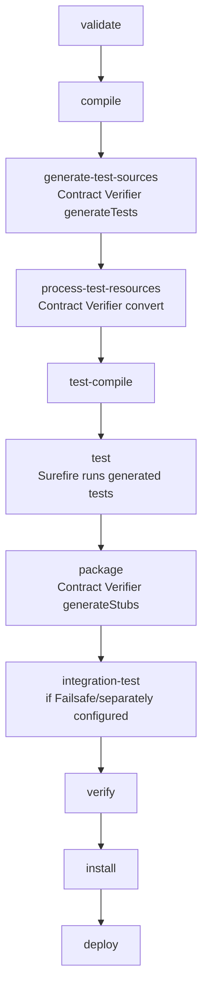
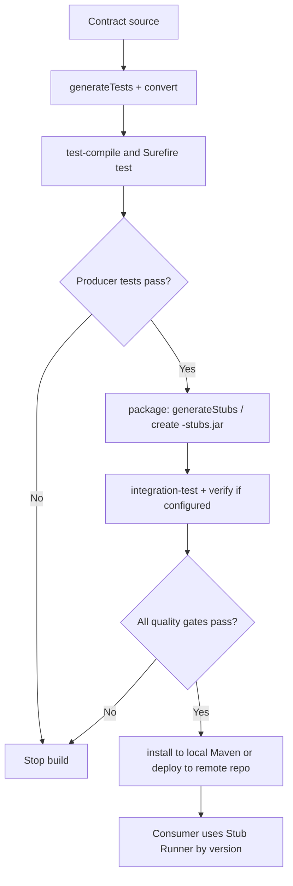
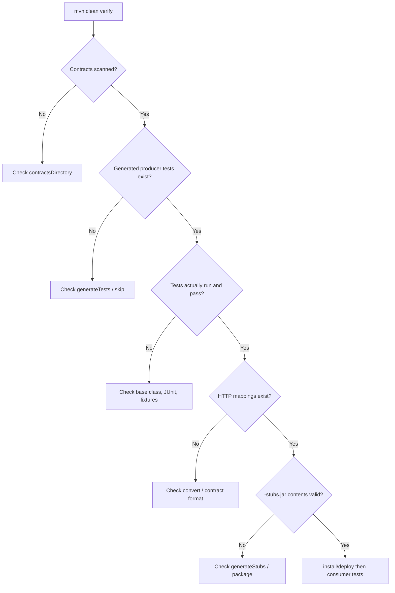

# Plugin Configuration, Dependencies, and Execution Order

## 1. Maven's role in the Spring Cloud Contract lifecycle

In the **SPRING_CLOUD_CONTRACT** module, we learn contract testing between a **producer** and a **consumer** using Groovy/YAML DSL for HTTP or messaging. Spring Cloud Contract can generate tests on the producer, convert HTTP contracts into WireMock mappings, package versioned stubs, and let the consumer use **Stub Runner**. When integrated into **Maven** and CI, that workflow must execute in the **right order** so that no stub is released before the producer satisfies it.

A project with a `pom.xml` declaring the plugin can still fail to verify anything if:

- Dependencies needed by generated producer tests or the test framework are missing.
- No Groovy/YAML files are found in the contracts directory.
- Generated tests lack a **base test class**, or the base test does not initialize the HTTP/message infrastructure.
- Only the source-generation goal is run **without executing the generated tests**.
- Stub packaging runs before contracts are converted into HTTP mappings.
- `-DskipTests`, the wrong test engine, or wrong naming makes the build green while contract tests never run.
- The installed/published artifact lacks the `stubs` classifier or uses the wrong version.

This lesson focuses on three closely coupled elements: the **Maven plugin**, **dependencies**, and **phase/goal execution order**. This is not just about writing an XML file; the goal is to know what capability each piece provides and what evidence proves the entire producer–consumer workflow actually works.

### After this lesson, you can

1. Distinguish `spring-cloud-contract-maven-plugin` from the `spring-cloud-starter-contract-verifier` and `spring-cloud-starter-contract-stub-runner` dependencies.
2. Pin consistent versions using the Spring Cloud Contract BOM and Maven plugin configuration.
3. Use `baseClassForTests`, `testFramework`, `testMode`, and the appropriate contracts root.
4. Explain how `generateTests`, `convert`, and `generateStubs` relate to the Maven lifecycle.
5. Run producer verification before `package`, `install`, or `deploy` of stubs.
6. Inspect generated test sources, Surefire reports, and `-stubs.jar` artifact contents.
7. Consume stubs on the consumer side via Stub Runner and diagnose build/CI failures.

## 2. Distinguishing the Maven plugin and dependencies

| Component | Type | Responsibility | Used in |
| --- | --- | --- | --- |
| `spring-cloud-contract-maven-plugin` | **Build plugin** | Reads DSL, generates producer tests, converts contracts to stubs, builds artifacts | Producer `build/plugins` |
| `spring-cloud-starter-contract-verifier` | **Test dependency** | Provides libraries required for generated contract tests and producer verification | Producer `dependencies`, `scope=test` |
| `spring-cloud-contract-dependencies` | **BOM** | Manages versions of Spring Cloud Contract modules as a compatible set | `dependencyManagement` |
| `spring-boot-starter-test` | **Test dependency** | JUnit/AssertJ, Spring Test, and Spring Boot test utilities | `dependencies`, `scope=test` |
| `spring-cloud-starter-contract-stub-runner` | **Test dependency** | Enables the consumer to fetch/run stubs, start WireMock, and/or integrate messaging | Consumer `dependencies`, `scope=test` |
| `maven-surefire-plugin` | **Test runner plugin** | Discovers and runs tests in the Maven `test` phase | `build/plugins` or managed by parent |
| `maven-failsafe-plugin` | **Integration-test runner** | Runs tests designated as integration tests during `integration-test`/`verify` | When the project **deliberately** splits test suites |

**Common mistake:** adding `spring-cloud-starter-contract-verifier` to dependencies without configuring the Maven plugin, expecting Groovy files to turn into JUnit tests automatically. A dependency only puts classes/libraries on the **classpath**; it does not create build goals. Conversely, the plugin can generate Java sources, yet without the dependency or test engine, tests will not compile or run.

### 2.1. Why don't producer and consumer share the same primary dependency?

The **producer** must run its own application to prove its status, headers, JSON body, or message output matches the contract; therefore it uses **Contract Verifier**.

The **consumer** needs to run its **real client/handler code** while simulating the external producer; therefore it uses **Stub Runner**. A typical consumer **does not need** to extend a producer base class or use the producer's verifier plugin just to send requests to a stub.

In a multi-module repository, these dependencies should be declared in the **exact module** with the corresponding role rather than added to every module in production scope.

### 2.2. A BOM does not install plugins automatically

Maven `dependencyManagement` manages dependency coordinates when those dependencies are declared; it **does not add dependencies by itself** and **does not configure build plugins**. In particular, the Maven plugin version must be specified or managed separately, usually via the same Spring Cloud Contract version property.

```text
Spring Boot parent/BOM  -> Spring Boot ecosystem versions
Spring Cloud Contract BOM -> Spring Cloud Contract dependency versions
spring-cloud-contract-maven-plugin -> Generator/packager, has its own plugin version
spring-cloud-starter-contract-verifier -> Producer test runtime
spring-cloud-starter-contract-stub-runner -> Consumer test runtime
```

## 3. Choosing compatible versions before configuring

Spring Boot, Spring Framework, the Spring Cloud release train, and Spring Cloud Contract follow a **compatibility matrix** per release line. Do not pick the newest version of one component at random and attach it to a project running an older release.

A clean way to manage versions in the producer's `pom.xml`:

```xml
<properties>
  <!-- MUST be replaced with a version compatible with the project's Spring Boot/Cloud. -->
  <spring-cloud-contract.version>REPLACE_WITH_COMPATIBLE_VERSION</spring-cloud-contract.version>
</properties>

<dependencyManagement>
  <dependencies>
    <dependency>
      <groupId>org.springframework.cloud</groupId>
      <artifactId>spring-cloud-contract-dependencies</artifactId>
      <version>${spring-cloud-contract.version}</version>
      <type>pom</type>
      <scope>import</scope>
    </dependency>
  </dependencies>
</dependencyManagement>
```

**Note:** `REPLACE_WITH_COMPATIBLE_VERSION` is a placeholder, **not a resolvable version**. When a Spring Boot parent/BOM and Spring Cloud BOM already manage the same group of dependencies, the team should check `effective-pom` and the dependency tree to avoid duplicate or incompatible BOM imports.

Official Spring Cloud Contract documentation may reference different versions depending on the guide branch. Always consult the **reference and plugin documentation for the exact chosen version**, especially when using Java 17+, JUnit 5, Spock, message binders, or servlet/reactive stacks.

### 3.1. Version management principles

- Use a **single supported Spring Cloud Contract version** for the plugin and BOM/test libraries.
- Do not scatter arbitrary versions across modules when a BOM already manages them.
- The Maven plugin is part of the **build toolchain**, so declare its version transparently.
- Pin the Maven Wrapper and JDK to match Boot/Spring Cloud Contract requirements.
- Upgrade Boot/Cloud/Contract together in a reviewed and tested change like a platform upgrade.
- Never place Contract Verifier or Stub Runner dependencies in production runtime scope just because tests use them.

## 4. Producer `pom.xml` example with JUnit 5 and MockMvc

Suppose the `orders-producer` application is a Spring MVC service exposing `GET /api/orders/{id}`. The project already has a compatible Spring Boot parent and dependency management. An **abbreviated configuration (you must add actual project/parent metadata)**:

```xml
<dependencies>
  <!-- Real HTTP controller of the producer. -->
  <dependency>
    <groupId>org.springframework.boot</groupId>
    <artifactId>spring-boot-starter-web</artifactId>
  </dependency>

  <!-- Spring Test + JUnit/AssertJ and Boot test utilities. -->
  <dependency>
    <groupId>org.springframework.boot</groupId>
    <artifactId>spring-boot-starter-test</artifactId>
    <scope>test</scope>
  </dependency>

  <!-- Dependency for executing generated producer contract tests. -->
  <dependency>
    <groupId>org.springframework.cloud</groupId>
    <artifactId>spring-cloud-starter-contract-verifier</artifactId>
    <scope>test</scope>
  </dependency>
</dependencies>

<build>
  <plugins>
    <plugin>
      <groupId>org.springframework.cloud</groupId>
      <artifactId>spring-cloud-contract-maven-plugin</artifactId>
      <version>${spring-cloud-contract.version}</version>
      <extensions>true</extensions>
      <configuration>
        <testFramework>JUNIT5</testFramework>
        <testMode>MOCKMVC</testMode>
        <baseClassForTests>com.example.orders.contract.ContractVerifierBase</baseClassForTests>
        <failOnNoContracts>true</failOnNoContracts>
      </configuration>
    </plugin>
  </plugins>
</build>
```

**Breakdown:**

| XML element | Reason |
| --- | --- |
| `spring-boot-starter-web` | Brings the real Spring MVC HTTP application onto the classpath |
| `spring-boot-starter-test` | Provides Spring Boot test/JUnit/MockMvc support |
| `spring-cloud-starter-contract-verifier` | Classes required by generated verification tests |
| `<version>${spring-cloud-contract.version}</version>` | Pins the Maven plugin version |
| `<extensions>true</extensions>` | Integrates the plugin into the Maven lifecycle per Spring Cloud Contract's mechanism |
| `<testFramework>JUNIT5</testFramework>` | Generates tests targeting JUnit 5 |
| `<testMode>MOCKMVC</testMode>` | Tests HTTP via MockMvc; fits servlet applications |
| `<baseClassForTests>...` | Points to the producer test base class containing required setup |
| `<failOnNoContracts>true</failOnNoContracts>` | Surfaces situations where no contracts are found when the goal supports it |

**Not a complete POM:** this snippet omits `groupId`, `artifactId`, `version`, Boot parent, repositories, compiler configuration, and persistence setup. `spring-cloud-contract.version` must be declared as shown in section 3; verify that your plugin version supports all illustrated options.

### 4.1. Why not use `testMode=MOCKMVC` for every technology?

`MOCKMVC` fits Spring MVC/servlet applications. If the producer uses Spring WebFlux, JAX-RS, or needs real HTTP calls to a running server, check the test modes supported by your **Spring Cloud Contract version**, such as `WEBTESTCLIENT` or `EXPLICIT`. The base class and client initialization must match the selected test mode. Picking the wrong mode causes generated tests to fail compilation or execution even when the Groovy contracts are valid.

## 5. Organizing source and contract directories

A Maven producer is typically organized as follows:

```text
orders-producer/
  pom.xml
  src/
    main/
      java/
        com/example/orders/
          OrdersApplication.java
          OrderController.java
          OrderService.java
    test/
      java/
        com/example/orders/contract/
          ContractVerifierBase.java
          OrderFixture.java
      resources/
        contracts/
          orders/
            get_order_success.groovy
            get_order_not_found.yml
          messaging/
            order_created_event.groovy
```

By default, the Maven plugin looks for contracts under `src/test/resources/contracts`. They are **test resources**, not production Java sources. Subdirectories like `orders` help the generator group scenarios, name generated classes, and can influence base-class selection strategies.

### 5.1. Changing the directory with `contractsDirectory`

When another location is needed:

```xml
<configuration>
  <contractsDirectory>
    ${project.basedir}/src/test/resources/contracts
  </contractsDirectory>
  <baseClassForTests>
    com.example.orders.contract.ContractVerifierBase
  </baseClassForTests>
</configuration>
```

This example explicitly sets the **default path** to illustrate the syntax. When changing the directory, verify that both `generateTests` and `convert` actually scan the intended contracts. Do not rely solely on `BUILD SUCCESS` logs; count the generated tests and HTTP mappings.

### 5.2. Do not read from paths guessed by workers

If contracts reside in a standalone JAR or Git repository, the plugin offers configuration options such as `contractDependency` or repository modes depending on the version. You must configure the **intended contract source** and check its version; do not merely change a local path and assume the plugin will find files in an external repository.

## 6. Two sample HTTP contracts

### 6.1. Success contract: Groovy DSL

File `src/test/resources/contracts/orders/get_order_success.groovy`:

```groovy
import org.springframework.cloud.contract.spec.Contract

Contract.make {
    name 'get_order_success'
    description 'Read an existing order'

    request {
        method GET()
        url '/api/orders/ord-1001'
    }

    response {
        status 200
        headers {
            contentType(applicationJson())
        }
        body([
            id    : 'ord-1001',
            status: 'CREATED'
        ])
    }
}
```

The producer test will send `GET /api/orders/ord-1001` and assert the response against the contract. **Fixture data** must ensure order `ord-1001` exists; if the data is not prepared, the producer may return `404` even though the API logic itself is correct.

### 6.2. Error contract: YAML DSL

File `src/test/resources/contracts/orders/get_order_not_found.yml`:

```yaml
name: get_order_not_found
description: Order not found
request:
  method: GET
  url: /api/orders/ord-missing
response:
  status: 404
  headers:
    Content-Type: application/json
  body:
    code: ORDER_NOT_FOUND
```

The producer test for this case needs a fixture ensuring `ord-missing` **does not exist**. The HTTP stub generated from this contract must return a `404` response with body `ORDER_NOT_FOUND`; do not confuse it with WireMock's default `404` when no mapping matches.

**Note:** you can organize both Groovy and YAML in one repository, but do not write **two contracts with identical request conditions** producing conflicting responses. Different filenames do not make WireMock magically distinguish the branches.

## 7. Base class for generated JUnit 5 tests

Contract Verifier generates **test code**, and does not automatically infer every fixture or how to bootstrap the application. With `testMode=MOCKMVC`, the producer can create a base class:

```java
package com.example.orders.contract;

import io.restassured.module.mockmvc.RestAssuredMockMvc;
import org.junit.jupiter.api.BeforeEach;
import org.springframework.beans.factory.annotation.Autowired;
import org.springframework.boot.test.autoconfigure.web.servlet.AutoConfigureMockMvc;
import org.springframework.boot.test.context.SpringBootTest;
import org.springframework.test.web.servlet.MockMvc;

@SpringBootTest
@AutoConfigureMockMvc
public abstract class ContractVerifierBase {

    @Autowired
    private MockMvc mockMvc;

    @Autowired
    private OrderFixture orderFixture;

    @BeforeEach
    protected void prepare() {
        orderFixture.resetTestData();
        orderFixture.createOrder("ord-1001", "CREATED");
        orderFixture.ensureMissing("ord-missing");
        RestAssuredMockMvc.mockMvc(mockMvc);
    }
}
```

`OrderFixture`, `resetTestData`, `createOrder`, and `ensureMissing` are **illustrative helpers implemented by the producer**, not built-in Spring Cloud Contract APIs. The `@BeforeEach` method uses `protected` visibility so generated test classes in other packages can still inherit the setup under JUnit 5 rules.

### 7.1. Requirements for the base test

- The test context must load the real `OrderController`/service.
- `RestAssuredMockMvc` must be configured before the generated test sends requests.
- Fixtures must be created/isolated **before each test**, independent of execution order.
- Avoid resetting a shared database if suites run in parallel.
- Do not mock the entire controller or hardcode response bodies just to "make tests pass"; doing so stops verifying producer behavior.
- If the producer uses messaging, appropriate triggers/message verifiers/binders are needed; a MockMvc base class does not handle message tests automatically.

### 7.2. Is one base class always enough?

For projects with `orders` HTTP, `payments` HTTP, and message events, you can use `baseClassMappings` to map contract groups to their respective base classes. `baseClassForTests` is only a shared/fallback option; when multiple transports require different setups, organize class mappings explicitly.

Conceptual example:

```xml
<baseClassMappings>
  <baseClassMapping>
    <contractPackageRegex>.*orders.*</contractPackageRegex>
    <baseClassFQN>com.example.orders.contract.OrdersHttpBase</baseClassFQN>
  </baseClassMapping>
  <baseClassMapping>
    <contractPackageRegex>.*messaging.*</contractPackageRegex>
    <baseClassFQN>com.example.orders.contract.OrdersMessagingBase</baseClassFQN>
  </baseClassMapping>
</baseClassMappings>
```

**Illustration:** the actual regex must be tested against the **contract package computed by the generator**; avoid overly broad regexes that accidentally match unintended groups. Referenced classes must exist on the test classpath. With multiple mappings, inspect the actual generated sources to verify the right `extends` base class.

## 8. Maven lifecycle: how does a phase differ from a goal?

Maven has **lifecycle phases** such as `generate-test-sources`, `test`, `package`, and `verify`. A **plugin goal** is a concrete task bound by Maven to a phase or invoked directly from the command line.

For example:

```bash
./mvnw -B spring-cloud-contract:generateTests
```

This command requests running **a single goal** that generates producer tests. It **does not mean** Maven has run `test`, `package`, or `verify`.

By contrast:

```bash
./mvnw -B clean verify
```

instructs Maven to execute the default lifecycle phases up to **`verify`** (after `clean`). If the plugin and test runner are configured properly, the goals bound to the lifecycle get executed in order.

### 8.1. Main phase sequence diagram



In this diagram, the boxes highlight **key milestones** without listing every intermediate phase. For instance, `generate-test-sources` runs after `compile` in the default lifecycle, and `process-test-resources` runs after generating/processing test sources. Each plugin goal only runs if it is **bound** to the lifecycle or invoked directly; `maven-surefire-plugin`/`maven-failsafe-plugin` must have proper test discovery configuration.

### 8.2. Goal table of the Spring Cloud Contract Maven plugin

| Goal | Default lifecycle phase per plugin documentation | What it does |
| --- | --- | --- |
| `spring-cloud-contract:generateTests` | `generate-test-sources` | Generates producer verification source from contracts |
| `spring-cloud-contract:convert` | `process-test-resources` | Converts HTTP contracts into WireMock mappings |
| `spring-cloud-contract:generateStubs` | `package` | Packages mappings and required contracts into a stub JAR |
| `spring-cloud-contract:run` | Not used as a default producer verification step | Serves stubs for testing in an appropriate environment |

**Required dependency:** `generateStubs` relies on output from `convert`. The plugin goal documentation explicitly states that `convert` must run before `generateStubs` so HTTP mappings are available for packaging.

**Verification relationship:** `generateTests` only generates source code; the tests must then be **compiled and executed** by the Maven test engine. Completing `convert` does not replace producer verification.

## 9. Distinguishing common Maven commands

| Command | Primary outcome | What remains unproven |
| --- | --- | --- |
| `./mvnw spring-cloud-contract:generateTests` | Generated source may be created | Tests compiled/executed |
| `./mvnw spring-cloud-contract:convert` | HTTP stub mappings may be created | Real producer returns matching responses |
| `./mvnw spring-cloud-contract:generateStubs` | Stub JAR may be built if convert output exists | Producer verification ran and passed |
| `./mvnw clean test` | Builds through `test`, typically running generated tests via Surefire | Stub JAR packaged or published |
| `./mvnw clean verify` | Runs lifecycle through `verify` as configured, including `package` | Artifact installed/deployed |
| `./mvnw clean install` | Runs lifecycle through `install` and puts artifacts in local repo | Artifact published to remote repository |
| `./mvnw clean deploy` | Runs lifecycle through `deploy` per repository config | All consumer versions are compatible |

Each description assumes the plugin and test lifecycle are **configured properly**. Maven reporting `BUILD SUCCESS` alone is not enough to conclude generated tests ran: contracts may be missing, tests may be skipped, classes may not be discovered, or Surefire/Failsafe may ignore generated tests.

### 9.1. Recommended commands during producer development

```bash
# Development: rebuild and run all tests up to verify.
./mvnw -B clean verify

# When creating artifacts for consumers on a dev machine.
./mvnw -B clean install
```

`clean` removes old build output before Maven steps through the phases, avoiding confusion from stale generated sources or mappings from a previous run. `install` only puts artifacts into the **local Maven repository**; it does not publish to Nexus/Artifactory.

### 9.2. Running individual goals for diagnostics

```bash
# Generate test code to inspect DSL, package, or extends issues.
./mvnw -B spring-cloud-contract:generateTests

# Convert DSL into HTTP mappings.
./mvnw -B spring-cloud-contract:convert

# Package stubs from convert output; does not imply tests ran.
./mvnw -B spring-cloud-contract:generateStubs
```

Running goals individually is useful when troubleshooting, but **do not use a chain of isolated goals as a release pipeline** skipping `test` and `verify`. Starting from a clean state, the `convert` → `generateStubs` order is necessary for HTTP stub packaging, while proof of producer correctness must come from executing generated tests.

### 9.3. Commands to run tests differ from commands to run the application

`mvn spring-boot:run` starts the application; it **does not verify contracts automatically**. `mvn spring-cloud-contract:run` serves stubs; it **does not perform producer verification**. `mvn verify` is the build lifecycle phase intended for verification checks, provided generated tests reside in test sources read by the test runner.

## 10. Where are generated test sources and reports placed?

In a typical Maven plugin setup:

```text
orders-producer/
  target/
    generated-test-sources/
      contracts/
        ... generated JUnit verification sources ...
    generated-test-resources/
      contracts/
        ... resources for generated tests ...
    surefire-reports/
      ... test phase reports ...
    stubs/
      META-INF/
        com.example/
          orders-producer/
            1.4.2/
              contracts/
              mappings/
    orders-producer-1.4.2-stubs.jar
```

This is a **typical layout**, not a guarantee that every plugin version uses the exact same generated class names, JSON filenames, or staging directories. `generatedTestSourcesDir` and other options can adjust paths. Consult build logs and documentation for your exact plugin version.

### 10.1. Checking three distinct outputs

1. **Generated source**: is there a Java test class with methods verifying scenarios like `get_order_success` or `get_order_not_found`?
2. **Test report**: did Surefire **execute** those methods, and how many passed/failed/skipped?
3. **Stub artifact**: does the JAR contain the contracts and HTTP mappings for the right API and version?

If only item 1 exists, the pipeline only generated code. If items 1 and 3 exist with **0 tests executed**, the producer has not been proven contract-compliant. If tests pass but the JAR lacks mappings, the consumer still has no HTTP stub to use.

### 10.2. Artifact structure

A stub artifact with coordinates:

```text
com.example:orders-producer:1.4.2:stubs
```

typically contains resources similar to:

```text
META-INF/com.example/orders-producer/1.4.2/contracts/orders/get_order_success.groovy
META-INF/com.example/orders-producer/1.4.2/contracts/orders/get_order_not_found.yml
META-INF/com.example/orders-producer/1.4.2/mappings/orders/<generated-http-mapping>.json
```

`<generated-http-mapping>` is a placeholder: the converter determines the real filename. A messaging contract may appear under `contracts` without a corresponding WireMock HTTP mapping; **do not count all HTTP + message contracts and expect the JSON file count to match the total**.

### 10.3. Inspecting the JAR to verify

```bash
jar tf target/orders-producer-1.4.2-stubs.jar
```

Verify the generated JAR against `groupId`/`artifactId`/`version` and the **`stubs` classifier**. A `-stubs.jar` filename alone does not prove it contains valid mappings, and a `target/stubs` directory does not prove the artifact was published.

## 11. Surefire, Failsafe, and the risk of skipping tests

### 11.1. Surefire handles the test phase by default

For JUnit 5 generated tests whose class names match test discovery conventions, Maven Surefire normally executes them in the `test` phase. A Spring Boot parent project may already manage a compatible Surefire version, though this should still be confirmed in practice.

A configuration to increase clarity:

```xml
<plugin>
  <groupId>org.apache.maven.plugins</groupId>
  <artifactId>maven-surefire-plugin</artifactId>
  <configuration>
    <failIfNoTests>true</failIfNoTests>
  </configuration>
</plugin>
```

`failIfNoTests` can catch situations where **zero tests run** in a module. However, if 20 unit tests run and **0 contract tests** are discovered, this rule will still pass the build. Therefore, confirm that **at least the expected generated contract classes/cases appear in the report**.

### 11.2. `-DskipTests` and `-Dmaven.test.skip=true`

```bash
# Examples to RECOGNIZE misconfiguration; do not use in a contract verification gate.
./mvnw -B clean verify -DskipTests
./mvnw -B clean verify -Dmaven.test.skip=true
```

`-DskipTests` typically skips test execution, while `-Dmaven.test.skip=true` can skip both test compilation and execution depending on build/plugin configuration. These flags may be useful for special packaging operations, **but they produce no evidence of producer verification**. Also watch for plugin-specific skip flags like `spring.cloud.contract.verifier.skip`.

### 11.3. When using Failsafe

If the team wants to move producer contract tests into an integration-test suite, you may need:

- Generated test naming / `nameSuffixForTests` matching Failsafe conventions (usually `*IT`).
- `maven-failsafe-plugin` configured to run `integration-test` and `verify`.
- Guarantees that generated tests **are not dropped** between Surefire and Failsafe.
- Guarantees that stubs **are not deployed if integration tests fail**, since the `package` phase runs **before** `integration-test`; the artifact created during `package` is not yet cleared for release.

Abbreviated Failsafe configuration example:

```xml
<plugin>
  <groupId>org.apache.maven.plugins</groupId>
  <artifactId>maven-failsafe-plugin</artifactId>
  <executions>
    <execution>
      <goals>
        <goal>integration-test</goal>
        <goal>verify</goal>
      </goals>
    </execution>
  </executions>
</plugin>
```

This alone is **not enough** to shift all generated tests to Failsafe: naming conventions, test includes, the test engine, and source directories must all align. Do not just add the plugin and assume producer contract verification happened.

## 12. Relationship between `package`, `verify`, `install`, and `deploy`

This is one of the most common points of confusion when publishing stubs:



- **`package`**: builds the artifacts. Normal Maven flow passes through `test` beforehand, though tests could still be skipped or additional verification might run later in Failsafe.
- **`verify`**: executes checks configured up to this phase, including Failsafe `verify` when present.
- **`install`**: installs artifacts into the local Maven repository after running preceding phases.
- **`deploy`**: publishes to a remote repository after running preceding phases, requiring proper distribution management and credentials.

**Operational takeaway:** the stub JAR file may be created during `package`, **but it should only be released after all required producer checks pass**. Never invoke `deploy:deploy-file` directly on an unverified JAR and treat it as a valid contract release.

### 12.1. Why not overwrite release versions?

Consumer CI must be able to fetch the exact same stub it used yesterday. If release `1.4.2` is overwritten with new mappings:

- Machine A holds the old cached artifact, while Machine B downloads the new one.
- The same consumer commit produces two different outcomes.
- Investigating compatibility becomes non-reproducible.

Use immutable release versions or transparent SNAPSHOT management, and pin versions in consumer tests intended for release verification.

## 13. Configuring consumer Maven to run published stubs

A consumer does not need to run the producer's verifier plugin. It needs the Stub Runner **test dependency** and **real client code** under test.

Example dependencies in `checkout-consumer`'s `pom.xml`:

```xml
<dependencies>
  <dependency>
    <groupId>org.springframework.boot</groupId>
    <artifactId>spring-boot-starter-test</artifactId>
    <scope>test</scope>
  </dependency>
  <dependency>
    <groupId>org.springframework.cloud</groupId>
    <artifactId>spring-cloud-starter-contract-stub-runner</artifactId>
    <scope>test</scope>
  </dependency>
</dependencies>
```

The consumer must also use compatible dependency management; the example above assumes a BOM/parent already manages versions. `scope=test` keeps Stub Runner tooling out of production runtime.

### 13.1. Illustrative Stub Runner test

```java
import org.junit.jupiter.api.Test;
import org.springframework.beans.factory.annotation.Autowired;
import org.springframework.boot.test.context.SpringBootTest;
import org.springframework.cloud.contract.stubrunner.StubRunnerProperties;
import org.springframework.cloud.contract.stubrunner.spring.AutoConfigureStubRunner;

import static org.assertj.core.api.Assertions.assertThat;

@SpringBootTest(properties = {
    "clients.orders.base-url=http://localhost:8090"
})
@AutoConfigureStubRunner(
    ids = "com.example:orders-producer:1.4.2:stubs:8090",
    stubsMode = StubRunnerProperties.StubsMode.LOCAL
)
class CheckoutConsumerContractTest {

    @Autowired
    private CheckoutService checkoutService;

    @Test
    void mapsCreatedOrderToPayableView() {
        CheckoutView view = checkoutService.load("ord-1001");

        assertThat(view.orderId()).isEqualTo("ord-1001");
        assertThat(view.canPay()).isTrue();
    }
}
```

`CheckoutService`/`CheckoutView` are **illustrative components implemented by the consumer**, not built-in Spring Cloud Contract APIs. The test is meaningful if `checkoutService` actually routes through an HTTP client pointing to the stub; **do not mock the HTTP client itself** when the goal is verifying integration with the producer's API.

### 13.2. `LOCAL`/`REMOTE`/`CLASSPATH` depend on artifact source

| Mode | Where stubs are located | Best suited for |
| --- | --- | --- |
| `LOCAL` | Local Maven repository, usually `~/.m2/repository` | Developers who ran `mvn install` for the stub |
| `REMOTE` | Configured Maven repository | CI fetching releases from Nexus/Artifactory |
| `CLASSPATH` | Stub resources available on the test classpath | Projects bundling/attaching stubs directly |

A consumer configured with `LOCAL` running on a clean CI runner without the stub JAR will fail resolving the artifact—not because of a Groovy DSL error. In CI, prefer `REMOTE` pointing to an authorized repository, or install the built artifact into the local repo within the same job.

### 13.3. The port is not part of the artifact

The string `com.example:orders-producer:1.4.2:stubs:8090` includes the **runtime** WireMock port, whereas the artifact stored in the repository has coordinates `com.example:orders-producer:1.4.2:stubs`. When multiple suites run concurrently, a hardcoded port `8090` can collide; consider dynamic ports and `StubFinder`.

## 14. Multi-module Maven projects: building and publishing the right components

Suppose:

```text
platform/
  pom.xml                   <- aggregator/parent
  orders-producer/pom.xml
  checkout-consumer/pom.xml
```

In an aggregator setup, distinguish:

- `<dependencyManagement>` manages dependency versions for modules.
- `<pluginManagement>` **manages plugin configuration**, but does not by itself cause the plugin to run in every module unless applied appropriately.
- `<build><plugins>` applies the plugin to a module/lifecycle per Maven inheritance and explicit config.
- `orders-producer` is the module needing the plugin to generate producer tests and stubs.
- `checkout-consumer` is the module needing Stub Runner tests; it does not necessarily need the Contract Verifier plugin.

Example building only the producer:

```bash
./mvnw -B -pl orders-producer -am clean verify
```

`-pl` selects the module, and `-am` includes dependent reactor modules if needed. This command does not install stubs into the local repository for a consumer job running **outside the reactor**; if the consumer later uses `LOCAL`, a matching `install` step is required, or else publish and use `REMOTE`.

### 14.1. Conditions for a multi-module pipeline

- Build the producer and verify tests first.
- Build/install/publish the `-stubs.jar` artifact with exact coordinates.
- Run consumer tests against the **newly verified stub version**.
- Prevent consumer tests from picking up a stale cached version from the Maven dependency cache.
- If producer and consumer build in parallel, enforce an explicit dependency: the consumer waits for the candidate stub rather than trying to download before publication completes.
- Do not attach the verifier plugin to every module just because it was declared in the parent without checking each module's role.

## 15. Troubleshooting plugins, dependencies, and lifecycle

| Symptom | Common cause | Check and resolution |
| --- | --- | --- |
| Maven cannot find goal/plugin | Missing plugin or wrong version/repository | Check `pom.xml`, plugin repositories, and invoke using FQ plugin coordinates |
| No generated tests | Wrong contracts root, files not scanned, or goal skipped | Check `contractsDirectory`, `generateTests`, and file count |
| Generated Java fails to compile | Missing test dependency, imports, or wrong framework version | Check BOM, test classpath, JUnit/Surefire |
| `Cannot find symbol ContractVerifierBase` | Wrong FQCN, base class missing from test sources | Check `baseClassForTests` and package declaration |
| `NoClassDefFoundError` in Rest Assured MockMvc | Missing/incompatible HTTP test module | Check verifier dependency, test mode, and dependency tree |
| Generated test fails with `404` instead of `200` | Fixture `ord-1001` not created | Check base test setup and test database |
| `BUILD SUCCESS` with 0 contract tests | Tests skipped, wrong naming, generated sources not added | Check test reports and generated classes |
| `convert` generates 0 mappings | No HTTP contracts or wrong source/filter config | Check input contracts and contract types |
| `generateStubs` runs but JAR lacks HTTP mappings | `convert` didn't run or stale/wrong directory used | Run full lifecycle, inspect JAR via `jar tf` |
| Consumer `LOCAL` cannot resolve artifact | Stub with matching version/classifier not installed | Check local Maven repo and `-stubs.jar` |
| Consumer `REMOTE` gets `401/403` | Missing repository credentials/permissions | Check CI secrets and repository access |
| Stub HTTP returns `404` no-match | Wrong URL/method/header/body or missing mapping | Inspect WireMock mapping/request journal |
| Green CI, yet consumer fails on upgrade | Consumer tested against old cached stub | Pin exact candidate artifact and run compatibility tests |
| Project runs unit tests but skips Failsafe | Integration tests not properly bound | Check Failsafe `integration-test`/`verify` |

### 15.1. Systematic verification sequence



### 15.2. Inspecting the effective POM

When a project inherits multiple parents, BOMs, or `pluginManagement` blocks, the configuration seen in a module may differ from what you expect. You can use:

```bash
./mvnw -B help:effective-pom
./mvnw -B dependency:tree
```

These are **reference commands**, not executed within the scope of writing this lesson. `effective-pom` shows the merged configuration after Maven inheritance; `dependency:tree` helps spot version conflicts in test dependencies. To inspect plugin parameters:

```bash
./mvnw -B spring-cloud-contract:help -Ddetail=true -Dgoal=generateTests
```

If invoking a goal by prefix fails to resolve, use the full plugin coordinates with a compatible version or check plugin groups/repositories; do not immediately assume the Groovy DSL is broken.

## 16. CI: a reliable build order

A pipeline can be divided into steps with **concrete evidence**:

| Step | Action | Passing criteria |
| --- | --- | --- |
| 1. Version/setup | Pin JDK, Maven Wrapper, Boot/Cloud/Contract versions | Dependencies and plugin resolve cleanly |
| 2. Contract discovery | Read Groovy/YAML under contracts root | All contracts for protected branches are present |
| 3. Generate tests | `generateTests` | Generated producer tests have valid sources |
| 4. Producer verification | `test` or appropriate suite | Tests **executed** and passed |
| 5. Convert mappings | `convert` | HTTP mappings match requests/responses |
| 6. Package stub | `generateStubs` in `package` | JAR contains contracts/mappings and right classifier |
| 7. Verify | `verify`, including integration gates if any | Zero test or quality gate failures |
| 8. Install/deploy | Install or publish versioned stub | Repository holds exact immutable artifact |
| 9. Consumer tests | Stub Runner uses candidate artifact | Consumer client/handler handles branches properly |

A minimal pipeline for a properly configured producer might use:

```bash
# Producer gate; block publish if this step fails.
./mvnw -B clean verify

# After all quality gates pass and CI policy permits:
./mvnw -B deploy
```

Note: `deploy` runs preceding phases in a **new invocation**, so the example above may **re-run tests**. In real CI, you can run a single `./mvnw -B clean deploy` if quality gates are properly bound to the Maven lifecycle, or split jobs with strict artifact provenance and release gates. Do not silently skip tests between `verify` and `deploy` to save time unless a strict provenance process guarantees the published artifact is the **exact verified artifact**.

### 16.1. Two-job variant with immutable artifacts

```text
Job A (producer validation)
  -> checkout commit/branch
  -> mvnw clean verify
  -> verify tests pass, generated mappings, and stub jar
  -> store JAR + checksum + build metadata as CI artifact

Job B (publish + consumer compatibility)
  -> receive exact JAR artifact from Job A
  -> verify checksum/provenance
  -> publish per policy
  -> consumer tests download exact version via Stub Runner
```

If Job B runs standard Maven `deploy`, it may rebuild the module; discrepancies must be controlled. Only use a "publish pre-verified artifact" pattern if the organization enforces strict provenance checks. Never mix a JAR from a new build with test reports from a different build.

### 16.2. What to log to detect false-green CI?

- JDK, Maven, and Spring Cloud Contract plugin versions.
- Contracts root, count/paths of scanned contracts.
- Generated test classes and counts of tests run/passed/failed/skipped.
- Output mapping location and count of critical HTTP scenarios.
- Stub artifact name, classifier, version, and checksum.
- Coordinates of the stub downloaded by consumer tests.
- HTTP/messaging branches verified by the consumer.

If `0 tests run` or a critical branch has no mapping, never mark the build as "contract verified" just because Maven exited with code 0.

## 17. Out-of-order pitfalls to recognize

### Scenario A: generate JUnit sources and publish immediately

```text
mvn spring-cloud-contract:generateTests
-> Maven creates Java files
-> Author concludes "Contract tests pass"
-> Stub published without running tests
```

**Wrong:** generated source is only generated code; the real producer has not been verified. Run `test`/`verify` and inspect the report.

### Scenario B: package stubs before converting

```text
mvn spring-cloud-contract:generateStubs
-> convert was never run
-> JAR is empty/missing mappings or uses stale staging output
```

**Wrong:** `generateStubs` needs `convert` output. In a normal build, use the proper plugin lifecycle to convert and then package.

### Scenario C: skip tests for a faster build

```text
mvn clean deploy -DskipTests
-> New stub published
-> No proof that producer version matches contracts
```

**Wrong:** building an artifact does not equal producer verification. Enforce mandatory verification gates before publishing in release pipelines.

### Scenario D: consumer uses the wrong artifact version

```text
Producer candidate: 1.4.3
Consumer Stub Runner IDs: com.example:orders-producer:1.4.2:stubs:8090
Consumer tests pass against old responses
```

**Wrong:** the consumer has not been tested against the incoming change. Test against candidate `1.4.3`, and add an old/new version matrix if rolling upgrades are required.

### Scenario E: seeing the JAR and assuming completion

```text
target/orders-producer-1.4.2-stubs.jar exists
Maven reports: Tests run: 0
```

**Wrong:** the existence of a JAR does not prove producer behavior. Confirm contracts were scanned, generated tests ran, assertions passed, and HTTP mappings are accurate.

## 18. Hands-on exercise: completing the Maven pipeline for Orders Producer

### 18.1. Context

The team is building a producer:

```text
groupId    = com.example
artifactId = orders-producer
version    = 1.4.2
language   = Java
HTTP stack = Spring MVC
test       = JUnit 5 + MockMvc
```

Contracts to protect:

| Contract | Request | Producer fixture | Expected response |
| --- | --- | --- | --- |
| `get_order_success.groovy` | `GET /api/orders/ord-1001` | `ord-1001` exists | `200`, status `CREATED` |
| `get_order_not_found.yml` | `GET /api/orders/ord-missing` | ID absent | `404 ORDER_NOT_FOUND` |
| `create_order_success.groovy` | `POST /api/orders` with quantity `2` | SKU in stock | `201`, new order ID |
| `create_order_out_of_stock.groovy` | `POST /api/orders` with out-of-stock SKU | SKU exists, stock `0` | `409 OUT_OF_STOCK` |

### 18.2. Tasks

1. Configure the BOM and `spring-cloud-contract-maven-plugin` with versions compatible with Spring Boot/Cloud.
2. Add `spring-cloud-starter-contract-verifier` with `scope=test` and required Spring Boot test dependencies.
3. Choose `testFramework=JUNIT5`, `testMode=MOCKMVC`, and set `baseClassForTests` to your team's test base class.
4. Place the four Groovy/YAML contracts under `src/test/resources/contracts/orders/`.
5. Prepare fixtures for success, not-found, and out-of-stock branches accurately.
6. Run `generateTests` standalone and inspect generated classes, methods, and `extends`.
7. Run `./mvnw -B clean verify` and record tests run/passed/failed/skipped in Surefire.
8. Inspect HTTP mappings created by `convert`; verify request matchers do not accidentally match the wrong branch.
9. Open `-stubs.jar` with `jar tf` and confirm `contracts`/`mappings` match the version.
10. Install into the local Maven repository and run consumer tests using Stub Runner `LOCAL`.
11. Change the fixture so `ord-1001` is missing and check that the generated success test fails as expected; restore the fixture.
12. Deliberately run `clean verify -DskipTests` and observe why its output cannot be used as release proof.

### 18.3. Record table

| Question | Result to be filled by learner |
| --- | --- |
| Actual contracts root | ... |
| Generated test classes | ... |
| Executed generated tests | ... |
| Tests pass/fail/skip count | ... |
| HTTP scenarios with mappings | ... |
| Stub JAR path + classifier | ... |
| GAV version loaded by consumer | ... |
| Does consumer handle `201` and `409` properly? | ... |

### 18.4. Self-check questions

**Q1.** Why doesn't `spring-cloud-starter-contract-verifier` replace `spring-cloud-contract-maven-plugin`?

**Answer:** The starter provides **test dependencies**, while the plugin executes **build goals** such as source generation, conversion, and stub packaging.

**Q2.** Does a successful `generateTests` run prove the producer returns `200` and `404` properly?

**Answer:** No. You must **compile and run the generated tests** with proper fixtures, then check assertions and reports.

**Q3.** Why does `generateStubs` require `convert` first?

**Answer:** `convert` produces HTTP WireMock mappings from contracts; `generateStubs` takes that converted output to package the stub JAR.

**Q4.** Does `mvn package` always prove every contract integration test passed?

**Answer:** Not necessarily. If tests were skipped, not discovered, or integration tests only run via Failsafe in `integration-test`/`verify`, `package` alone provides incomplete verification evidence.

**Q5.** What is the difference between `install` and `deploy`?

**Answer:** `install` places artifacts into the **local Maven repository**; `deploy` publishes them to a configured **remote repository**.

**Q6.** If the consumer uses `LOCAL` and the CI machine does not yet have `-stubs.jar`, what must be done?

**Answer:** Install the artifact with the exact coordinates into the local repository during the job, or switch to `REMOTE` with a configured repository and version.

**Q7.** If Surefire runs 15 unit tests but 0 generated contract tests, is `failIfNoTests=true` enough to fail the build?

**Answer:** No. You must check for the presence and execution of the specific **generated contract test cases**; a total test count greater than 0 is no guarantee.

## 19. Maven configuration checklist before publishing stubs

- [ ] Compatible Spring Boot, Spring Cloud Contract, and JDK/Maven versions are confirmed.
- [ ] `spring-cloud-contract-dependencies` BOM manages test library versions, or the project has equivalent dependency management.
- [ ] `spring-cloud-contract-maven-plugin` is configured in the producer module's build plugins with an explicit version.
- [ ] `spring-cloud-starter-contract-verifier` is declared in `test` scope.
- [ ] Test dependencies exist for JUnit 5/Spring Test and the chosen HTTP/message stack.
- [ ] `testFramework` and `testMode` match the producer's test infrastructure.
- [ ] `baseClassForTests`/`baseClassMappings` point to existing base classes that configure fixtures properly.
- [ ] Contracts root is accurate; Groovy/YAML files are fully scanned by the plugin.
- [ ] `generateTests` produces Java sources with the expected packages and methods.
- [ ] Surefire/Failsafe **actually runs** generated producer tests with none skipped.
- [ ] `convert` generates mappings for all protected HTTP branches.
- [ ] `generateStubs` runs after conversion and creates the `stubs` classifier.
- [ ] JAR contents have been inspected, not just filenames or staging directories.
- [ ] CI does not treat `package` as sufficient when integration gates remain in `verify`.
- [ ] No skip flags or test discovery bugs allow a false-green release.
- [ ] Artifacts are installed/deployed **after verification passes** with immutable versions.
- [ ] Consumer uses Stub Runner with the exact new artifact/version and asserts against real consumer code.
- [ ] Test reports record generated contract test counts, pass/fail/skip counts, mappings, and artifact coordinates.

### References

- [Spring Cloud Contract — Maven Project](https://docs.spring.io/spring-cloud-contract/reference/maven-project.html): BOM, Maven plugin, contracts root, base tests, and generated sources.
- [Spring Cloud Contract Maven Plugin — Goals](https://docs.spring.io/spring-cloud-contract/docs/current/spring-cloud-contract-maven-plugin/plugin-info.html): roles of `generateTests`, `convert`, and `generateStubs`.
- [Spring Cloud Contract Maven Plugin — generateTests](https://docs.spring.io/spring-cloud-contract/docs/current/spring-cloud-contract-maven-plugin/generateTests-mojo.html): parameters and default phase.
- [Spring Cloud Contract Maven Plugin — convert](https://docs.spring.io/spring-cloud-contract/docs/current/spring-cloud-contract-maven-plugin/convert-mojo.html): contract sources and HTTP mapping output.
- [Spring Cloud Contract Maven Plugin — generateStubs](https://docs.spring.io/spring-cloud-contract/docs/current/spring-cloud-contract-maven-plugin/generateStubs-mojo.html): packaging, classifier, and conversion prerequisites.
- [Apache Maven — Introduction to the Build Lifecycle](https://maven.apache.org/guides/introduction/introduction-to-the-lifecycle.html): phases, goals, `verify`, `install`, and `deploy`.
- [Maven Surefire Plugin](https://maven.apache.org/surefire/maven-surefire-plugin/): running tests in the `test` phase.
- [Maven Failsafe Plugin](https://maven.apache.org/surefire/maven-failsafe-plugin/): handling `integration-test`/`verify` per configuration.

**Key takeaway:** The Maven plugin **generates tests and packages stubs**, test dependencies provide the **libraries to run verification**, and the Maven lifecycle enforces **execution order**. `generateTests` is not `test`; `convert` must precede `generateStubs`; `package` does not mean all checks are complete; and `install/deploy` should happen only after **producer verification actually passes**. Only then can a versioned stub serve as reliable input for consumer tests via Stub Runner and CI.
