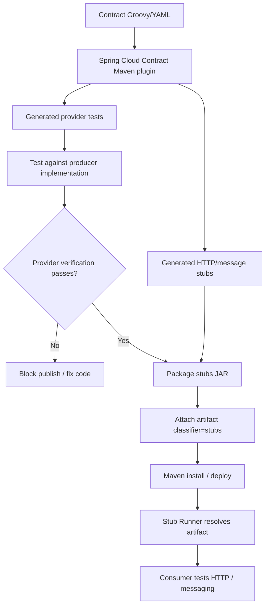
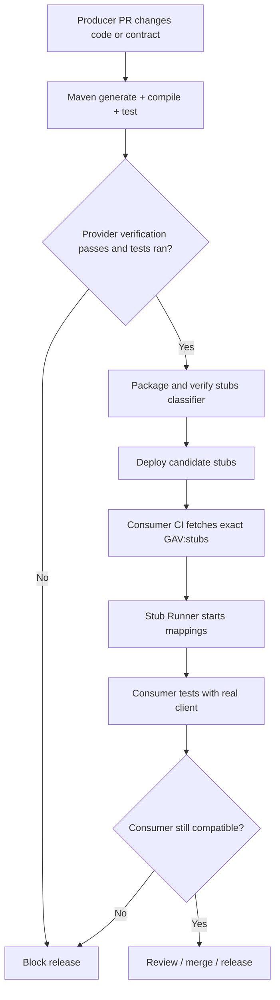

# Attaching the Stubs Artifact and Classifier in Spring Cloud Contract with Maven

In **Spring Cloud Contract (SCC)**, the producer describes HTTP or messaging interfaces using **Groovy/YAML DSL**, generates tests to verify its implementation, and publishes **stubs** so consumers can test integration with **Stub Runner**. When using **Maven**, the question is not only "how do we generate stubs?" but also **"which artifact packages the stubs, how does Maven identify it, and how does the consumer fetch that exact build?"**

That is the role of an **attached artifact** and **classifier**. An `order-producer` project can publish two JARs under the same version: the application JAR to run the service, and a **stubs JAR** containing WireMock mappings/message stubs for consumer testing. Maven distinguishes them via the `stubs` classifier. If packaged properly yet not **attached**, **installed**, or **deployed**, consumers still cannot resolve the stubs; if attached with the wrong classifier, Stub Runner may fail to find the artifact or silently fetch an older version.

This lesson in the **Maven Integration** chapter focuses on **attaching the stubs artifact and classifier**: core concepts, Maven plugin configuration, relationship to the `verify → install → deploy` lifecycle, inspecting JARs and repositories, how Stub Runner uses artifact coordinates, version risks in CI, and hands-on compatibility checks. The running example uses `order-producer` serving `GET /api/orders/1001` to `checkout-consumer`.

## 1. Learning objectives and big picture

After this lesson, you should be able to:

1. Distinguish **main artifact**, **stubs artifact**, and **test artifact** in Maven.
2. Explain the meaning of `groupId`, `artifactId`, `version`, `type/extension`, and `classifier`.
3. Understand that **attaching** registers a secondary artifact on the same Maven project rather than copying files into the application JAR.
4. Explain the role of `spring-cloud-contract-maven-plugin` in generating tests and stubs.
5. Verify that a real stubs JAR exists, contains matching mappings, and is installed/deployed by Maven with the exact coordinates.
6. Configure Stub Runner `LOCAL` or `REMOTE` so consumers use the `stubs` classifier properly.
7. Design CI pipelines that publish candidate stubs only after provider verification passes.
8. Diagnose "artifact not found," wrong classifier, stale version, and empty JAR issues.

Flow to remember:



The diagram depicts the **intended quality-control sequence**. Whether the plugin binds goals automatically in a specific version must be verified via **effective POM, Maven logs, and final artifacts**. A successfully built JAR does not prove every provider test executed.

## 2. Maven coordinates: what determines which artifact gets selected

A Maven artifact is identified by its key fields:

| Component | Example | Meaning |
| --- | --- | --- |
| `groupId` | `com.example` | Group owning the artifact |
| `artifactId` | `order-producer` | Project/package identifier |
| `version` | `1.4.0` | Specific version of producer and contracts |
| `type` / extension | `jar` | Content packaging type resolved |
| `classifier` | `stubs` | Artifact variant under the **same** GAV |

**GAV** stands for `groupId:artifactId:version`. When multiple JAR variants share the same GAV, Maven uses **classifier** to distinguish them.

Example:

```text
GAV = com.example:order-producer:1.4.0

Main artifact:
  com.example:order-producer:1.4.0
  file: order-producer-1.4.0.jar

Attached stubs artifact:
  com.example:order-producer:1.4.0:jar:stubs
  file: order-producer-1.4.0-stubs.jar

Optional test JAR:
  com.example:order-producer:1.4.0:jar:tests
  file: order-producer-1.4.0-tests.jar
```

Above, the `groupId:artifactId:version:type:classifier` ordering follows standard Maven dependency tooling notation. **Stub Runner `ids` uses its own syntax with an optional trailing port**, covered later. Do not copy coordinates verbatim from one tool to another without checking format.

### 2.1. A classifier is a variant label, not a version

`stubs` does **not** replace `version`. These two artifacts:

```text
com.example:order-producer:1.4.0:jar:stubs
com.example:order-producer:1.5.0:jar:stubs
```

are **two distinct stub releases**; both carry the `stubs` classifier. When the producer changes its schema in version 1.5.0, consumer tests pointing to stub 1.4.0 may stay green simply because **they have not run against the new contract candidate**.

### 2.2. A classifier is neither a Java package nor a directory name

A classifier is Maven artifact metadata. It does not require naming Java packages `com.example.stubs`, does not rewrite WireMock URL paths, and does not turn producer code into a stub server.

One project can produce multiple classifiers for different purposes, but for SCC/Stub Runner, **`stubs` is the crucial convention for selecting the contract stub bundle**.

## 3. How do main JAR, stubs JAR, and tests JAR differ?

| Artifact | Example filename | Typical contents | Purpose |
| --- | --- | --- | --- |
| Main JAR | `order-producer-1.4.0.jar` | Application classes/resources | Running or distributing the producer |
| Stubs JAR | `order-producer-1.4.0-stubs.jar` | WireMock mappings, contracts/message stub resources per config | Stub Runner or consumer tests |
| Tests JAR | `order-producer-1.4.0-tests.jar` | Test classes/resources when `maven-jar-plugin:test-jar` is enabled | Sharing test helpers/fixtures per project policy |

**Do not confuse `tests` with `stubs`.** A JAR with classifier `tests` might contain `OrderServiceTest.class` with zero WireMock mappings; Stub Runner requires the **stubs** bundle following the expected convention and structure.

A stubs JAR normally **contains no producer implementation**, database, or controllers capable of running as a production service. WireMock simulates responses from mappings rather than invoking producer runtime code.

### 3.1. A classifier can be missing even when the main artifact succeeds

Suppose the Maven repository holds:

```text
order-producer-1.4.0.pom
order-producer-1.4.0.jar
```

but lacks `order-producer-1.4.0-stubs.jar`. Installing or deploying the main JAR **does not guarantee** the stubs JAR exists. A consumer requesting the `stubs` classifier cannot infer stubs from the main JAR.

That is why you must **verify secondary artifacts both after packaging and after deployment**.

## 4. What does "attach artifact" mean precisely?

A Maven project has one **main artifact** dictated by its `packaging`, such as `jar`. When a plugin **attaches** a secondary artifact, it registers that file in the build's artifact list for the **same project**, along with file, type, and classifier metadata.

Expected outcome:

```text
Maven project: com.example:order-producer:1.4.0

Main:
  target/order-producer-1.4.0.jar
  classifier = none

Attached:
  target/order-producer-1.4.0-stubs.jar
  classifier = stubs
  type = jar
```

When the lifecycle is configured properly:

- **`package`**: creates the file and attaches the artifact within the build.
- **`install`**: installs the main artifact, POM, and attached artifacts into the local repository.
- **`deploy`**: publishes configured/attached artifacts to the remote repository.
- **Stub Runner**: resolves the exact stubs artifact from the target repository.

This is the **normal lifecycle model**; it does not mean Maven automatically attaches any file named `*-stubs.jar` sitting in `target/`. Attachment must come from an active plugin/configuration.

### 4.1. Do not equate distinct operations

| Operation | Primary result | What is still not guaranteed |
| --- | --- | --- |
| Generate stubs | Creates mappings and sample resources | JAR created |
| Package stubs | Produces `*-stubs.jar` file | Maven attached it |
| Attach stubs | Maven registers secondary artifact on project | Artifact is in repository |
| Install | Local Maven repository holds artifact | Remote repository received it |
| Deploy | Artifact reaches configured repository | Consumer CI selected right version |
| Stub Runner resolve | Stub server can use artifact | Producer verification of that build passed |

**Good verification confirms each step the pipeline claims**, rather than guessing from filenames.

## 5. Producer writes an HTTP contract to generate stubs

In `order-producer`, suppose we have `src/test/resources/contracts/http/get-order.groovy`:

```groovy
import org.springframework.cloud.contract.spec.Contract

Contract.make {
    description 'Read order 1001 returning valid JSON'

    request {
        method GET()
        url '/api/orders/1001'
        headers {
            header('Accept', 'application/json')
        }
    }

    response {
        status OK()
        headers {
            contentType(applicationJson())
        }
        body(
            id: 1001,
            status: 'CREATED',
            currency: 'VND'
        )
    }
}
```

The contract defines **one request/response**. From it, Spring Cloud Contract can generate:

1. A generated provider test sending GET to the real producer and asserting 200/JSON.
2. A WireMock mapping returning the sample response to consumers.
3. Contents packaged into the stubs JAR for distribution.

Equivalent YAML:

```yaml
description: "Read order 1001 returning valid JSON"
request:
  method: GET
  url: /api/orders/1001
  headers:
    Accept: application/json
response:
  status: 200
  headers:
    Content-Type: application/json
  body:
    id: 1001
    status: CREATED
    currency: VND
```

**Keep only one Groovy or YAML version of the same scenario in the scanned contract set.** Keeping both can generate duplicate tests or overlapping mappings.

### 5.1. Sample values and dynamic data

If the producer generates a different `orderId` or timestamp per request, use matchers so provider verification accepts valid formats. Meanwhile, the stubs JAR still needs **deterministic sample responses** so consumer tests stay reproducible.

Do not confuse a stubs JAR with a traffic recorder capturing production producer payloads. Stubs are generated **from contract definitions**, not by recording live traffic automatically.

## 6. Configuring the Spring Cloud Contract Maven plugin

A `pom.xml` skeleton for a producer using Spring Boot/SCC:

```xml
<properties>
    <spring-cloud-contract.version>YOUR_COMPATIBLE_SCC_VERSION</spring-cloud-contract.version>
</properties>

<dependencies>
    <dependency>
        <groupId>org.springframework.cloud</groupId>
        <artifactId>spring-cloud-starter-contract-verifier</artifactId>
        <scope>test</scope>
    </dependency>
</dependencies>

<build>
    <plugins>
        <plugin>
            <groupId>org.springframework.cloud</groupId>
            <artifactId>spring-cloud-contract-maven-plugin</artifactId>
            <version>${spring-cloud-contract.version}</version>
            <extensions>true</extensions>
            <configuration>
                <baseClassForTests>com.example.order.contract.OrderContractBase</baseClassForTests>
            </configuration>
        </plugin>
    </plugins>
</build>
```

**This is an illustrative configuration snippet**, not a standalone POM ready to build immediately. The project must manage the verifier dependency version via a **compatible BOM/dependency management** or explicit version, plus Spring Boot, a test framework, an HTTP test mode, and repositories.

Explanation:

- `spring-cloud-contract-maven-plugin` drives provider test generation and stub artifact creation per plugin/lifecycle integration.
- `extensions=true` is a common element in SCC Maven integration, enabling the plugin's Maven extension/lifecycle hooks when supported by the version.
- `baseClassForTests` names the parent class extended by generated provider tests.
- `spring-cloud-starter-contract-verifier` supplies required test components for the compatible version.

**Do not use `YOUR_COMPATIBLE_SCC_VERSION` as a literal in a real build.** Pick a version matching your Spring Boot, Spring Cloud Release Train, and Java/Maven versions. If your current plugin line configures goals differently, follow your installed version instead of copying blindly.

### 6.1. Base class for HTTP provider tests

A simple parent class using MockMvc:

```java
package com.example.order.contract;

import io.restassured.module.mockmvc.RestAssuredMockMvc;
import org.junit.jupiter.api.BeforeEach;
import org.springframework.beans.factory.annotation.Autowired;
import org.springframework.boot.test.autoconfigure.web.servlet.AutoConfigureMockMvc;
import org.springframework.boot.test.context.SpringBootTest;
import org.springframework.test.web.servlet.MockMvc;

@SpringBootTest
@AutoConfigureMockMvc(addFilters = true)
public abstract class OrderContractBase {

    @Autowired
    private MockMvc mockMvc;

    @BeforeEach
    public void setUpContractHttp() {
        RestAssuredMockMvc.mockMvc(mockMvc);
    }
}
```

This is an **example for generated tests using RestAssuredMockMvc and JUnit Jupiter**. If your producer uses another test mode or HTTP stack, configure the base class accordingly. Inspect generated sources to confirm test classes actually extend `OrderContractBase`.

### 6.2. Verify actual Maven tasks/goals

SCC Maven plugin versions provide goals such as **generating tests, generating stubs, converting DSL, or distributing contracts**, and may vary in how they bind to the Maven lifecycle. Do not treat goal names from a tutorial for a different version as proof of current build behavior.

When diagnosing, inspect plugin help, effective POM, and project Maven logs. Final proof remains **executed generated tests** and a **real `stubs` artifact**.

## 7. Relationship to the Maven lifecycle: verify, package, install, deploy

Key phases:

| Maven phase | General purpose | SCC behavior to verify |
| --- | --- | --- |
| `generate-test-sources` | Generates test sources if plugin binds here | Do generated contract tests appear? |
| `test-compile` | Compiles test sources | Do generated tests and base class compile cleanly? |
| `test` | Executes tests per Surefire/test framework config | Do provider contract tests actually run? |
| `package` | Packages artifacts | Is the stubs JAR created and attached? |
| `verify` | Checks post-packaging criteria | Do verification tests/gates run before release? |
| `install` | Places project artifacts into local Maven repo | Is the `stubs` classifier file present? |
| `deploy` | Publishes project artifacts to remote repo | Does the repository have the right classifier and version? |

**Note on standard lifecycle order:** Maven steps through phases in lifecycle order, where `package` runs **before** `verify`, followed by `install` and `deploy`. Thus, the stubs JAR may be **created** before all `verify` steps complete. What must be blocked is **promoting an unverified artifact into a trusted release**, not necessarily preventing JAR creation before `verify`.

### 7.1. Common commands

```bash
# Generate, compile, run tests, and execute through verify per project config
mvn -B -ntp clean verify

# Run lifecycle through install; installs configured attached artifacts as well
mvn -B -ntp clean install

# Run lifecycle through deploy; publishes when repository config is valid
mvn -B -ntp clean deploy
```

`-B` enables batch mode; `-ntp` reduces dependency download progress noise in supported Maven versions. These are **commands for learners to run in an environment with a valid POM**, not commands executed while authoring this lesson.

### 7.2. Generation does not equal verification

Suppose contracts parse cleanly and the plugin generates test classes. If real `GET /api/orders/1001` returns 500, the generated provider test must fail **when executed**. You cannot claim the producer is compliant just because test generation succeeded.

Similarly, an existing `*-stubs.jar` does not prove Surefire/Failsafe discovered and ran all contract tests. Check executed, skipped, and failed counts in Maven test reports.

### 7.3. Beware of `-DskipTests` and `maven.test.skip`

Commands like:

```bash
mvn clean install -DskipTests
mvn clean install -Dmaven.test.skip=true
```

can skip **test execution**, or even test compilation depending on options/plugins. They have legitimate uses in non-verification builds, **but must never be used to publish stubs advertised as producer-verified** without an independent mandatory provider verification gate.

A trustworthy pipeline enforces: **generated provider tests actually ran and passed on that exact commit** before treating the artifact as a valid candidate for consumers.

## 8. Does the plugin attach stubs automatically or must you attach manually?

In standard **Spring Cloud Contract Maven plugin** integration, the plugin can **generate, package, and attach the stubs JAR with classifier `stubs`** per your version's lifecycle/goals. In that case, **you do not need to add another plugin to attach the same file a second time**.

Signs the build already handles it properly:

```text
target/order-producer-1.4.0.jar
target/order-producer-1.4.0-stubs.jar

After mvn install:
~/.m2/repository/com/example/order-producer/1.4.0/
    order-producer-1.4.0.pom
    order-producer-1.4.0.jar
    order-producer-1.4.0-stubs.jar
```

These paths illustrate the **expected result of a fully configured stubs project**, not a guarantee for every custom build.

### 8.1. When does manual attachment make sense?

Consider it only when:

- You are **not using** the SCC plugin's built-in attachment mechanism or intentionally build the stubs JAR via a custom process.
- A pre-built JAR exists at a managed path before the attach phase runs.
- The stub bundle to publish follows the consumer's artifact conventions.
- You verified no other plugin **already attaches the same classifier/type**.
- You have integration tests checking the installed/deployed artifact contents.

If the plugin already attaches `stubs`, attaching another `stubs` artifact for the same GAV/type can cause duplicates, indeterminacy about which file gets published, or build errors. **Never default to manual attachment to "fix" an already working POM.**

## 9. Manual attachment example with build-helper — use only when genuinely needed

Maven's `build-helper-maven-plugin` provides the `attach-artifact` goal to attach secondary project artifacts. This **conditional** example assumes `target/order-producer-1.4.0-stubs.jar` **already exists before the package phase** from a controlled step and **the SCC plugin does not already attach classifier `stubs`**:

```xml
<plugin>
    <groupId>org.codehaus.mojo</groupId>
    <artifactId>build-helper-maven-plugin</artifactId>
    <version>YOUR_COMPATIBLE_BUILD_HELPER_VERSION</version>
    <executions>
        <execution>
            <id>attach-manually-generated-stubs</id>
            <phase>package</phase>
            <goals>
                <goal>attach-artifact</goal>
            </goals>
            <configuration>
                <artifacts>
                    <artifact>
                        <file>${project.build.directory}/${project.build.finalName}-stubs.jar</file>
                        <type>jar</type>
                        <classifier>stubs</classifier>
                    </artifact>
                </artifacts>
            </configuration>
        </execution>
    </executions>
</plugin>
```

This snippet is an **option for custom pipelines**, not a requirement for every SCC POM. If the JAR does not exist when the goal executes, attachment fails to do the intended job. Ensure the JAR-creation task is bound **before** the attach goal. If both run in the same phase, goal execution ordering must also be configured and tested explicitly.

### 9.1. Why attachment is only metadata, not generation

`attach-artifact` does not generate WireMock mappings, generate provider tests, or build a JAR from contracts. It simply **registers an existing file** on the project's secondary artifact list.

Therefore, the right sequence is:

```text
contracts
   -> generate stub mappings
   -> assemble valid stubs JAR
   -> attach with classifier=stubs
   -> install/deploy (after quality gates)
```

Jumping from "contracts" straight to "attach" without building the JAR still misses the core step. Skipping provider verification yields an artifact that is valid Maven format yet untrustworthy for compatibility.

### 9.2. Verifying against double attachment

When a project already uses `spring-cloud-contract-maven-plugin`, before adding `build-helper`, check:

1. Does `mvn clean package` create `*-stubs.jar`?
2. Does `mvn install` install the `stubs` classifier file?
3. Do logs/effective POM show which plugin created and attached the artifact?
4. Do mappings inside the JAR match the contracts?

If all four hold, **do not add a duplicate `attach-artifact` execution**.

## 10. Inspecting the actual stubs JAR in `target/`

After building, first confirm **file existence**:

```text
target/
  order-producer-1.4.0.jar
  order-producer-1.4.0-stubs.jar
```

Next, list its contents:

```bash
jar tf target/order-producer-1.4.0-stubs.jar
```

You typically want to see **HTTP mapping files and contract/message stub resources**; exact layout depends on SCC version and packaging settings.

Illustrative layout you may encounter:

```text
META-INF/
  com.example/
    order-producer/
      1.4.0/
        mappings/
          get-order.json
        contracts/
          http/
            get-order.groovy
```

**These paths are a reading aid, not a guarantee of exact locations or filenames across all plugin versions.** Treat **actual JAR contents** as proof; if your HTTP contract did not generate a mapping, consumer Stub Runner will start without serving the expected request.

### 10.1. Never check only the filename

A JAR named `order-producer-1.4.0-stubs.jar` can still be:

- Empty or containing only metadata.
- Carrying mappings from an old build.
- Missing a critical error scenario.
- Holding two overlapping mappings for the same request.
- Defining the wrong media type or response schema.
- Created on disk yet **not attached** to the Maven project.

Verify both **contents and distribution coordinates**.

### 10.2. Inspecting the local repository after install

```text
~/.m2/repository/com/example/order-producer/1.4.0/
  order-producer-1.4.0.pom
  order-producer-1.4.0.jar
  order-producer-1.4.0-stubs.jar
```

You can use the Maven dependency plugin to test resolving the classifier:

```bash
mvn dependency:get -Dartifact=com.example:order-producer:1.4.0:jar:stubs
```

In this `dependency:get` syntax, `jar` is type/extension and `stubs` is classifier. Omitting `stubs` resolves the **main artifact** instead of the stubs artifact. Argument quoting and plugin version may need adjustment if your shell or Maven environment differs.

**Never look at `~/.m2` and assume the artifact is published remotely.** Local install and remote deploy are two separate steps.

## 11. Consumer POM: using classifier via dependency vs via Stub Runner

In Maven, you can reference a secondary artifact using:

```xml
<dependency>
    <groupId>com.example</groupId>
    <artifactId>order-producer</artifactId>
    <version>1.4.0</version>
    <type>jar</type>
    <classifier>stubs</classifier>
    <scope>test</scope>
</dependency>
```

This asks Maven to pull the **stubs JAR** into dependency resolution/test classpath per project setup. It **does not launch WireMock or configure Stub Runner automatically**. It is a valid approach in specific classpath or manual-inspection setups.

In standard **Stub Runner LOCAL/REMOTE** setups, the consumer typically declares **stub coordinates in Stub Runner's configuration** so Stub Runner resolves the artifact itself, rather than **necessarily adding `order-producer:stubs` directly to the consumer POM**.

### 11.1. Two patterns not to confuse

| Reference style | Example | Result |
| --- | --- | --- |
| Maven dependency classifier | `<classifier>stubs</classifier>` | Resolves JAR as a Maven dependency |
| Stub Runner `ids` | `com.example:order-producer:1.4.0:stubs:8085` | Stub Runner fetches artifact and launches HTTP stub server |
| Maven dependency classifier `tests` | `<classifier>tests</classifier>` | Selects test JAR, not contract stubs |
| Maven dependency without classifier | `com.example:order-producer:1.4.0` | Selects main artifact by default |

Adding a direct dependency **does not fix a consumer client calling the wrong production URL**. Tests must point the client to the stub server and assert the response.

## 12. Stub Runner LOCAL: resolving from the local Maven repository

Consumer Spring Boot test example:

```java
import org.springframework.boot.test.context.SpringBootTest;
import org.springframework.cloud.contract.stubrunner.spring.AutoConfigureStubRunner;
import org.springframework.cloud.contract.stubrunner.spring.StubRunnerProperties;

@SpringBootTest(properties = {
    "order.api.base-url=http://localhost:8085"
})
@AutoConfigureStubRunner(
    ids = "com.example:order-producer:1.4.0:stubs:8085",
    stubsMode = StubRunnerProperties.StubsMode.LOCAL
)
class CheckoutConsumerContractTest {
    // Inject the consumer's real HTTP client, call /api/orders/1001,
    // and assert DTO/error mapping against the contract.
}
```

Here:

- `ids` specifies Stub Runner's `groupId:artifactId:version:classifier:port` syntax.
- `LOCAL` requires the artifact to exist in the local Maven repository.
- `8085` is an example HTTP stub port; in parallel CI, consider dynamic ports.
- `order.api.base-url` must be read by the consumer client so it targets the WireMock server started by Stub Runner.
- The test runs against the **consumer** implementation; the real producer service does not need to run.

If the producer has not run `mvn install` for the stubs artifact or attached the wrong classifier, Stub Runner in `LOCAL` mode cannot fabricate the missing JAR. Check the local repository and coordinates before changing consumer code.

### 12.1. Consumer tests must use the real client

A test that starts Stub Runner without calling the real `OrderClient` does not protect the integration path. For `GET /api/orders/1001`, assert that the consumer parses `id`, `status`, `currency`, and handles 4xx/5xx error responses per contract.

Do not build a separate throwaway HTTP client for tests and conclude the consumer's production Feign/WebClient/RestClient is configured properly.

## 13. Stub Runner REMOTE: downloading stubs from an artifact repository

When producer and consumer live in **separate repositories**, local install on the producer machine does not provide the artifact to consumer CI. You must **deploy candidate stubs to a shared repository** and configure Stub Runner to resolve that exact build.

Example:

```java
@AutoConfigureStubRunner(
    ids = "com.example:order-producer:1.4.0:stubs:8085",
    stubsMode = StubRunnerProperties.StubsMode.REMOTE,
    repositoryRoot = "https://repo.example.org/maven-candidates"
)
```

`repo.example.org` is an illustrative domain, not a live repository. In real projects, URLs, access control, and credentials must follow your organization's artifact management policies.

### 13.1. Maven deploy requires configured repositories

A producer POM can declare remote repositories:

```xml
<distributionManagement>
    <repository>
        <id>company-releases</id>
        <url>https://repo.example.org/maven-releases</url>
    </repository>
    <snapshotRepository>
        <id>company-snapshots</id>
        <url>https://repo.example.org/maven-snapshots</url>
    </snapshotRepository>
</distributionManagement>
```

This is an **illustrative snippet** without credentials. Maven normally reads credentials for repository IDs from `settings.xml` or proper secret injection. **Never commit passwords or tokens into the POM, test sources, or logs.**

When the build is verified and the pipeline permits deployment:

```bash
mvn -B -ntp clean deploy
```

Confirm the remote repository holds the **POM, main artifact (if applicable), and `stubs` classifier artifact** per project policy. Never treat a log line deploying the main JAR as proof the `stubs` classifier reached the remote repo without checking.

### 13.2. Avoid uncontrolled "latest" versions

A consumer pulling whatever latest version happens to exist can hit unexpected API changes. In CI compatibility gates, pin an **explicit candidate version** and record the producer commit. That way, failures pinpoint the exact interface change responsible.

## 14. Multi-module Maven builds: which module owns the stubs?

Suppose a repository has this layout:

```text
shop-platform/
  pom.xml
  order-producer/
    pom.xml
    src/test/resources/contracts/...
  checkout-consumer/
    pom.xml
```

The module **owning producer contracts** is normally where Contract Verifier runs and publishes the corresponding stubs artifact. If the parent `pom.xml` has `packaging=pom`, do not expect it to build a child module's main JAR or stubs JAR by itself.

Example:

```bash
mvn -pl order-producer -am clean verify
mvn -pl order-producer -am install
```

`-pl` selects the module; `-am` builds required reactor dependencies. The second command re-runs lifecycle phases across selected modules unless your pipeline reuses outputs by design.

Questions to answer:

1. In **which module** is `spring-cloud-contract-maven-plugin` applied?
2. What are the `groupId/artifactId/version` of the module publishing stubs?
3. Which module holds the base test class, and is it on the right classpath?
4. Is the stubs JAR created and attached on the producer module, or accidentally on the aggregator?
5. Does the consumer resolve the coordinates of the **exact right module**?

### 14.1. Parent POM and `pluginManagement` vs `plugins`

If the parent declares the plugin only in `<pluginManagement>`, submodules normally must **activate the plugin** per Maven rules for goals to run; `pluginManagement` manages defaults and versions, rather than executing every goal in every module automatically.

Do not alter contract paths or copy files up to the parent just to generate tests. Inspect the effective POM of the exact module and artifact ownership first.

## 15. CI: publish stubs only with producer verification proof

An ideal pipeline:



Key point: the **candidate version** must tie to a verified producer build. If the consumer tests release 1.3.0 while the PR is building 1.4.0, green consumer tests prove nothing about 1.4.0 compatibility.

### 15.1. An illustrative stage plan

```text
Stage 1 — Producer contract verification:
  mvn -B -ntp clean verify
  Assert: generated provider contract tests actually executed

Stage 2 — Artifact validation:
  Check target/order-producer-1.4.0-stubs.jar
  Inspect JAR mappings and classifier
  Check artifact naming and version

Stage 3 — Install/deploy candidate:
  Maven install/deploy per repository config and CI gates
  Record: producer commit, GAV, classifier, checksum if available

Stage 4 — Consumer compatibility:
  Stub Runner LOCAL/REMOTE resolves exact candidate artifact
  Run HTTP/messaging consumer tests and assertions

Stage 5 — Release gate:
  Block if either provider or consumer fails
```

This is a **conceptual workflow**, not a promise that every project shares identical POMs and plugin settings. If Stage 3 invokes a Maven lifecycle command that re-runs tests, that is normal; the minimum requirement remains **never publishing when tests fail or are improperly skipped**.

### 15.2. Watch out for SNAPSHOTs and caching

With `1.4.0-SNAPSHOT`, the same version coordinate can point to contents overwritten multiple times. A consumer build at another moment may resolve a different snapshot or hit a stale local cache.

Recommended practices:

- Tie candidate artifacts to producer commit/build IDs.
- When release gates require reproducible results, use distinct candidate versions or pin checksums per your artifact system.
- Log the exact resolved timestamp/version in consumer CI.
- Avoid overwriting release artifacts already consumed downstream.
- Never use `LATEST` or unbounded version ranges in critical compatibility gates.
- When debugging, inspect Maven/Stub Runner caches before blaming the contract.

Not all SNAPSHOTs are wrong; the problem is **not knowing exactly which artifact contents ran**.

## 16. Messaging stubs also need the right classifier and version

Spring Cloud Contract also supports message contracts. Example:

```groovy
import org.springframework.cloud.contract.spec.Contract

Contract.make {
    description 'OrderCreated v1 is emitted when an order is created'
    label 'order_created_v1'

    input {
        triggeredBy('publishOrderCreated()')
    }

    outputMessage {
        sentTo('orders.created')
        headers {
            messagingContentType(applicationJson())
        }
        body(
            eventId: 'EVT-1001',
            eventType: 'OrderCreated',
            schemaVersion: 1,
            orderId: 'ORD-1001'
        )
    }
}
```

Message stubs can be packaged inside the **same `order-producer-1.4.0-stubs.jar` artifact** per SCC configuration. The consumer uses Stub Runner and `StubTrigger` to emit sample messages by `label` when an appropriate messaging integration is wired.

Example:

```java
import org.springframework.beans.factory.annotation.Autowired;
import org.springframework.cloud.contract.stubrunner.StubTrigger;

class NotificationConsumerContractTest {

    @Autowired
    private StubTrigger stubTrigger;

    void triggerExample() {
        stubTrigger.trigger("order_created_v1");
    }
}
```

This is only an **illustrative trigger snippet**, not a complete JUnit test. A real test needs Stub Runner configuration, a message transport/binder, and a listener with assertions on handling outcomes.

**Do not confuse a stubs JAR containing messaging contracts with a real broker.** It does not automatically verify Kafka offsets, RabbitMQ ack/nack, retries/DLQ, or database transactions. Those behaviors require dedicated integration tests.

## 17. Right classifier with wrong contents can still cause false greens

Suppose the consumer resolves `com.example:order-producer:1.4.0:stubs`, Stub Runner starts cleanly, and a GET test passes. That still does not prove full contract compatibility.

Risks:

| Risk | Why the classifier alone cannot solve it |
| --- | --- |
| Provider tests did not run | Stub simulates promised contract, yet real implementation may diverge |
| Missing error-path contracts | Stubs lack 404/409/503 responses the consumer expects |
| Wrong stub version | Consumer test checks a different build |
| Sample JSON body too loose | Consumer may miss real field types or values |
| Overlapping mappings | WireMock returns a response from the wrong scenario |
| Request headers lack matchers | Consumer sends wrong headers and still matches |
| Test calls WireMock manually | Bypasses the consumer's production HTTP client |
| HTTPS/gateway/auth outside tests | Stubs do not enforce production infrastructure |
| Message broker semantics | Stubs do not enforce real ack, retry, or DLQ rules |

**The classifier is an identification and distribution mechanism, not a guarantee of content quality.** Quality comes from reviewed contracts, provider verification, consumer tests, and artifact/CI checks.

## 18. Troubleshooting: common issues with stubs JARs and classifiers

| Symptom | Possible cause | How to inspect |
| --- | --- | --- |
| `*-stubs.jar` missing | Plugin not applied/bound or no contracts found | POM, effective POM, logs, contract sources |
| JAR exists but lacks mappings | Wrong contract directory or generation didn't run | `jar tf` and generated output |
| `mvn install` skips stubs JAR | File not attached, attach goal didn't run | Local repo, plugin execution/attachment |
| Remote has main JAR but no stubs JAR | Deploy excluded attached artifacts | Remote repository and deploy logs |
| Stub Runner `LOCAL` cannot find it | Local repo lacks version/classifier | Check `~/.m2` and coordinates |
| Stub Runner `REMOTE` fails to download | Wrong URL/credentials/permissions/version | `repositoryRoot` and Maven settings |
| `-tests.jar` exists without `-stubs.jar` | Confused `test-jar` with stubs artifact | Classifier and JAR contents |
| Duplicate classifier during build | Both SCC plugin and `build-helper` attach | Remove duplicate attachment, keep one clear source |
| Consumer still hits old release | Candidate version not passed | Log resolved artifact |
| HTTP stub returns unexpected 404 | Request fails method/path/header/body match | WireMock mappings/request journal |
| Messaging trigger misses listener | Wrong label/destination/binder | Contract, `StubTrigger`, and transport |
| Provider and stub return different data | Stale contract or skipped provider verification | Generated tests and producer build |
| Fails only in CI | Maven version, credentials, snapshot cache, timing | Build environment and repo metadata |

### 18.1. Ordered diagnostic workflow

```text
1. Verify producer POM and plugin version.
2. Verify Groovy/YAML contracts are discovered.
3. Verify generated provider tests are created and executed.
4. Check the stubs JAR file in target.
5. Inspect JAR contents and verify mappings/message resources.
6. Verify artifact attachment and that mvn install creates classifier=stubs.
7. If REMOTE: verify deployment to the right repository and version.
8. Check Stub Runner ids, mode, port, and resolved artifact.
9. Verify consumer HTTP client/listener hits the real stub.
10. Re-run consumer assertions and match against producer candidate.
```

Do not hastily rename the classifier or add a main JAR dependency just because Stub Runner fails to resolve. **Debugging coordinates, files, distribution target, and logs** locates the true cause faster.

## 19. Comparing three easily confused setups

### 19.1. Main JAR only

```text
com.example:order-producer:1.4.0
  └── order-producer-1.4.0.jar
```

The producer can run normally; there is **not necessarily** a stubs artifact for consumers.

### 19.2. Stubs JAR exists on disk but not attached/installed

```text
target/order-producer-1.4.0-stubs.jar
Maven repository: no classifier=stubs file
```

The build file exists, yet Stub Runner `LOCAL` cannot resolve it from the repository because **Maven was never instructed to attach and install it with the right coordinates**.

### 19.3. Proper `stubs` classifier attached and distributed

```text
com.example:order-producer:1.4.0:jar:stubs
  └── order-producer-1.4.0-stubs.jar
```

Stub Runner can resolve the artifact. The **next step** is checking mappings, version, and provider/consumer tests—do not stop at resolution success.

## 20. Hands-on exercise: from contract to classifier in the Maven repository

Prepare two Maven projects or modules: `order-producer` and `checkout-consumer`. Use compatible Spring Boot, Spring Cloud Contract, and Maven versions.

1. **Create contract:** write `get-order.groovy` for `GET /api/orders/1001` returning JSON with `id`, `status`, `currency`. Create an equivalent YAML version on a separate branch to compare.
2. **Configure plugin:** add `spring-cloud-contract-maven-plugin`, the verifier dependency, and `baseClassForTests` in the producer POM.
3. **Run provider verification:** run `mvn clean verify`; confirm generated tests executed and passed, not merely that source files exist.
4. **Test failure:** make the producer return `status=PAID` while the contract requires `CREATED`. The generated provider test must fail; revert the code before continuing.
5. **Package stubs:** run the configured package/install lifecycle; locate `order-producer-1.4.0-stubs.jar` in `target`.
6. **Inspect contents:** run `jar tf` to find the WireMock mapping for the GET scenario.
7. **Verify classifier:** run `mvn install` and confirm the local repository contains `order-producer-1.4.0-stubs.jar` alongside the main JAR.
8. **Test resolution:** run `mvn dependency:get -Dartifact=com.example:order-producer:1.4.0:jar:stubs`.
9. **Distinguish tests JAR:** if the project builds `-tests.jar`, explain why it cannot substitute for `-stubs.jar`.
10. **Inspect attachment mechanism:** check effective POM/logs to see which plugin attaches stubs; do **not** add `build-helper` if the SCC plugin already attaches automatically.
11. **Consumer LOCAL:** use `@AutoConfigureStubRunner` with `com.example:order-producer:1.4.0:stubs:8085`, invoke the real HTTP client, and assert the response.
12. **Consumer error path:** add a 404 contract on the producer, republish the candidate stub, and confirm the consumer maps `ORDER_NOT_FOUND`.
13. **REMOTE:** in an environment with a test repository, deploy the candidate artifact and use Stub Runner `REMOTE` to resolve that version.
14. **Intentional wrong classifier:** point consumer config to a non-existent classifier; confirm resolution fails, then restore.
15. **Intentional wrong version:** point consumer to an older artifact; observe why green tests do not prove the new candidate is compatible.
16. **Multi-module:** if using a parent POM, confirm which module actually publishes the stubs JAR.
17. **CI:** configure gates for provider verification → artifact check → candidate deploy → consumer Stub Runner tests.
18. **Security:** verify repository credentials come only from secure config, never committed in the POM.
19. **Traceability:** record the producer commit, candidate version, and consumer test results for the same artifact.

### 20.1. Self-assessment table

| Competency | Evidence of mastery |
| --- | --- |
| Understand Maven coordinates | Accurately read GAV/type/classifier |
| Distinguish JAR types | Explain distinct roles of main, stubs, and tests JARs |
| Understand attachment | Know secondary artifacts register on the Maven project |
| Build stubs | Generated mappings and stubs JAR exist |
| Verify producer | Generated tests run and fail on API drift |
| Verify local repo | Exact `-stubs.jar` appears after `install` |
| Verify remote repo | Deployed artifact carries right classifier and version |
| Configure Stub Runner | LOCAL/REMOTE resolve exact candidate artifact |
| Avoid double attachment | No duplicate attachment from SCC plugin and `build-helper` |
| Safe CI | Blocks publish when verification fails |
| Catch false greens | Never uses stale cached stubs or wrong versions |

## 21. Summary and pre-release checklist

**The `stubs` classifier artifact is the bridge between producer testing and consumer testing in Spring Cloud Contract with Maven.** It allows a single producer GAV to publish both an **application JAR** and a **stubs JAR** without mixing runtime code with interface mock data. Still, four independent conditions must hold:

1. **Valid contract:** Groovy/YAML DSL accurately specifies promised producer behavior.
2. **Real producer verification:** Generated tests execute and pass against real code and fixtures.
3. **Right artifact:** The stubs JAR contains mapping/message resources, is attached with classifier `stubs`, and is installed/deployed to the repository consumers read.
4. **Right consumer version:** Stub Runner resolves the **candidate artifact**, and the consumer's real client/listener passes relevant assertions.

Before concluding a pipeline protects an API, ask: **"Which producer commit produced this `-stubs.jar`, what attached it, which repository hosts it, which exact version did the consumer actually download, and where is proof that producer tests executed?"**

Only when you can answer every one of those questions does **Maven classifier + attached artifact** become a reliable part of the **Contract Verifier → stubs JAR → Stub Runner → CI** workflow, catching incompatible API changes between producer and consumer early.
