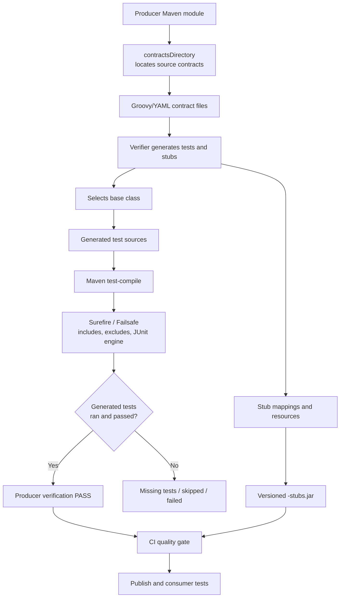

# Configuring Base Class, Contracts Directory, and Filters

## 1. Why do these three settings determine contract verification quality?

In **Spring Cloud Contract**, the producer and consumer agree on HTTP or messaging behavior using **Groovy DSL/YAML DSL** contracts. Spring Cloud Contract Verifier generates tests to verify the **real producer**, while also producing stubs for **Stub Runner** to power consumer tests. Good **Maven** integration is not just adding a plugin and seeing `BUILD SUCCESS`: the build must read the **right contracts**, attach the **right base test**, and the runner must **execute all generated tests** before CI publishes stubs.

Three core configuration areas:

- **Base class**: which class do generated tests extend to get the Spring context, HTTP test adapter, fixtures/mocks, or messaging trigger?
- **Contracts directory**: where does the plugin scan `.groovy`/`.yml` sources, and which Maven module owns them?
- **Filters**: which contracts enter code generation, which generated tests are discovered/executed by the runner, and which tests are excluded or skipped?

After this lesson, you will know how to configure `contractsDirectory`, `baseClassForTests`, and multi-base-class strategies, distinguish three separate filtering layers, read Surefire/Failsafe reports to prove tests actually ran, and place quality gates before stub publishing.

**Key message:** "Generating tests" differs from "compiling tests," and both still differ from "tests executed and passed."

## 2. Lifecycle from source contracts to test reports



| Stage | Evidence to collect | What remains unproven |
|---|---|---|
| **Contract discovery** | Exact source files in producer module | Tests were generated |
| **Code generation** | Generated Java/Kotlin test sources exist | Compiler or runner processed them |
| **Compilation** | Test compilation succeeds | Tests were discovered by JUnit |
| **Runner execution** | Reports show generated classes/methods, executed > 0 | Assertions all pass |
| **Passing assertions** | Failures/errors/skipped match expectations; verified response/message | Consumer handles stubs properly |
| **Stub packaging** | WireMock mappings/body files present in `-stubs.jar` | Producer is verified if tests were skipped |

In CI, cross-check the **exact generated contract tests**, not only the total unit test count across the reactor build.

## 3. Organizing the contracts directory in Maven

A producer with both HTTP APIs and message events might structure files like:

```text
order-service/
├── pom.xml
└── src/
    ├── main/java/com/example/orders/
    │   ├── OrderApplication.java
    │   └── api/OrderController.java
    └── test/
        ├── java/com/example/orders/contract/
        │   ├── OrderContractBase.java
        │   └── OrderMessageContractBase.java
        └── resources/
            ├── contracts/
            │   ├── http/orders/
            │   │   ├── get-paid-order.groovy
            │   │   ├── get-order-not-found.yml
            │   │   └── create-invalid-order.groovy
            │   └── messaging/orders/
            │       └── order-paid.groovy
            └── contract-fixtures/
                └── seed-orders.sql
```

Typically, `src/test/resources/contracts` is the default source directory used by Spring Cloud Contract projects. When a project uses a custom layout, **specify the path explicitly in the POM** and verify the generator discovered the files. Build output folders like `target/generated-test-sources`, `target/stubs`, or `mappings` are **not** the place to maintain source contracts.

Separating `http` and `messaging` is helpful because the two groups often require **completely different base tests**. Filenames should reflect observable behavior: success, not-found, validation error, or emitted event.

### 3.1. Multi-module Maven

```text
commerce-parent/
├── pom.xml
├── order-service/
│   ├── pom.xml
│   └── src/test/resources/contracts/...
└── checkout-service/
    ├── pom.xml
    └── src/test/java/...
```

When the plugin runs inside `order-service`, `${project.basedir}` normally resolves to **that producer module**, not the root parent. If the parent POM hardcodes a wrong absolute path or a child POM overrides the plugin, the generator can scan the wrong module.

Distinguish `<pluginManagement>` (managing version/defaults) from `<plugins>` and actual applied executions. Never treat a green parent build as proof that `order-service` contract tests executed.

## 4. Configuring the Spring Cloud Contract Maven Plugin

Illustrative POM snippet for a **producer using JUnit Jupiter and Rest Assured MockMvc**:

```xml
<properties>
    <spring-cloud-contract.version>REPLACE_WITH_COMPATIBLE_VERSION</spring-cloud-contract.version>
</properties>

<build>
    <plugins>
        <plugin>
            <groupId>org.springframework.cloud</groupId>
            <artifactId>spring-cloud-contract-maven-plugin</artifactId>
            <version>${spring-cloud-contract.version}</version>
            <extensions>true</extensions>
            <configuration>
                <contractsDirectory>
                    ${project.basedir}/src/test/resources/contracts
                </contractsDirectory>
                <baseClassForTests>
                    com.example.orders.contract.OrderContractBase
                </baseClassForTests>
                <testFramework>JUNIT5</testFramework>
                <testMode>MOCKMVC</testMode>
            </configuration>
        </plugin>
    </plugins>
</build>
```

**Keep in mind:**

1. `REPLACE_WITH_COMPATIBLE_VERSION` is a **placeholder**; choose a Spring Cloud Contract version compatible with your project's Spring Boot/Cloud BOM.
2. `contractsDirectory` specifies the contract source. `baseClassForTests` specifies the **fully qualified class name** (FQN) of the base test written by the producer team.
3. `testFramework` and `testMode` must align with generated test code and test infrastructure: e.g., `JUNIT5` + `MOCKMVC`.
4. `<extensions>true</extensions>` is common; verify the lifecycle/goals of your **actual plugin version** via build logs. Never rely on XML presence alone to conclude the plugin generated tests.
5. The snippet above **is not a complete POM**. Dependencies, test engine, Surefire/Failsafe, and fixtures/transports still need configuration.
6. If the producer uses WebFlux or messaging rather than Spring MVC, do not copy `MOCKMVC` just to make generated tests compile; pick the matching mode and base test.

### 4.1. Test dependencies

Example dependencies for a Spring MVC producer:

```xml
<dependencies>
    <dependency>
        <groupId>org.springframework.boot</groupId>
        <artifactId>spring-boot-starter-test</artifactId>
        <scope>test</scope>
    </dependency>
    <dependency>
        <groupId>io.rest-assured</groupId>
        <artifactId>spring-mock-mvc</artifactId>
        <scope>test</scope>
    </dependency>
</dependencies>
```

Spring Boot Test typically brings JUnit Jupiter and compatible test tools per your project's BOM. `spring-mock-mvc` is Rest Assured's MockMvc module; if its version is not managed via dependency management, declare an explicit compatible version. A runtime with only a JUnit 4 engine while generated tests use JUnit 5 can leave **tests unexecuted** even though sources compile.

## 5. `baseClassForTests` and the role of the base test

Generated tests rely on the base class to spin up the **real producer** environment. A base class may handle:

- Bootstrapping the Spring application context and HTTP test adapter.
- Seeding data or configuring mocks per contract scenario.
- Providing helper methods for `execute(...)`/`byCommand(...)` when used by contracts.
- Setting up the messaging verifier and trigger methods for message contracts.
- Cleaning up resources between generated tests so execution order never skews results.

### 5.1. Example `MOCKMVC` base class with JUnit 5

```java
package com.example.orders.contract;

import io.restassured.module.mockmvc.RestAssuredMockMvc;
import org.junit.jupiter.api.AfterEach;
import org.junit.jupiter.api.BeforeEach;
import org.springframework.beans.factory.annotation.Autowired;
import org.springframework.boot.test.autoconfigure.web.servlet.AutoConfigureMockMvc;
import org.springframework.boot.test.context.SpringBootTest;
import org.springframework.web.context.WebApplicationContext;

@SpringBootTest(webEnvironment = SpringBootTest.WebEnvironment.MOCK)
@AutoConfigureMockMvc
public abstract class OrderContractBase {

    @Autowired
    protected WebApplicationContext context;

    @BeforeEach
    public void prepare() {
        RestAssuredMockMvc.webAppContextSetup(context);
        // Prepare fixtures: order 42 in PAID state, etc.
    }

    @AfterEach
    public void cleanup() {
        RestAssuredMockMvc.reset();
        // Clean database/cache/mocks modified by the test.
    }
}
```

With `MOCKMVC`, Rest Assured MockMvc routes requests across the Spring MVC boundary without opening a real HTTP port. This protects routing, serialization, validation, and exception advice **provided those components are actually loaded in the test context**. The base test should not mock the whole controller or fabricate responses just to satisfy generated assertions.

**Scope of the example:** `OrderApplication`, concrete fixtures, and repositories are left out. In a real project, seed data so `GET /api/orders/42` matches expectations; otherwise generated tests will run, receive `404`, and fail.

### 5.2. The FQN must match the source

POM:

```xml
<baseClassForTests>
    com.example.orders.contract.OrderContractBase
</baseClassForTests>
```

Java source:

```java
package com.example.orders.contract;

public abstract class OrderContractBase {
    // Shared test infrastructure.
}
```

If you move the class to `com.example.orders.testing` without updating the POM, generated tests fail with `cannot find symbol` or `class not found` during compilation. The base class must also be on the producer module's **test compile classpath**.

### 5.3. The base class does not replace assertions

The base class makes requests runnable, while the **contract** defines expected requests and responses. Avoid:

- Hardcoding endpoints or mocking responses at the controller layer to always return sample data.
- Dropping `status`/body assertions from contracts when fixtures are broken.
- Relying on a production database or prior test order for seeded records.
- Sharing static mutable state across all tests without cleanup.

## 6. `contractsDirectory` and relative paths

Example declaration:

```xml
<contractsDirectory>
    ${project.basedir}/src/test/resources/contracts
</contractsDirectory>
```

This directory holds **source contracts**. After generation, outputs generally appear under `target/` depending on plugin/version:

```text
src/test/resources/contracts/
    ├── http/orders/get-paid-order.groovy
    └── http/orders/get-order-not-found.yml

target/
    ├── generated-test-sources/...  (generated tests)
    ├── test-classes/...            (compiled test bytecode)
    ├── stubs/...                   (generated stub resources if any)
    └── surefire-reports/...        (test reports if runner executed)
```

**Never store source contracts inside `target`**: `mvn clean` wipes build output before the generator looks for contracts. If a project fetches contracts from elsewhere, the fetch step must be explicit and run **before** the generator rather than silently relying on stale caches.

### 6.1. Common path errors

| Symptom | Possible cause | How to check |
|---|---|---|
| No generated tests | Wrong or empty `contractsDirectory` | Check path in the active module |
| Green parent build, producer module has no tests | Plugin not applied to child | Inspect effective POM / reactor scope |
| A YAML file is ignored | Wrong extension/syntax/DSL | Check parser errors, confirm plugin supports format |
| File placed in `src/main/resources` | Outside Verifier's scan root | Move to configured contract source |
| Running `clean` wipes all contracts | Source accidentally placed in `target` | Track sources in repo or explicit fetch step |
| Old tests remain after source changes | Stale generated output/cache from prior build | Run clean build and compare generated sources |
| Wrong module selected with `-pl` | Reactor runs a module owning no contracts | Confirm `project.basedir` and module ownership |

### 6.2. Structuring sources reduces complex filters

A domain-oriented structure:

```text
contracts/
├── http/
│   ├── orders/
│   │   ├── get-paid-order.groovy
│   │   └── get-order-not-found.yml
│   └── checkout/
│       └── validate-checkout.groovy
└── messaging/
    └── orders/
        └── publish-order-paid.groovy
```

Do not treat folder names as proof that the generator builds packages exactly as you imagine. Depending on how your plugin maps paths to packages/regexes, inspect the **actual generated source** when using base-class mappings.

## 7. Multiple contract groups need multiple base classes

A producer may expose both HTTP REST endpoints and emitted messages. HTTP tests need MockMvc, whereas messaging tests may need a message verifier, test binder, trigger methods, and separate fixtures. A base class initializing only MockMvc **cannot guarantee** messaging tests will run.

### 7.1. `baseClassMappings`

A common configuration when the plugin supports **regex matching against the contract package**:

```xml
<configuration>
    <contractsDirectory>
        ${project.basedir}/src/test/resources/contracts
    </contractsDirectory>
    <testFramework>JUNIT5</testFramework>
    <baseClassMappings>
        <baseClassMapping>
            <contractPackageRegex>.*http.*</contractPackageRegex>
            <baseClassFQN>
                com.example.orders.contract.OrderContractBase
            </baseClassFQN>
        </baseClassMapping>
        <baseClassMapping>
            <contractPackageRegex>.*messaging.*</contractPackageRegex>
            <baseClassFQN>
                com.example.orders.contract.OrderMessageContractBase
            </baseClassFQN>
        </baseClassMapping>
    </baseClassMappings>
</configuration>
```

**Important:** regex behavior, how contract packages are derived from paths, supported options, and mapping precedence depend on **Maven plugin version**. This snippet illustrates the strategy; verify it via the **base class name in the `extends` clause of generated Java tests**. Never assume `.*http.*` matches solely because files sit in an `http` folder.

Verification steps:

1. Group contracts by interface type.
2. Use non-overlapping regexes wherever possible.
3. Generate tests from a clean build.
4. Open generated sources and verify each test extends the intended base.
5. Compile and run both HTTP and messaging tests.

### 7.2. `packageWithBaseClasses` and conventions

Some Spring Cloud Contract setups support `packageWithBaseClasses` paired with base-test naming conventions. This is an **alternative strategy** to explicit mapping lists depending on version. When choosing it, verify the plugin's naming convention and generated `extends` rather than guessing from source directories.

Do not declare `baseClassForTests`, `baseClassMappings`, and `packageWithBaseClasses` simultaneously without clear precedence rules. Choose one simple strategy and verify it against generated sources.

### 7.3. Overlapping base class filters

If both groups sit under `orders`, the regex:

```xml
<contractPackageRegex>.*orders.*</contractPackageRegex>
```

can match **both HTTP and messaging**. When a message test accidentally inherits `OrderContractBase` (which only configures MockMvc), generated code may fail compilation for missing triggers or time out lacking a message verifier. Split patterns based on **distinct package segments** and verify each group.

## 8. Three distinct filtering layers in Maven

| Layer | Where configured? | What it filters? | Common trap |
|---|---|---|---|
| **Contract source** | `contractsDirectory` and supported generator options | Which contracts enter the generator | Fails to generate tests for protected files |
| **Base class selection** | `baseClassForTests`/`baseClassMappings` | How generated tests are set up | Runs wrong infrastructure or misses triggers |
| **Test execution selection** | Maven Surefire/Failsafe + JUnit engine + `-Dtest` | Which classes/methods execute | Tests are generated yet absent from reports |

This distinction is critical. `-Dtest=...` **does not** add a Groovy file to the contract source if the plugin never discovered it. Conversely, widening `contractsDirectory` **does not** guarantee Surefire runs every generated class if runner filters exclude them.

### 8.1. Source layer: never guess include/exclude option names

Verifier Maven Plugin versions may offer options to select or ignore contract files. However, **generator filter options** do not automatically share the same names or semantics as Surefire's `<includes>` and `<excludes>`. When filtering at generation time:

- Check plugin parameters **for your exact version**.
- Confirm whether patterns match **paths, filenames, or contract packages**.
- Check how many files/scenarios were processed after generation.
- Restrict filtering to local debugging when appropriate; release gates must verify the **full published contract set**.

Never add an unsupported option just because it looks like Maven test runner configuration.

### 8.2. Source filtering vs runner filtering

Suppose `get-paid-order.groovy` is missed because `contractsDirectory` is wrong: **zero generated tests** exist for Surefire to pick up. Suppose instead the generator produces `ShouldReturnPaidOrderTest.java`, yet Surefire only includes `**/*UnitTest.java`: the test **is generated and compiles**, yet **never executes**.

These two bugs need completely different fixes while producing the same surface symptom: `BUILD SUCCESS` with a high total test count from unrelated unit tests.

## 9. Surefire/Failsafe filtering of generated test classes

### 9.1. Maven Surefire

Surefire normally executes tests in the `test` phase. Default discovery rules and explicit includes/excludes depend on version and configuration. Example explicit includes:

```xml
<plugin>
    <groupId>org.apache.maven.plugins</groupId>
    <artifactId>maven-surefire-plugin</artifactId>
    <version>REPLACE_WITH_COMPATIBLE_SUREFIRE_VERSION</version>
    <configuration>
        <includes>
            <include>**/*Test.java</include>
            <include>**/*Tests.java</include>
        </includes>
    </configuration>
</plugin>
```

**Do not apply mechanically.** If the generator names classes differently, these includes can drop contract tests. Decide patterns after checking **actual generated test class names**. `REPLACE_WITH_COMPATIBLE_SUREFIRE_VERSION` is also a placeholder and cannot be used literally.

### 9.2. Excludes can erase verification evidence

```xml
<configuration>
    <excludes>
        <exclude>**/*ContractTest.java</exclude>
    </excludes>
</configuration>
```

The snippet above may intentionally separate integration tests; however, if Failsafe or another runner **never executes them**, CI loses contract verification. Track both **compiled generated tests** and **runner reports**.

### 9.3. Running a single generated class for debugging

```bash
# Replace name with the actual generated class.
mvn -Dtest=ShouldReturnPaidOrderTest test
```

`-Dtest` selects **test classes** for Surefire; it does not filter contract sources in the generator. If the class name fails to match, whether the build fails or skips depends on `failIfNoSpecifiedTests`; always check exit codes and reports, not just the command invoked.

In release CI, **never replace full verification with `-Dtest` for a single class**. Use this filter for quick debugging, then run the full contract suite.

### 9.4. Maven Failsafe for integration tests

Maven Failsafe normally runs integration tests in `integration-test` and `verify`. When designing generated contract tests to run under Failsafe:

1. Generated class/method names must **match Failsafe's includes**.
2. Failsafe `integration-test` and `verify` goals must be bound to the lifecycle properly.
3. You cannot run only `mvn test` and conclude integration tests passed.
4. Check `target/failsafe-reports` alongside Surefire reports when Failsafe is used.

Never leave a gap by excluding tests from Surefire without **including them in Failsafe**. If a project deliberately splits tests, maintain an explicit table of class pattern → runner → Maven phase.

## 10. JUnit engine, skip flags, and 0 generated tests

With `<testFramework>JUNIT5</testFramework>`, generated tests require the JUnit Jupiter engine and a Maven test plugin supporting JUnit Platform. If test classes compile yet lack a matching runtime engine, the runner may discover zero tests.

| Condition | Possible outcome |
|---|---|
| `-DskipTests` | Skips test execution in supporting plugins; compilation may still run |
| `-Dmaven.test.skip=true` | Can skip both test compilation and test execution |
| `-Dtest=SomeUnitTest` | Runs only tests matching the filter |
| Surefire `<skipTests>true</skipTests>` | Skips tests for that execution |
| Wrong JUnit engine | Generated tests compile yet runner misses them |
| Failsafe goals never run | Integration contract tests never execute |
| CI runs wrong Maven module/profile | Protected contracts never execute |

Example unsuitable as a producer verification gate:

```bash
mvn clean package -DskipTests
```

This command can package the app and stubs yet gives **zero proof that generated producer tests ran**. Nor is it enough if the summary reports 100 unit tests passing with zero generated contract tests.

**Counting tests matters more than counting files:** one contract file does not necessarily map one-to-one to a test class/method in every setup. Gates should verify **critical scenarios**, generated classes, and reports rather than assuming "contract file count equals test count."

## 11. Complete example: HTTP contracts and base class

Suppose `order-service` must return a paid order and an explicit error when an order is missing.

### 11.1. Groovy contract for HTTP 200

Example file `src/test/resources/contracts/http/orders/get-paid-order.groovy`:

```groovy
import org.springframework.cloud.contract.spec.Contract

Contract.make {
    description 'Return a paid order'

    request {
        method GET()
        url '/api/orders/42'
        headers {
            header 'Accept', 'application/json'
        }
    }

    response {
        status OK()
        headers {
            contentType(applicationJson())
        }
        body(
            id: 42,
            state: 'PAID',
            currency: 'VND'
        )
    }
}
```

### 11.2. YAML contract for HTTP 404

Example file `src/test/resources/contracts/http/orders/get-order-not-found.yml`:

```yaml
description: Order not found
request:
  method: GET
  url: /api/orders/9999
  headers:
    Accept: application/json
response:
  status: 404
  headers:
    Content-Type: application/json
  body:
    code: ORDER_NOT_FOUND
    message: Order not found
```

These are **two distinct scenarios**, so placing them in the same folder makes sense. Their responses do not conflict and they can share a base test. The base class must ensure order `42` is `PAID` while `9999` is absent.

### 11.3. Reading generated source to confirm effective configuration

A generated test has logic equivalent to the following (purely **illustrative pseudocode**, not verbatim output for every version):

```java
class ShouldReturnPaidOrderTest extends OrderContractBase {

    @Test
    void shouldReturnPaidOrder() {
        RestAssuredMockMvc.given()
            .header("Accept", "application/json")
            .when()
            .get("/api/orders/42")
            .then()
            .statusCode(200)
            .body("state", equalTo("PAID"));
    }
}
```

Verify:

- Does `extends OrderContractBase` match the POM and contract type?
- Does the test use `MOCKMVC`, live-port HTTP, or message verifier as intended?
- Does the generated test assert required fields such as `status`, `state`, error `code`, and headers?
- What are the class/method name and package, and **does Surefire/Failsafe pick it up**?
- Does that class appear in reports after `mvn verify`?

If generated source looks wrong, **never edit files under `target`**. A clean build regenerates and overwrites changes. Fix the root cause in the contract, plugin config, base test, or producer code.

### 11.4. Base tests need real fixtures or properly layered mocks

With `MOCKMVC`, the base test can seed a test DB, use `@Sql`, or mock external dependencies like repositories/downstream services that need isolation. Do not mock the controller itself to return hardcoded JSON bypassing producer HTTP converters, validation, and advice.

Conceptual fixture flow:

```text
BeforeEach:
  order 42   -> PAID, currency VND
  order 9999 -> absent

GET /api/orders/42:
  HTTP 200, JSON state PAID

GET /api/orders/9999:
  HTTP 404, JSON code ORDER_NOT_FOUND

AfterEach:
  Clean up records/caches/mock state modified by the test
```

If generated tests fail because the DB is empty, fix the fixture. Never change the expected response to `404` just to turn a test green when the contract promises `200`.

## 12. Messaging contracts need a different base class

Suppose the producer also emits `OrderPaid` from a business action:

```groovy
import org.springframework.cloud.contract.spec.Contract

Contract.make {
    description 'Successful payment emits OrderPaid'
    label 'order_paid'

    input {
        triggeredBy('publishOrderPaidForContract()')
    }

    outputMessage {
        sentTo('orders.paid')
        headers {
            header('eventType', 'OrderPaid')
        }
        body(
            orderId: 42,
            state: 'PAID'
        )
    }
}
```

If mappings route this scenario to `OrderMessageContractBase`, the base test must provide the method with the **exact signature**:

```java
public void publishOrderPaidForContract() {
    orderPaymentService.markOrderPaid(42L);
}
```

This is an **illustrative base-class method**, not generated by Spring Cloud Contract. It must invoke the **real business/publisher flow** alongside test infrastructure capturing output messages at the right destination. Depending on adapter/stack, use `@AutoConfigureMessageVerifier`, Spring Cloud Stream test binder, or another transport test harness.

**Never reuse an HTTP base class that lacks a message verifier/trigger.** Likewise, never have the trigger send a fake message directly from test code if the goal is verifying producer business logic.

## 13. Reading Maven reports and proving tests ran

Common output paths after a build:

```text
target/
├── generated-test-sources/
│   └── ...              # location depends on plugin/version
├── test-classes/
│   └── ...              # compiled generated tests
├── surefire-reports/
│   ├── TEST-*.xml
│   └── *.txt
└── failsafe-reports/
    └── ...              # if project actually uses Failsafe
```

Not every project has both report directories or identical generated source paths. First confirm which runner executes generated tests.

An **illustrative** report line, not an executed command:

```text
Running com.example.orders.contract.ShouldReturnPaidOrderTest
Tests run: 1, Failures: 0, Errors: 0, Skipped: 0
```

For the right generated class, this shows one test ran with no failures. Yet a summary line like:

```text
Tests run: 124, Failures: 0, Errors: 0, Skipped: 0
```

**does not prove** contract tests ran, because all 124 could be unit tests. CI must cross-check **generated class/method names** against the behaviors under protection.

### 13.1. Why isn't `failIfNoTests` enough?

Surefire can be configured with `failIfNoTests` to fail when zero tests run. However, if many regular unit tests exist and filters exclude all generated contract tests while unit tests still run, `failIfNoTests` **cannot detect** the missing contract verification.

A stronger gate checks one of:

- Expected generated contract test names appear in reports.
- Protected scenarios/contract groups are verified via class/method reporting.
- A dedicated task/module check **running only contract tests** with executed > 0 and zero skipped.

Choose an approach fitting your project setup, without assuming "one contract file produces exactly one test" unless your generator/version guarantees it.

### 13.2. Maven lifecycle when using Surefire/Failsafe

A build flow can traverse:

```text
generate-test-sources
        ↓
test-compile
        ↓
test                 (Surefire)
        ↓
integration-test     (Failsafe if configured)
        ↓
verify               (Failsafe verify if configured)
```

Specific phases and plugin goals must match your version and build. Do not assume `mvn test` runs `integration-test` or `mvn package` publishes stubs. For comprehensive verification, the reference command is:

```bash
mvn clean verify
```

Yet **the command alone does not create proof**: inspect plugin/test executions, reports, and skip flags.

## 14. Maven profiles and build environments

### 14.1. Fast profiles are not release gates

A `dev-fast` profile may intentionally trim tests for rapid local iteration:

```bash
mvn -Pdev-fast test
```

Never treat its result as full verification if the profile skipped or filtered contract tests. CI reports should log **profile names, modules, plugin/test versions**, and any flags affecting test execution.

### 14.2. Running the exact producer module

In a reactor build:

```bash
# Illustrative: selects order-service and required dependent modules.
mvn -pl order-service -am clean verify
```

`-pl` selects the module, and `-am` pulls reactor dependencies as resolved by Maven. Never expect every reactor module to own contract tests; only **producer modules owning contracts** need corresponding reports.

### 14.3. Effective POM to find overridden settings

If a parent POM declares the plugin in `<pluginManagement>` while a child lacks plugin activation/execution, inspect the **effective POM** on that exact module:

```bash
# Reference command, not executed in this lesson.
mvn help:effective-pom
```

Check:

- Does the Verifier plugin actually appear in effective build config?
- Which `project.basedir` did `contractsDirectory` expand from?
- Did a child override `baseClassForTests` or base class mappings?
- Did a profile or parent alter Surefire includes/excludes?
- Are plugin executions bound to expected phases and unskipped?

Do not tweak the parent POM or every module just because one child fails; focus effective config on the module owning the contracts.

## 15. Proper filtering pattern for local debug vs main CI

```text
Local debug:
    Generate code from right contract sources
    Run a single generated class to isolate bug
    Fix contract/fixture/base class/producer code

Before merge/release:
    Generate all contracts requiring protection
    Compile completely
    Execute all generated contract tests
    Verify class names and failure/skip counts in reports
    Only then publish the new stub artifact
```

| Task | Filtering acceptable? | What must be documented? |
|---|---|---|
| Debug a failing contract | **Yes** | Class name and narrowed scope |
| Fix a base class mapping | Yes initially, then run full suite | Affected HTTP/messaging groups |
| Merge gate | Never drop published contracts | Complete set of generated tests |
| Publish `-stubs.jar` | Only after full verification | Reports and artifact version |
| Consumer CI with Stub Runner | Can pin fixed release version | Resolved group/artifact/version/classifier |

An immediate red flag is seeing **generated contract test count drop to 0** while total test count remains high. Beyond counts, compare **contract source → generated class → report** for critical scenarios.

## 16. Diagnostic matrix: wrong source, base, or filter?

| Symptom | Layer to check first | How to verify |
|---|---|---|
| No generated Java | Contract discovery/generator | Directory, module, plugin lifecycle |
| A Groovy file is ignored | Source path, extension, or parse | Is the file under `contractsDirectory`? |
| Tests generated yet `cannot find symbol` | Base class FQN/test classpath | Actual `extends`, package, and class |
| Tests use JUnit 5 yet runner misses them | JUnit engine/Surefire | Annotations, runtime dependencies |
| Tests compile yet absent from Surefire report | Runner includes/excludes/skip | Actual class name, `-Dtest`, profiles |
| HTTP contract returns `404` instead of `200` | Base fixture or producer | Seeded order, controller mapping |
| Messaging test times out | Trigger/message verifier/binder | Messaging base class, transport, destination |
| Test passes standalone, fails in suite | Shared fixtures/cache/mocks | Setup/teardown, test isolation |
| Maven shows `BUILD SUCCESS` with 0 contract tests | Generator/runner filters | Do not accept as producer verification |
| Total unit tests pass yet generated class missing | Overly broad count gate | Check test report by class name |
| Only `-Dtest=...` runs generated class | Surefire default/include pattern | Update test selection deliberately |
| Release profile accidentally skips tests | Maven profile/flags | Effective config + CI command |
| Stub artifact created while producer fails | Tests skipped or weak assertions | True producer verification |
| Consumer gets stale stub | Coordinates/repository | Pin and verify version/classifier |
| Message contract extends HTTP base | Overlapping mapping regex | Inspect `contractPackageRegex` and generated `extends` |

### 16.1. Time-saving debugging sequence

1. **Source:** list expected contracts inside the assigned directory.
2. **Plugin:** confirm Verifier goals actually ran on the producer module.
3. **Generated source:** inspect generated class/method names and packages.
4. **Base:** inspect `extends`, `@BeforeEach`, mocks/fixtures, or message verifier.
5. **Compile:** fix dependency or test framework errors.
6. **Runner:** inspect Surefire/Failsafe filters, JUnit engine, and skip flags.
7. **Report:** cross-check generated classes executed/passed/failed/skipped.
8. **Publish:** package/publish stubs only after producer quality gates pass.

This sequence stops you from tweaking `-Dtest` when the real root cause is that **contracts were never discovered by the generator**.

## 17. CI gate before releasing stubs

```mermaid
sequenceDiagram
    participant Dev as Developer
    participant CI as Maven producer CI
    participant Repo as Artifact repository
    participant CC as Consumer CI
    Dev->>CI: Commit contract + code + POM
    CI->>CI: Select module and contractsDirectory
    CI->>CI: Generate tests, map base classes
    CI->>CI: Compile, execute Surefire/Failsafe
    CI->>CI: Cross-check generated tests with reports
    alt Protected contracts ran and passed
        CI->>Repo: Publish versioned -stubs.jar
        CC->>Repo: Resolve exact version/classifier
        CC->>CC: Stub Runner + consumer tests
    else Tests missing, skipped, or failed
        CI-->>Dev: Block publish; preserve logs and reports
    end
```

**Minimum quality gate:**

- Source contracts exist for which the producer module is responsible.
- The plugin generates corresponding tests with zero parse errors.
- Generated classes extend the **right base test** and compile.
- Runners execute all protected generated tests with zero excludes/skips.
- Assertions on status/body/headers or message destination/payload pass.
- CI inspects test reports, not just exit code 0 or aggregate unit test counts.
- Stubs are packaged with the exact classifier/version **after** producer verification.
- Consumer CI fetches the exact stub version and runs real HTTP/message clients via Stub Runner.

**Limitation:** publishing stubs after verification does not replace assessing compatibility with active consumers; both sides still need tests when changing API schemas, error codes, topic names, or semantics.

## 18. Practice lab: finding why Maven is "green" with no contract tests

**Context:** `order-service` has two HTTP contracts and one messaging contract. Maven Verifier was added to the POM, yet `mvn test` reports success and Surefire reports show only unit tests. When running one generated class directly, Maven reports `OrderMessageContractBase` is missing.

**Tasks:**

1. Confirm `order-service/src/test/resources/contracts` contains the HTTP and messaging files and `contractsDirectory` points to the producer module.
2. Inspect `baseClassForTests` or `baseClassMappings` and confirm base classes exist in `src/test/java`.
3. Run a clean build with the appropriate Maven command and locate generated sources.
4. Check `extends` in every generated class. Fix mappings if message contracts were bound to the HTTP base.
5. Check `testFramework=JUNIT5`, the JUnit Jupiter runtime engine, and compatible Surefire/Failsafe versions.
6. Compare include/exclude patterns against **actual generated class names**; remove filters dropping tests.
7. Read per-class test reports to confirm **executed > 0**, zero skipped, and zero failures/errors.
8. Deliberately change output `state=PAID` to `PENDING` in the producer test environment; the HTTP contract must fail if assertions are strong enough.
9. Deliberately omit the message trigger or change the destination; the messaging test must fail if the adapter/transport is wired properly.
10. Revert experimental edits, run full producer verification, and only then publish `-stubs.jar`.
11. Run Stub Runner in consumer CI to confirm the client deserializes responses and handles documented errors.

### 18.1. Self-check table

| Question | Answer |
|---|---|
| Does `contractsDirectory` point to where Java tests are generated? | **No**; it holds source contracts |
| Is `baseClassForTests` generated automatically by Verifier? | **No**; the producer team must supply it |
| Does `-Dtest=...` feed new Groovy files into the generator? | **No**; it filters the test runner |
| If 100 unit tests pass with zero generated tests, are contracts verified? | **No** |
| Can regex `.*orders.*` match both HTTP and messaging? | **Yes**, if both packages contain `orders` |
| Can enabling `-DskipTests` turn the build green even if contracts never ran? | **Yes** |
| Does `mvn test` run Failsafe integration tests by default? | **No** |
| Does every contract file always map to one generated method? | **Cannot be assumed** |
| Does generating `-stubs.jar` prove the producer honors the contract? | **No** |

## 19. Maven integration checklist

- [ ] Spring Cloud Contract Maven plugin is applied **to the right producer module** with versions compatible with Spring Boot/Cloud.
- [ ] `contractsDirectory` points to Groovy/YAML sources, not generated output or another module.
- [ ] Contract sources cover critical HTTP success/error and messaging scenarios for consumers.
- [ ] `baseClassForTests` uses an FQN present on the test compile classpath.
- [ ] With multiple base classes, mapping regexes/conventions are verified via **generated `extends`**.
- [ ] `testFramework`/`testMode` match JUnit, MockMvc, WebFlux, or messaging infrastructure.
- [ ] Base tests configure real fixtures/mocks and cleanup without bypassing the real controller/publisher under test.
- [ ] The generator discovers and generates all scenarios in the published contract set.
- [ ] Generated tests compile cleanly.
- [ ] Surefire/Failsafe includes/excludes do not accidentally drop generated classes.
- [ ] JUnit engine, profiles, Maven phases, and runner goals are aligned.
- [ ] `-DskipTests`, `maven.test.skip`, or debug `-Dtest` filters are never used as a release gate.
- [ ] Test reports prove **generated contract tests actually ran and passed**, not merely unit tests.
- [ ] CI alerts or fails if generated contract tests vanish or are skipped.
- [ ] Stubs are published with the right version/classifier after producer verification passes.
- [ ] Consumer CI uses Stub Runner with the exact artifact, runs the real client, and asserts behavior.
- [ ] In multi-module builds, effective POM and plugin inheritance are verified on contract-owning modules.
- [ ] After changing base mappings or filters, the full suite and intentional failure checks were run.

**Key takeaway:** `contractsDirectory` decides **which contracts enter the build**, the base class decides **what environment generated tests use to invoke the producer**, and Surefire/Failsafe plus filters decide **which tests actually execute**. Only when evidence exists at all three layers and CI blocks stub publishing on missing or failing producer verification does Maven integration enable Spring Cloud Contract to catch incompatible API changes reliably.
