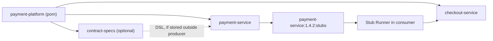
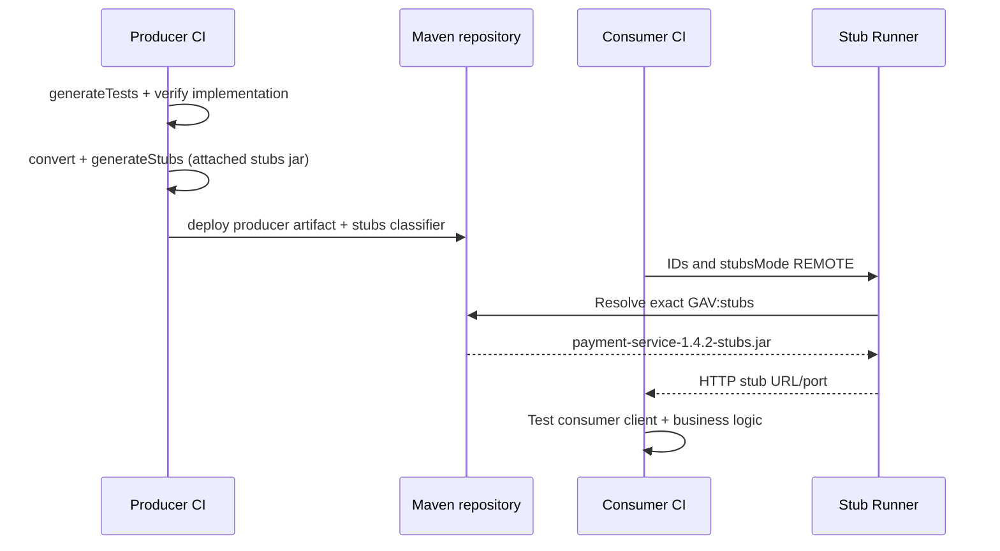
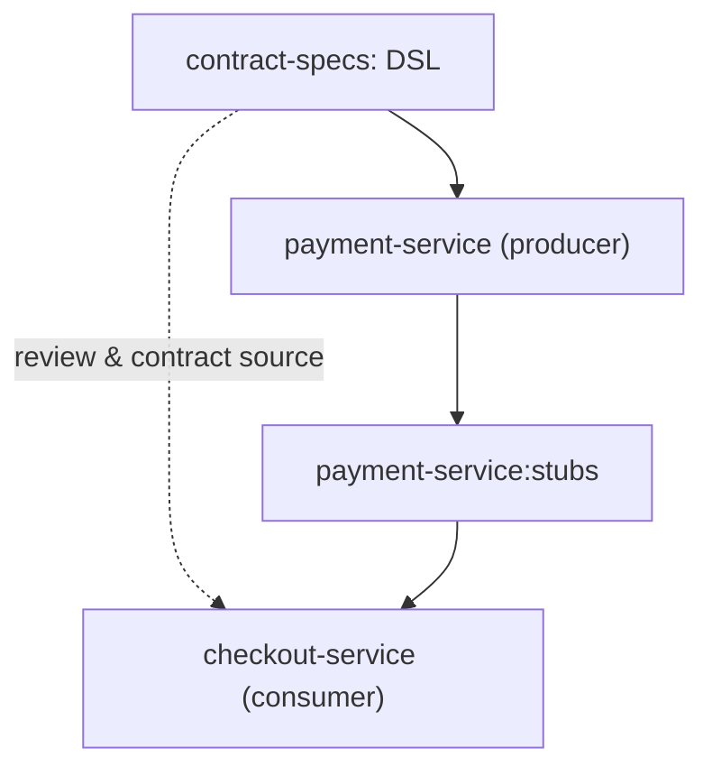
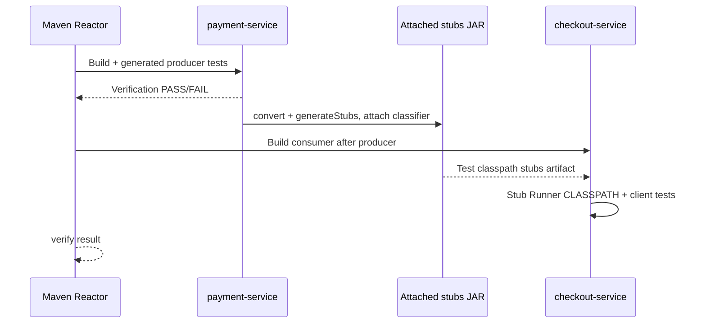
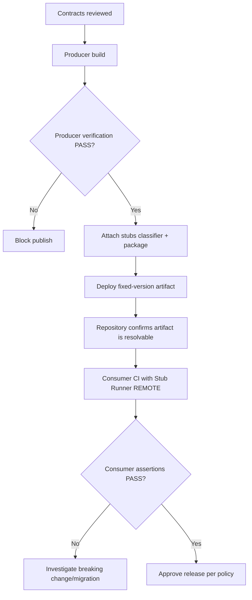

# Multi-module Builds and Dependency Publication Order

## 1. The problem: producer, consumer, and contracts do not always share one module

In a system using **Spring Cloud Contract (SCC)**, the **producer** exposes an HTTP API or emits messages, and the **consumer** consumes that interface. Both teams agree on behavior using **Groovy/YAML DSL**. The producer generates **verification tests** and builds a **stub artifact**; the consumer uses **Stub Runner** to load the stub and test client code. Wired into CI, this workflow catches incompatible API changes early.

In a multi-module Maven repository, a typical layout is:

- Module `payment-service` owns controllers, business logic, and producer contract tests.
- Module `checkout-service` contains the HTTP client and consumer logic needing tests against the payment stub.
- An optional `contract-specs` module stores shared DSLs, or contracts are loaded from an external source.
- A parent/aggregator `pom.xml` groups modules into one **Maven Reactor build**.

The question is not just "which module comes first in the POM?" More importantly:

1. **How does Maven know to build the producer before the consumer?**
2. **When is the stub JAR generated, attached, and resolvable?**
3. **When do producer verification, consumer tests, `install`, or `deploy` execute?**
4. **Is the consumer using the right stub version, or silently hitting a stale cache/stub?**
5. **How does CI prevent publishing contracts/stubs unverified by the producer?**

This lesson belongs to the **Maven Integration** chapter in the **SPRING_CLOUD_CONTRACT** module. Its focus is **multi-module Maven, the Reactor, build order, and dependency publication order**, not merely pasting the SCC plugin into a single POM.

### Learning objectives

After this lesson you will be able to:

- Distinguish **parent**, **aggregator**, **module**, **dependency graph**, and **artifact repository**.
- Explain Maven Reactor ordering and the limits of the `<modules>` list.
- Configure the SCC Maven plugin in the **right producer module** to generate tests and the stub JAR.
- Know when to select `CLASSPATH`, `LOCAL`, `REMOTE`, or `stubs://` for consumers.
- Use `-pl`, `-am`, `-amd` and `verify`, `package`, `install`, `deploy` lifecycles deliberately.
- Design multi-module CI that never publishes unverified artifacts and avoids dependency cycles.
- Diagnose reactor order bugs, missing classifiers, stale artifacts, `0 tests`, dependency cycles, and parallel build issues.

> **Principle:** The relationship between two modules is understood by the Maven Reactor through **instantiated dependency/build references**. Merely listing the producer before the consumer in `<modules>` or setting a version in `dependencyManagement` **is not enough to express every dependency**.

## 2. Four concepts to distinguish

| Concept | Example | Role |
|---|---|---|
| **Aggregator POM** | `payment-platform/pom.xml` with `<modules>` | Collects modules for the Maven Reactor to build |
| **Parent POM** | `<parent>com.acme:payment-platform:1.4.2</parent>` | Lets modules inherit properties, plugin/dependency management |
| **Module dependency** | `checkout-service` declares `<dependency>` on `payment-service` | Creates a dependency edge used by the Reactor for sorting |
| **Maven artifact** | `com.acme.billing:payment-service:1.4.2:stubs` | Built bundle that can be installed/published and loaded by Stub Runner |

One POM can serve as both **parent** and **aggregator**, yet those two roles are distinct:

- `<modules>` lists **module directories participating in the build**.
- `<parent>` defines **Maven model inheritance**.
- `<dependencies>` declares **actually required artifacts**.
- `<dependencyManagement>` defines default versions/attributes **when a module declares a dependency**, without adding dependencies itself.

Sharing an aggregator in one repository does not force two Java modules to depend directly on one another. Conversely, a dependency can reference an artifact **outside the repository**; if that artifact is not part of the active Reactor, Maven resolves it from local/remote repositories.

### 2.1. One repo, three collaboration models

| Model | Producer/consumer in same Reactor? | How consumer obtains stubs |
|---|---|---|
| **Single Maven Reactor with stub dependency** | Yes | `CLASSPATH` via `stubs` classifier dependency |
| **Single Maven Reactor using locally installed stubs** | Yes | `LOCAL`, provided producer ran `install` beforehand |
| **Separate repos or decoupled pipelines** | Usually no | `REMOTE` from repository after producer CI |
| **Single repo reading output directory directly** | Possible | `stubs://` if explicitly configured; not a Maven artifact |

Each path has trade-offs. Never switch `stubsMode` arbitrarily just to make tests pass: the mode must reflect the **actual artifact source**.

## 3. Illustrative architecture: a Maven aggregator and three modules

Suppose we have:

```text
payment-platform/
├── pom.xml                         # aggregator/parent
├── contract-specs/                 # shared DSL (optional)
│   └── pom.xml
├── payment-service/                # producer
│   ├── pom.xml
│   └── src/test/resources/contracts/...
└── checkout-service/               # consumer
    ├── pom.xml
    └── src/test/java/...           # Stub Runner tests
```

Intended relationships:



Arrows in the diagram depict **responsibility/output flows**; not every edge is a Maven `<dependency>`. If `checkout-service` declares no Maven dependency on `payment-service`, the Reactor **does not infer** an edge just because consumer tests put a Stub Runner ID inside an annotation.

### 3.1. Never create a dependency cycle to "force ordering"

A dangerous approach:

```text
checkout-service  -> payment-service (stub artifact)
payment-service   -> checkout-service (wants shared DTO/client)
```

When both declare direct Maven dependencies on each other, the Reactor reports a **cyclic dependency** and refuses to build. Better options:

- Extract shared DTOs/schemas/contracts into an **independent module** depending on neither producer nor consumer; or
- Separate testing and artifact publishing into distinct CI stages; or
- Resolve stubs from a repository so application modules avoid reverse dependencies within the same build lifecycle.

**Do not** try to fix a cycle by reordering `<modules>`. A dependency cycle remains a cycle.

## 4. How does the Maven Reactor actually sort modules?

The Maven Reactor:

1. Collects the selected projects in the build.
2. Sorts them by declared dependency/build relationships.
3. Builds each project in the resulting order.

According to Apache Maven's official multi-module documentation, relationships considered by the Reactor include:

1. A **project dependency** on another module in the build.
2. A **plugin declaration** referencing a plugin artifact built as a module in the build.
3. A **plugin dependency** pointing to another module in the build.
4. A **build extension** that is a module in the build.
5. A **parent project** included in the build.
6. Finally, if no stronger relationship exists, **the order in `<modules>`**.

`dependencyManagement` and `pluginManagement` **create no Reactor sort edges** until a real dependency or plugin is declared.

### 4.1. Two configurations that look alike yet mean different things

In the parent POM:

```xml
<dependencyManagement>
    <dependencies>
        <dependency>
            <groupId>com.acme.billing</groupId>
            <artifactId>payment-service</artifactId>
            <version>1.4.2</version>
        </dependency>
    </dependencies>
</dependencyManagement>
```

This is **version management**; it does not make checkout depend on payment.

In `checkout-service/pom.xml`:

```xml
<dependencies>
    <dependency>
        <groupId>com.acme.billing</groupId>
        <artifactId>payment-service</artifactId>
        <version>1.4.2</version>
        <classifier>stubs</classifier>
        <type>jar</type>
        <scope>test</scope>
    </dependency>
</dependencies>
```

This is an **instantiated dependency** on a `payment-service` artifact. When `payment-service` is part of the selected Reactor, Maven has grounds to build the producer **before** the consumer.

**However:** a Maven edge alone does not prove `-stubs.jar` was attached to the producer project. The SCC plugin must run its goals and attach the stub artifact before consumer tests need it.

### 4.2. `<modules>` order is only a fallback

Example parent:

```xml
<modules>
    <module>checkout-service</module>
    <module>payment-service</module>
</modules>
```

If checkout has a real dependency on payment in the same Reactor, Maven still builds **payment before checkout**, even though checkout is listed first. Conversely, with no dependency between them, Maven usually preserves `<modules>` order, though that is not a reliable way to coordinate separate pipelines or subset reactor builds selecting only one module.

### 4.3. Inspect what actually drives Reactor ordering

Run against a **real Maven project with a wrapper**:

```bash
./mvnw -pl :checkout-service -am validate
./mvnw -pl :checkout-service -am verify
```

`-pl` selects the target project. `-am` adds projects that module **actually depends on** in the Reactor. If `payment-service` is absent from the dependency graph, `-am` will not pull it in simply because test code contains the string `"payment-service"`.

**These commands are suggested for learners to run**, not executed while writing this lesson.

## 5. Parent/aggregator POM: grouping modules without running SCC everywhere

An illustrative `payment-platform/pom.xml` skeleton:

```xml
<project xmlns="http://maven.apache.org/POM/4.0.0"
         xmlns:xsi="http://www.w3.org/2001/XMLSchema-instance"
         xsi:schemaLocation="
           http://maven.apache.org/POM/4.0.0
           https://maven.apache.org/xsd/maven-4.0.0.xsd">
    <modelVersion>4.0.0</modelVersion>
    <groupId>com.acme.billing</groupId>
    <artifactId>payment-platform</artifactId>
    <version>1.4.2</version>
    <packaging>pom</packaging>

    <modules>
        <module>contract-specs</module>
        <module>payment-service</module>
        <module>checkout-service</module>
    </modules>

    <properties>
        <java.version>17</java.version>
        <spring-cloud-contract.version>REPLACE_WITH_COMPATIBLE_VERSION</spring-cloud-contract.version>
    </properties>

    <build>
        <pluginManagement>
            <plugins>
                <plugin>
                    <groupId>org.springframework.cloud</groupId>
                    <artifactId>spring-cloud-contract-maven-plugin</artifactId>
                    <version>${spring-cloud-contract.version}</version>
                </plugin>
            </plugins>
        </pluginManagement>
    </build>
</project>
```

Key points:

- `<packaging>pom</packaging>` fits an aggregator/parent.
- `<modules>` specifies participating modules when building from root; paths must match actual folders.
- `<pluginManagement>` defines plugin versions/defaults **for children to opt into**, without **activating SCC automatically** across all modules.
- The SCC plugin should normally be activated only in **producer modules owning contracts**. A pure consumer module needs the Stub Runner test dependency, not producer verification test generation.
- `REPLACE_WITH_COMPATIBLE_VERSION` must be replaced with a compatible Spring Boot/Cloud/SCC version. This is a minimal structural POM lacking full dependency management and Java/JUnit plugins.

If `contract-specs` is not a real module or the team keeps contracts inside the producer, **omit it from the list** rather than inventing a dummy module. Multi-module setups do not require a separate contracts module.

### 5.1. Parent inheritance differs from Reactor membership

A module can inherit from a published parent POM **outside the current Reactor's `<modules>`**. Maven resolves that parent from `relativePath`/repository, while building the parent as a Reactor module happens only when selected in the Reactor.

Conversely, an aggregator can group modules that do not share the same parent. Distinguish the two roles so you never rely on inheritance as a fake mechanism to force producer tests before consumers.

## 6. Producer POM: activating Spring Cloud Contract in the right module

In `payment-service/pom.xml`:

```xml
<project xmlns="http://maven.apache.org/POM/4.0.0">
    <modelVersion>4.0.0</modelVersion>

    <parent>
        <groupId>com.acme.billing</groupId>
        <artifactId>payment-platform</artifactId>
        <version>1.4.2</version>
        <relativePath>../pom.xml</relativePath>
    </parent>

    <artifactId>payment-service</artifactId>
    <packaging>jar</packaging>

    <dependencies>
        <dependency>
            <groupId>org.springframework.boot</groupId>
            <artifactId>spring-boot-starter-test</artifactId>
            <scope>test</scope>
        </dependency>
        <dependency>
            <groupId>org.springframework.cloud</groupId>
            <artifactId>spring-cloud-starter-contract-verifier</artifactId>
            <scope>test</scope>
        </dependency>
    </dependencies>

    <build>
        <plugins>
            <plugin>
                <groupId>org.springframework.cloud</groupId>
                <artifactId>spring-cloud-contract-maven-plugin</artifactId>
                <extensions>true</extensions>
                <executions>
                    <execution>
                        <id>generate-contract-artifacts</id>
                        <goals>
                            <goal>convert</goal>
                            <goal>generateStubs</goal>
                            <goal>generateTests</goal>
                        </goals>
                    </execution>
                </executions>
                <configuration>
                    <testFramework>JUNIT5</testFramework>
                    <testMode>MockMvc</testMode>
                    <baseClassForTests>
                        com.acme.payment.contract.ContractTestBase
                    </baseClassForTests>
                </configuration>
            </plugin>
        </plugins>
    </build>
</project>
```

This is a **POM excerpt for explanation**, missing full dependencies, Java compiler settings, BOMs, imports, and Spring Boot app config. The plugin version here is managed by the parent's `<pluginManagement>`. If the producer does not inherit that parent, declare the plugin version explicitly.

**Items to check on a concrete build:**

- `generateTests` reads contracts and generates verification tests into test sources.
- `convert` converts contracts into mappings for stubs.
- `generateStubs` packages mappings into the stub JAR; this goal requires `convert` to have run.
- `testMode=MockMvc` suits a Spring MVC producer; WebFlux or live HTTP requires another mode and base class.
- `baseClassForTests` must exist on the **producer test classpath** with matching fixtures and web context.
- `spring-cloud-starter-contract-verifier` stays in `test` scope, never needed in application runtime.

**Do not confuse Maven plugins with dependencies**: declaring `spring-cloud-starter-contract-verifier` does not run `generateStubs`; conversely, having the plugin generate tests without a proper test classpath leads to compile/test failures.

### 6.1. Where do contracts live?

Per SCC Maven plugin documentation, the default path is:

```text
payment-service/src/test/resources/contracts/
```

Example:

```text
payment-service/src/test/resources/contracts/payments/
  payment-captured.yml
  payment-not-found.yml
```

If your team uses a different folder, configure `contractsDirectory` on the plugin and inspect generated sources. Never infer Maven paths from Gradle's `src/contractTest/resources/contracts` convention.

## 7. HTTP contracts and fixtures in the producer

Sample contract:

```yaml
name: payment_captured
description: "Consumer looks up a captured payment"
request:
  method: GET
  url: /api/payments/PAY-42
  headers:
    Accept: application/json
response:
  status: 200
  headers:
    Content-Type: application/json
  body:
    paymentId: "PAY-42"
    state: CAPTURED
    amount: 150000
    currency: VND
```

The generated producer test requires the application to handle `GET /api/payments/PAY-42` and return the expected JSON and status. Illustrative base class:

```java
@SpringBootTest
public abstract class ContractTestBase {
    @Autowired WebApplicationContext context;
    @Autowired PaymentContractFixtures fixtures;

    @BeforeEach
    void prepare() {
        fixtures.resetIsolatedTestPayments();
        fixtures.addCapturedPayment("PAY-42", 150000L);
        RestAssuredMockMvc.webAppContextSetup(context);
    }
}
```

`PaymentContractFixtures` is a **project-provided helper**, not an SCC API. Never seed or reset a production DB. This snippet also needs package/imports and valid Spring Boot config, so it is not standalone compilable code.

**Producer verification** tests producer application code. **Consumer Stub Runner tests** check checkout's client against simulated responses; neither replaces the other.

## 8. Maven lifecycle: creating the stub JAR and when it is ready

In `spring-cloud-contract-maven-plugin`, goals have distinct roles:

| Goal | Default phase or role | Outcome |
|---|---|---|
| `generateTests` | Bound to `generate-test-sources` | Generates producer verification test sources |
| `convert` | Converts DSL to JSON mappings in the build lifecycle | Stub outputs ready for packaging |
| `generateStubs` | Per plugin docs, defaults to `package` | Builds attached stub JAR, default classifier `stubs` |
| Maven `test` | Runs unit/generated tests via Surefire when framework/discovery align | Test reports |
| Maven `verify` | Runs through `verify` and bound checks | Pre-release verification gate |
| Maven `install` | Writes Maven project artifacts into local repo | Main JAR, attached stubs JAR when properly configured |
| Maven `deploy` | Pushes Maven artifacts to remote repository | Main JAR and attached stubs JAR if plugin/lifecycle attached them |

Some plugin goal/lifecycle bindings vary by SCC version or custom `<executions>`. Inspect the Maven execution plan and logs to confirm `convert` runs before `generateStubs` and generated tests execute.

### 8.1. Practical producer commands in a Reactor

From the aggregator root:

```bash
./mvnw -pl :payment-service -am clean verify
./mvnw -pl :payment-service -am clean install
```

- `-pl :payment-service`: targets the module by `artifactId`.
- `-am`: includes **upstream dependencies** needed by the producer (parent/contract-specs if in the Reactor and related).
- `verify` runs through verify **without installing artifacts into the local Maven repository**.
- `install` runs all preceding phases and installs artifacts locally for later consumer `LOCAL` runs.

Example output when attached properly:

```text
payment-service/target/payment-service-1.4.2.jar
payment-service/target/payment-service-1.4.2-stubs.jar

~/.m2/repository/com/acme/billing/payment-service/1.4.2/
  payment-service-1.4.2.pom
  payment-service-1.4.2.jar
  payment-service-1.4.2-stubs.jar
```

Filenames and layout above are **typical**, though they can vary if customized. The stub JAR contains mappings/contract definitions in the layout supported by Stub Runner. Never check only for `-stubs.jar` existence while ignoring **executed test counts and internal mappings**.

### 8.2. How do `package` and `verify` differ in release policies?

The Maven lifecycle runs sequentially: `generate-test-sources → test-compile → test → package → verify → install → deploy` (intermediate phases omitted). `generateStubs` can run in `package`, making the JAR available at that phase.

However, if the organization runs **Failsafe integration tests** during `integration-test`/`verify`, `package` or `test` alone **does not** prove every gate passed. Thus, release CI should run `verify` and/or `deploy` with verification plugins bound properly—never stopping at `generateStubs`.

### 8.3. Never use standalone goals as shortcuts to skip verification

```bash
./mvnw -pl :payment-service spring-cloud-contract:generateStubs
```

A standalone goal invocation may lack `convert` output or skip running generated verification tests. Plugin docs state `generateStubs` **requires `convert` results first**. For release gates, invoke the full lifecycle and execution plan rather than an isolated goal out of context.

## 9. Module ordering from the consumer perspective: two distinct scenarios

### Scenario A — Consumer has a **test dependency** on the stub artifact

In `checkout-service/pom.xml`, add a dependency with classifier `stubs`:

```xml
<dependency>
    <groupId>com.acme.billing</groupId>
    <artifactId>payment-service</artifactId>
    <version>1.4.2</version>
    <classifier>stubs</classifier>
    <type>jar</type>
    <scope>test</scope>
</dependency>
```

This creates a recognizable Reactor edge whenever both projects are included. Maven can **build `payment-service` before `checkout-service`**, giving the consumer the stub artifact on its test classpath if the producer plugin packages/attaches it on time.

Consumer test configuration:

```java
@AutoConfigureStubRunner(
    ids = "com.acme.billing:payment-service:1.4.2:stubs",
    stubsMode = StubRunnerProperties.StubsMode.CLASSPATH
)
```

This pattern uses **classpath stubs inside one Reactor**, avoiding prior `install`. Ensure the stub JAR layout matches SCC's classpath scanning and the dependency enters the **real test classpath**. If the SCC plugin fails to attach the stub artifact or the reactor build stops before `package`, the classifier dependency fails to resolve.

**Watch out for transitive dependencies:** the stub JAR shares GAV with the producer's main artifact, so the producer POM can drag unnecessary application dependencies into the consumer when the consumer only wants mappings. SCC documentation suggests **marking optional**, **splitting `artifactId`**, or **exclusions** if needed. Never scatter broad exclusions without checking the Maven dependency tree first.

### Scenario B — Consumer uses only Stub Runner `LOCAL`/`REMOTE`

The consumer may **omit** `payment-service` from `<dependencies>` and write only:

```java
@AutoConfigureStubRunner(
    ids = "com.acme.billing:payment-service:1.4.2:stubs",
    stubsMode = StubRunnerProperties.StubsMode.LOCAL
)
```

Here, Stub Runner resolves the stub at test runtime from the **local Maven repo**. The `ids = "..."` string inside the annotation **is not a Maven project dependency**; the Reactor does not use it to select or build the producer when running:

```bash
./mvnw -pl :checkout-service -am test
```

If `checkout-service` has no Maven dependency on `payment-service`, `-am` **will not include** the producer just because of the annotation. Stub Runner might load a **stale** build sitting in `~/.m2` or fail with a missing artifact error.

When using `LOCAL`, CI should enforce a **verified producer `install` stage** before consumer tests, or switch to `CLASSPATH` (with a Maven test dependency) or `REMOTE` (fetching a published version) per design.

**Conclusion:** `<modules>` is a build list; a **Maven dependency** creates an explicit build constraint; and a **Stub Runner ID** identifies the artifact at test runtime. Never confuse these three concepts.


## 10. Scenario A in detail: single Reactor, `CLASSPATH`, and classifier dependency

This model fits when producer and consumer share a repository and Maven aggregator, and you want Maven to **explicitly track the test-scoped dependency** between them.

### 10.1. Consumer POM

In `checkout-service/pom.xml`, alongside the consumer's production dependencies, declare:

```xml
<dependencies>
    <dependency>
        <groupId>org.springframework.boot</groupId>
        <artifactId>spring-boot-starter-test</artifactId>
        <scope>test</scope>
    </dependency>
    <dependency>
        <groupId>org.springframework.cloud</groupId>
        <artifactId>spring-cloud-starter-contract-stub-runner</artifactId>
        <scope>test</scope>
    </dependency>

    <!-- Creates a Reactor edge to payment-service,
         and places the stub JAR on the test classpath. -->
    <dependency>
        <groupId>com.acme.billing</groupId>
        <artifactId>payment-service</artifactId>
        <version>1.4.2</version>
        <type>jar</type>
        <classifier>stubs</classifier>
        <scope>test</scope>
    </dependency>
</dependencies>
```

Maven Reactor recognizes `checkout-service` depends on `payment-service` when the producer participates in the build. The classifier selects the **attached `-stubs.jar` artifact**. It does not turn the application JAR into a stub; the producer plugin must **generate and attach** the artifact.

### 10.2. Consumer test

```java
@SpringBootTest
@AutoConfigureStubRunner(
    ids = "com.acme.billing:payment-service:1.4.2:stubs",
    stubsMode = StubRunnerProperties.StubsMode.CLASSPATH
)
class CheckoutConsumerContractTest {

    @Autowired CheckoutService checkout;

    @Test
    void capturedPaymentAllowsCheckout() {
        var result = checkout.evaluate("PAY-42");
        assertEquals("READY", result.reason());
    }
}
```

This test assumes `CheckoutService` invokes a **real HTTP client** configured to target the payment stub URL. You must wire the URL via `@StubRunnerPort`, `StubFinder`, or integrated service discovery; the annotation alone does not automatically overwrite a hardcoded HTTP client URL.

### 10.3. Build command

```bash
./mvnw -pl :checkout-service -am clean verify
```

With a real dependency, Maven selects and builds `payment-service` before `checkout-service`, running producer contract tests and attaching the stub artifact along the configured lifecycle. Consumer tests then read the artifact from the **classpath**.

**Verify three points**: reactor build order output, producer test reports, and consumer Stub Runner loading the right JAR/mappings. If the consumer fails with `Could not find artifact ...:jar:stubs`, check whether the producer actually attached the stub JAR in `package` rather than merely reordering `<modules>`.

### 10.4. Limitations to anticipate

- A `<dependency>` on a producer stub can pull the producer's **transitive dependencies** onto the consumer test classpath.
- Consumer tests become coupled to producer build outcomes, lengthening CI feedback loops.
- When producer and consumer want independent release cadences, this may not be the optimal pipeline architecture.
- If another module introduces a reverse dependency back to the consumer, cycles arise easily.

To limit transitive dependency impact, use targeted exclusions or split a dedicated stubs artifact per SCC docs; never introduce a dependency cycle just to force Reactor ordering.

## 11. Scenario B in detail: single repository using `LOCAL`

If the consumer **has no Maven dependency on the producer**, Stub Runner `LOCAL` reads artifacts from the local Maven repo. Therefore, **you must explicitly order producer `install` before consumer tests**.

### 11.1. Clear two-command workflow

From the aggregator root:

```bash
# Step 1: verify + package + install producer artifacts,
# including the stubs classifier, into local Maven repo.
./mvnw -pl :payment-service -am clean install

# Step 2: test consumer with stubsMode LOCAL.
./mvnw -pl :checkout-service test
```

The first command runs the `test/package/verify/install` lifecycle on the producer and selected upstream modules. The second runs Stub Runner `LOCAL` with a version-pinned ID.

**Benefit:** keeps the producer test dependency out of the consumer POM. **Trade-off:** the ordering between the two commands is a **CI/script constraint**, not an edge in the dependency graph. Running only the consumer command on a machine holding an older installed stub can pass against an artifact that does not reflect current sources.

### 11.2. Is a single `clean install` from the aggregator enough?

```bash
./mvnw clean install
```

Maven builds selected modules in Reactor order. If `payment-service` precedes `checkout-service` via a real dependency or `<modules>` fallback, producer `install` may finish before consumer tests start. However:

- With **no dependency** and only fallback module ordering, reordering modules can break tests.
- Running subset `-pl :checkout-service -am` without a producer edge **leaves the producer unselected**.
- Under parallelism or multiple CI jobs, local repo/shared caches make behavior hard to control.
- Local artifacts may originate from a prior build unless cleaned and explicitly versioned.

Thus, with `LOCAL` and no dependency-graph edge, an **ordered two-stage workflow** is easier to audit than relying on implicit aggregator behavior.

### 11.3. `~/.m2` is not a shared artifact repository across jobs

A fresh CI runner generally lacks stubs installed by an earlier job. If jobs run on separate hosts/containers, `LOCAL` works only if artifacts are explicitly transferred and installed into the consumer job's local repo.

Never claim "producer CI ran `install` successfully" means consumer CI can resolve it unless both jobs share the same local repo. For decoupled pipelines, use `REMOTE` or pass stub artifacts explicitly via CI artifacts under strict control.

## 12. Scenario C: producer `deploy` followed by consumer `REMOTE`

When producer and consumer have **independent repositories or release lifecycles**, the standard pattern is:

1. Producer CI takes agreed contracts.
2. Runs generated producer verification against the real implementation.
3. Builds and attaches the `stubs` classifier artifact.
4. Deploys the **explicitly versioned** artifact to a Maven repository.
5. Consumer CI fetches that stub version via Stub Runner `REMOTE`.
6. Runs consumer HTTP/message tests and reports compatibility.



### 12.1. Producer Maven `deploy`

Example from root:

```bash
./mvnw -pl :payment-service -am clean deploy
```

`deploy` executes preceding lifecycle phases, **unless** overridden by skip flags or custom plugin goals. Confirm Surefire/Failsafe actually executed generated tests, the stub JAR was attached, and the deploy plugin uploaded the right artifacts.

**Note on `-am`:** this flag can also select parent or upstream modules the producer depends on; `deploy` may **publish all of those selected modules**, not only the producer. If policy permits publishing only one module, design an explicit module-level release job/target repository rather than assuming `-pl ... -am deploy` publishes a single artifact.

### 12.2. Consumer Stub Runner `REMOTE`

```java
@SpringBootTest
@AutoConfigureStubRunner(
    ids = "com.acme.billing:payment-service:1.4.2:stubs",
    stubsMode = StubRunnerProperties.StubsMode.REMOTE,
    repositoryRoot =
        "https://repo.example.org/repository/maven-releases/"
)
class CheckoutConsumerContractTest {
    // Invoke consumer's real HTTP client and business logic.
}
```

The repository URL is the **Maven artifact source**, not the producer's service URL. Appropriate read permissions/credentials are required, and the HTTP client must point to the **stub URL** started by Stub Runner rather than a live API.

### 12.3. Can producer `deploy` and consumer `test` run in parallel?

Never run consumer tests for a **new artifact version** before producer CI has successfully deployed that version. If the consumer runs too early:

- Artifact does not exist yet; resolver gets 404.
- Resolver uses an older cached build, producing false greens.
- Snapshot metadata updates mid-flight, causing two jobs to see different builds.

Configure an explicit **pipeline job dependency**: trigger consumer builds only after the producer artifact is published and resolvable under its **published version**.

## 13. Contracts in a separate module: avoiding source dependency cycles

When teams share contract definitions, an independent `contract-specs` module may exist:

```text
payment-platform/
  contract-specs/    # DSL/schemas only; zero dependency on implementations
  payment-service/   # producer consumes DSL + implements API
  checkout-service/  # consumer tests against stubs
```

Intended relationship rules:



This is a **logical diagram**, not advice to turn every arrow into a Maven dependency. Options include:

- Producer reads contracts from `src/test/resources/contracts` inside its own module.
- Producer configures SCC Maven plugin `contractDependency` or a contract repository source to read a separate artifact; align `contractsMode`/`contractsPath` with your plugin version.
- Consumer consumes only the **producer-verified stubs artifact**, without necessarily depending directly on the contracts artifact.
- If consumers author contracts in a shared repo, establish a review/migration workflow so the producer picks up the right version without breaking existing consumers.

### 13.1. Maven plugin contract sources differ from regular Maven dependencies

Suppose `contract-specs` packages DSLs in a Maven artifact; the producer's SCC plugin config can use `contractDependency` to specify that contract bundle's group/artifact/version. How the **SCC plugin resolves contracts** and how the **Maven Reactor sorts modules** are related but distinct mechanisms.

If the producer only puts contract artifact coordinates inside a plugin parameter without declaring an **instantiated Maven dependency** or Reactor-recognized build reference, never assume `-am` will automatically include `contract-specs`. You must:

1. Check Reactor build order.
2. Confirm the contract artifact is already installed/deployed or on the classpath when the generator runs.
3. Confirm the plugin actually reads the right revision and generates tests.
4. If needed, add an explicit contract build step or declare a valid dependency **that introduces no cycle**.

### 13.2. Never make consumer tests a dependency of producer release

A common wrong turn:

```text
payment-service (producer) -> checkout-service (consumer)
checkout-service (consumer) -> payment-service (stubs)
```

That creates a cycle or tightly couples two teams' releases. Instead, the **producer is verified before releasing stubs**; the consumer runs its own test pipeline once the artifact is ready. Never force the producer to depend on a consumer implementation just to "run consumer tests before deploy."

## 14. Multi-module Maven CLI: selecting the right project set

Key options documented by Apache Maven:

| Option | Meaning | Example |
|---|---|---|
| `-pl`, `--projects` | Selects participating projects | `-pl :payment-service` |
| `-am`, `--also-make` | Also builds projects required by the selected projects | `-pl :checkout-service -am` |
| `-amd`, `--also-make-dependents` | Also builds projects depending on the selected projects | `-pl :payment-service -amd` |
| `-rf`, `--resume-from` | Resumes reactor from a project | `-rf :checkout-service` |
| `-N`, `--non-recursive` | Builds only the current project, skipping Reactor modules | `-N validate` |
| `-fae`, `--fail-at-end` | Continues unaffected builds, reporting all failures at the end | `-fae verify` |
| `-ff`, `--fail-fast` | Stops immediately on first module failure (default) | `-ff verify` |
| `-fn`, `--fail-never` | Never returns a non-zero exit code despite failures | **Never use for release gates** |

### 14.1. Practical examples

```bash
# Verify producer along with modules it depends on:
./mvnw -pl :payment-service -am clean verify

# Test checkout along with declared upstream dependencies:
./mvnw -pl :checkout-service -am verify

# From payment, also build modules depending on it:
./mvnw -pl :payment-service -amd verify

# Build all projects and verify without skipping tests:
./mvnw clean verify
```

`-amd` adds only modules with a **real dependency relationship**. If `checkout-service` has no POM dependency on `payment-service` and only references a Stub Runner ID in a Java annotation, `-amd` will not select checkout.

### 14.2. `-rf` does not install skipped upstream modules

When a reactor build fails at the consumer, you might resume with `-rf :checkout-service`. However, upstream modules skipped in the resumed run might **lack artifacts in the local repo**, or their sources may have changed since the earlier run. Resuming can then fail artifact resolution.

Before resuming, confirm upstream artifacts of the exact version are available or rerun with `-pl ... -am` in a reproducible build. Never treat `-rf` as a cure for missing stubs.

### 14.3. Should you run parallel Maven builds (`-T`)?

`generateStubs` Maven plugin docs note the goal is not marked **thread-safe**. Unless verified for your exact plugin version and build layout, **do not enable `-T 4` by default** for reactors performing SCC contract generation/publishing, especially when modules share output or repository state.

To speed up CI, first optimize fixtures, test execution, and pipeline splitting; enable parallel builds only with proven isolation and stable outcomes.

## 15. Version and classifier: which artifact is actually published?

For the producer:

```text
groupId:    com.acme.billing
artifactId: payment-service
version:    1.4.2
```

Maven may publish:

```text
payment-service-1.4.2.pom
payment-service-1.4.2.jar
payment-service-1.4.2-stubs.jar
```

The stub JAR uses **classifier** `stubs`, sharing `groupId`, `artifactId`, and `version` with the main JAR. Stub Runner identifies it via:

```text
com.acme.billing:payment-service:1.4.2:stubs
```

Do not confuse these items:

| Value | What it identifies |
|---|---|
| `1.4.2` | Artifact version |
| `stubs` | Classifier of the stub JAR |
| `18081` in Stub ID | HTTP stub server port; **not inside the Maven artifact** |
| `target/stubs` | Pre-packaging output folder for mappings/DSL |
| `~/.m2/repository` | Local Maven repository storing/pinning artifacts |
| `https://repo...` | CI's remote Maven repository |
| Producer/staging URL | Live HTTP service, **not an artifact source** |

### 15.1. Fixed versions vs SNAPSHOT or `+`

- **Fixed, immutable version:** ideal for release gates and reproducible testing.
- **SNAPSHOT:** can be published repeatedly under one logical version; caching can feed consumers different builds. Log timestamped artifacts/checksums/commits for auditability.
- **`+` in Stub Runner:** resolves the latest artifact, helpful for forward-compatibility jobs yet **not strictly reproducible** if the repository mutates.

In CI, log the **actual resolved stub version**, not just the `+` string from an annotation. Passing tests against an old build prove nothing about a new release.

## 16. Stub artifact dragging in producer dependencies

When a consumer declares a test dependency on:

```xml
<dependency>
    <groupId>com.acme.billing</groupId>
    <artifactId>payment-service</artifactId>
    <version>1.4.2</version>
    <classifier>stubs</classifier>
    <scope>test</scope>
</dependency>
```

sharing the GAV shares the **producer POM**. Thus Maven may resolve **transitive dependencies** of the producer when the consumer only wants WireMock mappings.

SCC documentation outlines several options:

1. **Mark application dependencies optional** where project conventions allow.
2. **Create a separate `artifactId` for stubs** with a minimal POM/dependency set if teams want isolation.
3. **Exclude transitive dependencies on the consumer** deliberately.

Targeted consumer exclusion example:

```xml
<dependency>
    <groupId>com.acme.billing</groupId>
    <artifactId>payment-service</artifactId>
    <version>1.4.2</version>
    <classifier>stubs</classifier>
    <scope>test</scope>
    <exclusions>
        <exclusion>
            <groupId>org.example</groupId>
            <artifactId>unneeded-producer-library</artifactId>
        </exclusion>
    </exclusions>
</dependency>
```

These are **illustrative coordinates**; exclude only dependencies **proven unnecessary** after checking `dependency:tree`. Accidentally excluding a Stub Runner or Jackson library needed by tests creates hard-to-diagnose classpath errors.

**Splitting `artifactId`** trims transitive dependencies while changing Stub Runner coordinates. Never switch from `payment-service:...:stubs` to `payment-stubs:...` without updating consumer CI and versioning conventions.

## 17. Never bypass producer verification with test-skip flags

When CI just wants a "quick JAR to publish," someone might try:

```bash
./mvnw -DskipTests deploy
./mvnw -Dmaven.test.skip=true deploy
```

These two flags **change the meaning of the release gate**:

- `-DskipTests` usually skips test **execution** in Surefire/Failsafe per config.
- `-Dmaven.test.skip=true` usually skips **both compilation and execution** of tests; some plugins honor it too.
- The SCC Maven plugin also has dedicated skip parameters like `spring.cloud.contract.verifier.skip` and `spring.cloud.contract.verifier.jar.skip`, separate from Maven test runners.
- If producer tests never ran, a stub JAR may still be generated/uploaded without proof that the producer implementation honors contracts.

**CI publishing should never use skip flags** except in a specially designated "unverified/in progress" channel with explicit risk acceptance.

### 17.1. A green build with `0 tests` must not count as PASS

If Surefire misses generated JUnit tests due to naming, source paths, or test framework mismatch, Maven can still report `BUILD SUCCESS` depending on config. Check:

- Does `target/generated-test-sources` contain test classes?
- Do `target/surefire-reports` and/or `target/failsafe-reports` report real executed test counts?
- Does `baseClassForTests` exist and do generated tests extend it properly?
- Is the JUnit 5 test engine on the classpath?
- Does breaking status/body on the producer turn the build red in a test run?

**Relying solely on the exit code of `generateTests` or `generateStubs` is never enough.**

## 18. Multi-module CI: two pipeline patterns and publication order

### 18.1. Single Reactor pipeline with explicit stub dependency



Prerequisites: the consumer has an **instantiated Maven dependency** on the producer stub (or the relationship is properly modeled), SCC attaches the artifact on the producer, and CI runs through required phases. Passing Reactor `verify` **does not publish to remote Maven automatically**.

### 18.2. Producer/consumer with separate release pipelines



This approach aims to **avoid relying on a shared local Maven cache across jobs**. Producer and consumer work independently while preserving artifact provenance: contract revision, producer commit, version/classifier, checksum, and consumer test reports.

### 18.3. Should contracts or stubs be published first?

- A **contract proposal** can be shared early for consumer/producer review.
- **Unverified stub artifacts** can aid parallel development, provided they are clearly marked **in progress/unverified** and never used as proof of implementation compliance.
- **Verified release stubs** should be published only after the producer verification gate passes.
- **Consumer tests** run against published versions; when testing an incoming version, specify it explicitly and schedule the job after publication.

Do not confuse the **order of exchanging contract proposals** with the **order of verified releases**. Parallel development can start from proposed contracts/stubs, but release CI gates must reflect actual verification evidence.


## 19. Diagnosing reactor, artifact, and publishing failures

The table below separates three error layers commonly lumped together: **Reactor selection**, **stub artifact packaging**, and **Stub Runner runtime resolution**.

| Symptom | Possible cause | Check / fix |
|---|---|---|
| `-pl :checkout-service -am` skips payment | Consumer lacks Maven dependency on producer | Check dependency graph; Stub Runner ID creates no Reactor edge |
| Maven builds checkout before payment | Missing dependency edge, falling back to `<modules>` | Declare classifier test dependency or split CI stages |
| Reactor reports cycle | Payment and checkout depend on each other | Extract contracts/DTO module or change workflow |
| `Could not find artifact ...:jar:stubs` | Producer didn't attach JAR, wrong classifier/version, or phase stopped before `package` | Check `generateStubs`, goal execution, and `target` |
| `generateTests` generates no tests | Wrong `contractsDirectory`, invalid DSL, or plugin didn't run | Check plugin logs, source folder, and generated sources |
| Generated tests exist yet `0 tests` | Wrong Surefire/JUnit/test source config | Inspect generated class, test engine, and reports |
| Producer contract test returns `404` instead of `200` | Missing fixture data or wrong controller mapping | Seed isolated test fixtures; verify request path |
| `convert` creates no mappings | Contracts undetected or matcher/DSL errors | Check inputs and `target/stubs` |
| Standalone `generateStubs` fails | `convert` did not run beforehand | Run full lifecycle or proper goal sequence |
| `-stubs.jar` exists yet is empty | Wrong contract source or skip/output config | Inspect contents with `jar tf` |
| Consumer `CLASSPATH` cannot find stub | JAR missing from test classpath or wrong `META-INF` layout | Inspect Maven `dependency:tree` and JAR |
| Consumer `LOCAL` picks up stale bundle | Current build not `install`ed or stale local cache | Pin version, run producer `install` on right build |
| Consumer `REMOTE` gets 404 artifact | Right classifier/version not `deploy`ed or wrong URL | Check repository metadata and build logs |
| Consumer `REMOTE` gets 401/403 | Missing credentials/repository permissions | Supply CI secrets; never hardcode |
| `mvn deploy` uploads main JAR without stubs | SCC plugin didn't attach artifact or execution skipped | Check `generateStubs` goal and deploy logs |
| Build `SUCCESS` after `-DskipTests deploy` | Tests were skipped | Remove skip in release gate and verify test reports |
| `-rf :checkout-service` fails dependency resolution | Upstream skipped in resumed Reactor and not installed | Rebuild with `-pl ... -am` or install upstream |
| Parallel CI fails sporadically | Shared `~/.m2`, ports, or non-thread-safe plugin goals | Isolate state; test sequentially, disable `-T` if needed |
| Mutated `SNAPSHOT` keeps consumer CI green | Caching/non-fixed version | Log resolved artifact/checksum; use immutable release versions |
| Consumer tests pass while new producer is broken | Consumer tested old stub or producer verification skipped | Verify producer commit/version and gates |
| `deploy` from root accidentally publishes extra modules | `-am` pulled in parent/dependencies | Inspect Reactor build plan and restrict publish permissions |

### 19.1. Layered debugging workflow

**Step 1 — Reactor selection:** which modules are selected? Did the command use `-pl`, `-am`, `-amd`? What is the actual `Reactor Build Order`?

**Step 2 — Contract input:** which Groovy/YAML contracts did the producer plugin read? Is `contractsDirectory` wrong?

**Step 3 — Producer tests:** do generated tests exist, compile, and **execute**? Were fixtures seeded? How many tests PASSED/FAILED?

**Step 4 — Stub artifact:** did `convert` generate mappings? Did `generateStubs` create an attached `-stubs.jar`? Does the JAR hold the contents/paths Stub Runner expects?

**Step 5 — Artifact distribution:** does the consumer use `CLASSPATH`, `LOCAL`, or `REMOTE`? Is the bundle on the right test classpath/local repo/remote repo? What are the real version and classifier?

**Step 6 — Consumer behavior:** did Stub Runner start the stub? Did the real HTTP client hit the right stub URL? Are both success and error paths asserted?

**Never edit contracts or alter expected status codes just to mask a Maven dependency resolution error.** Errors occurring before HTTP calls happen are not API incompatibilities.

## 20. Capstone exercise: multi-module Maven for `inventory-service`

### 20.1. Context

A monorepo contains:

```text
inventory-platform/
  pom.xml
  inventory-contracts/
    pom.xml
  inventory-service/
    pom.xml
  order-orchestrator/
    pom.xml
```

Producer coordinates:

```text
com.acme.catalog:inventory-service:2.1.0
```

Producer promises:

- `GET /api/stock/SKU-100` → `200` with `sku: SKU-100`, `available: true`, and `quantity: 8`.
- `GET /api/stock/SKU-404` → `404` with `code: SKU_NOT_FOUND`.

Consumer `order-orchestrator` must produce `ACCEPTED` when stock is available and `UNKNOWN_SKU` when absent.

### 20.2. Practice tasks

1. Write the aggregator `pom.xml` with `<packaging>pom</packaging>` and the three modules matching folders.
2. Explain why placing `inventory-service` before `order-orchestrator` in `<modules>` **is not a reliable dependency model** for every subset build.
3. Write the producer POM with the SCC plugin configured with `convert`, `generateStubs`, `generateTests`, `baseClassForTests`, and the Verifier test dependency.
4. Write YAML contracts for `SKU-100` and `SKU-404`, preparing fixtures solely on a test database.
5. Write the consumer `<dependency>` on `com.acme.catalog:inventory-service:2.1.0:stubs` in `test` scope; explain its effect on the Reactor.
6. Write `@AutoConfigureStubRunner` with `CLASSPATH`, invoke the **real `InventoryHttpClient`**, and assert `OrderOrchestrator` outcomes.
7. State the Maven command to build the **consumer along with upstream modules** in one Reactor.
8. Try a `LOCAL` workflow separating producer `install` and consumer `test` commands.
9. Design a `REMOTE` workflow where producer `deploy`s first and the consumer fetches the exact artifact version afterward.
10. Explain why `-DskipTests deploy` is insufficient as a gate.
11. If producer and consumer depend mutually on each other, propose how to break the cycle using a DTO/contract module or artifact distribution workflow.
12. Propose which test report/provenance details should be archived to trace versions.

### 20.3. Hint: success contract

```yaml
name: stock_available
description: "Inventory has eight units of SKU-100"
request:
  method: GET
  url: /api/stock/SKU-100
response:
  status: 200
  headers:
    Content-Type: application/json
  body:
    sku: "SKU-100"
    available: true
    quantity: 8
```

### 20.4. Hint: consumer Maven dependency

```xml
<dependency>
    <groupId>com.acme.catalog</groupId>
    <artifactId>inventory-service</artifactId>
    <version>2.1.0</version>
    <type>jar</type>
    <classifier>stubs</classifier>
    <scope>test</scope>
</dependency>
```

### 20.5. Hint: three build commands

```bash
# CLASSPATH model, with Reactor dependency:
./mvnw -pl :order-orchestrator -am clean verify

# LOCAL model, explicitly running producer before consumer:
./mvnw -pl :inventory-service -am clean install
./mvnw -pl :order-orchestrator test

# REMOTE model, producer publishes before consumer:
./mvnw -pl :inventory-service -am clean deploy
# Once the artifact is present in the repository:
./mvnw -pl :order-orchestrator test
```

**Important:** these three command blocks represent **three alternative strategies**, not a sequence to run back-to-back at all costs. If the consumer POM already declares the `stubs` classifier test dependency for `CLASSPATH`, trying `LOCAL` or `REMOTE` requires adjusting profiles/configs so a Maven dependency does not still force the Reactor to select the producer when you meant to decouple pipelines.

`-am deploy` can deploy additional upstream modules; in real CI, define publish scope and repository permissions explicitly.

### 20.6. Self-assessment criteria

| Question | Passing answer |
|---|---|
| How does Maven decide to build producer before consumer? | Instantiated dependency graph, not just list order |
| Does `dependencyManagement` create a Reactor edge by itself? | **No** |
| Where should the SCC plugin run? | Producer module owning contracts/implementation to verify |
| Which goal generates verification tests? | `generateTests` |
| Which goal creates stub mappings? | `convert` |
| Which goal packages the stub JAR? | `generateStubs` |
| When does an artifact appear in `~/.m2`? | After `install` or equivalent artifact installation |
| When does an artifact appear on the remote repo? | After successful `deploy` per repo config |
| When using `CLASSPATH`, what does the consumer need? | Stub JAR on test classpath with valid layout |
| Does a Stub Runner ID create a Reactor dependency automatically? | **No** |
| Does `verify` equal `deploy`? | **No** |
| What does a green producer contract suite prove? | Implementation satisfies tested scenarios in the test environment |

## 21. Anti-patterns and how to fix them

### Anti-pattern A — Reordering `<modules>` alone

```xml
<modules>
    <module>inventory-service</module>
    <module>order-orchestrator</module>
</modules>
```

This may change fallback order, yet will not make `-pl :order-orchestrator -am` select the producer if the consumer lacks a real dependency. **Fix:** declare the right classifier dependency or orchestrate via CI stages.

### Anti-pattern B — Placing the artifact only in `dependencyManagement`

```xml
<dependencyManagement>
    <dependencies>
        <dependency>
            <groupId>com.acme.catalog</groupId>
            <artifactId>inventory-service</artifactId>
            <version>2.1.0</version>
        </dependency>
    </dependencies>
</dependencyManagement>
```

This is only a managed version. **Fix:** the consumer POM needs an actual `<dependency>` if you want a Reactor edge.

### Anti-pattern C — Publishing after running only stub generation

```bash
./mvnw spring-cloud-contract:convert
./mvnw spring-cloud-contract:generateStubs
```

These commands create output yet **do not prove generated producer tests executed**. **Fix:** run Maven's `verify` lifecycle before `install/deploy` and inspect test reports; never skip tests.

### Anti-pattern D — Consumer `LOCAL` silently using an outdated stub

```java
@AutoConfigureStubRunner(
    ids = "com.acme.catalog:inventory-service:2.1.0:stubs",
    stubsMode = StubRunnerProperties.StubsMode.LOCAL
)
```

If CI did not run producer `install` beforehand or the local repo holds cache from a prior job, the consumer tests against stubs that do not reflect current sources. **Fix:** use immutable versions, explicit stage dependencies, or switch to `CLASSPATH`/`REMOTE` properly.

### Anti-pattern E — Enabling parallelism to fix slow builds

```bash
./mvnw -T 4 clean deploy
```

If plugin goals/stub generation are not thread-safe or tests share databases, ports, or repo state, parallel execution causes flakiness. **Fix:** test sequentially first, verify plugin goals and isolation, and enable parallelism only with proven stability.

## 22. Pre-merge or pre-release checklist

- [ ] Aggregator `<modules>` lists exact existing module directories.
- [ ] Parent inheritance and aggregator/reactor membership are clearly distinguished.
- [ ] Inter-module Maven dependencies are declared deliberately with zero cycles.
- [ ] Reactor order never relies on `dependencyManagement`/`pluginManagement`.
- [ ] The SCC Maven plugin is activated only in appropriate producer modules.
- [ ] Contracts are read from the exact `contractsDirectory` or a revision-pinned external source.
- [ ] `generateTests` generates code; Surefire/JUnit actually runs tests, never `0 tests`.
- [ ] Producer base classes/fixtures use isolated test environments.
- [ ] `convert` creates mappings and `generateStubs` attaches the `stubs` classifier JAR.
- [ ] The stub artifact carries exact `groupId:artifactId:version:classifier` and valid contents.
- [ ] `CLASSPATH` consumer tests declare the classifier dependency in `test` scope when needing a Reactor edge.
- [ ] `LOCAL` consumers ensure producer `install` finished for the exact version before testing.
- [ ] `REMOTE` consumers run after producer `deploy` and repository availability.
- [ ] `-pl/-am/-amd` follow the real graph; when using `-rf`, upstream artifacts are verified.
- [ ] Release builds never pass `-DskipTests`, `maven.test.skip`, or accidental SCC skip flags.
- [ ] `-T` is disabled unless plugin generation/test state is proven thread-safe.
- [ ] Test reports confirm counts, PASS/FAIL, and zero skipped generated contract tests.
- [ ] Parent/contract modules are published only when part of release policy.
- [ ] Repository credentials come from CI secrets, never hardcoded in POM/sources.
- [ ] Release artifacts use immutable versions plus commit/contract revisions for traceability.
- [ ] Consumer HTTP/messaging tests use Stub Runner with the exact stub version and test real client logic.
- [ ] CI fails on missing artifacts, missing mappings, compatibility breaks, or red producer verification.

## 23. Key takeaways and references

**Multi-module builds and dependency publication order** involve two independent yet aligned decisions:

1. **Maven Reactor order**: determined by declared Maven relationships across selected modules; `<modules>` is only a fallback when no stronger edge exists. **A Stub Runner ID is not a Reactor dependency.**
2. **Artifact release order**: the producer **verifies its implementation**, builds/attaches the stub JAR, then `install`s/`deploy`s; only then can the consumer fetch the exact version via `CLASSPATH`, `LOCAL`, or `REMOTE` and run tests.

Teams can develop in parallel with "in progress" contracts/stubs, but never publish them as proof of producer verification. In release CI, manage **artifact identity, version, classifier, plugin goals, test reports, and cross-job dependencies** explicitly.

**Official documentation to verify against your project's Maven/Spring Cloud Contract version:**

- [Apache Maven — Guide to Working with Multiple Modules (Reactor Sorting, CLI options)](https://maven.apache.org/guides/mini/guide-multiple-modules.html).
- [Apache Maven — Introduction to the Build Lifecycle](https://maven.apache.org/guides/introduction/introduction-to-the-lifecycle.html).
- [Spring Cloud Contract — Maven Project (plugin, contractsDirectory, tests)](https://docs.spring.io/spring-cloud-contract/docs/current/reference/html/maven-project.html).
- [Spring Cloud Contract Maven Plugin — Plugin Goals](https://docs.spring.io/spring-cloud-contract/docs/current/spring-cloud-contract-maven-plugin/plugin-info.html).
- [Spring Cloud Contract Maven Plugin — generateStubs goal, phase and classifier](https://docs.spring.io/spring-cloud-contract/docs/current/spring-cloud-contract-maven-plugin/generateStubs-mojo.html).
- [Spring Cloud Contract — Stub Runner Core](https://docs.spring.io/spring-cloud-contract/reference/project-features-stubrunner/stub-runner-core.html).
- [Spring Cloud Contract — stubs:// protocol for multi-module projects](https://docs.spring.io/spring-cloud-contract/reference/project-features-stubrunner/stub-runner-stubs-protocol.html).
- [Spring Cloud Contract — Working with Transitive Dependencies](https://docs.spring.io/spring-cloud-contract/reference/howto/how-to-work-with-transitivie.html).
- [Apache Maven Dependency Plugin — dependency:tree](https://maven.apache.org/plugins/maven-dependency-plugin/usage.html).


