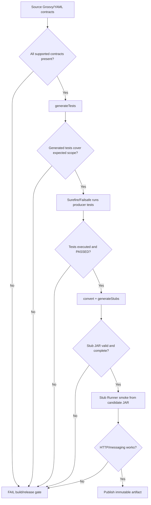
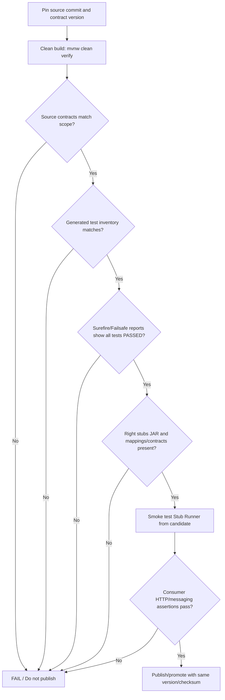

# Verifying Builds Do Not Miss Generated Tests or Stub Artifacts

## 1. The problem: `BUILD SUCCESS` does not automatically protect consumers

Suppose `payment-service` is a **producer** exposing an HTTP API to `checkout-service` and emitting events to `fulfillment-service`. Both consumers have concrete expectations:

- `GET /api/payments/PAY-1001` returns HTTP `200` with JSON `status=PAID`, `amount=250000`, `currency=VND`.
- When a payment is captured, the producer emits a `PaymentCaptured` event to destination `payments.captured`.
- On invalid requests, the producer returns HTTP `409` with the agreed business error code.

The team captures those expectations in **Spring Cloud Contract Groovy/YAML DSL**, uses **Contract Verifier** to generate producer tests, and packages stubs so Checkout can test via **Stub Runner**. All of it is wired into Maven and CI to catch incompatible API changes.

Then one day the pipeline prints:

```text
[INFO] BUILD SUCCESS
[INFO] Tests run: 0, Failures: 0, Errors: 0, Skipped: 0
[INFO] No contracts found
```

If the team looks only at `BUILD SUCCESS`, the release may have **verified zero contracts**. Another failure mode: producer tests pass, yet Maven never builds `payment-service-1.4.2-stubs.jar`, so consumer CI cannot fetch the artifact. Or the JAR has the right name, yet contains stale mappings or misses a body file.

**Lesson objective:** design checks on Maven builds to catch all three failure classes:

1. **Missing or omitted contracts** (wrong source path, filters, `inProgress`/`ignored`).
2. **Generated tests never created, compiled, or executed** (test engine, include patterns, skips, lifecycle).
3. **Stub artifact not created or unusable** (`convert`, `generateStubs`, classifier, JAR contents, repository, Stub Runner).

In this lesson, examples focus on **Maven + JUnit 5 + Spring Cloud Contract** in a Spring Boot application. Spock and Failsafe are noted as variants requiring explicit version-appropriate configuration rather than assuming they behave identically to JUnit/Surefire.

## 2. Five verification milestones requiring separate proof

To avoid vague claims like "contracts were tested," separate:

| Milestone | Question to answer | Expected evidence |
| --- | --- | --- |
| **C1 — Contract source** | Did Maven read the **right** Groovy/YAML from the right repo/artifact version? | Source path/version, inventory of supported contracts. |
| **C2 — Generated test sources** | Did the plugin generate tests for all contracts requiring verification? | Java/Groovy files in `generated-test-sources`, matching class names and scenarios. |
| **C3 — Executed tests** | Did the Maven test engine **run** generated tests, or merely compile/skip them? | Surefire/Failsafe reports, test counts, failures, skipped, per-generated-class results. |
| **C4 — Generated stub contents** | Were mappings and messaging contracts converted and packaged? | Generated mappings, body files, `META-INF/.../contracts` inside the candidate JAR. |
| **C5 — Runnable/published stub** | Can Stub Runner load the **exact artifact** and does the consumer verify real behavior? | Stub Runner smoke test, artifact coordinates, version/checksum. |

These are not five Maven task names, but **five independent control gates**. Missing any single one can yield a "false green."



**Never infer C3 passed just because C2 passed:** tests can be generated into `target/` yet skipped by Surefire or Failsafe. **Never infer C4/C5 passed just because C3 passed:** packaging can be skipped separately, written to the wrong path, or omit resources needed at stub runtime.

## 3. Maven lifecycle and three key Spring Cloud Contract goals

According to Spring Cloud Contract Maven plugin documentation, the primary goals carry these default phase bindings:

| Goal | Default Maven phase | Role | What to verify |
| --- | --- | --- | --- |
| `spring-cloud-contract:generateTests` | `generate-test-sources` | Generates producer verification tests from contracts. | Do generated sources exist and look valid? |
| `spring-cloud-contract:convert` | `process-test-resources` | Converts DSL into stub mappings. | Are matching HTTP mappings or messaging contracts present? |
| `spring-cloud-contract:generateStubs` | `package` | Packages converted output into a stub JAR (default classifier `stubs`). | Are artifact contents and layout valid? |

**Depending on version and plugin setup**, the Maven plugin also needs `<extensions>true</extensions>` and matching dependencies. These plugin goals are documented as **not thread-safe** in their goal documentation; never run parallel multi-module builds sharing output without careful control.

A typical lifecycle:

```text
validate
  ↓
generate-test-sources  ── generateTests
  ↓
process-test-resources ── convert
  ↓
test-compile           ── compile generated tests
  ↓
test                   ── Maven Surefire runs producer tests
  ↓
package                ── generateStubs creates classifier JAR
  ↓
verify                 ── extra verify checks if configured
  ↓
install / deploy       ── artifact to Maven Local / remote repository
```

Notes:

- Running `mvn generate-test-sources` **only generates test code**; it does not verify the producer.
- Running `mvn test` normally reaches test execution, yet **does not reach `package`** to build a fresh stub JAR.
- Running `mvn package` or `mvn verify` per lifecycle can produce both tests and stubs; confirm **they actually executed** and were not skipped.
- Invoking one goal directly, e.g., `mvn spring-cloud-contract:generateStubs`, does not ensure prerequisite goals ran; plugin docs require `convert` to process DSL before packaging.
- `mvn install` saves artifacts to **Maven Local**; `mvn deploy` pushes to the configured remote repository. **Never treat a successful `deploy` as proof that producer tests ran.**

To inspect exact parameters in your project, the Maven plugin provides:

```bash
./mvnw spring-cloud-contract:help \
  -Ddetail=true -Dgoal=generateTests
./mvnw spring-cloud-contract:help \
  -Ddetail=true -Dgoal=generateStubs
```

These are reference commands for a **project with the plugin and Maven Wrapper configured**, not commands executed while authoring this lesson. When upgrading Spring Cloud Contract versions, consult `help` on your real version instead of copying a property name from another release's documentation.

## 4. Source layout: one small change can make all tests vanish

An example producer:

```text
payment-service/
├── pom.xml
└── src/
    ├── main/java/com/example/payment/...
    └── test/
        ├── java/com/example/payment/contract/
        │   └── ContractBase.java
        └── resources/
            └── contracts/
                └── payment-service/
                    ├── http/
                    │   ├── get-paid-payment.groovy
                    │   ├── capture-payment.yml
                    │   └── payment-not-capturable.groovy
                    └── messaging/
                        └── payment-captured.groovy
```

For the Spring Cloud Contract Maven plugin, `contractsDirectory` usually defaults to `src/test/resources/contracts`. If a team moves files to `src/contractTest/resources/contracts` following Gradle's layout without updating Maven, the plugin may find zero files.

Similar pitfalls:

- `contractsDirectory` points to the wrong module in multi-module Maven.
- Source contracts live in an external artifact yet `contractsPath` points to the wrong branch.
- `includedFiles`/`excludedFiles` accidentally filter out all HTTP or messaging contracts.
- A contract is marked `inProgress()`, producing a stub without generating a producer test.
- A contract group is disabled via `ignored()` or `ignoredFiles`, stopping generated tests from enforcing the gate.
- Fixture files referenced via `file(...)` are not packaged or have broken relative paths.

**Never "fix" a build missing contracts by disabling `failOnNoContracts` if the producer still owns promises to verify.** If a module genuinely owns no contracts, treat that as an explicit isolated exception—never a blanket policy across producers.

## 5. Sample contract to trace generated tests

Let us use a clear HTTP contract: `GET /api/payments/PAY-1001` returning a paid payment.

### Groovy DSL

```groovy
import org.springframework.cloud.contract.spec.Contract

Contract.make {
    name 'get_paid_payment'
    description 'Look up a paid payment'

    request {
        method 'GET'
        urlPath '/api/payments/PAY-1001'
        headers {
            header 'Accept': 'application/json'
        }
    }

    response {
        status 200
        headers {
            contentType(applicationJson())
        }
        body([
            paymentId: 'PAY-1001',
            orderId: 'ORD-2001',
            status: 'PAID',
            amount: 250000,
            currency: 'VND'
        ])
    }
}
```

### Equivalent YAML DSL

```yaml
name: get_paid_payment
description: Look up a paid payment
request:
  method: GET
  urlPath: /api/payments/PAY-1001
  headers:
    Accept: application/json
response:
  status: 200
  headers:
    Content-Type: application/json
  body:
    paymentId: PAY-1001
    orderId: ORD-2001
    status: PAID
    amount: 250000
    currency: VND
```

Both snippets describe the **same scenario**. A real project should keep **one** canonical source so duplicate tests/mappings are not generated. The contract contains no `localhost` or test server ports; those belong to the base class/test mode or Stub Runner.

If consumers also depend on business error `409 PAYMENT_NOT_CAPTURABLE` and message `PaymentCaptured`, those require their own contracts and must **both appear in the release inventory**. Seeing a single GET success contract pass does not prove every behavior is protected.

## 6. Sample POM: explicitly configuring test generation and the no-contract guard

A producer using Spring Boot, JUnit Jupiter, and Spring Cloud Contract typically needs the following POM pieces. These are **fragments placed in the proper spots of a project POM**, not a standalone runnable POM since that also depends on Spring Boot parent/BOM, JDK, and plugin versions.

### 6.1. Dependency management

```xml
<!-- Inside <dependencyManagement><dependencies> -->
<dependency>
    <groupId>org.springframework.cloud</groupId>
    <artifactId>spring-cloud-contract-dependencies</artifactId>
    <version>${spring-cloud-contract.version}</version>
    <type>pom</type>
    <scope>import</scope>
</dependency>

<!-- Inside <dependencies> -->
<dependency>
    <groupId>org.springframework.boot</groupId>
    <artifactId>spring-boot-starter-test</artifactId>
    <scope>test</scope>
</dependency>
<dependency>
    <groupId>org.springframework.cloud</groupId>
    <artifactId>spring-cloud-starter-contract-verifier</artifactId>
    <scope>test</scope>
</dependency>
```

Choose `spring-cloud-contract.version` from the compatibility matrix for your Spring Boot and Spring Cloud Contract versions. When a BOM manages test dependencies, avoid pinning ad-hoc versions on individual artifacts that skew the classpath.

### 6.2. Plugin and guards

```xml
<!-- Inside <build><plugins> -->
<plugin>
    <groupId>org.springframework.cloud</groupId>
    <artifactId>spring-cloud-contract-maven-plugin</artifactId>
    <version>${spring-cloud-contract.version}</version>
    <extensions>true</extensions>
    <configuration>
        <contractsDirectory>
            ${project.basedir}/src/test/resources/contracts
        </contractsDirectory>
        <testFramework>JUNIT5</testFramework>
        <testMode>MOCKMVC</testMode>
        <baseClassForTests>
            com.example.payment.contract.ContractBase
        </baseClassForTests>
        <failOnNoContracts>true</failOnNoContracts>
        <failOnInProgress>true</failOnInProgress>
        <classifier>stubs</classifier>
    </configuration>
</plugin>
```

**Practical meaning:**

- `<extensions>true</extensions>` enables Maven plugin lifecycle integration per Spring Cloud Contract guidance.
- `contractsDirectory` points to source contracts, never `target/` where generated tests are written.
- `testFramework=JUNIT5` picks the generated test style; `testMode=MOCKMVC` tests HTTP via MockMvc. When a real HTTP socket is needed, use `EXPLICIT` with Spring Boot `RANDOM_PORT`; WebFlux supports `WEBTESTCLIENT` depending on version.
- `baseClassForTests` points to the **setup class** extended by generated tests.
- `failOnNoContracts=true` blocks builds where the plugin finds zero contracts when the goal supports this parameter. Plugin docs often default it to `true`, yet explicit declaration makes the policy easy to review.
- `failOnInProgress=true` prevents silently publishing declared behaviors not yet verified by the producer as supported by your version.
- `classifier=stubs` sets the default stub JAR suffix in packaging; it does not alter the producer's base GAV.

Never add `includedFiles` for a "fast HTTP build" inside a **release profile** if the producer also commits to messaging or legacy contracts. If two profiles exist, each needs its own clear inventory and pass rules; only the **full compatibility gate** may publish official stubs.

## 7. Base test and real implementation must actually be invoked

A subtle problem: generated tests can exist while a misconfigured base class stubs out responses directly in the test instead of calling the producer controller. With `MOCKMVC`, a base class can look like:

```java
package com.example.payment.contract;

import io.restassured.module.mockmvc.RestAssuredMockMvc;
import org.junit.jupiter.api.BeforeEach;
import org.springframework.beans.factory.annotation.Autowired;
import org.springframework.boot.test.context.SpringBootTest;
import org.springframework.test.web.servlet.MockMvc;
import org.springframework.boot.test.autoconfigure.web.servlet.AutoConfigureMockMvc;

@SpringBootTest
@AutoConfigureMockMvc
public abstract class ContractBase {

    @Autowired
    MockMvc mockMvc;

    @BeforeEach
    void configureGeneratedTests() {
        RestAssuredMockMvc.mockMvc(mockMvc);
    }
}
```

This base class assumes the producer is a Spring MVC app with Spring Boot Test, MockMvc, and `RestAssuredMockMvc` on the classpath. The test context must hold a **deterministic fixture** for `PAY-1001`, such as a test repository or mock at the data-access boundary.

When a GET contract fails, distinguish:

- **Test setup error:** fixture lacks `PAY-1001`, application context fails to start, or base class is missing.
- **Producer contract violation:** controller returns `PENDING` instead of `PAID`, wrong status, or missing field.
- **Generator/test engine failure:** zero generated tests ran, so neither failure mode above was ever detected.

Never rewrite the contract to `PENDING` just to avoid a red test if the producer broke an agreement not yet renegotiated with consumers.

## 8. Guard #1: source contracts exist and match scope

Key Maven plugin parameters:

| Parameter | Role | Common mistake |
| --- | --- | --- |
| `contractsDirectory` | Local Groovy/YAML contract directory. | Points to wrong module or Gradle layout. |
| `contractsMode` / `contractDependency` | Fetches contracts from an external artifact/repository when configured. | Uses dynamic version or lacks fetch credentials. |
| `contractsPath` | Selects contract sub-path inside the downloaded artifact. | Wrong path yields zero contracts. |
| `includedFiles` / `excludedFiles` | Filters contract files processed. | Filters out legacy APIs, messaging, or error contracts. |
| `failOnNoContracts` | Fails when zero contracts/stubs are found per goal. | Accidentally disabled to turn the build green. |
| `failOnInProgress` | Fails when any contract is marked in progress per checker mechanism. | Publishes unimplemented producer behavior. |
| `ignoredFiles` | Marks generated tests as ignored in some configs. | Confuses "ignored" with "verified." |

**Minimum guard:** ensure `failOnNoContracts=true` **and** maintain a list of mandatory scenarios. A non-empty JAR can still omit `payment-not-capturable` or `payment-captured-event`, so checking total contract count > 0 is not enough.

Illustrative expected inventory for a producer:

```text
HTTP:
  get_paid_payment
  capture_payment_success
  capture_payment_rejected_by_state

MESSAGING:
  payment_captured_event

Policy:
  Do not drop v1 API contracts while consumers still use them.
  No inProgress/ignored contracts permitted in release scope.
```

This is illustrative data, not a pre-existing inventory file. In real CI, the list may live in an organization-managed manifest or be derived from a registry/reviewed contracts; never edit a hardcoded list unilaterally without review when adding/removing contracts.

## 9. Guard #2: generated test files must appear

`generateTests` goal documentation lists the default Maven output directory:

```text
target/generated-test-sources/contracts
```

The generated test resources directory is typically:

```text
target/generated-test-resources/contracts
```

Generated class names, packages, and file extensions depend on `JUNIT5/JUNIT/SPOCK`, contract names, plugin version, and base mappings. One contract file does not necessarily yield exactly one Java test class; one file can hold multiple contracts.

After running Maven, verify:

1. Did the plugin actually execute `generateTests`?
2. Are expected `.java` or `.groovy` files present in `generated-test-sources`?
3. Do generated files have valid packages/class names and extend the right base class?
4. Do request/response details in generated tests reflect source contracts?
5. Were those files added to **test source roots** so the Maven compiler sees them?

### Why seeing files is not enough

If a Java file is generated yet test compilation cannot find `ContractBase`, the build fails visibly. More dangerously, generated sources may sit outside the test source roots scanned by Surefire; Maven still runs other unit tests and reports green while **zero contract tests executed**.

Spring Cloud Contract documentation describes using `build-helper-maven-plugin` to add `generated-test-sources` to test source roots when an IDE or Maven fails to recognize them. This is a fix only for a **confirmed source-root problem**, not a mandatory plugin for every project.

Additional snippet only when genuinely needed:

```xml
<plugin>
    <groupId>org.codehaus.mojo</groupId>
    <artifactId>build-helper-maven-plugin</artifactId>
    <version>REPLACE_WITH_COMPATIBLE_VERSION</version>
    <executions>
        <execution>
            <id>add-generated-contract-tests</id>
            <phase>generate-test-sources</phase>
            <goals>
                <goal>add-test-source</goal>
            </goals>
            <configuration>
                <sources>
                    <source>
                        ${project.build.directory}/generated-test-sources/contracts
                    </source>
                </sources>
            </configuration>
        </execution>
    </executions>
</plugin>
```

**Do not apply indiscriminately** when the SCC Maven plugin already registers generated sources on source roots; duplicating it only clutters the POM. For Spock/Groovy, proper `.groovy` compiler/source-set handling is also needed; adding a Java source folder without a Groovy compiler solves nothing.

## 10. Guard #3: generated tests actually run via Surefire or Failsafe

**Maven Surefire** normally runs tests in the `test` phase, whereas **Maven Failsafe** runs integration tests in `integration-test` and `verify` when configured. Spring Cloud Contract generated tests can run with Surefire; if a project deliberately names them after integration-test conventions, configure Failsafe accordingly.

A Maven Surefire snippet for **JUnit Jupiter**:

```xml
<plugin>
    <groupId>org.apache.maven.plugins</groupId>
    <artifactId>maven-surefire-plugin</artifactId>
    <version>REPLACE_WITH_COMPATIBLE_VERSION</version>
    <configuration>
        <failIfNoTests>true</failIfNoTests>
        <includes>
            <include>**/*Test.java</include>
            <include>**/*Tests.java</include>
        </includes>
    </configuration>
</plugin>
```

This is a **configuration fragment**; never copy it verbatim if your project also uses `TestSomething`, `*TestCase`, or Spock `*Spec`. Those `includes` select only two suffixes and can **drop tests** if generated classes do not match. Usually keep compatible default include patterns or widen intentionally rather than narrowing them for speed.

**`failIfNoTests=true` only catches an execution where Surefire finds zero tests overall.** If the project has 70 normal unit tests and **0 generated contract tests**, Surefire still finds tests and passes. Hence, verify **independently** the count of generated test classes/methods and executed tests in reports.

### Failsafe for integration naming when needed

Suppose a project deliberately names producer tests `PaymentContractIT` and uses Failsafe:

```xml
<plugin>
    <groupId>org.apache.maven.plugins</groupId>
    <artifactId>maven-failsafe-plugin</artifactId>
    <version>REPLACE_WITH_COMPATIBLE_VERSION</version>
    <executions>
        <execution>
            <goals>
                <goal>integration-test</goal>
                <goal>verify</goal>
            </goals>
        </execution>
    </executions>
    <configuration>
        <failIfNoTests>true</failIfNoTests>
        <includes>
            <include>**/*IT.java</include>
            <include>**/*ITCase.java</include>
        </includes>
    </configuration>
</plugin>
```

**This fits only when the module truly has integration tests matching those names.** If the project has zero `*IT` files, setting `failIfNoTests` fails the build for reasons unrelated to Spring Cloud Contract. Never let both Surefire and Failsafe execute the same generated class twice unintentionally; keep naming conventions and phases distinct.

### Inspect reports, not just summary logs

With Surefire, output typically appears under:

```text
target/surefire-reports/
├── TEST-com.example.payment.contract.GetPaidPaymentTest.xml
└── ...
```

With Failsafe:

```text
target/failsafe-reports/
├── TEST-com.example.payment.contract.PaymentContractIT.xml
└── ...
```

Paths and class names are **illustrative**, not guaranteed generated output. For CI guards:

- Identify the **package/class names** of generated tests in the current build.
- Inspect the XML reports of **those exact classes**, not just unrelated unit test reports.
- Count `tests`, `failures`, `errors`, and `skipped` specifically for those contract classes.
- Block when expected tests are missing, test count is 0, or tests are skipped outside policy.
- Never assume contract file count equals JUnit method count.

**Checking "generated files exist" + "test reports exist for those exact files" is the foundation against false greens.**

## 11. Three forms of skipping and their consequences

| Flag/setting | What can it do? | Impact on release gate |
| --- | --- | --- |
| `-DskipTests` | Usually allows compiling tests while **skipping execution** in Surefire/Failsafe. | No trustworthy producer verification. |
| `-Dmaven.test.skip=true` | Usually skips both test compilation and execution (per supporting plugins). | Generated tests may never even compile. |
| `-Dspring.cloud.contract.verifier.skip=true` | Skips Contract Verifier plugin work per version target. | May skip generating fresh tests/mappings/stubs. |
| `-Dspring.cloud.contract.verifier.jar.skip=true` | Skips **only stub JAR creation** in goals supporting `jarSkip`. | Producer tests pass yet no publishable artifact is built. |
| `<failOnNoContracts>false</failOnNoContracts>` | Permits zero contracts in the corresponding goal. | Hides wrong paths/patterns when module owes contracts. |
| `inProgress()` / `ignored()` | Can stop contracts from running producer tests. | Stubs exist yet cannot count as verified. |
| Surefire `<excludes>`, test filtering | Tests are generated yet unselected by the test engine. | "Generated sources exist" does not mean they ran. |

**Never use skip flags for an API-compatible release.** Shortcuts may suit temporary dev iterations, yet release gates must run cleanly from locked sources/contracts and collect full test reports.

### Warning on incremental generation

Per Maven plugin docs, several goals offer options:

- `incrementalContractTests`: regenerates tests only when contracts change per plugin mechanism.
- `incrementalContractStubs`: converts stubs only when inputs change per plugin mechanism.
- `incrementalContractStubsJar`: rebuilds the JAR only when stubs change.

**Incremental generation is a codegen/packaging optimization, not a substitute for producer verification.** When a controller changes without any contract change, generated tests must still run to catch regressions. For release builds, use a clean workspace or strict input/output caching; never grab an old JAR sitting in `target/` and stamp a new release version on it.

## 12. Guard #4: candidate JAR has the right classifier and contents

After `mvn -B clean verify` in a configured project, outputs typically resemble:

```text
target/
├── payment-service-1.4.2.jar
├── payment-service-1.4.2-stubs.jar
├── generated-test-sources/
│   └── contracts/...
├── stubs/
│   └── .../mappings/...
└── surefire-reports/
    └── TEST-....xml
```

**Folder and file names are illustrative**, depending on Maven `finalName`, plugin version, packaging, and output settings. What matters is having a **real candidate stub artifact** carrying the expected classifier, not only the application JAR.

Using the JDK, inspect via:

```bash
jar tf target/payment-service-1.4.2-stubs.jar
```

A common layout:

```text
META-INF/
└── com.example/
    └── payment-service/
        └── 1.4.2/
            ├── contracts/
            │   ├── http/get-paid-payment.groovy
            │   └── messaging/payment-captured.groovy
            └── mappings/
                └── http/get-paid-payment.json
```

This is an **illustrative artifact layout** that Stub Runner normally discovers under `META-INF/<groupId>/<artifactId>/<version>/`. Subfolders, body files, or formats can vary by plugin; never enforce a rigid rule like "every Groovy file must have one JSON mapping" across all contract types, since messaging is handled differently from HTTP.

### Distinguish at least three levels of package checks

| Level | Check | If you stop here |
| --- | --- | --- |
| **File exists** | Was `*-stubs.jar` built in the candidate build? | JAR could be empty or carry the wrong classifier. |
| **Structured contents** | Are entries under `contracts/`, `mappings/`, and referenced resources present? | Mappings could still have wrong matchers, status, or body. |
| **Runtime behavior** | Does Stub Runner load the exact JAR and serve HTTP/messages per contract? | Only verifies loader/consumer; still does not replace producer verification. |

When HTTP contracts are supported, a JAR without HTTP mappings must be blocked. When a producer **only has messaging contracts**, a JAR with zero HTTP mappings can still be valid—provided matching messaging contracts/labels/destinations and real tests exist.

### Inspect mapping semantics

An abbreviated WireMock mapping may look like:

```json
{
  "request": {
    "method": "GET",
    "urlPath": "/api/payments/PAY-1001"
  },
  "response": {
    "status": 200,
    "headers": {
      "Content-Type": "application/json"
    },
    "jsonBody": {
      "paymentId": "PAY-1001",
      "orderId": "ORD-2001",
      "status": "PAID",
      "amount": 250000,
      "currency": "VND"
    }
  }
}
```

This is a **WireMock content example**, not required byte-for-byte output for every generator version. Generated mappings may use `body`, `jsonBody`, `base64Body`, or `bodyFileName`. Accept valid representations when runtime returns the right data, while verifying:

- Do HTTP method and path match what the consumer will send?
- Are query/header/body matchers overly broad (e.g., `.*` for all IDs) or overly strict?
- Do status, `Content-Type`, body, and data types reflect the contract?
- Could calling a different ID or currency unintentionally match the happy-path stub?
- Are `bodyFileName` files located where the WireMock loader expects them?
- Are binary response bodies byte-preserved?

**Never just inspect a ZIP listing and check filenames:** run a smoke test against the exact candidate artifact.

## 13. Guard #5: Stub Runner loads the exact candidate artifact

Once the candidate JAR has valid contents, consumer tests must load it with **Stub Runner**. Example Checkout test:

```java
@SpringBootTest(properties = {
    "payment.base-url=http://localhost:6565"
})
@AutoConfigureStubRunner(
    ids = "com.example:payment-service:1.4.2:stubs:6565",
    stubsMode = StubRunnerProperties.StubsMode.LOCAL
)
class CheckoutPaymentStubTest {

    @Autowired
    PaymentClient paymentClient;

    @Test
    void parsesPaymentFromPublishedContractStub() {
        PaymentView payment = paymentClient.getPayment("PAY-1001");

        assertThat(payment.paymentId()).isEqualTo("PAY-1001");
        assertThat(payment.orderId()).isEqualTo("ORD-2001");
        assertThat(payment.status()).isEqualTo("PAID");
        assertThat(payment.currency()).isEqualTo("VND");
    }
}
```

This is an **illustrative test fragment**; a project needs imports, `spring-cloud-starter-contract-stub-runner` in test scope, and real `PaymentClient/PaymentView` classes. If the HTTP client uses Reactor, the test should use `StepVerifier` or bounded blocking only inside tests. `PaymentClient` must actually send HTTP requests to the stub server—never mock the client itself.

### Whose Maven Local does `LOCAL` read?

With `StubsMode.LOCAL`, Stub Runner reads artifacts from the **local Maven repository of the test process/container itself**. A newly built stub JAR in `target/` **does not automatically appear in Maven Local**. Normally you run `install` or place the candidate into an isolated repository per test workflow:

```bash
./mvnw -B clean install
```

**However:** `install` is not a "copy-only" operation: it runs the lifecycle through `install`, potentially regenerating artifacts and re-running tests. If a smoke suite checks the same version while Maven Local already holds an older JAR, it can pass falsely. In CI:

1. Pin a distinct candidate version per commit/build.
2. Use an **isolated** Maven Local or container filesystem per job.
3. Verify the exact coordinates and path Stub Runner resolved.
4. Compare checksums between the built JAR and the artifact loaded by Stub Runner.
5. After smoke testing, **publish/promote those exact verified candidate bytes**; if a subsequent rebuild produces a different file, re-verify before release.

With a remote repository, configure `StubsMode.REMOTE` and `repositoryRoot`/credentials per version. Release tests must never use dynamic `+` or `latest`, because the same Checkout commit could download two different artifacts at different times.

### Negative tests are also essential

If the contract applies only to `PAY-1001`, try calling `PAY-9999`. If the stub still returns `PAID` unexpectedly, the matcher is too broad. Yet WireMock returning `404 No matching stub` **is not proof that the real producer promises HTTP `404 PAYMENT_NOT_FOUND`**. To test business `404` errors, write an explicit 404 contract and verify it with producer tests.

## 14. Automating generated file checks with PowerShell

In a CI environment running Windows PowerShell (or PowerShell Core), a simple post-Maven check:

```powershell
$generatedDir = "target/generated-test-sources/contracts"
$stubJar = "target/payment-service-1.4.2-stubs.jar"

if (-not (Test-Path -LiteralPath $generatedDir)) {
    throw "Generated contract tests directory does not exist"
}

$generatedSources = @(
    Get-ChildItem -LiteralPath $generatedDir -Recurse -File |
    Where-Object { $_.Extension -in @(".java", ".groovy") }
)

if ($generatedSources.Count -eq 0) {
    throw "No generated contract source files found"
}

if (-not (Test-Path -LiteralPath $stubJar)) {
    throw "Candidate stubs JAR does not exist"
}

$jarEntries = & jar tf $stubJar
if ($LASTEXITCODE -ne 0) {
    throw "Unable to read candidate stubs JAR"
}

$httpMappings = @(
    $jarEntries | Where-Object {
        $_ -match "/mappings/.+\.json$"
    }
)
if ($httpMappings.Count -eq 0) {
    throw "No HTTP mappings found (this producer requires HTTP contracts)"
}

Write-Output "Generated source files: $($generatedSources.Count)"
Write-Output "HTTP mappings: $($httpMappings.Count)"
```

**This code is for learner reference, not an executed script.** Adjust the JAR path to actual artifact output if your project customizes `finalName` or version. The mapping check applies only when the producer **requires HTTP contracts**; never enforce `HTTP mappings > 0` on a messaging-only producer.

**Important:** this script only checks generated files and that the JAR has mappings. It **does not prove generated tests executed**. CI needs a separate guard parsing Surefire/Failsafe XML reports, matching generated classes against executed tests, and failing if any are missing. Never sum all unit tests in the module and mistake them for producer contract tests.

### Executed test count checks must track generated classes

Suppose a build produces:

```text
Generated test classes:
  GetPaidPaymentTest
  CapturePaymentTest
  PaymentNotCapturableTest

Surefire reports:
  PaymentServiceUnitTest       80 tests PASSED
  GetPaidPaymentTest           1 test PASSED
  CapturePaymentTest           MISSING
  PaymentNotCapturableTest     MISSING
```

Total executed tests is 81, yet **the full contract gate has not passed**. The job must FAIL because two generated classes are missing from reports. When implementing the guard, rely on **fully qualified class names (FQN) and test report XMLs**, not random string matching hoping for hits. Some generated tests group multiple methods, Spock specs, or dynamic names; match against your module's actual test engine and reports.

For stronger control, store an **expected behavior manifest** keyed by contract name and verify every promise has both producer verification and matching stub contents. Manifest updates must go through review when adding or removing API commitments.

## 15. Maven Enforcer and artifact checks in the `verify` phase

Maven Enforcer is commonly used to block invalid build conditions. A `requireFilesExist` rule can catch a **missing candidate JAR**, though it cannot verify mapping contents or that producer tests executed.

Example **plugin fragment in a project with a compatible Enforcer version**:

```xml
<plugin>
    <groupId>org.apache.maven.plugins</groupId>
    <artifactId>maven-enforcer-plugin</artifactId>
    <version>REPLACE_WITH_COMPATIBLE_VERSION</version>
    <executions>
        <execution>
            <id>verify-stubs-file</id>
            <phase>verify</phase>
            <goals>
                <goal>enforce</goal>
            </goals>
            <configuration>
                <rules>
                    <requireFilesExist>
                        <files>
                            <file>
                                ${project.build.directory}/${project.build.finalName}-stubs.jar
                            </file>
                        </files>
                    </requireFilesExist>
                </rules>
                <fail>true</fail>
            </configuration>
        </execution>
    </executions>
</plugin>
```

**Limitation:** `${project.build.finalName}-stubs.jar` assumes `generateStubs` outputs using that naming convention. If a project overrides classifier, output path, or packaging, update the checked path. If Enforcer runs on a module that does not build stubs, the rule fails falsely—place it **only in producer modules with mandatory stub artifacts**.

A file-existence rule knows nothing about **generated class test reports**, `META-INF` contents, or Stub Runner behavior. Treat it as a **helpful but incomplete guard**, paired with inventory, test report, and runtime smoke checks.

## 16. When a project uses Spock or other naming conventions

Not all generated tests are Java/JUnit:

- `testFramework=JUNIT5`: test classes target JUnit Jupiter, requiring the test engine on the classpath and compatible Surefire/Failsafe.
- `testFramework=SPOCK`: the plugin generates Groovy specs, requiring Spock dependencies and Groovy compiler/source-set support; Surefire must recognize suffixes like `*Spec` when used.
- `testFramework=JUNIT`: refers to JUnit 4 in plugin lines that still support it, distinct from JUnit 5.

Example **widening Surefire `includes`** when a project deliberately uses Spock:

```xml
<configuration>
    <includes>
        <include>**/*Test.java</include>
        <include>**/*Tests.java</include>
        <include>**/*Spec.java</include>
    </includes>
    <failIfNoTests>true</failIfNoTests>
</configuration>
```

**Do not copy blindly across versions:** Spock specs are Groovy sources, and Maven docs may use `**/*Spec.*`. Check compiled class files and Surefire test discovery in your exact environment; if using Spock 2 on JUnit Platform, compatible dependencies and engine are still required. If reports lack generated `Spec`s despite `.groovy` sources existing, fix the gate rather than turning off `failIfNoTests`.

## 17. Multi-module Maven: check the right module, not just the root build

An example Maven reactor:

```text
platform-parent/
├── pom.xml
├── payment-service/
│   ├── pom.xml
│   └── src/test/resources/contracts/...
├── inventory-service/
│   ├── pom.xml
│   └── src/test/resources/contracts/...
└── checkout-service/
    └── pom.xml
```

If Spring Cloud Contract is configured in the parent's `<pluginManagement>` yet **omitted from the producer module**, it may never execute where needed. If placed in shared `<plugins>` without scoping, modules without contracts (like Checkout) may fail or trigger a global skip flag that disables Payment's gate too.

Recommendations:

1. Producer modules `payment-service` and `inventory-service` explicitly activate the Contract Verifier plugin.
2. Consumer module `checkout-service` uses only Stub Runner/test clients as needed, never publishing stubs as a producer.
3. Each producer module enforces its **own** `failOnNoContracts` and test report guards rather than summing tests at the reactor root.
4. Lock GAV/classifier/contract scope per module so an `inventory-service` stub is never published under Payment's coordinates.
5. Never let jobs skip a producer module owning active contracts just to build a reactor subset faster.

Example running one module and its dependencies:

```bash
./mvnw -B -pl payment-service -am clean verify
```

This assumes the reactor contains `payment-service` and required dependencies. A root reactor `SUCCESS` does not replace checking the reports of **`payment-service` itself**. A release profile may select all producer modules, yet each module still needs independent artifacts and inventories.

## 18. "False-green" scenarios to test in CI

| Intentionally injected fault | What CI must catch |
| --- | --- |
| Point `contractsDirectory` to a non-existent folder. | Plugin finds zero contracts; `failOnNoContracts` and inventory fail. |
| Keep 3 contracts, set `includedFiles` to match only 1. | Full gate detects missing supported behaviors. |
| Change producer `GET /api/payments/PAY-1001` to return `PENDING`. | Generated GET producer test must **execute and fail**. |
| Pass `-DskipTests`. | Contract test execution reports are missing; release gate fails. |
| Pass `spring.cloud.contract.verifier.jar.skip=true`. | Candidate `-stubs.jar` is not built; artifact guard fails. |
| Narrow Surefire includes to `*UnitTest`. | Generated test reports are missing even though unit tests pass. |
| Mark a contract `inProgress()`. | Release gate blocks or requires an explicit exception, never marking the stub verified. |
| Delete an external body file while keeping its referencing mapping. | JAR inspection and Stub Runner runtime smoke catch the error. |
| Change classifier from `stubs` to `sources`. | Expected coordinates/filename mismatch; Stub Runner fails to download. |
| Put an old version's mappings into a new package. | Behavior checks, checksum/source/version checks, and producer verification catch the mismatch. |
| Keep GET stub while dropping messaging contract. | Full inventory/`StubTrigger` label and producer messaging test gate fail. |

**Perform these experiments on a test/sandbox branch**, never breaking release artifacts already consumed downstream. Once the gate proves effective, restore settings and rerun. Reliable CI is CI that **knows how to fail when a protection is deliberately disabled or bypassed**.

## 19. Release gate workflow for Spring Cloud Contract + Maven

A recommended workflow:



A pseudo-CI file **illustrating policy only**, not verbatim runnable GitHub Actions/GitLab/Jenkins YAML:

```yaml
jobs:
  producer-verify:
    command: "./mvnw -B -ntp clean verify"
    required:
      - expected_contracts_found
      - generated_sources_non_empty
      - generated_test_classes_executed
      - all_required_tests_passed
      - no_unapproved_skips_or_in_progress

  candidate-stub:
    needs: producer-verify
    required:
      - stub_jar_exists_with_classifier_stubs
      - expected_contracts_and_mappings_inside_jar
      - no_missing_body_resources
      - no_secrets_or_live_customer_data

  smoke:
    needs: candidate-stub
    required:
      - load_exact_candidate_in_stub_runner
      - positive_and_negative_http_requests
      - messaging_label_trigger_if_supported
      - consumer_business_assertions_passed

  publish:
    needs: smoke
    required:
      - same_source_and_contract_version
      - published_checksum_equals_candidate
      - release_version_is_immutable
```

### Notes on `install` and `deploy`

For Stub Runner in `LOCAL` mode, install candidate artifacts into a job-isolated local Maven repository. To share across CI jobs, upload candidates to a staging repository, run consumer smoke tests, and then **promote that exact artifact** to the release repository. If a pipeline calls `mvn deploy` after an earlier `mvn verify`, Maven may re-run the lifecycle/packaging; verify that the final published artifact contains the **exact tested bytes**, not merely the same filename.

Release versions must be immutable. Never republish `1.4.2` with new mappings to "quick-fix" a red consumer test; bump the version and let consumers adopt the new version properly.

## 20. Symptom-based debugging

| Symptom | Possible cause | Investigation path |
| --- | --- | --- |
| Green build, `target/generated-test-sources/contracts` empty | Wrong contract path, filter, or skipped goal. | Check path, plugin output, `failOnNoContracts`. |
| Generated Java exists without XML reports | Test engine or Surefire includes missed it; classes failed to compile. | Check test source roots, JUnit engine, Surefire reports. |
| Maven runs 80 unit tests yet 0 contract tests | Guard counts whole module instead of generated classes. | Match generated test class inventory against XML reports. |
| Tests run in IDE yet skipped in CI | IDE source roots differ from Maven lifecycle, profile, or test filters. | Run Maven Wrapper with exact release command; inspect effective POM. |
| `failIfNoTests=true` stays green despite missing contracts | Surefire runs unrelated unit tests. | Add dedicated guard for generated contract tests. |
| `mvn test` builds no `-stubs.jar` | `generateStubs` normally binds to `package` after `test`. | Run `package`/`verify` and inspect goal execution. |
| `-stubs.jar` exists with zero mappings | `convert` didn't run, wrong filter, or jar grabbed stale output. | Check `target/stubs`, JAR entries, and run a clean build. |
| `jarSkip=true` leaves missing artifact | Skipped only the JAR step. | Block skip flags and require artifact existence. |
| Stub Runner reports artifact not found | JAR not installed/deployed, wrong GAV/classifier, or wrong Maven Local. | Confirm repository, ID, classifier, and version. |
| Stub Runner returns stale data | Local cache, reused version, or stale packaged JAR. | Pin candidate version and inspect checksum/response. |
| Messaging contract exists yet test does not run | Base test/message verifier unconfigured, `inProgress`/`ignored`. | Inspect generated messaging tests and reports. |
| Stub returns 404 without error JSON | Request misses WireMock mapping. | Check request matchers; do not confuse with business 404 contracts. |
| Build fails on Enforcer missing JAR in parent | Rule runs in a module that builds no stubs. | Scope rule strictly to producer modules or matching profiles. |

### Quick debugging sequence

1. **Source:** which contracts and versions is Maven reading?
2. **Generator:** did `generateTests`/`convert`/`generateStubs` run in the lifecycle?
3. **Test source:** were generated sources compiled into test classes?
4. **Test execution:** do generated classes themselves have XML reports and non-zero test counts?
5. **Artifact:** does `-stubs.jar` exist with the right classifier, namespace, and contents?
6. **Runtime:** does Stub Runner load the right candidate and serve expected HTTP/events?
7. **Publish:** does the final artifact match the version and checksum of the tested candidate?

## 21. Practice exercise: creating three independent guards for a Maven producer

A Maven Spring Boot `inventory-service` makes these promises:

```text
Contract A: GET /api/inventory/SKU-001
            -> 200 + {"sku":"SKU-001","available":true,"quantity":12}

Contract B: GET /api/inventory/SKU-999
            -> 404 + {"code":"INVENTORY_NOT_FOUND"}

Contract C: InventoryReserved event
            -> destination inventory.reserved
            -> label inventory_reserved_001

groupId    = com.example
artifactId = inventory-service
version    = 2.3.0
classifier = stubs
```

**Practice requirements:**

1. Write Groovy or YAML DSL for contracts A and B; write contract C using messaging DSL with `triggeredBy`, `outputMessage.sentTo`, and `label`.
2. Configure `spring-cloud-contract-maven-plugin` with `<extensions>true</extensions>`, `contractsDirectory`, JUnit 5, a base test class, `failOnNoContracts=true`, and `failOnInProgress=true`.
3. Run the Maven lifecycle to generate tests, then identify the **`generated-test-sources` path** and generated class names for A, B, and C.
4. Add Surefire `failIfNoTests=true`; explain why this flag alone is insufficient when the module has 50 normal unit tests.
5. Design a guard matching generated class names against Surefire/Failsafe XML reports. What happens if contract C has no executed test?
6. Contrast `mvn test` and `mvn verify` outputs regarding the stub JAR; when does `generateStubs` run?
7. Use `jar tf` to inspect `inventory-service-2.3.0-stubs.jar`; what must appear under `contracts/` and `mappings/`?
8. Write a Stub Runner smoke test using `com.example:inventory-service:2.3.0:stubs:6565` verifying `SKU-001` and error handling for `SKU-999`.
9. Test `-DskipTests` or `-Dspring.cloud.contract.verifier.jar.skip=true` on a test branch, proving the corresponding release gate fails.
10. Try setting `includedFiles` to select only contract A. Why is a build with one generated test and one mapping still **insufficient** to protect all promises?
11. Use the candidate artifact in a CI-isolated Maven Local, comparing its checksum with the final published repository artifact; explain why release versions must never be overwritten.
12. If Inventory had only messaging and no HTTP, how would you adapt package-inspection policies so they do not wrongly demand HTTP mappings?

**Success criteria:** the solution enforces **exact contract source → generated tests exist → producer tests actually execute → stub artifact is accurate and complete → Stub Runner loads it → verified artifact is published**. A single `BUILD SUCCESS` or an existing `-stubs.jar` file cannot replace this full chain.

## 22. Key takeaways

- The Spring Cloud Contract Maven plugin provides primary goals: `generateTests` (default `generate-test-sources`), `convert` (default `process-test-resources`), and `generateStubs` (default `package`).
- **Enabling `failOnNoContracts` does not catch every 0-generated-test case.** Tests can be ignored/`inProgress`, missed by the test engine, or skipped.
- **`failIfNoTests` only sees total tests in Surefire/Failsafe execution**, without distinguishing contract tests from regular unit tests; always match generated classes against XML reports.
- Misusing `jarSkip`/`skipTests` and incremental/caching options can yield a green build with no matching verified stub artifact.
- **The stub JAR needs the right `stubs` classifier, GAV, mappings, contracts, and body resources**, and must pass a Stub Runner smoke test from that exact candidate.
- For Maven Local/remote, verify **artifact version/checksum** rather than just filename; never overwrite an in-use release.
- Release gates should combine **source inventory → test generation → test execution → package inspection → runtime smoke → publish**. Mark builds successful only when all mandatory conditions pass.

### References

- [Spring Cloud Contract — Maven Project](https://docs.spring.io/spring-cloud-contract/reference/maven-project.html): plugin setup, generated test sources, base classes, and Maven lifecycle.
- [Spring Cloud Contract — Maven Plugin Goals](https://docs.spring.io/spring-cloud-contract/docs/current/spring-cloud-contract-maven-plugin/plugin-info.html): goal list and meanings of `generateTests`/`convert`/`generateStubs`.
- [Spring Cloud Contract — generateTests Mojo](https://docs.spring.io/spring-cloud-contract/docs/current/spring-cloud-contract-maven-plugin/generateTests-mojo.html): `failOnNoContracts`, `failOnInProgress`, source paths, generated tests, and skip flags.
- [Spring Cloud Contract — convert Mojo](https://docs.spring.io/spring-cloud-contract/docs/current/spring-cloud-contract-maven-plugin/convert-mojo.html): converting contracts into WireMock stub mappings.
- [Spring Cloud Contract — generateStubs Mojo](https://docs.spring.io/spring-cloud-contract/docs/current/spring-cloud-contract-maven-plugin/generateStubs-mojo.html): classifier, `package` phase, `jarSkip`, and fail-on-empty.
- [Maven Surefire Plugin — Using Includes and Excludes](https://maven.apache.org/surefire/maven-surefire-plugin/examples/inclusion-exclusion.html): discovered test names and filtering test classes.
- [Maven Surefire Plugin — surefire:test](https://maven.apache.org/surefire/maven-surefire-plugin/test-mojo.html): `failIfNoTests`, test execution, and reports.
- [Maven Failsafe Plugin — failsafe:verify](https://maven.apache.org/surefire/maven-failsafe-plugin/verify-mojo.html): integration test verification conditions.
- [Spring Cloud Contract — Stub Runner](https://docs.spring.io/spring-cloud-contract/reference/project-features-stubrunner.html): using stub artifacts to test consumers.
