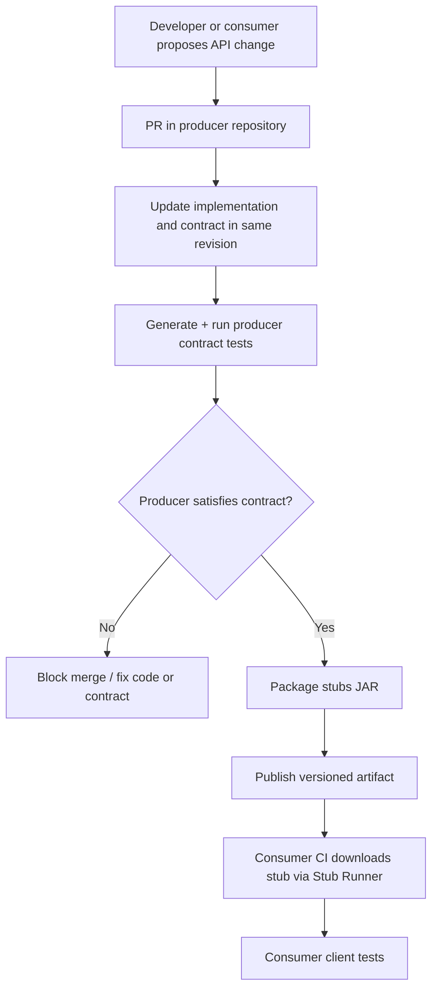
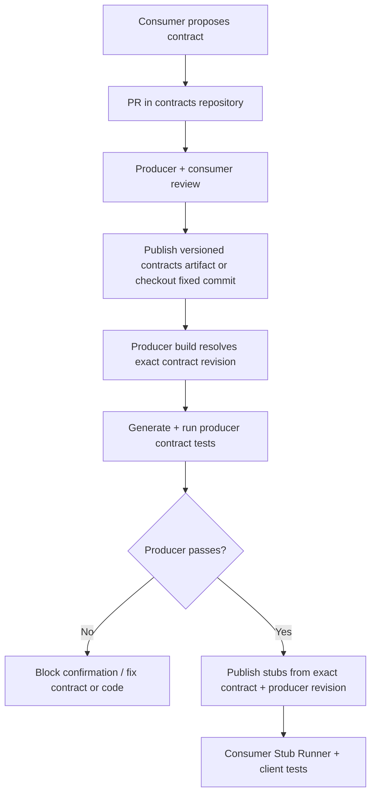
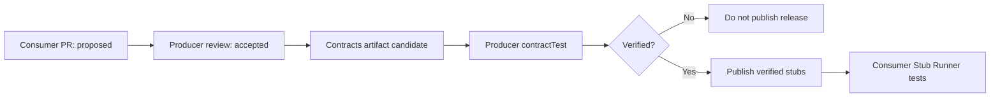
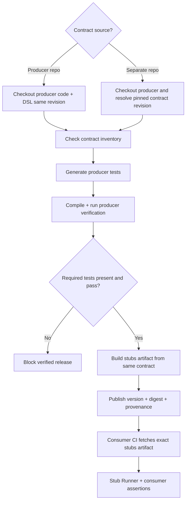

# Storing Contracts with the Producer or in a Separate Repository

## 1. Choosing Where to Store Contracts Is an Ownership Decision

In **Spring Cloud Contract**, the producer and consumer both rely on contracts describing **HTTP** or **messaging** behavior. Contracts can be written in the **Groovy/YAML DSL** and are used to generate **producer verification tests**, create **stubs**, run **Stub Runner** on the consumer side, and integrate with **CI** to detect incompatible API changes.

After learning how to write a contract, a team must answer an architectural question: **should contracts live in the producer's source repository or in an independent repository?**

For example:

- `order-service` provides `GET /api/orders/{id}`.
- `checkout-service` uses an HTTP client to check order status.
- `notification-service` receives the `OrderConfirmed` event from the producer.

If the contract lives in the **order-service repository**, the producer can update the code and contract in a single pull request and run verification immediately. If the contract lives in a **separate repository**, multiple consumers can propose and review interfaces in an independent place, but versions, access permissions, and the process of pulling contracts into the producer build must be coordinated.

**There is no single choice for every organization.** Both models can work with Spring Cloud Contract as long as the team maintains the core principles: contracts have clear ownership, the producer actually verifies the promise, stubs are generated from the **same source**, and consumers download the exact verified artifact/version.

**Lesson objectives:**

1. Distinguish between **source repository**, **contracts artifact**, and **stubs artifact**.
2. Compare storing contracts **with the producer** versus storing them in a **separate repository** across ownership, collaboration, release, and CI.
3. Understand the workflow where contracts are proposed by consumers and verified by the producer.
4. Organize paths, versions, and build configurations to resolve the right contracts.
5. Design a release gate connecting contract revision, producer verification, artifact publication, and Stub Runner.
6. Choose the right model for real-world scenarios, avoiding stale stubs and breaking consumers.

## 2. Three Different Kinds of “Repositories”: Git, Contracts Artifact, and Stubs Artifact

A very common mistake is calling all of them “the contract repository.” In practice, you need to distinguish:

| Component | What does it store? | Who uses it? | Role |
| --- | --- | --- | --- |
| **Git source repository** | `.groovy`/`.yml` files, source code, PR/review history | Developers, producer/consumer CI | **Editable source**, manages ownership and changes |
| **Contracts artifact** | Packaged/versioned bundle of **source DSL contracts** | Producer build or contract-sharing workflow | Transfers contracts from a separate repo to where the verifier can consume them |
| **Stubs artifact** | Generated WireMock mappings, response files, and/or messaging stub contents | **Stub Runner on the consumer** | Serves simulated responses/messages during consumer tests |
| **Artifact registry** | Stores and distributes contracts/stubs JARs by coordinates | CI and build tools | Provides release/versioning, access control, checksums |

Illustrative coordinates example:

```text
Producer source:
  git: order-service.git @ revision 8c1e540

Source contract:
  src/test/resources/contracts/orders/get-confirmed-order.groovy

Separate contracts artifact (if any):
  com.example.contracts:order-contracts:1.6.0

Producer stubs artifact:
  com.example:order-service:1.6.0:stubs

Producer executable artifact:
  com.example:order-service:1.6.0
```

These coordinates are examples only. **A contracts JAR and a stubs JAR are not the same artifact**: the contracts JAR contains DSL used to generate tests/stubs, while the stubs JAR provides data for Stub Runner to consume. A producer-owned workflow may **not need to publish a separate contracts JAR** because the verifier reads the DSL directly from the producer's source.

### “Remote contracts” does not mean “automatically reading Git”

In Spring Cloud Contract, settings like `contractsMode = REMOTE` typically relate to **fetching a contracts artifact from a Maven-compatible repository**, depending on the plugin/version. It **does not automatically clone an arbitrary Git URL**. If an organization stores DSL in a separate Git repository, there must be a way to:

- Publish the DSL as a contracts artifact that the producer can resolve; **or**
- Check out/copy the contract source into a controlled build directory and configure the verifier to read **that exact directory**.

In both approaches, you should record which Git commit produced the contract input and ensure producer tests use that exact content.

## 3. Model A: Storing Contracts in the Producer Repository

The producer owns both the implementation code and the DSL contracts in the same Git repository. For example:

```text
order-service/
  build.gradle
  src/
    main/
      java/com/example/orders/...
    contractTest/
      java/com/example/orders/contract/OrderContractBase.java
      resources/
        contracts/
          orders/
            get-confirmed-order.groovy
            get-missing-order.yml
          messaging/
            order-confirmed.groovy
```

This is an **illustrative layout for Gradle**, using `src/contractTest/resources/contracts` according to a common plugin configuration. With Maven, `src/test/resources/contracts` can be used. **Do not assume every project shares the same defaults**; the path must match Gradle's `contractsDslDir` or Maven's contract directory configuration.

### Producer-owned development workflow



**Pros:**

- **Atomic changes:** the same pull request can update code and contracts, making consistency easy to review.
- **Easy debugging:** a single Git commit links endpoint implementation, DSL, and generated-test setup.
- **Less extra infrastructure:** no separate pipeline needed to publish source contracts artifacts.
- **Clear ownership:** the producer is responsible for upholding the HTTP/message promises it publishes.
- **Simple for small teams:** fewer version synchronization steps between source repo and contract repo.

**Cons:**

- Consumers wanting to propose a contract may have to open a PR in the producer repository and obtain permissions/reviews from that team.
- Consumer teams may have less visibility into upcoming changes unless the producer proactively communicates.
- With many producer repositories, it is harder to have a single place to find/compare all API contracts without a catalog/index.
- If the producer changes a contract alongside code without running a compatibility matrix for still-supported consumers, breaking changes can still happen.

### Who has authority to approve a contract?

With producer-owned contracts, **the producer usually merges/approves** because they are responsible for the implementation. However, consumers must have a chance to review the parts they depend on. A practical rule is: **the producer owns ensuring the implementation**, while consumers own expressing the expectations that must be preserved; breaking changes must follow the organization's compatibility/versioning policy.

Do not treat co-locating contracts with the producer as a license to delete legacy fields/endpoints without notice. Having source in the same repository reduces drift, **it does not automatically guarantee backward compatibility**.

## 4. Model B: Storing Contracts in a Separate Repository

A team may want an independent **contracts repository**:

```text
service-contracts/
  build.gradle
  contracts/
    order-service/
      checkout/
        get-confirmed-order.groovy
        get-missing-order.yml
      notifications/
        order-confirmed.groovy
    payment-service/
      checkout/
        payment-status.yml
```

Directory names and structure are an **organizational governance convention**, not a mandatory Git schema enforced by Spring Cloud Contract. When feeding them into the verifier, you must clearly specify `contractsPath`/the equivalent path to pull **only the contract group belonging to the producer being built**, avoiding accidentally verifying another producer's APIs.

### Workflow with a separate contracts repository



**Pros:**

- Contracts have a **standalone** home independent of implementation, convenient for producer–consumer collaboration.
- Multiple consumers can propose scenarios and see requirements before the producer changes code.
- Easy to build a catalog and unified review policy across multiple producers.
- Supports organizations working across multiple repositories, multiple teams, or different release cadences.
- Allows versioning a **contract candidate** before producer code is finished for early testing.

**Cons:**

- **Two sources of change** must be coordinated: producer revision and contract revision do not stay in sync automatically.
- Introduces a build/publish pipeline for contracts artifacts or a job checking out a pinned Git commit.
- Risk of **consumers seeing a new contract while the producer has only passed an older version**.
- Ownership can easily become ambiguous: who is responsible for rejecting an unimplemented contract, who approves breaking changes, who publishes releases?
- Managing permissions, dependency resolution, caching, artifact promotion, and provenance is more complex.

**Principle:** a separate repository can support consumer-driven collaboration, but **merging a contract does not mean the producer has implemented it**. A contract only becomes a verified producer promise when the corresponding generated producer tests **actually run and pass against the target code**.

## 5. Comparing Both Models to Choose the Right Fit

| Criterion | **Contracts with Producer** | **Separate Contracts Repository** |
| --- | --- | --- |
| Source of truth | Source in producer repo | Source in independent contracts repo |
| Primary change approver | Producer, with consumer review | Producer and consumer per ownership/policy |
| Updating code + contract together | **Easy**, single PR | Harder, requires linking PRs or versions |
| Consumers proactively proposing contracts | PR into producer repo | **Convenient**, PR into shared repo |
| Multiple consumers collaborating | Needs review/catalog mechanism | More **centralized** |
| Risk of contract-code drift | Still exists if verification is skipped | **Higher** if contract revision is not pinned |
| Separate contracts artifact needed | Usually **no** | May be needed when using `REMOTE` |
| Ease of starting for one producer | **Very suitable** | Additional governance overhead |
| Organizational access auditing | Per producer repo | Centralized policy can be applied |
| Release and CI | Simpler inputs | Must coordinate two pipelines/revisions |
| Scaling to many teams | May need an additional catalog | Useful when ownership/process is strong |

### When should you prefer storing with the producer?

- The producer is a small team with full control over the API lifecycle.
- Consumers can easily open pull requests or send review requests to the producer repo.
- Code and contracts frequently change together, requiring fast feedback.
- The team does not yet have a stable artifact repository/contract publication pipeline.
- You want to minimize synchronization points to begin adopting **producer contract verification**.

### When should you consider a separate repository?

- Multiple independent consumers propose expectations for one or more producers.
- The organization requires **interface review before implementation**, decoupled from the producer's coding schedule.
- Unified **catalog, ownership, and versioning** across teams are needed.
- Reliable infrastructure exists to publish contracts artifacts, pin revisions, manage credentials, and audit.
- The team is ready to maintain a process distinguishing **proposed contracts**, **producer-accepted contracts**, and **producer-verified contracts**.

**The choice should not be based solely on the number of microservices.** An organization with dozens of services governed by clear owning teams can still use producer-owned repos. A team with two services but multiple independent parties designing the protocol may benefit from a separate contract repository.

## 6. Configuring Contract Resolution Alongside the Producer

Suppose `order-service` uses Gradle Groovy DSL and places sources at `src/contractTest/resources/contracts`:

```groovy
plugins {
    id 'java'
    id 'org.springframework.cloud.contract' version 'REPLACE_WITH_COMPATIBLE_VERSION'
}

dependencies {
    testImplementation 'org.springframework.cloud:spring-cloud-starter-contract-verifier'
}

contracts {
    contractsDslDir = file('src/contractTest/resources/contracts')
    testFramework = 'JUNIT5'
    testMode = 'MockMvc'
    baseClassForTests = 'com.example.orders.contract.OrderContractBase'
    failOnNoContracts = true
}
```

**This is an illustrative configuration.** You need to add repositories, dependency management, Spring Boot/test dependencies, and compatible Gradle/JDK/Spring Cloud Contract versions. Properties and task names must be verified against the exact plugin version. For an HTTP producer not running Spring MVC, the test mode/base class must be chosen to fit the runtime, such as real HTTP instead of MockMvc.

In this model, Gradle **does not need to resolve a contracts JAR from elsewhere**; it reads the DSL directly from the producer's working tree. When a PR modifies `OrderController` and `get-confirmed-order.groovy`, CI verifies the **same commit** containing both changes.

### Gradle sequence in the exercise

```bash
# Illustrative commands only; requires configured wrapper and plugin.
./gradlew generateContractTests
./gradlew contractTest
./gradlew verifierStubsJar
```

`generateContractTests` only generates code; `contractTest` is what actually **runs producer verification**. `verifierStubsJar` packages the stubs, but **should not be published under a verified label if producer tests have not passed**. You should inspect the task graph and the executed test count report in every build instead of assuming one successful task implies every step ran.

### Producer-owned Maven

With Maven, the DSL is typically placed at:

```text
src/test/resources/contracts/orders/get-confirmed-order.groovy
```

The Spring Cloud Contract Maven plugin needs to be configured for the test base class and generation of verification tests/stubs. In a pipeline wired with the proper lifecycle, you can run:

```bash
./mvnw -B clean verify
./mvnw -B install
```

The `install` command does not by itself prove a stubs JAR was attached if the plugin is not configured to package it properly. Inspect the actual produced artifacts and test reports. **Differences in default layout between Gradle and Maven do not change the principle of keeping contracts on the same producer revision.**

## 7. Pulling Contracts from a Separate Repository: Two Approaches

A separate Git repository still must be turned into **input for producer verification**. There are two primary paths:

### Approach A — Publish a contracts artifact to a Maven-compatible registry

```text
contracts.git @ commit CR-128
    → build/package DSL contracts JAR version 1.6.0
    → publish com.example.contracts:order-contracts:1.6.0

order-service.git @ commit P-542
    → resolve contracts artifact 1.6.0
    → select contracts path for order-service
    → generate and run producer verification tests
    → if pass: generate/publish order-service:1.6.0:stubs
```

With certain Spring Cloud Contract versions, Gradle supports a configuration structure like:

```groovy
contracts {
    contractsMode = 'REMOTE'
    contractsRepositoryUrl = 'https://repo.example.org/maven-releases'
    contractDependency {
        stringNotation = 'com.example.contracts:order-contracts:1.6.0'
    }
    // Select producer subpath if artifact contains multiple contract groups.
    contractsPath = 'order-service'
}
```

**Version-specific:** `contractsMode`, `contractsRepositoryUrl`, `contractDependency`, and `contractsPath` are concepts used in Spring Cloud Contract configuration; exact property names, extension types, artifact structure, and how paths inside the JAR are interpreted must be checked against **your exact Gradle plugin version** before use. This snippet shows **integration intent**, not a guarantee that copying it verbatim works on every branch.

With Maven, the same intent can be declared under the plugin:

```xml
<configuration>
    <contractsMode>REMOTE</contractsMode>
    <contractsRepositoryUrl>https://repo.example.org/maven-releases</contractsRepositoryUrl>
    <contractDependency>
        <groupId>com.example.contracts</groupId>
        <artifactId>order-contracts</artifactId>
        <version>1.6.0</version>
    </contractDependency>
    <contractsPath>order-service</contractsPath>
    <baseClassForTests>com.example.orders.contract.OrderContractBase</baseClassForTests>
</configuration>
```

This is a **configuration snippet** inside `spring-cloud-contract-maven-plugin`, not a complete `pom.xml`. You need to configure dependency/plugin versions, test framework, repository credentials, and corresponding packaging. In some versions, `contractsPath` may require a nested structure matching artifact conventions; **inspect the resolved input or check generator logs** to make sure the plugin picks up the right contracts.

### Approach B — Check out a pinned Git commit and use LOCAL

CI can check out the contracts repo alongside the producer:

```text
ci-workspace/
  order-service/                # producer commit P-542
  checked-out-contracts/       # contracts commit CR-128
    order-service/
      get-confirmed-order.groovy
      order-confirmed.yml
```

Then the pipeline places `checked-out-contracts/order-service` into the input location read by the plugin or points `contractsDslDir` to that path (following build tool rules). This option avoids publishing a contracts JAR, but requires:

1. **Pinning the contracts Git commit**, not checking out the default `main` branch on every run.
2. Ensuring the input path is allowed and present in the CI workspace.
3. Recording both `producerRevision` and `contractRevision` in build metadata.
4. Preventing another process from modifying contract sources between generate and verify.
5. Verifying tests/stubs were generated from **the exact checked-out content**.

The checkout approach can be easy to try in a monorepo or CI supporting multiple repositories, but it is harder to freeze sources when tasks run on a developer machine lacking the corresponding checkout. Therefore, you need a unified script/build convention rather than relying on manual file copying.

### Do not accidentally mix local and remote sources

A producer can accidentally retain old contracts in `src/test/resources/contracts` while pulling a new contracts artifact from the registry. If the plugin scans both or falls back silently to local, generated tests may duplicate or run wrong scenarios. Establish **one authoritative source**, configure the plugin for that source, and include a contract inventory check.

## 8. Designing a Separate Repository Structure for Multiple Producers and Consumers

If a separate repository holds contracts for multiple producers, you need to separate the **provider** from the **requesting parties**:

```text
contracts-repo/
  contracts/
    order-service/
      checkout-service/
        get-confirmed-order.groovy
        get-missing-order.yml
      notification-service/
        order-confirmed.groovy
    payment-service/
      checkout-service/
        get-payment.yml
```

A directory like `order-service/checkout-service` can mean “scenarios that checkout needs order-service to guarantee,” but **that is purely an example convention**. Spring Cloud Contract has different directory/`contractsPath` conventions across usage modes and versions. Do not assume the plugin understands consumer names just because a directory carries that name.

### Where should each contract go?

| Contract | Verified Producer | Interested Consumer | Location per example convention |
| --- | --- | --- | --- |
| `GET /api/orders/42` | `order-service` | `checkout-service` | `order-service/checkout-service/get-confirmed-order.groovy` |
| `GET /api/orders/999` | `order-service` | `checkout-service` | `order-service/checkout-service/get-missing-order.yml` |
| `OrderConfirmed` event | `order-service` | `notification-service` | `order-service/notification-service/order-confirmed.groovy` |
| `GET /api/payments/900` | `payment-service` | `checkout-service` | `payment-service/checkout-service/get-payment.yml` |

One contract can serve **multiple consumers**; there is no need to duplicate it unconditionally per consumer name if parties share the exact same contract. Duplication easily causes drift: one copy adds a header while another forgets to update. Split by consumer only when there are genuinely different requirements or necessary ownership workflows.

### Metadata outside the DSL and reviewer responsibilities

There should be a way to manage information that does not necessarily belong inside the Groovy/YAML DSL:

- Producer owner and related consumers.
- API/event version, stability level (`candidate`/`accepted`/`verified`).
- Compatibility policy: whether adding fields, changing statuses, or removing fields is allowed.
- Versioning/release requirements; deprecation plan.
- List of mandatory contracts in CI and required approvers.

This metadata can live in PR templates, code owners, a catalog, or CI—**it is not a mandatory file required by Spring Cloud Contract**. Avoid letting metadata become a second “source of promises” that contradicts the DSL.

## 9. An Identical HTTP Contract in Both Models

Storage location **must not alter test semantics**. Suppose consumer `checkout-service` needs:

```http
GET /api/orders/42 HTTP/1.1
Accept: application/json
```

Response:

```http
HTTP/1.1 200 OK
Content-Type: application/json

{"orderId":"ord-42","status":"CONFIRMED"}
```

### Groovy DSL

```groovy
import org.springframework.cloud.contract.spec.Contract

Contract.make {
    description 'Checkout looks up confirmed order'
    request {
        method GET()
        url '/api/orders/42'
        headers {
            accept(applicationJson())
        }
    }
    response {
        status OK()
        headers {
            contentType(applicationJson())
        }
        body([
            orderId: 'ord-42',
            status: 'CONFIRMED'
        ])
    }
}
```

### Alternative YAML DSL

```yaml
description: Checkout looks up confirmed order
request:
  method: GET
  url: /api/orders/42
  headers:
    Accept: application/json
response:
  status: 200
  headers:
    Content-Type: application/json
  body:
    orderId: "ord-42"
    status: "CONFIRMED"
```

**These are two alternative expressions of one scenario**; do not place both files with the same content in the directory scanned by the generator. The scenario is still simple and uses fixed sample values; for dynamic IDs/timestamps, consumer/producer matchers can be added based on compatibility requirements. Do not lock random values into a contract if the consumer does not depend on them.

### The difference lies in the path into the build

**With producer:**

```text
order-service.git @ revision P-542
  /src/.../contracts/get-confirmed-order.groovy
  /src/main/.../OrderController.java
  → producer verifier reads DSL directly
```

**Separate repo:**

```text
contracts.git @ revision C-128
  /order-service/checkout-service/get-confirmed-order.groovy
  → versioned contracts JAR or pinned checkout
  → order-service.git @ P-542 resolves exact C-128
  → producer verifier runs
```

In both cases, the conclusion must be: **the producer code at the tested revision satisfies the exact contract taken as input**. Where the contract sits in Git does not make the Java implementation automatically right.

### Error contracts must also be preserved

If the consumer handles `404 ORDER_NOT_FOUND`, a separate contract describing that exact error is required:

```yaml
description: Checkout does not find order
request:
  method: GET
  url: /api/orders/999
response:
  status: 404
  headers:
    Content-Type: application/json
  body:
    code: "ORDER_NOT_FOUND"
```

Moving to a separate repository and accidentally copying only `200` contracts removes `404` protection. Therefore, a migration process must include **inventory and generated tests/mappings verification**, not just counting copied files.

## 10. Messaging Contracts Must Also Be Tied to the Right Producer

HTTP contracts are not the only ones needing a repository decision. Suppose `order-service` emits a message after an order is confirmed:

```groovy
import org.springframework.cloud.contract.spec.Contract

Contract.make {
    description 'Emit OrderConfirmed event'
    label 'order_confirmed'

    input {
        triggeredBy('confirmOrder()')
    }

    outputMessage {
        sentTo('orders.confirmed')
        headers {
            messagingContentType(applicationJson())
            header('eventType', 'OrderConfirmed')
        }
        body([
            orderId: 'ord-42',
            status: 'CONFIRMED'
        ])
    }
}
```

If this contract lives in a separate repository, producer `order-service` still has to pull the right version of it, have a base class invoking `confirmOrder()`, and have an adapter capturing the output message. Consumer `notification-service` can use `StubRunner` and `StubTrigger` by `label`, but that is a **consumer-side test**—it does not run the producer's real publisher.

### Risk of misclassification in a separate repository

Suppose the contracts repo places `OrderConfirmed` under the `notification-service` directory because notification is the consumer. If the producer build only pulls `order-service/**`, the event contract can be **omitted** from producer verification. Thus you must distinguish:

- **Producer of the event**: the service **emitting** `OrderConfirmed`, verified on output.
- **Consumer of the event**: the service **receiving** the event, using stubs to test its listener.
- **Location in contracts repo**: a management convention that must map accurately to both flows.

For systems with multiple consumers on the same destination, evaluate each consumer's compatibility policy, but **do not create competing versions of the same event schema** without clear intent.

## 11. Consumer-Driven Contract Workflow in a Separate Repository

“Consumer-driven” means consumer needs can **shape contract content**, not that consumers can unilaterally commit on behalf of the producer. A clear workflow typically includes:

<escape>1.</escape> **Propose:** The consumer opens a PR with a contract describing the request/response or message it genuinely needs, along with a consumer test using a candidate stub if feasible.

<escape>2.</escape> **Review:** The producer checks endpoint/implementation feasibility, compatibility, and other consumers. Both sides refine field names, methods, statuses, or headers for clarity.

<escape>3.</escape> **Accept content:** The contract can be merged/published as a **candidate version**. This means “agreed requirement,” **not yet** “producer implemented.”

<escape>4.</escape> **Producer implements:** The producer pulls the **exact contract revision**, updates code if needed, and runs generated producer verification tests.

<escape>5.</escape> **Verify:** If producer tests fail, the release gate blocks; if they pass with a valid executed test count, record the revision, report, and artifacts.

<escape>6.</escape> **Publish stubs:** The producer publishes the stubs JAR from the same verified contract source. The consumer runs Stub Runner with the **exact version** to verify its client.

<escape>7.</escape> **Deploy and monitor:** The producer deploys the verified artifact; supported consumers check corresponding behavior. Monitor incidents and deprecation plans.



**Status distinctions:**

| Organization-managed label | Exact meaning | Can the producer be considered compliant? |
| --- | --- | --- |
| `PROPOSED` | Consumer proposed the contract | Not yet |
| `ACCEPTED` | Producer approved the requirement/design | Not necessarily yet |
| `VERIFIED` | Producer verification ran and passed on a defined revision | Yes, **within test scope** |
| `PUBLISHED` | Artifact can be downloaded from registry | **Does not imply** verified if CI lacks a gate |
| `DEPLOYED` | Producer code is deployed | Must match deployed artifact against verified artifact |

The labels in the table are **process conventions**, not built-in `status` values in the Spring Cloud Contract DSL. Avoid overly broad status names that lead readers to believe a contract is verified when it was only merged.

## 12. Version Management: Contracts, Producer, and Stubs Do Not Match 1-to-1

Suppose you have:

```text
Contracts repo tag:           contracts/order-service/v2.1
Contracts Git revision:       C-128
Contracts artifact:           com.example.contracts:order-contracts:2.1.0
Producer Git revision:       P-542
Producer artifact:            com.example:order-service:1.6.0
Producer stubs artifact:      com.example:order-service:1.6.0:stubs
Consumer Git revision:       K-913
```

**It is not mandatory** for the contracts artifact version and producer artifact version to share the same number. One producer version can target a different contract version according to release plans, and one contract version can be satisfied by multiple consecutive producer builds. What is mandatory is **traceable linkage between them**.

### Version relationship table to store in CI

| Producer build | Verified contract revision | Test result | Stubs artifact | Usable as release evidence? |
| --- | --- | --- | --- | --- |
| `order-service 1.5.0` | `C-120` | PASS | `1.5.0:stubs` | Yes, within tested scope |
| `order-service 1.6.0-rc1` | `C-128` | FAIL | Unverified candidate | **No** |
| `order-service 1.6.0-rc2` | `C-128` | PASS | `1.6.0-rc2:stubs` | Possible for candidate compatibility |
| `order-service 1.6.0` | `C-128` | NOT RUN | `1.6.0:stubs` if created | **Not yet**, must verify target artifact |

Revisions and versions are examples only. “PASS” does not mean every production behavior was tested; test mode, base class, fixtures, and executed contracts must be documented.

### Do not use dynamic versions for release decisions

A `contractDependency` using `LATEST` or a version range can pull different contents between runs. A stubs JAR with the `stubs` classifier using an overwritten version also risks stale/cached mismatches.

For reproducible releases:

- Pin **contracts Git commit or immutable artifact version/digest**.
- Pin **producer code revision or artifact image/JAR digest**.
- Record the **generated contract test report** and executed scenario count.
- Pin the **actual stubs artifact** downloaded by the consumer, not just a logical name.
- Restrict overwriting release artifacts in the registry and govern SNAPSHOT/candidate versions.

**Matching version numbers are only a tracking convenience, not a substitute for checksums/provenance.**

## 13. Designing CI for Producer-Owned and Separate-Contracts

Both models differ in how they fetch contract sources, but the **producer verification gate** must enforce the same standard:



### Gate A — Correct source contracts

Verify:

1. Which **repo/commit/version** did the contracts come from?
2. Is the plugin pointed to the right `contractsDslDir`/`contractsPath`?
3. Are another producer's contracts being read by mistake?
4. Do filters like `ignoredFiles` accidentally exclude required groups?
5. Do the count and **list** of active contracts match the expected inventory?

Especially with a separate repo containing multiple producers, a wrong `contractsPath` can cause the verifier to generate **0 tests** or generate tests for a different producer. If CI only checks `BUILD SUCCESS`, source-selection errors can go undetected.

### Gate B — Generated producer tests actually run

Generating code is **not enough**. You must verify:

- Test framework (JUnit 5/JUnit 4/Spock) and compatible runner.
- Whether base class/test mode calls the producer's real controller/server or publisher.
- Test fixtures are prepared and do not accidentally mock away the behavior being verified.
- The `executed / failed / skipped` report and required scenarios.
- When the implementation violates the contract (for example renaming `status` to `state`), do tests **actually fail**?

With a properly configured Gradle producer:

```bash
./gradlew clean contractTest
```

With a properly configured Maven producer:

```bash
./mvnw -B clean verify
```

These are **reference commands for learners**, not commands executed while authoring this guide. Task/goal names and lifecycle wiring depend on plugin/version; verify actual reports. If a project requires contract verification yet the report shows **0 tests executed**, the release gate should flag missing evidence rather than passing silently.

### Gate C — Publication tied to the same verified source

Correct workflow:

```text
Contract revision C-128 + producer revision P-542
  → generated tests and PASS report
  → stubs JAR generated from C-128
  → producer build/stubs artifact with version and digest
  → publish to registry under immutable policy
```

There is no mechanism forcing **every** build tool to block publishing automatically when tests have not run. Explicitly wire pipeline dependencies/gates or publication stages and verify the actual artifacts.

### Gate D — Consumer uses the exact stubs artifact

A Spring Boot consumer can use:

```java
import org.springframework.cloud.contract.stubrunner.StubRunnerProperties;
import org.springframework.cloud.contract.stubrunner.spring.AutoConfigureStubRunner;

@AutoConfigureStubRunner(
    ids = "com.example:order-service:1.6.0:stubs:9090",
    stubsMode = StubRunnerProperties.StubsMode.REMOTE,
    repositoryRoot = "https://repo.example.org/maven-releases"
)
class CheckoutContractTest {
    // Real client must point to http://localhost:9090.
    // Test GET /api/orders/42 and error responses to protect.
}
```

This is an **illustrative** annotation configuration; to run it requires `@SpringBootTest` or an appropriate test context setup, the Stub Runner dependency, a real repository, credentials, and assertions. Do not copy the skeleton as-is and treat a class with no `@Test` as consumer verification.

The consumer should assert meaningful responses, such as reading `status = CONFIRMED` or error code `ORDER_NOT_FOUND`. A WireMock 404 caused by a **missing mapping** is not a substitute for the business 404 response promised by the contract.

## 14. Security, Ownership, and Artifact Repository Controls

A separate contracts repository can become a central hub for many teams, so collaboration must be balanced with **authority to modify API promises**.

### Recommended permissions

| Role | Commonly needed actions | Recommended policy |
| --- | --- | --- |
| Consumer developer | Read contracts, propose PRs | Can propose, cannot unilaterally publish verified releases |
| Producer owner | Review feasibility, confirm verification | Final owner of producer behavior |
| Contracts repo CI | Package/publish candidate contracts artifact | Token scoped strictly to publish in its namespace |
| Producer CI | Read contracts artifact, publish stubs artifact after verification | Read access to contracts + write access to exact producer group |
| Consumer CI | Download stubs artifact, run tests | **Read-only** registry access is sufficient |
| Release manager/platform | Manage promotion/retention | Artifact audit, immutability policy, and rollback |

These are governance suggestions, not default RBAC created by Spring Cloud Contract. A smaller organization may use fewer roles, but must prevent a consumer CI token from being able to **overwrite** producer stubs artifacts.

### Things to avoid

- Putting registry username/password directly in `build.gradle`, `pom.xml`, or a `repositoryRoot` containing credentials.
- Committing broker tokens, private keys, real order data, or personal information into contract/stub fixtures.
- Allowing any team to overwrite a release version without traceability.
- Fetching contracts over HTTP/Git without TLS, credentials, or checksum verification.
- Logging full payloads containing sensitive data into public CI artifacts.

**Credentials and connectivity:** Use Gradle credentials properties, Maven `settings.xml`, environment variables, or CI secret stores; configure registry URLs over HTTPS/trusted networks. For internal organizational repos, internal authentication and distinct read permissions for consumers and producers may be needed.

### Stubs artifacts should not carry secrets

Stubs are simulation data that may be shared across many teams. If a contract contains JSON responses with account numbers, real emails, or production tokens, they can be packaged and stored long-term. Use **synthetic test data**, and never put sensitive data in bodies/headers unless governed by an appropriate process.

## 15. Branching, Candidates, and Backward Compatibility

A separate repository often has multiple PRs in flight simultaneously; the producer repo also has release branches. Without versioning rules, it is easy to hit “the new contract is merged, but new code isn't ready yet.”

### An illustrative version sequence

```text
Day 1:
  contracts C-120: GET /api/orders/42 -> {orderId,status}
  producer P-500: verification PASS with C-120
  consumer uses order-service:1.5.0:stubs

Day 2:
  consumer proposes adding header X-Correlation-Id
  contracts candidate C-128 reviewed and published
  producer P-500 does not support it yet, generated test with C-128 FAILS

Day 3:
  producer P-542 adds header, verification PASS with C-128
  publish producer/stubs 1.6.0-rc
  consumer candidate tests PASS

Day 4:
  release producer 1.6.0; pin digest and record provenance
```

On Day 2, contracts `C-128` is a **proposed/accepted requirement**, not evidence that `P-500` complies. Do not apply a “verified” badge to the entire repository merely because an older producer branch passed against a different revision.

### Breaking changes require explicit policy

| Change type | Risk | Reasonable process |
| --- | --- | --- |
| Adding a response field | Potentially compatible | Check consumer JSON deserializer strictness |
| Renaming `status` to `state` | Likely breaking | Keep old field during migration phase or version API |
| Changing HTTP `200` to `204` | Potentially breaking | Review consumers depending on body/status |
| Tightening required query/header | Likely breaking | Producer verify and consumer matrix |
| Changing message destination or `eventType` | May prevent consumers from receiving messages | Messaging contract + broker integration |
| Removing error code `ORDER_NOT_FOUND` | Can break error handling | Error contract and consumer assertions |

If a separate repository serves multiple producers/consumers, breaking change reviews especially need the list of supported consumers. **A merged PR is not proof that no consumer is impacted**; run a test matrix or agree on a deprecation plan.

### Branches, tags, and release versions

- **Branch:** convenient for development, but HEAD moves; never use a branch name as immutable artifact evidence.
- **Git tag:** helps identify release contracts; protect permissions to move tags.
- **Artifact version/digest:** convenient for Gradle/Maven resolution and reproducible CI.
- **Candidate versions:** used for early testing, should not be mistaken by consumers for verified production commitments.

At release time, record explicitly **which producer passed against which contract revision**, not just a generic repository-wide tag covering contracts for many producers.

## 16. Migrating from Producer-Owned to a Separate Repository Without Losing Coverage

As an organization grows, moving contracts to an independent repository may become necessary. This should not be an unverified “copy files and delete the old ones” operation.

### Safe migration plan

1. **Inventory:** List active contracts, source paths, related consumers, test framework/base classes, and expected test counts per group.
2. **Capture baseline:** Run producer verification on the current revision and save the report, test inventory, and stubs artifact/digest.
3. **Create separate repository:** Move the DSL using the agreed path convention, **without altering semantic content** just to reorganize folders.
4. **Choose input delivery:** `REMOTE` contracts artifact or pinned Git commit checkout.
5. **Configure producer build:** Point `contractsRepositoryUrl`/`contractDependency`/`contractsPath` or `contractsDslDir` appropriately for your plugin version.
6. **Compare outputs:** Generate tests/stubs from the new source and compare scenarios, request/response, matchers, test base classes, and artifact outputs against the baseline.
7. **Re-run producer verification:** The same implementation must pass the migrated contracts, and a negative smoke test must fail when deliberately returning a wrong response.
8. **Consumer verification:** Use Stub Runner with the new stubs artifact; assert protected HTTP success/error or messaging cases.
9. **Cut over old source:** Only after proving the new source works, stop scanning the old DSL; avoid double generation, duplicate mappings, and source ambiguity.
10. **Record provenance:** From here on, record both producer revision and contracts revision.

### A common issue after migration

After changing `contractsDslDir` or `contractsPath`, generated test classes may change packages, causing **`baseClassMappings` to mismatch** and tests to inherit the default base class. HTTP tests may fail because MockMvc is not set up, messaging tests may lack triggers/binders, or the test framework may not find the class.

When that happens, inspect **the package/path of generated tests**, regex mappings, and the test classpath. Do not tweak the contract DSL just to make it run if the failure stems only from **repository layout and build configuration**.

### Should two copies be maintained in parallel forever?

You should not have **two independently editable sources** for the same promise unless there is an explicit sync/reconciliation mechanism. A temporary option is keeping one side **read-only/mirrored** and using CI to compare checksums during migration. After cutover, pick one authoritative source; do not let the producer edit the internal copy while consumers propose changes in the separate repository with no link between them.

## 17. Diagnostic Matrix for Common Repository Issues

| Symptom | Root-cause area | What to inspect |
| --- | --- | --- |
| Producer build cannot find contracts JAR | Wrong coordinates, registry URL, version, or credentials | Check `contractDependency` and artifact registry |
| Repository HTTP 401/403 | Missing permissions, expired token | Check CI secrets, read-only permissions, and URL; never print credentials |
| Repository HTTP 404 | Missing requested artifact/version/classifier | Check publication manifest and Maven path |
| Pulling latest Git unexpectedly fails producer tests | Contract revision not pinned | Check out immutable commit/tag or use fixed artifact version |
| Generator finds 0 contracts | Wrong `contractsPath`/`contractsDslDir` or filter | Check inventory, discovery logs, tasks, and patterns |
| Generator pulls another producer's contracts | Wrong path/namespace in artifact | Separate producer groups, inspect generated source |
| Duplicate generated tests appear | DSL scanned from both internal repo and separate repo | Keep only one authoritative source |
| Generated tests fail to compile after migration | Base class mapping/package/classpath mismatch | Inspect generated `extends`, source sets, and FQNs |
| New contract exists, yet old stubs are still used | Cache or wrong version published | Compare coordinates/digests and build IDs |
| Consumer Stub Runner returns default 404 | Missing mapping, unmatched request, or wrong artifact | Inspect request journal, mappings, port, and version |
| Producer tests fail once contract is accepted | Implementation does not yet meet candidate | Fix producer or negotiate contract; never fake report to pass |
| Stubs JAR exists despite no producer test report | Publish pipeline does not depend on verification | Block publication until required tests execute |
| One consumer passes, another fails | Differing needs/versions | Run compatibility matrix for supported consumers |
| Contract uses Kafka event, but tests only have HTTP mappings | Wrong contract/adapter type | Check messaging DSL, verifier, and StubTrigger |
| Release tag points to different content than previous build | Non-immutable artifact/tag | Verify checksums, immutability policy, and audit logs |

### Layered debugging workflow

```text
1. Source:
   What is the authoritative contract source? Which commit/tag?

2. Resolution:
   What input did the producer build actually fetch? Coordinates / path / checksum?

3. Generation:
   Which contracts generated tests and stubs?

4. Verification:
   Did generated producer tests compile, execute, and pass?

5. Packaging:
   Which stubs JAR was created? Do version/digest match?

6. Consumer:
   Which artifact did Stub Runner download? Does the client match the mapping?

7. Deployment:
   Is the deployed producer the exact verified artifact?
```

**Do not jump straight from “Stub Runner returned 404” to changing the producer implementation.** The consumer may have downloaded the wrong version, or the mapping lacks that error contract. Conversely, a consumer passing against a valid stub **does not override** a producer verification failure on new code.

## 18. Practice Exercise: Choosing a Contract Repository for a System

### Context

A team has three services:

- **`order-service`**: producer of the orders API and `OrderConfirmed` event.
- **`checkout-service`**: consumer of the HTTP order lookup API.
- **`notification-service`**: consumer of the `OrderConfirmed` event.

Initially, all contracts are stored in the `order-service` repository. As the organization grows, consumer teams want to open independent contract PRs before the producer implements them.

Scenarios to protect:

| Consumer | Contract | Purpose |
| --- | --- | --- |
| Checkout | `GET /api/orders/42` returns `200` and `status=CONFIRMED` | Read order status |
| Checkout | `GET /api/orders/999` returns `404 ORDER_NOT_FOUND` | Error handling |
| Notification | `OrderConfirmed` to `orders.confirmed` | Send notification |

### Task A — Choose a model

Given two options:

**Option A:** Keep DSL in `order-service.git`, consumers open PRs into the producer repository.

**Option B:** Create `contracts.git`, CI publishes `com.example.contracts:order-contracts:1.6.0`, producer resolves the artifact to generate tests.

Evaluate:

1. Which option makes it easier to **update implementation and contract in the same PR**?
2. Which option is better when **multiple consumers want to propose contracts early**?
3. Which option requires **tracking two source revisions**?
4. Which approach lets a developer check out producer code and run tests without extra network/registry access, assuming dependencies are cached?
5. What verification and publication gates do both options require?

**Hint:** A excels at atomic changes/simplicity, B excels at independent contract collaboration. **Both A and B require producer verification and stub versioning.**

### Task B — Design the separate repo directory tree

If choosing B, propose a source tree:

```text
contracts-repo/
  contracts/
    order-service/
      checkout-service/
        get-confirmed-order.groovy
        get-missing-order.yml
      notification-service/
        order-confirmed.groovy
```

Determine `contractsPath`/the equivalent resolution path so the producer **only** pulls contracts for `order-service`. For the lab's specific Spring Cloud Contract version, inspect the actual path inside the contracts artifact and generated tests to verify whether the convention is applied correctly.

### Task C — Test two revisions

Suppose:

```text
Contract revision C-120:
  GET /api/orders/42 -> {orderId: "ord-42", status: "CONFIRMED"}

Contract revision C-128:
  GET /api/orders/42 -> {orderId: "ord-42", state: "CONFIRMED"}

Producer revision P-500:
  returns field status
```

Predict:

| Verification input | Producer code | Expected result |
| --- | --- | --- |
| Contract C-120 | P-500 | Pass if route/status/header/body match |
| Contract C-128 | P-500 | **Fail** if `state` is required while producer only returns `status` |
| Stub from C-128 | Old Checkout consumer reading `status` | Risks failing or missing field |
| Consumer uses C-120 stub while producer deploys new code differing from C-120 | Unknown | Consumer pass is **insufficient evidence** that new producer is compatible |

If a still-supported consumer relies on `status`, should C-128 be merged as a replacement contract and released immediately? **No, not without an agreed migration/versioning plan.** A transition period returning both fields or a new API version may be necessary.

### Task D — Author a provenance record

After producer P-542 passes with C-128, an illustrative CI manifest:

```yaml
service: order-service
producerRevision: P-542
contractSource:
  repository: contracts-repo
  revision: C-128
  artifact: "com.example.contracts:order-contracts:1.6.0"
verification:
  status: PASS
  executed: 8
  failed: 0
  skipped: 0
output:
  stubsArtifact: "com.example:order-service:1.6.0:stubs"
  sha256: "<computed-by-CI>"
```

This is a **governance template suggested by the exercise**, not a default file/metadata automatically generated by Spring Cloud Contract. Replace test counts and digests with real pipeline results; if verification has not run, record `NOT_RUN` instead of fabricating `PASS`.

### Task E — Design quality gates

Create two gates:

**Producer gate:** confirm contract source/version, active generated tests executed, tests pass, stubs artifact matching the revision published.

**Consumer gate:** Stub Runner downloads exact stubs artifact/digest, real HTTP client or messaging listener is invoked, success/error branches are asserted.

Then add an integration test using a real broker if `OrderConfirmed` requires routing/serializer protection beyond the test binder.

### Expected learning outcome

Learners can explain **why where contracts are stored does not determine API correctness**, and evaluate coordination costs: a producer repo is convenient for atomic changes; a separate repo is convenient for consumer proposals but requires clearer versioning, ownership, verification, and release provenance.

## 19. Mistakes to Avoid When Organizing Contract Repositories

### Mistake 1 — “Having a separate contract repository automatically makes APIs compatible”

A separate repository only helps **share and manage sources**. It does not run producer implementation, does not determine test mode, and does not protect consumers if the pipeline fails to fetch/verify the right contracts. **Contract review and producer verification are two separate actions.**

### Mistake 2 — “Once the contracts JAR is published, consumers just use that JAR”

A contracts JAR and a stubs JAR have different jobs. The **producer** typically reads the contracts artifact to generate tests/stubs; the **consumer Stub Runner** typically needs the stubs artifact published by the producer. Consumer tests using contract DSL or hand-written fixtures can help, but without producer verification on the same revision, they do not prove the implementation.

### Mistake 3 — “Both contract and code are version 1.6.0, so they match”

Version strings can match while bytes differ, especially with snapshots or overwritten artifacts. You need **source revision, build ID, checksum/digest, and test report** to link them. When releasing, pin the verified artifact; do not merely pass the string `1.6.0` over Slack and treat it as sufficient evidence.

### Mistake 4 — “The more copies of a contract per consumer, the better”

Copying an HTTP schema into 5 different consumer folders easily causes drift. When contracts are genuinely identical, maintain **one shared source** and only add consumer-specific scenarios when requirements differ. If parallel compatible versions are needed, version them explicitly instead of letting differing copies diverge silently.

### Mistake 5 — “Producer tests passed one contract, so the whole repo passes”

A `contractsPath` or `ignoredFiles` filter can silently drop dozens of contracts. CI should know the **list of required scenarios** and count executed tests, rather than only checking process exit codes.

### Mistake 6 — “Stub passes, so the producer is already implemented correctly”

WireMock serves loaded samples. It does not invoke the real producer controller/service. If the producer renames `status` to `state` while the consumer still uses an old stub, consumer tests can remain green. Producer verification on the target revision is required.

### Mistake 7 — “A separate repo can merge every contract proposal into the main release”

A consumer may propose a new endpoint before the producer implements it. Keep **candidate/accepted** separate from **verified/released**. Otherwise, other consumers may download an artifact containing unimplemented promises and assume the API is ready.

### Mistake 8 — “Moving sources does not affect generated tests”

Changing paths/folders can affect **generated class packages**, `baseClassMappings`, `contractsPath`, test classpath, or stubs packaging. After migration, compare test inventories, generated mappings, and re-run verification—do not just compare the contents of two DSL files.

## 20. Checklist for Deciding Where to Store Contracts

- [ ] Know **which producer** owns each HTTP endpoint or output message.
- [ ] Identify **which consumers** use the contract and who has authority to review/approve changes.
- [ ] Compared pros/cons of **producer-owned** vs. **separate contracts repository** for team scale/workflow.
- [ ] If co-located with producer, DSL and implementation can be changed/tested on the **same revision**.
- [ ] If in a separate repo, producer/consumer folder rules exist and unnecessary schema duplication is avoided.
- [ ] Clearly distinguish Git source repo from **contracts artifact** and **stubs artifact**.
- [ ] If using REMOTE, the producer build pulls the exact contracts artifact from the registry, right version, and `contractsPath`.
- [ ] If checking out a separate Git repo, the pipeline **pins a commit** rather than using a floating branch HEAD as release evidence.
- [ ] Verified `contractsDslDir`, `contractsPath`, and source filters do not omit required contracts.
- [ ] Producer verification **generates, compiles, actually runs, and passes** on the target code revision.
- [ ] HTTP/messaging base class/test mode matches runtime and does not mock away protected behavior.
- [ ] Never publish artifacts under a verified label when generated producer tests have not run or failed.
- [ ] Stubs JAR is built from the **exact contract revision** that passed producer verification.
- [ ] Artifacts carry traceable **group, artifact, version, classifier, build ID, and digest**.
- [ ] Registry enforces access control, immutable releases, and secure credential management.
- [ ] Consumer Stub Runner downloads the exact stubs artifact; real client/listener is tested with meaningful assertions.
- [ ] Still-supported consumers/versions have a compatibility matrix or clear deprecation process.
- [ ] Candidate contracts are distinguished from accepted, verified, and deployed contracts.
- [ ] If migrating repositories, source inventory, generated tests/stubs, and end-to-end contract workflow have been re-verified.
- [ ] Requirements beyond contract scope (DB transactions, broker delivery, security, idempotency) have dedicated integration/E2E tests if needed.

## 21. References and Version-Specific Application

When implementing in a real project, check the official documentation for the **exact Spring Cloud Contract version** locked in your build:

- [Spring Cloud Contract — Reference](https://docs.spring.io/spring-cloud-contract/reference/): overview of Contract Verifier, Stub Runner, artifact workflow, and configuration.
- [Spring Cloud Contract — Gradle Project](https://docs.spring.io/spring-cloud-contract/reference/gradle-project.html): Gradle plugin, local/remote contracts, source roots, and tasks.
- [Spring Cloud Contract — Maven Project](https://docs.spring.io/spring-cloud-contract/reference/maven-project.html): Maven plugin, contract dependency, and test generation.

Some pages may change URLs or display a newer version than your project uses. **Do not mechanically copy properties/DSL from another branch's examples**: first check plugin version, JDK/Spring Boot compatibility, and actual generated output with a small smoke test.

**Takeaway:** Storing contracts **with the producer** lets code and promises evolve in one revision and stays simple for many teams; storing them in a **separate repository** helps multiple consumers collaborate, review, and version interfaces independently. Neither model guarantees compatibility by itself. Reliable evidence always requires the chain **defined contract source → executed producer verification → stubs artifact from same source with provenance → consumer Stub Runner tests → deployed artifact of matching version**. Pick the storage location that fits your team's structure, while keeping that verification chain intact.
