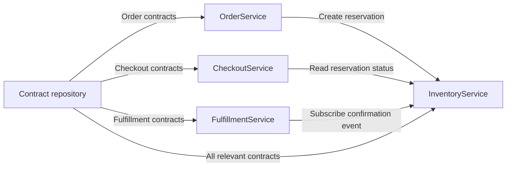
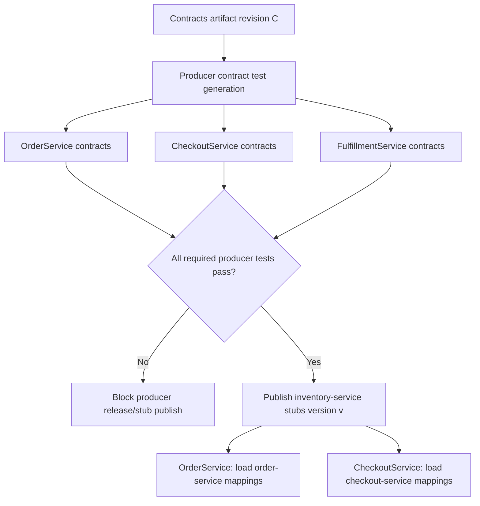
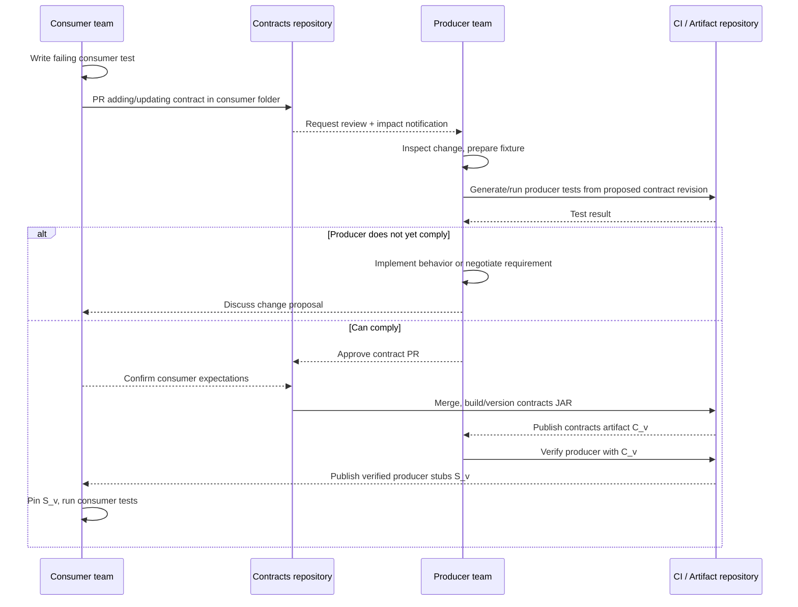
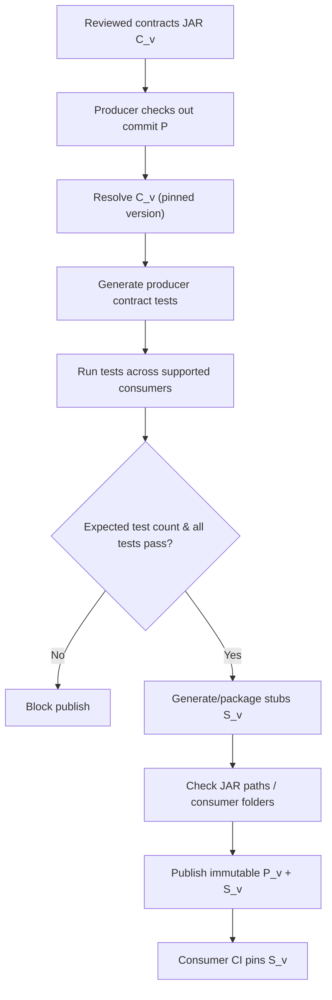

# Organizing Contracts by Consumer and Team Collaboration Needs

A producer rarely serves just one consumer. For example, `InventoryService` handles stock reservations for `OrderService`, checks availability for `CheckoutService`, and emits events for `FulfillmentService`. The same API can be used by three teams in different ways: the orders team relies on `reservationId`, the checkout team needs status `HELD`, and the fulfillment team relies on the `reservation.confirmed` event. If all contracts are mixed into a single folder, it is very hard to answer **who depends on which field**, who needs to review a change, and which stubs each team needs.

Spring Cloud Contract supports **Consumer-Driven Contracts (CDC)**: consumers describe the behaviors they need, the producer verifies that the real implementation satisfies them, and stubs are packaged for independent consumer testing. Contracts can live **in the producer repository**, in a **shared contracts repository**, or in a **separate Git/SCM repository**, and then be published as artifacts for teams to share.

This lesson belongs to the **Contract and Artifact Repositories** chapter of the **SPRING_CLOUD_CONTRACT** module. The module focuses on testing HTTP/messaging via **Groovy/YAML DSL**, generating producer tests, publishing stubs, using **Stub Runner**, and integrating with **CI** to catch incompatible API changes. This topic goes deep into **organizing contracts per consumer** and **cross-team collaboration workflows**, rather than just how to build a JAR.

After this lesson, you can:

- Distinguish **consumer owner**, **producer owner**, and **contract owner**.
- Choose between storing contracts in the producer repository vs. an external/shared repository.
- Structure directories by `producer/consumer/capability` to trace dependencies.
- Write Groovy/YAML contracts for specific scenarios without duplicating shared agreements.
- Enable `stubsPerConsumer`/`consumerName` so each consumer loads only relevant stubs.
- Detect conflicts when two consumers specify different responses for the same request.
- Manage Pull Requests, reviews, tests, artifact versions, and access controls across teams.
- Design CI gates from contract proposal to producer verification and consumer Stub Runner.

## 1. A Contract Is an Agreement, Not Just a Test File

A Spring Cloud Contract contract expresses **observable behavior across an integration boundary**. For HTTP, that means method, URL, headers, request body, status, and response body. For messaging, that can mean trigger, destination, headers, and payload.

For example, `OrderService` calls:

```http
POST /api/v1/reservations HTTP/1.1
Content-Type: application/json

{"sku":"SKU-001","quantity":2}
```

and expects:

```http
HTTP/1.1 201 Created
Content-Type: application/json

{"reservationId":"RES-701","status":"HELD"}
```

When a consumer says “we need `reservationId` and status `HELD`,” that is a technical dependency that can be captured in a contract; the producer must preserve it or coordinate a migration before changing it.

**Three distinct assertions:**

1. **Contract accepted by both teams:** an agreement on expected behavior exists.
2. **Producer verification passes:** the generated test actually checks the producer implementation and sees it comply.
3. **Consumer stub test passes:** consumer code calls/receives the stub properly and handles the response as agreed.

Having only (1) does not guarantee both sides work together; having only (3) does not prove the producer implementation is compatible. Storing contracts per consumer helps **identify who owns each requirement**, yet both verification and consumer tests remain necessary.

### Who decides what?

| Role | Primary responsibility | Example |
| --- | --- | --- |
| **Consumer team** | Express real needs, write consumer tests, propose contracts | `OrderService` needs `reservationId` |
| **Producer team** | Assess feasibility, verify implementation, publish versions | `InventoryService` guarantees `201` and ID field |
| **Contract/repository maintainers** | Manage conventions, review policy, artifact builds, access control | Govern the common contracts repo |
| **CI/release owners** | Ensure producer tests run, stubs build from exact revision, publish with provenance | Block release when contract tests fail |

Not every organization separates all four groups. What matters is having **clear accountability**; a contract PR should never be merged merely because JSON/Groovy parses cleanly.

## 2. Why Group Contracts by Consumer?

When teams depend on different parts of the same API, grouping helps:

- **Impact tracing:** quickly find which consumer relies on `reservationId` or `status`.
- **Right reviewers:** changes inside the `order-service` folder require reviewers who understand OrderService's needs.
- **Less stub noise:** consumers do not have to load every mapping belonging to other teams.
- **Migration management:** legacy contracts can be kept while older consumers have not migrated yet.
- **Access management:** consumers can propose contracts without needing write access to all producer source code.
- **Better self-service:** consumers can write desired scenarios before the producer finishes implementation.

However, placing a file in an `order-service` folder **does not turn its contents into a separate API exclusively for OrderService**. If the same request hits one producer instance without any mechanism to distinguish consumers, the server cannot return two contradictory results just because contracts live in two different folders.

## 3. Multi-Consumer System Example



Assumptions:

| Consumer | Need | Interface slice depended on |
| --- | --- | --- |
| `OrderService` | Create reservation | `POST /api/v1/reservations`, `201`, `reservationId` |
| `CheckoutService` | Read status before payment | `GET /api/v1/reservations/{id}`, `status` |
| `FulfillmentService` | Receive reservation confirmation notice | `reservation.confirmed` message, `orderId` |

In the repository, you can split by **consumer first**, then by capability or protocol:

```text
contracts/
├── order-service/
│   └── reservation-create/
│       ├── create-success.groovy
│       └── create-insufficient-stock.groovy
├── checkout-service/
│   └── reservation-status/
│       ├── get-held.yml
│       └── get-expired.yml
└── fulfillment-service/
    └── messaging/
        └── reservation-confirmed.groovy
```

This is a **subtree under the configured contracts root**; how that root is determined varies across Maven/Gradle or external repos. Do not copy this tree into an arbitrary directory without confirming the plugin reads that root.

### Directory naming guidelines

1. Use **stable consumer application names**, such as `order-service`, rather than people's names or sprint names.
2. If the project uses `stubsPerConsumer`, the directory name must match `spring.application.name` or the configured `consumerName`.
3. Place business capabilities underneath for easy lookup, such as `reservation-create`, `reservation-status`.
4. Use descriptive scenario names, such as `create-insufficient-stock`, not just `case-007`.
5. Do not rename folders arbitrarily: Stub Runner filters may stop loading the relevant mappings.

## 4. Model A: Contracts Live in the Producer Repository

For a producer using Maven under common conventions:

```text
inventory-service/
├── pom.xml
├── src/main/java/...
└── src/test/resources/contracts/
    ├── order-service/
    │   └── reservation-create/
    │       ├── create-success.groovy
    │       └── create-insufficient-stock.groovy
    ├── checkout-service/
    │   └── reservation-status/
    │       └── get-held.yml
    └── fulfillment-service/
        └── messaging/
            └── reservation-confirmed.groovy
```

With the **Spring Cloud Contract Gradle plugin using the `contractTest` source set convention**, the DSL source root is typically:

```text
inventory-service/src/contractTest/resources/contracts/
```

Do not confuse the Maven path with Gradle. If the project overrides `contractsDslDir` or `contractsDirectory`, use the actual configured value from the build.

**Pros of the producer repository:**

- Code and contracts change in the same commit.
- Producer CI easily generates and runs contract tests against the matching implementation.
- Less infrastructure: no separate contract repository and remote resolver needed.
- Easy to roll back both code and contracts for the same release.

**Cons:**

- Consumers might not have access to the producer repository.
- Consumers wanting to propose changes must participate in the producer team's PR workflow.
- With many producers, consumers must look up contracts across many repositories.
- Review responsibilities and release timing can be dominated by the producer without coordination conventions.

This model fits well when teams already share access, release on similar schedules, or the number of producers/consumers is manageable.

## 5. Model B: Shared Contracts Repository, Separate from Producer Code

In the **external/common contracts repository** model, teams manage contracts in one place **without needing access to producer source code**. Spring Cloud Contract has dedicated guidance for consumer-driven contracts in an external repository.

A reference layout when the producer has Maven coordinates `com.example:inventory-service`:

```text
shared-contracts/
├── pom.xml                 # Build/assembly for contracts artifact
└── src/main/resources/contracts/
    └── com/
        └── example/
            └── inventory-service/
                ├── order-service/
                │   └── reservation-create/
                │       └── create-success.groovy
                ├── checkout-service/
                │   └── reservation-status/
                │       └── get-held.yml
                └── fulfillment-service/
                    └── messaging/
                        └── reservation-confirmed.groovy
```

**Path explanation:**

- `com/example` represents `groupId` separated by `/`.
- `inventory-service` represents the producer `artifactId`.
- Directories directly beneath the producer identify consumers.
- Levels beneath the consumer organize by business capability/protocol and can follow team conventions.

This is the **shared repository source layout** recommended for packaging; once built into a **contract JAR**, the producer plugin must point to the corresponding path **inside the JAR**. Spring Cloud Contract has common repo examples putting `com/example/server/client1` inside the JAR, so do not confuse the project root `src/main/resources/contracts` with the unpacked root seen by the plugin.

### Differences between a Git repository and a Maven repository

| Repository | What does it hold? | Role |
| --- | --- | --- |
| **Git/SCM contracts repository** | Contract sources, PR history, reviews, conventions | Where teams propose and approve agreements |
| **Maven-compatible artifact repository** | Versioned contracts JARs, producer JARs, `*-stubs.jar` | Where builds/tests download exact packaged artifacts |
| **Local Maven repository** | `mvn install` artifacts for dev loops | Quick local testing before remote publish |
| **Consumer test repository** | Consumer code, Stub Runner configuration, test assertions | Verifies the consumer handles stubs properly |

A Git repo can store contracts/stubs directly under Spring Cloud Contract's SCM mechanism; however, in Java ecosystems, Git is typically used to review source files while Nexus/Artifactory or a Maven-compatible repository distributes versioned artifacts. **Do not equate a Git URL with a Maven `repositoryRoot`** without configuring the appropriate downloader/protocol.

## 6. Same Request, Two Consumers Want Two Different Responses

This is the most important source of conflict when organizing contracts by consumer.

Suppose both `OrderService` and `CheckoutService` call:

```http
GET /api/v1/reservations/RES-701 HTTP/1.1
Accept: application/json
```

Yet OrderService's contract expects:

```json
{"reservationId":"RES-701","status":"HELD"}
```

while CheckoutService's contract expects:

```json
{"reservationId":"RES-701","status":"CONFIRMED"}
```

For an identical request, same resource state, and same point in time, the producer **cannot guarantee two opposing outcomes**. Putting two files in two consumer folders only lets Stub Runner **filter stubs**; it gives the producer no real-world way to guess which consumer is calling.

Before accepting both contracts, verify:

1. Are both responses truly referring to **the same fixture state**?
2. Is a distinguishing request condition missing, such as a different URL, query parameter, header, token/permission, or body?
3. Is one consumer checking an **earlier state snapshot** while the other checks after a confirmation command has run?
4. Do their needs actually differ only in **which fields are asserted**, rather than the entire HTTP body?
5. Are the two teams proposing changes for different API versions?

### Proper solutions for valid differences

If resource states differ, use **distinct request fixtures**:

```text
GET /api/v1/reservations/RES-HELD      -> status HELD
GET /api/v1/reservations/RES-CONFIRMED -> status CONFIRMED
```

If differences depend on authorization, requests must carry an authorization context handled deterministically by the producer, backed by proper security tests. If they differ by version, use an agreed API versioning mechanism. If a consumer only needs part of a response, the contract can assert **the important fields** instead of forcing every consumer to demand different JSON bodies.

**Never use `stubsPerConsumer` to hide two contracts that contradict real producer behavior.** Producer verification must verify contracts against the real implementation and appropriate test data. Per-consumer contracts are a tool for **managing dependencies**, not a workaround for business logic.

## 7. Example Contract for OrderService in Groovy DSL

A contract at:

```text
contracts/order-service/reservation-create/create-success.groovy
```

can describe the interaction:

```groovy
import org.springframework.cloud.contract.spec.Contract

Contract.make {
    name 'order_service_create_reservation_success'
    description '''
        Consumer: OrderService.
        Needs reservationId to link the stock hold with the order.
        Producer: InventoryService.
    '''

    request {
        method 'POST'
        url '/api/v1/reservations'
        headers {
            contentType(applicationJson())
        }
        body([
            sku     : 'SKU-001',
            quantity: 2
        ])
    }

    response {
        status 201
        headers {
            contentType(applicationJson())
        }
        body([
            reservationId: $(consumer('RES-701'),
                             producer(regex('RES-[0-9]+'))),
            status: 'HELD'
        ])
    }
}
```

Meaning:

- `description` documents which consumer needs which field and why; this helps reviewers understand the impact of removing a field.
- `consumer('RES-701')` is the sample value for consumer stub tests.
- `producer(regex('RES-[0-9]+'))` is what generated producer tests validate on dynamic IDs.
- `status = HELD` is a concrete business expectation in the success fixture.

**Note:** mentioning the consumer in `description` is helpful for humans, but `stubsPerConsumer` mode uses the **directory/path** and consumer name—it does not parse the sentence “Consumer: OrderService” to filter automatically. Placing files under the right path is what matters at runtime.

### Another error-branch contract for the same consumer

```groovy
import org.springframework.cloud.contract.spec.Contract

Contract.make {
    name 'order_service_create_insufficient_stock'
    description 'OrderService needs to handle insufficient stock scenario'

    request {
        method 'POST'
        url '/api/v1/reservations'
        headers {
            contentType(applicationJson())
        }
        body([
            sku     : 'SKU-EMPTY',
            quantity: 2
        ])
    }

    response {
        status 409
        headers {
            contentType(applicationJson())
        }
        body([
            code: 'INSUFFICIENT_STOCK'
        ])
    }
}
```

Both contracts belong to OrderService but match **different** requests. Avoid overly broad matchers that could let `SKU-EMPTY` match the `201 HELD` stub or vice versa.

### Input verification matters

A file inside a consumer directory only has value when:

1. The producer plugin discovers the contract.
2. The generated test runs against the producer implementation with matching fixtures.
3. The stub artifact packages the corresponding mapping.
4. Consumer tests actually invoke client code and handle `201`/`409`.

A generated or hand-written JSON mapping **does not prove step 2**. CI must block release if generated producer tests are skipped or 0 tests execute.

## 8. Example YAML DSL for CheckoutService

Suppose `CheckoutService` reads an already held reservation, with contract source:

```text
contracts/checkout-service/reservation-status/get-held.yml
```

Content:

```yaml
name: checkout_service_get_held_reservation
description: CheckoutService needs to read hold status before payment
request:
  method: GET
  url: /api/v1/reservations/RES-701
  headers:
    Accept: application/json
response:
  status: 200
  headers:
    Content-Type: application/json
  body:
    reservationId: RES-701
    status: HELD
```

This is a simple YAML DSL with deterministic fixture data. For dynamic IDs or timestamps, use **YAML matchers matching your Spring Cloud Contract version** rather than copying Groovy's `$(consumer(...),producer(...))` syntax verbatim into YAML.

Two consumers can both need `status` across different scenarios:

| Consumer | Request | Minimum relied upon |
| --- | --- | --- |
| `OrderService` | `POST /api/v1/reservations` | `201`, `reservationId`, `status=HELD` |
| `CheckoutService` | `GET /api/v1/reservations/RES-701` | `200`, `reservationId`, `status` |

There is no need to copy OrderService's POST contract into CheckoutService if CheckoutService never sends that POST request. **Each folder should reflect real dependencies**, not a full duplicate of the producer API.

## 9. What Should Live in a Shared Group?

A system may have shared rules: standard JSON error shapes, trace headers, `reservationId` formats, or event schemas. However, **shared standards** and **executed contracts** are not the same thing.

| Content type | Where should it live? | How is it enforced? |
| --- | --- | --- |
| Common rules on error codes, ID formats | Docs/API guidelines/shared schemas | Reviews, schema validation, helpers |
| Contract for a specific consumer | `contracts/<consumer>/<capability>/...` | Producer verification and stubs-per-consumer |
| Identical contract depended on by multiple consumers | Shared folder with convention **or** each consumer references one valid source | Explicit inclusion/runtime configuration |
| Consumer-specific fault-tolerance test scenarios | Consumer test fixtures/manual stubs | Do not claim as a producer promise |
| Messaging contracts sharing a topic across producers | Can organize by topic + appropriate producer filter | Configure `includedFiles`/base class mappings |

**Be careful with `stubsPerConsumer`:** when filtering is enabled, only stub mappings whose paths match the consumer name are registered according to Stub Runner's rules. A mapping placed in a `common` folder **is not automatically included for every consumer**. If you want common mappings, design packaging/registration/inclusion carefully and test to verify.

### Do not overuse contract duplication

If three consumers all copy the same success file:

```text
order-service/create-success.groovy
checkout-service/create-success.groovy
fulfillment-service/create-success.groovy
```

while only one consumer actually calls POST, the repository ends up with **three sources that can drift over time**. Consider replacing them with one contract under the right owner and centralizing shared conventions in a schema/helper layer; when explicit per-consumer auditing is required, separate contracts can be kept provided duplication/conflict checks are in place.

The goal is not to minimize file count at all costs, but to ensure **every file represents an active commitment with a clear owner**.

## 10. How Does `stubsPerConsumer` Filter HTTP Stubs?

Spring Cloud Contract Stub Runner has a **stubs per consumer** mode. Per the documentation, when enabled, Stub Runner **does not register all HTTP stubs from the artifact**; it filters by mapping paths containing the consumer folder name.

Example source contract structure:

```text
contracts/
├── order-service/
│   ├── reservation-create/create-success.groovy
│   └── reservation-create/create-insufficient-stock.groovy
└── checkout-service/
    └── reservation-status/get-held.yml
```

Published stub JAR by convention may contain:

```text
META-INF/
  com.example/
    inventory-service/
      1.4.2/
        contracts/
          order-service/...
          checkout-service/...
        mappings/
          order-service/...
          checkout-service/...
```

The `META-INF` structure above is an **illustrative layout** of a Spring Cloud Contract artifact. Inspect the real JAR after building; if custom packaging strips the consumer directory, `stubsPerConsumer` filtering may not behave as expected.

### Configuration via annotation

Example test in `OrderService`:

```java
import org.springframework.boot.test.context.SpringBootTest;
import org.springframework.cloud.contract.stubrunner.spring.AutoConfigureStubRunner;
import org.springframework.cloud.contract.stubrunner.spring.StubRunnerProperties;

@SpringBootTest(properties = {
    "spring.application.name=order-service",
    "inventory.base-url=http://localhost:8090"
})
@AutoConfigureStubRunner(
    ids = "com.example:inventory-service:1.4.2:stubs:8090",
    stubsMode = StubRunnerProperties.StubsMode.LOCAL,
    stubsPerConsumer = true
)
class OrderServiceWithInventoryStubTest {
    // Test must invoke OrderService's real client/service.
}
```

Assuming `com.example:inventory-service:1.4.2:stubs` is in Maven local, Stub Runner starts the HTTP stub on port `8090` and **filters mappings by `order-service`** if the path structure matches.

Do not reuse the same port when tests run in parallel outside isolated environments. For projects with many stubs, let Stub Runner pick a dynamic port and retrieve the URL via your version's supported mechanism; do not leave the client hardcoded to `8090`.

### Explicitly overriding consumer name

If the test application's name is `order-checkout-integration-test` while the folder in the artifact is named `order-service`, specify the consumer name:

```java
@AutoConfigureStubRunner(
    ids = "com.example:inventory-service:1.4.2:stubs:8090",
    stubsMode = StubRunnerProperties.StubsMode.LOCAL,
    stubsPerConsumer = true,
    consumerName = "order-service"
)
```

This is an **annotation fragment**, not a complete class. Properties can also be configured via Spring properties, for example:

```yaml
spring:
  application:
    name: order-service
  cloud:
    contract:
      stubrunner:
        stubs-per-consumer: true
        consumer-name: order-service
```

Property names in documentation may appear in camelCase or kebab-case; choose syntax matching the binding mechanism of your release and **test it**, as Spring Cloud Contract/Spring Boot versions can vary.

### Key filter behaviors

| When stubs-per-consumer is enabled | Expected result |
| --- | --- |
| Consumer name = `order-service` | Only mappings with OrderService's consumer path are registered |
| Consumer name = `checkout-service` | CheckoutService's mappings are selected |
| Consumer name matches no folder | Zero mappings may be registered; tests must catch this |
| Mapping included in JAR without consumer path | Mapping is not guaranteed to be selected even though the file exists |
| Two matching mappings sit in two consumer folders | When each consumer runs tests separately, filtering reduces stub conflicts |

**Warning:** this feature targets **HTTP stub registration** as documented. Do not assume it applies identically to Kafka/RabbitMQ messaging or custom stub downloaders; validate each integration separately.

## 11. Producer Must Verify Contracts of *All* Supported Consumers

A common pitfall: a producer may receive **a single contracts JAR containing multiple consumer folders**, while each consumer only runs stubs for itself. The producer must never verify only a high-priority consumer's folder and declare the new version compatible with everyone.



**If a consumer has not yet adopted a change** while the producer wants to remove a field or change an endpoint, keep that consumer's contract in the verified set until the migration plan allows removal.

A stub version should be **traceable** back to:

- Producer Git commit/release build.
- Contracts revision or contract artifact version.
- Set of contracts consumed during verification.
- Generated producer test count, executed count, and results.
- Stub JAR coordinates/checksum.

`stubsPerConsumer` ensures consumer tests only see needed mappings; it is **not** a mechanism to shed the producer's compatibility obligations.

## 12. Packaging Common Contracts into One Artifact

Suppose the common repository produces a JAR:

```text
com.example.contracts:platform-contracts:2.3.0
```

Inside it contains:

```text
com/
  example/
    inventory-service/
      order-service/...
      checkout-service/...
      fulfillment-service/...
    pricing-service/
      order-service/...
      billing-service/...
```

This illustrates the **internal structure of a contracts JAR** for the producer plugin to read; it differs from a **stubs JAR**, which holds generated `META-INF/.../contracts` and `mappings` for one producer/version.

Distinction:

| Artifact | Purpose | Typically published by? |
| --- | --- | --- |
| **Contracts JAR** (e.g., `platform-contracts:2.3.0`) | Reviewed DSL source for multiple producers/consumers | Common contracts repository CI |
| **Producer JAR** (e.g., `inventory-service:1.4.2`) | Deployable producer application | Producer CI |
| **Stub JAR** (e.g., `inventory-service:1.4.2:stubs`) | Generated HTTP mappings/messaging contract definitions | Producer CI after verification |

A shared contracts JAR **does not prove the producer satisfies the contracts**. The producer must fetch the exact artifact revision, generate/execute tests against the real implementation, and then publish corresponding stubs.

### Producer Maven reading a contracts JAR from a repository

Example **configuration fragment** in producer `inventory-service/pom.xml`:

```xml
<plugin>
    <groupId>org.springframework.cloud</groupId>
    <artifactId>spring-cloud-contract-maven-plugin</artifactId>
    <version>VERSION_MANAGED_BY_PROJECT</version>
    <extensions>true</extensions>
    <configuration>
        <testFramework>JUNIT5</testFramework>
        <contractsMode>REMOTE</contractsMode>
        <contractsRepositoryUrl>
            https://artifacts.example.test/repository/contracts
        </contractsRepositoryUrl>
        <contractDependency>
            <groupId>com.example.contracts</groupId>
            <artifactId>platform-contracts</artifactId>
            <version>2.3.0</version>
        </contractDependency>
        <contractsPath>com/example/inventory-service</contractsPath>
        <baseClassForTests>
            com.example.inventory.ContractVerifierBase
        </baseClassForTests>
    </configuration>
</plugin>
```

**This is not a complete POM.** `VERSION_MANAGED_BY_PROJECT` must be replaced with a compatible Spring Cloud Contract version. The URL `artifacts.example.test` is a placeholder domain; a real project needs an actual repository URL and secure credentials.

**Two points to verify:**

1. `contractDependency` selects the **artifact containing the DSL**, not the producer application JAR or consumer `*-stubs.jar`.
2. `contractsPath` selects the **path inside the artifact** holding this producer's contracts. Documentation defaults relate to `groupId/artifactId`; since a common JAR's group/artifact may **differ from the producer's coordinates**, the example sets the path explicitly.

For LOCAL development, you can use `contractsMode>LOCAL</contractsMode>` and install the artifact into the Maven local repository; publishing via REMOTE still requires verifying repository permissions and pinned versions.

### Producer Gradle reading the corresponding contracts artifact

An example **Gradle Groovy DSL configuration fragment**:

```groovy
plugins {
    id 'org.springframework.cloud.contract' version 'VERSION_COMPATIBLE'
}

contracts {
    contractDependency {
        stringNotation = 'com.example.contracts:platform-contracts:2.3.0:'
    }
    contractsMode = 'REMOTE'
    contractsPath = 'com/example/inventory-service'
    baseClassForTests = 'com.example.inventory.ContractVerifierBase'
}
```

Plugin/Gradle versions and dependency management must be compatible. This snippet omits `repositories`, the Spring Boot plugin, and test dependencies. Do not use dynamic versions like `+` in release steps requiring reproducibility.

**Version note:** property names and extension APIs must be checked against **the reference version in use**. If the project uses convention plugins or Gradle Kotlin DSL, syntax may differ. Do not copy legacy snippets and ignore toolchain warnings.

## 13. Consumer-Driven Workflow: From Need to Verified Contract

When contracts live in a shared repository, an effective collaboration loop is **consumer proposes — producer verifies — both approve — CI publishes**.



The diagram illustrates **one possible coordination flow**, not an automated sequence enforced by Spring Cloud Contract. Organizations may choose to merge a contract after a producer branch passes, then re-run verification against the **published artifact version**. The mandatory invariant is **never publish a stub marked verified before the producer has been checked against the exact contract revision**.

### Step 1 — Consumer describes real need, not hypothetical implementation

`OrderService` needs to create a reservation for checkout. The consumer writes a test for its client/service:

```text
Given  sku=SKU-001, quantity=2
When   OrderService calls InventoryService to create reservation
Then   consumer receives reservationId and status=HELD
And    OrderService stores ID for next payment step
```

The consumer proposes `contracts/order-service/reservation-create/create-success.groovy` in a PR. Explain **why** the field is needed, rather than just saying “added field to make test green.”

### Step 2 — Producer checks feasibility and compatibility

The producer reviewer should ask:

- Does the real API support that HTTP method/path/request format?
- Do payload/error shapes align with shared standards?
- Does this introduce breaking changes for existing consumers?
- Are generated test fixtures reproducible?
- Do dynamic IDs/timestamps have appropriate matchers?
- Are there two contracts with overlapping requests or conflicting outcomes?
- If messaging, are the event schema and destination actually emitted by the producer?

If not yet supported, the producer can add the implementation on a branch and run generated tests from the **contract revision in the PR** before approving the merge.

### Step 3 — Both sides accept the agreement

A consumer test passing against a stub generated from the PR **is not enough for the producer to accept**; a stub only reflects the DSL. Conversely, a producer test passing while the consumer cannot consume the response does not prove full integration either.

Typically, a PR requires at least one reviewer familiar with consumer business logic and one familiar with the producer API, alongside automated format and compatibility checks. This rule is an **organizational policy**, not an automatic DSL feature.

### Step 4 — Publish contracts artifact and producer stubs

Once the PR is accepted:

1. The contracts repository versions and publishes an immutable **contracts JAR**.
2. The producer pulls the **exact artifact version**, generates, and executes the generated tests.
3. Only when producer verification passes are the producer release and `*-stubs.jar` published from the same build.
4. The consumer intentionally upgrades the stub version and runs tests via Stub Runner.
5. CI stores revisions and test reports for rollback or incident investigation.

**Never pull a moving `main` branch from the contract repo while the producer publishes a release**, because the same producer commit could be verified against two different contract sets at different times.

## 14. Information Template for a Contract Pull Request

Beyond the Groovy/YAML diff, a PR should answer:

| Field | Example | Benefit |
| --- | --- | --- |
| Producer | `InventoryService` | Identify team needed for review |
| Consumer | `OrderService` | Identify dependent team |
| Capability | `reservation-create` | Business categorization |
| Contract file | `order-service/reservation-create/create-success.groovy` | Easy to locate source artifact |
| Reason for change | Need to store `reservationId` for payment | Assess impact |
| Request/response | `POST → 201 HELD` | Review API behavior |
| Backward compatibility | No existing fields removed | Protect other consumers |
| Producer verification | Passes with branch code/proposed revision | Feasibility evidence |
| Consumer test | Passes with generated candidate stub | Usability evidence |
| Migration/deprecation | Old consumer keeps endpoint until agreed milestone | Avoid premature removal |
| Owner/reviewer | Order and Inventory teams | Clear accountability |

**Avoid requiring every PR to manually edit all producer API documentation** if the project already automates docs generation from an agreed source; however, contract content still requires semantic review. Passing JSON schema validation does not prove sound behavior.

### CODEOWNERS or review labels

An organization can configure code ownership by path groups, for example:

```text
# Pseudo-CODEOWNERS example; replace with real team handles.
/src/main/resources/contracts/com/example/inventory-service/  @inventory-team
/src/main/resources/contracts/com/example/inventory-service/order-service/ @inventory-team @order-team
/src/main/resources/contracts/com/example/inventory-service/checkout-service/ @inventory-team @checkout-team
```

This is an example of a **review convention**, not a rule enforced automatically by Spring Cloud Contract. Approval syntax/enforcement depends on your Git host and branch protection settings; when multiple rules overlap, ownership resolution can vary. Test with a real PR to confirm the expected reviewers are requested.

## 15. When Multiple Consumers Update the Same Endpoint

Suppose CheckoutService asks to add `expiresAt` to `GET /reservations/{id}`, while OrderService continues using `reservationId` and `status`. This is not necessarily a conflict.

A producer response can expand:

```json
{
  "reservationId": "RES-701",
  "status": "HELD",
  "expiresAt": "2026-12-01T10:30:00Z"
}
```

Still, whether adding a field is **backward-compatible** depends on how consumers deserialize:

- If consumer parsers ignore unknown fields, risk is usually low.
- If a consumer uses strict JSON schemas or fails on unknown properties, even adding a field can break it.
- If the field represents time, agree on timezone/format/nullability.
- If a consumer relies on a relationship like `expiresAt > createdAt`, a standalone timestamp regex does not verify that logic.

Therefore, run **consumer tests with the new stub version** before release rather than judging compatibility from diffs alone.

### When removing an old field

Suppose the producer wants to drop `reservationId` in favor of `holdId`. This change can break OrderService, even if CheckoutService does not use the old field.

A controlled migration:

1. Add `holdId` **alongside** `reservationId`, if the API allows.
2. Producer verifies both old and new contracts.
3. Publish a new stubs version so consumers can update.
4. OrderService switches to `holdId` and updates its contract.
5. Verify across all environments that no consumer still relies on `reservationId`.
6. Set a deprecation deadline and delete the old field only when compatibility policy permits.

Do not immediately delete the old contract from OrderService's folder just because another consumer migrated. The purpose of **per-consumer storage** is to pinpoint exactly what still needs support.

## 16. Versioning: Contracts Artifact Differs from Producer/Stub Artifact

When contracts live in a shared repository, there can be **two separate version cadences**:

| Artifact | Example | Source and role |
| --- | --- | --- |
| Contracts JAR | `com.example.contracts:platform-contracts:2.3.0` | Reviewed DSL bundle from common repo |
| Producer application | `com.example:inventory-service:1.4.2` | Built InventoryService code |
| Producer stubs | `com.example:inventory-service:1.4.2:stubs` | Stubs generated from contracts verified by producer version 1.4.2 |
| Consumer application | `com.example:order-service:2.8.0` | OrderService code |

The contracts JAR version does not have to equal the producer JAR version, since a common artifact can contain contracts for **multiple producers**. However, there must be a **manifest/provenance** linking each producer build to the contract revision used.

An **illustrative** metadata record:

```yaml
producer:
  coordinates: com.example:inventory-service:1.4.2
  commit: EXAMPLE_PRODUCER_COMMIT
contracts:
  coordinates: com.example.contracts:platform-contracts:2.3.0
  revision: EXAMPLE_CONTRACTS_COMMIT
  path: com/example/inventory-service
verification:
  generatedTests: 12
  executedTests: 12
  failedTests: 0
  result: PASS
stubs:
  coordinates: com.example:inventory-service:1.4.2:stubs
  sha256: EXAMPLE_SHA256_REPLACE_IN_REAL_RELEASE
```

This is **not a mandatory Spring Cloud Contract schema**, and values are illustrative placeholders. CI must pull real commit SHAs, test counts, and checksums from actual build data, rather than copying `12` as release evidence.

### Release artifacts must be immutable

Suppose `1.4.2:stubs` is built today from contract version `2.3.0`, and tomorrow someone re-uploads `1.4.2:stubs` from contract `2.3.1`. Consumers with the exact same code/version will see two different behaviors, destroying reproducibility.

Rules to enforce:

- Never overwrite stable release artifacts.
- Changing contracts or mappings requires a new artifact version.
- For snapshots, record the **resolved build/timestamp** and verify caching if reproducibility is needed.
- Pin versions in producer verification and consumer release tests.
- Avoid `+`/`latest` in release gates requiring reproducibility; reserve them for separate forward-compatibility jobs if desired.
- Retain test reports and checksums matching published artifacts.

## 17. Git/SCM as a Contracts and Stubs Repository

Spring Cloud Contract supports using Git to store contracts/stubs under a **path convention** and dedicated resolver protocol. The documentation describes URLs prefixed with `git://` to select the SCM downloader, such as `git://https://...`.

An illustrative SCM-based stub storage layout:

```text
META-INF/
  com.example/
    inventory-service/
      1.4.2/
        contracts/
          order-service/...
          checkout-service/...
        mappings/
          order-service/...
          checkout-service/...
```

In this mode:

- `contracts` holds DSL sources under the SCM/artifact convention.
- `mappings` holds HTTP mappings generated by the plugin, usually preserving consumer structure.
- Producer/Stub Runner needs the downloader configured with the right **protocol and location**.
- CI wanting to push stubs to SCM must configure the appropriate **push task/goal**; never assume the generator pushes to remote automatically.

**Important:** a Git repo used to **propose contract PRs** and a Git repo used to **store generated mappings/stubs under the META-INF convention** may be the same repo or two different repos. That is an organizational choice, but keep reviewed DSL sources distinct from generated outputs.

If using Git to fetch artifacts:

1. Select a fixed commit/tag/release revision for reproducible builds.
2. Set sensible read/write permissions and branch protection.
3. Never embed credentials inside URLs/source files.
4. Check protocol syntax, branch/tag selection, and downloader behavior in your exact version.
5. Verify both producer verification and consumer Stub Runner using the same revision/artifact.

Do not assume a `git://https://...` path is a standard Git clone URL understood by every tool; it is a Spring Cloud Contract-specific convention inside its adapters.

## 18. Messaging Contracts: Sometimes Grouping by Topic Matters More Than Producer

For messaging, the same topic may be published by multiple producers and consumed by multiple consumers. Grouping strictly by producer can duplicate schemas for the same event/topic in many places.

For example:

```text
contracts/
├── http/
│   └── inventory-service/
│       ├── order-service/...
│       └── checkout-service/...
└── messaging/
    └── reservation-events/
        ├── fulfillment-service/...
        └── analytics-service/...
```

This is a **suggested organizational convention**, not a guarantee that Spring Cloud Contract automatically discovers all topics under this layout. The common repo guide documents a **“messaging contracts per topic rather than per producer”** pattern using **includedFiles** and `contractsPath` (Maven) or a task that downloads/filters contracts before generation (Gradle).

When structuring by topic, answer:

- Which producer is responsible for emitting this event?
- Is there a versioned event schema or separate registry?
- Which contracts need generated tests for producer A and producer B?
- Which consumers are actually handling the event?
- Which `label` or destination does Stub Runner use to trigger?
- Are different base classes needed for HTTP vs. messaging tests?

**Do not expect HTTP `stubsPerConsumer` to solve message broker routing automatically.** For Kafka, RabbitMQ, Spring Integration, or Spring Cloud Stream, configure the adapters and tests fitting each framework.

## 19. CI for a Shared Contracts Repository: Syntax Checks Are Not Enough

A contract PR might parse cleanly yet serve no consumer, duplicate another file's request matcher, or break the current producer. CI in the **common contracts repository** should run appropriate checks:

| Check | Purpose | Enforcing system |
| --- | --- | --- |
| YAML/Groovy DSL parsing | Catch structural errors | Contract build/plugin |
| Producer/consumer folder names | Preserve stub filtering paths | Convention validator/review |
| Contract naming and scenario identity | Avoid duplicate files or poor traceability | Validator/review |
| Overlap/mapping conflict check | Detect two stubs matching same request with different responses | Build/consumer smoke tests |
| Package contract JAR | Ensure root and file paths are valid | Shared-repo CI |
| Producer compatibility | Check real implementation | Producer CI, optionally triggered from PR |
| Consumer behavior | Check consumer client/logic | Consumer CI |
| Artifact provenance | Record published revision | CI release/repository metadata |

**Never label a PR “compatible” just because DSL parsing succeeded.** Compatibility is a property of a **set of supported consumers**, the producer implementation, and the target deployment version.

### Checking paths inside the JAR

Suppose shared contracts CI produces:

```text
platform-contracts-2.3.0.jar
```

You can use JDK tools:

```bash
jar tf platform-contracts-2.3.0.jar
```

Verify it contains:

```text
com/example/inventory-service/order-service/...
com/example/inventory-service/checkout-service/...
com/example/inventory-service/fulfillment-service/...
```

Do not just check that the JAR exists. If the producer folder is accidentally nested under an extra `src/main/resources/contracts` level, the producer's `contractsPath` will fail to find the DSL even though the files exist in the artifact.

### A smoke test is worth more than listing files

1. Producer downloads the exact contracts artifact version.
2. Plugin generates tests from the expected producer folder.
3. Test runner executes and fails when a key response is deliberately broken.
4. Stub JAR is generated and packaged.
5. Stub Runner with `consumerName=order-service` loads only OrderService mappings.
6. Real consumer code sends requests handled by matching mappings.
7. Consumer test with `consumerName=checkout-service` does not accidentally receive OrderService-only mappings.

When two consumers call the same endpoint, tests must use **non-conflicting** request/fixture data or have valid distinguishing mechanisms.

## 20. CI for the Producer: Never Cherry-Pick the “Easy” Consumer

After the common contracts repository publishes revision `C_v`, producer `InventoryService` must run contract tests for **every consumer the release claims to support**.



A typical Maven or Gradle build step, depending on the producer:

```bash
# Maven producer once plugin is configured:
mvn -B -ntp clean verify

# Or Gradle producer with contractTest wired into verification lifecycle:
./gradlew clean check
```

These two commands are **alternatives by build tool**, not mandatory to run both on the same project. Inspect test reports to distinguish:

- Generator found the contracts.
- Generated tests were created.
- Generated tests compiled and **actually executed**.
- Fixtures and assertions exercised the real implementation.
- Test count matches the committed contract set.
- Build **fails** when an active consumer's contract is violated.

A green producer CI with 0 generated tests, or loading only the `order-service` folder while advertising compatibility with `checkout-service`, is not sufficient to publish a release.

## 21. CI for the Consumer: Filter the Right Stubs and Test Real Code

Once the producer has verified and published `inventory-service:1.4.2:stubs`, OrderService can use Stub Runner to test its client code.

Tests should:

1. Resolve the exact stub JAR version `1.4.2`.
2. Enable `stubsPerConsumer=true` and specify `consumerName=order-service`.
3. Ensure the real client's HTTP base URL points to the started stub port.
4. Call the consumer's **real** service/client rather than firing RestAssured directly at WireMock.
5. Assert meaningful business results or side effects.
6. Verify requests actually hit the stub with expected method/path/headers/body.
7. Test agreed error or fallback branches.

Do not merely assert `Stub Runner started` or a `curl` returning `201`. That only tests the stub server; consumer logic could still be using a mock, cache, or hardcoded response.

### Checking mappings for only the active consumer

In test-local WireMock, you can inspect active mappings:

```bash
curl http://127.0.0.1:8090/__admin/mappings
```

If stubs-per-consumer is enabled yet the list still contains `checkout-service` mappings, check:

- Does `consumerName` match the folder path?
- Does the artifact JAR preserve the `mappings/order-service/...` structure?
- Is runtime loading hand-written mappings from test setup outside the artifact?
- Is Stub Runner actually using the artifact/version you think it is?
- Are multiple WireMock instances sharing a port/journal during tests?

A lingering active mapping can come from runtime registration or another test; use an **isolated instance** and cross-check the artifact to avoid confusion.

## 22. How Do You Know Which Consumers Break When the Producer Changes?

Suppose the producer wants to change:

```text
GET /api/v1/reservations/{id}
Response field: status
New response field: reservationState
```

To assess impact:

1. Search contracts containing `status` across consumer folders.
2. Build a table of **consumer / endpoint / field / scenario / version**.
3. Run current producer tests for those contracts.
4. Never unilaterally remove assertions for a consumer that has not agreed to migrate.
5. Publish a candidate stub (without overwriting release) for consumers to test early.
6. Have each consumer confirm its new code deserializes/reads the field as expected.
7. Update official contracts or remove old fields only when release policy permits.

Example impact matrix:

| Consumer | What it relies on | Producer change | Risk |
| --- | --- | --- | --- |
| `OrderService` | `reservationId` + `status` | Remove `status` | **Breaking** if code needs it |
| `CheckoutService` | `status` before payment | Rename to `reservationState` | **Breaking** if not yet migrated |
| `FulfillmentService` | `reservation.confirmed` message | Only changing HTTP GET field | Likely unaffected, still check event contract |

**Limits of contract search:** a consumer may depend on an interface without having written full contracts, or a field may be used indirectly through a DTO/shared library. Thus “no contract found” **is not proof that no consumer uses it**. Combine the contract repository, consumer code search, and telemetry/version adoption if available.

## 23. Cross-Team Collaboration Should Not Depend on a Single Repo Gatekeeper

A shared repository delivers value when consumers can propose changes and producers can respond early. Some operational rules:

- Every consumer has **read** access to relevant contract sources and release history.
- Consumers submit PRs to folders they own, without arbitrarily modifying other teams' folders.
- Producer reviewers approve commitments impacting implementation and compatibility.
- Repository maintainers own conventions, packaging, and publish permissions.
- CI service accounts hold publish rights on protected branches/tags; ordinary developers do not overwrite releases.
- Contracts contain **test data**, never credentials or personal data from real environments.
- Breaking changes include a deprecation plan, deadline, and list of contacted consumers.

A review policy **may** require simultaneous producer approval and consumer approval. For changes with no API impact or description-only edits, teams can use a lighter workflow, provided it is clearly defined.

### When teams have different release schedules

For instance, OrderService releases daily, InventoryService weekly, and CheckoutService bi-weekly. A new contract may be proposed by a consumer today before the producer has deployed it.

To avoid disruption:

1. Consumer implements code compatible with the legacy interface or behind an appropriate feature flag.
2. New contract enters a candidate PR/revision with clear status.
3. Producer verifies and deploys supporting code in the appropriate release.
4. Publish the verified stub version tied to that producer release.
5. Consumer bumps the stub dependency and runs integration tests.
6. Enable the client path using the new interface only when the target environment actually runs a supporting producer version.

**Stub compatibility with a release candidate does not guarantee the producer is deployed in production.** Environment deployment metadata and smoke tests are needed when runtime compatibility has high impact.

## 24. Common Mistakes When Organizing Contracts by Consumer

| Symptom | Possible cause | How to resolve |
| --- | --- | --- |
| Producer generates no tests from common repo | Wrong `contractsPath` or JAR layout | Inspect JAR contents and artifact config |
| Consumer cannot find stub | Wrong version/classifier/repository mode | Pin coordinates and inspect `Stub Runner` logs |
| `stubsPerConsumer` enabled but no mappings loaded | Consumer folder does not match `consumerName` | Align name/test against active mappings |
| One consumer sees another team's mappings | Filter disabled, custom path, runtime registration | Check config and JAR paths |
| Two mappings match same request with different responses | Duplicate/conflicting contracts or broad fallback | Review matchers, fixtures, and priority |
| Producer passes while consumer B breaks | Producer verified only folder A or generated tests skipped | Run all supported contracts + check test count |
| Consumer test passes yet code never calls stub | Test calls HTTP directly, mocks client, or hits cache | Invoke real service, verify request journal |
| Shared contract PR merged before producer supports it | Missing producer approval/verification gate | Add PR gate tied to producer revision |
| Same contracts JAR version has different contents | Repository allows overwrites or snapshot cache | Immutable releases, checksums, provenance |
| Field deleted because “no test covered it” | Contract coverage gap or missing consumer | Inventory consumers and run code-level impact analysis |
| Renaming consumer service leaves stubs empty | `consumerName` and folder path no longer match | Migrate folder/name and verify stubs-per-consumer |
| New branch fetches `latest` contracts and CI flakes | External dependency version not pinned | Use fixed release candidate/SHA version |
| Git downloader fails to read repository | Missing `git://` convention or auth/version support | Check docs/plugin protocol and credentials |
| Messaging topic contract not tested by producer | Wrong `includedFiles` filter or base class mapping | Inspect generated tests by topic/producers |
| PR has valid YAML but wrong business semantics | Only linted, no domain reviewer | Require producer/consumer review and tests |

## 25. Checklist for Multi-Consumer Contract Repositories

- [ ] Producer and consumer lists have clear owners.
- [ ] Chosen between producer repo vs. shared external contracts repo based on access/review needs.
- [ ] Per-consumer contract paths are consistent and match Stub Runner application names.
- [ ] Path structure inside contracts JAR reflects the producer's `groupId/artifactId`.
- [ ] Groovy/YAML DSL accurately captures dependencies consumers actually use.
- [ ] Contract/scenario names are specific, without accidental duplication or conflict.
- [ ] Clear decision exists for shared conventions and common mappings when `stubsPerConsumer` is on.
- [ ] Confirmed HTTP and messaging contracts have suitable loaders/adapters.
- [ ] PRs require consumer/producer review for interface changes.
- [ ] Producer CI fetches the exact pinned contracts artifact/revision.
- [ ] Generated producer tests run thoroughly across supported consumers.
- [ ] Gate catches 0 generated/executed tests or skipped tests.
- [ ] Stubs JAR is generated from the **exact revision** the producer verified.
- [ ] Stub artifact preserves consumer directories so `stubsPerConsumer` filters properly.
- [ ] Consumer CI pins stub versions and exercises real consumer code.
- [ ] Smoke test verifies active mappings by `consumerName`.
- [ ] Immutable release publishing process stores provenance/checksums.
- [ ] Impact matrix and migration/deprecation process exist before removing fields/endpoints.
- [ ] Every artifact/contract traces back to PR, commit, owner, and CI run.
- [ ] Secrets, sensitive info, and production data are excluded from contracts.
- [ ] Separate integration/deployment checks exist when deployed environments diverge from verified builds.

### Practice Exercise

You manage a **shared contracts repository** for `InventoryService` with two HTTP consumers (`OrderService`, `CheckoutService`) and one messaging consumer (`FulfillmentService`). Requirements:

```text
OrderService:
  POST /api/v1/reservations
  body {"sku":"SKU-001","quantity":2}
  -> 201 {"reservationId":"RES-701","status":"HELD"}

CheckoutService:
  GET /api/v1/reservations/RES-701
  -> 200 {"reservationId":"RES-701","status":"HELD"}

FulfillmentService:
  message reservation.confirmed
  -> payload contains orderId and reservationId
```

**Tasks:**

1. Create a directory tree following `com/example/inventory-service/<consumer>/<capability>` in the shared repository; distinguish source root from the root inside the JAR.
2. Write OrderService's Groovy contract with a sample request and ID matcher for the producer.
3. Write CheckoutService's YAML DSL; keep request/response deterministic and avoid copying Groovy matchers by mistake.
4. Write a messaging contract for FulfillmentService; specify trigger, destination, payload, and adapter mechanism to test.
5. Define PR rules: which team proposes, who reviews, and when producer verification is mandatory.
6. Package contracts into `com.example.contracts:platform-contracts:2.3.0`; inspect the internal tree using `jar tf`.
7. Configure Maven or Gradle producer to fetch the **exact** artifact version, set `contractsPath= com/example/inventory-service`, and run generated producer tests.
8. Intentionally change the producer to return `200` instead of `201` for OrderService; verify CI **fails** on the exact consumer contract.
9. Build stub JAR `com.example:inventory-service:1.4.2:stubs` after producer tests pass.
10. In OrderService, enable `stubsPerConsumer=true` and consumer name `order-service`; verify only matching mappings register.
11. Try changing consumer name to a non-existent name; explain why tests should fail rather than silently skipping.
12. Create two contracts with the **same request but opposing responses**; analyze why splitting folders alone does not resolve producer conflicts and how to fix requests/fixtures.
13. Simulate the producer wanting to delete `status`. Build an impact matrix for OrderService, CheckoutService, and FulfillmentService.
14. Draft an illustrative manifest linking producer Git commit, contracts revision, generated test count, and stubs artifact checksum.
15. Write a CI gate blocking publish if producer verification did not run or if a contract/stubs artifact was replaced under the same version with different content.
16. Discuss choosing the producer repo vs. shared repo for an organization with three teams, differing access rights, and non-overlapping release schedules.

**Completion criteria:** learners can prove **which contract belongs to which consumer need**, **which producer build verified which contract revision**, **which stub was published accordingly**, and **which API change could break which consumer**. Contracts thus become a tool for collaboration and compatibility management, not just response-mocking files.

## References

- [Spring Cloud Contract — Consumer-Driven Contracts with Contracts in an External Repository](https://docs.spring.io/spring-cloud-contract/reference/using/cdc-external-repo.html): PR workflow, producer/consumer flow, and separate contracts JAR.
- [Spring Cloud Contract — Common Repository with Contracts](https://docs.spring.io/spring-cloud-contract/reference/howto/how-to-common-repo-with-contracts.html): `groupId/artifactId/consumer` tree, `contractsPath`, and topic-based messaging handling.
- [Spring Cloud Contract — Stubs Per Consumer](https://docs.spring.io/spring-cloud-contract/reference/project-features-stubrunner/stub-runner-stubs-per-consumer.html): filtering mappings by consumer name/path.
- [Spring Cloud Contract — Stub Runner Common Properties](https://docs.spring.io/spring-cloud-contract/reference/project-features-stubrunner/stub-runner-common.html): `stubsPerConsumer`, `consumerName`, and `ids`.
- [Spring Cloud Contract — Maven Project](https://docs.spring.io/spring-cloud-contract/reference/maven-project.html): `contractDependency`, `contractsPath`, and repository configuration.
- [Spring Cloud Contract — Gradle Project](https://docs.spring.io/spring-cloud-contract/reference/gradle-project.html): Gradle source sets, contract dependency, and generated tests.
- [Spring Cloud Contract — Git Storage for Contracts and Stubs](https://docs.spring.io/spring-cloud-contract/reference/howto/how-to-use-git-as-storage.html): SCM convention and `git://`.
- [Spring Cloud Contract — Reference](https://docs.spring.io/spring-cloud-contract/reference/): overview of CDC, Contract Verifier, and Stub Runner.
