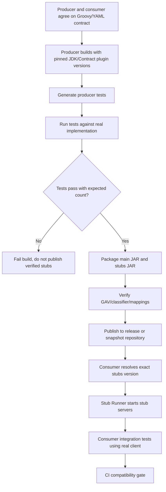

# Conventions for groupId, artifactId, version, and classifier

In *contract testing*, a **producer** can publish an application artifact to run in real environments while simultaneously publishing a **stubs** artifact for **consumers** to test independently. Both artifacts usually share the same **group ID, artifact ID, and version**, differing only by **classifier**. A single mistake in any coordinate component can cause **Spring Cloud Contract Stub Runner** to download the wrong artifact, fail to find mappings, or run contracts from an incompatible version.

For example, **Order Service** exposes an HTTP API returning order details to **Checkout Service** and an `ORDER_PAID` event to **Billing Service**. Spring Cloud Contract Verifier reads **Groovy/YAML DSL** contracts, generates producer tests, creates stubs, and packages an artifact consumers can consume in CI. For that workflow to be reproducible, teams must name and publish artifacts under a stable convention.

This lesson belongs to the **Contract and Artifact Repositories** chapter in the **SPRING_CLOUD_CONTRACT** track. The focus is explaining **`groupId`**, **`artifactId`**, **`version`**, **`classifier`**, and **`extension`**, how they appear in Maven repositories and `Stub Runner ids`, how to manage **release/SNAPSHOT** builds, and how to distinguish **contract source artifacts**, **application artifacts**, and **stubs artifacts** to prevent incompatible API changes from slipping past CI.

## 1. What Is a Maven Artifact?

In Maven, an artifact is a unit that can be stored, downloaded, and retrieved from a repository using **coordinates**. An artifact is commonly a `.jar`, `.pom`, or `.war` file, though not limited to those formats.

The simplest coordinates are written as:

```text
groupId:artifactId:version
```

With multiple variants from the same build, consider:

```text
groupId:artifactId:version:classifier:extension
```

**Attention:** the second line is only a **way to describe the attributes**, not a dependency or Stub Runner syntax you can copy verbatim into every tool. Maven dependency XML uses `groupId`, `artifactId`, `version`, `classifier`, and `type` elements; Stub Runner uses an `ids` string with a **port at the end**. Keep the context clear.

### 1.1. The five components and their roles

| Component | Example | Meaning |
|---|---|---|
| **`groupId`** | `com.example.commerce` | Namespace of the team/organization publishing the artifact |
| **`artifactId`** | `order-service` | Name of the published module or product |
| **`version`** | `1.4.0` | Specific release of the module |
| **`classifier`** | `stubs` | Distinguishes variants of the same `groupId:artifactId:version` |
| **`extension`** | `jar` | Artifact file format |

Examples in this lesson:

```text
com.example.commerce:order-service:1.4.0
com.example.commerce:order-service:1.4.0:stubs
```

How to read them:

- The first line typically points to the **main artifact** of Order Service when no classifier is specified.
- The second line identifies the **stubs artifact** at the same version, carrying the `stubs` classifier.
- In both cases, the extension is usually `jar`.
- It does not mean the two files contain the same bytes or serve the same purpose.

**Pitfall to avoid:** treating `stubs` as part of `artifactId` and renaming the artifact to `order-service-stubs` unintentionally. Such an `artifactId` can be valid if a team designs it intentionally, yet it **differs** from the default `stubs` classifier mechanism used by Spring Cloud Contract/Stub Runner in most configurations.

## 2. Conventions for `groupId`

`groupId` defines the **namespace** of an artifact. Maven guides recommend a structure similar to Java packages: **a domain name controlled by the organization, reversed**.

Illustrative examples:

```text
com.example
com.example.commerce
com.example.commerce.orders
```

For a hypothetical organization owning `example.com`, `com.example.commerce` expresses the namespace of commerce services. This is not a built-in identifier of Spring Cloud Contract; teams design it according to artifact repository policy.

### 2.1. Criteria for choosing a good group ID

- **Stable:** does not change whenever owning teams shift or internal project names change.
- **Owned:** never use namespaces not controlled by the organization.
- **Easy to group:** can be subdivided by product/business domain if large enough.
- **Not overly granular:** avoid creating a new `groupId` per branch, environment, or pull request.
- **No embedded secrets:** `groupId` is metadata displayed in build logs and repositories.
- **Consistent:** the application JAR and stubs JAR of the same module normally share the same `groupId`.

### 2.2. Naming patterns to avoid

| Naming choice | Problem | Better approach |
|---|---|---|
| `test` or `spring` | Too generic, hard to identify owner | `com.example.commerce` |
| `team-a-2026` | Tied to internal org structure/date | Stable product namespace |
| `dev.com.example` for all dev builds | Mixes environment into `groupId` | Keep `groupId`, differentiate by version/repository |
| `com.example.order-service` changed every sprint | Coordinates drift constantly | Use versioning rules and a stable module name |
| Different producer `groupId` between main and stubs without reason | Stub Runner cannot infer coordinates from producer module | Use the same `groupId`/GAV by convention, or document mapping |

**It is not mandatory** for every module in an organization to share one `groupId`. A company can use multiple namespaces for clear reasons. What matters is that **consumers can identify the exact producer artifact** and CI can look it up via a stable rule.

## 3. Conventions for `artifactId`

`artifactId` is the module name published to the repository. Maven recommends simple naming with **lowercase letters, digits, and hyphens**.

Examples:

```text
order-service
inventory-service
billing-service
checkout-api-client
shared-contract-model
```

### 3.1. Whose name is the artifact ID?

In producer–consumer contract testing:

- `order-service` is the **producer's artifactId** publishing the stubs.
- `checkout-service` is the **consumer** using the stubs.
- `billing-service` is another consumer receiving events from Order Service.
- `get_paid_order_200` or `billing_order_paid_v1` is a **contract scenario name**, not an `artifactId`.

When Checkout configures Stub Runner to download Order Service's stubs, the `artifactId` inside `ids` must be **`order-service`**, not `checkout-service`.

### 3.2. Do not confuse artifact ID with Spring application name

A producer might have:

```yaml
spring:
  application:
    name: orders-api
```

while its POM declares:

```xml
<artifactId>order-service</artifactId>
```

These two values **do not have to match**:

- `artifactId` belongs to Maven coordinates and artifact resolution.
- `spring.application.name` identifies the application within the Spring Boot/Spring Cloud context.
- In the `stubsPerConsumer` feature, the **consumer-side** application name can be used to select a branch of mappings, yet this does not alter the producer's `artifactId`.

Keeping them identical for easier management is an **internal convention**, not a Maven requirement.

## 4. Conventions for `version`

`version` tells the producer and consumer **which build's contract set** is in use. Examples:

```text
1.4.0
1.4.1
1.5.0
2.0.0
1.5.0-SNAPSHOT
2.0.0-rc1
```

Maven does not require all versions to follow Semantic Versioning, yet projects should enforce a **consistent versioning policy**. A common management approach is:

| Situation | Example | What to understand |
|---|---|---|
| Stable release | `1.4.0` | Artifact contents should never change after release |
| Bug fix without breaking contract changes | `1.4.1` | Follow the organization's versioning policy |
| Backward-compatible addition | `1.5.0` | Consumers should test new scenarios when relevant |
| Potentially API-breaking change | `2.0.0` | Requires consumer migration/review and explicit API strategy |
| Under active development | `1.5.0-SNAPSHOT` | Can change across builds; watch out for caching |
| Pre-release build | `2.0.0-rc1` | Signals this is not yet a final release |

**Important note:** a version number does not prove compatibility by itself. A producer could alter a payload in a patch release; a new major release might still preserve compatibility for some APIs. **Contract tests** are the real evidence for the stated expectations.

### 4.1. How releases and SNAPSHOTs differ

- **Release `1.4.0`:** by convention should be treated as *immutable*—once published, never overwrite the same coordinates with new content.
- **`1.5.0-SNAPSHOT`:** can be published repeatedly during development; remote Maven repositories maintain metadata to resolve snapshots by timestamp.
- **`+` version in Stub Runner:** some versions allow requesting the latest build; convenient for experimentation, yet makes CI non-reproducible unless the resolved version is recorded.
- **Version ranges:** only use when supported by the Stub Runner/resolver version and justified by the pipeline; never replace exact versions in release gates.

If Checkout tests against `1.4.0` stubs while production plans to upgrade Order Service to `1.5.0`, passing against the old stubs **does not prove** Checkout is compatible with the new build.

### 4.2. Artifact version and API version are two different things

| Version name | Example | Meaning |
|---|---|---|
| **Producer artifact version** | `1.4.0` | Order Service build version |
| **HTTP API version** | `/api/v2/orders` or `X-Api-Version: 2` | Protocol version visible to consumers |
| **Message schema version** | `eventVersion: 2` | Event payload convention |
| **Contract case version** | `billing_order_paid_v1` | Test scenario name/label |
| **Spring Cloud Contract plugin version** | A version in the Maven plugin | Generator tool version, **not** producer version |

A producer artifact `1.4.0` can implement HTTP API v2 or emit message schema v1. Do not use the stubs JAR version as a substitute for API/schema evolution rules.

## 5. Conventions for `classifier` and `extension`

Classifiers distinguish **variants sharing the same groupId, artifactId, and version**. Maven may store:

```text
order-service-1.4.0.jar
order-service-1.4.0-stubs.jar
order-service-1.4.0-sources.jar
order-service-1.4.0-javadoc.jar
```

In this example:

- Main JAR: **no classifier**.
- Stubs JAR: classifier **`stubs`**.
- Sources JAR: classifier **`sources`**.
- Javadoc JAR: classifier **`javadoc`**.

These are not four different producer versions; they are artifacts sharing the same GAV with different classifiers.

### 5.1. `extension` is not `classifier`

These attributes:

```text
groupId    = com.example.commerce
artifactId = order-service
version    = 1.4.0
classifier = stubs
extension  = jar
```

produce the familiar filename:

```text
order-service-1.4.0-stubs.jar
```

**`jar` is the extension**, while **`stubs` is the classifier**. Do not call `stubs` a packaging type and do not set `type=stubs` in a Maven dependency unless the project explicitly proves a custom type mapping exists.

### 5.2. What if the classifier is not `stubs`?

Spring Cloud Contract Stub Runner uses a **default classifier of `stubs`** in documented versions. A project can use a custom classifier variant if tooling/builds align, provided **producer publication and consumer resolution agree exactly**.

For instance, if the artifact is published with classifier `contract-stubs` while the consumer still looks for `stubs`, Maven may report artifact not found or Stub Runner will fail to load mappings.

Only change the classifier for a clear reason, document it for all consumers, and verify actual publication in the pipeline.

## 6. Example of One Producer Publishing Two Artifacts

Producer POM:

```xml
<project>
    <!-- Other required POM sections omitted. -->
    <modelVersion>4.0.0</modelVersion>
    <groupId>com.example.commerce</groupId>
    <artifactId>order-service</artifactId>
    <version>1.4.0</version>
    <packaging>jar</packaging>
</project>
```

Once Maven/Spring Boot/Spring Cloud Contract plugins are fully configured, the build can produce:

```text
target/
├── order-service-1.4.0.jar
└── order-service-1.4.0-stubs.jar
```

| Artifact | Logical coordinates | Where is it used? |
|---|---|---|
| Main application JAR | `com.example.commerce:order-service:1.4.0` | Runs the real Order Service |
| Attached stubs JAR | `com.example.commerce:order-service:1.4.0:stubs` | Stub Runner for Checkout/Billing |

**The minimal POM above does not generate a stubs JAR by itself.** To produce stubs, the producer still needs Groovy/YAML contracts, Spring Cloud Contract Verifier/plugin, and proper generation/packaging steps. If only the main JAR appears, never rename it to `-stubs.jar`; inspect the plugin and stub mappings instead.

### 6.1. The application artifact might not be executable

A main artifact can be a plain Java JAR or a Spring Boot executable JAR depending on packaging plugins. `order-service-1.4.0.jar` **does not automatically mean** it can always run with `java -jar`.

Conversely, the stubs JAR is not meant to run controllers or business services. **Stub Runner** uses mappings/contracts data to spin up a simulated server. Never deploy `-stubs.jar` as a producer application in production.

## 7. Paths Inside a Maven Repository

A repository following standard Maven layout uses **directory-formatted groupId**, followed by `artifactId` and `version`.

For:

```text
com.example.commerce:order-service:1.4.0:stubs
```

the standard path is:

```text
com/example/commerce/order-service/1.4.0/
├── order-service-1.4.0.pom
├── order-service-1.4.0.jar
└── order-service-1.4.0-stubs.jar
```

### 7.1. Why do dots in `groupId` become slashes?

`com.example.commerce` is a namespace; in a **Maven repository path** it is normally split into three segments:

```text
com/example/commerce
```

This **differs** from how some stubs JARs organize internal metadata, which may use a path like:

```text
META-INF/com.example.commerce/order-service/1.4.0/
```

**Never extrapolate one path format into the other.** The **external repository** layout is governed by Maven; the layout **inside the stubs JAR** is governed by the Spring Cloud Contract plugin and its version/artifact configuration.

### 7.2. Distinguishing filename from identity

A file named `order-service-1.4.0-stubs.jar` **does not prove** it was published under the right coordinates. A script can copy and rename a file without generating proper Maven metadata.

Verify:

1. `groupId`, `artifactId`, and `version` in the POM/publication.
2. Attached artifact's `classifier` is `stubs`.
3. Extension is `jar`.
4. The Maven repository holds the file and matching metadata.
5. Stub Runner can resolve using **the exact published coordinates**.
6. Inside the archive are the contracts/mappings the consumer expects to use.

**Do not build workflows around searching for similar-looking filenames** when you can resolve cleanly via Maven coordinates and repository policy.

## 8. Inside the Stubs JAR: Contracts and Mappings

An illustrative layout for the Order Service artifact:

```text
order-service-1.4.0-stubs.jar
└── META-INF/
    └── com.example.commerce/
        └── order-service/
            └── 1.4.0/
                ├── contracts/
                │   ├── checkout-service/
                │   │   └── get_paid_order_200.groovy
                │   └── billing-service/
                │       └── order_paid_event_v1.groovy
                └── mappings/
                    └── checkout-service/
                        └── checkout_get_paid_order_200.json
```

**This structure is illustrative and not guaranteed byte-for-byte across all Spring Cloud Contract versions.** Some setups may store extra response body files, message contracts, or vary folder layouts. What matters is that Stub Runner finds the mappings and metadata corresponding to the published contracts.

In the **external** repository live Maven coordinates. Inside the JAR live **stub definitions**. The same name `order-service` can appear in both, serving different tools.

### 8.1. Inspecting the actual archive

On a machine with the JDK and a proper producer build:

```bash
jar tf target/order-service-1.4.0-stubs.jar
```

This command helps locate entries like `contracts/` and `mappings/`. Actual names and paths must be verified against the output of your plugin version rather than forcing tests to fit an illustrative diagram.

If the archive lacks mappings:

- Was the contract source directory misconfigured?
- Did the plugin recognize the Groovy/YAML files?
- Did the convert/generate stubs goal execute?
- Was the artifact published before the plugin finished?
- Is the test fetching a different classifier?

An empty or misstructured stubs JAR may still resolve cleanly in Maven while **the consumer still has no response mappings to use**.

## 9. Sample Source Contracts and Their Link to Artifacts

Groovy DSL describing a Checkout HTTP scenario:

```groovy
import org.springframework.cloud.contract.spec.Contract

Contract.make {
    name 'checkout_get_paid_order_200'

    request {
        method GET()
        url '/api/orders/ORDER-42'
        headers {
            header 'Accept', 'application/json'
        }
    }

    response {
        status OK()
        headers {
            contentType(applicationJson())
        }
        body(
            id: 'ORDER-42',
            status: 'PAID',
            totalAmount: 125000
        )
    }
}
```

YAML DSL describing a **different scenario**, a non-existent order:

```yaml
name: checkout_get_missing_order_404
request:
  method: GET
  url: /api/orders/ORDER-MISSING
  headers:
    Accept: application/json
response:
  status: 404
  headers:
    Content-Type: application/json
  body:
    code: ORDER_NOT_FOUND
```

The producer should run generated tests to prove the real implementation returns `200`/`404` per the fixtures. Only then should the stubs artifact be considered **verified**.

### 9.1. Contract name is not artifact ID

- `checkout_get_paid_order_200`: identifies one **scenario**.
- `checkout-service`: a **consumer**.
- `com.example.commerce:order-service:1.4.0:stubs`: identifies the **producer's stubs artifact**.
- `ORDER-42`: test data inside the body/path.

Never replace `artifactId` with a contract name or consumer name. Creating a separate stubs JAR per contract unintentionally makes coordinates and versions very hard for consumer pipelines to manage.

## 10. Stub Runner `ids`: With **port** at the End

Spring Cloud Contract Stub Runner uses an Ivy-like notation to select stubs:

```text
groupId:artifactId:version:classifier:port
```

Example:

```text
com.example.commerce:order-service:1.4.0:stubs:8085
```

Breakdown:

| Position | Value | Meaning |
|---|---|---|
| 1 | `com.example.commerce` | Group of the **producer artifact** |
| 2 | `order-service` | Producer artifact ID |
| 3 | `1.4.0` | Stubs version |
| 4 | `stubs` | Stubs classifier |
| 5 | `8085` | Port of the **WireMock HTTP stub server** |

**The port is not part of Maven artifact coordinates.** Changing `8085` to `8090` does not create a different artifact in the Maven repository; it only changes how Stub Runner binds the HTTP server in the test environment.

### 10.1. Optional segments

In Stub Runner documentation, `version`, `classifier`, and `port` can be omitted according to version defaults. Common defaults:

- `classifier` is `stubs`.
- Omitting port picks a random port within a configured range.
- Omitting version triggers latest-version lookup such as `+`.

For **reproducible CI**, **specify version and classifier explicitly**, while port can stay dynamic if the test framework retrieves the actual assigned port. Never rely on “latest” in release gates without recording the resolved version.

### 10.2. Maven dependencies do not take a port

A Maven dependency describing the stubs artifact looks like:

```xml
<dependency>
    <groupId>com.example.commerce</groupId>
    <artifactId>order-service</artifactId>
    <version>1.4.0</version>
    <classifier>stubs</classifier>
    <type>jar</type>
    <scope>test</scope>
</dependency>
```

This is an **artifact dependency**: it does not start a WireMock server on its own. `scope=test` is an illustrative choice if you want stubs on the test classpath. With Stub Runner `LOCAL` or `REMOTE`, you may **not need to declare an explicit stubs dependency** in the consumer POM because Stub Runner resolves it from `ids`.

**There is no `<port>8085</port>` element in a Maven dependency.** Port is a runtime property of the stub server.

## 11. Stub Runner Example in the Consumer

Suppose Checkout uses JUnit/Spring Boot Test and consumes stubs installed in the Maven local repository:

```java
import org.springframework.boot.test.context.SpringBootTest;
import org.springframework.cloud.contract.stubrunner.spring.AutoConfigureStubRunner;
import org.springframework.cloud.contract.stubrunner.spring.StubRunnerProperties;

@SpringBootTest(
    properties = "clients.order.base-url=http://localhost:8085"
)
@AutoConfigureStubRunner(
    ids = "com.example.commerce:order-service:1.4.0:stubs:8085",
    stubsMode = StubRunnerProperties.StubsMode.LOCAL
)
class CheckoutOrderClientContractTest {
    // Inject Checkout's real client and add @Test.
    // Client calls GET /api/orders/ORDER-42.
    // Assert id, status, totalAmount per the contract.
}
```

This is a **test skeleton**, not a complete JUnit test. The `clients.order.base-url` property is defined by the Checkout application, not a standard property created automatically by Stub Runner. If using a dynamic port, configure the client from the URL provided by `StubFinder`/Stub Runner instead of hardcoding `8085`.

### 11.1. Stub resolution modes

| Mode | Source | When appropriate |
|---|---|---|
| **`LOCAL`** | Maven local repository (e.g., `~/.m2/repository`) | Developer just built and installed producer stubs |
| **`REMOTE`** | Repository configured in `repositoryRoot` | CI or other teams fetching stubs from Artifactory/Nexus |
| **`CLASSPATH`** | Resources/artifacts present on test classpath per version support | Tests that do not require Maven remote access |

Properties `spring.cloud.contract.stubrunner.stubs-mode` and `spring.cloud.contract.stubrunner.repository-root` typically correspond to annotation attributes. **Verify exact annotation names, packages, and properties against your actual version.**

### 11.2. Example reading stubs from a remote Maven repository

```java
@AutoConfigureStubRunner(
    ids = "com.example.commerce:order-service:1.4.0:stubs:8085",
    repositoryRoot = "https://repo.example.test/repository/maven-releases",
    stubsMode = StubRunnerProperties.StubsMode.REMOTE
)
```

This sample assumes an internal repository with an endpoint supporting Maven artifact resolution. Never put access tokens/passwords inside annotations or commit them to Git; use Maven settings/CI secrets and corresponding Stub Runner properties.

## 12. Contracts Artifact **Differs From** Stubs Artifact

An organization may store **source contracts** in a separate project or repository rather than keeping all contracts under the producer's `src/test/resources/contracts`. In that setup, a **third artifact** can appear.

| Artifact type | Example coordinates | What does it hold? | Who uses it? |
|---|---|---|---|
| **Application** | `com.example.commerce:order-service:1.4.0` | Runnable producer code | Runtime/deploy |
| **Stubs** | `com.example.commerce:order-service:1.4.0:stubs` | Mappings/contracts for Stub Runner | Consumer tests |
| **Contracts source** | `com.example.contracts:order-contracts:2026.11` | Independently managed Groovy/YAML DSL | Producer Contract Verifier plugin |

The third example is a **hypothetical convention**, not a mandatory classifier always generated by Spring Cloud Contract. A team may publish contract sources as a JAR with its own GAV or store them directly in Git; each option requires configuring the appropriate downloader and version.

### 12.1. When contracts live in a Maven artifact

In certain Spring Cloud Contract Maven plugin versions, you can use:

- `contractDependency`: specifies the artifact containing contracts.
- `contractsPath`: path to the contracts inside the artifact.
- `contractsMode`: how contracts are fetched.
- `contractsRepositoryUrl`: URL of the contract repository when different from the default repository.

Abbreviated POM structure example:

```xml
<plugin>
    <groupId>org.springframework.cloud</groupId>
    <artifactId>spring-cloud-contract-maven-plugin</artifactId>
    <version>APPROPRIATE_CONTRACT_PLUGIN_VERSION</version>
    <extensions>true</extensions>
    <configuration>
        <baseClassForTests>
            com.example.order.contract.OrderContractBase
        </baseClassForTests>
        <contractDependency>
            <groupId>com.example.contracts</groupId>
            <artifactId>order-contracts</artifactId>
            <version>2026.11</version>
        </contractDependency>
        <contractsPath>com/example/commerce/order-service</contractsPath>
    </configuration>
</plugin>
```

**This is a directional example, not a configuration guaranteed to run on every plugin version.** Replace `APPROPRIATE_CONTRACT_PLUGIN_VERSION`; `contractsPath` must match the actual path inside the contracts artifact. You may also need to set `contractsMode`, repository URL, classifier, or dependency metadata depending on how the artifact is published.

### 12.2. Keeping the link between contract source version and producer version

If contract sources are `order-contracts:2026.11` and the producer publishes `order-service:1.4.0`, record:

```text
Producer build:       order-service:1.4.0
Contracts source:     order-contracts:2026.11
Generated stubs:      order-service:1.4.0:stubs
Producer test result: PASS
Commit / pipeline ID: build-1842
```

Both versions do not have to match when contracts live in an independent project, yet **it must be traceable** which exact contract source version a producer build used. Otherwise, consumers might test against stubs from a contract never verified on a real producer build.

## 13. Repositories: Local, Remote, and Git Are Not the Same

Common storage locations:

| Storage | Example | Purpose |
|---|---|---|
| **Maven local** | `~/.m2/repository` | Cache/artifacts on a developer machine or CI worker |
| **Maven remote releases** | `https://repo.example.test/repository/maven-releases` | Publishing release artifacts |
| **Maven remote snapshots** | `https://repo.example.test/repository/maven-snapshots` | Builds under development |
| **Git contracts repo** | A Git URL containing Groovy/YAML contracts | Reviewing/updating contract sources |
| **Git stubs repo** | Repository storing stubs in a downloader-supported layout | Used when no Maven artifact repo exists |
| **Test directory `stubs://`** | Local/classpath path per Stub Runner protocol | Reusing stubs in a workspace, version-dependent |

**Do not drop a plain Git URL into Maven `repositoryRoot` and assume Stub Runner can read it.** Some versions support protocols like `git://` via a dedicated downloader, or `stubs://` to read from a filesystem/classpath path. That mechanism **differs** from Aether/Maven remote resolution. Pick the right mode and verify how your plugin/Stub Runner version interprets paths.

### 13.1. Maven local: `install` is not `deploy`

- `mvn install`: places artifacts into the **Maven local repository** on the running machine.
- `mvn deploy`: uploads artifacts to the configured **remote repository** with publish permissions.
- Stub Runner `LOCAL`: reads the corresponding local source.
- Stub Runner `REMOTE`: downloads from the declared remote repository.
- A consumer running on another machine **cannot automatically see** a developer's local `~/.m2`.

If a producer CI build runs `install` on runner A, a consumer job on runner B will not automatically have the stubs JAR unless the artifact is published, passed via CI artifacts, or shared through a properly managed cache/volume.

## 14. Maven `distributionManagement` for Publishing

A producer POM can declare where to deploy release and snapshot builds:

```xml
<distributionManagement>
    <repository>
        <id>company-releases</id>
        <url>https://repo.example.test/repository/maven-releases</url>
    </repository>
    <snapshotRepository>
        <id>company-snapshots</id>
        <url>https://repo.example.test/repository/maven-snapshots</url>
    </snapshotRepository>
</distributionManagement>
```

These are **hypothetical** URLs, not live repositories. Nexus, Artifactory, or any Maven-layout-compatible repository can be used.

In `~/.m2/settings.xml` or CI Maven settings, credentials must match the **repository `id`** and be provisioned securely. Never put static usernames/passwords in a committed POM. `distributionManagement` controls where artifacts are **deployed**; it does not automatically configure every repository needed to **resolve** dependencies/stubs. Consumer Stub Runner may still require `repositoryRoot`, mirrors, and proper Maven settings.

### 14.1. Deploy must attach the stubs classifier properly

A `mvn deploy` reporting success **is not enough** if the publication only uploaded the main JAR without the attached stubs JAR. Verify the repository contains:

```text
order-service-1.4.0.pom
order-service-1.4.0.jar
order-service-1.4.0-stubs.jar
```

For multi-module Spring Boot/Contract plugins, check the **specific producer module** and artifact version rather than assuming another module's deploy succeeded for it.

### 14.2. Immutable release versions are a policy to enforce

Do not merely say “don't overwrite releases”; configure the artifact repository to **reject redeploying** the same release coordinates if your organization enforces immutable releases. When a hotfix happens, publish a new version such as `1.4.1` rather than replacing the bytes of `1.4.0-stubs.jar` and hoping consumers refresh.

For SNAPSHOTs, record commit/build metadata and set an explicit cache policy, since two downloads of the same `baseVersion` `1.5.0-SNAPSHOT` can yield different contents depending on timestamps and metadata.

## 15. Example File Identification by Maven Repository Layout

Hypothetical repository root:

```text
https://repo.example.test/repository/maven-releases/
```

When resolving GAV:

```text
com.example.commerce:order-service:1.4.0
```

the main file path can be:

```text
com/example/commerce/order-service/1.4.0/order-service-1.4.0.jar
```

and the stubs file:

```text
com/example/commerce/order-service/1.4.0/order-service-1.4.0-stubs.jar
```

They differ by **classifier**, not by sitting in two arbitrary repository groups.

For SNAPSHOTs from a remote repository, files can carry **timestamps and build numbers**, while Maven `baseVersion` remains `1.5.0-SNAPSHOT`. Never construct snapshot URL filenames by guesswork; let the Maven/Stub Runner resolver read `maven-metadata.xml` or use repository-native tools.

### 15.1. Check existence via Maven, do not guess URLs

One way to verify dependency resolution for the stubs JAR is using the Maven Dependency Plugin once repositories are configured:

```bash
./mvnw dependency:get \
  -Dartifact=com.example.commerce:order-service:1.4.0:jar:stubs
```

**Note the argument order in the Maven Dependency Plugin** in this example is `groupId:artifactId:version:type:classifier`, which differs from Stub Runner's `groupId:artifactId:version:classifier:port`. Verify exact syntax for your Maven Dependency Plugin version.

This command only illustrates **verifying the artifact exists and can be downloaded**; it does not verify JAR contents are valid or that producer tests ran.

### 15.2. Comparing three common notations

| Tool | Example | What does the last segment mean? |
|---|---|---|
| **Maven POM dependency** | `<classifier>stubs</classifier>`, `<type>jar</type>` | No port |
| **Maven Dependency Plugin `dependency:get`** | `com.example.commerce:order-service:1.4.0:jar:stubs` | `stubs` is the classifier |
| **Spring Cloud Contract Stub Runner `ids`** | `com.example.commerce:order-service:1.4.0:stubs:8085` | `8085` is the stub server port |

This is a very common error: copying Stub Runner's `ids` string into the `-Dartifact` parameter of the Maven Dependency Plugin, causing Maven to interpret **`stubs` as `type`** and **`8085` as `classifier`**.

## 16. Multiple Consumers and Contract Directory Names

Suppose Order Service has two consumers:

```text
src/test/resources/contracts/
├── checkout-service/
│   └── get_paid_order_200.groovy
└── billing-service/
    └── order_paid_event_v1.groovy
```

You can keep **one** stubs artifact:

```text
com.example.commerce:order-service:1.4.0:stubs
```

for both consumers. The `stubsPerConsumer` setting (where supported by your version) can filter mappings by **consumer name in the path** instead of creating a new `artifactId` for every consumer.

### 16.1. Three separate axes

- **Producer artifact identity:** `com.example.commerce:order-service`.
- **Producer artifact version:** `1.4.0`.
- **Consumer selection:** `checkout-service` or `billing-service`.

If Checkout tests fail due to selecting the wrong consumer directory, **do not solve it by changing the producer `artifactId`**. Fix the contract folder/`consumerName` and verify which mappings Stub Runner actually registers.

## 17. Change Policy and Contract Compatibility

Teams should define who is allowed to change each component:

| Attribute | When changed | Control |
|---|---|---|
| `groupId` | Moving artifact namespace/owner | Migrate Maven dependencies, Stub Runner `ids`, and repository configs |
| `artifactId` | Renaming module or splitting/merging producer | Update consumers, CI, and transitional releases |
| `version` | Every new producer release/build | Pin target version, run consumer compatibility tests |
| `classifier` | Changing fetched artifact variant | Verify consumer resolution and publication |
| `extension` | Changing archive format | Tooling must be able to read it |
| API path/schema/header | Interface change | Producer contract verification and consumer stub tests |
| Contract source version | When contracts live in an independent artifact | Record provenance in producer build |
| Stub server port | Test environment config | Keep GAV unchanged; update test client URL |

### 17.1. Impact of API changes

Suppose Billing depends on:

```json
{
  "orderId": "ORDER-42",
  "totalAmount": 125000,
  "currency": "VND"
}
```

The producer renames `totalAmount` to `amount` in `1.5.0`. If the `1.4.0` contract still expects `totalAmount`, generated producer tests should catch when the new implementation breaks the commitment, or consumer tests running against `1.5.0` stubs will expose the incompatibility.

Changing an artifact version **does not fix consumer code by itself**. Review contracts, apply migrations, or intentionally version the API. That is why `version` and `classifier` must help CI identify **which exact build is under test**.

### 17.2. Never overwrite artifacts just to fix a contract

If stubs `1.4.0` are found to have a wrong mapping:

1. Identify whether the bug is in the contract source, generated mapping, or publication.
2. Fix the DSL or producer configuration.
3. Re-run generated producer tests.
4. Publish a new version such as `1.4.1` if following an immutable release policy.
5. Have consumers upgrade their test target to `1.4.1`.
6. Maintain traceability to commit/build and reason for the fix.

If the artifact is not yet officially released and is still a snapshot, the snapshot build may be updated per policy, provided caches and resolved versions are verified.

## 18. Common Maven/Stub Runner Pitfalls

| Symptom | Possible cause | How to resolve |
|---|---|---|
| Stub Runner reports artifact not found | Wrong `groupId`/`artifactId`/`version`/`classifier` | Check complete Maven coordinates |
| Maven resolves main JAR, Stub Runner has no mappings | Fetching artifact **without classifier** | Request the `stubs` classifier |
| `-stubs.jar` exists on producer machine yet CI fails to fetch | Only `install`ed locally, never `deploy`ed remotely | Publish to right repository; configure `REMOTE` |
| `dependency:get` cannot find JAR | Wrong `type`/`classifier` order in CLI | Put `:jar:stubs` at the end |
| Consumer test runs against old version | `ids` pinned to old version or cached snapshot | Check requested/resolved version and artifact content |
| Two builds of `1.4.0` produce different contents | Release artifact overwritten | Enforce immutable releases, publish a new version |
| Snapshot works intermittently | Inconsistent metadata/cache/publishing | Verify Maven metadata and repository policy |
| Stub Runner downloads right JAR yet every request returns `404` | Missing mappings or unmatched request | Open archive, inspect mappings, path/header/body |
| Unmatched-request `404` mistaken for business error | WireMock default response | Assert contract-defined JSON error code |
| Stubs JAR contains contracts yet no mappings | Wrong plugin conversion/packaging or message-only | Distinguish HTTP/message stubs; check logs |
| `stubsPerConsumer` selects no mappings | Directory name does not match consumer name | Check artifact paths and effective config |
| Multi-module deploy lacks stubs | Publication did not attach producer module classifier | Check module-specific artifacts |
| Artifact URL is right yet returns `401/403` | Repository credentials/permissions | Use Maven settings/CI secrets, never hardcode |
| Newer Maven version yet old plugin | Dependency/BOM and plugin version incompatibility | Pin and align Spring Boot/Cloud/Contract versions |
| Producer tests did not run yet JAR was published | Tests skipped or pipeline lacks release gate | Mandate report checks before deploy |
| Maven repository layout silently altered | Repo URL points to wrong endpoint or non-Maven upload | Fix Maven-compatible path/metadata |

### 18.1. Ordered diagnostic workflow

1. **Coordinates:** write down exact `groupId, artifactId, version, classifier, extension`.
2. **Source:** is the artifact in a local or remote repository?
3. **Publication:** does the repository hold the exact `-stubs.jar` and POM metadata?
4. **Contents:** does the archive contain valid mappings/contracts?
5. **Stub Runner:** are `ids` right and `stubsMode` appropriate?
6. **Runtime:** is the stub server port right, and does the client request match a mapping?
7. **Producer verification:** did generated tests actually run/pass in the publishing build?
8. **Consumer:** which version is the real client testing against, and how does it handle responses?
9. **Cache:** could the resolver be pulling a stale snapshot?
10. **Traceability:** which commit/build produced the artifact the test is consuming?

Do not start by editing the producer controller when the error is `artifact not found`. That is a **coordinates/repository** problem, not business logic.

## 19. CI: Versioning and Artifact Provenance

A pipeline can be structured as follows:



### 19.1. Values CI should record

```text
module             = order-service
producerGroupId    = com.example.commerce
producerArtifactId = order-service
producerVersion    = 1.4.0
stubsClassifier    = stubs
stubsExtension     = jar
producerCommit     = <build-commit-sha>
producerTests      = PASS
stubsPublication   = VERIFIED
consumerTestTarget = com.example.commerce:order-service:1.4.0:stubs
```

This example is **not a metadata file generated automatically by Maven**. These are fields that should live in build logs/artifact provenance if the organization needs auditing and failure reproduction.

Never declare **`producerTests=PASS`** merely because `order-service-1.4.0-stubs.jar` was created. Base it on test reports and actual execution of generated tests.

### 19.2. Pre-publish checklist

- [ ] `groupId` is an approved namespace, independent of temporary environments.
- [ ] `artifactId` reflects a stable producer module.
- [ ] `version` is explicitly defined; releases cannot be overwritten.
- [ ] Stubs JAR has classifier `stubs` and extension `jar`.
- [ ] Application JAR and stubs JAR come from the same producer build.
- [ ] Source contracts were discovered by the plugin.
- [ ] Generated producer tests exist, executed, and passed.
- [ ] `skipTests` is never used in verified release pipelines.
- [ ] Stubs archive contains expected mappings/contracts.
- [ ] Maven publication includes the attached stubs artifact and accurate metadata.
- [ ] Remote repository URL/permissions suit CI/consumers.
- [ ] Consumers use exact Stub Runner `ids`, `stubsMode`, and version.
- [ ] No repository credentials or tokens are hardcoded in source.
- [ ] No real personal data/secrets appear in stub payloads.
- [ ] Test reports and producer commit/build ID are traceable.

## 20. Practice Exercise: Order Service Publishes Stubs for Checkout

Context: a Maven producer `order-service` exposes an orders API; a consumer `checkout-service` uses Stub Runner to test its client. The goal is choosing the right coordinates, avoiding pulling the main JAR by mistake, and running reproducible CI.

### Step A — Agree on identifiers

Choose:

```text
groupId    = com.example.commerce
artifactId = order-service
version    = 1.4.0
classifier = stubs
extension  = jar
```

Explain:

1. Why does `groupId` reflect the organization's namespace?
2. Why is `artifactId` the producer rather than the consumer?
3. Why is `stubs` the classifier and `jar` the extension?
4. Why does port `8085` not belong to the coordinates above?

### Step B — Prepare contracts

1. Write a Groovy contract for `GET /api/orders/ORDER-42` returning `200`.
2. Write a YAML contract for `GET /api/orders/ORDER-MISSING` returning `404 ORDER_NOT_FOUND`.
3. Place both contracts in the source directory read by the plugin.
4. Prepare producer fixtures so both generated tests have deterministic data.
5. Never duplicate the same scenario in both Groovy and YAML.

### Step C — Generate tests and artifacts

1. Configure the Spring Cloud Contract Maven plugin and appropriate base class.
2. Run the producer Maven lifecycle, ensuring generated tests **actually execute**.
3. After tests pass, verify both main JAR and stubs JAR were created.
4. Run `jar tf` to inspect mappings/contracts inside the stubs JAR.
5. Check publication GAV/classifier metadata rather than looking only at filenames.

### Step D — Use Maven local

1. Install artifacts into the Maven local repository via `./mvnw install` after verification.
2. Confirm `com/example/commerce/order-service/1.4.0/` contains the right JARs.
3. Configure Checkout to use Stub Runner `LOCAL` with `ids=com.example.commerce:order-service:1.4.0:stubs:8085`.
4. Point Checkout's real client to port `8085`.
5. Assert both success responses and business error bodies.

### Step E — Deliberately test coordinate mistakes

1. Try omitting the classifier in a Maven dependency and observe which artifact resolves.
2. Try copying Stub Runner's `ids` string into `dependency:get`; explain why `type/classifier` order differs.
3. Try using `artifactId=checkout-service` instead of the producer.
4. Try publishing only the main JAR into a test repository and confirm the consumer lacks stubs.
5. Restore the right coordinates and re-run.

### Step F — Integrate into CI

1. Pin the producer version and Spring Cloud Contract plugin version.
2. Block publishing if producer contract tests do not run or fail.
3. Publish the `stubs` classifier artifact alongside the main artifact.
4. Consumer resolves from the test/remote repository and runs Stub Runner tests.
5. Record producer commit, artifact version, and test reports.
6. When releasing a new version, run consumer tests against the **target version**, not just the old one.

**Completion criteria:** learners accurately identify `groupId`, `artifactId`, `version`, `classifier`, and `extension`; distinguish Maven Dependency Plugin notation from Stub Runner `ids`; inspect repository contents; and explain why a stubs artifact is only trustworthy once producer tests have passed.

## 21. Self-Check Questions

1. **What is `groupId` used for?** Identifying the publishing organization/team namespace in Maven.
2. **Should `artifactId` be Order Service or Checkout Service when fetching Order stubs?** Order Service.
3. **Does the stubs artifact `version` usually match the main artifact?** Yes, when both come from the same producer build.
4. **Is classifier `stubs` the same as extension `jar`?** No, they are two distinct attributes.
5. **Can two JARs with different classifiers share the same `groupId:artifactId:version`?** Yes.
6. **Does `order-service-1.4.0-stubs.jar` run the producer application itself?** Normally no; Stub Runner loads its mappings.
7. **How does `groupId=com.example.commerce` appear in a Maven repository path?** Typically as `com/example/commerce`.
8. **Should a generic `groupId` like `test` be kept permanently for production?** No, because the namespace is too generic.
9. **How does a SNAPSHOT version differ from a release?** Snapshots can change across builds/metadata, whereas releases should be immutable.
10. **Can Stub Runner be left to pick a version via `+`?** Some versions allow it, yet it should not be used uncontrolled in CI release gates.
11. **Which tool uses `groupId:artifactId:version:classifier:port` syntax?** Spring Cloud Contract Stub Runner `ids`.
12. **Does port `8085` belong to Maven artifact identity?** No.
13. **In `dependency:get`, where do `jar` and `stubs` go?** Typically `group:artifact:version:jar:stubs`.
14. **Why does renaming the main JAR to `-stubs.jar` not work?** It does not create the mappings/contracts required by Stub Runner.
15. **How do `install` and `deploy` differ?** One writes to local Maven; the other publishes to a remote repository.
16. **What does `stubsMode=REMOTE` require?** A valid repository URL, published artifact, and access permissions.
17. **Must a contract source JAR share the exact same GAV as the producer?** No if organized/published separately, yet the verified contract version must be traceable.
18. **Must `spring.application.name` equal `artifactId`?** No.
19. **How does a consumer name differ from a producer `artifactId`?** Consumer name selects relevant contracts, while `artifactId` identifies the producer artifact.
20. **Why does passing tests against an old stub version not prove compatibility with a new producer version?** Because contracts/mappings have changed.
21. **Can a JAR resolve cleanly yet still provide no HTTP response stubs?** Yes, if mappings are missing or requests fail to match.
22. **What evidence is needed before publishing verified stubs?** Generated producer tests actually executed and passed against the real implementation.
23. **Why manage repository secrets separately?** To prevent exposing credentials in POMs, source code, logs, or artifacts.
24. **Why should a release repository forbid overwriting the same coordinates?** To guarantee reproducibility so the same version always yields identical artifact content.
25. **When changing the classifier, what needs updating?** Producer packaging/publication, Maven coordinates, and consumer Stub Runner config.

## 22. References and Version Boundaries

Official documentation to verify conventions and syntax per version:

- [Apache Maven — Maven Artifacts](https://maven.apache.org/repositories/artifacts.html)
- [Apache Maven — Naming Conventions](https://maven.apache.org/guides/mini/guide-naming-conventions.html)
- [Apache Maven — Repository Layout](https://maven.apache.org/repository/layout.html)
- [Apache Maven — Repository Metadata](https://maven.apache.org/repositories/metadata.html)
- [Spring Cloud Contract — Stub Runner Common Properties](https://docs.spring.io/spring-cloud-contract/reference/project-features-stubrunner/stub-runner-common.html)
- [Spring Cloud Contract — Stub Runner Core](https://docs.spring.io/spring-cloud-contract/reference/project-features-stubrunner/stub-runner-core.html)
- [Spring Cloud Contract — Maven Project](https://docs.spring.io/spring-cloud-contract/reference/maven-project.html)
- [Spring Cloud Contract — Fetching Stubs or Contract Definitions From a Location](https://docs.spring.io/spring-cloud-contract/reference/project-features-stubrunner/stub-runner-stubs-protocol.html)

Maven coordinates and Stub Runner `ids` follow different rules for **classifier/type/port**. Settings such as `contractDependency`, `contractsMode`, `repositoryRoot`, archive layout, annotation names, and SNAPSHOT handling must be verified against **the exact Spring Cloud Contract plugin/Stub Runner version** in use—never mix documentation from different release lines arbitrarily.

## Conclusion

**`groupId` identifies the namespace, `artifactId` identifies the producer module, `version` identifies the build, `classifier` separates stubs from the main artifact, and `extension` denotes the file format**. A single producer can publish `order-service-1.4.0.jar` to run the application and `order-service-1.4.0-stubs.jar` for consumers to consume via Stub Runner; they **cannot substitute for each other**.

For reliable contract and artifact repositories, teams need stable naming conventions, immutable release versions, traceable contract sources, publications carrying the exact classifier, and CI running **generated producer verification** before publishing verified stubs. When consumers resolve the exact GAV/classifier/version and test through real clients, Spring Cloud Contract helps catch incompatible API or message changes reproducibly.
