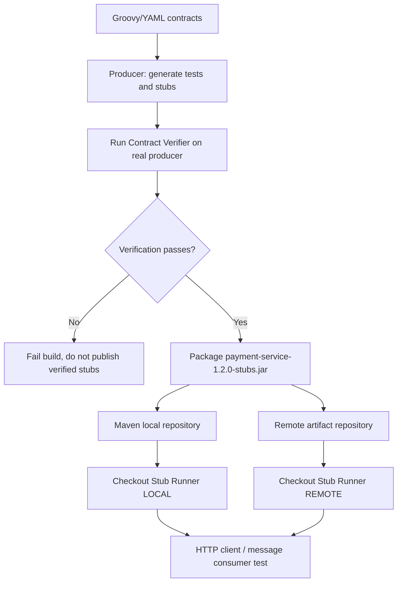
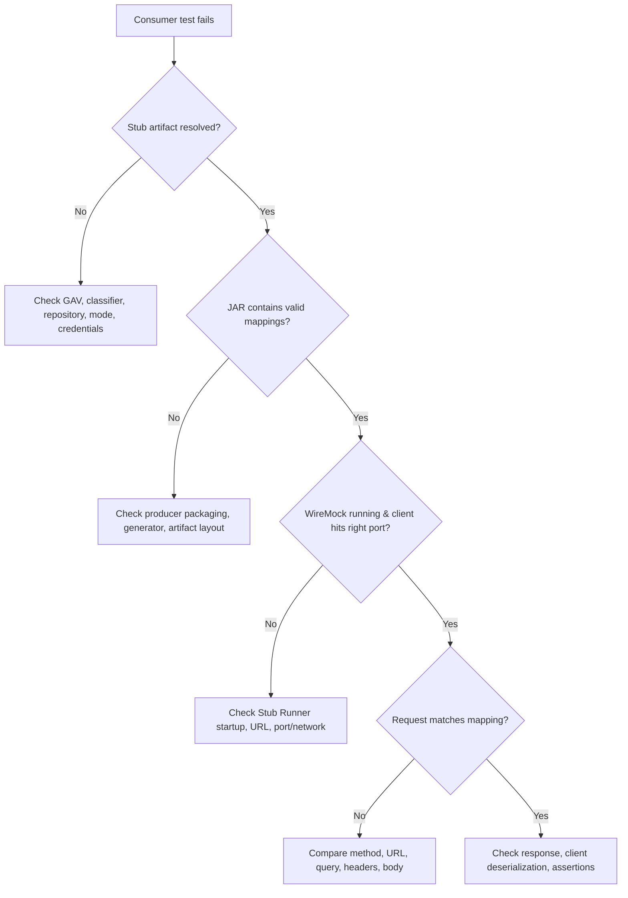
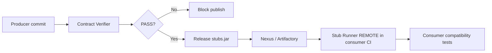

# Local Maven Repository and Remote Artifact Repositories

## 1. Context: One Producer, Multiple Consumers, and the Need to Share Contracts

Suppose **Payment Service** exposes an API for **Checkout Service** and **Reporting Service**. Development teams work across separate repositories, machines, and CI pipelines. Checkout needs to test its HTTP client when Payment Service is not running, while Reporting wants to ensure reporting data fields remain compatible.

With **Spring Cloud Contract**, teams can agree on HTTP or messaging behavior using the **Groovy/YAML DSL**. The producer generates **generated tests** to verify the real implementation while packaging HTTP stub mappings or messaging stub definitions. Consumers use **Stub Runner** to download and run stubs, catching incompatible API changes before services are deployed together.

The question arises: **Where are contracts and stubs stored so different teams fetch the exact right version?**

- On a developer's machine, build outputs are typically installed into the **Maven local repository**.
- In CI or enterprise setups, approved artifacts are usually **published to a remote repository** like Nexus or Artifactory.
- In source repositories, Groovy/YAML files are **contract definition sources**, not distributable JARs.
- A Gradle build cache or `build/` directory is not equivalent to a Maven artifact repository.

This lesson belongs to the **Contract and Artifact Repositories** chapter, focusing on how these storage locations relate and how to use them properly in Spring Cloud Contract.

### Learning outcomes

After this lesson, you can:

1. Distinguish Maven local, remote artifact repositories, contract repositories, and build caches.
2. Read Maven coordinates accurately: `groupId`, `artifactId`, `version`, `classifier`.
3. Package/install stubs at the producer via Maven or Gradle and verify artifact paths.
4. Configure Stub Runner with `LOCAL`, `REMOTE`, and `CLASSPATH`.
5. Configure `repository-root`, access permissions, and explicit versions for CI.
6. Distinguish missing artifacts, wrong classifiers, and wrong versions from WireMock request mismatches.
7. Design a reproducible **verify → package → publish → consume** pipeline.

## 2. Four Storage Locations Often Confused

| Storage location | What does it hold? | Who usually uses it? | Proves producer compliance by itself? |
| --- | --- | --- | --- |
| **Contract source repository** | `*.groovy`, `*.yml`, `*.yaml` | Producer/consumer reviewing together | No |
| **Maven local repository** | JARs, POMs, and Maven metadata on one machine | Developer, local builds, a single CI runner | No |
| **Remote Maven artifact repository** | Versioned JARs/POMs/metadata on a server | Multiple teams, multiple pipelines, Stub Runner | No |
| **Gradle build cache** | Outputs of tasks with matching cache keys | Gradle builds and CI | No |

What determines trustworthiness is not where the artifact sits, but whether **producer verification ran and passed before the stub was published as verified**.



**Note:** `install`/`publishToMavenLocal` target the local repository, whereas `deploy`/`publish` usually push to a remote repository **once publication is configured properly**. Those commands do not guarantee tests ran: the pipeline must enforce verification before publishing.

## 3. Maven Coordinates: Finding the Right Artifact Before Downloading

Maven identifies an artifact with these components:

```text
groupId : artifactId : version : classifier : extension
com.example : payment-service : 1.2.0 : stubs : jar
```

In Spring Cloud Contract, a standard stub artifact carries the **`stubs`** classifier. If the classifier is omitted, the dependency manager may fetch the **regular application JAR** instead of the file containing stub mappings.

| Field | Example value | Meaning |
| --- | --- | --- |
| `groupId` | `com.example` | Producer namespace |
| `artifactId` | `payment-service` | Producer module |
| `version` | `1.2.0` | Reproducible version |
| `classifier` | `stubs` | JAR variant for Stub Runner |
| `extension` | `jar` | Artifact type |

Under the standard Maven repository layout, the relative path is:

```text
com/example/payment-service/1.2.0/
  payment-service-1.2.0.pom
  payment-service-1.2.0.jar
  payment-service-1.2.0-stubs.jar
```

The paths above illustrate artifacts that **can** coexist if the project's publication includes both the application JAR and the stub classifier. `-stubs.jar` is a separate artifact; sharing the application's version does not mean the two files contain the same contents.

### 3.1. Stub Runner `ids` syntax

A commonly seen declaration:

```text
com.example:payment-service:1.2.0:stubs:8091
```

In Stub Runner's context, the trailing `8091` is the **HTTP stub server port**, not a Maven extension. Shorter `ids` forms may omit the classifier or port as supported by your Stub Runner version. To reduce ambiguity in CI, specify version, classifier, and port explicitly when a fixed port is needed.

**Producer ID is not consumer ID.** `Checkout Service` still fetches the artifact with `artifactId=payment-service`, because Payment Service publishes the API/stub.

### 3.2. Distinguishing `-stubs.jar` from a contract source artifact

A stubs JAR packaged by Spring Cloud Contract typically holds **mappings** and may include **contracts** in standard paths beneath `META-INF`. Other organizations may publish a **separate contracts artifact** (classifier defined by the team) or keep contract sources in an SCM repository.

Do not assume every project automatically produces `payment-service-1.2.0-contracts.jar`. If an independent artifact containing contract sources is needed, it must be **explicitly configured to package and publish**, with documented coordinate conventions.

## 4. From Groovy/YAML DSL to a Stub Artifact

Example Payment Service HTTP contract:

```groovy
import org.springframework.cloud.contract.spec.Contract

Contract.make {
    description 'Get payment status by paymentId'

    request {
        method GET()
        url '/api/payments/42'
        headers {
            header('Accept', 'application/json')
        }
    }

    response {
        status OK()
        headers {
            contentType(applicationJson())
        }
        body(
            paymentId: 42,
            status: 'PAID',
            currency: 'VND'
        )
    }
}
```

Producer workflow:

1. Save contracts into the project's DSL directory, e.g., `src/test/resources/contracts/`.
2. Configure the Spring Cloud Contract Gradle/Maven plugin along with its **test base class**.
3. Generate producer tests and HTTP stub mappings from contract sources.
4. **Run generated producer tests** to compare real requests/responses against contracts.
5. If passing, package the stub classifier per build configuration.
6. Install into local Maven or deploy/publish to a remote repository.

WireMock mapping files are usually JSON. An internal artifact structure looks like:

```text
META-INF/
  com.example/
    payment-service/
      1.2.0/
        contracts/
          get_payment.groovy
        mappings/
          get_payment.json
```

This is an **illustrative layout**, not a guarantee of exact mapping filenames produced by the generator. Intermediate/consumer directories and filenames can vary by version/configuration. When stubs fail to match, **inspect the published JAR contents** rather than merely confirming the JAR exists.

## 5. What Is the Maven Local Repository?

On a developer machine, typical Maven local paths are:

```text
Linux/macOS: ~/.m2/repository
Windows:      %USERPROFILE%\.m2\repository
```

The actual path can be overridden via `settings.xml`, `maven.repo.local`, or tool/CI setup. Gradle can also install Maven artifacts via `publishToMavenLocal`.

Maven local stores:

- Artifacts **installed/published locally** by the developer.
- Dependencies downloaded when Maven/Gradle uses that local repository.
- Metadata accompanying artifacts per resolver mechanisms.

**It is not a company-wide shared repository.** Two separate machines or containers do not automatically see each other's `~/.m2/repository`.

### 5.1. Installing the stub artifact locally with Maven

With a producer having plugin and test dependencies properly configured:

```bash
# Run in the producer repository in the lab environment.
./mvnw clean verify

# Once producer verification passes, install artifacts into Maven local.
./mvnw install
```

Then inspect the directory:

```text
~/.m2/repository/com/example/payment-service/1.2.0/
```

If `payment-service-1.2.0.jar` is present yet `payment-service-1.2.0-stubs.jar` is missing, the **plugin likely failed to generate/attach/package the stub classifier** during the lifecycle. Never work around this by changing Stub Runner from `stubs` to another classifier before the producer actually publishes the right artifact.

**Note:** `install` normally executes earlier Maven phases, yet the pipeline must still inspect generated test execution results and never bypass verification with `skipTests`/`maven.test.skip` flags. Having an artifact in the local repository **does not prove by itself** that it came from a passing build.

### 5.2. Maven plugin on the producer: example configuration

```xml
<!-- Snippet inside producer pom.xml, not a complete POM. -->
<plugin>
    <groupId>org.springframework.cloud</groupId>
    <artifactId>spring-cloud-contract-maven-plugin</artifactId>
    <version>${spring-cloud-contract.version}</version>
    <extensions>true</extensions>
    <configuration>
        <testFramework>JUNIT5</testFramework>
        <testMode>MOCKMVC</testMode>
        <baseClassForTests>com.example.payment.contract.PaymentContractBase</baseClassForTests>
    </configuration>
</plugin>
```

Property `${spring-cloud-contract.version}` must exist and be compatible with your Spring Boot/Spring Cloud dependencies; the POM also needs the Spring Cloud Contract Verifier dependency and related test dependencies. The plugin does not create `PaymentContractBase` in source automatically: the team must write the base class and prepare fixtures/MockMvc or the corresponding test mode.

## 6. How Does a Maven Remote Repository Differ from Maven Local?

A remote artifact repository is a server capable of managing versions, access control, metadata, and retention policies. Common examples:

- **Sonatype Nexus Repository**.
- **JFrog Artifactory**.
- An internal Maven-compatible repository or organization-managed artifact service.

Illustrative example URLs:

```text
https://repo.example.test/repository/maven-releases/
https://repo.example.test/repository/maven-snapshots/
```

The `example.test` domain is illustrative only; replace it with real repository URLs. Organizations typically separate **releases** and **snapshots**, though exact paths and policies depend on Nexus/Artifactory.

### 6.1. Maven can read from multiple repositories

A Maven project can declare or inherit repositories from `settings.xml`, parent POMs, and build configuration. However:

- **Dependency resolution** is **downloading/reading** artifacts.
- **Deployment** is **publishing/writing** artifacts.
- `repositories` or mirrors do not replace `distributionManagement` when the Maven Deploy Plugin needs a target repository.
- Having read access to a repository does not mean that account has permission to publish.

Distinguishing these two roles avoids errors like “my laptop downloads the JAR fine, yet `mvn deploy` returns `401`/`403`.”

## 7. Publishing Stubs from Maven to a Remote Repository

A `pom.xml` snippet illustrating where to publish:

```xml
<distributionManagement>
    <repository>
        <id>internal-releases</id>
        <url>https://repo.example.test/repository/maven-releases/</url>
    </repository>
    <snapshotRepository>
        <id>internal-snapshots</id>
        <url>https://repo.example.test/repository/maven-snapshots/</url>
    </snapshotRepository>
</distributionManagement>
```

In a developer/CI-managed Maven `settings.xml` file, credentials can be configured for the matching **server ID**:

```xml
<settings xmlns="http://maven.apache.org/SETTINGS/1.2.0">
    <servers>
        <server>
            <id>internal-releases</id>
            <username>${env.REPO_USER}</username>
            <password>${env.REPO_PASSWORD}</password>
        </server>
        <server>
            <id>internal-snapshots</id>
            <username>${env.REPO_USER}</username>
            <password>${env.REPO_PASSWORD}</password>
        </server>
    </servers>
</settings>
```

This is an **illustrative configuration**: `settings.xml` paths and CI secret-injection mechanisms vary by environment. Maven supports environment variable expressions depending on version/setup; ensure variables exist and credentials are managed safely. **Never commit real passwords or tokens into POM/settings files in source repositories.**

Illustrative publish commands:

```bash
# Producer build must be configured to verify contracts and attach stubs.
./mvnw clean verify

# Run only after producer verification PASSES.
./mvnw deploy
```

`deploy` only pushes artifacts attached during the publication/lifecycle to the target repository. **Never assume every `deploy` ran generated tests**, as CI could pass skip flags, override plugin goals, or run a shortened lifecycle.

### 7.1. Releases and snapshots have different policies

| Version type | Example | Purpose | Notes |
| --- | --- | --- | --- |
| Release | `1.2.0` | Stable version agreement between producer/consumer | Should enforce immutability, never overwrite |
| Snapshot | `1.3.0-SNAPSHOT` | Pre-release integration testing | Can change per deploy; understand update policy/metadata |
| Dynamic version | `+` in some Stub Runner configs | Discovering newest build | Non-reproducible; avoid as CI baseline |

Nexus/Artifactory usually enforce dedicated policies for snapshot retention and release overwrites. **A version is not proof of compatibility:** consumers must run tests against the intended stub version, and the producer must verify the exact source of that artifact.

## 8. Publishing with Gradle and `maven-publish`

If the producer uses Gradle, you can configure a publication containing the application JAR and the `verifierStubsJar` artifact (when provided by your plugin version).

Example **configuration snippet in `build.gradle` Groovy DSL**:

```groovy
plugins {
    id 'java'
    id 'maven-publish'
    id 'org.springframework.cloud.contract' version '<compatible-scc-version>'
}

group = 'com.example'
version = '1.2.0'

publishing {
    publications {
        maven(MavenPublication) {
            from components.java
            artifact(tasks.named('verifierStubsJar'))
        }
    }

    repositories {
        maven {
            url = uri('https://repo.example.test/repository/maven-releases/')
            credentials {
                username = providers.environmentVariable('REPO_USER').orNull
                password = providers.environmentVariable('REPO_PASSWORD').orNull
            }
        }
    }
}
```

**Replace** `<compatible-scc-version>` with a real Spring Cloud Contract plugin release compatible with your project's Spring Boot/Cloud versions. This is not a complete project: it still needs dependencies, test base configuration, contract sources, and how the Spring Cloud Contract plugin produces `verifierStubsJar`. If your plugin version names tasks or publications differently, inspect `./gradlew tasks --all` and the docs for your exact plugin version.

Illustrative commands:

```bash
# Producer must verify contracts against real code first.
./gradlew clean check

# Install publication into Maven local.
./gradlew publishToMavenLocal

# Publish to remote repository only after verification passes.
./gradlew publish
```

**Do not assume `publish` depends on `check`.** The pipeline must ensure `check` (including generated producer tests) executed, or build logic must wire explicit dependencies/gates. `publishToMavenLocal` and `publish` do not guarantee the artifact was verified.

### 8.1. Using Gradle when the consumer fetches a Maven artifact

A Maven-compatible repository works for both Maven and Gradle. A producer can publish with Gradle while a consumer runs Stub Runner in Spring/JUnit and downloads the artifact from the same Nexus/Artifactory.

Conversely, a producer publishing with Maven can be consumed by a Gradle consumer. **The repository/artifact format** is the contract boundary; producer and consumer do not have to share the same build tool.

## 9. Stub Runner in LOCAL Mode

In consumer `Checkout Service`, a Spring Boot test can start Payment Service stubs from the **Maven local repository**:

```java
import org.junit.jupiter.api.Test;
import org.springframework.boot.test.context.SpringBootTest;
import org.springframework.cloud.contract.stubrunner.spring.AutoConfigureStubRunner;
import org.springframework.cloud.contract.stubrunner.spring.StubRunnerProperties;

@SpringBootTest(properties = {
    "payment.client.base-url=http://localhost:8091"
})
@AutoConfigureStubRunner(
    ids = "com.example:payment-service:1.2.0:stubs:8091",
    stubsMode = StubRunnerProperties.StubsMode.LOCAL
)
class PaymentClientContractTest {

    @Test
    void checkoutReadsPaymentFromStub() {
        // Call real PaymentClient to localhost:8091.
        // Verify client deserializes status=PAID, currency=VND.
    }
}
```

This is an **illustrative skeleton**, not a complete test: the body must invoke the real HTTP client, the stub JAR must exist in the local repository, and test dependencies must be declared. Fixed port `8091` is only for convenience here; for parallel jobs, consider dynamic ports with `StubFinder`.

### 9.1. What does LOCAL require?

1. The **consumer test process's** Maven local contains the artifact with the right GAV/classifier.
2. Stub Runner is set to `LOCAL` mode, not `REMOTE`.
3. The stub JAR contains mappings in a layout supported by the Stub Runner version.
4. The consumer test calls the exact HTTP stub port.
5. URL, method, headers, and body actually match a mapping.

**A stub JAR sitting in `build/libs` will not necessarily be found by Stub Runner LOCAL.** It must reside in the local Maven repository or be supplied through another mode.

## 10. Stub Runner REMOTE and `repository-root`

In CI, jobs typically run on clean runners/containers without sharing `~/.m2/repository`. In that case, a remote repository is more appropriate:

```yaml
spring:
  cloud:
    contract:
      stubrunner:
        stubs-mode: REMOTE
        repository-root: "https://repo.example.test/repository/maven-releases/"
        ids:
          - "com.example:payment-service:1.2.0:stubs:8091"
```

`repository-root` here is the URL to the **Maven-compatible artifact repository** holding the producer's stub artifact. It is **not** the HTTP base URL of Payment Service and not where WireMock receives requests.

A consumer application must configure **separately** the URL its client calls for stubs:

```yaml
payment:
  client:
    base-url: "http://localhost:8091"
```

The two settings do two different jobs:

| Property | Effect |
| --- | --- |
| `stubrunner.repository-root` | Where Stub Runner **downloads** the JAR |
| `stubrunner.ids` | **Producer/version/classifier/port** to download and start |
| `payment.client.base-url` | Where the consumer HTTP client **sends requests** |

In Docker/Kubernetes, `localhost` resolves inside **the consumer's own container**. The URL must be changed to the hostname/service/port through which the consumer actually reaches the stub server.

### 10.1. Private remote repositories and secrets

Stub Runner supports authentication properties for its repository depending on version, commonly seen in examples:

```yaml
spring:
  cloud:
    contract:
      stubrunner:
        stubs-mode: REMOTE
        repository-root: "https://repo.example.test/repository/maven-releases/"
        username: "${STUB_REPO_USER}"
        password: "${STUB_REPO_PASSWORD}"
```

**Do not use the snippet above as a complete config without `ids`**; combine it with `ids` from the previous example. Both environment variables are placeholders. Secret injection must be protected by CI/orchestration; never put real credentials into Markdown, logs, Docker images, or Git.

If your organization's repository uses bearer tokens, special proxies, or an internal `settings.xml`, verify what resolvers and properties your **Stub Runner version** supports. Never assume every Maven authentication mechanism passes through unchanged to Stub Runner.

### 10.2. REMOTE does not turn Stub Runner into a proxy

`REMOTE` flow:

1. Stub Runner connects to the artifact repository and downloads the JAR.
2. Reads/loads the mappings inside the JAR.
3. Starts an HTTP stub server such as WireMock.
4. The consumer sends HTTP requests to the **stub server**, not the Maven repository.

This distinction matters when diagnosing: an HTTP `401` while downloading the JAR is an **artifact repository access error**, whereas an HTTP `401` returned by WireMock on `/api/payments/42` is **a stub response** or a request mapping issue.

## 11. `CLASSPATH` as a Third Option

Stub Runner also supports `CLASSPATH` mode in suitable configurations: it searches for stub resources present on the application/test classpath rather than downloading via `LOCAL` or `REMOTE`.

| `stubs-mode` | Stub lookup source | Prerequisite |
| --- | --- | --- |
| `CLASSPATH` | Resources on classpath | Stub resources/JAR placed properly on classpath |
| `LOCAL` | Maven local repository | Artifact installed/published locally |
| `REMOTE` | Maven-compatible remote repository | Valid URL, credentials, version, and network |

**Never treat `CLASSPATH` as a synonym for `LOCAL`.** A dependency merely downloaded to the Maven local cache is not necessarily on the test classpath. Conversely, a stub artifact already on the classpath can work under `CLASSPATH` without Stub Runner resolving it from GAV at runtime.

When a project has multiple modules/consumers, pick an explicit mode rather than relying on defaults that may vary across runners and versions.

## 12. Where Do Source Contracts Live? Do Not Confuse Them with Stub Artifacts

There are at least two collaboration models:

### 12.1. Contracts live in the producer repository

```text
payment-service/
  src/test/resources/contracts/
    checkout-service/
      get_payment.groovy
    reporting-service/
      payment_summary.yml
```

The producer owns source contracts, reviews PRs with consumers, generates tests/stubs, and publishes artifacts. This is a simple model when team count is small and the producer manages changes well.

### 12.2. Contracts live in a shared repository or artifact

```text
contracts-repository/
  payment-service/
    checkout-service/
      get_payment.groovy
    reporting-service/
      payment_summary.yml
  inventory-service/
    checkout-service/
      get_stock.yml
```

A pipeline can fetch DSL sources by **SCM revision** or **Maven artifact version**, pass them to the producer's generator step, and package stubs after verification.

**Configuring `stubrunner.repository-root` does not make the generator automatically download contract sources.** Stub Runner's `repository-root` serves **stub lookup during consumption**. Fetching contracts for the producer belongs to the **build plugin/contract repository source configuration**; it may use separate properties such as repository URL, contract dependency, mode, or path depending on version.

When using external contracts:

1. Explicitly identify which producer owns the contract.
2. Pin contract revision/artifact coordinates so builds stay reproducible.
3. Never allow a mutable URL/branch to silently alter DSL sources between CI runs.
4. Ensure the contract-fetch step is logged and runs before the generator.
5. Record provenance: contract revision, producer commit, and corresponding stub artifact version.

### 12.3. Why store both source contracts and stub mappings?

| Component | Serves |
| --- | --- |
| Groovy/YAML contract | Inspecting expectations, reviewing changes, generating verification and stubs |
| Generated producer test | Running assertions against producer implementation |
| WireMock mapping / message stub metadata | Consumer execution via Stub Runner |
| Application JAR | Running the real producer |
| Versioned stub artifact | Distributing generated/verified stubs |

If you only publish hand-written WireMock mappings **without producer verification**, consumers may pass tests against fake responses while the real producer no longer honors the contract. That is the difference between **pure stub mocking** and **two-sided contract testing**.

## 13. Publishing the Right Version: Release, Snapshot, Classifier

A principle worth applying:

**Producer commit + contract set + tool versions → producer verification → versioned stub artifact.**

For a release, preserve verifiable linkage between:

```text
Payment Service commit       = abc123...
Spring Cloud Contract plugin = locked version
Contract source revision     = recorded in CI metadata
Maven artifact               = com.example:payment-service:1.2.0:stubs
Consumer tested artifact     = the exact coordinates above
```

Commit/version values here are **illustrative**, not describing a real artifact.

### 13.1. Why avoid `+` in release CI?

A dynamic configuration:

```text
com.example:payment-service:+:stubs
```

can resolve different versions at two different times. It is helpful when sampling the latest build, yet cannot guarantee today's test uses the same JAR as tomorrow's. In release pipelines, prefer traceable, pinned versions.

### 13.2. SNAPSHOTs can change without changing version names

With `1.3.0-SNAPSHOT`, a repository can store multiple publishes and metadata selects an appropriate timestamped snapshot. When debugging, log the **actual resolved artifact**, not just the requested version name. Caching/update policies can cause one machine to use a different snapshot than another.

When producing stable artifacts for multiple consumers, immutable releases reduce the risk of “same GAV, different bytes.”

### 13.3. Checksums verify integrity, not contracts

Repositories can use hashes/checksums to confirm downloaded files are uncorrupted and unaltered in transit. Yet an intact JAR can still hold **business-wrong mappings** if producer verification was skipped. Both layers of verification are necessary.

## 14. Local Maven in Docker and CI: No Shared Filesystem by Default

A common failure:

1. Developer runs `./mvnw install` on the host machine.
2. Stub Runner container starts with `stubs-mode=LOCAL`.
3. Container reports it cannot find `payment-service-1.2.0-stubs.jar`.

Root cause: the **container's** `~/.m2/repository` is usually distinct from the host's.

Two solutions:

- **Mount** the local Maven directory at the exact path used by the process inside the container; restrict permissions to read-only and avoid mounting unnecessary secrets.
- **Use REMOTE**: publish the artifact to a remote repository and grant download access on the test network.

If mounting, verify the image's **user, home directory, and Maven local repository location**. A Docker command with a wrong mount point can run cleanly while Stub Runner still fails to find the artifact.

### 14.1. Do not overuse Docker bind mounts

Never mount an entire home directory containing credentials/tokens into a shared container just to pass a stub JAR. When needed, prefer a dedicated local Maven directory containing only test artifacts, or use a remote repository with scoped **read-only** access.

### 14.2. Clean CI runners need an explicit strategy

| Runner type | Appropriate strategy |
| --- | --- |
| Developer machine | `LOCAL` for quick loops after install |
| Ephemeral CI runner | `REMOTE` with pinned versions and read-only credentials |
| Single multi-module build embedding stubs | `CLASSPATH` if configured by the project |
| Isolated container without internet access | Mount prepared local repository or internal mirror |
| Multi-service pipeline | Shared artifact repository; build metadata tracks each producer version |

**Never use the Gradle build cache as a replacement Maven repository.** Build cache only stores task outputs under cache keys; Stub Runner still requires an artifact source matching the chosen mode.

## 15. Diagnosis: Artifact Downloads Yet Stub Still Fails

Ordered path to verify:



| Symptom | Possible cause | Check step |
| --- | --- | --- |
| `LOCAL` cannot find stub | Artifact only in `build/libs`, not installed or wrong Maven local | Inspect process's actual local repository |
| `REMOTE` returns `401`/`403` on download | Wrong repository permissions/credentials | Check repository server ID, token, and permission scope |
| `REMOTE` returns `404` on download | Wrong GAV/version/classifier or artifact not published | Check Maven layout URL/metadata |
| POM downloaded yet stubs JAR missing | Publication only has application JAR | Check `stubs` classifier in repository |
| JAR exists yet has no mappings | Producer failed to generate/attach properly | Inspect JAR contents and build tasks |
| WireMock returns `404` | Request unmatched **or** stub intentionally returns `404` | Check request journal, error body, and mappings |
| Consumer gets stale body | Old artifact version, snapshot cache, or overwritten publication | Log resolved version/checksum |
| Stub server fails to start | Port collision or dependency mismatch | Check startup logs and Stub Runner port |
| Works locally, fails in CI | CI lacks `~/.m2`, lacks remote auth, or different network | Compare mode, repository config, and runtime user |
| Consumer test green yet producer wrong | Stub built from old build or verification skipped | Run generated producer tests on current source |

### 15.1. An HTTP 404 can come from two different places

**Case A — artifact 404:** Stub Runner tries to download:

```text
https://repo.example.test/repository/maven-releases/com/example/
payment-service/1.2.0/payment-service-1.2.0-stubs.jar
```

The repository returns `404` because no JAR exists at those coordinates. Inspect publication.

**Case B — WireMock 404:** The stub downloaded and started, yet:

```http
GET /api/payments/999
```

has no matching mapping or has a business `404` mapping. Inspect WireMock request matching and response body.

Both errors share **the same HTTP status code at two different stages**; changing `repository-root` will not fix a wrong consumer request URL, and adding a mapping will not fix a missing artifact in Nexus.

## 16. How to Inspect JAR Contents Without Guessing

After building and installing/deploying, operators can list the files inside the fetched artifact:

```bash
# Replace path with the actual path to the stub artifact.
jar tf ~/.m2/repository/com/example/payment-service/1.2.0/payment-service-1.2.0-stubs.jar
```

Look for contracts/mappings paths under the `META-INF` namespace. To inspect URLs and responses, read the mapping JSON **inside the JAR** or inspect the loaded WireMock server data. Never look at the JAR filename alone and guess that every contract is inside.

**Practical caveat:** mapping names may be generated from DSL paths, packages, or metadata; JSON filenames in documentation are illustrative only. For messaging, stub handling is not necessarily a WireMock HTTP mapping; an appropriate message adapter/binder is also needed.

## 17. Multi-Stage CI Pipeline and Required Permissions

A pipeline can separate stages:

| Stage | Task | Repository permissions |
| --- | --- | --- |
| Producer PR | Generate and run Contract Verifier | Usually read-only for dependencies/contracts |
| Producer release | Build, verify, package, then publish `-stubs.jar` | Write to release/snapshot repo per policy |
| Consumer CI | Download exact producer stubs via Stub Runner | Read-only for needed artifacts |
| Integration/E2E | Verify real service coordination as needed | Dedicated test infra access, never publish rights by default |

**Never grant producer publish credentials to consumer CI.** In organizational setups, use dedicated service accounts, narrow scopes, and rotate tokens.

A release flow should include:

1. **Pin versions** of Spring Boot, Spring Cloud Contract, Maven/Gradle plugins, and contract sources.
2. **Build producer**, generate tests/stubs.
3. **Verify producer**, ensuring generated tests actually execute rather than hitting `skip`/`NO-SOURCE` accidentally.
4. **Package stubs**, verifying classifier and layout.
5. **Publish artifacts** only after verification passes; attach the proper release version.
6. **Consumer resolves** from the designated repository, never relying on unpublished artifacts on a developer's laptop.
7. **Run Stub Runner tests** with real HTTP client/consumer handlers.
8. **Record metadata**, including producer commit, artifact coordinates, contract sources, and test results.



### 17.1. Gate placement matters more than command names

A pipeline running `./mvnw deploy -DskipTests` or `./gradlew publish` directly on a PR can publish unverified stubs depending on configuration. Conversely, **separating the publish job** and running it only when producer verification passes enforces a much clearer condition.

Depending on your CI system, you can store verification results as a dependency/gate for the publish job or enforce task-graph constraints. Never assume a build tool command safeguards the entire release process on its own.

## 18. Compatibility, Security, and Privacy

A remote repository is an **artifact distribution channel**; policies are still needed:

- **Artifact integrity:** checksums, trusted publish sources, and audit logs.
- **Least privilege:** producer publishers write only to their designated repository; consumers are read-only.
- **Immutable releases:** prevent overwriting release GAVs so contents under a version never change.
- **Secret management:** credentials never appear in SCM, logs, stub mappings, or response fixtures.
- **Dependency hygiene:** verify plugins/dependencies and repository mirrors; prevent dependency confusion with internal `groupId`s.
- **Data hygiene:** contracts and stubs use synthetic test IDs/emails/tokens, never real PII.
- **Retention:** plan cleanup of old snapshots while retaining releases needed for reproduction.
- **Traceability:** store contract revision and matching producer artifact version.

**A stub JAR can expose sensitive data** if contract sources ever placed real values into `request.body`/`response.body`; repository security does not replace sanitizing fixtures before publishing.

## 19. Practice Exercise: Local to Remote Without Changing Contracts

Suppose `Shipping Service` (producer) has HTTP contracts for `GET /api/shipments/12`. `Storefront Service` (consumer) wants to test the response:

```json
{
  "shipmentId": 12,
  "status": "IN_TRANSIT",
  "carrier": "FASTSHIP"
}
```

Target artifact:

```text
com.example:shipping-service:2.4.0:stubs
```

### 19.1. Tasks

1. Write the Maven local path of `shipping-service-2.4.0-stubs.jar`.
2. Propose a workflow to install the artifact via Maven or Gradle after producer verification.
3. Write a Stub Runner `LOCAL` configuration running on port `8093`.
4. Switch to `REMOTE` using Nexus `https://repo.example.test/repository/maven-releases/`.
5. Explain why CI running inside Docker might fail to find a local artifact even when the developer's laptop finds it.
6. Distinguish a `404` when downloading the JAR from a `404` because WireMock found no mapping.
7. Propose how to avoid accidentally consuming a snapshot during Storefront releases.
8. If `Shipping Service` changes `carrier` from a string to an object, how must both producer and consumer verify?

### 19.2. Path hint

```text
~/.m2/repository/com/example/shipping-service/2.4.0/
  shipping-service-2.4.0-stubs.jar
```

### 19.3. `LOCAL` hint

```yaml
spring:
  cloud:
    contract:
      stubrunner:
        stubs-mode: LOCAL
        ids:
          - "com.example:shipping-service:2.4.0:stubs:8093"
```

### 19.4. `REMOTE` hint

```yaml
spring:
  cloud:
    contract:
      stubrunner:
        stubs-mode: REMOTE
        repository-root: "https://repo.example.test/repository/maven-releases/"
        ids:
          - "com.example:shipping-service:2.4.0:stubs:8093"
```

In both modes, `ShippingClient`'s URL in the test environment must point to the HTTP stub server running on port `8093` (or the port assigned by Stub Runner). **Changing where the JAR is fetched from does not automatically change the address the HTTP client calls.**

### 19.5. Answer hints

| Question | Key point |
| --- | --- |
| 2 | Run producer verification then `install`/`publishToMavenLocal`; verify the classifier actually exists |
| 5 | Container has its own filesystem, home, and Maven local; mount properly or use REMOTE |
| 6 | Artifact 404 in Nexus differs from WireMock 404 on a business request |
| 7 | Pin immutable release `2.4.0`; do not rely on `+`/`SNAPSHOT` in baseline |
| 8 | Changing `carrier` type can break consumer DTOs; update contract by agreement, and both producer verification and consumer Stub Runner tests must catch it |

### 19.6. Intentional negative testing

Try changing `ids` from `shipping-service:2.4.0:stubs` to a non-existent version. Stub Runner must **fail to download the artifact**, and tests must never silently hit production Shipping Service. Next, restore the valid ID, but intentionally send a wrong URL: now the artifact downloaded cleanly, and the issue is **request matching**.

Testing these two separate failures helps the team diagnose much faster than staring at a single “HTTP 404” line.

## 20. Checklist Before Merging or Publishing

- Where do contracts live: producer repository, shared repository, or separate artifact? Is the revision pinned?
- Does the stub artifact have the right `groupId:artifactId:version:stubs` and contain valid mappings/metadata?
- Did producer verification actually execute and pass before `install`/`deploy`/`publish`?
- Does `LOCAL` point to the **running process's** actual Maven local rather than assuming host/container sharing?
- Does `REMOTE` have the right `repository-root`, version, and read permissions?
- Have you distinguished the **artifact download** repository from the **HTTP stub server** URL?
- Are dynamic versions/`SNAPSHOT`s avoided when reproducible releases are required?
- Do Maven `distributionManagement` and credentials match server IDs, and does Gradle `maven-publish` attach the stubs classifier?
- Are secrets injected securely rather than hardcoded in POM/YAML/build logs?
- Is CI blocked from publishing out of unverified or test-skipped jobs?
- Is consumer Stub Runner running **the exact artifact version verified by the producer**, and do test clients actually send requests?
- On failure, did you isolate whether the issue is artifact resolution, mapping loading, port/network, or request mismatch?

**Official documentation for version-specific reference:**

- [Spring Cloud Contract — Stub Runner](https://docs.spring.io/spring-cloud-contract/reference/project-features-stubrunner.html).
- [Spring Cloud Contract — Stub Runner Core](https://docs.spring.io/spring-cloud-contract/reference/project-features-stubrunner/stub-runner-core.html).
- [Spring Cloud Contract — Publishing Stubs as JARs](https://docs.spring.io/spring-cloud-contract/reference/project-features-stubrunner/stub-runner-publishing-stubs-as-jars.html).
- [Spring Cloud Contract — Gradle Project](https://docs.spring.io/spring-cloud-contract/reference/gradle-project.html).
- [Maven — Introduction to Repositories](https://maven.apache.org/guides/introduction/introduction-to-repositories.html).
- [Maven — Settings Reference](https://maven.apache.org/settings.html).
- [Gradle — Maven Publish Plugin](https://docs.gradle.org/current/userguide/publishing_maven.html).

**Takeaway:** **Maven local** supports fast stub testing on the current machine; **remote Maven artifact repositories** let multiple teams and CI pipelines download the same versioned artifacts. **Groovy/YAML contracts** are the commitment source, **`-stubs.jar`** is the distribution unit, and **Stub Runner** fetches and serves it via `LOCAL`, `REMOTE`, or `CLASSPATH`. Regardless of storage, always run **producer verification before publishing**, use exact classifiers/versions, and confirm real consumer clients hit the right stub server. Having an artifact does not by itself guarantee API compatibility.
