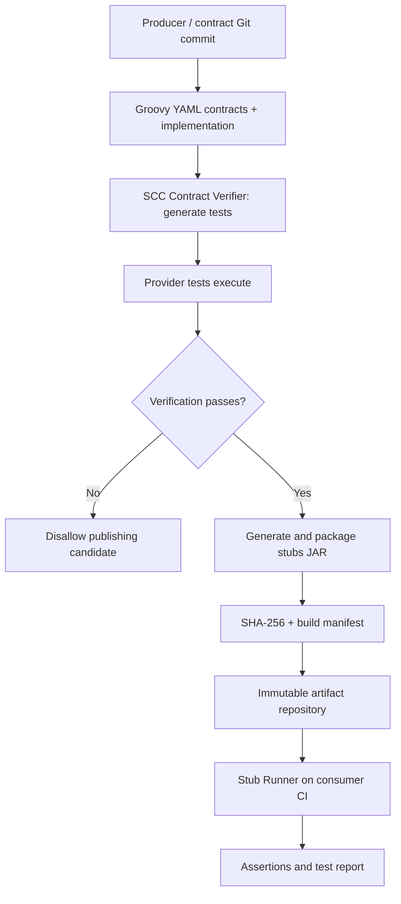
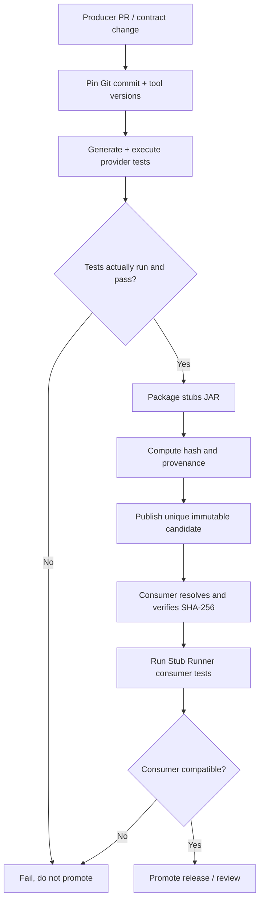

# Pinning Immutable Versions to Reproduce Spring Cloud Contract Test Results

In microservices systems, a consumer test suite can pass today and fail tomorrow without changing a single line of code. Sometimes the root cause is not in the consumer, but in **the downloaded stubs JAR changing**: Stub Runner pulled `LATEST`, a SNAPSHOT was republished, Maven's cache held an older copy, or the same artifact coordinates were overwritten in the repository.

With **Spring Cloud Contract (SCC)**, producers declare HTTP or messaging behavior in the **Groovy/YAML DSL**, generate provider verification tests, package stubs, and let consumers test via **Stub Runner**. For results to be reproducible, both sides must agree on **which exact artifact was used**, **whether its contents are immutable**, and **which code/contract revision produced it**.

This lesson belongs to the **Contract and Artifact Repositories** chapter, covering **Pinning Immutable Versions to Reproduce Test Results**, guiding Maven coordinates, classifiers, release/SNAPSHOT repositories, content hashes, provenance, Stub Runner configuration, multi-producer version locking, and candidate release CI. Running example: `order-producer` exposes an orders API and emits `OrderCreated`; `checkout-consumer` tests against stubs.

## 1. Two Distinct Conditions: Fixed Version and Unchanged Contents

Suppose the consumer configures:

```text
Order stub = com.example:order-producer:1.4.0:stubs
GET /api/orders/1001 -> {"id":1001,"status":"CREATED"}
```

If the repository allows re-uploading `order-producer-1.4.0-stubs.jar` with a different file, the exact same `1.4.0` version string could start returning:

```json
{"id":"ORD-1001","state":"CREATED"}
```

The consumer **pinned the version**, yet failed to pin the **bytes**. Tests can flip results as soon as caches refresh.

To guarantee reproducibility, you need:

1. **Pinned coordinates:** choose a specific version, never wildcards/dynamic versions.
2. **Enforced immutability:** the repository rejects overwriting already-published artifacts at those coordinates.
3. **Content verification:** store the SHA-256 of the verified JAR and compare it against the file the consumer actually downloads.
4. **Provenance records:** record producer commit, contract source revision, build ID, plugin/toolchain versions, and provider verification results.
5. **Freeze other test inputs:** consumer revision, configuration, test data, and infrastructure all shape behavior.

**Version pinning is a necessary condition, not a sufficient condition for content immutability.**

### 1.1. Example of test results shifting without consumer code changes

```text
Day A:
  checkout-consumer commit: 7b62e9a
  Stub version: 1.4.0
  SHA-256: HASH_A
  Result: PASS

Day B:
  checkout-consumer commit: 7b62e9a
  Stub version: 1.4.0
  SHA-256: HASH_B
  Result: FAIL
```

If `HASH_A` and `HASH_B` differ, you cannot claim “same test inputs” despite matching version strings. Investigate artifact origin, caches/mirrors, redeploys, or release pipelines.

## 2. Maven Coordinates: GAV, Type, and Classifier

A producer stubs artifact can be identified by:

```text
groupId    = com.example
artifactId = order-producer
version    = 2.4.0-rc.20261124.7
type       = jar
classifier = stubs
```

When written in Maven Dependency Plugin notation:

```text
com.example:order-producer:2.4.0-rc.20261124.7:jar:stubs
```

Example filename:

```text
order-producer-2.4.0-rc.20261124.7-stubs.jar
```

| Variant | Classifier | Purpose |
| --- | --- | --- |
| `order-producer-2.4.0-rc.20261124.7.jar` | None | Main application JAR |
| `order-producer-2.4.0-rc.20261124.7-stubs.jar` | `stubs` | HTTP mappings/message stubs |
| `order-producer-2.4.0-rc.20261124.7-tests.jar` | `tests` (if configured) | Compiled test classes/fixtures |
| `order-producer-2.4.0-rc.20261124.7.pom` | POM | Metadata for artifact resolution |

**Do not substitute `tests` for `stubs` or omit the classifier** when fetching contract stubs. The main JAR runs the producer without carrying WireMock data, and a test JAR does not replace message/HTTP stub mappings.

### 2.1. GAV does not reveal which repository served the file

The same coordinates can exist across multiple repositories or Maven mirrors. If repositories are managed inconsistently, returned files can differ. Record both **logical repository ID/URL** and **digest** in provenance; never include usernames/tokens in URLs stored in logs.

### 2.2. Versions across the system do not have to match

```text
Producer Maven version: 2.4.0-rc.20261124.7
Event schemaVersion:   1
Consumer app version:  3.2.0
SCC plugin version:    version managed by build
```

The producer artifact version selects a build. `schemaVersion` inside a payload helps consumers interpret event formats. The two versions can evolve independently; pinning an artifact does not automatically guarantee schema backward compatibility.

## 3. Three Provenance Layers: Contract Git, Producer Build, and Stub Bytes

A stubs JAR is created through a chain:



Two common models exist:

- **Contracts live in the producer repository:** one Git commit identifies both code and contracts.
- **Contracts live in a separate repository:** lock **contract revision** in addition to producer commit. Never record just `branch=main`.

Unprotected Git branches or tags can move. **Full commit SHAs** identify specific revisions; however, recording a commit SHA alone still does not prove the JAR was actually built from that revision. You need CI provenance, artifact digests, and trustworthy publish permissions.

### 3.1. Provenance does not equal semantic validity

An artifact with verified origin can still contain flawed contracts or missing error cases. To trust an artifact:

- Generated tests must be generated and run against real producer implementations.
- Test counts/coverage must match expected contracts.
- Stubs JAR must contain accurate mappings.
- Consumers must verify the cases they depend on.
- CI must block publishing when provider verification fails.

Pinning versions ensures **test conditions remain constant**; it does not magically make an incomplete contract complete.

## 4. Immutable Releases, Mutable SNAPSHOTs, and Dynamic Versions

| Approach | Example | Strictly reproducible? | When to use? |
| --- | --- | --- | --- |
| Unique candidate release + no-redeploy | `2.4.0-rc.20261124.7` | Strong foundation when bytes/hashes are verified | PR/release compatibility gates |
| Fixed release + no-redeploy | `2.4.0` | Strong foundation if repo is truly immutable | Testing against published releases |
| Maven SNAPSHOT | `2.4.1-SNAPSHOT` | Not by default; metadata can shift builds | Rapid development |
| Dynamic version | `+`, `LATEST`, or ranges if supported | No; selected version can change | Candidate discovery jobs |
| Git branch/HEAD | `main` | No; revision moves | Tracking development lines, not locking |

### 4.1. Why can a SNAPSHOT change test outcomes?

A base version `2.4.1-SNAPSHOT` in a Maven repository can resolve via metadata to a timestamped snapshot:

```text
At time A:
  2.4.1-SNAPSHOT -> 2.4.1-20261124.030000-3

At time B:
  2.4.1-SNAPSHOT -> 2.4.1-20261124.071500-4
```

Names above are examples only. Depending on metadata/caches, consumers can receive different builds for the same base version. Some setups support selecting specific timestamped snapshots, yet resolution syntax is inconsistent across Maven, plugins, and Stub Runner. **Real-world setups should favor unique, non-overwritable candidate versions paired with hashes** instead of assuming snapshot timestamps automatically lock everything.

### 4.2. Dynamic versions are useful when separated by stage

One job may have the goal: *“find the newest stubs and check whether consumers stay compatible.”* That is **compatibility discovery**, intentionally changing inputs.

Another job has the goal: *“re-run the exact candidate verified yesterday.”* That is **reproducible verification** and must use locked versions.

Proper design:

```text
Discovery:
  find latest candidate
  record resolved GAV + SHA-256

Verification:
  use exactly that GAV + SHA-256
  execute consumer tests
  save manifest and result
```

Never report `tested order-producer latest` without recording which actual build “latest” resolved to.

## 5. Immutable Repositories Must Be Enforced via Config and Permissions

Never assume a repository blocks re-uploads just because a version lacks `SNAPSHOT`. A reliable policy includes:

- Separating **snapshot repositories** from **candidate/release repositories**.
- **No-redeploy** for every existing GAV/type/classifier in candidate/release repos.
- Restricting CI accounts allowed to publish; never give everyone the same publish rights.
- Strictly gating delete/overwrite permissions with audit trails.
- Managing retention so artifacts needed for replay are not silently purged.
- Storing provenance/manifests with controlled write access.
- Auditing mirrors/caches/proxies to prevent serving stale bytes or wrong sources.
- When recalling broken artifacts, issuing a new version via an audited revocation flow instead of secretly overwriting old releases.

Example repository classification:

```text
maven-snapshots   -> mutable, dev builds
maven-candidates  -> unique RC versions, reject redeploy
maven-releases    -> immutable, reject redeploy
```

Repository names are illustrative, not vendor standards. Maven/Nexus/Artifactory or other artifact registries have their own policy settings. **Verify the active enforced policies**, rather than leaving rules purely in a wiki.

### 5.1. Testing no-redeploy in a safe environment

In a **dedicated test repository**, publish a candidate artifact. Attempt to publish a **different file** under the same coordinates and verify the server rejects it. Never run overwrite tests against production or shared repositories.

### 5.2. Immutability and retention must work together

An artifact protected from overwrites yet purged after 30 days cannot be used to replay tests six months later. Align retention with consumer support lifecycles and audit needs. If removal is forced for legal/security reasons, log the reason and accept replay limits.

## 6. Maven Producer: Building the Stubs JAR After Contract Verification

An HTTP contract in the producer:

```groovy
import org.springframework.cloud.contract.spec.Contract

Contract.make {
    description 'GET order 1001 returns valid JSON'
    request {
        method GET()
        url '/api/orders/1001'
        headers {
            header('Accept', 'application/json')
        }
    }
    response {
        status OK()
        headers {
            contentType(applicationJson())
        }
        body(
            id: 1001,
            status: 'CREATED',
            currency: 'VND'
        )
    }
}
```

Equivalent YAML DSL:

```yaml
description: "GET order 1001 returns valid JSON"
request:
  method: GET
  url: /api/orders/1001
  headers:
    Accept: application/json
response:
  status: 200
  headers:
    Content-Type: application/json
  body:
    id: 1001
    status: CREATED
    currency: VND
```

Both examples describe **one scenario**; in a real learning build choose **one DSL** so duplicate tests/mappings are not generated.

A minimal Maven plugin setup:

```xml
<plugin>
    <groupId>org.springframework.cloud</groupId>
    <artifactId>spring-cloud-contract-maven-plugin</artifactId>
    <version>${spring-cloud-contract.version}</version>
    <extensions>true</extensions>
    <configuration>
        <baseClassForTests>com.example.order.contract.OrderContractBase</baseClassForTests>
    </configuration>
</plugin>
```

This is **not a complete POM**. The producer must manage compatible plugin/Verifier/BOM versions, dependencies, test framework, and base class. To verify:

```bash
mvn -B -ntp clean verify
```

Then, if packaging is configured for the `stubs` classifier properly:

```bash
mvn -B -ntp clean install
```

`install` runs the Maven lifecycle through the install phase, rather than merely copying a JAR. Inspect Surefire/Failsafe reports and ensure generated provider tests compiled and ran without being skipped. **A `BUILD SUCCESS` with 0 contract tests cannot count as complete verification.**

### 6.1. Generating stubs differs from executing provider tests

Contract Verifier can generate provider tests and stub mappings from the same contract. Yet a stubs JAR can still be packaged even when the real implementation returns wrong responses if the pipeline bypasses verification. Therefore, **publish gating** must depend on actual test execution, not merely the JAR appearing in `target/`.

### 6.2. Pinning generator tools is also part of provenance

Record versions of:

- Spring Cloud Contract Maven/Gradle plugin.
- Spring Boot/Spring Cloud BOM.
- JDK, Maven, or Gradle Wrapper.
- HTTP/message test framework.
- Source code commit and contract source revision.

Two builds of the same contract using different generator versions can emit different outputs. An immutable artifact lets consumers replay exact stub bytes even if source generators evolve later.

## 7. Inspecting the Stubs Artifact Before and After Install

Expected file:

```text
target/order-producer-2.4.0-rc.20261124.7-stubs.jar
```

List contents:

```bash
jar tf target/order-producer-2.4.0-rc.20261124.7-stubs.jar
```

The stubs JAR must contain actual mappings/message resources matching the scenarios. Internal JAR paths depend on plugin version/configuration; **never hardcode one layout** and assume the plugin failed if files sit in a different folder.

After `mvn install`, the local repository may contain:

```text
~/.m2/repository/com/example/order-producer/2.4.0-rc.20261124.7/
    order-producer-2.4.0-rc.20261124.7.pom
    order-producer-2.4.0-rc.20261124.7.jar
    order-producer-2.4.0-rc.20261124.7-stubs.jar
```

If only the main JAR appears, check whether the SCC plugin packaged and **attached** stubs with classifier `stubs`. Never alter the consumer to fetch the main JAR instead.

### 7.1. Verifying the right classifier via Maven

```bash
mvn dependency:get \
  -Dartifact=com.example:order-producer:2.4.0-rc.20261124.7:jar:stubs
```

With the Maven Dependency Plugin, the order is `groupId:artifactId:version:type:classifier`. Stub Runner `ids` use a different format, typically appending the **port** at the end.

### 7.2. Right filename, wrong contents

A `*-stubs.jar` file might:

- Contain only metadata or miss mappings for critical endpoints.
- Hold data generated from an older contract.
- Have two overlapping mappings yielding unpredictable responses.
- Have response bodies incompatible with schemas.
- Have the right classifier yet lack provider verification from the same producer commit.

**Checksums and provenance tell you which file was used; they do not automatically verify that contract semantics match business requirements.**

## 8. SHA-256: Locking Bytes, Not Just Filenames

On Linux/macOS:

```bash
sha256sum target/order-producer-2.4.0-rc.20261124.7-stubs.jar
```

On Windows PowerShell:

```powershell
Get-FileHash -Algorithm SHA256 -LiteralPath "target/order-producer-2.4.0-rc.20261124.7-stubs.jar"
```

SHA-256 returns a 64-character hex digest. In pipelines, **compare the hash computed from the consumer's received file** against the hash recorded and protected by trusted producer CI in the manifest. Never treat two hashes taken from the same potentially tampered file as independent verification.

### 8.1. Integrity is not authenticity

- **Integrity:** do received bytes match the bytes recorded in the manifest?
- **Authenticity/provenance:** did the manifest and artifact genuinely come from a trusted build source?
- **Contract correctness:** does the producer satisfy the contract contents?

SHA-256 answers the first question. The latter two require publish permissions, CI provenance, signing/attestation where available, and provider verification tests.

### 8.2. Digests protect against stale caches/mirrors

If a local cache holds a JAR with the same GAV yet a different hash than the manifest, tests should **fail before running consumer assertions**. Otherwise, consumer tests may run against the wrong artifact and still report PASS.

Never “fix” a mismatch by auto-updating the expected hash from the newly downloaded file; that turns verification into **blindly accepting arbitrary content**.

## 9. Stub Runner LOCAL and Limits of the Maven Cache

Consumer example:

```java
import org.springframework.boot.test.context.SpringBootTest;
import org.springframework.cloud.contract.stubrunner.spring.AutoConfigureStubRunner;
import org.springframework.cloud.contract.stubrunner.spring.StubRunnerProperties;

@SpringBootTest(properties = {
    "order.api.base-url=http://localhost:8085"
})
@AutoConfigureStubRunner(
    ids = "com.example:order-producer:2.4.0-rc.20261124.7:stubs:8085",
    stubsMode = StubRunnerProperties.StubsMode.LOCAL
)
class OrderConsumerContractTest {
    // Call consumer's real HTTP client and assert DTO/error mapping.
}
```

LOCAL fits when candidate stubs were `install`ed into the job's local Maven repository. Risks include:

- `~/.m2` cache holds a JAR from a different build.
- A developer reinstalled an artifact under the same version into local repo.
- A CI worker reuses stale caches when candidate versions do not change.
- Client accidentally hits a localhost port from another process.
- Test does not log the artifact version actually resolved.

**How to mitigate:** give every candidate build a unique version, isolate local Maven repos in CI if needed, verify hashes after resolution, and log the actual Stub Runner URL/version.

### 9.1. Do not rely on cache wiping as the sole fix

Wiping caches helps debug, yet does not turn a mutable repository into an immutable one. Once caches refill, artifacts can still shift. Fix the root cause in **repository policy and versioning schemes**.

## 10. Stub Runner REMOTE with a Candidate Repository

Example:

```java
@AutoConfigureStubRunner(
    ids = "com.example:order-producer:2.4.0-rc.20261124.7:stubs:8085",
    stubsMode = StubRunnerProperties.StubsMode.REMOTE,
    repositoryRoot = "https://repo.example.org/maven-candidates"
)
```

`repo.example.org` is an illustrative domain, not a live repository. A trustworthy REMOTE job requires:

1. Candidate version pinned explicitly and blocked from redeploy.
2. Repository Root/ID matching the right source.
3. Access granted via secrets, never hardcoded tokens in code or logs.
4. Resolver logs the downloaded artifact.
5. Downloaded file's SHA-256 matches the manifest.
6. Client actually calls the WireMock started by Stub Runner, never a production server.
7. No fallback to another version if the candidate is unavailable.

### 10.1. Do not confuse version locking with port locking

`ids` typically looks like:

```text
groupId:artifactId:version:classifier:port
```

`8085` in the example is the **stub server port**, not part of artifact identity. For parallel CI runs, dynamic ports are often better; changing the port does not mean the artifact changed. Retrieve the assigned URL dynamically to configure the client.

### 10.2. Dynamic versions serve discovery, not replay

Some Stub Runner versions support dynamic version markers like `+`. Never use this in **reproducibility gates**; if used to discover new releases, record the **resolved version** before handing off to fixed verification steps.

## 11. Locking Versions in a Test Manifest

An example of a **CI-managed manifest file**, not a file parsed automatically by Stub Runner:

```yaml
manifestVersion: 1
producer:
  name: order-producer
  gitCommit: REPLACE_WITH_FULL_PRODUCER_SHA
  contractSourceCommit: REPLACE_WITH_CONTRACT_SHA
  ciBuildId: producer-build-107
  providerVerification: PASSED
  stubsArtifact:
    repositoryId: maven-candidates
    repositoryUrl: https://repo.example.org/maven-candidates
    groupId: com.example
    artifactId: order-producer
    version: 2.4.0-rc.20261124.7
    extension: jar
    classifier: stubs
    sha256: REPLACE_WITH_64_HEX_SHA256
consumer:
  name: checkout-consumer
  gitCommit: REPLACE_WITH_FULL_CONSUMER_SHA
  ciBuildId: consumer-build-221
  stubRunnerMode: REMOTE
```

`REPLACE_WITH...` values are placeholders; CI must populate them from **verified real sources**. `providerVerification: PASSED` only means something if the upstream stage holds evidence that generated tests ran without skipping.

The manifest should link:

```text
Consumer test report
  -> consumer Git commit
  -> Stub Runner ids + mode + repository
  -> resolved stubs GAV:classifier
  -> stubs JAR SHA-256
  -> producer/contract Git commit
  -> provider verification build report
```

### 11.1. Where is the manifest stored?

- CI report artifacts retained under appropriate retention policies.
- A protected provenance/artifact metadata store.
- Links from pull requests or release records to the stored manifest.

Never store passwords, personal access tokens, or URLs with embedded credentials in manifests. When using checksums/signatures, protect the source of expected values rather than storing them alongside the JAR in a mutable location.

## 12. CI: Verify the Producer First, Then Distribute the Candidate



What to inspect at each gate:

| Gate | Evidence |
| --- | --- |
| Provider verification | Generated tests match expected count, executed/passed |
| Artifact packaging | `-stubs.jar` exists with mappings |
| Coordinates | Fixed GAV/type/classifier, unique candidate version |
| Repository immutability | No-redeploy and publish permissions enforced |
| Integrity | Hash downloaded by consumer matches trusted manifest |
| Consumer execution | Real client/listener exercises Stub Runner |
| Consumer assertions | DTO, headers, error handling match contract |
| Traceability | Consumer report points back to producer build and artifact bytes |

A pipeline merely running `mvn clean verify` **without running consumer tests against candidate stubs** has not proven consumer compatibility. Conversely, consumer tests passing against an old release stub do not prove a producer candidate is safe.

### 12.1. Maven phases: package, verify, install, and deploy

```bash
mvn -B -ntp clean verify
mvn -B -ntp clean install
mvn -B -ntp clean deploy
```

These are illustrative commands, not necessarily run sequentially in a real pipeline. Maven's lifecycle runs `package` before `verify`, followed by `install` and `deploy`. **A JAR can be created before `verify` completes**, so **publish/release** must be blocked until verification passes.

If another command triggers Maven to rebuild between test and deploy stages, artifact bytes can differ. Actively verify **the final published file is the exact file tested**, or compare/re-verify accordingly.

### 12.2. Do not skip tests for faster publishing

```bash
mvn clean deploy -DskipTests
```

Such a command can bypass provider assertions. If an organization separates build/test/publish into stages, deploy should publish existing artifacts **only after** the verification stage passed and proved identical bytes. Never equate “plugin generation passed” or “stubs JAR exists” with provider test execution.

## 13. Promotion: Build Once, Test Exact Bytes, Promote Safely

An anti-pattern:

```text
PR build:
  source revision A
  stubs JAR digest HASH_A
  consumer tests PASS

Release job:
  checks out latest branch
  rebuilds
  stubs JAR digest HASH_B
  publishes as the tested artifact
```

Even without source changes, timestamps, zip metadata, tool versions, or POM version fields can yield different JAR bytes. Be explicit about whether a release was **rebuilt** rather than **promoting the exact tested file**.

Two options:

1. **Promote exact candidate bytes** if release coordinates are fixed from the outset.
2. **Rebuild/repackage a separate release**, then re-verify hashes/provenance and run necessary producer/consumer verification against that exact release artifact.

Do not claim changing a version from `2.4.0-rc.20261124.7` to `2.4.0` keeps every byte identical: JAR/POM contents can embed build metadata/versions.

### 13.1. What if a published release has a bug?

Never silently overwrite `2.4.0:jar:stubs`. Instead:

- Create a new bugfix version.
- Record `supersedes` or `revoked` relationships in release metadata.
- Re-run provider verification and consumer candidate tests.
- When forced to remove an artifact for security reasons, log an audit entry and note replay limits.

## 14. Multiple Producers: Lock the Entire Dependency Matrix

`checkout-consumer` may depend on `order-producer`, `inventory-producer`, and `payment-producer`. A lock manifest:

```yaml
consumer: checkout-consumer
stubs:
  - service: order-producer
    groupId: com.example
    artifactId: order-producer
    version: 2.4.0-rc.20261124.7
    classifier: stubs
    sha256: HASH_ORDER_FROM_VERIFIED_CI
  - service: inventory-producer
    groupId: com.example
    artifactId: inventory-producer
    version: 3.1.2
    classifier: stubs
    sha256: HASH_INVENTORY_FROM_VERIFIED_CI
  - service: payment-producer
    groupId: com.example
    artifactId: payment-producer
    version: 1.9.4
    classifier: stubs
    sha256: HASH_PAYMENT_FROM_VERIFIED_CI
```

**This is an illustrative structure**, not automatically parsed by Stub Runner. CI must translate it into real `ids`/configuration and verify resolved artifacts.

If you pin Order while Inventory still uses a dynamic version, re-running consumer tests can change outcomes because of Inventory. The lockfile must cover **every artifact affecting the use case**, not solely the producer touched by the pull request.

### 14.1. BOM/Gradle locking does not automatically lock Stub Runner dependencies

BOMs or dependency management control Java library versions, yet a hardcoded `@AutoConfigureStubRunner(ids="...:+:stubs")` can still resolve dynamic versions. When Stub Runner downloads JARs directly from a Maven repository, lock at **Stub Runner's resolution point** rather than assuming Gradle dependency locking applies automatically.

### 14.2. Multiple stub servers should not mix mappings

Two producers might both expose `GET /api/items/1001`. Use distinct servers/base URLs per producer instead of merging mappings into one WireMock server if that causes collisions. Right version on the wrong server still produces unreliable results.

## 15. Gradle Also Needs Version and Artifact Source Locking

A producer using Gradle with the SCC plugin can build and publish stubs to a Maven-compatible repository. A Gradle consumer must still:

- Pin stub versions where Stub Runner is configured.
- Pin Gradle Wrapper, SCC plugin, and Spring Boot dependency versions.
- Verify artifact digests after resolution.
- Record producer build and consumer test provenance.
- Use fixed candidate versions instead of dynamic selectors.
- Ensure tests use the exact stubs artifact rather than another job's cache.

Example Gradle Groovy DSL configuration variable:

```groovy
ext {
    orderStubVersion = '2.4.0-rc.20261124.7'
}
```

This variable **has no effect** unless wired into Stub Runner's actual configuration. Never put a constant in the build file just to claim “we pinned it” while annotations/test properties still use `+`.

## 16. Reproducing Results Differs from Reproducing Builds

Two concepts:

- **Reproducible build:** identical source/toolchain/inputs regenerate byte-for-byte identical artifacts when the build is designed for it.
- **Reproducible test:** identical code, artifact bytes, fixtures, and environment inputs yield repeatable test outcomes.

A consumer can **replay tests** using an immutable stubs JAR from the repository even if the producer build is not byte-for-byte reproducible. Conversely, a byte-reproducible JAR can still suffer flaky tests if dependent on random data, wall-clock time, broker state, or race conditions.

### 16.1. Environment variables worth locking

| Variable | When does it matter? |
| --- | --- |
| JDK version | Reflection, serialization, TLS, or test frameworks |
| Spring Boot/SCC version | Generated mappings and runtime behavior |
| Maven/Gradle version | Build plugin resolution and lifecycle |
| Timezone/locale | Dates, currencies, sorting, formatting |
| Container image digest | OS/broker/database libraries |
| Random seed | IDs, test data, test execution order |
| Stub server port | Parallel test runs or hardcoded URLs |
| Database/queue state | Async tests reading leftover data |
| External services | Network latency, rate limits, outages |

You do not need to lock every variable at the same level for every test; prioritize those affecting **asserted behaviors**.

## 17. Messaging Stubs: Schema Locking Does Not Lock Broker Semantics

A message contract:

```groovy
import org.springframework.cloud.contract.spec.Contract

Contract.make {
    description 'OrderCreated event v1'
    label 'order_created_v1'

    input {
        triggeredBy('publishOrderCreated()')
    }

    outputMessage {
        sentTo('orders.created')
        headers {
            messagingContentType(applicationJson())
        }
        body(
            eventId: 'EVT-1001',
            eventType: 'OrderCreated',
            schemaVersion: 1,
            orderId: 'ORD-1001'
        )
    }
}
```

An immutable stubs JAR lets `notification-consumer` receive the exact same sample message via Stub Runner/StubTrigger across runs. However, it **does not by itself prove**:

- Kafka offset commits, consumer group rebalances, partition ordering.
- RabbitMQ ack/nack, queue bindings, and DLQs.
- Broker redelivery, retry/backoff, and retention.
- Database transactions/outbox and idempotency.
- Header metadata added or mutated by production binders/brokers.

If consumers depend on those behaviors, run broker/database integration tests with controlled versions/configurations. **Pinning stubs protects contract data, not production delivery semantics.**

## 18. Troubleshooting: Results Still Differ Despite Identical Versions

| Symptom | Possible cause | Check path |
| --- | --- | --- |
| Same GAV yet different SHA-256 | Repository redeploy/wrong mirror/cache | Compare hashes, server audit logs, artifact origin |
| Stub Runner pulls old release | LOCAL cache or unpinned REMOTE candidate | Log resolved version, repo, digest |
| SNAPSHOT test shifts daily | Maven metadata points to newer build | Use immutable candidate version |
| “Latest” test suddenly fails | Dynamic selection picked new release | Record resolved version and replay fixed |
| Right classifier JAR yet missing mappings | Wrong packaging or contract directory | `jar tf` and generated output |
| Provider build green yet 0 tests | Plugin scanned no contracts or tests skipped | Check test reports/counts |
| Consumer test green yet new API broken | Stale stubs artifact | Check producer commit/candidate build |
| Same hash yet flaky test | Clock/random/concurrency/state | Stabilize fixtures and environment |
| Consumer hits live server | Wrong base URL or dynamic port wiring | WireMock request journal and logs |
| Remote repo fails to resolve | URL, permissions, metadata, mirror | Repository settings, no secrets in logs |
| BOM version changed yet stubs unchanged | Hardcoded `ids` | Pin/reconfigure at resolver |
| Artifact hash matches yet untrusted | Unprotected manifest/CI identity | Provenance, signing, publish permissions |

### 18.1. Ordered diagnostic workflow

```text
1. Record consumer Git commit and exact test command.
2. Read Stub Runner ids, stubsMode, repositoryRoot.
3. Determine resolved GAV/type/classifier, URL, and port.
4. Compute SHA-256 of the executed stubs JAR.
5. Compare against trusted producer CI manifest.
6. Inspect mapping contents and contract version.
7. Confirm provider verification on that source revision passed.
8. Confirm real client/listener exercised the stub server/binder.
9. Check toolchain, timezone, test data, and async state.
10. Only then investigate business logic/contract changes.
```

Never loosen regexes or edit expected bodies before knowing whether the artifact changed. If the root cause is a repository overwrite, tweaking matchers masks a distribution risk.

## 19. Common Misconceptions

**“Setting version 2.4.0 guarantees the artifact is immutable.”** Not if the repository permits redeploying the same GAV/classifier.

**“A Maven SNAPSHOT has only one file per version.”** No; metadata can advance to newer snapshot builds.

**“Using `+` keeps tests always accurate.”** It helps discover newer builds, yet prevents stable replay.

**“A Git tag is enough for provenance.”** Unprotected tags can move; record commit SHAs and build provenance.

**“Matching checksum means producer code is right.”** Hashes verify bytes against an expected source, not provider verification.

**“Consumer passed against release 2.3.0, so it is compatible with candidate 2.4.0.”** No; test against the new candidate stubs.

**“Promoting by rebuilding is identical to copying the tested artifact.”** Not guaranteed; outputs can vary in bytes/version metadata.

**“The BOM pins stub versions automatically.”** Not if Stub Runner `ids` draw versions elsewhere.

**“One stub version protects all microservices.”** No; consumers can depend on multiple producers and environments.

**“Immutable artifacts guarantee non-flaky tests.”** No; races, time, randomness, and external state still interfere.

## 20. Reproducibility Verification Lab

In a **dedicated sandbox repository for exercises**:

1. Create a Groovy/YAML HTTP GET order contract; pick one executable DSL.
2. Generate and run provider tests; try changing `status=CREATED` to `PAID` to see failure.
3. Choose a unique candidate version like `2.4.0-rc.20261124.7`.
4. Package `-stubs.jar`; list mappings with `jar tf`.
5. Compute SHA-256 and store alongside producer Git commit/build ID.
6. Publish to a candidate repository configured with no-redeploy.
7. Attempt to redeploy a different file under the same coordinates **on the test repo** and confirm server rejection.
8. Configure consumer Stub Runner REMOTE to use the pinned version.
9. Compute hash on the consumer runner and compare against the trusted manifest before running tests.
10. Call the real HTTP client; assert consumer JSON parsing and error handling.
11. Try changing version to `+` in a discovery job; record what resolved.
12. Feed that resolved version as a fixed input into a verification job.
13. Try a `-SNAPSHOT` on the test repo and observe the base version does not stay tied to one build.
14. Test a cache containing a file with the same GAV yet a different hash; pipeline must fail.
15. Re-run the same consumer commit and artifact hash on a different CI worker; compare outcomes.
16. Add inventory/payment stubs to the lock manifest to govern the dependency matrix.
17. Reproduce an intentional bug using only consumer commit + manifest + toolchain.
18. Verify promotion: final release uses exact candidate bytes or was compared/re-verified.
19. Archive a report with complete coordinates, checksums, and provider verification build link.

### 20.1. Checksum check skeleton

```bash
# Expected digest must come from producer CI's trusted manifest.
EXPECTED_SHA256="REPLACE_WITH_64_HEX_DIGITS"
ACTUAL_SHA256=$(sha256sum "order-producer-stubs.jar" | cut -d ' ' -f 1)

if [ "$ACTUAL_SHA256" != "$EXPECTED_SHA256" ]; then
  echo "ERROR: stubs digest mismatch"
  exit 1
fi
```

This is illustrative code: real scripts must check file existence, command errors, manifest origin, resolved coordinates, and CI conditions. Never pull the expected hash from the freshly downloaded file itself.

### 20.2. Self-assessment rubric

| Competency | Evidence achieved |
| --- | --- |
| Identity pinning | Knows GAV/type/classifier/repository |
| Immutability | Safely verified no-redeploy policy |
| SNAPSHOT | Understands Maven metadata and mutability |
| Integrity | Compares SHA-256 against trusted manifest |
| Provenance | Links producer commit, test build, stubs JAR |
| Stub Runner | LOCAL/REMOTE use exact artifact |
| Multi-producer | Lock manifest covers all key dependencies |
| CI | Blocks publish when provider tests fail |
| Promotion | Distinguishes copying verified bytes from rebuilding |
| Debugging | Isolates artifact/cache/environment differences |
| Replay | Re-runs exact consumer revision and stubs hash |

## 21. Conclusion: Version Pinning Is Only Reliable When Contents Are Immutable

In **Spring Cloud Contract**, the stubs JAR bridges **provider verification** and **consumer tests with Stub Runner**. For both sides to reproduce the exact same scenario weeks or months later, more than a version string in an annotation is required.

Coordinate **four layers of protection**:

1. **Fixed identity:** pin group/artifact/version/type/classifier and repository.
2. **Byte protection:** repository forbids overwrites; record/verify SHA-256 and CI provenance.
3. **Lifecycle protection:** provider tests actually pass, publish the exact candidate, and never silently rebuild into a different artifact after consumer testing.
4. **Environment protection:** stabilize toolchain, other producer dependencies, fixtures, and critical config.

**Final question before trusting a green result:** *“If we re-run this consumer commit three months from now, can we download the exact same stubs JAR, verify the exact SHA-256, and know which producer build created it?”*

Once you can answer yes, **pinning immutable versions** truly enables **reproducible test results, regression investigation, and early detection of incompatible API changes** between producer and consumer.
