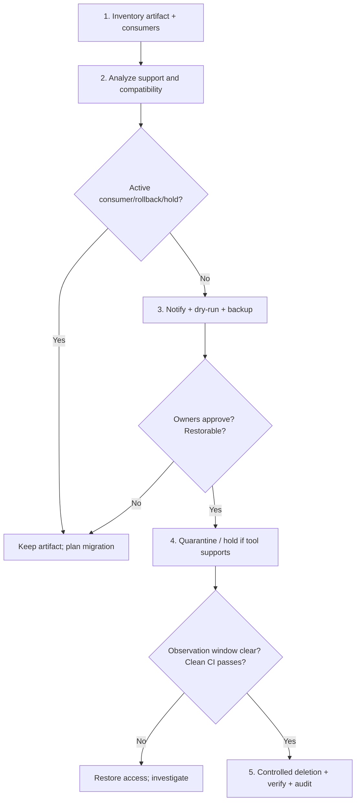

# Deleting Old Artifacts Without Breaking Active Consumers

## 1. Context: Why Can Deleting a Stub JAR Break Your Test Suite?

In **Spring Cloud Contract** (module `SPRING_CLOUD_CONTRACT`), producers and consumers agree on **HTTP** or **messaging** behavior using **Groovy/YAML DSL** contracts. Contract Verifier generates producer-side tests to verify the real API/message behavior. Contracts are converted into stubs, packaged, and published by version; consumers use **Stub Runner** to test integration code in CI without running the real producer.

After many releases, a Maven-compatible repository such as **Nexus**, **Artifactory**, or an internal artifact store can accumulate hundreds of versions. Operations teams want to delete old artifacts to save storage, cut maintenance costs, and avoid unnecessary buildup. Yet if a consumer still fetches `orders-producer:1.4.2:stubs`, deleting that version can cause failures:

- Consumer CI fails to download the stub whenever a fresh runner is provisioned.
- A maintenance branch or legacy application release can no longer reproduce its contract tests.
- A team that has not upgraded is forced onto a new stub, exposing unresolved incompatibilities.
- A rollback pipeline needs to reconstruct the test environment, yet the artifact is gone.
- Developers still pass locally thanks to local Maven caches, while clean CI fails.
- Producer and consumer are flagged “incompatible” due to a missing artifact even though the live API has not changed.

**The goal is not keeping every version forever**, but **deleting only when there is sufficient evidence no supported consumer still needs that version**, backed by recovery mechanisms and post-deletion checks.

**Core principle:** *“Zero recent downloads” does not mean “nobody uses it anymore.”* Consumers may fetch artifacts from caches, classpaths, mirrors, or only run during hotfixes.

### Learning objectives

After this lesson, you can:

1. Identify artifacts accurately and distinguish **contract sources**, **stub JARs**, and **application JARs**.
2. Discover consumers depending on a stub version, including dependencies **declared in Stub Runner IDs**.
3. Propose retention policies accounting for supported consumers, rollbacks, maintenance branches, and audits.
4. Build a workflow of **migration → validation → quarantine/hold → deletion → verification**.
5. Design CI gates and evidence to prevent accidental deletion of active versions.
6. Distinguish deleting `SNAPSHOT`s, trial builds, and immutable releases.
7. Prepare recovery procedures for accidental deletions without compromising artifact immutability.

## 2. Know the Exact Artifact Type You Plan to Delete

In a Maven repository, the same producer can publish several file types:

| Type | Example | Role | Risk if deleted |
| --- | --- | --- | --- |
| Application JAR | `orders-producer-1.4.2.jar` | Real producer binary | Impacts runtime deploy/rollback |
| Stub JAR | `orders-producer-1.4.2-stubs.jar` | Contracts and HTTP/message stubs for consumers | Impacts Stub Runner, consumer tests |
| Contract-only artifact | DSL source JAR per team convention | Producer fetches contracts from central repo | Impacts generation/verification |
| POM | `orders-producer-1.4.2.pom` | Maven metadata/dependencies | Breaks resolution even if JAR remains |
| Checksum/signature | `.sha1`, `.sha256`, `.asc` if present | Integrity/authenticity verification | Weakens artifact verification |
| Repository metadata | `maven-metadata.xml` at relevant paths | Assists version/snapshot lookup | Can break resolution if edited manually |

A typical stub artifact has coordinates:

```text
groupId    = com.example
artifactId = orders-producer
version    = 1.4.2
type       = jar
classifier = stubs
```

**GAV** (`groupId`, `artifactId`, `version`) alone **is not enough** to separate an application JAR from a stub JAR. When evaluating deletion, identify the exact **classifier** and **repository**. With Spring Cloud Contract, consumer Stub Runner typically uses the identifier:

```text
com.example:orders-producer:1.4.2:stubs
```

If fixing the WireMock port in a Stub Runner example:

```text
com.example:orders-producer:1.4.2:stubs:8090
```

`8090` is the **stub runtime port**, not part of the artifact stored in the repository.

### 2.1. Maven repository paths differ from contents inside the JAR

A Maven repository path typically looks like:

```text
com/example/orders-producer/1.4.2/
  orders-producer-1.4.2.pom
  orders-producer-1.4.2.jar
  orders-producer-1.4.2-stubs.jar
  ... checksum/signature if provided by repository ...
```

Meanwhile, contents inside the stub JAR can follow:

```text
META-INF/com.example/orders-producer/1.4.2/
  contracts/
    orders/get_order_success.groovy
    orders/get_order_not_found.yml
  mappings/
    orders/<generated-mapping>.json
```

This is a **common layout pattern**; mapping filenames/paths depend on plugin version and config. Maven repository paths use `com/example`, whereas `META-INF` examples use `com.example` as one folder segment. **Never mix these two representations** when operating on repositories.

### 2.2. Deleting one classifier differs from deleting the entire version

If cleanup deletes **the entire version directory**, it can wipe out the application JAR, POM, stubs, signatures, and other classifiers too. That is a much broader change than “deleting old stubs.”

If cleanup deletes only `-stubs.jar`, the repository may still display the version as existing via the POM and application JAR. Yet consumers requesting the `stubs` classifier still fail to download. **Never treat GAV visibility in the repository UI as proof that stubs still exist.**

Before any plan, record explicitly: *which repository, groupId, artifactId, version, type/classifier, and which exact set of files/metadata the operation touches*.

## 3. Which Consumers Might Still Need an Old Version?

A stub version can be used by more teams and environment types than you expect:

| Consumer or workflow | How it depends | Why easily missed? |
| --- | --- | --- |
| Primary consumer CI | `@AutoConfigureStubRunner(ids=...)` | Version sits inside annotation, not a direct Maven dependency |
| Other consumers using JUnit/Gradle | `stubrunner.ids` config | Lives in `application-test.yml`, test properties, or Gradle scripts |
| Teams using Stub Runner Boot/Docker | `STUBRUNNER_IDS` env var | Declared in CI templates/Helm charts, not in producer repo |
| Consumers with messaging stubs | `StubTrigger.trigger(label)` with specific artifact version | Searching only HTTP mappings misses messaging contracts |
| Hotfix/maintenance branches | Pinned old stub version | Main branch upgraded while release branch stays supported |
| Consumer LTS releases | Project maintains compatibility tests | Runs only on schedule or during incidents |
| Offline developers | `LOCAL` in `~/.m2` | Passes on local cache even after repository deletion |
| Non-JVM consumers | Standalone Stub Runner in test namespace | May have no Maven `pom.xml` at all |
| Shared test environments | Runtime config fetching stubs from repo | Invisible in developers' dependency graphs |
| Disaster recovery/rollback jobs | Rebuilding old CI checks | Rarely executed yet critical |

Example Spring Boot consumer:

```java
@AutoConfigureStubRunner(
    ids = "com.example:orders-producer:1.4.2:stubs:8090",
    stubsMode = StubRunnerProperties.StubsMode.REMOTE,
    repositoryRoot = "https://repo.example.invalid/maven-releases"
)
class CheckoutConsumerContractTest {
    // Test calls Checkout's real HTTP client against stub.
}
```

The repository URL in this example is a placeholder unable to download real artifacts. **Important:** version `1.4.2` lives inside **Stub Runner IDs**, so grepping for an `orders-producer` dependency in `pom.xml` can miss this consumer completely.

### 3.1. Dynamic configuration in properties

```yaml
stubrunner:
  ids:
    - com.example:orders-producer:1.4.2:stubs:8090
  stubs-mode: REMOTE
  repository-root: https://repo.example.invalid/maven-releases
```

Property/binding names can vary across versions or startup modes; this block illustrates **where users can pin versions**. When auditing, inspect **effective configuration** after profiles, CI environment variables, and build templates are applied—not solely default source YAML.

### 3.2. Dependency graphs are not the whole truth

The Maven command:

```bash
./mvnw -B dependency:tree
```

helps inspect static Maven dependencies. Yet Stub Runner can **download artifacts by coordinates supplied at runtime**, so the artifact need not appear as a static dependency in the tree. Combine **configuration searches**, **repository audit logs**, **CI provenance**, and owner confirmations to get the full picture.

## 4. Why “No Recent Downloads” Is Not Enough to Conclude Unused

Suppose the artifact repository shows nobody downloaded `orders-producer:1.4.2:stubs` in 30 days. There are at least six possibilities:

1. Every consumer migrated to a newer version.
2. Consumers still use it via Maven caches or proxy mirrors.
3. Pipelines only run monthly/quarterly.
4. A maintenance branch has had no recent commits.
5. Log retention is shorter than your observation window.
6. An external consumer downloads via a different repository proxy.

**Right conclusion:** zero downloads is a **supporting signal**, not sufficient proof to delete.

### 4.1. Evidence sources to combine

| Evidence | Strength | Limitation |
| --- | --- | --- |
| Search `Stub Runner IDs` across active repos | Finds explicit version references | Can miss dynamically generated configs or out-of-scope repos |
| Effective CI/Helm/environment configs | Shows exact version chosen at runtime | Secrets/templates or overrides can be hard to inspect |
| Repository download logs | Observes real fetches | Caches/mirrors hide requests from origin |
| CI test reports/artifact manifests | Shows versions used in concrete runs | Does not prove rarely run jobs were checked |
| Supported releases/branches list | Accounts for maintenance and rollbacks | Must be kept current by team owners |
| Formal confirmation from consumer owners | Captures future needs, SLAs, release plans | Requires preserving evidence and response deadlines |
| Re-running consumer tests on new stub | Proves compatibility | Covers only executed tests |

**Never** delete based on a single source. Build a **consumer–artifact usage inventory** with owners and verification dates.

### 4.2. Sample usage inventory

| Consumer | Owner | Supported branch/release | Stub version needed | Verification source | Status |
| --- | --- | --- | --- | --- | --- |
| checkout-web | Checkout Team | `main` | `1.5.0` | CI config + last successful run | Migrated |
| checkout-web | Checkout Team | `release/2025-lts` | `1.4.2` | Release branch + owner | **Still needed** |
| inventory-sync | Inventory Team | `main` | `1.4.2` | Stub Runner Boot template | **Still needed** |
| billing-reports | Billing Team | `main` | `1.5.0` | Test report | Migrated |
| legacy-mobile-gateway | Mobile Team | End of support | `1.3.9` | Decommission record | Deletion candidate after checks |

This is a **hypothetical scenario for learning**. The table shows that even if every consumer on `main` moved to `1.5.0`, a maintenance branch still using `1.4.2` makes deletion unsafe.

## 5. Establish a Retention Policy Before Deleting

There is no **universal default retention day count** that fits every team. Retention depends on version support SLAs, rollback windows, CI reproducibility needs, security, cost, and legal compliance.

A policy should distinguish at least:

| Artifact category | Suggested principle | Key condition |
| --- | --- | --- |
| Release stub with supported consumer | **Keep** | Even with few or zero recent downloads |
| Release stub for rollback/LTS | **Keep** until support and holds expire | Only consider deletion after proof rollback is no longer needed |
| Superseded release stub, zero references | **Candidate** | Still requires owner verification and observation window |
| Snapshot/temporary build | Shorter TTL possible | Exclude snapshots pinned in CI/hotfixes |
| Broken artifact or contains secrets | Handle per incident/security policy | May require urgent revocation, consumer notice, and preserved evidence |
| Artifact under legal/audit hold | **Never delete** | Even past normal TTL |

### 5.1. Immutable releases vs. mutable snapshots

A **release** like `1.4.2` should be treated as **immutable**: identical coordinates always mean identical contents. If you delete it and later upload a different file under the same version to “restore,” you create divergent caches returning different results.

A `SNAPSHOT` has metadata and timestamped builds designed for continuous development. Although cleaned faster, never delete a snapshot currently pinned by a job needing reproducibility or incident investigation.

**Principle:** plan retention around **actual versions resolved by consumers** and provenance, not merely folder names containing `SNAPSHOT`.

### 5.2. Dependency-set retention policy

You can model the protected set:

```text
ProtectedVersions =
    versions referenced by supported consumers
  ∪ versions required by rollback/disaster recovery
  ∪ versions under release/support/security/legal hold
  ∪ versions currently in active migration windows
```

An artifact becomes a **deletion candidate** only when its version is **not** in that set and has passed appropriate waiting/approval periods.

A “keep last 3 versions” rule can work for **experimental snapshots**, yet **is insufficient for release stubs**: an LTS consumer may need a version older than the latest three.

## 6. Defining “In Use” by Support Contracts

You cannot consider a consumer “no longer using it” merely because the team merged a stub version bump to `main`. Consider:

- **Supported consumer versions:** release and hotfix branches.
- **Pipeline cadence:** daily, weekly, or release-only.
- **Rebuild needs:** does the team need to rebuild an old release?
- **Rolling upgrade plans:** must the new producer stay compatible with old consumers during transition?
- **Audit needs:** keep stubs or verified reproduction paths.
- **Repo access and network boundaries:** consumers in isolated networks or external partners.

### 6.1. API compatibility and artifact availability are two separate issues

A new producer may stay HTTP-schema compatible while **consumer tests still fail** because the old stub JAR was deleted. Conversely, keeping old artifacts forever does not make consumers compatible with a new API.

| Check | Question |
| --- | --- |
| **Artifact availability** | Can the consumer still download its pinned version? |
| **Contract compatibility** | Can the current consumer handle the candidate producer's stub? |
| **Producer correctness** | Do generated producer tests pass on real producer code? |
| **Deploy/rollback readiness** | Can tests still be reproduced for supported versions? |

Only when all four align with the support plan should retiring storage be considered.

## 7. Five-Step Workflow to Retire Old Artifacts Safely



This is a **recommended operational model**, not an automatic workflow built into Spring Cloud Contract. Nexus/Artifactory cleanup policies, approval gates, and backups must match your real artifact governance system.

### Step 1: Inventory the exact target

Create a record containing:

```yaml
artifact:
  repository: maven-releases
  groupId: com.example
  artifactId: orders-producer
  version: 1.4.2
  extension: jar
  classifier: stubs
  checksum: "SHA256_PROVIDED_BY_BUILD_SYSTEM"
owner: Orders Platform
reason: Planned end of support lifecycle
status: PROPOSED_ONLY
```

This is an **internal documentation/dry-run example**, not a format required by Nexus/Artifactory. Never validate real files using placeholder checksums; pull real digests from artifacts of known provenance.

At this stage **delete nothing**. Gather all consumer references and related classifier/metadata variants.

### Step 2: Analyze and migrate remaining consumers

For each consumer:

1. Record `owner` and supported release/branch.
2. Identify current stub version from effective configuration.
3. Agree on target version or formal end-of-support decision.
4. Run consumer tests against the new stub version; if failing, resolve incompatibilities.
5. Confirm pipelines on supported branches have updated.
6. Wait across an appropriate run cycle and archive evidence.

**Never force consumers to upgrade by deleting first.** When a client relies on an older schema, it needs a migration plan and compatibility tests—not an `artifact not found` failure.

### Step 3: Notify, dry-run, and preserve recoverability

A deletion proposal should include:

- **Exact** list of artifact coordinates affected.
- Consumer list and evidence of zero remaining references.
- Cutoff date, hold window, and approvers.
- Backup/artifact copy with **checksum matching the original**.
- Restore procedure tested in a controlled environment.
- Response plan if an unanticipated consumer reports dependency.

Use **dry-run/preview** features of repository cleanup policies when available; review **filter scope** carefully before enabling. A repository-wide policy can sweep unintended groups/artifacts.

### Step 4: Deprecate before deleting

Some organizations implement **deprecation notices** or **quarantine/hold**:

- Mark the version as nearing end-of-support.
- Notify owners and lock a migration deadline.
- Block new dependencies on that version via CI/code review policies.
- In an isolated test environment, check whether “cold builds” still fetch that version.
- If the repository supports soft quarantine, apply per policy and monitor feedback.

**Do not block downloads in live environments** just to “scream-test who still uses it”: that causes real outages. Prefer passive inspection and rehearsals on isolated mirrors/test repositories. Only restrict access after an approved change plan, notices, and rollback readiness.

### Step 5: Approved deletion and post-verification

Once all checks pass, administrators execute controlled deletion via the repository's official cleanup feature/API. You must:

1. Re-verify **repository + coordinates + classifier + checksum** right before execution.
2. Confirm no new consumer/rollback/security/legal hold arose.
3. Delete **only the exact approved scope**; avoid broad wildcards.
4. Record audit trail: who, when, why, exact affected artifacts.
5. Re-run supported consumers in an environment **not relying on stale caches**.
6. Verify retained artifacts remain downloadable.
7. Keep backups until the defined recovery window expires.

**Never delete blob files directly from Nexus/Artifactory backing storage** via OS commands. Repository managers maintain metadata, indexes, checksums, GC, and reference tracking; bypassing the API corrupts repository consistency.

## 8. Maven Coordinates and Safe Inspection Commands

Commands in this section are for **observation**, not deleting artifacts. They run only where Maven/JDK and the target repository are configured.

### 8.1. Test fetching the exact artifact and classifier

The Maven Dependency Plugin accepts `artifact` in the format:

```text
groupId:artifactId:version:packaging:classifier
```

Example:

```bash
./mvnw -B dependency:get \
  -Dartifact=com.example:orders-producer:1.4.2:jar:stubs
```

Here, `jar` is **packaging/extension** and `stubs` is **classifier**. This is Maven Dependency Plugin parameter syntax, **different from the order in Stub Runner IDs**. Never write `com.example:orders-producer:1.4.2:stubs:jar` by mistake in `dependency:get`.

The command can **populate the local cache**, so checking “artifact exists” belongs on a clean/isolated runner or via repository metadata APIs if you want to avoid touching caches. Succeeding because the file already sat in `~/.m2` **does not prove** the remote repository still holds it.

### 8.2. Inspect JAR contents

```bash
jar tf "$HOME/.m2/repository/com/example/orders-producer/1.4.2/orders-producer-1.4.2-stubs.jar"
```

Check for `META-INF/.../contracts` and `.../mappings` covering the HTTP/messaging scenarios to protect. **Never edit a JAR** to “patch” a retention mishap; handle through verified build sources and provenance.

### 8.3. Audit consumer code and config

Places worth scanning:

```text
@AutoConfigureStubRunner(ids = ...)
stubrunner.ids
STUBRUNNER_IDS
stubsMode / stubs-mode / STUBRUNNER_STUBS_MODE
repositoryRoot / repository-root
application-test.yml
CI workflow / shared pipeline template / Helm values
release branches / archived-but-supported test jobs
```

These are **search hints**, not an automated org-wide scanner. Beyond source code, inspect injected runtime configurations in pipelines and non-Java consumers.

## 9. Sensitive Case: Producer Changed Contracts While Consumer Has Not Upgraded

Suppose Orders Producer published:

- `1.4.2`: `GET /api/orders/ord-1001` response has `id`, `status`.
- `1.5.0`: response adds `currency`, changes a status rule.

Legacy Checkout uses a strict DTO and has only tested against `1.4.2` stubs. When tested against `1.5.0`, consumer tests fail on the new field or changed enum.

**Wrong move:** delete `1.4.2` to force every pipeline onto `1.5.0`.

**Right move:**

1. Identify which consumers need support.
2. Run consumer tests against `1.5.0` and document real compatibility failures.
3. Agree on backward-compatible producer fixes or a consumer upgrade.
4. Keep `1.4.2` for maintenance branches/rollbacks during transition.
5. Retire `1.4.2` only once support ends and retention gates pass.

### 9.1. Version matrix

| Consumer | Stub `1.4.2` | Stub `1.5.0` | Decision |
| --- | --- | --- | --- |
| Checkout v2.0 (supported) | PASS | FAIL | **Keep `1.4.2`**, resolve compatibility |
| Checkout v2.1 | PASS | PASS | Eligible to move to `1.5.0` |
| Inventory v3.0 | PASS | PASS | Eligible to move to `1.5.0` |
| Billing v1.8 (EOL) | PASS | Untested | Do not assume: check EOL/rollback policy |

This matrix is **illustrative**, not real test results. Only once supported consumers have upgraded or formally reached end-of-support can the older version enter the candidate pool.

## 10. How Do Stub Runner LOCAL, REMOTE, and CLASSPATH Affect Investigation?

| Stubs mode | Stub source | After remote deletion | Verification trap |
| --- | --- | --- | --- |
| `REMOTE` | Maven-compatible repository | Cold builds fail to resolve artifact | CI uses a proxy/cached repository |
| `LOCAL` | Local Maven repository | Cached machines still run; clean runners fail | “Passes on my laptop” is false evidence |
| `CLASSPATH` | Stub bundled on test classpath | Tests may keep running if JAR is pre-packaged | Artifact may still be distributed elsewhere |

A passing `LOCAL` test **does not prove** no consumers remain or that the remote copy is safe to delete. Conversely, deleting a version from the remote repository **does not immediately fail every test**; cached environments can mask the impact for weeks.

### 10.1. Testing from a clean environment

For **dry-run validation** of a cleanup plan:

1. Spin up a test job/runner with no pre-cached stub artifacts.
2. Run consumer tests **already migrated to retained versions**.
3. Confirm Stub Runner resolves artifacts from the active repository.
4. Capture output showing GAV, classifier, source, and test results.
5. If any consumer still requires the version slated for deletion, **halt the plan** and investigate.

Do not wipe developer machines' caches or shared runner caches just to test; use a **job-scoped Maven local repository** or an isolated container/build agent.

## 11. Why Is Manual Metadata Deletion Dangerous?

Maven repositories manage POMs, checksums, snapshot metadata, repository indexes, and multiple artifact classifiers. When cleaning up, understand deletion scope:

- Deleting only `-stubs.jar` does not equal deleting the release version.
- Deleting the version directory can wipe producer application JARs, POMs, and non-SCC consumers.
- Deleting `maven-metadata.xml` manually can break version/snapshot resolution.
- Deleting physical blobs without updating repository manager metadata leaves orphan records or broken links.
- Repository proxies/caches may keep serving stale copies briefly afterward; behavior across machines will diverge temporarily.

Therefore, **never run OS file-delete commands directly on backing storage**. Use official cleanup tools with dry-run where supported, backups, and scoped permissions.

### 11.1. Nexus and Artifactory: Shared Concepts, Distinct APIs

**Nexus Repository** and **JFrog Artifactory** both host Maven artifacts, yet have **different permission models, retention/cleanup rules, and APIs**. Never copy a delete endpoint from one system and run it against the other.

This lesson presents **safe processes rather than live DELETE commands**, as execution depends on organizational configuration and permissions:

```text
repo = maven-releases
coordinate = com.example:orders-producer:1.4.2:jar:stubs
proposed_action = DELETE_AFTER_APPROVAL
dry_run_result = exact artifact candidates and affected files
approval = required
backup_sha256 = verified
delete_execution = repository manager official operation
post_checks = required
```

Administrators must verify whether a tool's API/policy deletes an **asset**, a **component/version**, or an **entire directory**; those are vastly different scopes.

## 12. Organizing Deprecation and Migration Notices

Before deleting artifacts, the producer should announce the plan so consumer owners can update.

A clear notice specifies:

- Artifact coordinates/version slated for retirement.
- Reason: EOL, repository migration, retention, security, or API replacement.
- Replacement stub version and compatibility criteria.
- How to re-test consumer code with Stub Runner.
- Response deadline and owner contact.
- Support plan for LTS/rollback branches.
- Cleanup start date once approved.

**Sample internal notice** (example):

> The Orders team proposes retiring `com.example:orders-producer:1.4.2:stubs` once supported consumers migrate to `1.5.0` with passing contract tests. Please confirm any branches/hotfixes still requiring `1.4.2` before the response deadline published by Operations. Nothing will be deleted without migration evidence, rollback checks, and retention approval.

The word “proposes” matters: **never turn a proposal into an automatic deletion commitment** without a complete inventory.

### 12.1. Avoid “silent” changes

These practices undermine reproducibility:

- Overwriting release `1.4.2` with new stubs while keeping the same version.
- Quietly repointing a repository alias to another repo with identical filenames yet different contents.
- Deleting old versions and telling consumers to switch to `+` or “latest” to pick whatever remains.
- Tweaking matchers/requests/responses simultaneously so old tests pass without reviewing contract semantics.

Each of these can produce green tests while ceasing to verify the agreement consumers originally depended on.

## 13. Recovering from Accidental Deletion

Even with strong processes, an artifact can still be deleted accidentally due to wrong scope, wrong classifier, or an incomplete inventory.

### 13.1. Post-deletion symptoms

| Symptom | Possible meaning | Action needed |
| --- | --- | --- |
| Consumer CI reports `Could not find artifact ...:stubs` | Stub version no longer resolves | Halt cleanup, verify coordinates, restore if needed |
| Local developer passes, clean CI fails | Cache hides remote failure | Inspect repository/proxy and local Maven cache |
| Stub Runner Boot fails to start | One requested ID's version is missing | Inspect stubs list and required downloads |
| An LTS branch fails weeks later | Infrequently used branch missed in inventory | Reopen support inventory, restore artifact |
| Maven resolves POM yet misses JAR classifier | `stubs` asset deleted while GAV remained | Check exact classifier/extension |

### 13.2. Recovery workflow

1. **Freeze related cleanup operations.**
2. Identify the missing artifact: repository, GAV, classifier, extension, and checksum.
3. Retrieve a copy from **immutable/verified backups** or a build archive with provenance.
4. Compare checksums against the original pre-deletion record; never rebuild a “similar-content” JAR and overwrite arbitrarily.
5. Restore through your organization's approved repository manager mechanism.
6. Confirm the artifact **resolves from a clean environment**.
7. Run relevant producer/consumer verification and test impacted branches.
8. Log the incident, add the missed consumer to inventory, and adjust policy.

If no backup of the original artifact exists, you can **rebuild from the pinned source commit and dependencies**, though byte-for-byte reproducibility is not guaranteed. Never claim a rebuilt copy is **the exact same artifact** when checksums differ; evaluate provenance and follow appropriate versioning/release procedures.

### 13.3. Restoring availability does not restore compatibility

Once the JAR downloads again, consumer tests can still fail due to environment shifts, library upgrades, or API changes. Separate two questions:

- **Is the artifact back with the right checksum?**
- **Do supported consumers still work properly with that artifact?**

Never close an incident merely because the repository returned HTTP 200 on download.

## 14. Designing a Retention Gate in CI

A CI system can **automatically propose** candidate artifacts yet must never auto-delete critical releases based solely on file age. The gate should draw from multiple evidence sources.

### 14.1. Minimum conditions

| Condition | If unmet |
| --- | --- |
| Exact artifact coordinates, classifier/extension verified | **Block** |
| Not in protected versions/rollback/legal holds | **Block** |
| All supported consumer owners confirmed | **Block** |
| Zero active CI/config references in inventoried scope | **Block** |
| Migrated consumer tests ran and passed on retained artifacts | **Block** |
| Verified backup/checksum and tested restore plan exist | **Block** |
| Approvals obtained and observation window elapsed | **Block** |
| Dry-run affects exact intended resources | **Block** |

### 14.2. Decision check pseudocode

```text
function eligibleForDeletion(candidate):
    assert candidate.repository is explicitly selected
    assert candidate.groupId, artifactId, version are nonempty
    assert candidate.classifier == "stubs" if deleting stub only

    if candidate.inProtectedVersions: return BLOCKED
    if candidate.hasActiveConsumerReference: return BLOCKED
    if candidate.hasLtsOrRollbackDependency: return BLOCKED
    if candidate.underAuditOrLegalHold: return BLOCKED
    if not candidate.ownersApproved: return BLOCKED
    if not candidate.migrationTestsPassed: return BLOCKED
    if not candidate.backupChecksumVerified: return BLOCKED
    if not candidate.dryRunScopeMatchesApproval: return BLOCKED
    if not candidate.observationWindowElapsed: return BLOCKED

    return READY_FOR_MANUAL_APPROVAL
```

The code above is **decision pseudocode**, not a deletion script. It outputs `READY_FOR_MANUAL_APPROVAL` because destructive actions require controlled execution per repository policy.

### 14.3. Never bulk-delete purely from download logs

Example dangerous rule:

```text
DELETE every stub artifact with lastDownload > 30 days
```

This rule ignores caches, LTS branches, rollbacks, release support, and legal holds. If your platform still needs automated snapshot cleanup, define a **separate policy** with strict conditions, narrow repository scope, and proof that consumers do not pin those snapshots.

## 15. Detecting References When Consumers Use Groovy/YAML and Messaging

HTTP stubs are not the only ones with consumers. Messaging contracts can contain:

```groovy
import org.springframework.cloud.contract.spec.Contract

Contract.make {
    name 'order_created_event'
    label 'order_created'

    input {
        triggeredBy('publishOrderCreated()')
    }

    outputMessage {
        sentTo('orders.events')
        body([
            eventType: 'ORDER_CREATED',
            orderId  : 'ord-1001'
        ])
        headers {
            messagingContentType(applicationJson())
        }
    }
}
```

A consumer may run:

```java
assertThat(stubTrigger.trigger("order_created")).isTrue();
```

If `1.4.2:stubs` holds this event while `1.5.0` renamed the `label` or payload, consumer messaging tests can fail during migration.

### 15.1. Why counting HTTP mappings alone is not enough

Messaging contracts can be distributed inside the `contracts` folder of a stub artifact without a corresponding **WireMock HTTP mapping JSON** file. When inventorying versions to keep, check:

- Whether any consumer triggers label `order_created`.
- Which consumers subscribe to destination `orders.events`.
- Which stub version holds the message contract expected by consumers.
- Whether test bindings and message converters work with replacement versions.

Never delete simply because “the stub JAR only has a few HTTP mappings” while overlooking message labels in contracts.

### 15.2. Labels themselves can be test dependencies

Renaming `label 'order_created'` to `label 'orders.order_created'` does not alter the wire message schema, yet causes `StubTrigger.trigger("order_created")` to fail to find the scenario. When upgrading versions to retire old stubs, verify **stub trigger interfaces**, not only event payloads/schemas.

## 16. Decision Model for a Concrete Scenario

Suppose during repository cleanup, a team has three versions:

```text
com.example:orders-producer:1.3.9:stubs
com.example:orders-producer:1.4.2:stubs
com.example:orders-producer:1.5.0:stubs
```

Confirmed inventory (hypothetical):

| Version | Supported consumer | Protection reason | Action |
| --- | --- | --- | --- |
| `1.3.9` | None | No rollback/audit hold, owners approved | **Candidate** after dry-run/backup |
| `1.4.2` | Checkout LTS, Inventory | Maintenance branch and messaging tests still use it | **Keep** |
| `1.5.0` | Checkout main, Billing | New active release version | **Keep** |

If storage quota runs tight, operations might want to delete `1.4.2` because it is older. Yet it is actively used, so **prioritize cleaning unreferenced candidates**, optimize storage, and plan consumer upgrades—never delete out of order purely by timestamp.

### 16.1. After Checkout LTS upgrades

Suppose Checkout LTS moves to `1.5.0` with passing consumer tests, while Inventory still uses `1.4.2`:

```text
Checkout LTS: 1.5.0  -> migrated
Inventory:    1.4.2  -> still active
Decision: RETAIN 1.4.2
```

**One remaining consumer is enough to block deletion** under the rule of never breaking supported consumers.

### 16.2. After all consumers upgrade

Only when Inventory also upgrades and support/rollback holds expire:

```text
All supported consumers: migrated
LTS/rollback: cleared
Compliance hold: none
Owners: approved
Cold CI builds: pass
Backup/checksum: verified
Dry-run: exact target
Decision: ELIGIBLE FOR CONTROLLED DELETION
```

**Eligible** does not mean “deleted”: approval workflows and post-operation checks still apply.

## 17. Practice Exercise: Proposing Stub Deletion for Payments Producer

### 17.1. Scenario

The artifact repository holds:

```text
com.example:payments-producer:2.1.0:stubs
com.example:payments-producer:2.2.0:stubs
com.example:payments-producer:2.3.0:stubs
```

Consumers:

| Consumer | Supported branch | Stub version |
| --- | --- | --- |
| checkout-service | `main` | `2.3.0` |
| checkout-service | `release/lts` | `2.1.0` |
| settlement-service | `main` | `2.2.0` |
| reconciliation-service | `main` | `2.3.0` |

Repository logs show **zero downloads of `2.1.0` in 60 days**, yet Checkout LTS may be rebuilt when needed. Operations proposes keeping the two newest versions and deleting `2.1.0`.

### 17.2. Questions

1. Can `2.1.0` be deleted solely under a “keep two newest versions” rule?
2. Why do 60 days of zero downloads fail to prove the artifact is unused?
3. For `2.2.0`, which consumer must confirm and run tests before deletion?
4. When Checkout LTS upgrades to `2.3.0`, what evidence must be collected?
5. If `2.1.0` contains sensitive payment data in a fixture, how must it be handled?
6. After an accidental deletion, why should you never upload a different-content JAR under the old release coordinates?
7. When might an EOL branch still require keeping an artifact?

### 17.3. Guided answers

**Q1:** No. Checkout LTS is still supported and pins `2.1.0`. “Keep two newest” is not an adequate retention policy for release stubs.

**Q2:** Maven caches, proxies, or an LTS branch that only builds during hotfixes could be serving it. Download logs are one signal, not complete usage proof.

**Q3:** Settlement Service currently uses `2.2.0`; migration + compatibility tests against the new stub, plus rollback/support hold checks, are required.

**Q4:** Save the upgrade commit, effective config, CI run on the LTS branch, resolved artifact/version, producer verification of the new stub, owner approval, and clean-runner test results.

**Q5:** Trigger data security/incident procedures. Urgent artifact revocation and exposure mitigation may be required, alongside notifying consumers and preserving evidence per policy. Never delete silently without assessing impact.

**Q6:** Releases must remain immutable. Different content under identical coordinates breaks cache/provenance consistency. Restore only a checksum-verified original or issue a new release via proper processes.

**Q7:** When audit obligations, legal holds, incident reproduction, or agreed rollback windows remain active—even if the branch receives no new features.

### 17.4. Extension exercise: Draft a deletion proposal form

Create a pre-cleanup table with columns:

```text
Artifact coordinate | Repository | Classifier | Checksum
Consumer | Branch/LTS support | Stub version used
Owner approval | CI verification run | Rollback hold
Backup location | Observation window | Decision
```

Fill it out for `2.1.0`, `2.2.0`, and `2.3.0`. Any version with **a “still depended on” or “unverified” field** should be marked `BLOCKED` rather than auto-approved.

## 18. Common Artifact Governance Mistakes

| Mistake | Consequence | Prevention |
| --- | --- | --- |
| Deleting solely by file age | Breaks LTS branches or infrequent consumers | Combine usage inventory + support policy |
| Searching only `pom.xml` | Misses Stub Runner IDs in annotations/env | Scan source, CI templates, effective runtime configs |
| Treating zero downloads as unused | Caches/proxies hide references | Confirm with owners and test cold builds |
| Deleting whole version when only retiring stubs | Loses application JAR, POM, other classifiers | Verify repository operation scope |
| Deleting `maven-metadata.xml` manually | Breaks resolution or leaves repo inconsistent | Use official cleanup/APIs |
| Overwriting old release after deletion | Breaks immutability, splits caches | Back up checksums and restore exact artifact |
| Using dynamic `+` to dodge old artifacts | Non-reproducible CI, tests wrong API | Pin versions and run controlled migrations |
| Ignoring messaging contracts | Consumer `StubTrigger` loses labels | Inventory both HTTP and messaging |
| Running CI with pre-warmed `LOCAL` cache | Tests pass even after remote artifact disappears | Clean runners/isolated local repos |
| Skipping owner notifications | Consumers fail unexpectedly after cleanup | Deprecation notices, deadlines, approvals |
| Keeping no backups | Accidental deletion cannot recover quickly | Backups and restore drills |
| Testing only one consumer on `main` | Misses release/hotfix branches | Supported consumer and branch matrix |
| Using broad cleanup wildcards | Deletes unintended groups/artifacts | Dry-run exact scope, review target list |
| Equating artifact availability with API compatibility | Misses breaking schema changes | Run producer/consumer contract verification |

## 19. Pre- and Post-Deletion Checklist

### Before approval

- [ ] Identified exact repository, `groupId`, `artifactId`, `version`, extension, and classifier.
- [ ] Distinguished application JAR, contract-only JAR, and `-stubs.jar`.
- [ ] Inventoried all supported consumers, including LTS and hotfix branches.
- [ ] Searched references in `@AutoConfigureStubRunner`, `stubrunner.ids`, env vars, and pipeline templates.
- [ ] Assessed both HTTP consumers and messaging `label`/`StubTrigger` consumers.
- [ ] Zero active consumers rely on the artifact slated for deletion.
- [ ] Migrated consumers have passing test results against newer stub versions.
- [ ] Evaluated rollback needs, incident reproducibility, and legal/security holds.
- [ ] Repository access logs used only as supporting evidence, never sole criteria.
- [ ] Approvals obtained from artifact owner and relevant consumer owners.
- [ ] Intact backup exists with verified checksum/provenance.
- [ ] Dry-run outputs match exact intended resources.
- [ ] Notice and observation windows elapsed per policy.

### During and after execution

- [ ] Executed via official repository manager, never raw blob deletion.
- [ ] Execution rights restricted to approved users/jobs.
- [ ] Complete audit record and timestamp saved.
- [ ] No impact to application JARs/POMs/other classifiers outside scope.
- [ ] Retained stub versions still resolve from clean runners.
- [ ] Supported consumer contract tests pass against retained artifacts.
- [ ] Rollback/restore path tested without overwriting other releases.
- [ ] Backups retained until recovery window ends.
- [ ] Inventory and retention policy updated post-cleanup.
- [ ] If any consumer impact is discovered, halt further cleanup and handle as an incident.

### References

- [Spring Cloud Contract — Stub Runner Core](https://docs.spring.io/spring-cloud-contract/reference/project-features-stubrunner/stub-runner-core.html): how Stub Runner locates, downloads, and runs artifacts.
- [Spring Cloud Contract — Stub Runner Common](https://docs.spring.io/spring-cloud-contract/reference/project-features-stubrunner/stub-runner-common.html): IDs, repository root, and stub modes.
- [Spring Cloud Contract — Maven Project](https://docs.spring.io/spring-cloud-contract/reference/maven-project.html): generating tests, converting contracts, and packaging stubs.
- [Apache Maven — Introduction to Repositories](https://maven.apache.org/guides/introduction/introduction-to-repositories.html): local/remote repositories and artifact resolution.
- [Maven Dependency Plugin — dependency:get](https://maven.apache.org/plugins/maven-dependency-plugin/get-mojo.html): checking artifacts by Maven coordinates.
- [Sonatype Nexus Repository Documentation](https://help.sonatype.com/en/sonatype-nexus-repository.html): version-specific Nexus cleanup/retention references.
- [JFrog Artifactory Documentation](https://jfrog.com/help/r/jfrog-artifactory-documentation/jfrog-artifactory): version-specific Artifactory governance and storage policies.

**Takeaway:** deleting old artifacts is a change that can break **consumer testing and integration reproducibility**, even while the producer API runs normally in production. Delete only when you know **who still uses which version**, migrations and compatibility checks are complete, support/rollback/hold constraints have expired, exact backups exist, and operation scope is verified. Retaining versioned stubs is not pointless waste—it is part of keeping producer–consumer contract verification reliable in CI.
