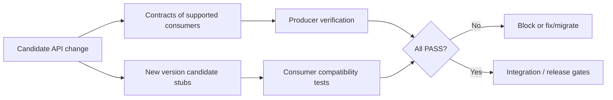
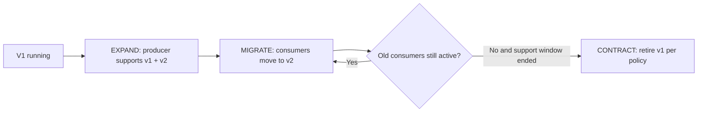
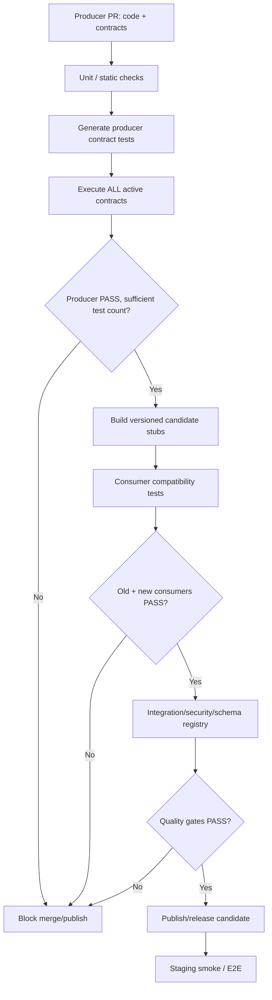

# Compatible Changes and Contract-Breaking Changes

> **Chapter:** Versioning and Compatibility  
> **Module:** `SPRING_CLOUD_CONTRACT` — learn contract testing between producer and consumer using Groovy/YAML DSL for HTTP and messaging; generate provider-side tests, publish stubs, use Stub Runner, and integrate compatibility checks into CI.
>
> **Guiding Question:** When a service changes its API, how do we know whether old consumers still work, and how do we prove it before deployment?

## Learning Objectives

After this lesson, you will be able to:

1. Distinguish between **backward-compatible changes**, **breaking changes**, and **conditional changes**, based on the behavior consumers actually depend on.
2. Classify HTTP changes regarding URL, method, request/response body, headers, status, authentication, dynamic data, and business semantics.
3. Analyze the impact of changes on **messaging contracts**: event type, payload, headers, destination, schema version, and legacy consumers.
4. Use Spring Cloud Contract **Groovy/YAML DSL** to express v1 and v2 contracts without creating conflicting stubs for the same request.
5. Understand why **producer verification** against active contracts and **consumer Stub Runner tests** using the exact candidate stub version must go together.
6. Apply the **expand → migrate → contract** strategy and API versioning when a breaking change cannot be avoided.
7. Use `stubsPerConsumer` with control, knowing the difference between filtering stubs for one consumer and protecting all consumers of the producer.
8. Design compatibility gates in CI, including regression/negative cases and stub artifact management policies.
9. Evaluate a proposed change through a risk matrix and build a practical rollout/rollback plan.

## 1. Why Can a Small Change Break the Entire System?

Suppose a system has:

- `checkout-service` calling `inventory-service` to check stock before placing an order.
- `catalog-service` also calling `inventory-service` but displaying stock in its own way.
- `inventory-service` as the **producer** of the shared HTTP API.
- Consumers and the producer can be deployed **on different days**, because each service has an independent release pipeline.

Current contract:

```http
GET /api/v1/stock/SKU-001 HTTP/1.1
Accept: application/json
```

Response:

```http
HTTP/1.1 200 OK
Content-Type: application/json

{
  "sku": "SKU-001",
  "available": true,
  "quantity": 4
}
```

A developer wants to rename the `quantity` field to `availableUnits` for clarity:

```json
{
  "sku": "SKU-001",
  "available": true,
  "availableUnits": 4
}
```

To the producer, this looks like just a rename. However, an old client might be reading:

```java
int remaining = response.quantity();
if (remaining >= requestedQuantity) {
    checkoutService.acceptOrder();
}
```

When `quantity` disappears, the client may fail to parse, receive a default `0`, or make the wrong decision. **That is a breaking change for any consumer depending on that field.**

Similarly, if the producer changes `available: true` to `available: "true"`, a human sees the same value, but the wire format type has changed from a JSON boolean to a string. Strict consumers will break; permissive consumers may silently coerce the type, making bugs harder to detect.

### 1.1. Compatibility Is a Relationship, Not an Absolute Label

A change is considered compatible when **every supported consumer continues to work according to the contract it depends on**. That depends on:

- Which endpoints, methods, headers, and media types the consumer calls.
- Which response fields the consumer reads/asserts and how strictly it checks them.
- Whether the consumer handles unknown fields, null, new enum values, and error statuses.
- Whether the producer maintains the old behavior during the rollout phase.
- Which consumer versions are actually still active in practice.

Therefore, you cannot just look at an OpenAPI diff, JSON diff, or version number and draw a definitive conclusion. Contract tests provide **bounded but verifiable evidence**.



## 2. Defining the Three Change Categories

| Category | Practical Definition | Example | Action |
| --- | --- | --- | --- |
| **Compatible** | Supported consumers still use the old behavior as before | Adding a new endpoint while keeping the old endpoint unchanged | Run tests and continue rollout |
| **Breaking** | At least one supported consumer must modify code/configuration to work | Removing `quantity` or changing `GET` to `POST` | Block, maintain v1, or negotiate migration |
| **Conditional (potentially breaking)** | Safe for some consumers but not all | Adding a response field, adding an enum value, changing array ordering | Verify consumer behaviors; do not guess by eye |

### 2.1. Backward and Forward Compatibility

- **Backward compatibility of a new producer:** the candidate producer continues to satisfy requests from **old consumers**.
- **Forward compatibility of a consumer:** the current consumer is able to accept responses from a future producer within designed boundaries (for example, ignoring unknown optional fields).
- **Full compatibility:** both directions under a specific set of rules, often required in complex schema/event exchanges.

In Spring Cloud Contract, the most common goal is protecting **a new producer against the contracts of active consumers**. Consumer-side Stub Runner helps verify that the client understands the **selected contract stubs**.

### 2.2. Changing the Version Number Alone Does Not Make an API Safe

The artifact name `inventory-service:2.0.0` has no power to automatically make v1 consumers compatible. Semantic Versioning (SemVer) is a **communication convention about the magnitude of a change**, not test evidence.

Even when a team's standard states that breaking changes must bump the major version, the producer still needs to keep the old version for a period if old consumers have not upgraded yet.

## 3. HTTP Change Matrix: Request

**Requests are what the producer needs to accept from existing clients.** If the new server requires old clients to send something additional, the likelihood of breaking them is high.

| Change in Producer | Default Assessment | Explanation |
| --- | --- | --- |
| Add a new endpoint | Usually compatible | Old endpoints remain intact |
| Remove an existing endpoint | **Breaking** | Old clients receive 404/405 |
| Change `GET /stock` to `POST /stock` | **Breaking** | Changes the method, may change safety/idempotency |
| Move `/api/v1/...` to `/api/v2/...` and drop v1 | **Breaking** | Old clients keep calling the old path |
| Add an **optional** query parameter | Usually compatible | New server still accepts requests without the parameter |
| Turn an optional query parameter into required | **Breaking** | Old requests may get 400 |
| Add an **optional** JSON request field | Usually compatible | Server handles old requests missing the field |
| Add a required JSON request field without a default | **Breaking** | Old clients do not send that field |
| Rename or change the type of a request field | **Breaking** | Decoder/validation changes |
| Tighten validation on previously accepted input | Potentially breaking | Old payloads are now rejected |
| Change body from JSON to XML | **Breaking** | Different media type and serializer |
| Require an additional `X-Tenant-Id` header | **Breaking** if old clients omit it | New input requirement |
| Change required auth scope/token format | Potentially breaking | Old clients may get 401/403 |

**Example:** the producer starts requiring `region` in a POST request:

```json
{
  "sku": "SKU-001",
  "units": 2,
  "region": "VN"
}
```

If the v1 request only consists of `sku` and `units`, all old consumers will not send `region`. A **compatible expansion** approach is to allow `region` to be absent and apply an agreed default, and only require it on a v2 endpoint or after migration.

## 4. HTTP Change Matrix: Response

Responses are what consumers receive; failures usually lie in **shape, meaning, and processing expectations**.

| Response Change | Default Assessment | What Needs Verification |
| --- | --- | --- |
| Add a new optional field | **Conditional** | Do consumers ignore unknown fields? |
| Remove a field currently in use | **Breaking** | Consumer parsing/logic depends on it |
| Change `quantity: 4` → `"4"` | **Schema-breaking** | JSON number becomes JSON string |
| Change `available: true` → `"true"` | **Schema-breaking** | Boolean becomes string |
| Change a field to `null` | Potentially breaking | Does the consumer support null? |
| Change a field from non-null to optional/absent | Potentially breaking | Does the client require that field to always be present? |
| Rename a field (`quantity` → `availableUnits`) | **Breaking** if old name is removed | Old clients still read `quantity` |
| Replace `200` with `204` | **Breaking** when client needs body | Payload is gone |
| Change `200` to `201` | Potentially breaking | Does the client compare exact status? |
| Add enum value `BACKORDERED` | Conditional | Does the client handle open enums or use an exhaustive switch? |
| Change units of `quantity` or `price` | **Semantically breaking** | JSON shape may remain unchanged |
| Change timestamp timezone/format | Potentially breaking | Client parsing and time semantics |
| Change order of an array with business meaning | Potentially breaking | Does the client rely on ordering? |
| Change error code/body on failure | Potentially breaking | Consumer fallback/error handling logic |

### 4.1. Adding a Field Is Not Automatically Safe

Suppose the new producer returns:

```json
{
  "sku": "SKU-001",
  "available": true,
  "quantity": 4,
  "warehouse": "HCM-01"
}
```

Most clients designed to **ignore unknown JSON fields** can continue working. However, clients using strict JSON schemas, a deserializer with `FAIL_ON_UNKNOWN_PROPERTIES`, full-payload signatures/hashes, or snapshot equality may fail.

Therefore, **"adding a response field is compatible" is only an assumption** that must be verified against supported consumers. Deserializer configurations across different stacks/languages can vary.

### 4.2. A Change Without Modifying JSON Can Still Be Breaking

The producer keeps the exact same payload:

```json
{"sku":"SKU-001","available":true,"quantity":4}
```

but changes the meaning of `quantity` from **units available for sale** to **total units in the warehouse including reserved stock**. The consumer might allow checkout beyond actual available inventory while every schema assertion still PASSES.

Similarly, changing currency rounding rules, time zones, pagination behavior, default values, or processing order can also break the **semantic contract**.

**To protect against this, contracts need sufficiently representative business examples**, along with unit/integration tests for the corresponding logic. A matcher checking only `by_type` cannot prove that business calculations are correct.

## 5. Headers, Content Negotiation, and Error Behavior Are Also Contracts

HTTP contracts are not just JSON bodies.

### 5.1. Accept vs. Content-Type

- `Accept` in the **request** states which response media types the client accepts.
- `Content-Type` in the **request** specifies the media type of the body the client sends.
- `Content-Type` in the **response** is the media type the server actually returns.

If an old client sends `Accept: application/json`, the producer must not silently switch all responses to `application/xml`. If the producer forces request bodies to use a new media type, old clients may receive `415 Unsupported Media Type`. If the producer cannot produce a response matching `Accept`, the client may receive `406 Not Acceptable`.

Media type changes should be described in contracts and verified on both producer and consumer sides.

### 5.2. Changing Error Codes Breaks Fallback Flows

For example, a consumer handles unfound inventory via status `404` and body:

```json
{
  "code": "SKU_NOT_FOUND",
  "message": "Stock item not found"
}
```

If the new producer returns `200` with `available: false`, the old client may no longer run its previous error-reporting logic. If the producer changes `code` to `NOT_FOUND` while keeping status 404, consumer logic matching on `code` may break.

**Error contracts are real contracts**, not an afterthought to success responses. When an API has important 400, 401, 403, 404, 409, 429, or 503 responses, describe the cases consumers depend on.

### 5.3. Authorization and Caching

- Requiring extra tokens, audiences, roles, or tenants can break old consumers.
- Removing/changing `ETag`, `Cache-Control`, or headers affecting caching can cause bugs even if the JSON remains valid.
- Changing the `Location` header after `201` can break clients that use the newly created URL.
- HTTP behavior behind a gateway/proxy may differ from standalone MockMvc tests; security/integration tests provide supplementary evidence.

## 6. v1 Contract Example Using YAML DSL

We will maintain a verifiable v1 HTTP contract. Producer `inventory-service` serves `checkout-service`.

File `src/test/resources/contracts/checkout-service/stock_available_v1.yml` if the project uses Maven and chooses to group by consumer:

```yaml
name: stock_available_v1
description: "Checkout reads stock from API v1"

request:
  method: GET
  url: /api/v1/stock/SKU-001
  headers:
    Accept: application/json

response:
  status: 200
  headers:
    Content-Type: application/json
  body:
    sku: SKU-001
    available: true
    quantity: 4
```

In the modern Gradle plugin, the default contract source typically lives under `src/contractTest/resources/contracts`; do not copy the Maven location to Gradle and assume the plugin will always find it. If the project configures a custom path, use that path.

### 6.1. Producer Code Before the Change

```java
@RestController
@RequestMapping("/api/v1/stock")
class InventoryV1Controller {

    @GetMapping(
        path = "/{sku}",
        produces = MediaType.APPLICATION_JSON_VALUE
    )
    public StockV1 get(@PathVariable String sku) {
        if (!"SKU-001".equals(sku)) {
            throw new ResponseStatusException(
                HttpStatus.NOT_FOUND, "SKU not found"
            );
        }
        return new StockV1(sku, true, 4);
    }

    record StockV1(String sku, boolean available, int quantity) {}
}
```

This is a learning-oriented controller: when using it in a project, add Spring MVC imports, JDK 17+, the Boot app class, and appropriate test configuration. It does not yet commit to an error body for the not-found case; only the v1 success contract is described above.

Producer verification must run against the **real controller/service** in the test environment, not by mocking the entire controller to return fixtures from the contract.

### 6.2. Changing Fields While Keeping the Same Path Is Breaking

Suppose a developer changes the response of `GET /api/v1/stock/SKU-001` to:

```json
{
  "sku": "SKU-001",
  "availability": "IN_STOCK",
  "availableUnits": 4
}
```

The v1 contract still requires `available` and `quantity`. **The generated producer test must fail** because the new implementation no longer fulfills the old promise.

If the developer **edits the v1 contract itself** to match the new output just to make the test green, producer verification only proves it fulfills the **new promise**—it does not prove that old checkout is unbroken. Modifying a contract requires CDC review from supported consumers.

## 7. Using Groovy DSL to Express the Same Contract

Groovy equivalent of the v1 YAML:

```groovy
org.springframework.cloud.contract.spec.Contract.make {
    name 'stock_available_v1'

    request {
        method 'GET'
        url '/api/v1/stock/SKU-001'
        headers {
            header 'Accept': 'application/json'
        }
    }

    response {
        status 200
        headers {
            contentType(applicationJson())
        }
        body(
            sku: 'SKU-001',
            available: true,
            quantity: 4
        )
    }
}
```

**Do not place both YAML and Groovy versions for the same interaction** in the contract directory scanned by the plugin; doing so can generate duplicate tests/stubs.

Corresponding elements:

| Purpose | YAML | Groovy |
| --- | --- | --- |
| Method | `request.method: GET` | `method 'GET'` |
| URL | `request.url` | `url '/api/v1/...'` |
| Request header | `request.headers.Accept` | `header 'Accept': 'application/json'` |
| Response status | `response.status: 200` | `status 200` |
| Response JSON | `response.body` | `body(sku: ..., quantity: ...)` |
| Dynamic field matcher | `response.matchers.body` | `response.bodyMatchers { ... }` |

Choosing a DSL does not by itself determine compatibility. **The actual behavior checked by the contract** is what determines whether a breaking change gets caught.

## 8. Compatible Expansion: Keep Old Fields and Add New Fields

If the goal is to clarify stock quantities, the producer can **preserve the old schema** during a transition period:

```json
{
  "sku": "SKU-001",
  "available": true,
  "quantity": 4,
  "availableUnits": 4
}
```

This is the **expand** strategy, before removing `quantity`. However, two conditions are required:

1. Old fields **retain their type and meaning**, not just their names.
2. Old consumers **accept the new field** or are already configured to ignore unknown fields.

### 8.1. Testing the Tolerant Reader Assumption

An old DTO:

```java
public record StockV1(
    String sku,
    boolean available,
    int quantity
) {}
```

With Jackson, how unknown properties are handled depends on the application's mapper/configuration. You can write a concrete test to confirm there is no error with `availableUnits`:

```java
@Test
void v1ClientBoQuaFieldMoiNeuDuocCauHinh() throws Exception {
    String candidateJson = """
        {
          "sku":"SKU-001",
          "available":true,
          "quantity":4,
          "availableUnits":4
        }
        """;

    ObjectMapper mapper = new ObjectMapper()
        .configure(
            DeserializationFeature.FAIL_ON_UNKNOWN_PROPERTIES,
            false
        );

    StockV1 stock = mapper.readValue(candidateJson, StockV1.class);
    assertEquals(4, stock.quantity());
    assertTrue(stock.available());
}
```

This is a **unit test demonstrating the tolerant reader concept** using Jackson 2 API, JUnit 5, and corresponding imports. In a real application, you must test the **ObjectMapper actually used by the HTTP client**, not just a freshly created mapper in a test.

**Do not assume Spring Cloud Contract always ignores every extra response field by default.** Depending on the contract DSL, matchers, generated assertions, and consumer serializer, strictness can vary. Run both **producer verification of the old contract** and **consumer tests against the candidate response**.

### 8.2. Avoid Overly Broad Matchers to "Fix" Failures

An anti-pattern is changing the contract response to:

```yaml
response:
  status: 200
  body:
    quantity: 4
  matchers:
    body:
      - path: $.quantity
        type: by_regex
        value: '.*'
```

If `quantity` must be a **meaningful integer**, a `.*` matcher or existence-only check can mask schema and logic bugs. Keep equality for fixtures with concrete values, or use **intentional** type/format matchers when data is genuinely dynamic.

## 9. When You Must Break the Schema: Introduce v2 Alongside v1

Suppose the team decides `available` and `quantity` must be replaced by a new model with stock classification. Instead of modifying the v1 response immediately, create a new endpoint:

```http
GET /api/v2/stock/SKU-001 HTTP/1.1
Accept: application/json
```

v2 response:

```json
{
  "sku": "SKU-001",
  "availability": "IN_STOCK",
  "availableUnits": 4,
  "warehouse": "HCM-01"
}
```

New contract `stock_available_v2.yml`:

```yaml
name: stock_available_v2
description: "Consumer has upgraded to use API v2"

request:
  method: GET
  url: /api/v2/stock/SKU-001
  headers:
    Accept: application/json

response:
  status: 200
  headers:
    Content-Type: application/json
  body:
    sku: SKU-001
    availability: IN_STOCK
    availableUnits: 4
    warehouse: HCM-01
```

**Key point:** the v2 contract has a **different URL**, so WireMock stubs do not end up as two mappings for the same request demanding conflicting responses. The new producer must still serve both v1 and v2 during the transition period.

### 9.1. How to Implement Both Endpoints Simultaneously

```java
@RestController
class InventoryCompatibilityController {

    private final InventoryService inventory;

    InventoryCompatibilityController(InventoryService inventory) {
        this.inventory = inventory;
    }

    @GetMapping(
        path = "/api/v1/stock/{sku}",
        produces = MediaType.APPLICATION_JSON_VALUE
    )
    StockV1 v1(@PathVariable String sku) {
        StockData data = inventory.find(sku);
        return new StockV1(
            data.sku(), data.available(), data.availableUnits()
        );
    }

    @GetMapping(
        path = "/api/v2/stock/{sku}",
        produces = MediaType.APPLICATION_JSON_VALUE
    )
    StockV2 v2(@PathVariable String sku) {
        StockData data = inventory.find(sku);
        return new StockV2(
            data.sku(), data.availabilityCode(),
            data.availableUnits(), data.warehouse()
        );
    }

    record StockV1(String sku, boolean available, int quantity) {}

    record StockV2(
        String sku, String availability,
        int availableUnits, String warehouse
    ) {}
}
```

`InventoryService` and `StockData` are **illustrative** domain types that need to be implemented in a real project. Ensure the mapping from the v2 domain to the v1 schema preserves the old semantics; for example, if `RESERVED` appears, the mapping rule for `available` must be explicitly designed rather than arbitrarily assigning an incorrect boolean.

**Creating both v1 and v2 contracts is not enough** if the producer implementation drops the v1 endpoint. Contract Verifier must execute **both**.

### 9.2. Do We Have to Use `/v2` in the URL?

No. Other options include:

- Versioning in the URL: `/api/v1`, `/api/v2`.
- Versioning via vendor media type: `Accept: application/vnd.inventory.v2+json`.
- Versioning via a clearly designed header.

Each option must have a **distinguishable request matcher** so that the producer and Stub Runner do not return two different schemas for the same request. Do not create two contracts with the exact same method, path, headers, and body expecting two conflicting responses.

## 10. Subtle Breaking Cases That Need Dedicated Verification

### 10.1. Nullability and Default Values

The following structures are **not equivalent**:

```json
{"quantity": 0}
```

```json
{"quantity": null}
```

```json
{}
```

A consumer might interpret `0` as out of stock, `null` as unknown, and a missing field as a data error. In Java, using a primitive `int` can turn a missing value into `0` under certain deserialization configurations, hiding the difference. For required fields, test **presence, nullability, type, and business semantics** thoroughly.

### 10.2. Expanding Enums

The producer adds `availability: "BACKORDERED"` alongside `IN_STOCK` and `OUT_OF_STOCK`. For a consumer with:

```java
switch (availability) {
    case "IN_STOCK" -> allowCheckout();
    case "OUT_OF_STOCK" -> denyCheckout();
    default -> throw new IllegalStateException("Unknown status");
}
```

the new enum value can cause the client to fail. If an enum is meant to be extensible, the contract and clients must agree on how to handle unknown values **upfront**. Do not assume adding an enum value is automatically compatible.

### 10.3. Pagination and Sorting

Changing the default `pageSize` from 100 to 20, switching sorting from ascending to descending, or changing how `nextPageToken` is computed can break consumers even when field names remain unchanged. Express this **behavior** in contracts or integration tests at the appropriate layer.

### 10.4. Errors / Throttling / Rate Limits

A new producer returns `429 Too Many Requests` for cases that previously returned `200`. This may be a reasonable operational policy change, but old consumers without retry/backoff may fail. If 429 behavior is part of the public API, corresponding contracts and consumer resilience tests are needed.

### 10.5. Introducing Side Effects

Changing `GET` from a read-only operation to an operation with side effects breaks **HTTP safety**, even if the response is identical. Contracts describing request/response may not catch all side effects; semantic unit/integration tests are required.

## 11. Messaging Contracts: Backward Compatibility Is Not Just JSON

Suppose `order-service` publishes an `OrderAccepted` message to `orders.events`, and consumers `billing-service` and `notification-service` listen to it.

v1 payload:

```json
{
  "eventType": "OrderAccepted",
  "schemaVersion": 1,
  "orderId": "ORD-1001",
  "amount": 240000,
  "currency": "VND"
}
```

A Spring Cloud Contract YAML messaging example:

```yaml
name: order_accepted_v1
label: order_accepted
input:
  triggeredBy: publishOrderAccepted()
outputMessage:
  sentTo: orders.events
  headers:
    contentType: application/json
    eventType: OrderAccepted
  body:
    eventType: OrderAccepted
    schemaVersion: 1
    orderId: ORD-1001
    amount: 240000
    currency: VND
```

This is an example of a producer with a `publishOrderAccepted()` method in its base test and message verifier integration. Running it requires an appropriate messaging adapter/binder and `@AutoConfigureMessageVerifier`; the contract does not create a Kafka topic or broker by itself.

### 11.1. Messaging Change Matrix

| Change | Risk | Why |
| --- | --- | --- |
| Add an optional metadata field | Conditional | Strict consumers may reject unknown fields |
| Remove `orderId` | **Breaking** | Consumers need the identifier key |
| Rename `amount` to `total` and remove `amount` | **Breaking** | Old handlers read `amount` |
| Change `amount` from number to string | **Breaking** | Schema/decoder changes |
| Change `amount` unit from VND to cents | **Semantically breaking** | Numeric value looks valid but has wrong meaning |
| Change `eventType` | **Breaking** if consumers route by event type | Handlers may not be triggered |
| Change destination `orders.events` | **Breaking** if old bindings do not follow | Consumers receive no messages |
| Change `contentType`/encoding | Potentially breaking | Deserializer fails to read |
| Add a new event type on the same topic | Conditional | Do consumers filter/ignore unknown events? |
| Change `schemaVersion` without supporting old version | Potentially breaking | Old/new events fail to process |
| Change ordering, key/partition | Potentially breaking | Consumers rely on per-order ordering |
| Change retry/duplicate guarantees | Potentially breaking | Consumer idempotency assumptions |

### 11.2. New Events and Old Events Can Coexist

With a message broker, v1 events may still sit in a topic/queue waiting to be processed after a rollout. New consumers need to be designed to read **both stored old events** and new events during the transition window if the system has replay/backlog.

You can use strategies such as:

- Keep `OrderAccepted` v1; add optional fields and test consumer tolerance.
- Publish a **new event type** or new schema version when a change is incompatible.
- Keep handlers supporting both v1 and v2 while backlog remains.
- Write message contracts for **each committed version**.
- Have integration tests against a real broker/schema registry when serialization/partition/retention risks matter.

**Spring Cloud Contract is not itself a schema registry.** If the system uses Avro/Protobuf/JSON Schema, compatibility rules and registry checks are an additional gate and should not be conflated with contract DSL verification.

## 12. Choosing Matchers Without Weakening the Contract

Some fields are genuinely dynamic: `requestId`, `traceId`, or `occurredAt`. When the producer generates a new UUID, comparing against a fixed UUID will fail even though the API remains compatible.

Example YAML response with a matcher:

```yaml
response:
  status: 200
  headers:
    Content-Type: application/json
  body:
    sku: SKU-001
    available: true
    quantity: 4
    requestId: 55145a90-f0a1-4c47-bcdf-550d89023902
  matchers:
    body:
      - path: $.requestId
        type: by_regex
        predefined: uuid
```

This snippet is a **replacement response block** for an API containing a `requestId` field; do not add a second `response` key into a complete YAML file.

The matcher allows only `requestId` to vary as a UUID. The invariants `available` and `quantity` are still checked against their expected values.

### 12.1. Do Not Substitute Type Matchers for Business Assertions

If `quantity` is a number that can vary, yet the contract requires it to be non-negative, a `by_type` matcher only confirms it is a JSON number and **does not prove it is greater than or equal to 0**.

Depending on complexity, you can use:

- Contracts with multiple fixtures representing key values.
- Specific matchers/`by_command` and custom helpers when supported by the framework.
- Producer unit/integration tests for business formulas.
- Consumer tests checking reactions to boundary values.

**Merely having "every field has a type" does not mean semantic compatibility.**

### 12.2. Request and Response Matchers Serve Two Different Purposes

In Groovy DSL, **request** matchers help consumer-side stubs accept requests with dynamic values that match a valid pattern. **Response** matchers help producer-generated tests accept valid dynamic responses.

Do not confuse the directions of `consumer(...)` and `producer(...)` in the DSL. In YAML, use `request.matchers` and `response.matchers` on the appropriate side; each matcher must reference the corresponding field in the example body.

## 13. Multiple Consumers and stubsPerConsumer

A producer may serve both `checkout-service` and `catalog-service`. Checkout needs `available`/`quantity`, while catalog needs display metadata. Not every consumer depends on all response fields.

Spring Cloud Contract supports organizing contracts into per-consumer directories and **filtering stubs during consumer tests** using `stubsPerConsumer`.

Example structure:

```text
contracts/
├── checkout-service/
│   ├── stock_available_v1.yml
│   └── stock_unavailable_v1.yml
└── catalog-service/
    ├── stock_display.yml
    └── stock_not_found.yml
```

Example `checkout-service` consumer using Stub Runner:

```java
@SpringBootTest(
    properties = "inventory.base-url=http://localhost:8090"
)
@AutoConfigureStubRunner(
    ids = "com.example:inventory-service:1.8.0:stubs:8090",
    stubsMode = StubRunnerProperties.StubsMode.LOCAL,
    stubsPerConsumer = true,
    consumerName = "checkout-service"
)
class CheckoutInventoryContractTest {
    // @Autowired CheckoutService checkout;
    // @Test verifies the checkout client handles its stubs.
}
```

This is an **illustrative test configuration**, requiring real imports/dependencies and an HTTP client. Port 8090 is just an example; in parallel CI runs, prefer dynamic ports and `StubFinder.findStubUrl(...)` or port injection mechanisms.

### 13.1. What Can `stubsPerConsumer` Do?

- Filter which mappings/stubs are registered when testing **a single consumer** based on directory/consumer name.
- Avoid loading too many unrelated stubs into the same WireMock server.
- Clarify which scenarios each consumer actually uses.

### 13.2. What `stubsPerConsumer` Does **Not** Do

- It does not allow the producer to drop accepted contracts of other consumers.
- It does not make two conflicting responses for the **same request** valid in production.
- It does not guarantee the real producer knows which group a client belongs to if the request has no distinguishing signal.
- It does not automatically synchronize deployments of consumers using different versions.

The official documentation highlights the issue of two consumers wanting two different responses for the same endpoint. **A producer cannot simultaneously return two contradictory responses for the same request under the same conditions.** You must design distinguishable requests or return a shared schema that satisfies coexisting commitments.

### 13.3. Filtered Contracts Are Not the Full Compatibility Obligation

If producer CI only runs contracts for `checkout-service` while `catalog-service` is still active, changes that break catalog can slip through. The producer should verify **the entire set of still-supported contracts**; stub filtering makes consumer tests cleaner, not a reason to drop protection for other consumers.

## 14. Stub Artifact Version and API Version Are Two Separate Concepts

A stub artifact may have coordinates:

```text
com.example:inventory-service:1.8.0:stubs
com.example:inventory-service:2.0.0:stubs
```

Meanwhile, artifact `2.0.0` itself can still contain **both v1 and v2 endpoints**. Therefore:

- **Artifact version**: the build/package version containing published contracts/stubs.
- **HTTP API version**: the public interface such as `/api/v1`, `/api/v2`, or a vendor media type.
- **Consumer application version**: the deployed version of checkout/catalog and its API calling behavior.
- **Schema/event version**: the message structure committed between producer and consumer.
- **Contract repository revision**: the set of DSL definitions used when generating tests/stubs.

There is no rule forcing all these versions to be equal.

### 14.1. Pin the Stub Version in Quality Gates

For consumer releases, use a concrete version such as:

```text
com.example:inventory-service:2.0.0-RC1:stubs
```

Some stub-loading mechanisms allow dynamic versions, such as `+`. That is useful for a pipeline tracking the latest candidate, but **not reproducible** if a newer version is published to the repository later.

In CI, record the **exact artifact actually downloaded**, the producer commit/build that verified it, and the consumer test version that ran.

### 14.2. LOCAL and REMOTE Do Not Mean the Same Thing

- `LOCAL` resolves stubs from the runner's own Maven local repository.
- `REMOTE` downloads from a Maven-compatible artifact repository when configured.
- A producer running `mvn install` on runner A does not automatically make the artifact appear in `~/.m2` on runner B.
- When using Gradle, configure stub artifact publication according to the plugin/version; **generating a stub JAR does not mean it has been published and verified against producer code**.

Only publish artifacts attached with clear metadata/verifier results; never label a build "verified" when tests were skipped.

## 15. The Expand → Migrate → Contract Workflow

When you must change the v1 schema, a safe rollout strategy is to **expand first, gradually migrate consumers, and only then remove the old part**.



### Phase 1 — Expand

- The producer adds the v2 endpoint/media type/schema while still returning v1 exactly as before.
- Producer CI runs **both v1 and v2 contract tests**.
- Publish versioned candidate stubs.
- Old consumers continue using v1 without having to deploy alongside the producer.
- If adding fields to v1, verify with real old clients whether they ignore unknown fields.

### Phase 2 — Migrate

- Consumers run contract tests against the new producer's candidate stubs.
- Consumers deploy v2 support, optionally supporting both v1/v2 temporarily if rollback is needed.
- Monitor v1 usage via logs/metrics that do not contain sensitive data.
- For events, process both v1 backlog and new v2 events during the transition window.
- Verify compatibility across multiple deploy cycles; avoid forcing two services to deploy simultaneously whenever possible.

### Phase 3 — Contract

- Once v1 consumers are no longer within the **supported scope** and the rollback/deprecation window has expired, the new producer removes v1.
- Delete/retire v1 contracts **through an evidence-backed review**, not simply because new tests PASS.
- Update API docs, stub packages, dashboards, and release policies.
- Check whether mobile/offline/partner clients still use v1; they often update slower than internal microservices.

### 15.1. Rollback Must Be Designed Upfront

If the producer has already deleted v1 and an old consumer needs to roll back, the system may fail after rollback. Therefore, you must define the **coexistence period for both versions** and the point at which support is genuinely allowed to end.

**API versioning does not replace operational strategy.** It merely provides the mechanism for versions to coexist.

## 16. Producer Verification Against Active Contracts

On the producer side, YAML/Groovy contracts must generate tests that invoke the **real producer implementation** within the chosen test scope. For HTTP, you can use:

- RestAssuredMockMvc standalone when the controller/logic is the boundary under test.
- MVC slice or `@SpringBootTest` + MockMvc when custom converters, advice, or security/filters affect the contract.
- Embedded HTTP server when verifying behavior over an actual HTTP socket.

A minimal base class for the controller example in section 6:

```java
package com.example.inventory;

import io.restassured.module.mockmvc.RestAssuredMockMvc;
import org.junit.jupiter.api.BeforeEach;

public abstract class ContractTestBase {

    @BeforeEach
    public void setup() {
        RestAssuredMockMvc.standaloneSetup(
            new InventoryV1Controller()
        );
    }
}
```

This is a **single-endpoint v1 template**. When the producer has both v1 and v2, you must instantiate the corresponding controllers/services in the base test or use an appropriate Spring context. Do not copy this class verbatim and expect v2 contracts to be verified if the v2 controller is not registered.

### 16.1. What Should the Producer Side Check?

- v1 contracts are still discovered by the plugin and generated tests run.
- v2 contracts are discovered and have their own tests.
- Producer code returns the exact status/headers/JSON body for each contract.
- If there are dynamic fields, matchers validate formats without relaxing invariants.
- An intentional breaking change makes the generated test fail.
- No important contracts were deleted/skipped just to "fix" the build.

**Read the generated test reports**, because `BUILD SUCCESS` with 0 tests executed or skipped producer verification provides zero compatibility protection.

## 17. Consumer Tests with Stub Runner: Confirming the App Reads the Contract

The consumer must run its **real HTTP client**, not just assert that the stub server returns the right status.

JUnit test example with candidate stubs:

```java
@SpringBootTest(
    properties = "inventory.base-url=http://localhost:8090"
)
@AutoConfigureStubRunner(
    ids = "com.example:inventory-service:2.0.0-RC1:stubs:8090",
    stubsMode = StubRunnerProperties.StubsMode.LOCAL
)
class CheckoutCandidateCompatibilityTest {

    @Autowired
    InventoryClient client;

    @Test
    void shouldReadV2StockResponse() {
        StockV2 stock = client.fetchV2("SKU-001");

        assertEquals("SKU-001", stock.sku());
        assertEquals("IN_STOCK", stock.availability());
        assertEquals(4, stock.availableUnits());
    }
}
```

This is a **consumer test snippet**, requiring imports, Spring Boot test/stub runner dependencies, `InventoryClient`/`StockV2`, and a matching stub artifact. Port 8090 is a fixed example and risks collisions in parallel CI; in real projects, prefer obtaining a dynamic URL from `StubFinder`.

### 17.1. Do Not Test Only New Stubs Against New Consumers

To detect breaking changes for old consumers, you need **a compatibility run** using supported consumers—or the contracts those consumers require—against the **candidate producer/stubs**.

Dangerous scenario:

1. Consumer v1 passes with `inventory-service:1.8.0:stubs`.
2. Producer v2 deletes the `quantity` field.
3. Consumer tests still pin the v1 artifact → PASS.
4. Producer v2 gets deployed → consumer v1 fails in production.

How to protect against this: producer verification of the **v1 contract** must fail when `quantity` is deleted; additionally, cross-service compatibility tests using **v2 candidate stubs** (including retained contracts) verify old client behavior when needed.

### 17.2. Stubs Alone Do Not Prove Producer Code

Stub Runner reads packaged mappings; it **does not start the producer implementation itself**. Therefore:

- Producer verification PASSING is a prerequisite before calling stubs "verified".
- Consumer tests PASSING only shows that the client handles the **selected stubs**.
- Integration/E2E tests are still necessary for networking, auth, DB/broker, and distributed behavior.

## 18. CI Quality Gates for Compatibility

An ideal pipeline links contract definitions with the **candidate producer** and **supported consumers**.



### 18.1. Producer-Side Gates

- Maintain a manifest/set of contracts for all still-supported consumers.
- The plugin actually generates and **executes generated tests**; reject unexpected 0-contract-test runs.
- No unapproved `skipped` tests.
- Generated tests fail when the producer violates a required field.
- Do not downgrade matchers from equality to `.*` to hide errors.
- Every public schema change is reviewed by the relevant owners.

For a Maven project configured with Spring Cloud Contract:

```bash
mvn clean verify
```

For a Gradle project configured with the plugin/source set:

```bash
./gradlew clean build
```

These are **reference commands**; gate effectiveness depends on actual plugin/task wiring and test reports. Do not pass `-DskipTests` or `-x contractTest` to publish verified stubs.

### 18.2. Consumer-Side Gates

- Run unit and consumer stub tests using the **real client/handler**.
- Pin the candidate stub version under evaluation.
- Test success, error, required fields, unknown optional fields, and enum boundaries when risky.
- Verify that v1 consumers still work if the candidate producer intends to retain v1.
- Check Stub Runner logs to see which artifact was actually downloaded.
- For message contracts, verify listeners process v1/v2 events properly and run separate broker integration tests if schema/serialization changes.

### 18.3. Release Gate and Traceability Metadata

A minimal verification record:

```yaml
producer:
  artifact: com.example:inventory-service
  candidate: 2.0.0-RC1
  commit: "<producer-commit>"
  contractVerification: PASS
  activeContractCases: 12
  skipped: 0

consumers:
  - application: checkout-service
    version: 4.6.0
    stubArtifact: com.example:inventory-service:2.0.0-RC1:stubs
    compatibility: PASS
  - application: catalog-service
    version: 3.2.0
    stubArtifact: com.example:inventory-service:2.0.0-RC1:stubs
    compatibility: PASS
```

This is an **illustrative manifest**, not a file auto-generated by Spring Cloud Contract. In real CI, values must come from actual artifacts/test reports; never hard-code `PASS` without running verification.

### 18.4. Do Not Turn Compatibility Gates into Full-System E2E

Contract suites should provide fast feedback and pinpoint interface errors. Supplement them with targeted integration/E2E tests for:

- Auth/gateway/TLS.
- Persistence/migrations.
- Kafka/RabbitMQ/JMS encoding and delivery.
- Service discovery, timeouts, traffic routing.
- End-to-end business journeys.

Do not use E2E tests to replace dozens of specific contract assertions; a happy-path E2E test might never touch error branches or rarely used consumer fields.

## 19. Sensitivity Testing via Intentional Changes

One way to evaluate a quality gate is to **intentionally break the contract on a practice branch** and check whether tests turn red.

### Scenario A — Remove a Required Field

- Keep the v1 contract `quantity: 4`.
- Change producer code so it omits `quantity`.
- Expected: **producer verification FAILS**.
- If the build still PASSES: inspect the plugin, generated tests, assertions, and whether tests are being skipped.

### Scenario B — Change Data Type

- Producer changes `available: true` to `available: "true"`.
- Contract still uses a JSON boolean.
- Expected: schema/type assertion FAILS or an additional strict compatibility test catches it.
- If tests do not turn red: examine how matchers and generated JSON assertions behave; do not rush to conclude the change is safe.

### Scenario C — Add a Field to the Response

- Producer adds `warehouse` while keeping old fields.
- Run v1 producer verification and consumer tests with the **candidate response**.
- If a strict consumer fails, the change is **not yet compatible with that consumer**, even though the new field loses no data.

### Scenario D — Change Semantics While Keeping JSON Intact

- Producer still returns `quantity: 4`, but those four units are **already reserved** rather than available for sale.
- Schema-based verification may PASS if fixtures do not cover this.
- Add business-level contract examples or integration tests validating inventory rules.

### Scenario E — Stub Drift

- Consumer test uses `inventory-service:1.8.0:stubs`.
- Producer candidate is `2.0.0-RC1`.
- A consumer test PASSING against 1.8.0 **does not** prove the candidate is compatible. Fix the pipeline to test against the candidate or the old contract set.

**Do not push intentional breaking changes to the main branch/release.** Perform them on a practice branch, inspect logs, then revert the code.

## 20. Observability Before Retiring an Old Version

Contract tests reflect **listed consumers/behaviors**. In production environments, there are also:

- Slow-updating mobile apps.
- External third parties calling the API outside the repository.
- Weekly/monthly batch jobs.
- Temporarily offline consumers that call the API only upon startup.
- Message backlogs/replays of old data.

Before deleting v1, check:

1. List of consumers and support policies.
2. Logs/metrics by API version, accounting for infrequent traffic.
3. Communicated support-end/deprecation dates.
4. Rollback window for producer/consumers.
5. Broker retention/backlog and ability to decode old event schemas.
6. New contracts/tests guaranteeing v2 behavior.
7. Approval from owners or governance policy.

**Do not conclude "no v1 consumers remain" just because a single day had zero traffic** or because no contract test failed. Missing coverage is not proof of zero dependencies.

## 21. Quick Decision Table

| Proposal | Preferred Approach | Quality Gate |
| --- | --- | --- |
| Add a new response field | Verify tolerant readers, keep old fields | Consumer candidate tests + producer verification |
| Remove `quantity` | Maintain v1 or create v2 | Active v1 contracts must PASS |
| Add a required request header | Keep default/optional during transition | Old request contract tests |
| Add an enum value | Design unknown-case handling | Consumer contract/robustness tests |
| Change error code `SKU_NOT_FOUND` | Migrate handlers or version error API | Consumer error contracts |
| Change `/api/v1` → `/api/v2` | Run v1/v2 in parallel | Producer verifies both |
| Replace event `amount` → `total` | Version event, preserve consumer backlog | Message contracts v1/v2 + broker integration |
| Change Kafka partition key | Verify ordering semantics | Broker integration/consumer ordering tests |
| Change `quantity` semantics | Review business contract and fixtures | Business/unit/integration regression |
| Remove v1 after migration | Gather usage/retirement evidence | Release governance, rollback plan |

## 22. Practice Exercises

**Exercise 1 — Classify HTTP changes.** For the following changes, mark *compatible*, *breaking*, or *conditional* and explain based on checkout behavior: adding `warehouse`, removing `quantity`, turning `quantity` into a string, adding an optional query parameter, requiring an `X-Tenant-Id` header, changing status 200 to 204.

**Exercise 2 — Keep the v1 promise.** Use `stock_available_v1.yml` from section 6. Write a producer controller returning valid v1. Intentionally remove the `available` field and observe the generated test. Why does editing the contract to match the broken implementation fail to prove backward compatibility?

**Exercise 3 — Groovy/YAML.** Convert the v1 YAML to Groovy DSL. Explain how to avoid generating two stub mappings with duplicate requests when both files contain the same interaction.

**Exercise 4 — Optional request field.** The producer wants to accept an additional `region` field. Design request handling so it works both when old consumers omit `region` and when new consumers include it; build two corresponding test scenarios.

**Exercise 5 — Conditional response field.** Create a strict consumer DTO and a tolerant reader for a response with an added `warehouse` field. Inspect the difference and propose how to verify compatibility in a real client.

**Exercise 6 — Parallel v2.** Write `stock_available_v2.yml` for `GET /api/v2/stock/SKU-001` and a v2 producer route. Why must producer verification of both v1 and v2 contracts be kept during the migration phase?

**Exercise 7 — Error compatibility.** The consumer depends on `404` and `code: SKU_NOT_FOUND`. The producer changes the code to `NOT_FOUND`. Propose a regression contract and a migration strategy that avoids breaking old clients.

**Exercise 8 — Messaging.** `order-service` changes the event field `amount` to `total`. Design how to publish/consume v1/v2 while backlog still exists; list tests needed beyond Spring Cloud Contract when Kafka is involved.

**Exercise 9 — Multiple consumers.** `checkout-service` and `catalog-service` share the same inventory producer. Explain how `stubsPerConsumer` helps each test suite and why the producer still needs to verify all active contracts.

**Exercise 10 — Version drift.** Checkout tests PASS with `1.8.0:stubs`, while the producer deploys `2.0.0`. Point out what evidence is missing and how to bring candidate artifacts into the pipeline.

**Exercise 11 — Semantic breaking.** The producer leaves the schema unchanged but changes `quantity` to "stock including reserved items". What kind of tests will detect this, and why might data-type matchers be insufficient?

**Exercise 12 — Release design.** Draft an expand–migrate–contract timeline involving producer v1/v2, checkout v1/v2, catalog v1, an old mobile client, and a rollback window. Determine when v1 is safe to retire.

### Answer Hints

1. Adding a field: conditional; removing/changing type of `quantity`: breaking; optional query parameter: usually compatible; required header and 204 without body: breaking for old clients depending on prior behavior.
2. Keep the old contract; the generated producer test must turn red when a required field is removed. Changing the promise to match broken code only masks consumer incompatibility.
3. Use one DSL file per interaction; if there are different v1/v2 responses, requests must be distinguishable.
4. Use a default for missing `region` or accept an optional value; test both requests.
5. Test the actual deserializer/HTTP client used in practice, rather than assuming all clients ignore unknown fields.
6. v1 must keep serving un-upgraded consumers; v2 serves new consumers; test both before retiring v1.
7. Keep the old error code for v1 or version the error API; migrate consumers before removing old behavior.
8. Keep v1 events/decoders during the backlog window; message contracts verify shape, broker integration tests verify routing/serialization/ordering.
9. Filter stubs per consumer, yet the producer must not drop supported consumers.
10. Require producer verification of the v1 contract and consumer compatibility runs against the actual candidate stubs.
11. Unit/integration/business contract fixtures for inventory semantics; checking JSON number only checks wire type.
12. Remove v1 only when no supported consumer depends on it, the backlog/rollback window has expired, and policy approval is granted.

## 23. API Change Review Checklist

**Before modifying the producer:**

- [ ] Have all supported consumers (services/mobile/partners/batch) been identified?
- [ ] Have the HTTP methods/paths, headers, statuses, fields, nullability, enums, and error behaviors they depend on been identified?
- [ ] Have both schema **and semantic** changes been evaluated?
- [ ] Has compatible/conditional/breaking status been decided with explicit evidence or assumptions?
- [ ] Has an expand–migrate–contract plan or API versioning been chosen if needed?

**In the pull request:**

- [ ] Are old contracts still active and executed by producer verification?
- [ ] Do new contracts have tests, without request/response conflicts against old mappings?
- [ ] Do dynamic matchers relax only genuinely dynamic fields?
- [ ] Are important error cases and messaging behaviors updated?
- [ ] Have consumer owners reviewed risky changes?
- [ ] Do generated tests actually run, with no unexpected 0-test or skipped runs?

**Before release:**

- [ ] Have candidate stubs been verified by the producer and tagged with version/commit?
- [ ] Have consumer tests run against the **exact candidate stubs**?
- [ ] Are consumers still on v1 protected?
- [ ] Are integration/security/broker tests in place for risks outside contracts?
- [ ] Is there a rollback/deprecation/support window?
- [ ] Are we avoiding dropping v1 solely due to low observed traffic or missing tests?

## 24. Summary

A **compatible change** is one that allows **every supported consumer** to continue using the old promise; a **breaking change** forces at least one consumer to alter its code/config or fail. Compatibility depends on **HTTP wire format, headers, statuses, data types, errors, enums, semantics, and message events**, not merely field names or version numbers.

In Spring Cloud Contract, core protection consists of: **keeping active contracts of old consumers**, running **producer Contract Verifier** on the candidate implementation, publishing **versioned stubs** only after verification passes, and running **consumer Stub Runner tests with the real candidate**. `stubsPerConsumer` helps filter scenarios when testing one consumer, but does not replace the obligation to support other consumers.

When a change cannot be immediately compatible, use **expand → migrate → contract**: the producer supports v1 and v2 concurrently, consumers upgrade at their own pace, and v1 is retired only after evidence and a rollback plan are in place. Contract tests catch most interface-breaking bugs early; integration/E2E tests add evidence for security, brokers, data, and real deployments.

## References

- [Spring Cloud Contract — Consumer Driven Contracts](https://docs.spring.io/spring-cloud-contract/reference/getting-started/cdc.html) — consumer-requested contracts and the producer verification workflow.
- [Spring Cloud Contract — Dynamic Properties](https://docs.spring.io/spring-cloud-contract/reference/project-features-contract/dsl-dynamic-properties.html) — response/request matchers for dynamic values, YAML/Groovy DSL.
- [Spring Cloud Contract — Stubs Per Consumer](https://docs.spring.io/spring-cloud-contract/reference/project-features-stubrunner/stub-runner-stubs-per-consumer.html) — organizing contracts by consumer and filtering stubs with `stubsPerConsumer`.
- [Spring Cloud Contract — Stub Runner Core](https://docs.spring.io/spring-cloud-contract/reference/project-features-stubrunner/stub-runner-core.html) — downloading and running versioned HTTP/message stubs on the consumer side.
- [Spring Cloud Contract — Contract DSL](https://docs.spring.io/spring-cloud-contract/reference/project-features-contract.html) — describing HTTP/message behavior with the DSL.
- [Spring Cloud Contract — Messaging](https://docs.spring.io/spring-cloud-contract/reference/project-features-messaging.html) — `input`/`outputMessage`, producer verification, and message stubs.
- [Semantic Versioning 2.0.0](https://semver.org/) — versioning convention, not a substitute for compatibility tests.
