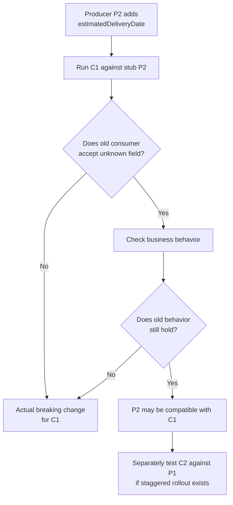
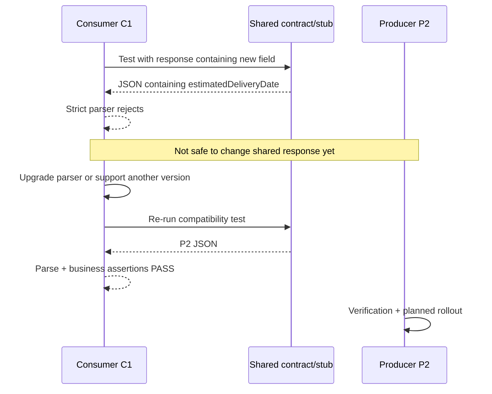
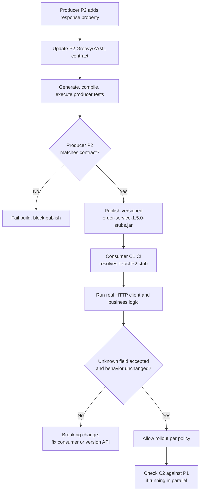

# Adding a Response Field and the Consumer's Actual Strictness

## 1. Is "Just Adding a Field" Always Backward-Compatible?

When evolving an API, a producer often needs to expand a JSON response to provide additional data. For example, `order-service` returns order details and the team wants to add `estimatedDeliveryDate`. At first glance, this is an **additive** change: no old fields are deleted, the HTTP status is unchanged, and the endpoint path is untouched.

However, **compatibility is determined not only by the shape of the new response**, but also by **the actual assumptions and behavior of each consumer**. A consumer that reads only the fields it needs and ignores unknown fields may continue working normally. A consumer that checks that the JSON has **exactly three keys**, uses a strict parser, or hashes/signs the entire payload byte-for-byte can break the moment a fourth key appears.

In the **Spring Cloud Contract** module, we use the **Groovy/YAML DSL** to describe producer–consumer interfaces, generate **producer contract tests**, package **stubs**, verify consumers via **Stub Runner**, and integrate CI to catch incompatible API changes. This lesson belongs to the **Versioning and Compatibility** chapter and focuses on the question:

> **When adding a response field, what exact constraints bind existing consumers, and how do we test so that a "seemingly safe" change is not blindly assumed to be compatible?**

After this lesson, you will be able to:

1. Distinguish **structural compatibility** from **behavioral compatibility** when a response gains a field.
2. Recognize how strict/lenient deserialization, JSON Schema, and assertions change a consumer's actual strictness.
3. Write Groovy/YAML contracts for responses before and after expansion.
4. Use the **new version** stub to test **old consumer code** with a real client; avoid "false green" tests.
5. Separate requirements from **old consumers** and expectations of **new consumers** that need the added field.
6. Design a compatibility matrix and CI gate before changing an API or publishing a new artifact.

## 2. Running Example: `GET /api/orders/42`

Producer version `1.4.0` returns:

```http
GET /api/orders/42
Accept: application/json

HTTP/1.1 200 OK
Content-Type: application/json
```

```json
{
  "id": 42,
  "state": "PAID",
  "currency": "VND"
}
```

The old `checkout-service` consumer only needs:

- `id` to correlate the order;
- `state` to decide whether a receipt can be issued yet;
- `currency` to display the currency unit.

Producer `1.5.0` wants to add the estimated delivery date:

```json
{
  "id": 42,
  "state": "PAID",
  "currency": "VND",
  "estimatedDeliveryDate": "2026-12-01"
}
```

This is a change that **adds a property to a JSON response object**. It is *potentially* compatible with old consumers, but that alone is not enough evidence to claim all consumers are safe.

### 2.1. Do Not Confuse "Adding a Field" with Other Changes

| Change | Preliminary Classification | Common Risks |
|---|---|---|
| Add string `estimatedDeliveryDate` | Additive property | Strict parser/assertion rejects unknown key |
| Change `id` from number to string | Change type of existing field | DTO, validation, numeric comparisons may fail |
| Change `state` from `PAID` to `SETTLED` | Change existing value/semantics | Consumer enum mapping/business branch misbehaves |
| Rename `currency` to `currencyCode` | Rename and remove old field | Consumer no longer receives required data |
| Change response from object to array | Change root structure | Deserializer/DTO is no longer compatible |
| Add element to array | Change cardinality | Consumer uses index, assumes fixed count |
| Add field while removing old field | Not purely additive | Old consumers may break |
| Add field containing sensitive data | Structurally additive | May violate security/privacy even if client parses it |

**Preliminary conclusion:** only cases that add a property while **all existing promises and data remain intact** can be considered as candidates for a compatible change. Even then, consumers may constrain the JSON shape more tightly than expected.

## 3. Compatibility Is a Relationship Between Two Specific Versions

Let us distinguish:

- **Producer P1**: returns three fields `id`, `state`, `currency`.
- **Producer P2**: returns those three fields **plus** `estimatedDeliveryDate`.
- **Consumer C1-lenient**: reads only the three old fields, ignores unknown fields.
- **Consumer C1-strict**: rejects responses containing undeclared fields.
- **Consumer C2-required**: updated to **require** `estimatedDeliveryDate` to have a value.

### 3.1. Compatibility Matrix to Run

| Consumer × Producer | P1: three fields | P2: added field | Reason |
|---|---|---|---|
| **C1-lenient** | Usually works | **May work** | Does not depend on new field, tolerates unknown properties |
| **C1-strict** | Works | **May fail** | Strict deserialization or exact-key assertion |
| **C2-required** | **May fail** | Works if field is valid | New consumer assumes producer always includes new field |
| **C2-optional/fallback** | May work | May work | Handles both missing and present field |

The matrix above is a **hypothesis to verify with tests**, not a universal truth table for every codebase. Beyond the parser, outcomes also depend on business logic, schema validation, caching, transforms, metrics, and side effects performed by the consumer.

In particular, both directions must be tested **separately**:

1. **New Producer → Old Consumer:** can the old consumer tolerate the extra field?
2. **Old Producer → New Consumer:** can the new consumer tolerate the field not yet appearing?

You cannot infer the second direction from the first. A new field may be **optional to an old consumer** yet treated as **required** data by a newer consumer version.



## 4. What Does "Actual Strictness" Mean?

A consumer can be constrained at **more layers than just the DTO**:

| Consumer Layer | Example Constraint | When Producer Adds a Property |
|---|---|---|
| JSON decoder | Disallows unknown fields | Deserialization fails |
| DTO/mapping | Extracts only `id/state/currency`, drops extras | Usually still parses |
| JSON Schema | `additionalProperties: false` | Validation fails |
| Assertion | JSON must match exact old structure | Tests/logic report failure |
| Business logic | Branches behavior on a specific field | May be unaffected if old fields stay intact |
| Data forwarding | Consumer re-serializes raw payload | Extra field may leak downstream |
| Signing/hashing | Hashes raw JSON bytes | Hash/signature changes |
| Caching and size | Response or field length limits | May exceed limits |
| Observability/security | Logs/displays every key | May expose sensitive data |

Therefore, the statement **"the consumer only needs three fields"** must rest on **actual code and behavioral testing**, not on an informal remark like "the checkout team doesn't use the delivery date."

### 4.1. Minimum Constraints Should Be Stated Explicitly

For `checkout-service`, a relatively durable set of commitments is:

```text
GET /api/orders/42 returns HTTP 200 and a JSON object.
id       is present and is a JSON number, equal to 42.
state    is present and is a JSON string, equal to "PAID".
currency is present and is a JSON string, equal to "VND".
Other properties must not alter the meaning of these three fields.
The consumer ignores properties it does not use.
```

That set of commitments **does not require the JSON to have only three keys**. It is a way to reduce coupling to details with no business value to this consumer.

However, if the consumer belongs to a category **requiring a closed schema**—for example, a legal compliance system, a payload-signing serializer, or a protocol requiring exact fields—the strict constraint may be **intentional**. In that case, record it as a real dependency rather than "tweaking the test to green" and calling the change compatible.

## 5. Groovy DSL for Responses Before and After Adding a Field

### 5.1. Producer P1 Contract

```groovy
import org.springframework.cloud.contract.spec.Contract

Contract.make {
    description 'Read order with basic fields'

    request {
        method GET()
        url '/api/orders/42'
        headers {
            header 'Accept', 'application/json'
        }
    }

    response {
        status OK()
        headers {
            contentType(applicationJson())
        }
        body(
            id: 42,
            state: 'PAID',
            currency: 'VND'
        )
    }
}
```

### 5.2. Producer P2 Contract

```groovy
import org.springframework.cloud.contract.spec.Contract

Contract.make {
    description 'Order with added estimated delivery date'

    request {
        method GET()
        url '/api/orders/42'
        headers {
            header 'Accept', 'application/json'
        }
    }

    response {
        status OK()
        headers {
            contentType(applicationJson())
        }
        body(
            id: 42,
            state: 'PAID',
            currency: 'VND',
            estimatedDeliveryDate: '2026-12-01'
        )
    }
}
```

These two snippets represent **two versions of the same scenario**; you should not place both P1 and P2 with identical request criteria but different responses into the same set of WireMock mappings. If you do, both mappings can match `GET /api/orders/42`, leaving consumer tests dependent on unintended priority/ordering.

**Producer contract verification:** P2 must actually return the three old fields with the right types/values plus `estimatedDeliveryDate`. Generated tests must run against **P2 code**, not merely generate stubs. Green producer tests prove part of P2's correctness, **not yet that all old consumers accept P2**.

### 5.3. YAML DSL for P2

```yaml
description: Order with added estimated delivery date
request:
  method: GET
  url: /api/orders/42
  headers:
    Accept: application/json
response:
  status: 200
  headers:
    Content-Type: application/json
  body:
    id: 42
    state: PAID
    currency: VND
    estimatedDeliveryDate: "2026-12-01"
```

Here `id` is a number; `state`, `currency`, and `estimatedDeliveryDate` are strings. Quoting the date avoids different YAML parsers inferring scalars differently across rules/versions. This is an **equivalent representation** to Groovy P2; pick only one DSL in your actual contract source to avoid duplicate mappings.

### 5.4. Contract Constraints That Should Not Be Dropped

For P2, keep explicit:

- HTTP `200` and `Content-Type: application/json`.
- `id`, `state`, `currency` with their old types and semantics.
- `estimatedDeliveryDate` with the agreed name, type, and formatting rules.
- Error behaviors `400`/`404`/`409` if consumers rely on them.
- Response branches keyed on request headers/query parameters without overly broad mappings.

**Do not alter or delete an old field just because a newer consumer version doesn't need it** if legacy consumers still depend on it.

## 6. Do Not Confuse the Producer Contract with Consumer Strictness

The P2 contract declares **an example response with four fields**. The verifier can generate assertions from the response body and matchers. However:

1. **Producer generated test** verifies P2 producer output against the P2 contract.
2. **WireMock stub** returns the sample response to the consumer client.
3. **Consumer test** executes the consumer's parser/client/business code against that stub.

These are **three distinct checks**. Passing the P2 producer test does not guarantee consumer C1 ignores unknown fields. Likewise, passing a consumer test against stub P1 **says nothing** about tolerating the fourth field in P2.

### 6.1. Does "Checking a Few JSONPaths" Mean Adding Fields Is Allowed?

You cannot deduce that mechanically. For example, a test that only asserts:

```java
assertThat(json.at("/id").asLong()).isEqualTo(42L);
assertThat(json.at("/state").asText()).isEqualTo("PAID");
assertThat(json.at("/currency").asText()).isEqualTo("VND");
```

does not check the full key set. However, **the consumer's real execution path** might include another DTO deserializer or validator that rejects unknown properties.

The snippet above is **illustrative code only** (assuming `json` is a Jackson `JsonNode`). Even if JSONPath or loose assertions allow extra fields, **that does not guarantee the production client does**.

### 6.2. Be Careful When Adding `bodyMatchers`

Spring Cloud Contract supports response-side matchers such as regex, type, and JSONPath depending on DSL/version—for example, to describe dynamic data instead of locking onto a random ID. However:

- Matchers **do not automatically define** the consumer's unknown-field policy.
- Fields in the contract response body may still generate different assertions in the generated producer test, depending on generator and config.
- When changing matchers, read the **actual generated test** to know what strictness is applied.
- A `.*` matcher on `state` could let the producer return `FAILED` instead of `PAID` and still pass, erasing business meaning.

For this topic, the most accurate check is running the **real consumer client against stub P2**, rather than inferring compatibility purely from Groovy/YAML matcher syntax.

## 7. Jackson: Does the Consumer Ignore Unknown Fields or Throw an Error?

Suppose a Java application uses Jackson to deserialize JSON into a DTO:

```java
package com.example.checkout.dto;

public record OrderView(
    long id,
    String state,
    String currency
) {}
```

When P2 JSON includes `estimatedDeliveryDate` while the DTO declares only three properties, behavior depends on **how the ObjectMapper is configured**.

### 7.1. Deliberately Testing Strict Mode

```java
import com.fasterxml.jackson.databind.DeserializationFeature;
import com.fasterxml.jackson.databind.ObjectMapper;
import com.fasterxml.jackson.databind.exc.UnrecognizedPropertyException;
import org.junit.jupiter.api.Test;

import static org.assertj.core.api.Assertions.assertThatThrownBy;

class StrictOrderViewTest {

    private final ObjectMapper strictMapper = new ObjectMapper()
        .configure(DeserializationFeature.FAIL_ON_UNKNOWN_PROPERTIES, true);

    @Test
    void shouldRejectAddedFieldInStrictMode() {
        String json = """
            {
              "id": 42,
              "state": "PAID",
              "currency": "VND",
              "estimatedDeliveryDate": "2026-12-01"
            }
            """;

        assertThatThrownBy(() ->
            strictMapper.readValue(json, OrderView.class))
            .isInstanceOf(UnrecognizedPropertyException.class);
    }
}
```

This test **deliberately enables strict mode**. Do not assume Spring Boot always enables that option: many default Spring Boot configurations **do not fail on unknown JSON properties**, whereas a manually instantiated `ObjectMapper` or another stack may have a different policy. Always inspect the **actual mapper/decoder instance used by the consumer's WebClient, RestClient, or HTTP library**.

### 7.2. Consumer Explicitly Wants to Allow Extra Fields

Jackson provides an annotation:

```java
import com.fasterxml.jackson.annotation.JsonIgnoreProperties;

@JsonIgnoreProperties(ignoreUnknown = true)
public record OrderView(
    long id,
    String state,
    String currency
) {}
```

With this DTO, a standard Jackson mapper can ignore `estimatedDeliveryDate` and still construct `OrderView(42, "PAID", "VND")`. This is a **contractual decision on the consumer side**: the consumer depends only on three properties and allows the producer to add others without altering their meaning.

Another option is configuring the ObjectMapper itself:

```java
ObjectMapper mapper = new ObjectMapper()
    .configure(DeserializationFeature.FAIL_ON_UNKNOWN_PROPERTIES, false);
```

Do not change the **global ObjectMapper** of an entire application just to fix one test if other APIs have different strictness requirements. Scope the policy appropriately, considering the impact on endpoints that require strict validation.

### 7.3. Direct Lenient Test Against P2 Payload

```java
import com.fasterxml.jackson.databind.ObjectMapper;
import org.junit.jupiter.api.Test;

import static org.assertj.core.api.Assertions.assertThat;

class LenientOrderViewTest {

    private final ObjectMapper mapper = new ObjectMapper();

    @Test
    void oldDtoCanIgnoreTheNewField() throws Exception {
        String json = """
            {
              "id": 42,
              "state": "PAID",
              "currency": "VND",
              "estimatedDeliveryDate": "2026-12-01"
            }
            """;

        OrderView order = mapper.readValue(json, OrderView.class);
        assertThat(order.id()).isEqualTo(42L);
        assertThat(order.state()).isEqualTo("PAID");
        assertThat(order.currency()).isEqualTo("VND");
    }
}
```

This example assumes `OrderView` already has `@JsonIgnoreProperties(ignoreUnknown = true)` as in section 7.2. If you **simultaneously use an unannotated record class and a strict ObjectMapper**, this test must fail: that is a policy difference to understand, not flakiness.

**Important:** this is still a **deserializer unit test**; it has not tested the real HTTP path, timeouts, headers, error decoders, or checkout logic. A complete consumer contract test must use the **production HTTP client** against stub P2.

## 8. JSON Schema Can Constrain More Tightly Than a DTO

Even when a client's Jackson mapper ignores unknown fields, a separate validation layer can still reject the new response.

For instance, the following JSON Schema describes the three old fields and **disallows properties outside the list**:

```json
{
  "type": "object",
  "required": ["id", "state", "currency"],
  "properties": {
    "id": {"type": "integer"},
    "state": {"type": "string"},
    "currency": {"type": "string"}
  },
  "additionalProperties": false
}
```

Under this schema:

- P1 JSON with exactly three properties passes.
- P2 JSON adding `estimatedDeliveryDate` **fails** because it violates `additionalProperties: false`.

If the consumer accepts extensibility, an open schema can **omit `additionalProperties` or set a policy allowing extra properties**, depending on the dialect and validation setup. Never silently relax the policy if the consumer has a legitimate reason to reject unknown fields.

### 8.1. An OpenAPI Document Is Not the Runtime Parser

An OpenAPI document may describe a response schema, yet at runtime the consumer might:

- Generate a client from the schema with different unknown-field handling.
- Deserialize using Jackson with its own configuration.
- Run an actual JSON Schema validator before processing the DTO.
- Use the schema solely to generate documentation without runtime validation.

**Do not conclude whether a consumer rejects or accepts a change from a spec file alone.** Observe the **actually built and deployed client**, along with any validators/interceptors on the path.

### 8.2. A Closed Response Contract Can Be Intentional

In some APIs, an unexpected property can signal a wrong version, leaked data, or protocol violation. When a consumer requires an exact schema, adding a field can be a **breaking change under that consumer's contract**.

In such cases, the solution is not always to "relax validation"; it may require:

1. Updating the consumer to allow unknown fields after a risk review.
2. Having the producer support the old format/version in parallel.
3. Explicit API versioning or media-type negotiation.
4. Coordinated rollout, not changing the response for an unready consumer.

## 9. Exact JSON Equality vs. Field-Level Assertions

Look at two ways to assert a JSON response:

### 9.1. Exact Shape Checking

An example check with JSONAssert:

```java
import org.skyscreamer.jsonassert.JSONAssert;
import org.skyscreamer.jsonassert.JSONCompareMode;

String expected = """
    {"id":42,"state":"PAID","currency":"VND"}
    """;

String actual = """
    {"id":42,"state":"PAID","currency":"VND",
     "estimatedDeliveryDate":"2026-12-01"}
    """;

// In a real test: JSONAssert.assertEquals(expected, actual, STRICT)
// will fail because actual contains a field not present in expected.
JSONAssert.assertEquals(expected, actual, JSONCompareMode.STRICT);
```

This snippet **illustrates an intentionally failing assertion**, not a complete test meant to pass. `STRICT` mode strictly verifies structure/key set as well as array order per library rules; it is appropriate when that exact shape is genuinely the committed interface.

### 9.2. Checking the Subset Used by the Consumer

When the consumer's contract depends only on three properties:

```java
import com.fasterxml.jackson.databind.JsonNode;
import com.fasterxml.jackson.databind.ObjectMapper;

JsonNode actual = new ObjectMapper().readTree("""
    {"id":42,"state":"PAID","currency":"VND",
     "estimatedDeliveryDate":"2026-12-01"}
    """);

assertThat(actual.path("id").asLong()).isEqualTo(42L);
assertThat(actual.path("state").asText()).isEqualTo("PAID");
assertThat(actual.path("currency").asText()).isEqualTo("VND");
```

This style of assertion **does not reject extra fields**. However, it also **does not guarantee** that the real HTTP client or business consumer accepts the field; testing at the actual client boundary is still required.

### 9.3. Do Not Relax Everything Just to Accept One New Field

Allowing unknown JSON fields does not mean:

- Accepting `state=FAILED` instead of `PAID` in a successful payment scenario.
- Accepting `id="42"` if the consumer expects a JSON number.
- Accepting `currency=null` if logic cannot handle null.
- Accepting HTTP `404` when the contract expects `200`.
- Ignoring missing/reordered array elements when the consumer relies on them.

**Design rule:** relax constraints only on what the consumer **genuinely does not depend on**; keep strong assertions on business-meaningful data.

## 10. When the New Field Can Be Absent or `null`

Adding a property is not binary ("present" vs. "absent"). For `estimatedDeliveryDate`, the producer might return:

| Situation | JSON | Possible Meaning |
|---|---|---|
| Date not yet known | No `estimatedDeliveryDate` | Optional/absent field |
| Date not yet known | `"estimatedDeliveryDate": null` | Key present with null value |
| Date known | `"estimatedDeliveryDate": "2026-12-01"` | ISO date string |
| Format bug | `"estimatedDeliveryDate": 20261201` | Number type instead of string |
| Semantic bug | `"estimatedDeliveryDate": ""` | Empty string; may be invalid |

**Missing, `null`, and empty string are not automatically equivalent.** A consumer may:

- Use `Optional<LocalDate>` or a nullable field.
- Require an ISO-8601 date and reject empty strings.
- Distinguish "no estimate" from "estimate cleared".
- Cache a DTO with a default value when the field is absent.

### 10.1. New Consumers Need Clear Fallbacks

If C2 wants to display the delivery date, yet may encounter producer P1 during rollout, design the logic carefully:

```java
public record OrderViewV2(
    long id,
    String state,
    String currency,
    String estimatedDeliveryDate
) {
    public String deliveryLabel() {
        return estimatedDeliveryDate == null
            || estimatedDeliveryDate.isBlank()
            ? "No estimated delivery date yet"
            : estimatedDeliveryDate;
    }
}
```

This example assumes Jackson represents an absent field as `null` in the record and business rules permit a fallback. In production systems, validate **date format** and timezone/calendar policies rather than using an arbitrary string.

If C2's requirement **strictly mandates a delivery date**, a fallback cannot arbitrarily hide the absence; you must ensure **producer P2 is deployed before C2** on every route C2 can call, or use explicit version negotiation.

### 10.2. Compatibility Must Also Check Legacy Records

Even after P2 deploys, not every order may have an `estimatedDeliveryDate`. The API must specify:

- Is the field required in **every** response?
- For legacy data, is the field **omitted** or returned as `null`?
- For `CANCELLED` orders, does it still make sense?
- How is the date value normalized?

Producer contract tests should have **at least one scenario with the new field**, and if the API promises optionality, an additional scenario where it is **absent** or **null** per policy. Consumer C2 must test both; testing only order `42` with a date present is insufficient.

## 11. Testing the Real Consumer with P2 Stub Runner

Once the producer publishes the P2 stub with classifier `stubs`, the old consumer should run its **actual source code/client** against the **new stub artifact**.

Example:

```text
P1 artifact: com.example:order-service:1.4.0:stubs
P2 artifact: com.example:order-service:1.5.0:stubs

Deployed consumer C1: checkout-service 2.3.0

Test goal:
  Run C1 client/code against P2 stub 1.5.0,
  receive response containing estimatedDeliveryDate,
  verify C1 still processes order 42 properly.
```

### 11.1. A Java Consumer HTTP Client

Example using Spring `RestClient` (Spring Framework 6.1+):

```java
package com.example.checkout.client;

import java.net.URI;
import org.springframework.web.client.RestClient;

public final class OrderClient {
    private final RestClient http;

    public OrderClient(RestClient.Builder builder, URI baseUrl) {
        this.http = builder.baseUrl(baseUrl.toString()).build();
    }

    public OrderView findById(long id) {
        return http.get()
            .uri("/api/orders/{id}", id)
            .retrieve()
            .body(OrderView.class);
    }
}
```

In this example, `OrderView` is the old DTO annotated with `@JsonIgnoreProperties(ignoreUnknown = true)` from section 7.2. The test must use the **exact HTTP client code used by real checkout-service**; instantiating a different `RestClient` with different converters/configuration may produce results that do not reflect production.

### 11.2. Consumer Contract Test Using the New Version Stub Runner

```java
package com.example.checkout.contract;

import com.example.checkout.client.OrderClient;
import com.example.checkout.dto.OrderView;
import java.net.URI;
import org.junit.jupiter.api.Test;
import org.springframework.beans.factory.annotation.Autowired;
import org.springframework.boot.test.context.SpringBootTest;
import org.springframework.cloud.contract.stubrunner.StubRunnerProperties;
import org.springframework.cloud.contract.stubrunner.spring.AutoConfigureStubRunner;
import org.springframework.cloud.contract.stubrunner.spring.StubRunnerPort;
import org.springframework.web.client.RestClient;

import static org.assertj.core.api.Assertions.assertThat;

@SpringBootTest
@AutoConfigureStubRunner(
    ids = "com.example:order-service:1.5.0:stubs",
    stubsMode = StubRunnerProperties.StubsMode.LOCAL
)
class ExistingConsumerAgainstNewProducerStubTest {

    @Autowired
    RestClient.Builder restClientBuilder;

    @StubRunnerPort("com.example:order-service")
    int orderStubPort;

    @Test
    void oldConsumerMustTolerateAnExtraResponseProperty() {
        OrderClient client = new OrderClient(
            restClientBuilder,
            URI.create("http://localhost:" + orderStubPort)
        );

        OrderView order = client.findById(42L);
        assertThat(order.id()).isEqualTo(42L);
        assertThat(order.state()).isEqualTo("PAID");
        assertThat(order.currency()).isEqualTo("VND");

        // Add assertions on the actual checkout/receipt decision
        // if the consumer depends on those business behaviors.
    }
}
```

**Limitations of this snippet:**

- The test assumes the producer has **installed** stub `1.5.0` into the Maven local repository; CI fetching remote artifacts needs `REMOTE`, `repositoryRoot`, and appropriate credentials per version/setup.
- `OrderClient` and `OrderView` belong to the consumer project, not Spring Cloud Contract. The Spring Boot test needs a compatibly configured `RestClient.Builder` bean.
- The port is the **Stub Runner runtime port**, not the production producer port. If the consumer has an HTTP client bean initialized at Spring context startup, pass the base URL into configuration **before the bean is created**, rather than mutating it afterward.
- To be sure this is testing the **new field**, verify that stub `1.5.0` actually returns `estimatedDeliveryDate`; accidentally resolving `1.4.0` could let the test pass without checking what you intended to check.
- If the consumer app uses **WebClient/reactive**, subscribe and await publisher completion (e.g., via `StepVerifier`); simply constructing a `Mono` does not execute the HTTP call.

### 11.3. Consumer Business Behavior Must Also Be Asserted

A test verifying only that Jackson parses the DTO is insufficient if the consumer:

- Uses `state=PAID` to enable receipt issuance.
- Calls a shipping system when an estimated delivery date is present.
- Forwards the JSON to a downstream system.
- Logs the entire response or re-serializes the DTO.

Therefore, a realistic contract test should invoke the **consumer's integration boundary** to verify the relevant business decision. For example, after reading a P2 order, the rule "PAID orders can issue a receipt" must still hold despite the new field.

## 12. Test P1 and P2 Bidirectionally to Avoid False Confidence

### 12.1. Old C1 Receiving New P2

Purpose: detect whether the additive change breaks the old consumer.

```text
Consumer code : checkout-service C1 (currently running)
Stub artifact : order-service P2 (about to be released)
Expected      : C1 still reads id/state/currency
               and completes old checkout behavior.
```

This is a **mandatory check** before calling the change compatible with C1.

### 12.2. New C2 Receiving Old P1

Purpose: check whether the new consumer tolerates the field not yet appearing during staggered deployment.

```text
Consumer code : checkout-service C2 (preparing to deploy)
Stub artifact : order-service P1 (may still exist)
Expected      : C2 does not throw NPE/deserialization error;
               uses fallback if API and business rules allow.
```

If C2 strictly requires `estimatedDeliveryDate` with no fallback, the two versions are **incompatible in this direction**. Ensure all C2 traffic routes to P2, hold C2 until after the producer rollout, or use versioned contracts.

### 12.3. Do Not Assume Strict C1 Is "Wrong"

If strict C1 was built against a published closed contract, then P2 adding a field is a breaking change **for existing C1**. You may propose upgrading C1 to ignore unknown fields, but consider the rollout safe **only after all supported C1 instances are updated or an old-response option is preserved**.

## 13. An "Added Field" Must Not Silently Alter Old Semantics

A change can preserve the old schema yet still alter how consumers make decisions.

Example before:

```json
{
  "id": 42,
  "state": "PAID",
  "currency": "VND"
}
```

After the change:

```json
{
  "id": 42,
  "state": "PAID",
  "currency": "VND",
  "paymentStatus": "REVERSED"
}
```

Structurally, this is still additive. Yet `state=PAID` alongside `paymentStatus=REVERSED` can create a **business contradiction** or cause C2 to misinterpret the order. If the producer silently changes the meaning of `state`, C1 ignoring `paymentStatus` and continuing to treat the order as `PAID` is a real risk.

Hence, check:

1. Is the meaning of old fields preserved?
2. Are values of the new field consistent with business invariants?
3. Do old consumers that ignore the new field still make the right decision?
4. Do other consumers re-serialize/forward the full payload or use signed JSON?
5. Do data governance and security permit exposing the new field?

**Compatibility does not mean merely deserializing successfully.** You must evaluate behavior, invariants, and downstream effects.

## 14. Rollout Strategies When Strict Consumers Exist

### 14.1. When All Old Consumers Allow Unknown Fields

A relatively straightforward rollout:

1. Producer defines the P2 response and generated contract tests.
2. Run regression/consumer tests of key consumers **against stub P2**.
3. Review schema, logs, data governance, and behavior.
4. Once all gates pass, publish/deploy P2.
5. Consumer C2 can deploy afterward, preferably treating the new field as optional during transition.

### 14.2. When a Strict Consumer Exists

If C1 rejects unknown fields:



Options:

- **Consumer-first:** update C1 to tolerate unknown fields first, then have the producer add the field.
- **Parallel versions:** keep endpoint `/v1` returning the old schema and `/v2` returning the new schema.
- **Content negotiation:** use Accept/media type or an explicitly published and tested API version header.
- **Feature/tenant gating:** return the new field only to ready consumers if designed as a stable interface with tests for each branch.

Do not implement gating via ad-hoc user-agent sniffing if consumers have not agreed on a contract. Every version/header response branch must be clearly documented and verified.

### 14.3. Do Not Apply SemVer Rules Mechanically

By SemVer convention, adding a response field is commonly considered a minor release candidate when backward-compatible, yet **no version-numbering rule proves consumer compatibility by itself**. If strict C1 breaks, the change is still a breaking change for C1 even if the producer names it `1.5.0`.

If P1 can still run during deployment, consumer C2 needs fallback consideration. App versions, stub artifacts, and actual deployments should be linked so you know **which interface the tests ran against**.

## 15. Testing in CI with the Exact New Stub Version

A suitable pipeline for Spring Cloud Contract:



### 15.1. Why Not Test Against the Old Stub?

If consumer C1 tests against `order-service:1.4.0:stubs`, the response **does not yet contain the new field**. The test cannot detect strict C1 breaking under P2. Therefore:

- Consumer compatibility tests for the P2 change must use the **P2 stub artifact**, or supplementary fixtures containing that exact new field.
- Pin `group:artifact:version:classifier`, e.g., `com.example:order-service:1.5.0:stubs`.
- Log the **resolved version**, since `+` or SNAPSHOT coordinates do not guarantee every CI run uses the same artifact.
- Inspect the mapping/body inside the JAR to ensure it actually contains `estimatedDeliveryDate`, rather than trusting the version string alone.
- If P2 is not yet published, you can use stubs from a candidate build/CI artifact with clear provenance and switch to the final versioned artifact once verification passes.

### 15.2. Required Evidence on Both Producer and Consumer Sides

| Gate | What Must Be Proven | Pitfall to Avoid |
|---|---|---|
| Producer contract verification | P2 returns all three old fields plus the new field per contract | Only generating sources/stubs without running tests |
| Artifact packaging | Stub P2 contains the new WireMock mappings/body | Consumer accidentally resolving old artifact |
| Consumer C1 compatibility | Real C1 parser and logic handle P2 response | Running only a Jackson unit test with a mapper different from production |
| Consumer C2 rollout | C2 handles P1 response if still interacting with P1 | Assuming the new field is always present |
| Observability | Logs/reports record exact versions, test classes, and environment | Looking only at "BUILD SUCCESS" |

**Avoid false positives:** a consumer test asserting only `HTTP 200` or inspecting WireMock mappings directly does not prove the consumer parses JSON successfully. Tests must invoke the **real HTTP client** and verify output/business behavior.

## 16. When Consumer-Driven Contracts Do Not List the New Field

In **consumer-driven contract testing**, each consumer typically describes **only the parts of the interface it actually needs**. If C1 only uses `id` and `state`, C1's contract may mention only those fields, or constrain the schema under a policy allowing extra fields.

This differs from a **P2 producer contract** aiming to describe the entire new response. The two are not contradictory when organized clearly:

| Question | Producer-Focused Contract | Consumer-Focused Contract |
|---|---|---|
| Who defines it? | Producer and API team, with consumer review | Consumer states its dependencies, producer agrees |
| What does it protect? | Fields/statuses committed by the producer for the API version | Fields/behaviors actually used by the consumer |
| Must all fields be asserted? | Depends on scope/schema/contract version | Not necessarily; usually only what the consumer needs |
| Is adding a field compatible? | Depends on schema commitment and generated assertions | Depends on parser strictness and consumer logic |

**Do not confuse "the contract only asserts three fields" with "the consumer definitely ignores a fourth field."** Consumer tests must run the P2 payload through the real pipeline to verify that.

### 16.1. Reviewing Real Consumer Requirements

When discussing the change with consumer teams, ask:

1. Does the client use Java DTOs, TypeScript interfaces, schema validators, Protobuf/Avro, JSONPath, or raw JSON?
2. Are unknown properties ignored, rejected, or forwarded?
3. Are exact key sets, byte payloads, or raw JSON strings checked anywhere?
4. Does logic depend on old field semantics and output mappings?
5. Are there unmaintained legacy consumers still running in production?
6. Can the producer and consumers deploy at different times?
7. Is there an endpoint or version negotiation mechanism to preserve the old response if needed?

Do not rely solely on SDK docs if runtime uses a customized configuration; **integration test evidence with the actual client matters more than speculation**.

## 17. Variants Easily Overlooked When Adding a Field

| Variant | Risk | Additional Test |
|---|---|---|
| New field inside a nested object | Validator on nested DTO is strict | Return nested object with extra field |
| New field on **each array element** | Element deserializer is strict | Single- and multi-element lists |
| New field containing `null` | Consumer dereferences without null check | Missing, null, and non-null |
| New field using ISO date | Inconsistent parsing/timezone | Valid dates, invalid formats, DST if timestamps |
| Very long new field | Payload/log/cache limits | Appropriate size boundary |
| Sensitive value in new field | Unintended logging/forwarding | Security/privacy review |
| New field colliding with alias/case-insensitive mapping | Overwrites field in mapper | Test exact key names/aliases under config |
| Entire response is signed/hashed | Byte changes alter signature | Test signature/canonicalization |
| Consumer forwards response downstream | New field crosses data boundary | Assert output/serialization after mapping |
| Schema has `additionalProperties: false` | Validation rejects | Test schema against P2 JSON |

If tests only cover a flat object, you may miss issues in nested arrays or proxies processing JSON. You do not need every random combination; pick scenarios matching **verified consumer dependencies**.

## 18. Practice Lab: A Newly Added Field Breaks an Old Consumer

**Context:** `order-service P2` adds `estimatedDeliveryDate` to the `GET /api/orders/42` response. `checkout-service C1` uses a DTO containing only `id/state/currency`. The producer team claims this is a non-breaking change; yet after rollout, a consumer reports deserialization errors.

### 18.1. Tasks

1. Write contract P1 with three fields and contract P2 adding `estimatedDeliveryDate`, keeping method/path/status/old fields intact.
2. Run producer verification for P2. Confirm generated tests **actually execute and pass**, not just generate test sources.
3. Package stub P2 as `com.example:order-service:1.5.0:stubs`; inspect the JAR to verify it contains the sample response with the new field.
4. Run consumer C1 against **stub P1** for a baseline. Record the passing result.
5. Keep C1 source unchanged, switch the consumer test to **stub P2**, and re-run using the real HTTP client.
6. If the test fails, inspect ObjectMapper strictness, schema validators, JSONAssert exact equality, and business logic.
7. Try strict Jackson configuration `FAIL_ON_UNKNOWN_PROPERTIES=true` with the old DTO; verify why the new field is rejected.
8. Try `@JsonIgnoreProperties(ignoreUnknown = true)` on the DTO if the consumer contract allows it; verify C1 reads all three fields and receipt behavior remains correct.
9. If C1 enforces `additionalProperties: false` for business reasons, discuss keeping the old API version instead of relaxing policy without review.
10. Create consumer C2 that uses the delivery date field; test C2 receiving P1 (field missing) and P2 (field present) per the designed fallback/rollout.
11. Add a scenario where P2 returns `null` or omits the field for legacy orders; evaluate the optionality policy.
12. Add the supported C1/P1, C1/P2, C2/P1, C2/P2 matrix to CI with clear artifact versions and test reports.

### 18.2. Intentional Experiments

| Test Change | Expectation |
|---|---|
| Add `estimatedDeliveryDate`, lenient C1 | Test with stub P2 passes if business rules unchanged |
| Add `estimatedDeliveryDate`, strict C1 | Test with stub P2 fails on unknown property/schema |
| Change `state=PAID` to `FAILED` | C1 business test must fail even with lenient parser |
| Change `id=42` number to string | Type check or appropriate mapping test must catch it |
| C2 requires new field when run against P1 | Fails or applies intentional fallback |
| C1 test mistakenly resolves stub P1 instead of P2 | Risk of false confidence; must verify resolved artifact |
| C1 uses exact JSON assertion | May fail even when only adding a field |
| C1 ignores all fields and asserts only status 200 | May falsely pass when response semantics break |

### 18.3. Self-Assessment Questions

| Question | Answer |
|---|---|
| Is adding a response property always non-breaking? | **No**; depends on consumer parser/schema/logic |
| Is an old consumer declaring only three fields guaranteed to parse four? | **No**; depends on actual strictness |
| Does P2 producer test passing prove C1 is compatible? | **No**; must test consumer C1 against P2 |
| Will testing C1 against stub P1 detect the new P2 field? | **No** |
| Can `additionalProperties: false` block a new field? | **Yes** |
| Does ignoring unknown fields permit changing `state` semantics? | **No** |
| Is C2 needing the new field guaranteed to work with P1? | **No**; requires optional/fallback handling or ordered rollout |
| Are `null` and a missing field automatically identical? | **No** |
| Does SemVer minor automatically guarantee compatibility? | **No** |
| Do passing Stub Runner consumer tests replace producer generated tests? | **No** |

## 19. Checklist Before Publishing a New Response Field

- [ ] Documented **old/new producer versions**, path, status, headers, and response schema changes.
- [ ] Confirmed the change strictly **adds** a property without removing or altering old field types or semantics.
- [ ] Documented type, format, null/missing values, and meaning of the new field.
- [ ] Identified deployed consumers and the actual parser/schema validator technologies they use.
- [ ] Checked strict/lenient deserialization and exact-key assertions in old consumers.
- [ ] Groovy/YAML contract P2 describes the new response; generated producer tests execute and pass.
- [ ] Stub P2 is built and published under the exact version/classifier, and its sample response actually contains the new field.
- [ ] Consumer C1 is tested against **stub P2**, not merely P1 or a stale manual fixture.
- [ ] Consumer tests use the real HTTP client and business behavior, not just asserting status 200.
- [ ] Consumer assertions remain strict on used fields such as `id`, `state`, and `currency`.
- [ ] If C2 can call P1, missing/optional field handling and fallback or version negotiation are tested.
- [ ] If C1 is strict, a plan exists to upgrade C1 first, retain the v1 response, or version the API.
- [ ] Evaluated nested fields, arrays, signed payloads, logging, response size, and sensitive data where applicable.
- [ ] CI pins artifact versions, records resolved versions, and cross-checks producer/consumer reports.
- [ ] Compatibility is not assumed solely from JSON Schema/OpenAPI, a minor version name, or a stub returning HTTP 200.
- [ ] A rollback plan and support for un-upgraded consumers exist during the transition window.

**Key Takeaway:** **Adding a response field is a *potentially* backward-compatible change, not a guarantee.** Actual strictness resides in the parser, schema, assertions, and business logic of **each running consumer**. Preserve old field commitments, use Spring Cloud Contract to verify the producer, publish versioned P2 stubs, and **run old consumer clients against that exact P2 stub** before concluding an API change is safe.
