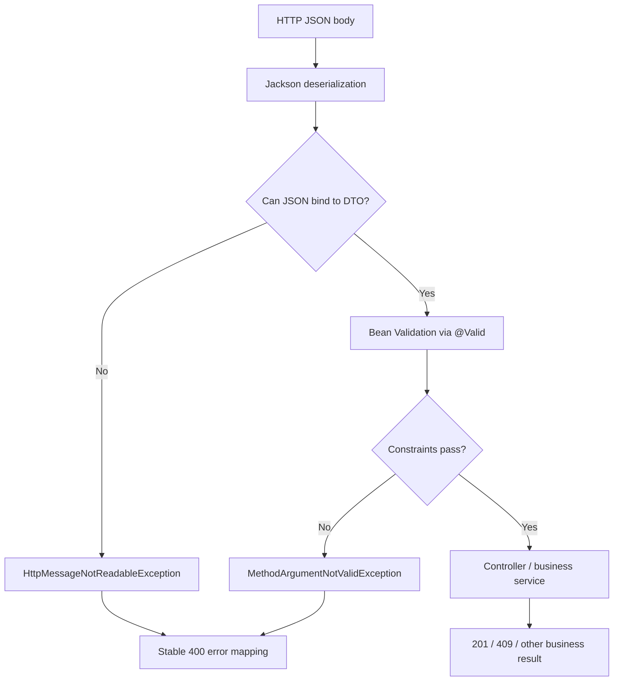
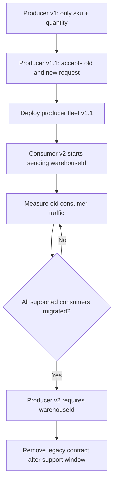
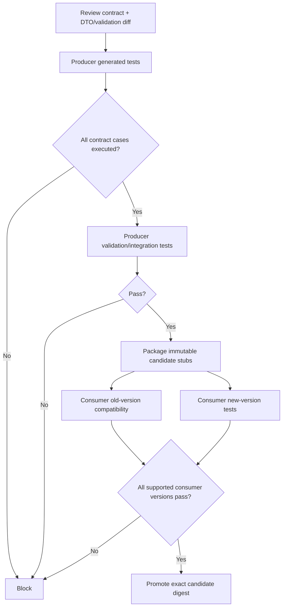

# Changing Required Fields, Null Values, and Validation Rules

An API can keep its HTTP method, URL, and status code identical and still **break compatibility** when it changes how a JSON field is handled. For example, `OrderService` previously sent `sku` and `quantity`; after an upgrade, `InventoryService` starts requiring `warehouseId`. Old consumers continue sending requests that were valid under the previous version, yet now receive `400 Bad Request`. Another seemingly smaller change: a producer previously returned `"deliveryNote": null`, then omits the field from JSON altogether. Consumers using required binding or distinguishing those two states may alter their behavior.

In **Spring Cloud Contract (SCC)**, these differences must be explicitly described in Groovy/YAML DSL and verified on both sides. Producer verification proves the implementation satisfies the contract; consumer Stub Runner tests verify the client against sample requests/responses. This lesson focuses on **field presence**, **nullability**, and **validation rules** during API evolution to catch incompatible changes before release.

This content belongs to the **Versioning and Compatibility** chapter of the **SPRING_CLOUD_CONTRACT** module. The module teaches contract testing between producers and consumers, defining HTTP or messaging behavior using Groovy/YAML DSL, generating provider-side tests, publishing stubs, using Stub Runner, and integrating CI to detect incompatible API changes.

After this lesson, you will be able to:

- Distinguish a **missing** field, a field with **JSON null**, an empty string, a whitespace-only string, and a valid value.
- Assess the impact of adding/removing required fields in requests and responses.
- Understand how Bean Validation and Jackson handle missing values, nulls, and type mismatches.
- Write separate contracts for valid, missing, null, and invalid values.
- Use Contract Verifier to catch unauthorized producer validation changes.
- Use Stub Runner to test how consumers handle null, absent fields, and legacy data.
- Build an **expand → migrate → contract** process to roll out changes without breaking old consumers.
- Construct a compatibility matrix across producer/consumer versions and enforce required cases in CI.

## 1. Running Scenario

`OrderService` sends a reservation request to `InventoryService`:

```http
POST /api/v1/reservations HTTP/1.1
Content-Type: application/json

{
  "sku": "SKU-001",
  "quantity": 2
}
```

The producer returns:

```http
HTTP/1.1 201 Created
Content-Type: application/json

{
  "reservationId": "RES-2001",
  "status": "HELD",
  "deliveryNote": null
}
```

Suppose the initial contract specifies:

| Field | Direction | Initial Rule |
| --- | --- | --- |
| `sku` | Request | Required, non-null, non-empty, max 32 characters |
| `quantity` | Request | Required, positive integer |
| `deliveryNote` | Request | Optional; may be missing or null; if present with content, max 120 characters |
| `reservationId` | Response | Always has a value, format `RES-[0-9]+` |
| `status` | Response | Required, e.g., `HELD` |
| `deliveryNote` | Response | Always present; may be JSON null if there is no note |

We will verify both requests and responses. Remember that **request validation belongs to the producer** because the producer receives requests; how the consumer serializes requests and deserializes responses is the consumer's responsibility.

## 2. Four States That Must Not Be Equated

JSON distinguishes between a property being absent and a property being present with a null value.

| JSON Data | State | Possible Meaning |
| --- | --- | --- |
| `{}` | Missing field | Client did not send the property |
| `{"deliveryNote": null}` | Present field, null value | Client sent the property with no value |
| `{"deliveryNote": ""}` | Empty string | Client sent a zero-length string |
| `{"deliveryNote": "   "}` | Whitespace-only string | Client sent a string with no useful content |
| `{"deliveryNote": "Deliver after 18:00"}` | Non-blank string | Client sent a value |

For a string field, `null` is not `""`. For a numeric field, `0` is not `null`. For an array, `[]` is neither `null` nor a missing field.

### Example: Optional Does Not Mean Accepting Every Value

`deliveryNote` is optional and nullable, yet the business rule specifies that if the user provides input, it must contain at least one non-whitespace character. Therefore:

| Input | Outcome Under Lab Policy |
| --- | --- |
| No `deliveryNote` | Accepted |
| `"deliveryNote": null` | Accepted |
| `"deliveryNote": ""` | Rejected `400` |
| `"deliveryNote": "   "` | Rejected `400` |
| `"deliveryNote": "Deliver after 18:00"` | Accepted |
| String longer than 120 characters | Rejected `400` |

If your API treats an empty string as representing "no note", document and test that policy explicitly. Never leave behavior accidentally dependent on how Jackson or a client serializer handles strings.

## 3. Requests and Responses Have Different Compatibility Directions

A change must be evaluated from the **perspective of sender and receiver**, not just by looking at the producer DTO.

### Request: The Producer Is the Receiver

Old consumers may not know about a new field. If the producer starts requiring that field, old requests are rejected.

| Change in Producer Request | Common Impact |
| --- | --- |
| Add optional field | Usually compatible with old consumers |
| Add required field | **Breaking** for consumers not sending the field |
| Optional → required | **Breaking** for old missing/null requests |
| Required → optional | Expands valid inputs; usually compatible, though business semantics may shift |
| Allow null → forbid null | Potentially breaking for consumers sending null |
| Allow empty → forbid empty | Potentially breaking for consumers sending empty strings |
| Increase max limit | Usually expands valid inputs |
| Decrease max limit | **Breaking** for consumers sending longer values |
| Expand allowed enum/values | Expands inputs; check business logic |
| Tighten allowed enum/values | Potentially breaking for consumers sending old values |

### Response: The Producer Is the Sender

Old consumers may depend on the shape and values returned by the producer.

| Change in Producer Response | Common Impact |
| --- | --- |
| Add new field | Usually additive for tolerant consumers; may break strict deserializers |
| Remove existing field | **Breaking** for consumers reading that field |
| Always-present value → nullable | **Breaking** for consumers assuming non-null |
| Null key present → omitted when null | Potentially breaking for consumers distinguishing null vs. absent |
| Rename field | **Breaking** |
| Change string → number/object | Usually **breaking** |
| Add enum value | May break strict consumer switches/enum deserializers |
| Reduce precision or change format | May change semantics even when field name stays unchanged |

"Adding a response field" is often called an additive change, yet it is compatible only if consumers accept unknown fields or configure their deserializers accordingly. Never assume every consumer is tolerant.

## 4. Validation Model in Spring

With Spring MVC, a JSON request typically passes through these steps:



Two important error classes:

- **Binding/deserialization error:** invalid JSON syntax, type conversion failure, or unreadable body. Spring typically throws `HttpMessageNotReadableException`.
- **Bean Validation error:** JSON binds to the DTO, yet violates `@NotNull`, `@NotBlank`, `@Positive`, `@Size`, etc. With `@Valid @RequestBody`, Spring MVC typically throws `MethodArgumentNotValidException`.

If you only handle `MethodArgumentNotValidException`, you can miss JSON type-mismatch errors. The API should provide stable error responses for both categories per organizational policy.

## 5. DTOs: Use Nullable Types to Detect Missing/Null Data

Create the request DTO:

```java
package com.example.inventory.dto;

import jakarta.validation.constraints.NotBlank;
import jakarta.validation.constraints.NotNull;
import jakarta.validation.constraints.Pattern;
import jakarta.validation.constraints.Positive;
import jakarta.validation.constraints.Size;

public record ReservationRequest(
    @NotBlank
    @Size(max = 32)
    String sku,

    @NotNull
    @Positive
    Integer quantity,

    @Size(max = 120)
    @Pattern(regexp = "(?s).*\\S.*")
    String deliveryNote
) {
}
```

Explanation:

- `sku` uses `@NotBlank` to reject null, empty, and whitespace-only values; `@Size` caps length.
- `quantity` uses `Integer` instead of primitive `int`. When JSON is missing/null, the wrapper represents `null` so `@NotNull` cleanly rejects it. `@Positive` rejects 0 and negative numbers.
- `deliveryNote` has neither `@NotNull` nor `@NotBlank`, so null/missing is accepted. `@Size` and `@Pattern` apply when the value is non-null; empty/whitespace-only strings fail the regex.

**Note:** Bean Validation constraints such as `@Pattern` and `@Size` typically treat `null` as valid; they do not replace `@NotNull`. Always verify the semantics of each constraint you use.

### Why Not Use Primitive `int`?

If you use:

```java
public record ReservationRequest(
    String sku,
    int quantity
) {}
```

a missing `quantity` property may bind to a default value `0` depending on configuration/binding paths. That makes it difficult to distinguish "quantity omitted" from "quantity=0 sent". Using `Integer` + `@NotNull` expresses missing/null states clearly.

### Can Missing and Explicit Null Be Distinguished?

With a standard record DTO, both:

```json
{"sku":"SKU-001","quantity":2}
```

and:

```json
{"sku":"SKU-001","quantity":2,"deliveryNote":null}
```

normally bind `deliveryNote` to `null`. If business rules must distinguish the two cases, a regular nullable DTO **cannot preserve presence information**. You need a dedicated presence representation, such as reading `JsonNode`/`JsonNullable<T>` or using a custom deserializer to check explicit property presence. Do not try to distinguish them with `@NotNull`, since it inspects only the post-binding value.

## 6. Response DTO and Null/Absent Commitments

In this lab, the response always includes `deliveryNote`. When there is no note, the JSON must contain an explicit null:

```java
package com.example.inventory.dto;

import com.fasterxml.jackson.annotation.JsonInclude;

@JsonInclude(JsonInclude.Include.ALWAYS)
public record ReservationResponse(
    String reservationId,
    String status,
    String deliveryNote
) {
}
```

`JsonInclude(ALWAYS)` makes intent explicit on this DTO even if the application has a global Jackson setting that strips null fields. If the API intends to **omit fields when null**, choose the `NON_NULL` policy and write contracts verifying the field is absent accordingly. Never let a global serializer accidentally dictate the API schema.

### Two Non-Equivalent Responses

Response A:

```json
{
  "reservationId": "RES-2001",
  "status": "HELD",
  "deliveryNote": null
}
```

Response B:

```json
{
  "reservationId": "RES-2001",
  "status": "HELD"
}
```

A consumer may:

- Use `containsKey("deliveryNote")` to check property presence.
- Bind the response to a DTO with `String deliveryNote` and receive `null` for both absent and explicit null.
- Use a JSON Schema requiring the property to be present while allowing type `string|null`.

Therefore, "the Java field is still null" does not prove the JSON wire format stayed the same. **Contracts must verify the actual serialized JSON shape.**

## 7. Controller and Stable Error Responses

Create the error DTO:

```java
package com.example.inventory.dto;

public record ValidationError(
    String code,
    String field
) {
}
```

Controller:

```java
package com.example.inventory;

import com.example.inventory.dto.ReservationRequest;
import com.example.inventory.dto.ReservationResponse;
import com.example.inventory.dto.ValidationError;
import jakarta.validation.Valid;
import org.springframework.http.HttpStatus;
import org.springframework.http.ResponseEntity;
import org.springframework.web.bind.annotation.*;

@RestController
@RequestMapping("/api/v1/reservations")
public class ReservationController {

    private final ReservationService service;

    public ReservationController(ReservationService service) {
        this.service = service;
    }

    @PostMapping
    public ResponseEntity<?> create(
            @Valid @RequestBody ReservationRequest request) {

        if ("SKU-EMPTY".equals(request.sku())) {
            return ResponseEntity.status(HttpStatus.CONFLICT)
                .body(new ValidationError(
                    "INSUFFICIENT_STOCK", "sku"));
        }

        ReservationResponse response = new ReservationResponse(
            "RES-2001",
            "HELD",
            request.deliveryNote()
        );
        return ResponseEntity.status(HttpStatus.CREATED).body(response);
    }
}
```

`RES-2001` is fixed so the lab can focus on field presence. A real producer must generate IDs per business rules, persist the reservation, and ensure proper concurrency/idempotency.

Exception handler:

```java
package com.example.inventory;

import com.example.inventory.dto.ValidationError;
import org.springframework.http.HttpStatus;
import org.springframework.http.ResponseEntity;
import org.springframework.http.converter.HttpMessageNotReadableException;
import org.springframework.web.bind.MethodArgumentNotValidException;
import org.springframework.web.bind.annotation.ExceptionHandler;
import org.springframework.web.bind.annotation.RestControllerAdvice;

@RestControllerAdvice
public class ApiValidationAdvice {

    @ExceptionHandler(MethodArgumentNotValidException.class)
    ResponseEntity<ValidationError> handleValidation(
            MethodArgumentNotValidException exception) {
        String field = exception.getBindingResult()
            .getFieldErrors()
            .stream()
            .map(error -> error.getField())
            .sorted()
            .findFirst()
            .orElse("request");

        return ResponseEntity.badRequest()
            .body(new ValidationError("INVALID_REQUEST", field));
    }

    @ExceptionHandler(HttpMessageNotReadableException.class)
    ResponseEntity<ValidationError> handleUnreadable(
            HttpMessageNotReadableException exception) {
        return ResponseEntity.status(HttpStatus.BAD_REQUEST)
            .body(new ValidationError("MALFORMED_REQUEST", "request"));
    }
}
```

In a real application, standardize field selection ordering, error codes, and response schemas per API policy. Never expose raw exception messages in public responses, as their wording can change across framework/Jackson versions and leak internal details.

### Distinguishing Validation from Business Rules

- `quantity=null` or `quantity<=0` is an input/validation error → `400` in the lab policy.
- `SKU-EMPTY` is validly formatted yet out of stock → `409` business conflict.
- Type-mismatched JSON such as `"quantity":"many"` may fail during Jackson binding before Bean Validation → `HttpMessageNotReadableException` handler.

Do not return the same error code for every situation if consumers require distinct handling.

## 8. Writing a Contract for a Missing Optional Field

Create contract `reservation-without-delivery-note.groovy`:

```groovy
import org.springframework.cloud.contract.spec.Contract

Contract.make {
    name 'reservation_without_delivery_note'

    request {
        method 'POST'
        url '/api/v1/reservations'
        headers {
            contentType(applicationJson())
        }
        body([
            sku: 'SKU-001',
            quantity: 2
        ])
    }

    response {
        status 201
        headers {
            contentType(applicationJson())
        }
        body([
            reservationId: 'RES-2001',
            status: 'HELD',
            deliveryNote: null
        ])
    }
}
```

In the request body, **there is no `deliveryNote` key**. The response still includes that key with value `null` per the chosen policy. The generated producer test sends the request without the field and asserts the response JSON.

## 9. Writing a Contract for an Explicit Null Optional Field

Create `reservation-with-null-delivery-note.groovy`:

```groovy
import org.springframework.cloud.contract.spec.Contract

Contract.make {
    name 'reservation_with_null_delivery_note'

    request {
        method 'POST'
        url '/api/v1/reservations'
        headers {
            contentType(applicationJson())
        }
        body([
            sku: 'SKU-001',
            quantity: 2,
            deliveryNote: null
        ])
    }

    response {
        status 201
        headers {
            contentType(applicationJson())
        }
        body([
            reservationId: 'RES-2001',
            status: 'HELD',
            deliveryNote: null
        ])
    }
}
```

This contract differs from the previous section: the request contains the `deliveryNote` key with a `null` value. Both are accepted, yet they are **two distinct wire-level cases**. Keep both contracts if the API commits to supporting both.

## 10. Writing a Contract for a Missing Required Field

Create `reservation-without-quantity.groovy`:

```groovy
import org.springframework.cloud.contract.spec.Contract

Contract.make {
    name 'reservation_without_quantity'

    request {
        method 'POST'
        url '/api/v1/reservations'
        headers {
            contentType(applicationJson())
        }
        body([
            sku: 'SKU-001'
        ])
    }

    response {
        status 400
        headers {
            contentType(applicationJson())
        }
        body([
            code: 'INVALID_REQUEST',
            field: 'quantity'
        ])
    }
}
```

The request omits `quantity`. Because the DTO uses `Integer`, binding yields `null`; `@NotNull` triggers a validation error. The generated producer test verifies both status and error response.

## 11. Writing a Contract for an Explicit Null Required Field

Create `reservation-null-quantity.groovy`:

```groovy
import org.springframework.cloud.contract.spec.Contract

Contract.make {
    name 'reservation_null_quantity'

    request {
        method 'POST'
        url '/api/v1/reservations'
        headers {
            contentType(applicationJson())
        }
        body([
            sku: 'SKU-001',
            quantity: null
        ])
    }

    response {
        status 400
        headers {
            contentType(applicationJson())
        }
        body([
            code: 'INVALID_REQUEST',
            field: 'quantity'
        ])
    }
}
```

Both missing and null requests are rejected, yet they remain two distinct cases. If policy only needs to verify both are invalid, a parameterized test in another test suite can cover that; however, separate contracts make producer verification and stub mappings explicitly represent each wire input.

## 12. Writing Contracts for Empty and Whitespace-Only Values

Create `reservation-empty-delivery-note.groovy`:

```groovy
import org.springframework.cloud.contract.spec.Contract

Contract.make {
    name 'reservation_empty_delivery_note'

    request {
        method 'POST'
        url '/api/v1/reservations'
        headers {
            contentType(applicationJson())
        }
        body([
            sku: 'SKU-001',
            quantity: 2,
            deliveryNote: ''
        ])
    }

    response {
        status 400
        headers {
            contentType(applicationJson())
        }
        body([
            code: 'INVALID_REQUEST',
            field: 'deliveryNote'
        ])
    }
}
```

Create a similar contract with `deliveryNote: '   '` to test whitespace-only input. `@Pattern(regexp = "(?s).*\\S.*")` on the DTO rejects both empty strings and whitespace-only strings, even with newlines; `@Size(max=120)` checks length. Never assume `@NotNull` or `@Size` alone will reject an empty string.

### Contract for a Valid Value with a Note

Create `reservation-with-delivery-note.groovy` with request:

```groovy
body([
    sku: 'SKU-001',
    quantity: 2,
    deliveryNote: 'Deliver after 18:00'
])
```

and response:

```groovy
body([
    reservationId: 'RES-2001',
    status: 'HELD',
    deliveryNote: 'Deliver after 18:00'
])
```

These are **body fragments** for illustration; place them inside `request`/`response` in a complete `Contract.make` as in the earlier contracts. The generated producer test verifies the producer preserves the received value rather than silently dropping the field.

## 13. Additional Cases to Consider

| Input | Question to Decide | Suggested Test |
| --- | --- | --- |
| Missing `sku` | Does it return `400` and specify the field? | Missing required field |
| `sku: null` | Same policy as missing? | Explicit null |
| `sku: ""` | Does `@NotBlank` reject it? | Empty string |
| `sku: "   "` | Is it trimmed before validation? | Whitespace-only |
| `sku` over 32 chars | Does it return a length error? | Max length + max+1 |
| `quantity` is 0 | Does it return a positive-number error? | Boundary value 0 |
| `quantity` is negative | Does it return an error? | Negative value |
| `quantity` is decimal | Does Jackson bind it to Integer? | Type mismatch |
| `quantity` is string `"2"` | What is the Jackson coercion policy? | Strict/lenient binding |
| `deliveryNote` over 120 | Does it return `400`? | Boundary max+1 |
| Unknown field `unexpected` | Ignore or reject? | Unknown-property policy |
| New enum value | Do old consumers handle it? | Forward compatibility |

You do not need contracts for every random string. Select boundary cases based on API semantics and compatibility risks.

## 14. Building a Contract Matrix for Field Presence

Before running generated tests, list the request/response cases that are genuinely part of the API:

| Scenario | Request Field | Expected Status | Response |
| --- | --- | ---: | --- |
| Success without note | `deliveryNote` absent | 201 | `deliveryNote: null` |
| Success explicit null | `deliveryNote: null` | 201 | `deliveryNote: null` |
| Success with note | Valid string | 201 | Preserves note content |
| Missing quantity | `quantity` absent | 400 | `INVALID_REQUEST/quantity` |
| Null quantity | `quantity: null` | 400 | `INVALID_REQUEST/quantity` |
| Zero quantity | `quantity: 0` | 400 | `INVALID_REQUEST/quantity` |
| Empty note | `deliveryNote: ""` | 400 | `INVALID_REQUEST/deliveryNote` |
| Blank sku | `sku: "   "` | 400 | `INVALID_REQUEST/sku` |
| Out-of-stock SKU | Valid value `SKU-EMPTY` | 409 | `INSUFFICIENT_STOCK` |

Each contract is an **independent scenario**. Do not use a broad contract matcher to merge missing/null/empty inputs if they carry different meanings.

### Contract Verifying a Null Field in the Response

The success-without-note contract requires this response:

```groovy
body([
    reservationId: 'RES-2001',
    status: 'HELD',
    deliveryNote: null
])
```

If the producer serializer drops the `deliveryNote` field, the generated test must catch the difference. This is how you test **wire representation**, not merely Java values inside a DTO.

## 15. Configuring Producer Tests and Running Contract Verifier

The producer needs:

- `spring-boot-starter-web`
- `spring-boot-starter-validation`
- `spring-cloud-starter-contract-verifier` in test scope
- `spring-boot-starter-test`
- `spring-cloud-contract-maven-plugin` at a compatible version

Dependencies snippet:

```xml
<dependency>
    <groupId>org.springframework.boot</groupId>
    <artifactId>spring-boot-starter-validation</artifactId>
</dependency>

<dependency>
    <groupId>org.springframework.cloud</groupId>
    <artifactId>spring-cloud-starter-contract-verifier</artifactId>
    <scope>test</scope>
</dependency>
```

The Maven plugin can use JUnit 5 and a MockMvc base class:

```xml
<plugin>
    <groupId>org.springframework.cloud</groupId>
    <artifactId>spring-cloud-contract-maven-plugin</artifactId>
    <version>${spring-cloud-contract.version}</version>
    <extensions>true</extensions>
    <configuration>
        <testFramework>JUNIT5</testFramework>
        <testMode>MOCKMVC</testMode>
        <baseClassForTests>
            com.example.inventory.ContractVerifierBase
        </baseClassForTests>
        <contractsDirectory>
            ${project.basedir}/src/test/resources/contracts
        </contractsDirectory>
    </configuration>
</plugin>
```

This is a POM fragment; manage Spring Boot/Spring Cloud BOMs and JUnit/RestAssured dependencies per your actual versions. `ContractVerifierBase` must initialize `RestAssuredMockMvc` with the Spring `WebApplicationContext` according to your project's setup.

Run:

```bash
mvn -B -ntp clean verify
```

### Evidence to Inspect

1. The plugin discovers all contract files in the source directory.
2. Generated tests are created for success, null, missing, and invalid cases.
3. Tests compile with the base class and validation dependencies.
4. Tests actually execute against the controller/application context.
5. The producer returns the expected status and body for each input.
6. Test reports from that exact build show an executed count greater than 0 with no failures.

Do not treat `BUILD SUCCESS` as the sole evidence. If the contract directory is empty or tests are skipped, the pipeline can turn green without verifying field compatibility.

### Negative Control

Temporarily change the DTO:

```java
@NotNull
@Positive
Integer quantity
```

to a primitive:

```java
int quantity
```

Then run producer tests with the missing/null quantity contracts. Depending on Jackson creator/binding configuration, missing/null may be handled differently (e.g., default value or deserialization failure); what matters is that **the producer must continue meeting its committed status/error body**. If behavior changes, the test must fail. Restore the wrapper type after the experiment.

## 16. Consumer DTOs and Serializers Are Also Part of the Contract

Producer tests verify requests sent to the producer by generated tests. In the real consumer, however, `OrderService`'s serializer decides which fields appear on the wire.

Example DTO:

```java
package com.example.order.dto;

import com.fasterxml.jackson.annotation.JsonInclude;

@JsonInclude(JsonInclude.Include.ALWAYS)
public record ReservationRequest(
    String sku,
    Integer quantity,
    String deliveryNote
) {
}
```

With the `ALWAYS` policy, `deliveryNote=null` serializes as an explicit null. If the consumer needs to **omit the field when null**, use `NON_NULL` on the DTO or a controlled serializer configuration. The two choices produce different JSON.

### Building a Request Without `deliveryNote`

An explicit way is creating a body map without the key:

```java
Map<String, Object> requestWithoutNote = Map.of(
    "sku", "SKU-001",
    "quantity", 2
);
```

### Building a Request with Explicit Null

`Map.of` does not allow null values. Use a mutable map:

```java
Map<String, Object> requestWithNullNote = new java.util.LinkedHashMap<>();
requestWithNullNote.put("sku", "SKU-001");
requestWithNullNote.put("quantity", 2);
requestWithNullNote.put("deliveryNote", null);
```

In production code, choose a DTO/presence model that represents the right semantics; maps are used here solely so the lab can demonstrate the difference between absent and explicit null.

## 17. Writing the Consumer Client and Verifying Wire Shape

The client can accept a body object/map to send to the producer stub:

```java
package com.example.order;

import com.fasterxml.jackson.databind.JsonNode;
import java.util.Map;
import org.springframework.http.MediaType;
import org.springframework.stereotype.Component;
import org.springframework.web.client.RestClient;

@Component
public class InventoryHttpClient {

    private final RestClient restClient;

    public InventoryHttpClient(RestClient restClient) {
        this.restClient = restClient;
    }

    public JsonNode reserve(Map<String, Object> request) {
        return restClient.post()
            .uri("/api/v1/reservations")
            .contentType(MediaType.APPLICATION_JSON)
            .body(request)
            .retrieve()
            .body(JsonNode.class);
    }
}
```

The client returns `JsonNode` in this lab so presence can be checked directly. Real applications usually map to a DTO/domain type; when you need to distinguish absent vs. null, pick a type that preserves that information (such as `JsonNode` or `JsonNullable`) rather than accidentally losing the distinction.

### Response DTO If the Consumer Does Not Need to Distinguish Absent/Null

```java
public record ReservationResponse(
    String reservationId,
    String status,
    String deliveryNote
) {
}
```

This DTO is convenient, yet both absent and explicit null responses become `deliveryNote == null`. If the API requires the consumer to tell the two states apart, this DTO is insufficient.

## 18. Consumer Tests with Stub Runner

The consumer uses the stubs artifact already installed by the producer into Maven local:

```java
import java.util.Map;
import org.junit.jupiter.api.Test;
import org.springframework.beans.factory.annotation.Autowired;
import org.springframework.boot.test.context.SpringBootTest;
import org.springframework.cloud.contract.stubrunner.spring.AutoConfigureStubRunner;
import org.springframework.cloud.contract.stubrunner.spring.StubRunnerProperties;
import com.fasterxml.jackson.databind.JsonNode;

import static org.assertj.core.api.Assertions.assertThat;

@SpringBootTest(properties = {
    "inventory.base-url=http://127.0.0.1:8090"
})
@AutoConfigureStubRunner(
    ids = "com.example:inventory-service:1.0.0-SNAPSHOT:stubs:8090",
    stubsMode = StubRunnerProperties.StubsMode.LOCAL
)
class InventoryFieldCompatibilityTest {

    @Autowired
    InventoryHttpClient inventoryClient;

    @Test
    void sendsRequestWithoutOptionalField() {
        Map<String, Object> request = Map.of(
            "sku", "SKU-001",
            "quantity", 2
        );

        JsonNode response = inventoryClient.reserve(request);

        assertThat(response.path("status").asText()).isEqualTo("HELD");
        assertThat(response.has("deliveryNote")).isTrue();
        assertThat(response.get("deliveryNote").isNull()).isTrue();
    }

    @Test
    void sendsRequestWithExplicitNull() {
        Map<String, Object> request = new java.util.LinkedHashMap<>();
        request.put("sku", "SKU-001");
        request.put("quantity", 2);
        request.put("deliveryNote", null);

        JsonNode response = inventoryClient.reserve(request);

        assertThat(response.has("deliveryNote")).isTrue();
        assertThat(response.get("deliveryNote").isNull()).isTrue();
    }
}
```

This example requires the consumer's Spring Boot/Stub Runner dependencies. Both the success-without-note and explicit-null mappings must exist in the stub artifact; if the WireMock mappings do not distinguish the bodies properly, inspect the generated mappings and request matching.

### Also Verify the Request Actually Sent

To prove the consumer test actually hit the stub, inspect WireMock's request journal after calling the client. This helps catch mocked or cached tests. With multiple Stub Runner instances, retrieve the journal from the matching port/server.

## 19. Old Consumer and New Producer: Strict or Tolerant?

A consumer can deserialize responses under several policies:

| Handling Style | When Producer Adds a Field | When a Field Becomes Null |
| --- | --- | --- |
| Default Jackson DTO, unknown fields don't fail | Usually ignores the new field | Nullable Java field receives null |
| Strict Jackson unknown-property | May fail if no matching field exists | Depends on nullability/constructor |
| Primitive DTO field | Absent/null may become default or fail depending on creator/config | Risk of losing null distinction |
| Kotlin non-null property | May fail if required field is missing/null | Usually fails when null is disallowed |
| Strict JSON Schema validation | Per schema: additionalProperties/required/type | Must allow type `string\|null` if intended |
| JsonNode/JsonNullable | Can distinguish presence and null | Can preserve exact state |

Never assume one framework binding policy applies uniformly across Java records, Kotlin data classes, generated clients, and JSON Schema validators. Write consumer tests using the **application's real configuration**.

### What Should a Consumer Tolerate?

- Ignore unknown response fields if API policy calls for forward compatibility.
- Handle nullable fields per schema instead of calling `trim()`/`length()` without a null check.
- Do not assume an enum has a fixed value set if the producer may expand it.
- Have intentional fallbacks for new optional fields.
- Distinguish business defaults from technical defaults injected by Jackson.

Being tolerant does not mean accepting arbitrary bad data. For example, a consumer may ignore an unknown response field while still rejecting a malformed `reservationId` if it is core data.

## 20. Validation Annotations Are Not Interchangeable

| Constraint | Rejects null? | Rejects empty string? | Rejects whitespace-only? |
| --- | --- | --- | --- |
| `@NotNull` | Yes | Not applicable alone | Not applicable alone |
| `@NotEmpty` | Yes | Yes | No |
| `@NotBlank` | Yes | Yes | Yes |
| `@Size(min=1)` | No | Yes | No |
| `@Pattern(...)` | No | Depends on regex | Depends on regex |
| `@Positive` | No | Not applicable | Not applicable |
| `@Min(1)` | No | Not applicable | Not applicable |

Range/length constraints typically let `null` pass through; to make a field required, combine with `@NotNull`. Example:

```java
@NotNull
@Positive
Integer quantity;
```

### Examples of Changes That Can Break the API

Before:

```java
@Size(max = 120)
String deliveryNote;
```

After:

```java
@NotBlank
@Size(max = 60)
String deliveryNote;
```

This change has two impacts:

1. Null/missing is no longer valid because `@NotBlank` was added.
2. Values between 61 and 120 characters that were previously valid are now rejected.

Those are **two independent validation changes**; a contract checking only an empty string will miss the tightened length cap. Include boundary tests at `60` and `61`, along with missing/null cases.

### Watch Out for Nested Objects and Collections

- Constraints on nested fields run only when cascading validation is enabled via `@Valid`.
- `@NotEmpty` on a list rejects an empty list without validating each item.
- `@Size(max=10)` on a list checks element count, not element contents.
- If a field is a list of DTOs, place `@Valid` on the collection element type to validate every item per policy.

Example:

```java
public record ReservationRequest(
    @NotNull
    @Size(min = 1, max = 10)
    List<@Valid ReservationLine> lines
) {}
```

If an API adds validation for individual line items, consumers that previously sent items missing a field may begin receiving `400`. Add contracts/tests for empty lists, missing lists, null lists, invalid items, and count boundaries.

## 21. Jackson Coercion and Unknown Fields: Do Not Let Defaults Become API Policy

Jackson can be configured to:

- Ignore or reject unknown JSON properties.
- Coerce numeric strings into numbers or reject them.
- Treat empty strings as null for certain target types depending on config.
- Include or omit null fields during serialization.
- Choose null handling for primitives/wrappers/constructor parameters.

Defaults can change across Spring Boot/Jackson versions and application customizers. Therefore, contracts should specify the **committed wire behavior of the API**, and producer/consumer tests must run against the application's real ObjectMapper.

### Unknown Field Example

Consumer sends:

```json
{
  "sku": "SKU-001",
  "quantity": 2,
  "clientTrace": "order-9001"
}
```

If the producer ignores `clientTrace`, the request may still succeed. If strict unknown-property handling is enabled, it may be rejected. Either policy can be reasonable, but it must be agreed upon. A producer accidentally switching from tolerant to strict can break old consumers without altering any known fields.

### Numeric Coercion Example

Two requests:

```json
{"sku":"SKU-001","quantity":2}
```

```json
{"sku":"SKU-001","quantity":"2"}
```

Never assume they always behave identically. If the API expects `quantity` to be a JSON number, assert the type in contracts and configure deserialization explicitly; do not rely on Jackson happening to coerce numeric strings today.

### Contracts Check Examples, Not the Entire Validation Suite

A Groovy contract with `quantity: 2` proves the producer handles **the value 2** properly. It does not automatically prove all positive integers are valid, all negative numbers are rejected, or max limits are enforced. For boundary values, write multiple contracts or parameterized validation tests.

## 22. YAML DSL Must Also Preserve Missing vs. Null Distinctions

A YAML contract can express a request omitting the field:

```yaml
name: reservation_without_delivery_note
request:
  method: POST
  url: /api/v1/reservations
  headers:
    Content-Type: application/json
  body:
    sku: SKU-001
    quantity: 2
response:
  status: 201
  body:
    reservationId: RES-2001
    status: HELD
    deliveryNote: null
```

And a request with explicit null:

```yaml
name: reservation_with_null_delivery_note
request:
  method: POST
  url: /api/v1/reservations
  headers:
    Content-Type: application/json
  body:
    sku: SKU-001
    quantity: 2
    deliveryNote: null
response:
  status: 201
  body:
    reservationId: RES-2001
    status: HELD
    deliveryNote: null
```

In the second YAML, the `deliveryNote` key is present with value `null`. In the first YAML, that key does not appear in the request body. When using YAML DSL, verify the generated tests/mappings on your exact SCC version to be sure the parser preserves the distinction. Never add a broad matcher that collapses both requests into one.

## 23. OpenAPI/JSON Schema: Required and Nullable Are Two Separate Dimensions

A schema can require a property to be present while permitting a `null` value. Conversely, a property outside `required` may be omitted, yet if provided must be a non-null string.

### Illustrative OpenAPI 3.1

```yaml
type: object
required:
  - sku
  - quantity
  - deliveryNote
properties:
  sku:
    type: string
    minLength: 1
    maxLength: 32
  quantity:
    type: integer
    minimum: 1
  deliveryNote:
    type:
      - string
      - 'null'
    maxLength: 120
```

In this schema, `deliveryNote` is **required for presence** yet nullable in value. To make the field optional and nullable, remove `deliveryNote` from `required`. To make it optional and non-null, keep it outside `required` and use `type: string`.

### OpenAPI 3.0 Uses Different Nullable Syntax

```yaml
type: object
required:
  - sku
  - quantity
properties:
  deliveryNote:
    type: string
    nullable: true
    maxLength: 120
```

`nullable: true` is familiar in OpenAPI 3.0; OpenAPI 3.1 follows JSON Schema vocabulary and typically uses type unions. Do not copy 3.1 schemas to tooling supporting only 3.0 or vice versa without checking the validator.

### Required/Nullable Matrix

| `required` list | Schema type | Missing | Explicit null |
| --- | --- | --- | --- |
| Field included | `string` | Invalid | Invalid |
| Field included | `string \| null` | Invalid | Valid |
| Field omitted | `string` | Valid | Invalid if field is sent |
| Field omitted | `string \| null` | Valid | Valid |

This is a clearer way to reason than saying "optional field". In API design, discuss **presence** and **nullability** separately.

## 24. Validation Rule Changes and Compatibility Impact

When changing a constraint, compare the set of accepted inputs before and after.

| Change | New Input Set | Compatibility Risk |
| --- | --- | --- |
| Add `@NotNull` | Narrower | Old consumers sending missing/null are rejected |
| Add `@NotBlank` | Narrower | Consumers sending null/empty/whitespace are rejected |
| `@Size(max=120)` → `max=60` | Narrower | Values of length 61–120 are rejected |
| `@Min(0)` → `@Positive` | Narrower | Value `0` is rejected |
| Broaden regex | Wider | Usually acceptance-compatible; verify semantics |
| Allow null | Wider | Consumers may start sending null; downstream logic must handle it |
| Allow unknown fields | Wider | May improve interoperability, requires security review |
| Start rejecting unknown fields | Narrower | Consumers sending custom fields are rejected |

Relaxing validation is not automatically harmless. For instance, allowing an unchecked field can feed invalid input into a database or expose unintended behavior. Compatibility and business/security policies must be evaluated together.

### Response Validation Can Also Change

Producers rarely run Bean Validation on responses before serialization, yet response schemas still carry constraints: required fields, non-null guarantees, formats, enums, min/max. Contract Verifier checks that the real producer returns the right response samples/assertions; consumer tests verify how the consumer handles that data.

If a producer begins returning `deliveryNote=null` while consumer code calls `response.deliveryNote().trim()`, that is a regression in **consumer null handling**. If a producer begins omitting a response field, a contract requiring presence must fail during producer verification.

## 25. The Expand → Migrate → Contract Strategy

When you must add a required field or tighten validation, the safe path is usually **expand first, migrate consumers, and only then remove old behavior**. Do not force the producer and all consumers to release simultaneously.

Suppose you want to add `warehouseId` to the reservation request. The old version had only `sku` and `quantity`; the new version wants to require `warehouseId`.

### Phase 0 — Baseline

The producer accepts:

```json
{
  "sku": "SKU-001",
  "quantity": 2
}
```

Old consumers do not know about `warehouseId`. Existing contracts verify the old request.

### Phase 1 — Expand Producer

The producer adds the field without making it **required yet**:

```java
public record ReservationRequest(
    @NotBlank String sku,
    @NotNull @Positive Integer quantity,
    @Size(max = 32) String warehouseId
) {}
```

If `warehouseId` is null/missing, the producer uses an agreed routing/default policy. If present, the producer validates and uses it. Contracts are needed for both the old request and the new request.

Deploy the producer first so every live instance accepts both forms. During a rolling deployment, if a new consumer sends the field while an old producer instance does not yet support it, requests can still fail; therefore, complete the producer rollout before enabling consumers to send the new field.

### Phase 2 — Migrate Consumers

New consumers begin sending `warehouseId`:

```json
{
  "sku": "SKU-001",
  "quantity": 2,
  "warehouseId": "WH-HCM-01"
}
```

The expanded producer accepts the new request. Consumer CI tests against a producer stub version containing mappings for the new form; producer CI keeps legacy contracts to guarantee old requests continue working during migration.

Monitor:

- Consumer versions sending old/new requests.
- Count of requests omitting `warehouseId`.
- Validation/routing errors per producer instance.
- Supported consumers that have not yet upgraded.

### Phase 3 — Contract Producer

Only after all supported consumers have migrated or the support window has expired can the producer:

- Change `warehouseId` to `@NotBlank`/required.
- Remove legacy default behavior.
- Remove legacy request contracts.
- Publish version/breaking-change notices per policy.

If old consumers remain, do not tighten the field merely because dashboards show most traffic has moved; rely on **support policy** and the list of valid active clients.

### Rollout Diagram



This is a rollout strategy, not an automatic guarantee provided by SemVer or SCC. CI and release governance must enforce each phase.

## 26. What If Old and New Requests Cannot Both Be Supported?

Sometimes the business semantics of a new field have no valid default. For example, `warehouseId` determines where inventory is reserved and cannot be safely inferred from `sku`. In such cases, do not pretend it is an additive change.

Options:

1. **Create a new endpoint/version:** `/api/v2/reservations` requires `warehouseId`; retain v1 during the support window.
2. **Use a media type/version header:** if the organization has a versioning convention supported by gateways/consumers.
3. **Create a new request schema:** keep the URL if needed, but route version semantics explicitly instead of having the server guess the version from a missing field.
4. **Major release with migration window:** announce deprecation, provide an upgrade window, and maintain contracts for each version.

Never silently turn `400` behavior for old requests into `409` or default to an arbitrary warehouse. That is a business-semantics change capable of corrupting data, not merely a schema change.

## 27. Response Evolution: Producer Deploys Before Consumers

Suppose the producer wants to add `estimatedDeliveryAt` to the response:

```json
{
  "reservationId": "RES-2001",
  "status": "HELD",
  "deliveryNote": null,
  "estimatedDeliveryAt": "2026-12-01T10:00:00Z"
}
```

Safe workflow:

1. Producer adds the field **additively**, preserving all old fields.
2. Producer contracts verify the new response and ensure old fields keep their semantics.
3. Test old consumers against responses containing the new field, especially strict unknown-property deserializers.
4. Deploy the producer fleet first.
5. Deploy new consumers reading `estimatedDeliveryAt` as an optional field initially.
6. Once all producer instances supply stable values, new consumers may begin relying on it per policy.
7. If the field later becomes required/non-null, create corresponding contracts and versioning decisions.

### Consumers Should Not Assume the New Field Is Always Present

A new consumer may receive responses from an old producer during rolling upgrades or rollbacks. An intentional fallback:

```java
Instant estimated = response.estimatedDeliveryAt() != null
    ? response.estimatedDeliveryAt()
    : fallbackDeliveryEstimate();
```

Fallbacks must have approved business meaning. If no safe fallback exists, the consumer must wait until the producer rollout is verified before enabling the new code path.

## 28. Nullability Evolution in Responses

Suppose the response previously promised `deliveryNote` was always a string—even when there was no note, the producer returned an empty string. Now the producer wants to return `null` or omit the field.

This can be a breaking change for consumers:

```java
// Old consumer
String normalized = response.deliveryNote().trim();
```

When the value becomes `null`, the consumer may hit a `NullPointerException`.

### Safe Order of Changes

1. **Expand consumers first:** consumers handle both strings and null/absent.
2. **Verify consumer versions:** all supported consumers must be tolerant.
3. **Expand producer:** contract allows null/absent under the new policy; producer ships the new field behavior.
4. **Monitor:** inspect sanitized logs/metrics and request/response samples.
5. **Contract old contracts:** only after the consumer support window for the old behavior ends.

If an old consumer cannot be updated and the new field will be null, preserve the old behavior, version the API, or deploy an adapter/translation layer for that consumer.

### Null and Absent Can Be Two Separate Migrations

For example, the producer has:

```java
@JsonInclude(JsonInclude.Include.ALWAYS)
String deliveryNote;
```

and later changes to:

```java
@JsonInclude(JsonInclude.Include.NON_NULL)
String deliveryNote;
```

The Java value is still `null`, yet wire output shifts from `"deliveryNote": null` to **omitting the key**. Contracts checking explicit null must be updated or preserved according to compatibility policy. Consumers using `JsonNode.has` or JSON Schema `required` will notice the difference.

## 29. How Do Consumer-Driven Contracts and Producer-Owned Contracts Work Together?

In SCC, contracts generate producer tests and consumer stubs. For field validation, clarify **who owns each expectation**:

- Consumer-driven contracts describe requests the consumer actually sends and responses the consumer needs.
- Producer-owned contracts can supplement validation/error cases the producer commits to for all clients.
- Consumer tests verify how the consumer handles response variants.
- Producer tests verify the real implementation satisfies every request/response scenario.

A consumer typically sends only `quantity=2`. That contract alone is insufficient to prove the producer rejects `quantity=0`. If validation is public API behavior, the producer needs negative contracts/test cases.

### Ownership Matrix

| Scenario | Producer Contract/Test | Consumer Test |
| --- | --- | --- |
| Valid old request without new field | Required if preserving backward compatibility | Old client/legacy payload |
| New request with optional field | Required | New client sending field |
| Missing/null required request field rejected | Producer verifies status/error schema | Consumer handles error if it can occur |
| Null response field | Producer verifies wire representation | Consumer tests null handling |
| Absent response field | Producer verifies absence if policy chooses | Consumer tests missing handling |
| Response adds new field | Producer verifies field and keeps old fields | Old consumer tolerant/strict policy |
| Validation boundary | Producer checks boundaries | Consumer sends schema-valid values |

Do not rely solely on a consumer happy path to conclude producer validation is adequately tested.

## 30. Compatibility Matrix Between Producer and Consumer Versions

Suppose:

- `P1`: old producer supporting only `sku` and `quantity`.
- `P2-expand`: new producer supporting both old requests and requests with `warehouseId`.
- `C1`: old consumer not sending `warehouseId`.
- `C2`: new consumer sending `warehouseId`.

Matrix:

| Consumer / Producer | Old P1 | P2-expand |
| --- | --- | --- |
| C1 sends old request | Expected pass | Expected pass |
| C2 sends new request | **Incompatible** | Expected pass |

Thus the deployment order is **P2-expand first, C2 second**. During rollback windows, keep P2-expand supporting old requests; do not rush to release a producer accepting only the new field while C1 remains supported.

### When Contract Versions Change

Each candidate stub artifact should be tied to a specific producer/contracts revision. The consumer compatibility matrix must use the exact candidate artifact—never `latest` or an overwritable snapshot. Run multiple CI jobs, each resolving a concrete producer version.

Example:

```text
Consumer build C1
  -> Stub Runner: inventory-service:1.0.0:stubs
  -> verify legacy request behavior

Consumer build C2
  -> Stub Runner: inventory-service:1.1.0-rc.2:stubs
  -> verify warehouseId request behavior
```

These are illustrative coordinates, not real release versions. To test C1 against the P2 candidate, run an additional C1 → P2-expand job. Never infer C1's compatibility from C2's tests alone.

## 31. Versioning: Contract Version, Producer Version, and Consumer Version

Three related concepts that need not be identical:

| Version | Represents | Example |
| --- | --- | --- |
| Producer artifact version | Build of the producer service | `inventory-service:1.1.0` |
| Stub artifact version | Published stubs for consumers | `inventory-service:1.1.0:stubs` |
| Contract source revision/version | Reviewed contract contents | Git commit/tag or contracts artifact version |
| Consumer artifact version | Build of the consumer | `order-service:2.4.0` |
| HTTP API version | Endpoint/schema semantics version | `/api/v1`, `/api/v2`, or media type |

Not every minor contract change requires bumping the HTTP URL version. However, breaking changes must have an explicit strategy: major release, new endpoint version, deprecation period, or organizationally approved migration plan.

### SemVer Does Not Determine Compatibility by Itself

A team might bump a minor version while accidentally adding `@NotNull` to a request; that can still break old consumers. Another team might bump a major version despite only adding an optional field to align with internal policy. SemVer is a **release convention**; compatibility proof must come from contract tests and the compatibility matrix.

## 32. CI/CD Gates for Required/Null/Validation Changes

A trustworthy pipeline verifies both producer and consumers:



### Recommended Gates

1. **Contract inventory:** never accidentally drop contracts or generated tests for missing/null/invalid fields.
2. **Producer generated tests:** statuses/bodies/matchers match the implementation.
3. **Validation boundary tests:** min/max, null, missing, empty, type mismatch.
4. **Serialization tests:** absent/null/non-null response fields follow policy.
5. **Consumer compatibility:** supported consumer versions read new responses and send producer-accepted requests.
6. **Artifact identity:** record producer commit, contract revision, plugin versions, and stub digest.
7. **Fail-closed release:** missing reports, skipped mandatory suites, or `UNKNOWN` block promotion.

### Candidates Before Stable Publication

Consumer tests can run against candidate artifacts in CI/staging. Only after all required gates pass should that exact candidate byte artifact be promoted to release. If a release job rebuilds a different JAR, re-verify it or use repository promotion guaranteeing unchanged bytes.

### Do Not Let Skip Flags Nullify Validation Gates

Watch out for:

- Maven `-DskipTests` or profiles excluding contract tests.
- Gradle `-x contractTest` or task graphs bypassing the generated suite.
- CI `continue-on-error` on producer verification.
- Publish jobs using `if: always()`.
- Stale test reports lingering in the workspace when gates check only file existence.
- Consumer jobs resolving `latest` instead of the candidate version/digest.

Never publish stable stubs unless mandatory tests have genuinely executed.

## 33. Troubleshooting Required/Null/Validation Changes

| Symptom | Possible Cause | How to Verify |
| --- | --- | --- |
| Missing field still passes producer test | Contract lacks missing scenario or test was skipped | Check contract inventory and generated test report |
| Explicit null and absent behave identically | DTO binding collapses both to null | Use `JsonNode`/`JsonNullable` or custom presence model if distinction needed |
| Empty string still accepted | Only `@Size` or `@NotNull` used | Check `@NotBlank`/`@Pattern` and boundary tests |
| Whitespace-only still passes | Validation lacks suitable constraint | Test space/tab strings per policy |
| Missing Integer returns 0 | Primitive or Jackson creator behavior | Use wrapper + `@NotNull` and test actual ObjectMapper |
| String `"2"` binds as integer | Jackson coercion policy | Write type mismatch test, configure coercion if needed |
| Response null field disappears | Jackson `NON_NULL`/global serializer setting | Inspect raw JSON and `@JsonInclude` |
| Old consumer NPE after deploy | Response field can be null or absent | Check DTO nullability and fallback |
| New consumer fails with old producer | Consumer assumes new field always exists | Producer-first rollout or fallback/version gate |
| Producer v2 rejects old consumer | Added required field/tightened validation too early | Expand phase, retain legacy acceptance |
| Stub mapping fails to match null body | Request mapping/body matcher drops presence | Inspect generated mapping and request journal |
| Strict consumer deserializer fails on added field | Unknown-property policy | Check ObjectMapper/JSON Schema config and compatibility tests |
| Contract passes yet over-max values accepted | Only one sample value tested | Add max/max+1 boundary tests |
| Error response message change breaks tests | Contract checks raw framework message | Use stable error code/field, avoid raw exception text |
| CI green even with zero contracts | Gate does not check test count/contract inventory | Fail when generated test count is 0 |
| Consumer test uses stale stub | Wrong snapshot/latest/cache/version | Pin coordinates, log resolved version and checksum |

### Troubleshooting Workflow

1. Identify whether failure happens in **JSON binding**, **Bean Validation**, **business logic**, **serialization**, or **consumer deserialization**.
2. Capture sanitized raw requests/responses; preserve the distinction between missing, null, empty, and whitespace.
3. Inspect the Java/Kotlin DTOs and real ObjectMapper config.
4. Check whether contract scenarios accurately represent the failure case.
5. Inspect generated producer tests and stub mappings.
6. Run the consumer against the exact stub artifact/version.
7. Add a negative control proving the gate catches incorrect behavior.
8. Update the versioning/migration plan if the change narrows input/output compatibility.

## 34. Checklist Before Changing Schema or Validation

### Contract Semantics

- [ ] Explicitly defined which fields are required and which are optional.
- [ ] Defined nullability independently from requiredness/presence.
- [ ] Decided whether empty strings and whitespace-only strings are accepted or rejected.
- [ ] Defined exact JSON types: string, integer, number, array, object.
- [ ] Documented min/max, pattern, enum, and boundary values.
- [ ] Decided whether unknown fields are ignored or rejected.
- [ ] Defined whether an unset response field is `null` or absent.

### Producer

- [ ] DTOs use wrapper types when distinguishing null/missing.
- [ ] Bean Validation annotations match semantics; team understands which constraints allow null.
- [ ] Controllers trigger validation with `@Valid` where needed.
- [ ] Binding errors and validation errors share stable response schemas.
- [ ] Jackson serializer preserves exact null/absent behavior.
- [ ] Contracts cover valid, missing, explicit null, empty, and invalid cases per policy.
- [ ] Generated tests execute against the real producer implementation.
- [ ] Boundary tests cover min/max and type mismatches.

### Consumer

- [ ] Request serializer sends absent/null accurately per API contract.
- [ ] Response DTO/deserializer tolerates committed nullable fields.
- [ ] Unknown response fields follow the forward-compatibility policy.
- [ ] New consumers have fallbacks or rollout ordering dependencies while old producers remain active.
- [ ] Consumer tests use the exact Stub Runner artifact/version.
- [ ] Tests exist for old consumer versions still within the support window.

### Versioning and Release

- [ ] Assessed impact across all supported consumers.
- [ ] New required request fields have an expand/migrate/contract plan or a new API version.
- [ ] Producer rollout finishes before consumers begin sending new fields.
- [ ] New response fields are published by the producer before consumers depend on them.
- [ ] Old nulls/fields are not dropped before consumer migration completes.
- [ ] Compatibility matrix covers real producer/consumer version pairs.
- [ ] CI checks executed test counts and blocks when mandatory suites are skipped.
- [ ] Candidate stubs carry clear version, contract revision, and digest.
- [ ] Release promotion uses the exact artifact that passed producer/consumer gates.

## 35. Practice Exercises

You are tasked with upgrading the `InventoryService` API. The old version accepts:

```json
{
  "sku": "SKU-001",
  "quantity": 2
}
```

Response:

```json
{
  "reservationId": "RES-2001",
  "status": "HELD",
  "deliveryNote": null
}
```

The new version plans to add `warehouseId`, tighten `sku` validation, and alter how `deliveryNote` is represented. Complete these tasks:

1. Create a classification table for request fields: required, nullable, empty allowed, min/max.
2. Write Groovy contracts for a request omitting `deliveryNote` and a request with explicit null.
3. Write contracts for missing `quantity` and `quantity=null`; confirm both return a stable error schema.
4. Write contracts for `quantity=0`, `quantity=-1`, `sku=""`, and whitespace-only `sku`.
5. Add `@NotNull`, `@Positive`, `@NotBlank`, `@Size`, and optional constraints for `deliveryNote`; explain why each annotation was chosen.
6. Use `Integer` instead of `int` for quantity; run a negative control with a primitive and record the actual binding result.
7. Configure the response serializer so `deliveryNote` is always present with null; then switch to `NON_NULL` and prove the producer contract detects the altered wire shape.
8. Write corresponding YAML DSL contracts for one missing scenario and one explicit null scenario.
9. Write a consumer test using Stub Runner, parse the response with `JsonNode`, and assert both `has("deliveryNote")` and `isNull()`.
10. Write a consumer test using a regular DTO; explain why a nullable DTO does not distinguish absent vs. null.
11. Create a new contract with optional `warehouseId` for the expand phase; retain the legacy contract without the field.
12. Implement the expanded producer version accepting both old and new requests.
13. Write a new consumer version sending `warehouseId` and verify against the candidate stub.
14. Build a compatibility matrix between old/expand producers and old/new consumers.
15. Design a producer-first, consumer-second rollout; state the exact criteria for tightening `warehouseId` to required.
16. Simulate the producer tightening `@Size(max=120)` to `max=60`; write tests for 60 and 61 characters.
17. Simulate the producer adding a new response field; test old consumers with strict and tolerant deserialization.
18. Simulate a response field moving from non-null to nullable; update consumer null handling before releasing the producer.
19. Build CI gates for generated tests, validation boundary tests, consumer compatibility, and artifact checksums.
20. Add a negative control: delete a missing/null contract or skip generated tests; CI must block release.
21. Write a migration note documenting producer version, consumer support window, deprecation date, and rollback procedure.

### Completion Criteria

You must be able to demonstrate:

- Missing, explicit null, empty, and whitespace-only inputs are distinguished per policy.
- Producer-generated tests catch when the implementation changes status, error body, field presence, or validation.
- Consumer tests use the exact stub artifact and deserialize responses according to agreed semantics.
- Every change narrowing the valid request set has a compatibility/migration plan.
- No release is published without mandatory producer/consumer gates actually executing.

## References

- [Spring Cloud Contract — Reference](https://docs.spring.io/spring-cloud-contract/reference/): contract DSL, producer verification, stub generation, and Stub Runner.
- [Spring Cloud Contract — HTTP Contracts](https://docs.spring.io/spring-cloud-contract/reference/project-features-contract/http.html): request/response bodies, matchers, and HTTP contract definitions.
- [Spring Cloud Contract — Maven Project](https://docs.spring.io/spring-cloud-contract/reference/maven-project.html): Contract Verifier Maven plugin and generated tests.
- [Spring Cloud Contract — Stub Runner](https://docs.spring.io/spring-cloud-contract/reference/project-features-stubrunner.html): consumer-side stubs and artifact versions.
- [Spring Framework — Bean Validation](https://docs.spring.io/spring-framework/reference/core/validation/beanvalidation.html): Jakarta Bean Validation integration.
- [Jakarta Bean Validation Specification](https://jakarta.ee/specifications/bean-validation/): constraint and validation semantics.
- [Jackson Annotations — JsonInclude](https://javadoc.io/doc/com.fasterxml.jackson.core/jackson-annotations/latest/com/fasterxml/jackson/annotation/JsonInclude.html): null/empty serialization policies.
- [OpenAPI Specification 3.1](https://spec.openapis.org/oas/v3.1.0.html): schemas, required properties, and nullable types via JSON Schema.
- [OpenAPI Specification 3.0](https://spec.openapis.org/oas/v3.0.3.html): required properties and nullable.
- [JSON Schema — Understanding JSON Schema](https://json-schema.org/understanding-json-schema/): required, type unions, and validation keywords.
- [Semantic Versioning](https://semver.org/): versioning conventions and breaking changes.
- [Maven — Build Lifecycle](https://maven.apache.org/guides/introduction/introduction-to-the-lifecycle.html): test, verify, install, and deploy phases.
