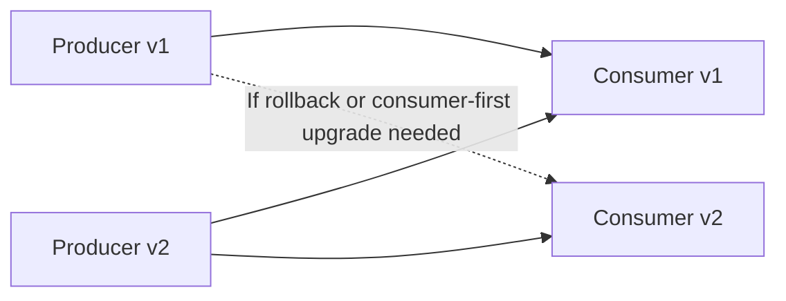
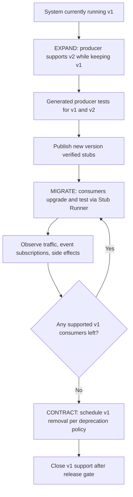
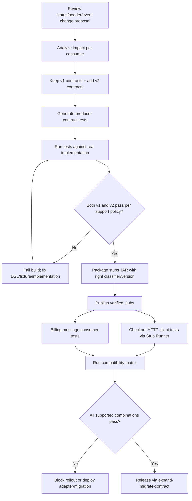

# Changing Status Codes, Headers, or Message Types

A producer can leave its URL and JSON body untouched and still break consumers when it changes an **HTTP status**, alters a **response header**, or modifies the **event type** a consumer handles. For example, **Order Service** switches `201 Created` to `202 Accepted`, drops the `Location` header, or renames the event `ORDER_PAID` to `PAYMENT_COMPLETED`. **Checkout Service** and **Billing Service** can stop working even though the endpoint still exists and both applications build successfully.

In the **SPRING_CLOUD_CONTRACT** track, teams use **Spring Cloud Contract** to describe HTTP or messaging behavior via the **Groovy/YAML DSL**, generate producer tests, package stubs, use **Stub Runner** in consumer tests, and integrate **CI** to detect incompatible API changes. Accordingly, status codes, headers, message types, and destinations are **observable interfaces**, not implementation details to change without an impact assessment.

This lesson belongs to the **Versioning and Compatibility** chapter. Its goal is to analyze risks when changing **status/headers/message types**, build a **producer–consumer compatibility matrix**, write contracts protecting old/new behavior, design an **expand–migrate–contract** strategy, and verify changes through producer verification and consumer stubs.

## 1. When Is a Change Incompatible?

A change is considered **breaking for a specific consumer** when that consumer can no longer perform its function against the new interface exposed by the producer.

Examples:

- Checkout v1 accepts only `201 Created` and extracts `id` to proceed to payment.
- Order Service v2 returns `202 Accepted` with `operationId` because it moved to asynchronous processing.
- Checkout still calls the right endpoint yet fails to receive the expected order ID.

A messaging example:

- Billing v1 subscribes only to `orders.events` and dispatches `ORDER_PAID`.
- Order Service v2 publishes only `PAYMENT_COMPLETED` to `payments.events`.
- Billing never receives the message, or if it does, ignores the unknown type.

**Not every status/header change is breaking.** The verdict depends on which parts of the interface consumers use, how they parse responses, their retry/fallback behavior, and which versions are committed as supported. Still, without verification, never assume a small change is safe.

### 1.1. Layers of a Contract

| Communication Layer | Example Change | Potential Impact |
|---|---|---|
| HTTP method/path | `POST /api/orders` → `PUT /api/orders/{id}` | Consumer hits the wrong route |
| HTTP status | `201` → `202` | Client misclassifies or misunderstands completion timing |
| Response header | Remove `Location` | Client loses resource/operation URI |
| Request header | Require `X-Api-Version` | Old consumers get rejected |
| Content negotiation | JSON → XML/CBOR | Decoder no longer supports format |
| JSON shape | `totalAmount` → `amount.value` | DTO or business mapping breaks |
| Message type | `ORDER_PAID` → `PAYMENT_COMPLETED` | Handler routing misses |
| Destination | `orders.events` → `payments.events` | Consumer is not subscribed to right topic/queue |
| Message headers | Change `eventType` or `contentType` | Routing/serialization fails |
| Schema format | JSON → Avro/Protobuf | Requires different decoder/schema reader |
| Delivery semantics | Emit twice/change ordering | Idempotency and workflow affected |

### 1.2. Backward and Forward Compatibility

- **Backward compatibility:** the new producer continues to satisfy expectations used by old consumers.
- **Forward compatibility:** the new consumer can work with the old producer when the system requires a rollback or staggered deployment.

Never assume the producer and all consumers deploy simultaneously. If any consumer has not upgraded yet, the **producer v2 + consumer v1** combination is usually the single most critical check.



The arrows indicate **combinations that must be evaluated**, not assertions that all of them pass. Actual outcomes depend on contracts and compatibility tests.

## 2. HTTP Status Is Part of Business Behavior

An HTTP status is not just a number. It tells the client how the request was handled.

Example successful order creation under API v1:

```http
POST /api/v1/orders
Content-Type: application/json
Accept: application/json

{"sku":"SKU-42","quantity":2}
```

The producer returns:

```http
HTTP/1.1 201 Created
Location: /api/v1/orders/ORDER-42
Content-Type: application/json

{"id":"ORDER-42","status":"CREATED"}
```

Checkout may rely on all three: `201`, `Location`, and `id`. If any of the three disappears, the consumer might still receive a `2xx` status yet behave incorrectly.

### 2.1. Status Changes Prone to Incompatibility

| Change | Notable Difference | What Consumers Might Do Wrong |
|---|---|---|
| `200 OK` → `201 Created` | Resource creation semantics | Code branch accepts only `200` |
| `201 Created` → `202 Accepted` | Accepted for processing, completion not guaranteed | Uses resource before it exists |
| `200 OK` → `204 No Content` | No response body | Tries to parse JSON from empty body |
| `404 Not Found` → `200 OK` + error in body | Alters how missing resources are signaled | Skips error handling |
| `400 Bad Request` → `422 Unprocessable Content` | Different validation classification | Client maps only `400` |
| `429 Too Many Requests` → `503 Service Unavailable` | Rate-limit semantics differ from unavailable | Retry policy behaves unexpectedly |
| `500 Internal Server Error` → `503` | Error may be transient | Unintended retry amplification |
| `401 Unauthorized` → `403 Forbidden` | Authentication vs. authorization | Client triggers token refresh incorrectly |
| `200` → `206 Partial Content` | Returns partial representation | Treats incomplete data as complete |
| `301` → `308` | Redirect semantics, method preservation per spec | Some HTTP clients handle differently |

**Two responses both being `2xx` does not mean they share the same business meaning.** In particular, `202 Accepted` does not promise the work is finished.

### 2.2. `204` Is Not the Same as JSON `null` or an Empty Object

Distinguish between:

- `204 No Content`: no response content.
- `200 OK` with zero-length body: empty HTTP body.
- `200 OK` with body `null`: a JSON null value.
- `200 OK` with body `{}`: an empty JSON object.
- `200 OK` with body `[]`: an empty JSON array.

If Checkout v1 expects `{"status":"CANCELLED"}` and producer v2 returns `204`, the client may throw a deserialization error. Never treat these cases as equivalent merely because "there is no meaningful data."

## 3. Case Study: Switching from `201 Created` to `202 Accepted`

**API v1:** synchronous order creation.

```http
HTTP/1.1 201 Created
Location: /api/v1/orders/ORDER-42
Content-Type: application/json

{"id":"ORDER-42","status":"CREATED"}
```

**API v2:** accepts an asynchronous order creation request.

```http
HTTP/1.1 202 Accepted
Location: /api/order-operations/OP-42
Content-Type: application/json

{"operationId":"OP-42","status":"PENDING"}
```

Checkout v1 might:

1. Require status to equal `201`.
2. Read `id` from the JSON.
3. Redirect straight to the payment step.
4. Have no idea what `operationId` or `PENDING` status means.

Even if the client is patched to accept any `2xx`, it might treat `OP-42` as an order ID, causing business failures. **This is a workflow change, not just a status code change.**

### 3.1. Preserving Compatibility During Transition

If all consumers cannot upgrade simultaneously:

- Keep `POST /api/v1/orders` returning `201` per the old contract.
- Add `POST /api/v2/orders` returning `202` and the operation ID.
- Add contracts and tests for polling operation status/callbacks.
- Have Checkout v2 implement the asynchronous workflow.
- Measure API v1 traffic and complete deprecation before dropping support.
- Avoid mutating v1 behavior in-place and expecting consumers to adapt on their own.

If using **media type/header versioning** instead of path versioning, ensure request matchers distinguish v1/v2. Never write two stub mappings matching the same request while returning different responses.

## 4. Groovy DSL Contract Protecting v1 Status and Headers

A producer-side contract for Checkout v1:

```groovy
import org.springframework.cloud.contract.spec.Contract

Contract.make {
    name 'checkout_create_order_v1_201'

    request {
        method POST()
        url '/api/v1/orders'
        headers {
            contentType(applicationJson())
            header 'Accept', 'application/json'
        }
        body(
            sku: 'SKU-42',
            quantity: 2
        )
    }

    response {
        status CREATED()
        headers {
            contentType(applicationJson())
            header 'Location', '/api/v1/orders/ORDER-42'
        }
        body(
            id: 'ORDER-42',
            status: 'CREATED'
        )
    }
}
```

This contract protects:

- Method/path `POST /api/v1/orders`.
- Request content type and JSON body with numeric `quantity`.
- HTTP status `201 Created`.
- `Location` header pointing to the order resource.
- Response body containing `id` and `status`.

When Contract Verifier generates producer tests and executes them against the real implementation, changing `201` to `202` or dropping `Location` must be caught **provided the corresponding generated assertions are generated and executed**. Inspect generated test sources rather than assuming the DSL alone guarantees execution.

### 4.1. The Importance of `Location`

The `Location` header is not decorative data. In v1 it points to the **order resource**, whereas in v2 it may point to the **operation status resource**. A `.*` regex for `Location` will not protect this distinction.

If the URI contains a dynamic ID, use fixed fixtures/ID generators or a pattern matcher supported by your DSL version. When correlation between the body ID and `Location` matters, add assertions ensuring **both values correspond**, rather than matching two independent regexes.

## 5. v2 Contract: Separate Requests So Both Versions Can Coexist

Example contract for v2:

```groovy
import org.springframework.cloud.contract.spec.Contract

Contract.make {
    name 'checkout_create_order_v2_202'

    request {
        method POST()
        url '/api/v2/orders'
        headers {
            contentType(applicationJson())
            header 'Accept', 'application/json'
        }
        body(
            sku: 'SKU-42',
            quantity: 2
        )
    }

    response {
        status ACCEPTED()
        headers {
            contentType(applicationJson())
            header 'Location', '/api/order-operations/OP-42'
        }
        body(
            operationId: 'OP-42',
            status: 'PENDING'
        )
    }
}
```

During transition, the producer must satisfy **both the v1 contract and the v2 contract**. Before publishing verified stubs, CI must run generated tests for both scenarios.

Do not let v1 and v2 contracts match the exact same `POST /api/orders` with identical headers/body yet contradictory responses. Stub Runner/WireMock cannot guess a consumer's version. There must be an explicit differentiating **path, header, Accept media type, or request matcher**.

### 5.1. YAML DSL for v2 Validation Errors

A separate case, without duplicating the Groovy success scenario:

```yaml
name: checkout_create_order_v2_invalid_quantity_422
description: V2 publishes validation errors using HTTP 422
request:
  method: POST
  url: /api/v2/orders
  headers:
    Content-Type: application/json
    Accept: application/json
  body:
    sku: SKU-42
    quantity: -1
response:
  status: 422
  headers:
    Content-Type: application/json
  body:
    code: INVALID_QUANTITY
    field: quantity
```

If API v1 still returns `400` for the same error, keep a separate v1 contract and distinguish requests by version. **Do not switch 400 to 422 system-wide** merely because a newer framework/controller version classifies it differently.

## 6. Headers: Small Changes Can Cause Major Failures

Headers carry metadata affecting serialization, caching, security, retries, routing, and correlation.

| Header | Change | Risk |
|---|---|---|
| `Content-Type` | JSON → XML/CBOR/Avro | Decoder is no longer compatible |
| `Accept` | Producer requires another media type | Old clients receive `406` or unparseable responses |
| `Location` | Removed or changed from order URI to operation URI | Client does not know where to fetch results |
| `Retry-After` | Removed or semantics altered | Rate-limit/backoff breaks |
| `ETag` | Format changed or omitted | Conditional requests/caching may fail |
| `Cache-Control` | `private` → `public` | Risk of caching sensitive data |
| `Vary` | Omitted when representation depends on `Accept` | Caches may mix representations |
| `WWW-Authenticate` | Challenge/scheme changed | Auth client handles incorrectly |
| `X-Correlation-Id` | Renamed or stopped sending | Trace correlation lost |
| `X-Api-Version` | Becomes required header | Old clients omitting it get rejected |
| `Idempotency-Key` | Support dropped | Retrying POST may produce duplicate side effects |

HTTP header names are **case-insensitive**: `Content-Type` and `content-type` denote the same header in HTTP semantics. Conversely, header values follow their own rules; never arbitrarily lowercase every value.

### 6.1. Absent, Empty, and Changed Values Are Not the Same

- **Header absent:** consumer receives no such metadata.
- **Header present with empty value:** does not equal a valid value.
- **Header with new value:** may be valid or alter protocol behavior.
- **Added header:** often compatible, yet can still affect caching or proxies.
- **Multi-valued header:** consumer must understand how to combine and parse values per that header's spec.

For instance, if Billing routes on the `eventType` header, moving that value into the body can cause the handler to ignore the message even though the payload is complete.

### 6.2. `Retry-After` Does Not Always Mean Milliseconds

In HTTP, `Retry-After` can represent **seconds** or an **HTTP-date**. If the producer changes representation, consumers must parse according to the standard. Never interpret `Retry-After: 2` as **2 milliseconds**.

Changing `429` to `503` can steer the consumer's retry policy in a different direction. Test **status + header + retry budget**, not a single isolated value.

## 7. `Content-Type` and `Accept` Must Be Evaluated Together

`Content-Type` describes the data being sent; `Accept` describes the representation the client accepts.

Example:

```http
GET /api/v1/orders/ORDER-42
Accept: application/json
```

```http
HTTP/1.1 200 OK
Content-Type: application/json

{"id":"ORDER-42","totalAmount":125000}
```

If the producer suddenly returns `application/xml` or switches to a binary format while the client only has a JSON decoder, the consumer can fail even though HTTP returns `200`.

### 7.1. Versioning via Media Type

An alternative to path versioning:

```http
GET /api/orders/ORDER-42
Accept: application/vnd.example.order.v1+json
```

and:

```http
GET /api/orders/ORDER-42
Accept: application/vnd.example.order.v2+json
```

The producer can return the representation matching each `Accept` if the controller/gateway genuinely supports content negotiation. In that case:

1. Contract v1 uses Accept v1.
2. Contract v2 uses Accept v2.
3. Responses include the matching `Content-Type`.
4. WireMock mappings must match `Accept` to avoid overlap.
5. Intermediate caches must respect `Vary: Accept` where needed.
6. Consumer tests must parse the exact format received.

**Spring Cloud Contract does not enable API versioning on its own.** It verifies what the implementation exposes. Choosing path, header, or media-type versioning must be an explicit system API design decision.

### 7.2. Avoid Overly Rigid or Overly Loose Matchers

`application/json; charset=utf-8` and `application/json` are usually both accepted by JSON decoders, yet differ as raw header strings. Base assertions on **the semantics the consumer actually depends on**, rather than unnecessary byte-for-byte demands.

Conversely, a regex matching any `Content-Type` will miss a switch to XML or binary formats the client cannot read. The goal is **catching breaking changes**, not forcing tests green with loose matchers.

## 8. Requiring a New Request Header Can Also Be Breaking

Suppose Inventory v2 requires:

```http
GET /api/inventory/SKU-42
X-Tenant-Id: TENANT-42
```

Yet Checkout v1 does not send this header. If the producer enforces it immediately, old consumers may be rejected.

A suitable migration plan:

1. Identify why the new header is required.
2. If safe from business and security standpoints, have the producer temporarily support both old and new paths.
3. Update consumers to send the new header.
4. Run consumer tests against target-version producer stubs.
5. Measure traffic from old consumers.
6. Enable strict validation only after conditions are met, or version the API if legacy support is impossible.

**Never weaken security rules just to keep a contract green.** If the header is a mandatory authentication/tenant-isolation requirement, execute a planned migration, versioned interface, or coordinated deployment per security policy.

## 9. Writing Contracts Protecting Used Headers

Example HTTP contract protecting media type, correlation, and cache policy:

```groovy
import org.springframework.cloud.contract.spec.Contract

Contract.make {
    name 'checkout_get_order_v1_with_headers'

    request {
        method GET()
        url '/api/v1/orders/ORDER-42'
        headers {
            header 'Accept', 'application/json'
        }
    }

    response {
        status OK()
        headers {
            contentType(applicationJson())
            header 'X-Correlation-Id', 'CORR-42'
            header 'Cache-Control', 'private, no-store'
        }
        body(
            id: 'ORDER-42',
            status: 'PAID',
            totalAmount: 125000
        )
    }
}
```

If consumers truly depend on `Cache-Control` or correlation IDs, contracts must assert them. If a header is not part of the consumer's interface, hard-coding an arbitrary value can create false positives.

### 9.1. Dynamic Data Requires Deliberate Matchers or Fixtures

Correlation IDs, ETags, and timestamps can vary per request. A test pinning `CORR-42` can use a fixed fixture; to accept dynamic values, use matchers supported by your DSL/version.

Never invent matcher APIs not supported by Contract Verifier. If you need to prove `response X-Correlation-Id` equals `request X-Correlation-Id`, two independent regexes **do not guarantee the relationship**. Add appropriate integration assertions or use the dynamic value mechanisms supported by your version.

## 10. What Does "Message Type" Mean in Messaging?

Unlike HTTP statuses, message types can live across multiple layers:

1. **Business event/command name**: `ORDER_PAID`, `RESERVE_STOCK`.
2. **Message header**: `eventType=ORDER_PAID`.
3. **JSON body field**: `"eventType":"ORDER_PAID"`.
4. **Envelope metadata**: e.g., CloudEvents `type`.
5. **Serialization/media type**: JSON, Avro, Protobuf.
6. **Schema version**: `eventVersion=1` or `2`.
7. **Destination/topic/queue**: `orders.events`.
8. **Record key/partition semantics**: especially in Kafka.

Do not lump all of these under one vague `messageType` label and assume you have tested enough. Changing any layer can break different consumers.

### 10.1. Order Service v1 Message

JSON body:

```json
{
  "eventId": "EVT-42",
  "eventType": "ORDER_PAID",
  "eventVersion": 1,
  "orderId": "ORDER-42",
  "totalAmount": 125000,
  "currency": "VND"
}
```

Metadata:

```text
destination = orders.events
contentType = application/json
eventType   = ORDER_PAID
```

Billing may route using the `eventType` header or the body field depending on its code. Never assume the header is unimportant simply because the body holds the same value.

### 10.2. Proposed v2 Message

```json
{
  "eventId": "EVT-42-V2",
  "eventType": "PAYMENT_COMPLETED",
  "eventVersion": 2,
  "orderId": "ORDER-42",
  "amount": {
    "value": 125000,
    "currency": "VND"
  }
}
```

And a new destination `payments.events`.

This proposal bundles **multiple independent breaking changes**:

- Changing the event type.
- Changing the destination.
- Nesting `totalAmount` and `currency` inside an `amount` object.
- Bumping schema/event version.
- Potentially altering header routing.

If Billing v1 subscribes only to `orders.events`, it will never receive the event. Even if it receives it via another route, it may ignore `PAYMENT_COMPLETED` or fail deserialization. Verify both the **delivery path** and **handler logic**, not just JSON validity.

## 11. Groovy Message Contract for v1 Type

An outbound-only message contract:

```groovy
import org.springframework.cloud.contract.spec.Contract

Contract.make {
    name 'billing_order_paid_v1'
    label 'billing_order_paid_event_v1'

    input {
        triggeredBy('publishOrderPaid()')
    }

    outputMessage {
        sentTo('orders.events')
        headers {
            header('contentType', 'application/json')
            header('eventType', 'ORDER_PAID')
        }
        body(
            eventId: 'EVT-42',
            eventType: 'ORDER_PAID',
            eventVersion: 1,
            orderId: 'ORDER-42',
            totalAmount: 125000,
            currency: 'VND'
        )
    }
}
```

Producer verification needs the base test hook `publishOrderPaid()` to trigger the **real implementation**, an appropriate message verifier/binder to observe output, and assertions on destination, headers, and body.

If the producer removes `ORDER_PAID` completely, the generated v1 producer test must fail **if tests are properly generated and run**. Conversely, a consumer using Stub Runner to trigger label `billing_order_paid_event_v1` receives only the **sample message from the stubs artifact**; it does not invoke real Order Service logic.

### 11.1. Header/Body Types and Destination All Matter

A test asserting only body `eventType=ORDER_PAID` can miss the producer:

- Sending the event to the wrong destination.
- Altering the `eventType` header used by the dispatcher.
- Switching `Content-Type` to Avro while the consumer only has a JSON decoder.
- Changing the partition key and altering ordering.
- Dropping correlation IDs needed by sagas/workflows.

Contract DSL protects many properties, while broker-specific guarantees require corresponding integration tests.

## 12. v2 Message Contract and Coexistence of Both Types

A new contract for v2:

```groovy
import org.springframework.cloud.contract.spec.Contract

Contract.make {
    name 'billing_payment_completed_v2'
    label 'billing_payment_completed_event_v2'

    input {
        triggeredBy('publishPaymentCompleted()')
    }

    outputMessage {
        sentTo('payments.events')
        headers {
            header('contentType', 'application/json')
            header('eventType', 'PAYMENT_COMPLETED')
        }
        body(
            eventId: 'EVT-42-V2',
            eventType: 'PAYMENT_COMPLETED',
            eventVersion: 2,
            orderId: 'ORDER-42',
            amount: [
                value: 125000,
                currency: 'VND'
            ]
        )
    }
}
```

During transition, the producer can retain v1 and add v2; each contract must be verified by generated tests. However, if both messages represent the same transaction, **dual publishing can cause duplicate payment recording** if a consumer receives both.

### 12.1. Questions to Resolve When Dual Publishing

- Are both v1 and v2 emitted for the same business event, or only one of them?
- Are event IDs/correlation IDs sufficient for deduplication?
- Does Billing subscribe to both topics during migration?
- Do message ordering and partition keys preserve required semantics?
- Can consumers decode headers/serialization of both?
- During a producer rollback, can v2 consumers still handle compatible events?
- When may v1 publishing stop, and what observability data confirms it?

Never treat dual publishing as a "harmless copy" for events with financial side effects.

### 12.2. YAML DSL Example for Another Command

A separate contract, not duplicating the Groovy v2 event:

```yaml
name: inventory_reserve_stock_command_v1
label: inventory_reserve_stock_v1
input:
  triggeredBy: publishReserveStock()
outputMessage:
  sentTo: inventory.commands
  headers:
    contentType: application/json
    commandType: RESERVE_STOCK
  body:
    commandId: CMD-42
    commandType: RESERVE_STOCK
    orderId: ORDER-42
    sku: SKU-42
    quantity: 2
```

If the command type changes to `STOCK_RESERVATION_REQUESTED` while the Inventory handler only recognizes `RESERVE_STOCK`, the consumer will ignore or reject it. Versioning/migration similar to events is required.

YAML message DSL syntax, header conversion, and binder support depend on the Spring Cloud Contract version. Inspect generated tests/stubs when applying. Do not feed two DSL files describing the exact same scenario unless intentional.

## 13. Schema Evolution: Adding a Field Can Still Be Unsafe

| Payload Change | Typical Impact | Condition to Be Safe |
|---|---|---|
| Add optional JSON field | Usually compatible | Consumers ignore unknown fields |
| Add required request field | Usually breaks old clients | Producer provides default/adapter |
| Remove field used by consumers | Breaking | Consumers have migrated |
| Rename field | Breaking | Alias/dual-field or new API version |
| `125000` → `"125000"` | Number becomes String | Parsers/schemas handle explicitly |
| `null` → missing | Potentially breaking | Consumers handle both if committed |
| `[]` → `null` | Potentially breaking | Collection handling differs |
| Timestamp format/timezone change | Potentially breaking | Parsers and semantics updated |
| Enum gains a new value | Potentially breaking | Consumers avoid rigid exhaustive switches |
| Avro changes field without suitable default | Potentially breaking | Reader/writer compatibility |
| Protobuf changes field number | Breaking | Must obey field number/reserved rules |

Do not merely ask "Is the JSON valid?", ask "**How will old consumers parse and use it?**"

### 13.1. Checking Data Types

Groovy DSL can use matchers:

```groovy
response {
    status OK()
    body(
        orderId: 'ORDER-42',
        totalAmount: 125000
    )
    bodyMatchers {
        jsonPath('$.orderId', byEquality())
        jsonPath('$.totalAmount', byEquality())
    }
}
```

This is a Groovy DSL example. Inspect generated assertions of your plugin version to confirm JSON number/string types are protected as expected; where needed, supplement with Jackson `JsonNode.isNumber()` and `isTextual()` checks in producer integration tests.

A regex `[0-9]+` describes only a string pattern; it is insufficient to prove a field is a **JSON number**.

### 13.2. Avro/Protobuf Require Dedicated Schema Tooling

Contract DSL does not replace **Schema Registry compatibility checks**:

- Avro reader/writer schemas and default values affect backward compatibility.
- Protobuf must preserve field numbers and follow reserved-field rules.
- Content-type headers, encodings, and schema IDs can govern how consumers decode payloads.
- Kafka/RabbitMQ partitioning, ack/retry, dead-lettering, and ordering semantics belong to integration tests.

Combine **schema checks + producer message contracts + consumer handler tests**, rather than inferring safety solely from a Groovy DSL body map.

## 14. Without a Contract for a Property, Tests May Miss Failures

Example:

```groovy
response {
    status OK()
    body(id: 'ORDER-42')
}
```

A contract asserting only status and `id` may still pass when the producer changes:

- `Content-Type` header.
- `Location` header.
- `totalAmount`.
- Cache behavior.
- Message type of another workflow.

Because those properties **were not described**, the test has no obligation to protect them. Likewise, if a message contract asserts only `orderId` while omitting `sentTo` and `eventType`, a routing change can go undetected.

You must:

1. Discover **what consumers actually use**.
2. Capture those dependencies in contracts.
3. Verify generated tests contain corresponding assertions.
4. Add integration tests where the DSL cannot express enough.
5. Avoid overly broad `.*` matchers that mask breaking changes.
6. Avoid hard-coding irrelevant data that makes tests brittle.

## 15. Producer–Consumer Compatibility Matrix

Suppose:

- **P1:** Order Service v1, creates orders with `201` and emits `ORDER_PAID`.
- **P2:** Order Service v2, adds `202` and `PAYMENT_COMPLETED`.
- **C1:** Old Checkout/Billing version.
- **C2:** New Checkout/Billing version.

| Combination | Compatible? | Must Be Proven |
|---|---|---|
| **P1 + C1** | Supported baseline | v1 contracts and consumer tests |
| **P2 + C1** | **Not by default** | P2 preserves v1 behavior/format or uses an adapter |
| **P2 + C2** | New deployment target | v2 contracts and client/handler tests |
| **P1 + C2** | Depends on rollback policy | Can C2 understand v1 if the producer rolls back? |

If your organization deploys the producer before consumers, you must test **P2 + C1**. If consumers upgrade first or the producer may roll back, you may also need to test **P1 + C2**.

### 15.1. Different Impacts Across Consumers

| P2 Change | Checkout v1 | Billing v1 |
|---|---|---|
| `201` → `202` | Potentially breaking | Unaffected if not calling this API |
| Drop `Location` | Breaking if URI used | Unaffected |
| `ORDER_PAID` → `PAYMENT_COMPLETED` | Unaffected if not listening | Breaking |
| `orders.events` → `payments.events` | Unaffected | Breaking because unsubscribed |
| Add `traceId` | Likely safe | Likely safe if decoder ignores it |
| Drop `currency` | Unaffected if unused | Breaking if needed for invoicing |

Compatibility is **per consumer**, not simply per producer artifact version.

## 16. The Expand → Migrate → Contract Roadmap



### 16.1. EXPAND

The producer adds new behavior **without removing old contracts**:

- Keep `POST /api/v1/orders` returning `201`.
- Add `POST /api/v2/orders` returning `202`.
- Keep `ORDER_PAID` on `orders.events`.
- Add `PAYMENT_COMPLETED` on the new destination.
- Maintain tests for statuses/headers/message types of both versions.

### 16.2. MIGRATE

Consumers upgrade one by one:

- Checkout v2 handles `202` and the operation workflow.
- Billing v2 parses `PAYMENT_COMPLETED`.
- Consumer tests use the **stubs artifact of the producer version being deployed**.
- Verify new headers/contentType/schema version.
- If dual-subscribing, verify idempotency/deduplication.
- Use canary/feature flags if supported by the architecture.
- Track remaining consumers still on v1.

### 16.3. CONTRACT

Retire v1 only when:

- An inventory of consumer owners and migration status exists.
- Deprecation windows have been communicated.
- No mandatory consumer still needs v1.
- Rollback strategy no longer requires v1 support.
- Monitoring confirms no critical traffic/handlers remain on v1.
- CI has updated the test matrix per support policy.
- Old contracts/stubs remain traceable for historical investigation.

**Do not remove v1 merely because v2 consumer tests are green.** That does not prove real-world clients have upgraded.

## 17. Distinguishing Artifact, API, and Schema Versions

| Concept | Example | Purpose |
|---|---|---|
| Producer artifact version | `order-service:1.5.0` | Producer build |
| Stubs artifact version | `order-service:1.5.0:stubs` | Stubs from the same producer build |
| HTTP API version | `/api/v1` or `/api/v2` | Representation/behavior version |
| Message schema version | `eventVersion=2` | Payload version |
| Message type | `PAYMENT_COMPLETED` | Business/dispatch classification |
| Contract name/label | `billing_payment_completed_event_v2` | Scenario identifier |
| Plugin version | Spring Cloud Contract version in Maven/Gradle | DSL/generation capabilities |
| Consumer version | `billing-service:2.3.0` | Code build processing events |

A single producer artifact `v1.5.0` can hold **both v1/v2 APIs** and **both event types**. Never assume artifact version and API/schema version must be identical.

### 17.1. Pinning Stub Runner Versions in CI

```java
import org.springframework.boot.test.context.SpringBootTest;
import org.springframework.cloud.contract.stubrunner.spring.AutoConfigureStubRunner;
import org.springframework.cloud.contract.stubrunner.spring.StubRunnerProperties;

@SpringBootTest(
    properties = "clients.order.base-url=http://localhost:8085"
)
@AutoConfigureStubRunner(
    ids = "com.example:order-service:1.5.0:stubs:8085",
    stubsMode = StubRunnerProperties.StubsMode.LOCAL
)
class CheckoutOrderClientContractTest {
    // Inject real OrderClient; add @Test verifying 201/202 per API version.
}
```

The `ids` string follows `groupId:artifactId:version:classifier:port`; `8085` is the **stub server port**, not part of the Maven artifact identity. `clients.order.base-url` is a custom property defined by Checkout.

This example is a **configuration skeleton**, not a complete JUnit class. `LOCAL` requires the stubs artifact to be `install`ed in the Maven local repository. `REMOTE` requires repository URL, access permissions, and matching artifact version.

### 17.2. Why Not Use `latest` Arbitrarily?

If consumer CI resolves a dynamic version or mutable snapshot, the exact same consumer commit may test against two different stub sets on different days, harming reproducibility.

Always record:

- Requested and resolved producer stubs version.
- `stubs` classifier.
- Producer commit/build ID.
- Spring Cloud Contract plugin version.
- Consumer version.
- Which compatibility matrix cells were tested.

Release artifacts should be treated as **immutable**. When modifying a published contract, publish a new version instead of overwriting existing coordinates.

## 18. Consumer HTTP Tests Must Check Semantics, Not Just `2xx`

A client written as:

```java
if (response.statusCode() >= 200 && response.statusCode() < 300) {
    return parseOrder(response.body());
}
```

can break if `202` contains an operation ID instead of an order ID. The `2xx` range does not guarantee identical body shapes.

Example v1 client accepting only `201`:

```java
OrderCreated parseCreateOrderResponse(int status, JsonNode body) {
    if (status != 201) {
        throw new IllegalStateException("Expected created order");
    }
    String id = body.path("id").asText(null);
    if (id == null || id.isBlank()) {
        throw new IllegalStateException("Missing order id");
    }
    return new OrderCreated(id);
}
```

A v2 client design can distinguish outcomes:

```java
sealed interface CreateOrderOutcome
    permits CreatedOrder, AcceptedOperation {}

record CreatedOrder(String orderId)
    implements CreateOrderOutcome {}

record AcceptedOperation(String operationId)
    implements CreateOrderOutcome {}
```

This is a **Java 17+** example, not a built-in Spring Cloud Contract API. Consumer v2 must handle `AcceptedOperation` with polling/callbacks or the corresponding workflow, rather than immediately triggering payment as if an order were already created.

Tests should protect:

1. `201` returns `CreatedOrder` and the right `Location`.
2. `202` returns `AcceptedOperation`.
3. Missing `operationId` is caught as a schema violation.
4. Operation IDs are never treated as order IDs.
5. `409`/`422` have dedicated error mappings.
6. If rollback is required, the new consumer can still understand v1 responses.

## 19. Consumer Message Tests Must Assert Handlers and Side Effects

For Billing, checking only that the stub event has `ORDER_PAID` or `PAYMENT_COMPLETED` is not enough. Verify how the real handler receives and processes it:

1. Prepare the consumer listener/test context.
2. Configure the matching binder/broker.
3. Point Stub Runner to the right stubs artifact and message label.
4. Trigger the label for the message type under test.
5. Await side effects with an explicit timeout.
6. Assert invoice/payment state by `orderId`, `eventId`, or correlation key.
7. Verify there are no double charges/duplicate invoices when both versions are emitted simultaneously.
8. Reset broker/DB state between tests.

**`StubTrigger` returning without error does not prove the consumer processed the message.** Assert observable side effects or handler state.

### 19.1. Negative Cases Worth Testing

- Header `eventType` differs from body `eventType`.
- Header `contentType` is absent or switched to another encoding.
- New destination has no subscription yet.
- Consumer encounters an unknown enum/event type.
- Payload omits `orderId`.
- New schema version alters a field's type.
- Duplicate `eventId` or message redelivery.
- Events arrive out of the order required by the workflow.

These cases may belong to consumer integration/resilience suites rather than producer contracts; define scope clearly.

## 20. CI for Status, Header, and Message Type Changes



### 20.1. Required CI Evidence

| Evidence | Used to Verify |
|---|---|
| Source Contract DSL | Explicit API/message commitments |
| Generated tests | Plugin read the contracts |
| Surefire/Failsafe reports | Producer tests **actually ran**, not skipped |
| Stubs artifact metadata | Consumer downloaded exact producer GAV/classifier/version |
| Producer build/commit | Traceable artifact |
| Consumer test reports | Real client/handler meets target version |
| Compatibility matrix | Supported deployment combinations were tested |
| Schema Registry checks | Avro/Protobuf compatibility |
| Broker integration tests | Routing, conversion, delivery semantics |
| Rollout metrics | Whether v1 can be safely retired |

### 20.2. Reference Maven Commands

In a producer project configured with the plugin:

```bash
./mvnw clean verify
jar tf target/order-service-1.5.0-stubs.jar
```

These are commands **learners run in their own project**, not previously executed output. File names, directories, plugin goals, and versions depend on your build. To install artifacts into the Maven local repository after verification, run `./mvnw install`.

**Never use `-DskipTests`** and then label the stubs artifact producer-verified. Producing a JAR does not mean generated tests executed.

## 21. Mutation Testing for Breaking Changes

One way to evaluate contract quality is to **intentionally break the implementation on a test branch** and verify whether tests catch it.

| Intentional Breakage | Test That Must Fail |
|---|---|
| `201` → `202` on v1 endpoint | Producer contract status assertion |
| Drop v1 `Location` | Header assertion |
| `Content-Type` → `text/plain` | Header/consumer decoder test |
| `totalAmount` number → String | JSON type assertion |
| `ORDER_PAID` → `PAYMENT_COMPLETED` without keeping v1 | v1 message contract |
| `orders.events` → `payments.events` | Destination assertion |
| Drop `orderId` | Message body assertion |
| Emit both v1 and v2 causing double processing | Consumer idempotency integration test |
| Client treats any `2xx` as order created | Consumer workflow test |

After confirming the test fails for the right reason, **restore the implementation** and re-run. If tests stay green despite breaking a protected status/header/event type, inspect generated sources and test reports; the contract may lack an assertion, the plugin may not have generated it, or Surefire may not be running it.

## 22. Common Pitfalls

| Symptom | Cause | Remediation |
|---|---|---|
| Checkout v1 fails after producer deploy | `201` became `202` | Compare contract/status and semantics |
| HTTP `2xx` yet consumer parsing fails | V2 uses `operationId` instead of `id` | Update DTO/workflow, not just loosen status |
| Client cannot find URI | `Location` removed/changed | Check header contracts and API version |
| Client reports unsupported media type | `Content-Type`/`Accept` changed | Content negotiation and decoder |
| Old requests rejected | New version/tenant header became mandatory | Migration/compatibility adapter or API v2 |
| Abnormal retries | `429` changed to `503` or `Retry-After` lost | Retry policy tests |
| Billing receives no events | Destination changed | Topic/binder/subscription |
| Billing ignores events | Header/body event type changed | Handler dispatch |
| Message deserialization fails | JSON/Avro/Protobuf schema changed | Schema compatibility checks |
| Double payment/invoice | Dual publish without deduplication | Idempotency and side-effect tests |
| Producer tests pass when `Location` dropped | Contract lacked assertion or tests skipped | Inspect generated assertions/test report |
| Consumer gets stale stub | Wrong artifact version/cache | Check GAV/classifier/resolved version |
| Stub Runner returns default `404` | Request failed to match mapping | Check method/path/headers/body |
| Both v1/v2 stubs match same request | Request selector not versioned | Separate path/media type/header |
| Flaky tests | Shared DB/broker state, async race | Isolation, fixtures, timeouts |
| Fails only in CI | Different JDK/plugin/binder version or cache | Pin versions, inspect reports |

### 22.1. Ordered Diagnosis

1. Identify the actual **producer version** and **consumer version**.
2. Capture HTTP request/status/headers/body or message destination/headers/payload.
3. Compare against the contract the consumer depends on.
4. Verify generated producer tests were generated and executed.
5. Inspect stubs artifact version/classifier and contents.
6. Run the consumer test via Stub Runner against the target version.
7. For messaging, inspect broker/binder/serializer/schema registry.
8. Inspect state fixtures, timing, and idempotency.
9. Verify whether v1 is retained throughout the support window.
10. Decide on rollback, adapter, consumer upgrade, or API/message versioning.

Never tweak statuses/matchers just to turn tests green without confirming committed behavior.

## 23. Practice Lab: Migrating Order Service from v1 to v2

Context: Checkout v1 requires `201 Created` and a `Location` header when creating an order. Billing v1 requires `ORDER_PAID` on `orders.events`. The team wants to move to `202 Accepted` and `PAYMENT_COMPLETED` on `payments.events`.

### Part A — v1 Baseline

1. Write a Groovy contract for `POST /api/v1/orders` returning `201`, `Location`, and `id/status` body.
2. Write a Groovy message contract with a stable label for `ORDER_PAID`.
3. Seed producer fixtures and run generated producer tests.
4. Run consumer tests via Stub Runner with v1 stubs.
5. Archive baseline reports and artifact coordinates.

### Part B — v2 Design

1. Add `POST /api/v2/orders` returning `202` and `operationId`.
2. Define how consumers retrieve operation status/callbacks.
3. Design `PAYMENT_COMPLETED` v2 with schema `amount.value/currency`.
4. Define destination `payments.events`, serialization, and headers.
5. Build compatibility matrix P1/C1, P2/C1, P1/C2, P2/C2.

### Part C — Expand Producer

1. Keep route `v1` and event `ORDER_PAID` during the support window.
2. Add route `v2` and event `PAYMENT_COMPLETED`.
3. Maintain contract tests for both versions.
4. Verify key headers.
5. Run producer tests; intentionally break v1's `201` to observe test failure.
6. Restore the implementation and confirm the suite passes.

### Part D — Consumer Migration

1. Checkout v1 must continue working with P2 during the support window.
2. Checkout v2 handles `202 Accepted` with correct semantics.
3. Billing v1 still receives v1 events.
4. Billing v2 receives/deserializes/handles v2 events.
5. Verify dual-subscription and deduplication if needed.
6. If rollback is required, verify C2 against P1.

### Part E — CI and Deprecation

1. Package the stubs artifact from the verified producer build.
2. Pin the stub version in consumer tests.
3. Execute the compatibility matrix per support policy.
4. Record producer commit/build ID and schema version.
5. Deploy P2 only when release gates pass.
6. Do not drop v1 until usage/deprecation plans permit.

**Completion Criteria:** explain why `201` → `202` is a semantic change, why removing `Location` or altering `eventType`/destination is breaking, and how to maintain old/new contracts while consumers upgrade.

## 24. Pre-Merge Checklist

- [ ] Identified affected producers and consumers.
- [ ] Classified status/header/message type/destination/schema changes.
- [ ] Verified semantics, not merely string diffs.
- [ ] Retained all v1 contracts still requiring support.
- [ ] v2 contracts have distinct request selectors from v1 where needed.
- [ ] Protected all headers used by consumers.
- [ ] Verified event type, destination, and content type.
- [ ] Generated producer tests execute genuinely without skipping.
- [ ] Stubs JAR from the same producer build has explicit GAV/classifier/version.
- [ ] Consumer tests execute through real HTTP/message clients.
- [ ] Compatibility matrix executed per rollout policy.
- [ ] Dual events have deduplication/idempotency mechanisms.
- [ ] Avro/Protobuf schema compatibility checks run where applicable.
- [ ] No production tokens/PII inside contracts/stubs.
- [ ] Rollout, rollback, and deprecation plans exist.
- [ ] Release artifacts are immutable; snapshots have provenance.
- [ ] Fixtures/broker/DB state are isolated.
- [ ] Mutation testing proves critical assertions are not missed.

## 25. Self-Check Questions

1. **Why can changing `201` to `202` be breaking?** `202` only accepts processing; it does not guarantee the resource has been created.
2. **What does `204` mean to a JSON deserializer?** There is no response content to parse.
3. **How does WireMock's default `404` differ from a business error?** The request may simply fail to match any mapping, lacking the contracted error body.
4. **Why can removing `Location` break a client?** The client may need the returned URI to continue its workflow.
5. **How do `Content-Type` and `Accept` differ?** One describes the representation being sent, while the other describes the representation the client wants to receive.
6. **Are HTTP header names case-sensitive?** No; header values follow their own rules.
7. **Can `Retry-After` only be milliseconds?** No; it can be seconds or an HTTP-date.
8. **Why isn't `201` → `202` fixed by accepting any `2xx`?** Workflow and response shape can change.
9. **What failure can adding a mandatory request header cause?** Old clients omit it and get rejected.
10. **What does `ORDER_PAID` → `PAYMENT_COMPLETED` break?** Handler dispatch/event schema and potentially destination.
11. **Can changing destination break consumers even if the body stays identical?** Yes, consumers are not subscribed to the new destination.
12. **Where can message type reside?** Header, body, envelope, or framework metadata.
13. **Must event schema version and producer artifact version be equal?** No.
14. **Is adding a JSON field always compatible?** No; depends on parser/schema and consumer.
15. **Do JSON numbers and JSON strings differ?** Yes, affecting type checking and deserialization.
16. **What is `triggeredBy` used for in a message contract?** Invoking the real producer during verification tests.
17. **Does Stub Runner triggering a label execute the real producer?** No, it uses the stub message sample.
18. **Are green producer tests enough to guarantee all consumers are safe?** No; consumer tests and appropriate coverage are needed.
19. **What is EXPAND/MIGRATE/CONTRACT?** Add new support while keeping old, migrate consumers, then remove old in a controlled manner.
20. **Why is dual publishing risky?** It can cause duplicate side effects.
21. **Why pin the stubs artifact version?** To make tests reproducible.
22. **Does asserting HTTP `2xx` alone protect business semantics?** No.
23. **How do you know generated producer tests actually ran?** Inspect test reports and executed test counts.
24. **When are Schema Registry compatibility tests needed?** When formats/schemas like Avro/Protobuf require them.
25. **What evidence is needed before dropping v1?** Consumers migrated, usage data, and rollback/deprecation policy approval.

## 26. References and Version Caveats

Standards and framework documentation references:

- [RFC 9110 — HTTP Semantics](https://www.rfc-editor.org/rfc/rfc9110)
- [Spring Cloud Contract — Reference](https://docs.spring.io/spring-cloud-contract/reference/)
- [Spring Cloud Contract — Contract DSL](https://docs.spring.io/spring-cloud-contract/reference/)
- [Spring Cloud Contract — Messaging](https://docs.spring.io/spring-cloud-contract/reference/)
- [Spring Cloud Contract — Stub Runner](https://docs.spring.io/spring-cloud-contract/reference/)
- [Apache Avro Specification](https://avro.apache.org/docs/current/specification/)
- [Protocol Buffers — Updating a Message Type](https://protobuf.dev/programming-guides/proto3/#updating)

**Version caveat:** Groovy/YAML DSL syntax, matcher APIs, message binder integration, Maven/Gradle plugin behavior, and test modes can vary across Spring Cloud Contract versions. Examples in this lesson are learning patterns; when applying them to a real project, verify **generated tests**, **stubs archive**, **effective configuration**, and producer/consumer behavior under your pinned versions.

## Conclusion

**Changing status codes, headers, or message types can break a contract even when the URL and most of the JSON body stay unchanged.** `201` → `202` can shift a synchronous flow to asynchronous; removing `Location` loses a crucial URI; `Content-Type` governs the decoder; renaming `ORDER_PAID` to `PAYMENT_COMPLETED` or moving destinations can stop consumers from receiving or handling events.

To control risk, explicitly specify the properties consumers depend on using **Groovy/YAML contracts**, run **generated producer tests** against the real implementation, publish **verified stubs JARs**, test consumers with **Stub Runner**, maintain a **cross-version compatibility matrix**, and roll out using **expand–migrate–contract**. When CI protects status, headers, message types, payload semantics, and supported producer–consumer pairs, teams catch breaking changes before they cause production incidents.
