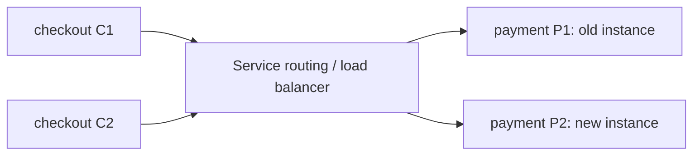
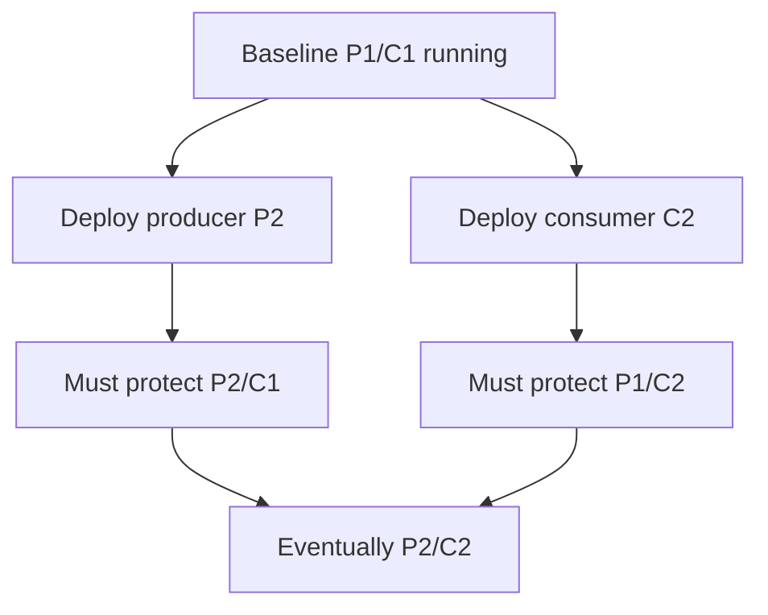
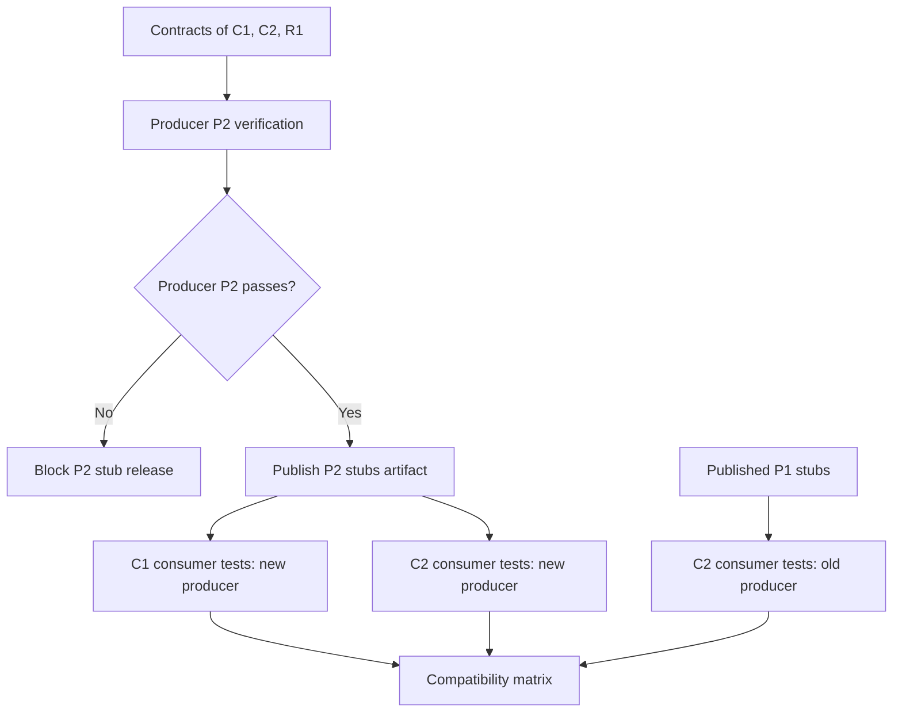
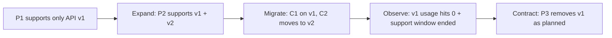
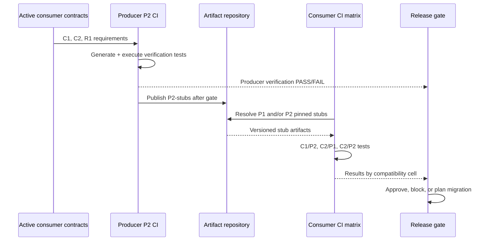

# Multiple Producer and Consumer Versions Coexisting

## 1. Why Isn't Compatibility Just About the "Latest Version"?

In a microservices system, a **producer** exposes an HTTP API or emits events, while a **consumer** calls the API or receives messages. **Spring Cloud Contract (SCC)** helps both parties agree on behavior using the **Groovy/YAML DSL**, generates **producer verification tests**, packages **stub artifacts**, lets consumers use **Stub Runner**, and runs checks in **CI** to detect incompatible API changes early.

In practice, multiple versions frequently **coexist**:

- Some instances of producer `payment-service 1.4.2` still serve traffic while `1.5.0` is rolling out.
- `checkout-service 2.8.0` does not upgrade at the exact same time as `checkout-service 3.0.0`.
- `reporting-service 1.9.0` and `notification-service 4.2.0` still require different data fields.
- Mobile clients, batch jobs, or external partners may stay on an old contract for weeks or months.
- Messages in Kafka/RabbitMQ may have been produced under an old version and only consumed after the consumer upgrades.

Asking "Does the new producer pass the new contract?" is **not enough**. You must ask:

> During the **overlapping deployment window**, **which consumer versions** can call or receive events from **which producer versions**, and has each pair been tested for the exact behavior that real consumers depend on?

This lesson belongs to the **Versioning and Compatibility** chapter of the **SPRING_CLOUD_CONTRACT** module. The focus is on **designing, testing, and deploying safely when multiple producer and consumer versions operate concurrently**, rather than following a rigid SemVer checklist.

### Learning Objectives

After this lesson, you will be able to:

1. Distinguish **backward** and **forward compatibility** from the producer–consumer perspective.
2. Distinguish **application version**, **API version**, **contract version**, and **stub artifact version**.
3. Evaluate HTTP/message changes that risk breaking consumers, even when the schema appears "additive only."
4. Design a **matrix of supported version pairs**, without having to test every combination ever created.
5. Use SCC producer verification and Stub Runner to test the right version pairs with traceable artifact versions.
6. Organize **stubs per consumer** when consumers use different slices of a contract.
7. Design **expand → migrate → contract**, rolling/canary deployments, and CI gates for incompatible changes.
8. Recognize the limits of stub testing regarding production environments, historical data, brokers, and multiple instances.

> **Limitation to remember:** A stub JAR simulates **a defined set of scenarios**. Passing tests with a stub package does not automatically prove every running producer version, every API path, or every lingering message is compatible.

## 2. Two Compatibility Directions: Defined by Timeline

To avoid terminology confusion, this lesson uses **version-pair-specific** definitions:

- **New producer ↔ old consumer:** producer version **P2** continues serving the needs of consumer version **C1**. This is a form of **producer backward compatibility toward old consumers**.
- **New consumer ↔ old producer:** consumer version **C2** still works when calling producer version **P1**. This enables the **consumer to roll ahead of the producer** during a rolling deployment, often termed **forward compatibility** from a migration perspective.
- **New producer ↔ new consumer:** both sides upgraded; proves new features work, yet is **insufficient** as proof for mixed pairs.

The terms "backward" and "forward" are sometimes used differently in data/schema registry standards. Therefore, in technical discussions always **state the exact pair** `P2→C1` or `C2→P1` to avoid ambiguity.

| Pair | Practical Question | Why It Matters |
|---|---|---|
| `P1 + C1` | Does the old baseline run properly? | Baseline reference |
| `P2 + C1` | Does the new producer break old consumers? | Rolling deploy producer first |
| `P1 + C2` | Can the new consumer tolerate the old producer? | Rolling deploy consumer first or producer rollback |
| `P2 + C2` | Do the two new versions work together? | Final post-migration target |

A safe release plan must know **which pairs can actually occur**. You do not need to support every historical C/P forever; instead, maintain a **support window**, deprecation plan, and test evidence for pairs still allowed to run.

### 2.1. Rolling Deployment Example



If the router does not distinguish versions, **both C1 and C2 may hit either P1 or P2**. Testing only `P2+C2` is therefore insufficient. Even when the router supports version routing, check rollback, failover, or caching policies that might route requests to another version.

### 2.2. A Memorable Four-Cell Grid



**Conclusion:** Deployment order dictates which version pairs **must** remain compatible during overlap. This is why the CI compatibility matrix must reflect real topology and rollout schedules.

## 3. Four Kinds of "Version": Same Word, Different Jobs

Suppose `payment-service` has:

```text
Producer release:      payment-service 1.5.0
HTTP API:              /api/v1/payments/{id}
Contract revision:     git commit d4e5f6a
Stub Maven artifact:   com.acme.billing:payment-service:1.5.0:stubs
Consumer release:      checkout-service 3.0.0
```

These four identifiers are related yet **not identical**:

| Version Type | Determines | Can Change Independently? |
|---|---|---|
| **Producer application version** | Which binary/implementation is deployed | Yes |
| **Public API version** | Published v1/v2 interface or schema/message contract | Yes: multiple app releases can serve API v1 |
| **Contract revision/version** | Which DSL serves as input to verification | Yes: contracts are reviewed independently |
| **Stub artifact version** | Package of mocks/mappings downloaded by consumers | Per build strategy, usually tied to producer release |

Additionally, there is the **consumer application version**, determining which client code and assumptions are running. Never mechanically equate `API v1 = producer 1.x = consumer 1.x`.

A producer app `2.0.0` can still serve API `/v1` for old consumers while simultaneously exposing API `/v2`. Conversely, a producer app `1.5.0` could contain a contract-breaking change without bumping its major version if the organization fails to enforce versioning rules.

### 3.1. Stub ID Is Not API Version

```text
com.acme.billing:payment-service:1.5.0:stubs
                                           ↑ classifier
                                  ↑ producer artifact version
```

Full Stub Runner coordinate format:

```text
groupId:artifactId:version:classifier:port
```

Here `port` is the HTTP stub server port, **not** an API v1/v2 port or version. If no version is specified, Stub Runner may use `+` to pick the latest resolvable version; however, "latest" does not mean compatible with every consumer.

### 3.2. One Stub Artifact Can Contain Multiple API Generations

A single `1.5.0` producer can publish a `-stubs.jar` package containing mappings for **both** `/api/v1/...` and `/api/v2/...`. When consumers pull the right artifact version, Stub Runner loads the matching mappings without needing a separate artifact ID per endpoint.

On the other hand, if a provider splits `v1`/`v2` into two separate services or two Maven artifacts, define clear coordinates. SCC imposes no single mandatory versioning convention on organizations.

## 4. Running Story: Payment v1 → New Version

Producer `payment-service P1 = 1.4.2` currently returns:

```json
{
  "paymentId": "PAY-42",
  "state": "CAPTURED",
  "amount": 150000,
  "currency": "VND"
}
```

Two consumers:

- **checkout C1 = 2.8.0**: needs `paymentId` and `state` to decide whether checkout can complete.
- **reporting R1 = 1.9.0**: uses `amount` and `currency` for reporting.

Producer prepares **P2 = 1.5.0**, wanting to add `paymentMethod`:

```json
{
  "paymentId": "PAY-42",
  "state": "CAPTURED",
  "amount": 150000,
  "currency": "VND",
  "paymentMethod": "CARD"
}
```

**This can be a compatible change**, provided:

- Old consumers **accept unknown fields** or do not deserialize strictly.
- Existing fields **do not change name, type, or meaning**.
- HTTP status, headers, auth, URL, ordering/sorting, and error handling still meet consumer needs.
- No new requirement forces consumers to send an unfamiliar header/field.
- Producer v2 continues handling old requests throughout the overlap window.

If checkout C1 enables Jackson `FAIL_ON_UNKNOWN_PROPERTIES` or uses a strict schema validator, merely **adding one field** can break C1. Thus, "additive = always safe" is only a **heuristic**, not proof.

### 4.1. C1's HTTP Contract for the Existing Interface

```yaml
name: checkout_payment_captured
description: "Old checkout requires captured payment"
request:
  method: GET
  url: /api/payments/PAY-42
  headers:
    Accept: application/json
response:
  status: 200
  headers:
    Content-Type: application/json
  body:
    paymentId: "PAY-42"
    state: "CAPTURED"
```

This contract requires only the fields C1 actually uses. If the generated producer test is configured to assert the required fields rather than asserting the body **must exactly equal** a closed JSON forbidding extra attributes, P2 can return extra fields while still satisfying C1.

**Do not infer from this example that SCC always ignores every extra field.** JSON matching depends on DSL, matchers, generated test mode, and how assertions are generated. Inspect actual generated tests and mappings.

### 4.2. Reporting's Contract Against the Same Producer

```yaml
name: reporting_payment_amount
description: "Reporting needs amount and currency"
request:
  method: GET
  url: /api/payments/PAY-51
response:
  status: 200
  headers:
    Content-Type: application/json
  body:
    paymentId: "PAY-51"
    amount: 280000
    currency: "VND"
```

Using distinct request discriminators `PAY-42` and `PAY-51` in the example avoids two WireMock mappings for the exact same request with different responses. In a real project, if two consumers call the **exact same request**, the producer can only return **one response under published semantics** (unless differentiated by headers, content negotiation, or versioned routes). Never write two contracts demanding the producer return two contradictory JSON payloads for the same request and expect stubs-per-consumer to solve it.

### 4.3. Contracts and Implementations Must Be Evaluated Together

A producer P2 passing C1 and reporting R1 contracts **on test fixtures** is useful evidence of backward compatibility. However, if consumer C1 parses JSON strictly or uses a field omitted from the contract, producer tests will not catch the issue. Run **real consumer code against stub P2** and, for critical risks, run **integration/deployment tests** between real implementations.

## 5. HTTP Change Matrix: Compatibility Depends on the Caller

| Producer Change | Commonly Viewed As | What Must Be Verified |
|---|---|---|
| Add optional field to JSON response | Usually additive | Do consumers ignore unknown fields? Strict schema/assertions? |
| Add new endpoint | Usually additive | Does not interfere with routing/auth of old endpoints |
| Add **optional** query param with old default | Usually additive | Old clients omitting it still receive equivalent results |
| Add optional request field | Usually additive | Server defaults/validation do not reject old requests |
| Rename `paymentId` to `id` | **Breaking** for consumers using old name | Keep old field or introduce new API and migrate |
| Remove `currency` from response | **Breaking** for reporting | Find active consumers; do not remove during support window |
| Change `amount` from number to string | **Breaking** at wire schema | Serializer/DTO/validation per contract |
| Change `amount` unit from VND to cents, even if still number | **Semantically breaking** | Consumers may miscalculate money without throwing exceptions |
| `200` → `204` | Usually breaking if client needs body | Test status/body/error handling |
| `404` → `200` empty body | Potentially breaking | Consumer not-found classification branch |
| Add enum value `PARTIALLY_CAPTURED` | **Potentially breaking** | Does the client have an exhaustive switch or default handler? |
| Turn optional **request** field into required | **Breaking** | Old clients omitting the field get rejected |
| Require new auth header | **Breaking** if old clients omit it | Security/authorization compatibility |
| Change path `/api/payments` to `/api/v2/payments` | Breaking if old path removed | Parallel endpoints or migration |
| Change default sort/order/pagination | Potentially breaking even if JSON schema unchanged | Do consumers rely on ordering/page boundaries? |
| Reduce server timeout or rate limit | Behaviorally potentially breaking | Contract/integration/load tests against SLAs |
| Add new response header | Usually additive | Do clients/proxies perform strict checks? |

Never classify purely from syntax diffs. Compatibility depends on **consumer-observable behavior** and the **committed interface**. For example, `"state": "CAPTURED"` keeps its type, yet if the producer redefines "CAPTURED" from funds-collected to authorization-hold-only, that is still a business-breaking change.

### 5.1. Schema-Compatible Yet Behaviorally Incompatible

Easily missed cases:

- Switching from **idempotent** to **non-idempotent** when consumers retry.
- Returning `200` earlier before data is consistent, causing consumers to act on stale state.
- Changing permissions, rate limits, or introducing new errors on the same path.
- Altering sort/group/filter criteria so consumers compute different totals.
- Changing HTTP `Content-Type` header and affecting decoders.
- Changing rounding rules for `amount` even though it remains a JSON number.

SCC can express many request/response constraints, while load, concurrency, retry, or side-effect properties require supplementary **integration/resilience tests**.

## 6. Consumers Can Prepare Ahead to Tolerate Changes

A consumer resilient to schema evolution typically:

- Requires **only the fields truly needed** for business logic.
- Ignores unknown fields when the contract permits extension.
- Distinguishes **absent field**, `null`, and meaningful defaults.
- Handles **unknown** enum values deliberately, never silently falling into sensitive business paths.
- Does not assume JSON object key ordering unless required by a specific protocol.
- Has explicit error handling for statuses and error codes.
- Does not assume the new producer runs on every instance during rolling deployments.

### 6.1. Jackson Example for an Old Consumer

```java
import com.fasterxml.jackson.annotation.JsonIgnoreProperties;

@JsonIgnoreProperties(ignoreUnknown = true)
public record PaymentDto(
    String paymentId,
    String state,
    long amount,
    String currency
) {}
```

If P2 JSON adds `paymentMethod`, a Jackson decoder with this annotation ignores the unfamiliar field and still constructs `PaymentDto`. That is a **compatibility technique**, not "SCC automatically making consumers compatible."

**Warning:** Ignoring unknown fields is not always the right policy, especially for financial data, security payloads, or strictly controlled schemas. Choose intentionally and test the exact decoder configured in the application.

### 6.2. New Consumers Must Survive Old Producers If Rollout Requires It

Suppose C2 wants to read `paymentMethod`, which P1 does not return yet:

```java
@JsonIgnoreProperties(ignoreUnknown = true)
public record PaymentDtoV2(
    String paymentId,
    String state,
    long amount,
    String currency,
    String paymentMethod
) {}
```

When JSON omits `paymentMethod`, many Jackson setups leave this reference property as `null`. Never **rely on implicit defaults** when constructor validation, `@JsonProperty(required=true)`, or strict null handling could change the outcome.

Consumer C2 needs an explicit policy:

```java
String method = payment.paymentMethod() == null
    ? "UNKNOWN"
    : payment.paymentMethod();

if ("UNKNOWN".equals(method)) {
    // Do not enable features requiring paymentMethod when hitting P1.
}
```

**Crucial point:** C2 must not assume `paymentMethod` is always present merely because P2 published an artifact. During rolling deployment, requests can still land on P1; if that is unacceptable, deployment must use guaranteed **routing/version negotiation**, not luck.

### 6.3. Enum Expansion Is Not Automatically Safe

```java
switch (payment.state()) {
    case "CAPTURED" -> finishCheckout();
    case "PENDING"  -> waitForPayment();
    default         -> rejectUnknownState();
}
```

A new enum value `PARTIALLY_CAPTURED` should be handled per business policy—likely rejected or held—never silently routed into the "payment succeeded" branch. If the consumer uses a Java `enum` type and Jackson fails to recognize the new value, deserialization can fail before reaching the switch. Test the real parser and behavior.

## 7. When One Producer Version Serves Multiple Consumer Versions

A producer may simultaneously serve:

| Consumer | Running Version | API Slice Used | Requirement When Deploying P2 |
|---|---|---|---|
| `checkout-service` | C1 = 2.8.0 | `paymentId`, `state` | P2 preserves status/path and semantics |
| `checkout-service` | C2 = 3.0.0 | Also uses `paymentMethod` if present | C2 still tolerates P1 if rollout overlaps |
| `reporting-service` | R1 = 1.9.0 | `amount`, `currency` | No type/unit changes or field removals |
| `notification-service` | N1 = 4.2.0 | `PaymentCaptured` event | No schema/`eventType` changes breaking consumer |

This list is a **hypothetical example**, not reflective of a real system's versions. It illustrates that a producer release must not be evaluated against only one team's newest consumer.

### 7.1. "Who Uses Which Field?" Must Be Evidence-Based

You can rely on:

- Reviewed consumer-owned contract files.
- Generated producer tests from contracts of supported consumers.
- Consumer Stub Runner integration tests on each version's client code.
- API usage logs/telemetry, consumer registries, and partner inventories.
- Schema Registry compatibility rules, if messaging schemas are used.
- Support/deprecation agreements with consuming teams.

**Never conclude** "no contract uses this field, so it's safe to delete" if undocumented consumers or older versions remain active outside managed contract coverage.

## 8. Building a Version Matrix Around Pairs That Can Actually Occur

Suppose the rollout allows `checkout-service C1/C2` and `payment-service P1/P2` to coexist. Target matrix:

| Consumer \ Producer | P1 = 1.4.2 | P2 = 1.5.0 |
|---|---|---|
| **C1 = 2.8.0** | Baseline PASS (target) | **Must PASS** if P2 deploys first |
| **C2 = 3.0.0** | **Must PASS** if C2 deploys first or P2 can roll back | New target PASS |

**PASS in this table is a design goal**, not an already-executed test result. After execution, each cell must record actual `PASS/FAIL/NOT TESTED/UNSUPPORTED`, rationale, and artifact/build identifiers.

### 8.1. Not Every Cell Must Be Supported Forever

For example, an organization states it only supports:

- P1 with C1 pre-release.
- P2 with C1 and C2 during rolling deploy.
- Once P1 is completely retired: C2 talks only to P2.

In that case, `C2/P1` may be marked **UNSUPPORTED** if verified routing guarantees C2 can never reach P1, even during rollback. Prove that routing/deployment constraint genuinely holds rather than marking "not tested" due to lack of time.

### 8.2. Large Matrices Require Risk-Based Selection

If there are 10 producer versions and 20 consumer versions, you do not need to run 200 combinations on every commit. You can:

1. Include only versions still **supported or actually running** in the matrix.
2. Always test the **oldest supported consumer** and **newest consumer** against the producer release candidate.
3. Run pairs **that can meet during rollout/rollback**.
4. Run the full suite on a schedule or before major migrations.
5. Explicitly report **untested** cells instead of reporting a blanket "compatibility PASS."

Do not use a "representative" contract that skips fields/flows used only by older consumers. Test scope must reflect **constraints real consumers depend on**.

## 9. Using Spring Cloud Contract to Protect Version Pairs

SCC provides two complementary layers of evidence:

1. **Producer verification:** the same P2 build is verified against **active contracts of all supported consumers**. If the producer breaks schema/status, generated tests fail.
2. **Consumer tests via Stub Runner:** executes **real HTTP/message client code** of consumer version C1/C2 against **selected stub artifacts** of producer version P1/P2. If the client fails to deserialize or behave correctly, tests fail.



This diagram does not imply SCC automatically fetches C1/C2/P1/P2 builds and assembles a matrix; **the team must configure which projects/builds/artifacts feed CI jobs**. A passing P2 contract test does not replace **testing C1's parser and logic**; passing C1 against P2 stubs does not replace P2 producer verification.

### 9.1. Different Checks for the Same Change

**Proposal:** P2 adds `paymentMethod` while keeping old fields intact.

- **Producer P2 verification with C1 contract:** returns `200`, `paymentId`, `state` as C1 was promised.
- **C1 client tests with P2 stub:** does real C1 code ignore the new field? Does it parse the DTO cleanly?
- **C2 client tests with P1 stub:** when `paymentMethod` is absent, does C2 fall back safely?
- **C2 client tests with P2 stub:** does the new logic work once the field appears?

No single verification suite can answer all four questions.

### 9.2. Avoid "New Contract Completely Replaces Old Contract"

Suppose on releasing P2, the team deletes the `checkout C1` contract from the repository just because C2 was created. P2 generated tests might PASS, yet **no assertions remain protecting C1**. That is lost test coverage, not proof that P2 is backward-compatible.

Until C1 reaches end-of-support, preserve **constraints still used by C1** as contracts/source tests, or run an equivalently reproducible compatibility suite. Never silently delete contracts just to turn red tests green.

## 10. Running Stub Runner with Explicit Versions

With producers P1 and P2:

```text
com.acme.billing:payment-service:1.4.2:stubs
com.acme.billing:payment-service:1.5.0:stubs
```

**These versions are published artifact versions**; they do not automatically encode `/v1` or `/v2` URLs. If P2 still serves `/api/payments/PAY-42`, P2's stub simulates that interaction according to the contract version built into P2.

### 10.1. Consumer Test with Pinned Stub Runner Version

```java
@SpringBootTest
@AutoConfigureStubRunner(
    ids = "com.acme.billing:payment-service:1.5.0:stubs",
    stubsMode = StubRunnerProperties.StubsMode.REMOTE,
    repositoryRoot =
        "https://repo.example.org/repository/maven-releases/"
)
class CheckoutAgainstPayment15Test {
    // Test invokes real CheckoutService / PaymentHttpClient;
    // client points to the URL started by Stub Runner.
}
```

This is a **configuration skeleton**: it needs JUnit, Spring Boot, Stub Runner dependencies, HTTP mappings, and URL/port wiring via `@StubRunnerPort` or `StubFinder`. Do not instantiate a fresh HTTP client inside the test that bypasses the real consumer code under test.

To compare C1 against P1 and P2, **do not run two Stub Runner versions on the same port**. Keep it clean by running **two jobs** (or two isolated test runs), each pinning one artifact version.

### 10.2. Using Properties So the CI Matrix Selects the Stub Artifact

Example `application-contract-test.yml`:

```yaml
spring:
  cloud:
    contract:
      stubrunner:
        stubs-mode: REMOTE
        repository-root: "https://repo.example.org/repository/maven-releases/"
        ids:
          - "com.acme.billing:payment-service:${PAYMENT_STUB_VERSION:1.4.2}:stubs"
        fail-on-no-stubs: true
```

The consumer test class can enable Stub Runner via `@AutoConfigureStubRunner`, reading `ids` from Spring properties per your SCC version's configuration. CI jobs set environment variable `PAYMENT_STUB_VERSION` to `1.4.2` or `1.5.0`.

**Mandatory rules:**

- Log the **resolved stub version** in reports.
- If the artifact is missing, fail the test; never fall back to a "close enough" version.
- Verify profiles/annotations do not override `ids` or `stubsMode`.
- Ensure the consumer HTTP client actually calls the stub URL/port rather than hitting production or a cache.
- When testing multiple pairs, record **consumer build version, stub artifact version, and result** for every cell.

### 10.3. When to Use `+`, Version Ranges, or SNAPSHOT?

Stub Runner accepts `groupId:artifactId:version:classifier:port`, with trailing segments optional. Per official docs:

- Omitting the version can be equivalent to `+` (resolving the latest available version).
- **Version ranges** may be used per supported resolver mechanics.
- Default classifier is `stubs` if omitted.
- Omitted port is chosen dynamically.

Example:

```text
# Reproducible test against a specific version:
com.acme.billing:payment-service:1.5.0:stubs

# Probe the latest producer stub:
com.acme.billing:payment-service:+:stubs
```

**Version `+` is unsuitable for release gates requiring strict reproducibility**: the exact same consumer commit could resolve a different package tomorrow. It fits better in a **forward-compatibility tracking job** that logs the exact resolved artifact. Similarly, `-SNAPSHOT` can be republished; for auditability, record build ID/checksum rather than just a logical version string.

### 10.4. Do Not Assume Classifier Equals Production Status

SCC docs show an example using classifier `stubs` for development and `prod-stubs` for production deployments, **only if the build pipeline actually publishes both artifacts**.

```text
com.acme.billing:payment-service:1.5.0:stubs
com.acme.billing:payment-service:1.5.0:prod-stubs
```

This is an **organization-defined convention**, not SCC magically knowing what is in production. Use `prod-stubs` only if such an artifact actually exists; never assume switching classifiers automatically fetches the stub for a live deployment.

## 11. `stubsPerConsumer`: Selecting Per-Consumer Contracts

A producer often serves multiple consumers with differing needs. SCC provides **stubs per consumer** to package/register mappings by **consumer name**:

```text
src/test/resources/contracts/
  checkout-service/
    payment-captured.yml
    payment-pending.yml
  reporting-service/
    payment-amount.yml
  notification-service/
    payment-event.groovy
```

When a consumer enables `stubsPerConsumer`, Stub Runner **filters and registers only stubs under that consumer's directory** rather than all mappings in the artifact, following SCC path conventions. Official docs describe `spring.cloud.contract.stubrunner.stubs-per-consumer` and `consumer-name`. This is not a runtime mechanism for creating separate producer variants.

### 11.1. Illustrative Configuration

```java
@SpringBootTest
@AutoConfigureStubRunner(
    ids = "com.acme.billing:payment-service:1.5.0:stubs",
    stubsMode = StubRunnerProperties.StubsMode.REMOTE,
    repositoryRoot =
        "https://repo.example.org/repository/maven-releases/",
    stubsPerConsumer = true,
    consumerName = "checkout-service"
)
class CheckoutContractTest {
    // Uses only mappings matching consumerName per packaging.
}
```

Equivalent Spring properties:

```yaml
spring:
  cloud:
    contract:
      stubrunner:
        stubs-per-consumer: true
        consumer-name: checkout-service
```

If `consumer-name` is omitted, SCC may default to `spring.application.name`; ensure the **name matches the folder convention**. Inspect the generated stub JAR to verify its path structure matches what the filter expects.

### 11.2. Stubs Per Consumer Is **Not** Stubs Per Version

`consumerName = "checkout-service"` filters by consumer name only—it **does not automatically distinguish checkout C1 from checkout C2**. To separate consumer generations, deliberately structure namespaces/contract folders and selectors, or use **versioned artifacts** and a matching CI matrix.

Never assume `stubsPerConsumer=true` causes a production producer to simultaneously return two contradictory responses for the same request. It only lets **a consumer test suite** load relevant mappings. If the exact same request/headers must return two different responses over time or across caller groups, the API needs a **real discriminator** such as versioned endpoints, headers, query parameters, or explicitly contracted stateful behavior.

### 11.3. Governance Benefits and Limits

Benefits:

- Clearly shows which consumers depend on **which parts of the contract**.
- Reduces mapping collisions across consumers within a single WireMock server.
- Simplifies running per-consumer compatibility tests and spotting impact when changing fields/endpoints.
- Aids deprecation decisions when no managed consumer depends on an API slice anymore.

Limits:

- Consumers outside SCC scope or lacking declared contracts may still depend on the API.
- Contracts may omit error cases, authentication, or fields used by real code.
- Misconfigured names/folders can load zero mappings; configure the suite to fail when no stubs match.
- A green consumer-specific suite does not replace **producer verification of all still-supported contracts**.

## 12. Rollout Strategy: Expand → Migrate → Contract

When an interface change is breaking, a safe approach is **multi-step rollout**:

1. **Expand:** producer **keeps the old interface** and adds the new interface or **compatibly** extends data; test both old and new consumers.
2. **Migrate:** update consumers in waves, monitor usage, and verify overlapping version pairs.
3. **Contract:** only when no supported consumer uses the old interface, **fully deprecate/remove** it; enforce policy, announce, and test final behavior.



### 12.1. Example: Changing an API Path

Original:

```text
GET /api/v1/payments/PAY-42
```

New requirement:

```text
GET /api/v2/payments/PAY-42
```

During phase P2, the producer can serve **both endpoints**:

```yaml
# Old contract — retained while C1 remains
name: payment_v1_for_legacy_checkout
request:
  method: GET
  url: /api/v1/payments/PAY-42
response:
  status: 200
  headers:
    Content-Type: application/json
  body:
    paymentId: "PAY-42"
    state: "CAPTURED"
```

```yaml
# New contract — for C2
name: payment_v2_for_new_checkout
request:
  method: GET
  url: /api/v2/payments/PAY-42
response:
  status: 200
  headers:
    Content-Type: application/json
  body:
    id: "PAY-42"
    status: "CAPTURED"
    method: "CARD"
```

These are **two scenarios placed in separate YAML files** in the producer to avoid conflicting requirements on the same request. Generated producer tests for P2 must verify **both v1 and v2** throughout the support window.

### 12.2. Do Not Delete v1 Right After C2 Code Merges

Some C1 instances, batch jobs, or mobile clients may still call `/v1`. Criteria for removing v1 should include:

- Inventory of active consumers and versions.
- Sufficient C2 rollout or version routing guaranteeing no C1 traffic reaches v1.
- Reliable telemetry showing v1 requests have ceased within the support window.
- Completed notification and deprecation policy for external consumers.
- CI checks confirming supported consumers do not require v1.
- A rollback plan and clear removal date.

If C1 remains live—or rollback to C1 is possible—deleting v1 turns a routine rollback into an outage.

## 13. Rolling Deployment, Canary, and Rollback

### 13.1. Producer Deploys First

If P2 rolls out before C2 finishes deploying, the minimum requirement is:

```text
P2 must be compatible with C1 (and all still-supported old consumers).
```

During a rolling deploy, C1 may hit either P1 or P2 depending on routing. Testing only `P2/C2` post-release does not tell you whether `P2/C1` is safe.

### 13.2. Consumer Deploys First

If C2 rolls out before P2 completes:

```text
C2 must tolerate P1 or have routing guaranteeing it only hits P2.
```

For example, C2 needs `paymentMethod`, which P1 does not return yet. Use an intentional fallback or feature flag; if the new feature cannot function without the field, **do not enable the feature** until confirming requests no longer hit P1.

### 13.3. Canary Does Not Replace Compatibility Tests

A canary giving P2 5% of traffic can catch real failures, yet only if traffic covers enough **consumer versions, endpoints, fields, and error scenarios**. A canary carrying only C2 requests does not prove P2 is compatible with C1.

Combine:

- **Pre-deploy:** producer verification + consumer matrix with stub artifacts.
- **During deploy:** canary/rolling health, errors, traces, per-consumer breakdown.
- **Post-deploy:** monitor usage, deprecation warnings, rollback readiness.

The 5% figure is an **illustrative example**, not a mandatory policy or technical standard.

### 13.4. Rollback Is Its Own Compatibility Direction

If you roll the producer back from P2 to P1 while C2 is already deployed, you must know whether `C2/P1` is supported. If not:

- Roll back the consumer as well in the right order, or
- Switch routing/feature flags so C2 avoids P1, or
- Maintain a compatibility bridge in P1/P2 per the release plan.

**Never design rollback merely as "swap the image tag"** when data or interfaces have migrated irreversibly.

## 14. Messaging: Old and New Events Can Coexist in One Topic

Unlike synchronous HTTP request/response, **messages have a lifecycle**:

- Producer P1 might have emitted an event yesterday.
- The event sits in broker backlog or replay logs.
- Consumer C2 today must read both P1 and P2 events.
- When P2 deploys, consumer C1 may still receive P2 events if sharing a topic/queue.

Suppose the v1 event is:

```json
{
  "eventType": "PAYMENT_CAPTURED",
  "paymentId": "PAY-42",
  "amount": 150000,
  "currency": "VND"
}
```

P2 wants to add `paymentMethod`:

```json
{
  "eventType": "PAYMENT_CAPTURED",
  "paymentId": "PAY-42",
  "amount": 150000,
  "currency": "VND",
  "paymentMethod": "CARD"
}
```

The change can be compatible if old consumers ignore the new field, new consumers tolerate old events missing the field, and event semantics remain unchanged. However, when using **Avro/Protobuf/JSON Schema + Schema Registry**, compatibility rules also depend on **schema types, default values, field tags, and compatibility modes**; you cannot conclude safety from a JSON example alone.

### 14.1. Risky Messaging Changes

| Change | Risk |
|---|---|
| Change `eventType`/destination | Old consumers fail to receive or misroute |
| Remove or rename required field | Deserializer/handler fails |
| Change `amount` type or unit | Business calculation errors |
| Add enum value | Exhaustive handlers may fail |
| Change key/partitioning | Events for the same aggregate arrive out of order |
| Change ack/retry/DLQ semantics | Lost/duplicated/misrouted message lifecycle |
| Dual-publish v1 and v2 | Can cause duplicates, reordering, double side effects |
| Change schema ID or serializer | Consumers cannot deserialize/replay |
| Change retention | Newly started consumers lose required historical data |

**SCC message contracts** help protect body/headers/destination within their defined scope. Verifying offsets, partition keys, consumer groups, broker routing, retry/DLQ, and historical replay requires supplementary **broker integration tests**.

### 14.2. v2 Event Strategies

If v2 is incompatible with v1, consider:

- Adding a new event type/destination such as `PAYMENT_CAPTURED_V2` or topic `payments.events.v2`.
- Having the producer **dual publish** during migration, with verified idempotency/ordering.
- Having new consumers **dual read** or support parsing both v1/v2.
- Using a Schema Registry with suitable compatibility policies and testing schema evolution/replay.
- Retiring v1 only after old consumers and related backlogs are drained.

There is no single right answer: trade-offs between duplication, ordering, operational cost, and rollback depend on broker/client architecture.

## 15. Data, DB Schemas, and Feature Flags Also Affect Compatibility

An API can preserve its JSON schema and still break when:

- P2 begins writing a new state that C1 does not understand.
- P2 changes the meaning of `CAPTURED` without renaming the field.
- A database migration drops a column that a P1 instance still reads.
- Caches or async jobs still use the old format.
- A feature flag enables functionality depending on un-backfilled data.
- Queue replay feeds C2 old messages missing new fields.

Therefore, **expand → migrate → contract** must apply to **storage schemas and event data** as well, not just HTTP endpoints. A mixed-version deployment is safe only if **old code can still interact with new data** during the overlap window.

### 15.1. A Safer Database Migration

For example, changing `payment_method`:

1. **Expand schema:** add a new nullable column; old code keeps using the old column.
2. **Dual-write/backfill:** new code writes both or runs bridge logic per policy; verify idempotency.
3. **Migrate readers:** update consumers/read models to use the new column; run compatibility tests.
4. **Observe:** verify no old instances/jobs still access the old column.
5. **Contract schema:** drop the old column in a planned later release, never in the same step that added the new column.

This is a **deployment pattern** to adapt to your real DB/transaction engine, not something SCC checks automatically. SCC protects the HTTP/message interface described in contracts; DB migrations require separate integration tests and migration tooling.

## 16. API Versioning: Path, Header, Media Type, or Separate Service?

When a change cannot remain compatible on the same endpoint, version the API via:

| Versioning Style | Example | Strengths | Risks |
|---|---|---|---|
| **Path** | `/api/v1/payments`, `/api/v2/payments` | Easy to inspect and route | More endpoints to maintain |
| **Header** | `X-Api-Version: 2` | Keeps URL identical | Clients/gateways/caches must forward header |
| **Media type** | `Accept: application/vnd.acme.payment.v2+json` | Ties version to representation | Complex negotiation/caching |
| **Query** | `?apiVersion=2` | Easy to test | Needs strict caching and validation rules |
| **Service/hostname** | `payment-v2.internal` | Clean deployment isolation | Complex service discovery/routing and ops |
| **Messaging destination/type** | `payments.events.v2` | Avoids conflicting schemas | Dual publishing/consumer migration |

Spring Cloud Contract mandates none of these. Choose based on routing, consumer capabilities, magnitude of change, and support policy. When using header or media-type versioning, **contracts must define matching request matchers**, and consumer tests must send the right headers. If multiple versions share indistinguishable requests, WireMock will hit duplicate/conflicting mappings.

### 16.1. Do Not Create v2 Just for One Small Field

If an API can evolve additively with tests proving old consumers tolerate it, keeping one stable API reduces version sprawl. Conversely, when changing **data meaning, status codes, field types, auth, or business flows**, a versioned endpoint/event is often safer.

**API v2** can be served by **producer artifact 1.5.0**; the two numbers need not match. And a single `1.5.0-stubs.jar` artifact can carry both v1/v2 contracts during the support window.

## 17. `inProgress` Contracts: Enabling Parallel Development, Not Release Proof

SCC supports marking certain contracts as **in progress**. Per official docs, an `inProgress` contract can be used to **generate stubs** so consumers can build code early, while the **corresponding producer verification test is not yet generated**. This helps two teams work in parallel.

At release time, however, if unverified contracts remain and all stubs are treated as "production-ready," CI may report **false compatibility**.

SCC docs describe the `failOnInProgress` option; by default, the plugin is designed to **fail when in-progress contracts still exist** during release/testing per policy. Never set `failOnInProgress=false` just to bypass a gate without understanding the consequences.

### 17.1. Four Statuses That Must Be Reported Separately

| Status | Meaning | Usable as Release Compatibility Proof? |
|---|---|---|
| **Proposal** | Consumer proposes schema/behavior | **No**; not yet agreed upon |
| **In progress stub** | Consumer has a mock for development | **No**; producer has not verified that contract |
| **Producer verified contract** | Generated tests pass on a specific producer build | **Yes**, within executed test scope |
| **Consumer verified against published stub** | Consumer code passes against a specific artifact | **Yes**, for consumer behavior against that mock |

**The last two statuses must be linked by exact artifact/version/commit.** Producer verifying P2 while consumer tests run against P1 stubs does not prove "C1 is compatible with P2."

### 17.2. Moving from Proposal to Verified

Recommended workflow:

1. Consumer proposes contract, optionally requesting an in-progress stub for client development.
2. Producer reviews, aligns on semantics, and implements.
3. Remove the in-progress marker once implementation is ready.
4. Run producer verification, confirming tests execute and fail when responses violate the contract.
5. Publish P2 artifact containing mappings from verified contracts.
6. Run consumer suites against the **P2 stub artifact**.
7. Record results per version pair.

Never delete old consumer contracts simply because the new contract passed verification.

## 18. Designing a Traceable CI Compatibility Matrix

### 18.1. Two Independent Axes

**Producer verification axis:**

- For release candidate P2, gather contracts from **all still-supported consumers**.
- Generated producer tests must verify P2 against agreed interactions.
- Run fixture, security/serialization, and messaging verification where applicable.
- Forbid skipping contracts outside approved policy.

**Consumer verification axis:**

- Run **C1 codebase** against **P2 stubs** to assess backward compatibility.
- Run **C2 codebase** against **P1 stubs** if deployment/rollback requires that pair.
- Run **C2 codebase** against **P2 stubs** to verify new behavior.
- Keep **C1/P1** as baseline or scheduled regression smoke.
- Every job pins artifact versions and records source/build identifiers.



### 18.2. A Minimal CI Matrix

| Job | Consumer Code | Stub Artifact | Goal | Result to Record |
|---|---|---|---|---|
| `baseline-old` | `checkout 2.8.0` | `payment 1.4.2` | Baseline | PASS/FAIL |
| `producer-backward` | `checkout 2.8.0` | `payment 1.5.0` | P2 does not break C1 | PASS/FAIL |
| `consumer-forward` | `checkout 3.0.0` | `payment 1.4.2` | C2 tolerates P1 | PASS/FAIL or UNSUPPORTED with reason |
| `current-pair` | `checkout 3.0.0` | `payment 1.5.0` | New behavior | PASS/FAIL |
| `other-consumers` | `reporting 1.9.0` | `payment 1.5.0` | P2 does not break R1 | PASS/FAIL |

This table defines **jobs to execute**, not actual results. If a pair cannot occur under verified deployment topology, mark it `UNSUPPORTED` with explicit conditions instead of writing PASS.

### 18.3. Passing Versions to Jobs

For consumer tests using Spring properties as in section 10.2, a CI job can pass:

```text
PAYMENT_STUB_VERSION=1.4.2
PAYMENT_STUB_VERSION=1.5.0
```

Each job sets **one value**; do not set two variables with the same name simultaneously in one process expecting Stub Runner to run both. Use your CI system's matrix environment or build parameters.

If consumer tests use annotations with fixed IDs, refactor configuration so the test suite reads the version from a property/CI parameter. **Never silently grep/sed source files to swap versions** in a release job without leaving an audit trail, as it diverges from reviewed code.

### 18.4. Publish Only After Passing the Right Gate

A release flow might look like:

1. Validate contract proposals/reviews and list still-supported consumer versions.
2. Producer P2: **generate + run** verification tests; fail on mismatch.
3. Package artifact `payment-service:1.5.0:stubs` and record checksum.
4. Publish verified package to Maven repo with an immutable version.
5. Trigger the consumer matrix against the published version.
6. Fail/hold rollout if any required cell FAILS or did not run.
7. Proceed with approved canary/rolling deployment, monitoring traffic per consumer version.
8. Deprecate old interfaces only after migration and support policy completion.

In multi-repo pipelines, consumer CI need not block every producer commit upfront; however, the **release gate must join evidence by exact versions**, with clear policies if consumer CI runs asynchronously post-publish.

## 19. Supplementary Tests That Stub Runner Cannot Replace

The following scenarios matter for multi-version coexistence yet sit outside basic stub request/response mocking:

| Risk | Supplementary Test Needed |
|---|---|
| P1 and P2 share a database | Schema integration tests + rolling data migration |
| P2 emits a new state unknown to C1 | Consumer tests with new fixtures/contracts + deployment monitoring |
| v1 messages remain in Kafka post-upgrade | Broker replay tests with old events and new consumer |
| Dual publish v1/v2 causes duplicate handling | Integration/idempotency tests |
| Header-based version routing at gateway | Gateway/integration tests sending real headers |
| Schema Registry compatibility | Schema compatibility checks per real format and mode |
| New auth policy, old token scopes | Security integration tests |
| New rate limit with legacy batch job | Load/resilience/integration tests |
| Canary receives insufficient C1 traffic | Version-segmented telemetry + targeted synthetic tests |
| P2 rolls back to P1 after data migration | Rollback rehearsal + DB/data compatibility tests |

SCC does not simulate database migrations, Kubernetes rollouts, Kafka offsets, or TLS gateways. It remains vital at the **contracted interface behavior** layer, while operational properties require environment-faithful testing.

### 19.1. Verifying Wire Compatibility with Real Consumer Code

If C1 uses a strict Jackson parser, P2 producer verification can PASS while C1 still breaks upon encountering a new field. Therefore, the `C1/P2` test must exercise **C1's actual HTTP client decoder and business logic**, not just:

```java
// Insufficient to prove consumer code is compatible:
assertEquals(200, rawHttpResponse.statusCode());
```

A more meaningful test is:

```java
// CheckoutService is a production class of consumer C1.
CheckoutDecision decision = checkoutService.evaluate("PAY-42");

assertTrue(decision.accepted());
assertEquals("READY", decision.reason());
```

This example assumes `checkoutService` is wired to stub P2 and the method/DTO correspond. The test must not mock `PaymentHttpClient` and then claim wire compatibility was tested.

### 19.2. Test Error Paths and Event Ordering

Do not test only happy paths. Version pairs may diverge on:

- `404` and error body schemas.
- `409` conflict or `429` throttling.
- Null/missing fields and new enums.
- Authentication headers/roles.
- Pagination and ordering.
- Retries/idempotency on write operations.
- Message redelivery, unknown event types, and DLQs.

A consumer might handle `200` fine with P2 yet fail when P2 turns the error response `code` from a string into an object.

## 20. Common Misconceptions and Pitfalls

| Misconception | Consequence | Fix |
|---|---|---|
| "P2/C2 is green, so release is safe" | Old C1 or R1 may break | Run all supported pairs |
| "Adding a JSON field is always backward-compatible" | Strict parsers/schemas may fail | Run old consumer code against P2 stub |
| "Keeping JSON types preserves compatibility" | Unit/semantic changes still break business logic | Test semantic invariants |
| "Producer only needs to verify the newest contract" | Strips protection for old consumers | Retain active contracts and version history |
| "Stub Runner `+` represents production" | Resolver may pick a different build than runtime | Pin deployed artifact/version, log metadata |
| "`stubsPerConsumer` isolates C1/C2 automatically" | Filters by consumer name, not binary version | Explicit version/namespace matrix |
| "P1/P2 contracts on same request returning two JSONs is fine" | Stub mappings conflict or producer cannot satisfy | Add API/request discriminator or migrate |
| "New consumers always hit new producers" | Rolling deploy/rollback still serves P1 | Test C2/P1 or enforce explicit version routing |
| "Zero API v1 traffic for a few hours means we can delete it" | Batch/mobile/partner clients may call later | Support window + deprecation plan |
| "Published new stub means producer is verified" | May have published in-progress/skipped tests | Enforce actual producer verification gate |
| "CI snapshots are identical across runners" | Snapshots/caches can change contents | Immutable releases/checksums and resolved versions |
| "Schema Registry PASS proves whole messaging flow" | Ack/retry/DLQ/partitioning can still fail | Broker integration tests |
| "5% canary suffices to test all consumers" | Traffic may miss C1/error paths | Version-segmented telemetry and synthetic tests |
| "Rollback only means swapping image tags" | New consumers/data may break on P1 | Rollback rehearsals and backward/forward data compatibility |
| "Green contracts eliminate usage monitoring" | Unregistered consumers may call old APIs | API analytics/deprecation governance |
| "No contract uses the field, so deletion is safe" | Contract coverage may be incomplete | Cross-check telemetry and consumer inventory |

**Essential habit:** state every compatibility conclusion in the form "**Consumer version X** works with **producer/stub version Y** for **contract set Z** in **test environment E**," never merely "compatible."

## 21. Practice Lab: Deploying `payment-service` with Three Consumers

### 21.1. Context

The system has:

| Component | Version | Active Requirements |
|---|---|---|
| Producer `payment-service` | P1 = 1.4.2 | API `/api/payments/{id}` with `state` and `amount` |
| Producer release candidate | P2 = 1.5.0 | Wants to add `paymentMethod` and enum `PARTIALLY_CAPTURED` |
| Consumer `checkout-service` | C1 = 2.8.0 | Accepts only `state: CAPTURED` for checkout |
| Consumer `checkout-service` | C2 = 3.0.0 | Displays `paymentMethod` when present |
| Consumer `reporting-service` | R1 = 1.9.0 | Uses `amount` and `currency` for analytics |

Traffic can reach both P1 and P2 during canary. C1 and C2 run concurrently. Reporting R1 has no upgrade scheduled.

P2 proposes response:

```json
{
  "paymentId": "PAY-42",
  "state": "CAPTURED",
  "amount": 150000,
  "currency": "VND",
  "paymentMethod": "CARD"
}
```

And a new case:

```json
{
  "paymentId": "PAY-43",
  "state": "PARTIALLY_CAPTURED",
  "amount": 70000,
  "currency": "VND",
  "paymentMethod": "CARD"
}
```

### 21.2. Tasks

1. Distinguish **producer release 1.5.0**, **API version**, and **stub artifact version**.
2. Write a YAML contract protecting **C1** behavior on `PAY-42`; do not force C1 to know `paymentMethod`.
3. Write a YAML contract for C2's new behavior including `paymentMethod`.
4. Explain why **adding a field** can break a strict C1 parser.
5. Explain why new enum value `PARTIALLY_CAPTURED` is risky even without JSON schema changes.
6. Design a **C2 consumer** that tolerates P1 omitting `paymentMethod` during rolling deployment.
7. Propose contract folders organized by **consumer name** for stubs-per-consumer.
8. Build the `C1/P1`, `C1/P2`, `C2/P1`, `C2/P2` matrix and add `R1/P2`.
9. Show how to pin P1 and P2 stub IDs for Stub Runner instead of using `+`.
10. List producer verification and consumer tests that must PASS **before** rolling out P2.
11. Suppose `/api/payments` will be replaced by `/api/v2/payments`; draft an expand → migrate → contract plan.
12. If payment events live in Kafka, design a test replaying old P1 events through consumer C2.
13. Propose metrics indicating when old APIs/events can be removed.
14. Describe rollback if C2 is already deployed yet P2 must revert to P1.

### 21.3. Hint for C1 Contract

```yaml
name: checkout_legacy_payment_captured
request:
  method: GET
  url: /api/payments/PAY-42
response:
  status: 200
  headers:
    Content-Type: application/json
  body:
    paymentId: "PAY-42"
    state: "CAPTURED"
```

To test consumer C1 against stub P2, artifact P2 must **include a matching mapping**, and the test must invoke **C1's HTTP client code** rather than mocking the client. If P2's response mapping includes the extra field, verify the parser truly tolerates it.

### 21.4. Hint for C2 Contract

```yaml
name: checkout_v2_payment_method
request:
  method: GET
  url: /api/payments/PAY-43
response:
  status: 200
  headers:
    Content-Type: application/json
  body:
    paymentId: "PAY-43"
    state: "PARTIALLY_CAPTURED"
    paymentMethod: "CARD"
```

In a real project, C2 contracts must reflect **all fields and statuses the consumer actually uses**, not just minimal examples. If C1 and C2 call the same path yet expect distinct responses, use different request data/headers or ensure producer semantics satisfy both, avoiding overlapping conflicting mappings.

### 21.5. Hint for Test Matrix

| Job | Consumer Code | Producer Stub | Expectation |
|---|---|---|---|
| 1 | C1 | P1 `1.4.2:stubs` | Baseline PASS |
| 2 | C1 | P2 `1.5.0:stubs` | Backward compatibility PASS |
| 3 | C2 | P1 `1.4.2:stubs` | PASS or explicit routing/feature gating |
| 4 | C2 | P2 `1.5.0:stubs` | New behavior PASS |
| 5 | R1 | P2 `1.5.0:stubs` | Amount/currency semantics PASS |

These are **expectations**, not test results. For each job, archive consumer commit/version, producer/stub version, contract revision, test reports, and rationale if any pair is unsupported.

### 21.6. Reasoning Question

**If P2 can return `PARTIALLY_CAPTURED` to C1**, would you:

- Have C1 safely classify the new value as "not yet complete," if existing code supports and tests it?
- Use feature flags/routing so C1 never receives the new value until upgraded?
- Preserve v1 semantics and introduce an explicit v2?

There is no single absolute answer without business context. However, **never** silently treat `PARTIALLY_CAPTURED` as `CAPTURED`; doing so could complete checkout before full funds are collected.

## 22. Checklist Before Allowing Multiple Versions to Coexist

- [ ] Inventory exists of running or still-supported producer/consumer versions.
- [ ] Identified **C/P pairs that can occur during rollout/rollback**, not only the newest pair.
- [ ] Distinguished app version, API version, contract revision, and stub artifact version.
- [ ] Contracts for still-supported old consumers are preserved or backed by equivalent tests.
- [ ] Producer release candidate executes **generated verification tests** for active contracts.
- [ ] Stub artifacts are published under explicit versions after passing gates (or clearly marked unverified).
- [ ] Real consumer code runs tests against stubs of all producer versions needing support.
- [ ] Tested added fields, missing/null fields, unknown enums, and key error statuses.
- [ ] Did not assume additive JSON is always compatible; checked strict/tolerant decoders.
- [ ] Every matrix cell records PASS/FAIL/NOT TESTED/UNSUPPORTED with rationale.
- [ ] `stubsPerConsumer` is configured with matching names/folders if used.
- [ ] `stubsPerConsumer` is not mistaken for an automatic version selector.
- [ ] Stub Runner uses pinned versions for releases; `+` is used only intentionally with resolved versions logged.
- [ ] No in-progress contracts are treated as producer-verified outside policy.
- [ ] API v1/v2 or event v1/v2 have real request/destination discriminators when coexisting.
- [ ] For messaging, backward/forward schema and old event replay tests exist where needed.
- [ ] Broker integration tests cover offsets/ack/retry/DLQ/partitioning/idempotency where relied upon.
- [ ] Database schema migrations tolerate mixed-version instances throughout the support window.
- [ ] An expand → migrate → contract plan and deprecation rules exist.
- [ ] Canary/rolling deploys are monitored by consumer/version, not merely aggregate error rate.
- [ ] Rollback accounts for C2/P1 and data compatibility.
- [ ] Release logs record producer commit, contract revision, stub artifact/checksum, and consumer test reports.
- [ ] Never remove old fields/endpoints/events solely because one suite passed or short-term traffic looked low.

## 23. Key Takeaways and References

**Multiple producer and consumer versions coexisting** is the normal state of independently deployed systems. To upgrade safely, understand **what each consumer version truly needs**, know **which pairs can meet**, and maintain **matching test evidence**.

- **SCC Groovy/YAML contracts** specify agreed behavior.
- **Generated producer verification tests** check the producer implementation on the exact build.
- **Versioned stub artifacts + Stub Runner** run real consumer code against chosen producer versions.
- **Stubs per consumer** filters contracts by consumer, without automatically separating binary versions.
- **Compatibility matrix** connects C1/P1, C1/P2, C2/P1, C2/P2, and other consumers.
- **Expand → migrate → contract**, CI gates, usage telemetry, schema/database/broker tests, and rollback plans protect the multi-version overlap phase.

**No single generic `PASS` badge can substitute for committed version pairs, test reports, and rollout conditions.**

### Official Documentation

- [Spring Cloud Contract — Stub Runner: Common Properties, Version IDs, and Version Ranges](https://docs.spring.io/spring-cloud-contract/reference/project-features-stubrunner/stub-runner-common.html).
- [Spring Cloud Contract — Consumer-Driven Contracts: Stubs Per Consumer](https://docs.spring.io/spring-cloud-contract/reference/project-features-stubrunner/stub-runner-stubs-per-consumer.html).
- [Spring Cloud Contract — Stub Runner Core: Downloading and Running Versioned Stubs](https://docs.spring.io/spring-cloud-contract/reference/project-features-stubrunner/stub-runner-core.html).
- [Spring Cloud Contract — How to Mark a Contract In Progress](https://docs.spring.io/spring-cloud-contract/reference/howto/how-to-mark-contract-in-progress.html).
- [Spring Cloud Contract — How-to: Latest Versions and Development/Production Stubs](https://docs.spring.io/spring-cloud-contract/docs/current/reference/html/howto.html).
- [Spring Cloud Contract — Configuration Properties](https://docs.spring.io/spring-cloud-contract/reference/configprops.html).
- [Spring Cloud Contract — Spring Cloud Contract Reference Documentation](https://docs.spring.io/spring-cloud-contract/reference/index.html).
