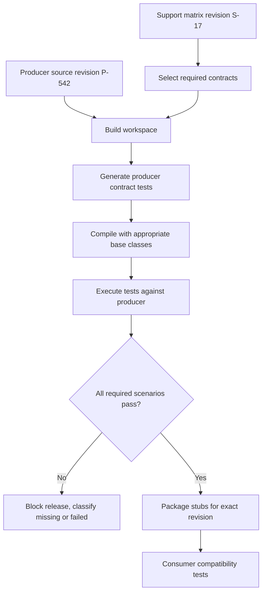
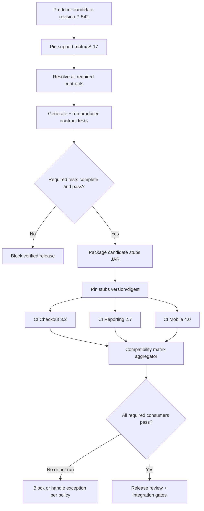
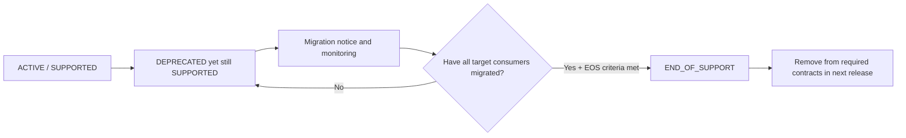

# Verifying Contracts of Still-Supported Consumers

## 1. Why Isn't "The Latest Consumer Works Fine" Enough?

In **Spring Cloud Contract**, a **producer** is a service providing an HTTP API or emitting messages; a **consumer** is a service calling the API or receiving messages. Teams describe interfaces with the **Groovy/YAML DSL**, generate producer-side tests, publish **stubs**, run consumer tests with **Stub Runner**, and integrate CI to detect incompatible changes.

Suppose `order-service` serves three consumers:

- `checkout-service` version 3.2 reads the `status` field from the HTTP response.
- `reporting-service` version 2.7 also reads `status` yet updates on a monthly cycle.
- The new `mobile-gateway` version 4.0 has switched to the `state` field.

The producer wants to change JSON from:

```json
{"orderId":"ord-42","status":"CONFIRMED"}
```

to:

```json
{"orderId":"ord-42","state":"CONFIRMED"}
```

Tests for the new `mobile-gateway` may turn green. However, still-supported **checkout** and **reporting** may break when the new producer deploys. If CI only runs contracts for the newest consumer, a green result is not proof that the producer is compatible with the **target consumer set**.

**Core principle:** Every producer build preparing for release must be verified against **all active contracts of consumers the organization is still committed to supporting**, while consumer tests must run against the matching stub/artifact. Consumers that have reached end-of-support should be removed from scope via a **traceable decision**, rather than accidentally disappearing from the source root or test filters.

Lesson objectives:

1. Define what makes a consumer **still supported**, distinguishing it from "the latest consumer."
2. Design a **compatibility matrix** across producer releases and active consumers/versions.
3. Preserve old consumer contracts when the producer adds new capabilities; distinguish compatible vs. breaking changes.
4. Organize contract sources, generated producer verification, stub publication, and consumer CI by version.
5. Apply controlled end-of-support/deprecation policies.
6. Practice investigating an HTTP or messaging change that impacts old consumers.

## 2. What Does a "Still-Supported" Consumer Mean?

A supported consumer is not necessarily the latest version or even one with an actively developed repository. It is **a version or group of versions with which the producer/API owner remains committed to maintaining communication for a defined period or under a published policy**.

Example policy:

| Consumer | Running Version | Support Status | What Producer Must Preserve |
| --- | --- | --- | --- |
| `checkout-service` | `3.2.x` | **Supported** | HTTP `GET /api/orders/{id}` with `status` |
| `reporting-service` | `2.7.x` | **Supported**, until migration ends | `status` and error code `ORDER_NOT_FOUND` |
| `mobile-gateway` | `4.0.x` | **Supported** | Can read `state` and `status` during transition |
| `legacy-exporter` | `1.1.x` | **End-of-support**, approved | No protection required after support window ends |
| `fraud-service` | `5.0-rc` | **Candidate** | Early check; not yet treated as a supported production consumer |

These versions and statuses are illustrative. Teams need trustworthy data sources: a service catalog, deployment manifests, product owners, consumer registrations, or support agreements. Never assume "no requests in this week's logs" means a consumer stopped using the API: it might run as a monthly batch, in a disaster-recovery flow, or in a region without telemetry.

### Three Lists to Distinguish

1. **Running consumers**: observed in deployments/telemetry.
2. **Still-supported consumers**: covered by compatibility commitments of the producer or organization.
3. **Experimental consumers**: have candidate contracts, yet are not deployed or approved.

These three sets may overlap yet are **not identical**. The set requiring protection before release is normally **still-supported consumers** plus any candidates the team chooses to include in the release gate; exception handling must be documented in policy.

### Specify Support Scope by Capability

A service might still support `checkout-service` 3.2 for `GET /api/orders/{id}` while not guaranteeing a separate experimental endpoint. Therefore, policy should link **consumer version → supported contracts/scenarios**, rather than merely listing service names. This is essential for verification to have a realistic scope.

## 3. Defining Compatibility by Version Pair

Notation:

- `P(v)`: producer version `v`.
- `C_i(w)`: consumer `i`, version `w`.
- `K_i(w)`: set of contract scenarios that consumer depends on.
- `S`: set of **still-supported** consumer/versions at release time.

A minimal requirement for a producer release:

\[
\forall C_i(w) \in S,\quad
P(v) \models K_i(w)
\]

Read: *For every still-supported consumer/version, the producer candidate must satisfy its corresponding contracts*. The symbol `\models` here expresses a **verification goal**, not an automated calculation built into Spring Cloud Contract.

The relationship to test is **producer version × consumer version**, not merely "latest contract version." One producer may support consumers 2.x and 3.x simultaneously; one consumer may be compatible with producers 1.5 and 1.6 yet not 2.0.

| Producer / Consumer | Checkout 3.2 | Reporting 2.7 | Mobile 4.0 | Releasable Under Section 2 Policy? |
| --- | --- | --- | --- | --- |
| `order-service 1.5` | Pass | Pass | Lacks `state` field | No, if Mobile 4.0 is mandatory |
| `order-service 1.6-rc1` | Fail (`status` missing) | Fail (`status` missing) | Pass | **No** |
| `order-service 1.6-rc2` | Pass | Pass | Pass | **Possible**, after remaining gates |

"Pass" in the table means **defined assertions and scenarios** executed successfully, not that every production behavior has been proven.

### Why Use a Matrix Instead of One System-Wide Boolean?

A single `compatibility = PASS` line easily hides that the producer only ran against Checkout 3.3 while Reporting 2.7 was never tested. A matrix exposes **unexecuted cells**, **failing cells**, **no-longer-required cells**, and causes. It also lets teams make per-group/per-region rollout decisions while multiple consumer versions run.

## 4. Process for Building the Required Contract Inventory

Before enabling release gates, establish a **compatibility inventory**:

| Contract ID | Producer | Consumer/Version | HTTP or Messaging | Status | Owner |
| --- | --- | --- | --- | --- | --- |
| `ORD-GET-200` | Order | Checkout 3.2, Reporting 2.7 | HTTP 200, `status` field | Required | Order + Checkout |
| `ORD-GET-404` | Order | Reporting 2.7 | HTTP 404, `code` | Required | Order + Reporting |
| `ORD-GET-V2` | Order | Mobile 4.0 | HTTP 200, `state` field | Required | Order + Mobile |
| `ORD-EVENT-1` | Order | Notification 2.1 | Message `OrderConfirmed` | Required | Order + Notification |
| `ORD-BETA-1` | Order | Fraud 5.0-rc | Experimental event | Candidate | Order + Fraud |

A contract can be **shared across multiple consumers** if they use the same interface. There is no need to duplicate `ORD-GET-200` across identical files; what matters is that the inventory knows **which consumers are impacted when that contract changes**.

### Where Can Inventory Data Come From?

- Service registry/catalog recording still-supported consumers and versions.
- Approved consumer and producer contract pull requests.
- Deployment manifests, release notes, and runtime telemetry spanning a representative window.
- Documented deprecation and end-of-support decisions.

Do not automatically delete a contract because a consumer hasn't updated its SDK or because the consumer repo had no commits this month. Before removing a matrix cell, require an **end-of-support decision** with appropriate rollout/notification evidence.

### Pinning the Verification Snapshot

Set `S` should be snapshotted at a defined point in the release. If the consumer list changes mid-CI because a team merged a PR, results become hard to reproduce. Record a `supportMatrixRevision` or equivalent build metadata; any subsequent list change must refresh verification/candidate gates per policy.

## 5. Breaking Change Example: From `status` to `state`

Suppose the old API is:

```http
GET /api/orders/42 HTTP/1.1
Accept: application/json
```

```json
{
  "orderId": "ord-42",
  "status": "CONFIRMED"
}
```

Mobile 4.0 wants field name `state` instead of `status`. A direct switch:

```json
{
  "orderId": "ord-42",
  "state": "CONFIRMED"
}
```

risks breaking Checkout 3.2 and Reporting 2.7. A **safer transitional change** could be:

```json
{
  "orderId": "ord-42",
  "status": "CONFIRMED",
  "state": "CONFIRMED"
}
```

Yet this is still only a **compatibility candidate**, needing real testing: a consumer deserializing JSON strictly might reject the new `state` field. If you introduce a separate API version like `/v2/api/orders`, new consumers can call v2 while old consumers stay on v1; in exchange, the producer must maintain multiple interfaces during the committed period.

### Migration Decisions to Record

1. Which consumers/versions read `status`?
2. Do any consumers reject extra JSON fields?
3. Does `state` share the exact same enum and semantics as `status`, or is it only a rename?
4. Is there an explicit deprecation plan: notice, end-of-support date, rollout check?
5. Will the producer emit both fields or create a new API version?
6. Which generated producer tests and Stub Runner consumer tests must run before release?

**Never delete an old field from a contract merely because new producer code stopped emitting it.** A contract is an agreement with still-supported consumers; editing one side to make tests pass does not prove consumers have migrated.

## 6. Groovy DSL: Protecting Interfaces Used by Old Consumers

A producer-owned contract for Checkout 3.2:

```groovy
import org.springframework.cloud.contract.spec.Contract

Contract.make {
    description 'Checkout 3.x reads order via current API'

    request {
        method GET()
        url '/api/orders/42'
        headers {
            accept(applicationJson())
        }
    }

    response {
        status OK()
        headers {
            contentType(applicationJson())
        }
        body([
            orderId: 'ord-42',
            status: 'CONFIRMED'
        ])
    }
}
```

This contract protects the producer returning the `status` field for a concrete scenario. The generated producer test sends the request and checks generated assertions; the WireMock stub provides the sample response. **Inspect the actual generated test** to know whether matchers permit extra response fields in your Spring Cloud Contract version — never assume every JSON check is always strict or always lenient.

### Adding New Requirements Without Deleting the Old Interface

If the producer chooses versioned endpoints, it can add another contract for Mobile 4.0:

```groovy
import org.springframework.cloud.contract.spec.Contract

Contract.make {
    description 'Mobile 4.x uses v2 interface'

    request {
        method GET()
        url '/v2/api/orders/42'
        headers {
            accept(applicationJson())
        }
    }

    response {
        status OK()
        headers {
            contentType(applicationJson())
        }
        body([
            orderId: 'ord-42',
            state: 'CONFIRMED'
        ])
    }
}
```

Both contracts have **different request paths**, so stubs pick mappings unambiguously: `/api/orders/42` for old consumers, `/v2/api/orders/42` for new consumers. This is not necessarily the best API design in all cases; the example aims to show **how one producer verifies two still-supported interfaces**.

### What About Keeping the Same Path and Returning Both Fields?

When the producer has a response containing both `status` and `state`, consider **one unified contract** describing the real response:

```groovy
response {
    status OK()
    headers {
        contentType(applicationJson())
    }
    body([
        orderId: 'ord-42',
        status: 'CONFIRMED',
        state: 'CONFIRMED'
    ])
}
```

**Never create two WireMock mappings on the same `GET /api/orders/42` with identical headers/queries where one returns only `status` and the other returns only `state`** and expect Stub Runner to guess which consumer is calling. Two mappings without distinguishing criteria will conflict or pick an unintended response. Use versioned paths, explicit version headers, or **one unified mapping** matching the agreed contract.

If an old consumer **rejects extra fields**, returning both can still fail; test that specific consumer. In that case, separate endpoints/media types/versions or execute a matching migration plan.

## 7. YAML DSL: Verifying Both Success and Error Cases Needed by Old Consumers

An old consumer may rely on error code `ORDER_NOT_FOUND` to display the right message. When updating DTOs to `state`, do not accidentally lose error contracts.

Example YAML contract for a 404 response:

```yaml
description: Reporting 2.x handles non-existent order
request:
  method: GET
  url: /api/orders/999
  headers:
    Accept: application/json
response:
  status: 404
  headers:
    Content-Type: application/json
  body:
    code: ORDER_NOT_FOUND
    message: Order not found
```

Consumer tests should assert **both HTTP status and `code`**, because WireMock returns a default 404 when a request matches no stub. A test asserting only status 404 can pass falsely even when the business error contract was never loaded.

### Avoid Locking onto Random Data

If the producer returns a dynamically generated `eventId`, `correlationId`, or timestamp, use a format/type matcher instead of locking onto a sample UUID. Never relax matchers for `status`, `state`, or error codes to `.*` just to turn tests green: those may be the exact values consumers depend on.

In Spring Cloud Contract DSL, for **requests**, consumer-side matchers typically govern how stubs match inputs; for **responses**, producer-side matchers help generated tests verify dynamic outputs. When translating between Groovy and YAML, verify the exact semantics of `consumer(...)`, `producer(...)`, and `request.matchers`/`response.matchers` in your plugin version.

### Contracts Do Not Automatically Prove the Whole Enum

If `status` has `CONFIRMED`, `PENDING`, `CANCELLED`, and `FAILED`, a contract covering only `CONFIRMED` **does not prove** the producer emits every value accurately. Inventory the statuses consumers rely on, add key scenarios, and verify enum versioning. For "consumer ignores unknown status" claims, test real fallback behavior rather than relying solely on contract matchers.

## 8. Organizing Contracts by Consumer and Version

Spring Cloud Contract allows organizing DSL files into folders. Grouping helps reviewers see **which scenario serves which consumer**, though how plugins scan folders, package stubs, or filter stubs can depend on build tool/version.

Example source tree **following an organizational convention**:

```text
src/contractTest/resources/contracts/
  order-service/
    checkout-3x/
      get-order-success.groovy
    reporting-2x/
      get-order-not-found.yml
    mobile-4x/
      get-order-v2.groovy
    notification-2x/
      order-confirmed.groovy
    candidates/
      fraud-5x/
        enriched-order-event.groovy
```

This is not a mandatory Spring Cloud Contract folder schema. In a multi-producer repository, clearly configure which producer root the verifier reads. **Do not assume folder name `checkout-3x` automatically enforces runtime versions**: tie it to your compatibility inventory and support policy.

### Three Ways to Organize Contracts While Preserving Correctness

| Approach | Strengths | Risks to Manage |
| --- | --- | --- |
| **Shared contracts by endpoint/event** | Avoids duplicating identical schemas; easy coordinated updates | Needs inventory to know which consumers depend on it |
| **Per-consumer contracts** | Consumers submit requirements and review per need | Multiple files may overlap on the same request, causing stub conflicts |
| **Contracts by API/event version** | Clean separation of v1/v2 interfaces | Must maintain old versions during support window |

A hybrid model is often effective: shared contracts protect shared interfaces, while consumer-specific contracts describe **genuinely distinct** scenarios. You do not need to copy the exact same contract into three folders merely to "count three consumers."

### When Consumer-Specific Contracts Share Method and URL

Two consumers may send the **same HTTP request** yet want different responses. That is a sign to **renegotiate the interface**—e.g., distinguishing via version header, route, or access permissions—rather than dropping two contracts into two folders and leaving mapping selection to WireMock. Stub Runner's consumer-specific filtering (where supported by version) helps select mappings for a test suite, yet **never guarantees a producer can return two contradictory responses in production**.

## 9. Producer Verification for All Active Contracts

**Producer verification** is the mandatory check of the API promise. In Spring Cloud Contract, the typical flow is:



Note that `required` is a **policy-driven support status**, not a built-in keyword in every Groovy/YAML contract. Before applying filters, CI must know which scenarios are required and why.

### Checklist for Producer Tests to Have Real Value

1. Input contract set includes required scenarios for **all supported consumers**.
2. Source root, include/exclude/ignored patterns, and contract paths are verified.
3. Generated tests actually compile and run, not merely generate source files.
4. Test framework and base class match: JUnit 5/4, Spock; MockMvc/real HTTP/messaging adapter.
5. Tests invoke the producer implementation at the right boundary; never mock the response being protected.
6. Test reports record `executed`, `failed`, `skipped`, and required scenario IDs.
7. Every contract output change goes through review and re-runs against the **target producer code**.

Do not stop at "generated test count `> 0`." If `reporting-service` is still supported yet its broken contract folder got excluded by a filter, 20 other tests may still pass. **Coverage gates must reconcile against the required scenario list**, not just total count.

## 10. Gradle/Maven: Feeding Supported Contracts into the Producer Build

A Gradle producer typically uses the Spring Cloud Contract plugin and `contractTest` task; a Maven producer typically uses `spring-cloud-contract-maven-plugin` in its lifecycle. What matters most is the **contract input** and **proof that tests ran**.

### Producer-Owned Gradle Example

```groovy
plugins {
    id 'java'
    id 'org.springframework.cloud.contract' version 'REPLACE_WITH_COMPATIBLE_SCC_VERSION'
}

contracts {
    testFramework = 'JUNIT5'
    testMode = 'MockMvc'
    baseClassForTests = 'com.example.orders.contract.OrderContractBase'
    contractsDslDir = file('src/contractTest/resources/contracts')
    failOnNoContracts = true
}

tasks.named('contractTest', Test) {
    useJUnitPlatform()
}
```

This snippet is an **illustrative skeleton**, not a turnkey build file: it needs compatible plugin/dependency/JDK/Spring Boot versions, repositories, and the base class on the test classpath. For non-Spring MVC producers, `MockMvc` may not fit; select another test mode. Crucially here, `contractsDslDir` must contain **contracts for still-supported old consumers as well**, not only new contracts.

Practice commands:

```bash
./gradlew generateContractTests
./gradlew contractTest
```

`generateContractTests` does **not** replace `contractTest`. Inspect generated Java/Groovy test files and execution reports. In multi-module Gradle builds, prefix with the module, e.g., `:order-service:contractTest`.

### Producer Maven Example

A Maven plugin configuration typically needs `baseClassForTests`, contracts in the source root, and a matching test framework:

```xml
<plugin>
    <groupId>org.springframework.cloud</groupId>
    <artifactId>spring-cloud-contract-maven-plugin</artifactId>
    <extensions>true</extensions>
    <configuration>
        <baseClassForTests>
            com.example.orders.contract.OrderContractBase
        </baseClassForTests>
    </configuration>
</plugin>
```

Plugin `version`, dependency management/BOM, test mode, generator, and JUnit runner must be configured in the real POM. Once lifecycle wiring is complete:

```bash
./mvnw -B clean verify
```

Maven and Gradle have **different source root/filter defaults** across versions; do not copy Gradle's `ignoredFiles` into Maven properties without checking plugin docs. With a separate contracts repository, the producer must also pin `contractDependency`/`contractsMode`/`contractsPath` or check out the exact Git source revision to guarantee the right contract set.

### How to Separate Candidates from Required Contracts?

Some projects use a `candidates` folder or metadata tags to mark experimental contracts. **That does not mean the plugin natively understands those labels.** Configure filters so that:

- **Required contracts:** are always included in release verification and official stub artifacts.
- **Candidate contracts:** can run in a separate job for early feedback; if the producer does not support them yet, they must not distort the "release required contracts pass" signal.
- **Retired contracts:** are removed from required only after a traceable end-of-support decision.

When verifying candidates, use a dedicated task/job and separate report metadata. Never lose `required` results during selective runs or enable ignore-failure flags so candidates won't block releases.

## 11. Consumer Tests with Stub Runner: Checking Each Supported Version

Consumer tests do not run the real producer, yet they verify the **consumer's real HTTP client or message listener** against a producer-verified sample stub. Therefore, they must run on the **exact consumer source/artifact versions** covered by support policy, not just on the `main` branch.

Example Checkout 3.2 using `@AutoConfigureStubRunner`:

```java
import org.junit.jupiter.api.Test;
import org.springframework.beans.factory.annotation.Autowired;
import org.springframework.boot.test.context.SpringBootTest;
import org.springframework.cloud.contract.stubrunner.StubRunnerProperties;
import org.springframework.cloud.contract.stubrunner.spring.AutoConfigureStubRunner;

import static org.assertj.core.api.Assertions.assertThat;

@SpringBootTest(properties =
    "clients.order.base-url=http://localhost:9090")
@AutoConfigureStubRunner(
    ids = "com.example:order-service:1.6.0-rc2:stubs:9090",
    stubsMode = StubRunnerProperties.StubsMode.LOCAL
)
class Checkout32ContractTest {

    @Autowired
    OrderClient orderClient;

    @Test
    void keepsReadingOldStatusField() {
        OrderDto order = orderClient.getOrder("42");
        assertThat(order.status()).isEqualTo("CONFIRMED");
    }
}
```

`OrderClient` and `OrderDto` are illustrative application types matching real Checkout 3.2. `clients.order.base-url` is also an illustrative consumer property, not a mandatory Stub Runner setting. Only when the HTTP client calls the **actual WireMock on 9090** and hits the matching mapping do you have valid consumer test evidence.

This skeleton uses `LOCAL`: the stubs artifact must be installed in the Maven local repository on the test runner; CI across independent repositories can use `REMOTE` with repository URLs and secure credentials.

### Do Not Use One Consumer Build to Represent All Versions

If Checkout 3.2 and 3.3 have different DTOs/HTTP clients, running a test on Checkout 3.3 does not prove Checkout 3.2 still accepts the response. Run **test code of the actual version**, using versioned branches, tags, container artifacts, or an environment capable of testing older binaries/SDKs. If an old consumer cannot be executed, document the evidence gap and consider supplementary API smoke/compatibility tests.

### A Consumer Might Still Be Testing Against an Old Producer Stub

A consumer still on Checkout 3.2 passing against `order-service:1.5.0:stubs` **does not prove** Checkout 3.2 works with producer `1.6.0` preparing for release. When validating a release candidate, run supported consumer versions against **stubs built from the exact verified producer candidate**, rather than silently reusing stale cached stubs.

### Per-Consumer Stubs: A Selection Tool, Not Permission to Break APIs

Some Spring Cloud Contract/Stub Runner versions support **filtering stubs by consumer** (commonly via `stubsPerConsumer` or matching consumer-name settings). This helps a consumer load only relevant stubs. However:

- Supported syntax and folder conventions vary by version/build tool; verify against docs for your exact version.
- A producer release must still verify **all required contracts**, not only the stub subset loaded by one consumer.
- Never use consumer filtering to hide two contracts with **identical requests yet contradictory production responses**.
- When a contract is shared, ensure filtering does not strip required mappings from another consumer.

**Separate "selecting stubs to test a consumer" from "proving the producer satisfies every supported consumer."** These are two distinct decisions with different scopes.

## 12. Messaging: Supporting Old Consumers Means Keeping Destination and Headers Too

In messaging, breaking changes are not limited to JSON fields. Consumers may depend on:

- Destination or binding logic such as `orders.confirmed`.
- Header `eventType: OrderConfirmed`.
- Payload schema/version.
- `orderId`, `eventId`, `occurredAt`, or correlation fields.
- Actual serialization format (JSON, Avro, Protobuf...), enum values, and nullability.

An illustrative Groovy contract:

```groovy
import org.springframework.cloud.contract.spec.Contract

Contract.make {
    description 'Notification 2.x receives OrderConfirmed'
    label 'order_confirmed_v1'

    input {
        triggeredBy('confirmOrder()')
    }

    outputMessage {
        sentTo('orders.confirmed')
        headers {
            header('eventType', 'OrderConfirmed')
            messagingContentType(applicationJson())
        }
        body([
            eventId: $(consumer('evt-701'),
                       producer(regex('evt-[0-9]+'))),
            orderId: 'ord-42',
            status: 'CONFIRMED'
        ])
    }
}
```

If the new producer switches to `orders.events.v2` and `eventType = OrderApproved` without emitting the old message, Notification 2.x may **receive no messages at all** even if the new JSON has all IDs. Producer verification against the old contract must catch destination/header mismatches if the adapter test is properly configured. Consumer tests using `StubTrigger` show only that the listener handles the **old stub**; they do not prove new producer code still publishes to the old destination.

### Messaging Transition Plan

During a concurrent support window, you can:

1. Have the producer keep publishing `OrderConfirmed` to destination v1 for old consumers.
2. Have the producer additionally emit event v2 on the new destination/event type for new consumers, if architecture allows.
3. Verify **both** message contracts with corresponding producer tests.
4. Test consumers v1/v2 with matching stubs and dedicated broker integration tests for routing, serializers, and acknowledgments.
5. Monitor rollout, duplicates, and idempotency if one business action emits multiple events to avoid double processing.

**Never assume contract verification checks exactly-once delivery, ordering, or transaction/outbox behavior.** When two event versions coexist, double processing is a business risk requiring dedicated testing.

## 13. Designing CI: Producer Candidates Must Pass All Required Contracts

A meaningful quality gate typically has **two tiers**:

1. **Producer-level gate:** the producer candidate satisfies **all required contracts** of the supported consumer set.
2. **Consumer-level gate:** each supported consumer version handles the stubs/scenarios corresponding to the producer candidate.



### Why Must the Producer Gate Run Before Publication?

If a stubs JAR is published under a verified label while the producer failed tests, consumers might pass against **simulated responses the real producer never produces**. Attach the producer verification gate directly to the package/publish workflow. Unverified candidate stubs may be used internally for parallel development, but must carry distinct versions/labels and never count as proof of producer compatibility.

### Are Consumer Gates Still Needed After Producer Verification?

**Yes**, because producer tests and consumer tests answer two different questions:

| Evidence | What It Checks | What It Does Not Check Automatically |
| --- | --- | --- |
| Producer generated contract test | Producer returns/emits data matching assertions | Whether consumer DTOs, error handling, or listeners process it properly |
| Consumer Stub Runner test | Consumer builds requests/deserializes/handles a committed sample | Whether current producer code actually fulfills the contract |
| Compatibility matrix | Whether target consumer versions ran against candidate stubs | Flows not represented in contracts |
| Broker/HTTP integration/E2E | Configured runtime and operational interactions | Does not replace full contract scenario coverage |

To save CI time, parallelize consumer suites, cache **immutable artifacts**, tier scenarios by risk, and gate by merge vs. release. Never silently drop a supported consumer just because its tests are slow; any exception requires an accountable owner and documentation.

## 14. Matrix Reporting: Distinguishing PASS, FAIL, NOT_RUN, and NOT_REQUIRED

A practical release-candidate table should include at least:

| Consumer/Version | Contract Revision | Producer Verifier | Consumer Test vs. Candidate Stub | Overall Status |
| --- | --- | --- | --- | --- |
| Checkout 3.2 | `ORD-GET-200@C-128` | PASS | PASS | **PASS** |
| Reporting 2.7 | `ORD-GET-404@C-128` | PASS | NOT_RUN | **INCOMPLETE** |
| Mobile 4.0 | `ORD-GET-V2@C-128` | PASS | PASS | **PASS** |
| Notification 2.1 | `ORD-EVENT-1@C-128` | FAIL | PASS against old stub | **FAIL** |
| Legacy Exporter 1.1 | No longer supported | NOT_REQUIRED | NOT_REQUIRED | **EXEMPT**, with EOS decision |

**Never treat "not run" as a green status.** A `NOT_RUN` cell may happen because CI cannot reach the consumer repo, lacks credentials, or hit an unavailable test environment; it is completely different from `NOT_REQUIRED` confirmed by product/engineering owners.

### Transparent Status Conventions

| Status | Meaning |
| --- | --- |
| **PASS** | Mandatory tests executed and passed with identified version/provenance |
| **FAIL** | At least one assertion executed and detected a mismatch |
| **NOT_RUN** | Not executed or missing report; **no evidence** |
| **SKIPPED** | Tests exist yet were skipped by config; requires explicit policy, never treated as pass by default |
| **NOT_REQUIRED** | Outside the approved support matrix for this release |
| **INCOMPLETE** | Missing one or more mandatory pieces of evidence |
| **CANDIDATE_ONLY** | Early experimental scenario, not yet a release commitment |

These are **team-designed CI reporting conventions**, not built-in Spring Cloud Contract DSL status values. Status names may differ across Jenkins/GitHub Actions/GitLab, yet their meanings should remain unambiguous.

### Record Provenance for Every Cell

An illustrative record:

```yaml
producer:
  service: order-service
  artifactVersion: 1.6.0-rc2
  sourceRevision: P-542
contracts:
  sourceRevision: C-128
  supportMatrixRevision: S-17
verification:
  expectedRequiredScenarios: 14
  executed: 14
  failed: 0
  skipped: 0
stubs:
  coordinates: "com.example:order-service:1.6.0-rc2:stubs"
  sha256: "<digest-from-CI>"
consumer:
  service: reporting-service
  version: 2.7.4
  sourceRevision: R-307
  scenariosPassed: 3
  scenariosFailed: 0
  result: PASS
```

The revision IDs, test counts, and digest are **hypothetical data illustrating the design**. In real pipelines, populate only values collected from actual builds; if a `sha256` was not computed, mark it missing rather than guessing. Likewise, derive `expectedRequiredScenarios` from your inventory/versioned policy instead of hard-coding a number that teams forget to bump when adding new contracts.

### When Scenario Count Differs from Contract File Count

One DSL file can express multiple contracts, or a framework may generate multiple test methods per source file. Quality gates should therefore track **contract/scenario IDs or generated test identities**, not merely count `.groovy` and `.yml` files. If 20 files are provided yet 1 critical file was filtered out, an executed count of 19 must still fail against the inventory.

## 15. Support Windows and Old Contract Retirement Process

Keeping every contract forever incurs significant cost; deleting them too early breaks consumers. Maintain a clear **deprecation lifecycle**:



Example timeline:

1. Announcement date: `status` will be replaced by `state`, with documentation and new-version examples provided.
2. During the support window: producer retains `status` or API v1; CI continues running **old required contracts**.
3. Consumer teams update, test against candidate v2 stubs, and verify production rollout.
4. Agreed deadline passes: owners finalize `END_OF_SUPPORT`, listing any straggling consumers and exception plans if applicable.
5. Only then remove the old contract from the **required set** and let the producer drop old behavior in the appropriate release.

Do not declare EOS solely because an old consumer repository was archived: an old binary might still be deployed. Conversely, keeping old source code in Git does not oblige indefinite support once the policy window has closed.

### Evidence to Collect Before Retirement

- List of all notified consumers/versions and deadlines.
- Rollout confirmation across critical environments/regions or documented exceptions.
- Telemetry covering an observation window matching real execution cadence (including batches).
- Sign-off from API owner/product owner or enterprise policy.
- Release notes, migration instructions, and rollback plan.
- Source revision of the support matrix recording the status transition.

**Retirement must be a reviewed change in the support matrix**, never an unexpected `ignoredFiles` filter slipped in to speed up CI.

## 16. Verifying Breaking Changes with Negative Smoke Tests

A strong test suite proves **it will fail when the producer accidentally breaks a promise**. This exposes gaps caused by overly broad matchers, missing contracts, or skipped tests.

### Intentional Mutations to Test Your Safety Net

| Trial Mutation | Contract That Must Catch It | Expectation |
| --- | --- | --- |
| Remove `status` from v1 response | Checkout 3.x, Reporting 2.x | v1 producer test fails |
| Change `orderId` from string to number | String-deserializing consumers | Schema/type matcher test fails |
| Change HTTP `404` to `200` for missing order | Reporting error contract | Error producer test fails |
| Drop `code = ORDER_NOT_FOUND` | Reporting error handler | Producer test and consumer assertion fail |
| Move `OrderConfirmed` to new destination without keeping v1 | Notification 2.1 | Producer messaging contract fails |
| Change `eventType` header | Notification 2.1 | Contract header assertion fails |
| Add `state` field when consumer is strict | Checkout 3.2 real deserializer test | Consumer test catches if extra fields rejected |
| Omit a required contract from generator | Support matrix coverage gate | CI fails even if remaining tests pass |

**Distinguish producer tests from consumer tests**: a producer mutation changing a field makes **producer verification fail** against the altered code, yet consumer tests may still pass against old stubs; that is why both gates exist. When adding a JSON field to a response, whether tests fail depends on matchers/serializers and specs; never assume one strictness level applies to all versions by default.

### A "0 Tests" Run Can Never Pass

Suppose CI runs `./gradlew contractTest` yet a misconfigured `contractsDslDir` results in **0 tests** in the report; the build still exits 0 due to task configuration. Without an inventory check in the release gate, the producer could publish with zero contract evidence.

A sound check requires **required scenario present + generated source + executed test + assertion passed**. `failOnNoContracts` (where supported by your plugin version) catches an empty contract root, yet cannot detect one consumer group missing from a 20-contract set.

### Do Not Turn Negative Tests into Broken Releases

Mutation tests should run in controlled test jobs or use isolated fixtures to prove the gate works. Never commit intentional producer breakage to a release branch. The goal is verifying that your verification system detects regressions, not serving broken responses to real consumers.

## 17. Request Compatibility: What Are Old Consumers Still Allowed to Send?

Not every breaking change lives in the **response**. A producer can change validation, authentication, query parameters, URL paths, or headers unfamiliar to old consumers.

Current API example for Checkout 3.2:

```http
POST /api/orders HTTP/1.1
Content-Type: application/json

{"customerId":"cust-123","quantity":2}
```

The new producer wants to require query parameter `source` and header `X-Client-Version`:

```http
POST /api/orders?source=checkout HTTP/1.1
Content-Type: application/json
X-Client-Version: 4

{"customerId":"cust-123","quantity":2}
```

If the producer rejects requests missing these two new inputs, old consumers may receive `400`/`401`/`422` instead of the promised response. Compatibility checks must therefore protect **requests old consumers still send**, not only responses old consumers want to read.

### Matrix of Request Changes

| What Did Producer Change? | Risk to Old Consumers | Verification Approach |
| --- | --- | --- |
| Require new query `source` | Old clients omit it | Keep old request contract, run producer verification |
| Require header `X-Client-Version` | Old clients lack header | Test old path still accepted or version the API |
| Change `POST` to `PUT` | Clients still send POST | Old method contract must pass if supported |
| Change `/api/orders` to `/orders` | Clients call old path | Provide alias/version endpoint or migrate |
| Require an extra JSON field | Old clients omit field | Test producer still accepts old body |
| Change `quantity` from number to string | Different serializer/validation | Contracts assert both request and response types |
| Tighten `customerId` regex | Previously valid data rejected | Test representative old values, especially edge cases |
| Change auth scheme | Old consumers lack new credentials | Security integration/compatibility tests |

### Note: Sample Tests Do Not Cover the Entire Input Domain

A contract sending `customerId = cust-123` does not prove every code from `cust-001` to `cust-999` is accepted. Consumer-side matchers let stubs accept many values, yet generated producer tests typically send **one sample value**. When compatibility policy covers input domains, add **boundary/validation tests** on the producer or multiple representative contract scenarios.

### "Relaxing the Contract" Does Not Relax the Implementation

If a developer edits the DSL so the request matcher allows missing `source` while the real controller still uses `@RequestParam(required = true)`, producer verification must fail when the generated test omits the query parameter. Conversely, if generated tests only send requests *with* `source`, they never verify backward compatibility for requests *without* `source`. Design **explicit legacy test inputs**.

## 18. Diagnosing When the New Producer "Passes" Yet Old Consumers Break

| Symptom | Likely Cause | First Step |
| --- | --- | --- |
| Producer tests pass, Checkout 3.2 fails deserialization | Response has extra fields/changed data types | Diff actual response/candidate stub against Checkout 3.2 DTO |
| Producer tests pass, Reporting 2.7 gets unexpected 404 | Path/query or authorization changed | Check Reporting's real request vs. old contract request |
| Consumer tests pass with 1.5.0 stubs, prod runs 1.6.0 | **Stale stub** does not reflect new producer | Reconcile artifact version/digest and generated tests |
| Producer tests pass yet Notification receives no events | Destination/header, broker binding, or listener mismatch | Check messaging contract, adapter, and broker integration |
| A supported consumer has no job in matrix | Incomplete inventory or disconnected CI | Check `supportMatrixRevision`/owner and `NOT_RUN` status |
| Tests generated yet never executed | Wrong JUnit engine, source set, task/filter | Inspect test report executed/skipped counts and task graph |
| Missing 404 error contract | Filtered out or wrong source root | Inspect contract inventory and generated mappings |
| Both sides pass yet prod auth fails | Contract tests bypass security/gateway | Add security/integration tests |
| "Same version" yet different artifact hashes | Overwritten release artifact or stale cache | Verify registry provenance and checksums |
| EOS consumer still blocks required gate | Stale support matrix | Review EOS decision and versioned inventory |
| Candidate contract breaks required gate | Candidate scope not isolated | Separate test scopes; never edit required contracts to mask it |
| Two contracts on same GET/path return different bodies | Competing stub mappings, conflicting interface | Design versioned route/header or unified response |

### A Reliable Investigation Order

```text
1. Support: is this consumer/version still in the supported set?
2. Source: which contract describes the request/response/message it needs?
3. Input: did producer verification read the right source revision?
4. Execute: did generated tests actually run on the new producer revision?
5. Stub: did consumer CI download the right candidate stubs artifact/digest?
6. Consumer: which HTTP client/listener ran and what did it assert?
7. Runtime: does the failure happen only via broker/DB/gateway/security?
8. Release: does the deployed binary/image match the verified revision/digest?
```

Never immediately rewrite contracts to match new behavior when a still-supported consumer reports a failure. First determine **whether the old promise still holds**, which scenario lacked coverage, and whether the producer genuinely violated it.

## 19. Practice Lab: Releasing Order Service 1.6 Without Breaking 2.x/3.x Consumers

### Context

Producer `order-service` is preparing `1.6.0`. The team has:

| Consumer | Version | Supported? | What It Needs |
| --- | --- | --- | --- |
| `checkout-service` | 3.2 | Yes | `GET /api/orders/42` with `status` |
| `reporting-service` | 2.7 | Yes | `GET /api/orders/999` returning `404 ORDER_NOT_FOUND` |
| `mobile-gateway` | 4.0 | Yes | `GET /v2/api/orders/42` with `state` |
| `notification-service` | 2.1 | Yes | Event `OrderConfirmed` on destination `orders.confirmed` |
| `legacy-exporter` | 1.1 | No, EOS | No longer required |

A developer changes `OrderController` to return only `state` and renames `OrderConfirmed` to `OrderApproved`. Mobile 4.0 tests pass, yet producer CI currently reads only the new contracts.

### Task A — Identify Gaps

Classify:

1. Why is running only the `GET /v2/api/orders/42` contract insufficient?
2. Why can changing the event type break Notification even if the JSON body looks similar?
3. Why does Legacy Exporter 1.1 not require a test in this release gate?
4. Why are `404` scenarios still required even though mobile doesn't use them?

**Guided answer:** Checkout 3.2 and Reporting 2.7 are still supported; Notification needs the old header/destination; Legacy Exporter has an EOS decision, whereas Reporting still relies on `ORDER_NOT_FOUND`.

### Task B — Build the Version Inventory

Create a table with columns: `consumerId`, `versionRange`, `requiredContractIds`, `supportState`, `supportUntil`, `owner`. Distinguish `REQUIRED`, `CANDIDATE`, and `RETIRED` per team policy. Assign a revision to the inventory (e.g., `S-17`) so CI can trace it.

Do not assume SCC natively understands version ranges: this is organizational metadata that the pipeline must translate into a **concrete scenario set**.

### Task C — Design the DSL Sources

Use four contracts:

1. Groovy: `GET /api/orders/42` → body with `status = CONFIRMED`.
2. YAML: `GET /api/orders/999` → `404`, `code = ORDER_NOT_FOUND`.
3. Groovy: `GET /v2/api/orders/42` → body with `state = CONFIRMED`.
4. Groovy messaging: `OrderConfirmed` sent to `orders.confirmed`, `eventType` header preserved.

Use the examples in sections 6, 7, and 12 as templates. Ensure you never create two mappings with identical requests and conflicting responses, and never remove old contracts from the source root just because v2 is under development.

### Task D — Run Producer Verification

1. Configure Gradle/Maven according to the producer's actual Spring Cloud Contract version.
2. Verify contract discovery: all four required scenarios present, none filtered out.
3. Generate and **run** producer tests (do not stop at generation).
4. Temporarily make the controller return only `state` on the old route to observe the `status` test fail.
5. Temporarily stop the producer from emitting `OrderConfirmed` to observe the messaging contract test fail or time out with the right adapter.
6. Fix the implementation to honor all supported promises; archive the test report showing executed/failed/skipped counts.

Illustrative Gradle commands:

```bash
./gradlew generateContractTests
./gradlew contractTest
```

These are **practice commands**, not commands executed on a workspace while authoring this lesson. Check plugin versions/task graphs in your own project.

### Task E — Run Each Consumer Against Candidate Stubs

After producer verification passes:

1. Package `order-service:1.6.0-rc2:stubs` from the exact tested revision.
2. Run Checkout 3.2 via Stub Runner; assert `status`.
3. Run Reporting 2.7; assert HTTP 404 with `ORDER_NOT_FOUND`, avoiding unmatched 404s.
4. Run Mobile 4.0; assert `state` on the v2 endpoint.
5. Run Notification 2.1 with Stub Trigger/matching adapter; assert the listener processes the event.
6. Aggregate results into the compatibility matrix without skipping any job due to timeouts or missing credentials.

### Task F — Evaluate Results

Suppose you receive this report:

```text
Support matrix: S-17
Producer revision: P-542
Required contract scenarios: 4
Producer generated tests executed: 4
Producer verification: PASS
Stub artifact: order-service:1.6.0-rc2:stubs
Checkout 3.2: PASS
Reporting 2.7: NOT_RUN
Mobile 4.0: PASS
Notification 2.1: PASS
Legacy Exporter 1.1: NOT_REQUIRED (EOS)
```

**Question:** Can you declare "all supported consumers have been verified"? **No.** Reporting 2.7 is still in the supported set yet its job never ran. Run the test or obtain a formal release exception per policy, documenting remaining risk. Legacy Exporter's `NOT_REQUIRED` is not the same as Reporting's `NOT_RUN`.

### Extension

Add a requirement that the producer mandates `X-Client-Version` for API v2. How do you guarantee Checkout 3.2 is **still allowed to call the old API without that header**? Add a producer-side contract/test with the legacy input. If the system updates its auth gateway, add security/integration tests rather than expecting WireMock alone to prove deployment auth works.

## 20. Rollout, Rollback, and Supporting Multiple Producer Versions

Even when a release candidate passes, real deployment often happens per region or user cohort. For some window, **two producer versions may run concurrently**, such as `order-service 1.5.0` and `1.6.0`. The new producer must be compatible with supported consumers; meanwhile, new consumers may have to operate against the old producer if routing/rollback allows it.

| Situation | Relationship to Verify |
| --- | --- |
| Canary deploys 1.6 while rest stays 1.5 | Do consumers routed to **both 1.5 and 1.6** handle responses properly? |
| Mobile 4.0 deploys before producer v2 is everywhere | Mobile must tolerate producer v1 or be routed/gated behind a feature flag |
| Producer rolls back from 1.6 to 1.5 | Do new consumers needing 1.6-only fields/endpoints have a fallback? |
| A batch consumer runs at month-end | Does the producer preserve the contract that batch relies on? |
| Both v1/v2 events emit during migration | Do consumers distinguish versions and avoid double processing? |

### Support Matrices May Need an "In-Flight Producers" Dimension

If the system never runs two producer versions concurrently and consumers deploy strictly after producers, the matrix in section 3 may suffice. If you have canaries, rollbacks, or slow-updating mobile clients, expand testing across **currently served producer versions** × **supported consumer versions**.

For example, Mobile 4.0 calls `/v2/api/orders/42`, yet producer 1.5 lacks the v2 route. If Mobile 4.0 could hit producer 1.5 during a rollback, you need **client fallback**, **routing guarantees**, **ordered feature rollout**, or **disallowing rollback** without a plan. Producer 1.6 passing with Mobile 4.0 stubs does not prove Mobile 4.0 + Producer 1.5 works.

### Tie Compatibility Gates to Deployed Artifacts

Generating and verifying stubs from revision P-542, then deploying an image built from P-550 without re-verifying, **severs evidence from the target artifact**. Record producer image/JAR digests in release provenance, ensuring the deployed binary comes from the tested revision/artifact or an approved reproducible build pipeline.

This is a layer built on top of Spring Cloud Contract: the framework produces **test evidence**, while **release engineering** ensures the exact verified artifact gets deployed.

## 21. Common Mistakes When Verifying Supported Consumers

### Mistake 1 — Running Consumer Tests Only on `main`

`main` may use new DTOs/URLs that do not reflect consumer 2.x running in production. Pick **actual consumer versions in the supported set** and run their tests, or maintain an explicitly approved representative compatibility harness.

### Mistake 2 — Assuming Green Producer `contractTest` Means No Breaking Changes

Producer tests check only the contracts **included in the build**. If an old consumer lacks a contract, was filtered out, or lacks field assertions, green says nothing about that consumer. Inspect the **required inventory** before interpreting pass/fail.

### Mistake 3 — Treating All `400` or `404` Responses as One Scenario

Old consumers may depend on JSON error code `ORDER_NOT_FOUND`, not merely the HTTP status. If a stub returns 404 due to an unmatched mapping, a consumer test asserting only 404 passes falsely. Test status, content type, error code, and required fields.

### Mistake 4 — Editing Contracts to Fit New Code and Deleting Old Expectations

When a producer accidentally drops `status`, changing Checkout 3.x's DSL to `state` to make producer tests pass **does not magically make deployed Checkout 3.x understand `state`**. Review support policy, migration status, and real behavior before altering promises.

### Mistake 5 — Assuming "No Observed API Calls" Means End-of-Support

Infrequent batch jobs, low-traffic regions, or offline apps may emit zero logs during a short observation window. End-of-support must be an explicit decision with owner, notice, and effective date—not an automatic inference from short-term telemetry.

### Mistake 6 — Merging Old/New Contracts with Same Request and Different Responses

Two stub mappings for the same GET/path/headers/query returning different JSON can cause non-deterministic mapping selection. Design **request versioning** or a compatible unified response rather than relying on file load order.

### Mistake 7 — Consumer Uses Floating `latest` or SNAPSHOTs

Consumer CI may pull different stubs at different times, making results non-reproducible—or stubs may not even come from the producer revision slated for deploy. Pin versions/digests and log the actually downloaded artifact.

### Mistake 8 — Ignoring Messaging Failures Because HTTP Tests Passed

Notification 2.1 may require `OrderConfirmed` on destination v1. When the producer alters destination or `eventType`, HTTP contracts stay green. Messaging producer verification and consumer listener tests must be **separate cells in the matrix**, never lumped together and overlooked.

### Mistake 9 — Treating Stub-Based Consumer Tests as Producer Verification

WireMock/StubTrigger simulates declared data; it never invokes the current producer's controllers or publishers. Run producer contract tests against release-candidate code and generate stubs from that exact verified source.

### Mistake 10 — Counting Tests Instead of Tracking Contract Identities

`10 tests executed` might omit Reporting 2.7's `ORD-GET-404` contract. Effective gates track **scenario IDs, owners, and support matrix revisions**, not raw totals. Every skipped test or filtered source must be accounted for before release.

## 22. Checklist Before Claiming "Compatible with All Supported Consumers"

- [ ] Maintain a versioned **support matrix** specifying consumers/versions, owners, contract scope, and support windows.
- [ ] Distinguish running consumers, still-supported consumers, and candidate consumers.
- [ ] Identify which producer versions remain live during rollout/rollback.
- [ ] Active old contracts are not deleted when adding new endpoint/event versions.
- [ ] Old requests (method, URL, query, headers, body) remain verified if covered by support commitments.
- [ ] Old responses (status, headers, body, fields, error codes) remain verified.
- [ ] Message contracts preserve destination, event type, payload/schema, and serialization needed by old consumers.
- [ ] Contracts are organized so no mappings share identical requests with conflicting responses.
- [ ] Producer build pulls **the complete set of required contracts** per the support matrix revision.
- [ ] Generated producer tests are generated, compiled, and executed; zero-test runs or unapproved skips are blocked.
- [ ] Base test class, test mode, and messaging adapter exercise the real producer implementation at the right boundary.
- [ ] Producer verification passes on the **exact producer code/artifact revision** slated for release.
- [ ] Candidate stubs artifact is built from the **same contract revision** that passed verification.
- [ ] Stub version/digest and producer revision/test reports have traceable provenance.
- [ ] Each still-supported consumer version ran **that version's client/listener tests** against matching candidate stubs (or has an approved exception).
- [ ] Consumer tests assert both success and error scenarios, never mistaking unmatched WireMock 404s for business errors.
- [ ] Matrix clearly distinguishes PASS, FAIL, NOT_RUN, SKIPPED, NOT_REQUIRED, and CANDIDATE_ONLY.
- [ ] End-of-support/deprecation was announced, reviewed, and recorded in the support matrix before retiring contracts.
- [ ] Rollout/canary/rollback never exposes new consumers to incompatible old producers without a fallback/routing plan.
- [ ] Non-contract invariants such as DB, auth, broker delivery, idempotency, and concurrency have suitable integration/E2E tests.
- [ ] Releases are gated on **mandatory evidence** passing, not a lone `BUILD SUCCESS` line.

### Final Self-Check Questions

| Question | Target Answer |
| --- | --- |
| Is the old consumer still supported? | Backed by policy and owner, not guessed from Git/telemetry |
| Which contracts belong to that consumer? | Tracked by inventory/contract ID and revision |
| Has the new producer run them? | Backed by test report, executed count, and detailed results |
| Is a green consumer test against an old stub enough? | **No**; requires exact candidate stubs + producer verification |
| When can an old contract be removed? | After end-of-support with review and migration evidence |
| What if canary/rollback allows multiple producer versions? | Must verify all combinations that can occur |
| What if both producer and consumer are green yet prod fails? | Check coverage, config, broker/DB/security, and integration tests |

**Key Takeaway:** Verifying contracts of **still-supported consumers** is about protecting a **set of version relationships**, not just testing the newest consumer. Spring Cloud Contract supplies Groovy/YAML DSL sources, generated producer verification, and consumer stubs, while the team must manage the **support matrix, contract inventory, artifact provenance, and CI gates**. Only when the producer candidate still satisfies required contracts, target consumers handle the matching stubs, and the deployed artifact matches the tested revision can the team claim compatibility **within the verified scenarios**.
