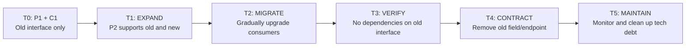
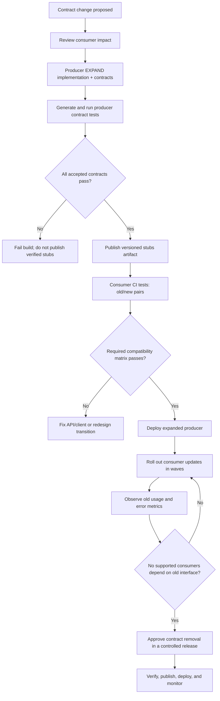

# Transition Phases When Changing APIs or Schemas

## 1. The Problem: Producer and Consumers Do Not Deploy at the Same Time

In a multi-service system, deployments of `Order Service` and `Checkout Service` rarely happen simultaneously. `Order Service` (producer) may change its API in a new release, while `Checkout Service`, `Reporting Service`, and a legacy mobile app are still calling the previously published API.

Suppose the response of `GET /api/orders/42` currently returns:

```json
{
  "orderId": 42,
  "customerName": "Mai",
  "status": "CREATED"
}
```

The producer team wants to rename `customerName` to `buyerName` for more consistent business terminology. If they simply rename the field and deploy immediately, old consumers may receive `null`, fail deserialization, or display a missing customer name.

The same issue occurs with **message schemas**: `Order Service` emits `OrderCreated` to multiple subscribers, yet it cannot force all subscribers to upgrade simultaneously. An event emitted under a new schema can become unreadable to consumers running the old schema.

With **Spring Cloud Contract**, Groovy/YAML DSL specifies committed interactions; **Contract Verifier** generates tests to verify the real producer; stub artifacts and **Stub Runner** let consumers test before upgrading. Still, these tools verify only declared contracts and scenarios: **coordinating the transition phase** must be deliberately designed.

In this lesson under the **Versioning and Compatibility** chapter, we will:

1. Understand why a "design-correct" change can still break old consumers.
2. Apply the **expand → migrate → contract** strategy.
3. Write HTTP Groovy/YAML contracts for the phase supporting both old and new fields.
4. Distinguish compatible vs. breaking changes by **producer/consumer direction**.
5. Plan transitions for endpoints, request bodies, status codes, and message schemas.
6. Use stub versions, producer verification, consumer tests, and CI matrices.
7. Define criteria for retiring old behavior, monitoring, rollback, and incident handling.

## 2. Compatibility Means Compatible with Whom?

Saying "the new API is backward compatible" is too vague without stating **which version of which side**. There are two practical questions:

- **Can the new producer serve old consumers?** This is usually the minimum requirement when deploying the producer first.
- **Can the new consumer work with the old producer?** This is required if consumers may deploy first, one side rolls back, or the system runs multiple versions concurrently.

Example matrix:

| | Producer P1 (old) | Producer P2 (new) |
| --- | --- | --- |
| **Consumer C1 (old)** | Must work | **Must work during the transition phase** |
| **Consumer C2 (new)** | May need to work if reverse-order rollout/rollback occurs | Must work |

Do not assume all four cells automatically succeed. Choose a **deployment order** and explicitly state which version pairs must be supported.

### 2.1. Syntactic Compatibility vs. Semantic Compatibility

A change can pass a JSON parser and still break business logic:

| Change | Syntactic Issue | Semantic Issue |
| --- | --- | --- |
| Rename `customerName` to `buyerName` | Old consumer loses key | Display name disappears |
| Change `amount` from number to string | DTO may fail | Currency/calculation errors |
| Keep `status: PAID` yet change its meaning | JSON remains valid | Consumer misinterprets when to ship |
| Change `201 Created` to `202 Accepted` | Response may parse | Completion becomes asynchronous |
| Add enum `PARTIALLY_REFUNDED` | Still a string | Old consumer may fail to handle new branch |

**Schema compatibility does not automatically guarantee behavioral compatibility.** Spring Cloud Contract can verify statuses, headers, bodies, matchers, and specific behaviors, while business-meaning changes must be captured in suitable contracts/tests or undergo dedicated review.

## 3. Three-Phase Model: Expand → Migrate → Contract

The safe strategy for many breaking changes is **expanding before contracting**:



Phases:

| Phase | What Producer Does | What Consumer Does | Transition Criteria |
| --- | --- | --- | --- |
| **T0 — Current** | Serves `customerName` | Reads `customerName` | Known legacy contract |
| **T1 — Expand** | Returns **both `customerName` and `buyerName`** | Old version keeps working | Producer tests pass for old and new interfaces |
| **T2 — Migrate** | Maintains both fields | Gradually deploys code using `buyerName` | Consumer tests pass against expanded producer/stub |
| **T3 — Verify** | Keeps old field for now | All relevant consumers migrated | Evidence of dependencies and real traffic |
| **T4 — Contract** | Removes `customerName` in a **controlled breaking release or new interface** | Only consumers on new schema remain | Deprecation agreement, compatibility gate, and rollback plan |
| **T5 — Maintain** | Cleans legacy code/metrics | Monitors post-release errors | Stable SLOs and operational metrics |

**You do not always need five separate deployments.** The number of releases depends on risk, consumer count, upgrade deadlines, and operational setup. What must never be skipped is a **coexistence window where both old and new interfaces live together** long enough for consumers to upgrade safely.

### 3.1. When Cannot You Expand Within a Single Response?

Some changes cannot be represented simultaneously without altering semantics:

- An endpoint switches from a synchronous result to an asynchronous job with a completely different contract.
- The same field name **changes units** from VND to cents, causing two consumers to interpret it differently.
- For the exact same request, the producer is expected to return two **contradictory** statuses/bodies.
- A new message format cannot be decoded by old consumers.

In those cases, use a **separate API version, media type, endpoint, or event type/destination** rather than trying to cram "both behaviors" into a single indistinguishable request.

## 4. Running Example: Renaming HTTP Field `customerName` → `buyerName`

Keep the same endpoint:

```http
GET /api/orders/42
Accept: application/json
```

### 4.1. Before the Change

Producer P1:

```json
{
  "orderId": 42,
  "customerName": "Mai",
  "status": "CREATED"
}
```

Consumer C1 reads `customerName` and knows nothing about `buyerName`.

### 4.2. Expand Phase

Producer P2 temporarily returns:

```json
{
  "orderId": 42,
  "customerName": "Mai",
  "buyerName": "Mai",
  "status": "CREATED"
}
```

Advantages:

- Old consumers still find `customerName`.
- New consumers can begin reading `buyerName`.
- During transition, the producer can verify consistency between both values.

**Note on JSON clients:** Adding a field to a response is **usually** compatible when consumers ignore unknown fields, yet not always. A consumer configured to reject unknown properties or compare raw response bodies verbatim may fail. Verify via each consumer's tests rather than assuming "adding a JSON field is always safe."

### 4.3. Consumer Migration Phase

Consumer C2 should prefer `buyerName`, while falling back to `customerName` whenever it may hit P1:

```java
import com.fasterxml.jackson.annotation.JsonIgnoreProperties;

@JsonIgnoreProperties(ignoreUnknown = true)
public record OrderView(
    long orderId,
    String customerName,
    String buyerName,
    String status
) {
    public String displayName() {
        return buyerName != null ? buyerName : customerName;
    }
}
```

This is a minimal Java/Jackson example: `displayName()` handles both response styles, and `@JsonIgnoreProperties(ignoreUnknown = true)` prevents failures on extra unnecessary fields. In real applications, consider validation, empty strings, `null`, semantic consistency, and how your mapper handles primitives/nullables.

Consumer tests must exercise both **producer P1** (`customerName` only) and **P2** (both fields) if deploy order or rollback can route C2 back to P1.

### 4.4. Contract Phase

Only once all supported consumers have moved to `buyerName` can the producer consider removing `customerName`:

```json
{
  "orderId": 42,
  "buyerName": "Mai",
  "status": "CREATED"
}
```

**This is a breaking change for any consumer still reading `customerName`.** If you must still support consumers that cannot upgrade (old mobile apps, partner APIs), continue serving the old interface or publish a new API version.

## 5. How Does Spring Cloud Contract Protect the Expand Phase?

A Groovy contract for the **expanded response**:

```groovy
import org.springframework.cloud.contract.spec.Contract

Contract.make {
    description 'Order API during field rename transition'

    request {
        method GET()
        url '/api/orders/42'
        headers {
            header('Accept', 'application/json')
        }
    }

    response {
        status OK()
        headers {
            contentType(applicationJson())
        }
        body(
            orderId: 42,
            customerName: 'Mai',
            buyerName: 'Mai',
            status: 'CREATED'
        )
    }
}
```

This contract defines a **single sample response** containing both fields with the same value `Mai`. Producer verification checks that the implementation returns data satisfying the generator's assertions; Stub Runner can serve that stub response to consumers.

**Watch matcher strictness:** Generated tests apply body/JSON checks according to test mode and declared matchers. If you want extra fields to be allowed without breaking consumers, inspect how JSON matching behaves in your exact Spring Cloud Contract version and configure matchers intentionally. Never assume old bodies always tolerate extra fields.

### 5.1. Equivalent YAML DSL

```yaml
description: Order API during field rename transition
request:
  method: GET
  url: /api/orders/42
  headers:
    Accept: application/json
response:
  status: 200
  headers:
    Content-Type: application/json
  body:
    orderId: 42
    customerName: Mai
    buyerName: Mai
    status: CREATED
```

Groovy and YAML express the exact same commitment. This file belongs to producer `Order Service`; it **does not automatically know which consumers have upgraded** unless the team maintains cross-service dependency records.

### 5.2. Do Not "Legalize" Breakage by Deleting Old Contracts Early

An anti-pattern:

1. Producer edits JSON to return only `buyerName`.
2. Deletes the contract containing `customerName` so generated tests pass.
3. Publishes new stubs and declares compatibility.

Deleting an assertion does not prove old consumers stopped depending on it. Contract tests check **only the obligations still defined**. Removing obligations before consumers have migrated yields a false-green compatibility pipeline.

The right process:

- Use the contract repository, consumer inventory, and PRs to identify who uses the old field.
- Keep old obligations intact during the expand phase.
- Add/update contracts for the expanded interface.
- Consumers run stub tests against the new version and confirm they handle it.
- Drop the old requirement only when agreed deprecation/migration criteria are satisfied.

## 6. Consumer-Driven Contracts: Who Owns Contracts in Each Phase?

When multiple consumers share `Order Service`, one organization style groups contracts by consumer:

```text
order-service/
  src/test/resources/contracts/
    checkout-service/
      get_order.yml
    reporting-service/
      get_order_report.groovy
    notification-service/
      order_created.groovy
```

`checkout-service` records the fields and cases Checkout depends on, `reporting-service` records what Reporting needs, and so forth. During transition, owners can inspect **which consumers still require `customerName`**.

However, **grouping by consumer does not allow the exact same HTTP request to return two contradictory responses in production**. If Checkout and Reporting both send the identical `GET /api/orders/42` request yet demand incompatible bodies, the producer needs either a **single unified response** satisfying both, or contracts differentiated by an API-supported URL/header/media type/version.

Stub Runner offers `stubsPerConsumer` to load only one consumer's mappings; this avoids collisions **on the stub server** without resolving conflicts in the real producer.

### 6.1. Responsibility Matrix

| Role | During Expand | During Migrate | Before Contract |
| --- | --- | --- | --- |
| Producer owner | Implement support for both fields/interfaces | Maintain both and monitor | Confirm old interface can be retired |
| Consumer owner | Verify tolerance for extra fields | Update client, contracts, and tests | Confirm no old dependencies remain |
| Contract reviewer | Reject baseless removal of old assertions | Review new contracts and stub data | Approve breaking change |
| CI/release engineer | Enable producer verification, publish versioned stubs | Execute compatibility matrix | Enforce release gate/rollback |
| Operations/SRE | Monitor legacy traffic, decode errors, and statuses | Measure migration progress | Determine safe window and post-release monitoring |

## 7. Request Changes: Required, Optional, and Default Values

Response fields are not the only risk. In a request, a **newly required** field usually breaks old consumers immediately.

For example, P1 accepts:

```json
{
  "orderId": 42,
  "amount": 125000
}
```

P2 wants to add `currency`. If old requests omitting `currency` return `400`, consumer C1 will fail.

Transition strategy:

1. **Expand:** producer accepts old requests; when `currency` is missing, apply an explicit, safe default **if business rules permit**.
2. **Migrate:** consumers send `currency` explicitly.
3. **Verify:** producer confirms no consumers still rely on the default.
4. **Contract:** in a new API/version, `currency` can become required as agreed.

**Caution:** Currency is not a field you can safely guess by default in a multi-currency system. If no safe default exists, create a new endpoint/request version instead of silently assuming `VND`.

### 7.1. Request Change Matrix

| Change on Producer | Might Affect Old Consumers? | Recommendation |
| --- | --- | --- |
| Add **optional** request field | Usually no if missing field behaves as before | Keep old path, define sensible fallback |
| Turn optional field into required | Yes | Transition gradually or version API |
| Change `amount` type: number → string | Yes | Support both types temporarily or version schema |
| Rename query parameter | Yes | Accept old/new alias during transition |
| Tighten validation | Possibly | Retain contracts for still-valid legacy inputs |
| Add mandatory authentication | Yes if old clients omit credentials | Explicit credential rollout/deprecation plan |

With Spring Cloud Contract, create/keep contracts for both **valid old requests** and **valid new requests**, ensuring producer verification runs both. Adding a new stub response without running generated tests for old requests is insufficient to protect compatibility.

## 8. Changing HTTP Statuses, Headers, and Endpoints Requires Behavioral Analysis

### 8.1. `200` Differs from `202`

If the API previously returned `200 OK` after payment was persisted yet the new version returns `202 Accepted` meaning "processing," this is not merely swapping a number:

- Consumers may treat any `2xx` as final success.
- UI screens may report payment complete before processing finishes.
- Downstream systems may start shipping prematurely.

When moving from synchronous to asynchronous processing, introduce a **new endpoint/status contract and consumer migration plan**, rather than loosening status matchers to accept any `2xx`.

### 8.2. Headers Are Also an Interface

Headers like `Content-Type`, `Location`, `ETag`, `Retry-After`, or version media types can be critical to consumers. Switching `application/json` to an unsupported media type, dropping `Location`, or changing caching semantics can break clients.

During deprecation, teams can announce notices via docs, response headers (such as standard deprecation headers where applicable), and consumer channels. **Spring Cloud Contract does not enforce deprecation policies on its own**; if a header is part of the commitment, describe and test it.

### 8.3. Version Endpoints When You Cannot Expand the Same Interface

An explicit option:

```text
GET /api/v1/orders/42   -> response with customerName
GET /api/v2/orders/42   -> response with buyerName
```

During transition, the producer serves both `/v1` and `/v2`; contract tests verify both endpoints. Consumers move step by step to `/v2`.

Do not treat `/v2` as an automatic cure-all for every change. It adds operational cost: routing, security, docs, monitoring, bug fixes, and retiring `/v1`. Choose a new version only for incompatible changes or when explicit version boundaries are needed.

### 8.4. Example YAML Contract for a v2 Endpoint

```yaml
description: Get order API v2
request:
  method: GET
  url: /api/v2/orders/42
response:
  status: 200
  headers:
    Content-Type: application/json
  body:
    orderId: 42
    buyerName: Mai
    status: CREATED
```

For `/v1`, maintain a **separate** contract—do not delete it immediately after creating `/v2`. Producer verification must test both throughout the support period.

## 9. Rules When Transitioning Message Schemas

In an event-driven system, `Order Service` might emit:

```json
{
  "eventType": "OrderCreated",
  "schemaVersion": 1,
  "eventId": "evt-42",
  "orderId": 42,
  "customerName": "Mai"
}
```

`Notification Service`, `Analytics Service`, and `Inventory Service` may consume events via Kafka/RabbitMQ or another message binder. Because publishing and consuming are asynchronous, multiple producer and consumer versions can run concurrently; moreover, **old messages may be replayed after the new schema deploys**.

### 9.1. Expanding Message Schemas

Instead of immediately replacing `customerName` with `buyerName`, the producer can emit:

```json
{
  "eventType": "OrderCreated",
  "schemaVersion": 1,
  "eventId": "evt-42",
  "orderId": 42,
  "customerName": "Mai",
  "buyerName": "Mai"
}
```

If old consumers **ignore unknown fields**, they continue reading `customerName`. New consumers can read `buyerName`. However, with Avro, Protobuf, or a Schema Registry, whether "adding a field is safe" depends on **writer/reader schemas, defaults, optional/required rules, compatibility modes, and serialization formats**. Do not blindly apply dynamic JSON rules to every format.

### 9.2. Messaging Contract with Old and New Fields

```groovy
import org.springframework.cloud.contract.spec.Contract

Contract.make {
    description 'OrderCreated during field rename transition'
    label 'order_created_transition'

    input {
        triggeredBy('createOrderAndPublish()')
    }

    outputMessage {
        sentTo('orders.created')
        body(
            eventType: 'OrderCreated',
            schemaVersion: 1,
            eventId: 'evt-42',
            orderId: 42,
            customerName: 'Mai',
            buyerName: 'Mai'
        )
        headers {
            header('eventType', 'OrderCreated')
        }
    }
}
```

The base test class needs `createOrderAndPublish()` invoking the **real publisher**, plus matching message verifier/binder configuration. `outputMessage.sentTo` describes the logical destination; the contract does not spin up a broker or guarantee a Kafka topic exists.

This Groovy snippet is a **contract generating producer message tests**; it does not replace consumer tests reading v1/v2 events from a broker or Stub Runner.

### 9.3. When Schemas Cannot Coexist

For major breaking schema changes, use a **side-by-side** strategy:

```text
orders.created.v1  -> old event type/schema
orders.created.v2  -> new event type/schema
```

Or keep the same topic while cleanly distinguishing `eventType`, schema ID/version, and router/serializer mechanics if your ecosystem supports it. **Never assume a consumer reading the old topic will understand a new payload merely because the topic name stayed the same.**

When emitting two schemas in parallel, the producer may have to **dual-publish** for a period. This introduces **duplicate processing** risks for any consumer subscribed to both streams. Design `eventId`, lineage, and deduplication/idempotency, along with a plan to prevent double business side effects.

### 9.4. Do Not Substitute `schemaVersion` for a Compatibility Strategy

Adding `"schemaVersion": 2` does not magically make serializers support schema v2. Producers/consumers must define:

1. How to identify the right schema during deserialization.
2. How to handle old data during message replay.
3. Required/optional/default field rules.
4. Rules for retiring or never reusing names or field numbers per format.
5. Which consumer versions remain live.

With Protobuf, never reuse field numbers previously assigned to different meanings; with Avro, verify compatibility modes and default rules in the Schema Registry. With JSON, inspect how contracts and actual parsers handle added fields or type changes.

## 10. Distinguishing Three Commonly Confused Versions

| Version | Example | Answers the Question |
| --- | --- | --- |
| **Producer deployment version** | `order-service:2.8.0` | Which binary/code is running? |
| **Stub artifact version** | `com.example:order-service:2.8.0:stubs` | Which build's packaged contract samples are consumer tests using? |
| **Interface/schema version** | `/api/v2`, `schemaVersion=2` | Which interface shape/meaning is exposed? |

These versions are **related yet not identical**. A producer can ship multiple patch releases while API v1 stays unchanged; conversely, one producer release can serve both API v1 and v2 concurrently.

### 10.1. Stub Artifacts Must Reflect Verified Sources

Suppose producer `Order Service` publishes:

```text
com.example:order-service:2.8.0:stubs
```

Before publishing, verify:

- Which contract revision was used?
- Which producer commit ran the generated tests?
- Does the stub JAR include all v1/v2 mappings that must be preserved?
- Does any consumer need stubs per consumer?
- Is the artifact version pinned and immutable?

A stub artifact downloadable from Nexus/Artifactory does not by itself prove the producer code running in production is compatible. Producer verification evidence in the corresponding pipeline is mandatory.

### 10.2. Do Not Use `+` or Floating Snapshots as Release Baselines

```text
com.example:order-service:+:stubs
```

may resolve to a newer stub version between two test runs. Likewise, a snapshot can be republished with altered contents. In reproducible pipelines, use **deterministic artifact versions** and record resolved coordinates/producer commits in build metadata.

Never treat Semantic Versioning as an automatic guarantee. `2.8.0` sounding "minor" or "patch" does not establish compatibility; only concrete contracts, tests, and version reviews support that conclusion.

## 11. Consumer Tests with Stub Runner During Transition

Checkout can verify its new HTTP client against the stub artifact from the expanded producer:

```java
import org.junit.jupiter.api.Test;
import org.springframework.boot.test.context.SpringBootTest;
import org.springframework.cloud.contract.stubrunner.spring.AutoConfigureStubRunner;
import org.springframework.cloud.contract.stubrunner.spring.StubRunnerProperties;

@SpringBootTest(properties = {
    "order.client.base-url=http://localhost:8091"
})
@AutoConfigureStubRunner(
    ids = "com.example:order-service:2.8.0:stubs:8091",
    stubsMode = StubRunnerProperties.StubsMode.LOCAL
)
class CheckoutOrderContractTest {

    @Test
    void checkoutReadsTransitionResponse() {
        // Call real OrderClient against Stub Runner on localhost:8091.
        // Verify both buyerName and fallback if client supports P1.
    }
}
```

This is a **skeleton to complete**, not a self-verifying test since the body contains only comments. To run it:

- Stub JAR `order-service-2.8.0-stubs.jar` must exist in the Maven local repository for `LOCAL`, or switch to `REMOTE` with matching repository credentials.
- Checkout's real `OrderClient` must read the `order.client.base-url` property.
- The test must invoke the client and assert real values, not merely verify the stub server starts.
- Avoid fixed ports when multiple jobs run in parallel; consider `StubFinder` or per-run port configuration.

### 11.1. Why Test Against More Than One Stub Version?

During rollout, you may have:

```text
Producer P1 -> response with customerName only
Producer P2 -> response with customerName + buyerName
Producer P3 -> response with buyerName only (post-contract)
```

If consumer C2 can hit P1 during rollback or while load balancers still hold old nodes, testing **C2 against both P1 and P2 stubs** is necessary. After the contract phase, ensure current consumers handle P3.

There is no mechanical rule to "always test every version ever released." Identify the **set of version pairs that can genuinely meet** during rollout, scale-out, rollback, or partner support, and build a compatibility matrix for that set.

### 11.2. Example of Two Test Profiles

One organizational approach (configuration example, not mandatory filename):

```yaml
# Profile testing new consumer against expanded producer
spring:
  cloud:
    contract:
      stubrunner:
        stubs-mode: REMOTE
        repository-root: "https://repo.example.test/repository/maven-releases/"
        ids:
          - "com.example:order-service:2.8.0:stubs:8091"
```

If you need a separate profile for P1, replace `2.8.0` with the recorded P1 version and run matching consumer assertions. Never register **two conflicting mappings for the exact same HTTP request** on the same WireMock port expecting the server to infer "producer version."

## 12. Test by Phase, Not Only Against One Contract

A test plan can be structured as follows:

| Phase | Producer Verification | Consumer Test | Integration/E2E |
| --- | --- | --- | --- |
| T0 | Old contract passes with P1 | C1 + P1 stubs | Baseline |
| T1 — Expand | Contract protects `customerName` and `buyerName` on P2 | C1 + P2, C2 + P2 (if ready) | New API response does not break old clients |
| T2 — Migrate | P2 still supports both | C2 + P1 (if rollback needed), C2 + P2 | Canary/per-consumer traffic |
| T3 — Verify | Test all unretired obligations | Confirm remaining supported consumers | Check legacy traffic and active versions |
| T4 — Contract | New contract drops old field; v1 contract kept separately if still supported | C2 + P3; C1 must be retired/migrated first | Rollout, decode errors, rollback |

**Every "PASS" must be tied to a concrete version.** C1 passing against P1 does not mean C1 will pass against P3; C2 passing against P2 stubs does not mean real P2 code passed producer verification if the pipeline skipped tests.

### 12.1. Why Keep Multiple Contracts in Certain Phases?

During expand, you can keep old consumers' obligations while adding new consumers' obligations. For instance:

- Old Checkout still requires `customerName`.
- New Reporting requires `buyerName`.
- Producer P2 returns **both fields**, and generated tests ensure the respective obligations remain satisfied.

If the system already versions endpoints `/v1`/`/v2`, maintain separate contracts for each endpoint. On a single endpoint, avoid creating **two different WireMock responses for the exact same request**; use a unified expanded response or differentiate requests via a genuinely supported version media type.

### 12.2. Never Let Generated Tests Be Skipped

A build can package a stub artifact successfully while skipping generated contract tests due to Gradle/Maven config, test filters, or `skipTests` flags.

In CI, verify:

1. Do generated sources contain the expected tests?
2. Does the executed test count include contract tests?
3. Do tests actually invoke/trigger the producer implementation?
4. Do reports show pass or fail assertions for every critical contract?
5. Is publication blocked when verification fails?

**The presence of a JAR or mapping files never substitutes for executed test counts.**

## 13. CI and Rollout: Expand-First, Contract-Later Model



A pipeline can be divided into gates:

- **Contract review gate:** determine whether the change is additive or breaking and which consumers depend on it.
- **Producer verification gate:** Groovy/YAML tests are generated and run against producer code.
- **Stub publication gate:** publish only artifacts tied to passing producer/contract revisions.
- **Consumer compatibility gate:** run HTTP/message clients or subscribers against every stub version runtime may encounter.
- **Deployment gate:** canary, monitor real errors, and verify rollback readiness.
- **Removal gate:** drop the old interface only with evidence that no supported consumer still needs it.

### 13.1. Pipeline Tests Alone Cannot Tell You Traffic Is Zero

A consumer might:

- Run on a weekly schedule, producing zero traffic during a few hours of observation.
- Be a mobile app with a long upgrade lifecycle.
- Be operated by a third party invisible to internal CI.
- Call an endpoint only during rare failure recovery.

Therefore, **an interval with zero observed requests is not absolute proof**. Maintain a consumer inventory, owner sign-offs, retention/deprecation policies, sufficiently long metrics windows, and risk assessments tailored to the API.

## 14. Monitoring and Deprecation Policy

A sound deprecation plan should include:

| Element | Example |
| --- | --- |
| Change being migrated | `customerName` → `buyerName` |
| Parallel support start date | Per published release schedule |
| Affected consumers | Checkout, Reporting, partner integrations |
| Producer version supporting both | P2 (expand) |
| Legacy API/schema to retire | `customerName` in response or `/v1` |
| Communication channel | PRs, changelogs, API/deprecation notices |
| Completion criteria | Owner confirmation, passing contract tests, reliable telemetry |
| Rollback risk | Old producer cannot read new schema; DB/queues already altered |
| Recovery plan | Retain P2, re-enable old endpoint, revert appropriate feature flag |

To measure usage, use access logs, per-endpoint/per-version HTTP metrics, reliable correlation/consumer IDs, and subscriber telemetry. Never collect tokens, PII, or sensitive payloads merely to identify which consumer calls an endpoint.

### 14.1. Feature Flags Can Help, Yet Never Replace Contracts

Feature flags can toggle new output fields, dual-publishing, or data read paths during rollout. However, if a flag causes the same contract to produce two different responses, verify both states supported by the system.

**Never use a flag to drop an old field while old consumers still depend on it.** A flag is an operational rollout lever, not proof of compatibility.

## 15. Rollback and Database Schema Changes

An API migration sometimes requires database changes:

```text
Old DB: orders.customer_name
New DB: orders.buyer_name
```

If you update the API and immediately drop `customer_name`, rolling back to producer P1 can fail because old code still reads the deleted column.

Follow a parallel database schema strategy:

1. **Expand DB:** add column `buyer_name` while keeping `customer_name`.
2. **Dual-write/backfill:** keep old/new data consistent with clear source-of-truth rules.
3. **Migrate reads:** switch producer API and internal consumers to the new column.
4. **Observe:** verify consistency and check whether legacy queries still run.
5. **Contract DB:** drop the old column only when no running binary needs it and the rollback window has expired.

This is **database integration/migration testing**, not an automated feature of Spring Cloud Contract. Contract Verifier protects the declared interface; persisted data, rollback migrations, and transactions require separate tests.

### 15.1. Rollback Is Not Always Equivalent to Redeploying the Old JAR

Once P3 stops emitting old messages, old consumers may not decode v2 messages. If the DB dropped the column, P1 cannot run. If the system wrote v2 events to a topic with retention, rolling back to consumer v1 may encounter undecodable payloads.

Therefore, **rollback plans must account for persisted data and already-emitted messages**, not just producer/consumer artifacts. Sometimes the safest recovery is **rolling forward** with a small fix rather than reverting to an old binary.

## 16. Message Schema Changes: Beyond Content Lies Delivery

Messaging contracts can verify `input`, `outputMessage`, `sentTo`, headers, payloads, and matchers. During message transitions, also watch for:

| Risk | Cause | Supplementary Test |
| --- | --- | --- |
| Consumer fails to decode new event | Altered type or required field | Consumer tests against v1/v2 schemas |
| Consumer receives two copies | Dual-publish or at-least-once delivery | Idempotency/deduplication |
| Events arrive out of order | Partitioning/retries/parallel consumers | Ordering/replay tests |
| Old consumer replays stored messages | Retention/replay | Backward reader compatibility |
| Schema Registry rejects new version | Compatibility policy violated | Registry/schema validation |
| Producer emits to wrong topic | Unannounced destination change | Producer verifier + broker integration test |
| Wrong `eventType` metadata | Routing header/payload altered | Header contract/consumer handler tests |

**Stub Runner messaging** can emit stub messages to test consumer handlers, yet cannot prove Kafka/RabbitMQ enforces retries, ordering, ACLs, or transactional delivery. Run binder or real-broker integration tests for those properties.

### 16.1. Principles for Dual-Publishing

If you must emit `OrderCreatedV1` and `OrderCreatedV2` concurrently:

- Clearly define the **single** underlying business event and the relationship between both representations.
- Use `eventId`/business IDs so consumers can deduplicate when needed.
- Prevent a single consumer from subscribing to both streams and executing side effects twice.
- Monitor lag/offsets, processed message counts, and deserialization error rates.
- Base v1 retirement timing on subscriber inventory, not just producer readiness.

Not all brokers offer identical delivery guarantees; completion criteria must reflect your concrete deployment.

## 17. Common Pitfalls During Transition Phases

| Symptom | Common Mistake | Remediation |
| --- | --- | --- |
| C1 breaks after producer renames field | Removed `customerName` before C1 upgraded | Expand response, retain old field |
| Producer tests pass yet partner breaks | Partner contract was not tracked/tested | Update inventory and contracts reflecting dependencies |
| C2 fails with P1 during rollback | New consumer understands only `buyerName` | Fallback/test C2+P1 or forbid backward rollback |
| Same request has two conflicting stub responses | Each consumer defines a different response | Unified response or versioned endpoint/media type |
| Contracts deleted to turn build green | Obligations removed before migration finished | Deprecation review and keep producer verification |
| Consumer tests pass with stale stub | Artifact version not updated | Pin version per release, log resolved artifact |
| New message fails deserialization | Incompatible schema rules/defaults | Dual schemas and Schema Registry compatibility |
| Dual-publish causes double side effects | Missing deduplication/subscribing to both v1,v2 | Idempotency and migration plan |
| Rollback fails despite old JAR running | DB schema or retained events changed | Expand/contract DB, replay/rollback rehearsals |
| Unknown which consumers still use v1 | Missing owner/telemetry/API inventory | Create dependency inventory and deprecation schedule |
| `200` changed to `202` breaks business logic | Treated all `2xx` identically | Re-contract semantics, phase client upgrades |

### 17.1. Why Can "Adding a Field Is Safe" Be Wrong?

Because a consumer may:

- Set `FAIL_ON_UNKNOWN_PROPERTIES=true`.
- Hash the entire raw JSON body for comparison or signature verification.
- Use strict schema validation accepting only a fixed field set.
- Have mapping logic comparing the entire response body.

Even additive changes must be verified through contracts/consumer tests representing real client behavior.

### 17.2. Why Isn't "New Contracts Pass" Enough?

A contract suite describing only the new interface lacks assertions protecting old behavior. **Compatibility is a relationship between versions**, requiring verification of every needed version pair and keeping old contracts active until approved end-of-support.

## 18. Practice Lab: Upgrading the Invoice Lookup API

**Context:** `Invoice Service` is the producer. `Billing UI` and `Accounting Service` are two consumers. Currently:

```http
GET /api/invoices/900
```

P1 response:

```json
{
  "invoiceId": 900,
  "total": 220000,
  "status": "ISSUED"
}
```

The producer team wants to rename `total` to `totalAmount` and add `currency`. `Billing UI` can upgrade this week, while `Accounting Service` only has a release window at month-end.

### 18.1. Tasks

1. Classify `total` → `totalAmount`: additive or breaking if applied directly?
2. Design an **expand** response so both old and new Billing UI work.
3. Write a YAML contract for the expanded response of `GET /api/invoices/900`.
4. List the P1/P2 × C1/C2 matrix to test if Billing UI might roll back.
5. Propose criteria for removing `total` after Accounting upgrades.
6. If new Billing UI calls P1 lacking `totalAmount`, how should the client handle it?
7. If an `InvoiceIssued` event is also emitted over Kafka, can you switch its schema immediately just by editing the HTTP API contract?
8. Plan stub artifact publishing and CI gates.

### 18.2. Suggested Expand Response

```json
{
  "invoiceId": 900,
  "total": 220000,
  "totalAmount": 220000,
  "currency": "VND",
  "status": "ISSUED"
}
```

`total` and `totalAmount` must share the same unit during transition; if currency units change, reflect that in contracts and processing logic rather than blindly copying values.

### 18.3. Suggested YAML Contract

```yaml
description: Invoice during total field rename transition
request:
  method: GET
  url: /api/invoices/900
response:
  status: 200
  headers:
    Content-Type: application/json
  body:
    invoiceId: 900
    total: 220000
    totalAmount: 220000
    currency: VND
    status: ISSUED
```

### 18.4. Suggested Compatibility Matrix

| Consumer | P1 (`total` only) | P2 (both `total` and `totalAmount`) |
| --- | --- | --- |
| Old Billing UI | Must work | Must work |
| New Billing UI | If rollback/rollout waves hit P1, must support fallback | Must work |
| Old Accounting | Must work | Must work until Accounting upgrades |
| New Accounting | Per deployment policy | Must work |

A new consumer can fall back from `totalAmount` to `total` while P1 remains live; once the contract phase completes and consumers no longer need P1, the team can remove the fallback after review.

### 18.5. Exit Criteria and Summary Solution

Do not remove `total` until:

1. Both Billing UI and Accounting Service have actually deployed versions that do not depend on `total`.
2. Owners confirm the legacy interface support window has ended.
3. CI producer/consumer tests pass for all required version pairs.
4. Telemetry shows no remaining supported dependencies over a suitable observation window.
5. A rollback/roll-forward plan exists, covering invoice data and message schemas if applicable.

If Kafka `InvoiceIssued` also changes, you need **separate messaging contracts and schema compatibility tests**. Updating an HTTP YAML contract does not automatically update subscribers or guarantee broker event handling.

## 19. Checklist Before Removing an Old API/Schema

- Built a **old/new producer × old/new consumer** matrix covering pairs that can occur in practice?
- Does the change affect **data types, business meaning, HTTP statuses, headers, URLs, or message schemas**?
- Implemented an **expand** phase protecting consumers still on the old interface?
- Do consumers ignore extra fields and handle null/defaults properly—verified with real tests?
- Do Groovy/YAML contracts preserve old obligations throughout migration?
- Are generated producer tests generated and **actually executed** against the new implementation?
- Do stub artifacts have explicit versions, published after producer verification, and pinned in consumer CI?
- When running v1/v2 in parallel, are requests genuinely distinguishable or does an expanded response satisfy both?
- Does messaging account for subscriber lag, replay, Schema Registry, dual-publishing, duplicates, and idempotency?
- Do database migrations preserve rollback capability over the required window?
- Do you have a reliable consumer inventory, owner sign-off, telemetry, and deprecation schedule?
- Avoided deleting old contracts just to make the build pass?
- Prepared canary monitoring, alerting, and explicit rollback/roll-forward decisions?

**Reference documentation for your project version:**

- [Spring Cloud Contract — Reference](https://docs.spring.io/spring-cloud-contract/reference/).
- [Spring Cloud Contract — HTTP Contracts](https://docs.spring.io/spring-cloud-contract/reference/project-features-contract/http.html).
- [Spring Cloud Contract — Dynamic Properties](https://docs.spring.io/spring-cloud-contract/reference/project-features-contract/dsl-dynamic-properties.html).
- [Spring Cloud Contract — Messaging](https://docs.spring.io/spring-cloud-contract/reference/project-features-messaging.html).
- [Spring Cloud Contract — Stub Runner](https://docs.spring.io/spring-cloud-contract/reference/project-features-stubrunner.html).
- [Spring Cloud Contract — Stubs Per Consumer](https://docs.spring.io/spring-cloud-contract/reference/project-features-stubrunner/stub-runner-stubs-per-consumer.html).

**Key Takeaway:** **Changing an API or schema safely is not just writing a new contract and deleting the old one.** In multi-service systems, producers and consumers deploy asynchronously; you need an **expand** phase supporting old/new interfaces simultaneously, **migrate** each consumer with tests, **verify** real usage, and only then **contract** to remove legacy obligations. Spring Cloud Contract, producer verification, stub artifacts, and Stub Runner catch discrepancies, yet deciding when to contract must rely on **a compatibility matrix, owner sign-off, telemetry, a migration plan, and rollback readiness**.
