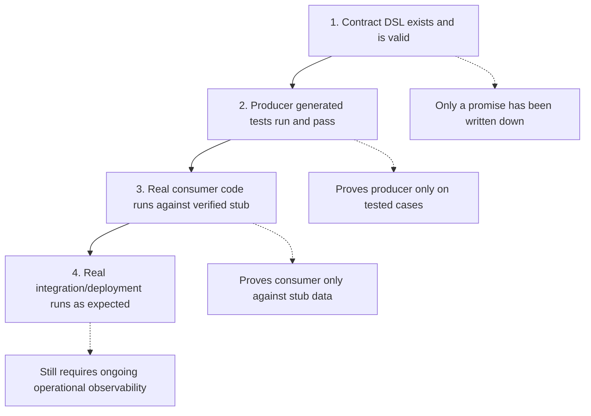
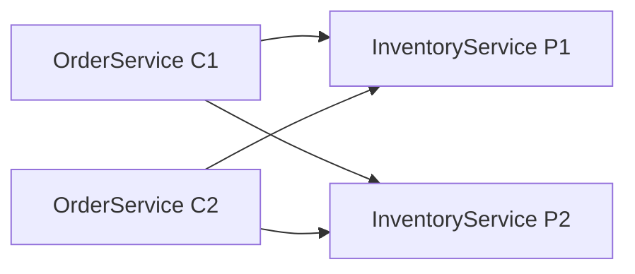
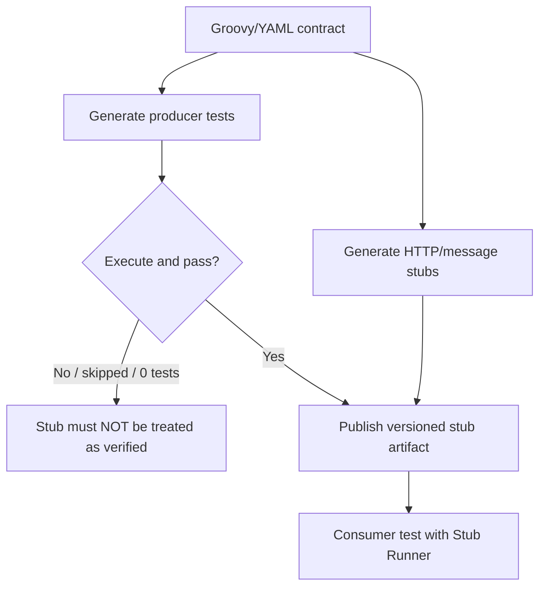
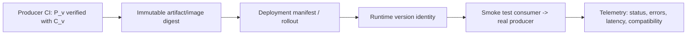
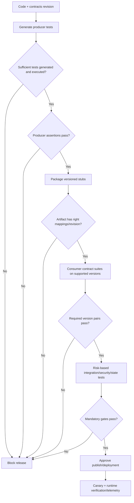

# Limits of Inferring Compatibility Solely from Passing Tests

When a pipeline displays **BUILD SUCCESSFUL** or **Tests passed**, it is tempting to conclude: "Producer and consumer are compatible." Yet a contract test can verify only interactions that were **described, generated into tests, executed, and properly observed**. It cannot by itself prove that every consumer version, every input, every deployment configuration, or every distributed-system scenario is safe.

Suppose `InventoryService` (producer) changes its reservation API while `OrderService` (consumer) and `CheckoutService` run different versions. Producer CI runs **Spring Cloud Contract** generated tests and all pass; consumer CI with **Stub Runner** also turns green. Even so, an old consumer may fail to read a new field, an overly broad WireMock mapping may give consumer tests a false green, or production may still run a producer build different from the one tested. **PASS is scoped evidence, not an unconditional compatibility certificate.**

This lesson belongs to the **Versioning and Compatibility** chapter of the **SPRING_CLOUD_CONTRACT** module. Within the module scope, we use **Groovy/YAML DSL** to define HTTP or messaging behavior, generate producer-side tests, publish stubs for consumers, and integrate CI to detect incompatible API changes. The focus of this lesson is **accurately interpreting test evidence**, recognizing inference limits, and designing responsible release decisions.

After this lesson, you will be able to:

- Distinguish **test pass**, **contract satisfied**, **version compatibility**, and **deployment safety**.
- Write a conditional conclusion for a producer–consumer pair instead of claiming absolute compatibility.
- Detect gaps in **coverage**, fixtures, matchers, generated tests, stubs, and environments.
- Analyze backward/forward compatibility in rolling upgrades and consumer–producer version matrices.
- Identify changes that appear additive yet still break strict consumer schemas/deserializers.
- Recognize Spring Cloud Contract's limits regarding HTTP state, messaging, authorization, timeouts, retries, and performance.
- Combine producer verification, consumer tests, schema tests, integration/E2E tests, and runtime telemetry into layered evidence.
- Design a CI release gate that checks **actual test execution**, uses **exact artifacts**, and records the verification scope.

## 1. Stating "Tests Passed" Must Include Specific Context

A meaningful conclusion must clearly state at least:

| Axis | Question to Answer | Example |
| --- | --- | --- |
| **Producer revision** | Which producer source revision ran? | `inventory-service:1.4.2`, commit `P42` |
| **Contract revision** | Which DSL set was used? | `inventory-contracts:2.3.0` |
| **Test implementation** | Did generated tests and base classes really run? | 24 tests passed, 0 skipped |
| **Consumer revision** | Which consumer code version ran stub tests? | `order-service:2.8.0` |
| **Stub artifact** | From which verified contract set were stubs built? | `inventory-service:1.4.2:stubs` |
| **Fixture/environment** | Which data, timezone, profile, and client stack? | Test DB, JUnit 5, HTTP mock mode |
| **Coverage** | Which interactions were verified? | Reservation creation success and out-of-stock |
| **Limitations** | What remains unverified? | Concurrent requests, retries, gateway auth |

If you only know "CI is green," you cannot deduce the missing axes. Even `100% tests passed` describes only **the set of tests executed by the runner**, saying nothing about critical behaviors lacking tests.

### Properly Scoped Inference Formula

Notation:

- `P`: a producer revision.
- `C`: a defined contract set.
- `T(P,C)`: generated tests derived from `C`, executed on `P`.
- `E`: environment/fixtures/test mode used.

When `T(P,C,E) = PASS`, the valid statement is:

> In environment E, producer revision P satisfied the assertions executed from contract set C at the time of verification.

Never extrapolate that into:

> Producer P is compatible with every existing and future consumer, for every input and every environment.

Logical representation:

\[
\operatorname{Pass}(T(P,C,E))
\not\Rightarrow
\forall u\in Consumers,\;\forall x\in Inputs,\;\forall e\in Environments,\;
\operatorname{Compatible}(P,u,x,e).
\]

The second claim requires information about **consumers and conditions that never appeared in the tests**.

## 2. Four Levels of Evidence That Must Not Be Equated



| Evidence | What It Proves | What It Does Not Prove |
| --- | --- | --- |
| **Contract DSL parses** | Tooling can read contract syntax | Real producer satisfies it |
| **Producer Contract Verifier passes** | Tested implementation meets generated assertions | Real consumers parse, handle, or send right requests |
| **Consumer Stub Runner tests pass** | Tested consumer code handles stub data in tested cases | Production producer matches version and behavior |
| **Integration/E2E tests pass** | Tested real interactions pass in that environment | Every load, data, config, and timing scenario |
| **Production monitoring is healthy** | No incidents within observed scope and thresholds | Zero bugs exist or future changes stay safe |

These layers **complement one another**; none replaces another. A green consumer test is meaningful only when invoking **the consumer code under test** and **the right stub**; a green producer test is meaningful only when executed against **the implementation under verification**, not a mocked controller returning canned fixtures.

## 3. Minimal HTTP Example: One Passing Scenario Does Not Cover the API

`OrderService` needs to call:

```http
POST /api/v1/reservations HTTP/1.1
Content-Type: application/json

{"sku":"SKU-001","quantity":2}
```

Producer `InventoryService` promises:

```http
HTTP/1.1 201 Created
Content-Type: application/json

{"reservationId":"RES-701","status":"HELD"}
```

A Groovy DSL contract:

```groovy
import org.springframework.cloud.contract.spec.Contract

Contract.make {
    name 'create_reservation_success'
    description '''
        Consumer OrderService needs reservationId and HELD status.
        Producer InventoryService must create a reservation for a valid SKU.
    '''
    request {
        method 'POST'
        url '/api/v1/reservations'
        headers {
            contentType(applicationJson())
        }
        body([
            sku: 'SKU-001',
            quantity: 2
        ])
    }
    response {
        status 201
        headers {
            contentType(applicationJson())
        }
        body([
            reservationId: $(consumer('RES-701'),
                             producer(regex('RES-[0-9]+'))),
            status: 'HELD'
        ])
    }
}
```

If the generated producer test runs and passes, the supported conclusion is **the producer returns the expected response for the described request/fixture** within the test context. It does not prove:

- Quantity `0`, negative numbers, oversized values, or nonexistent SKUs are handled properly.
- The API is idempotent when a consumer retries the same request.
- The reservation is actually committed to the database if the test inspects only the HTTP response.
- Headers like `Location` or `X-Correlation-Id` meet requirements unless asserted by the contract.
- Error branches `401`, `403`, `404`, `409`, `429`, `503` behave correctly.
- Old consumers tolerate new fields or changed processing order.
- Deployment uses the exact code, DB schema, and config executed by the test.

**Increasing test count alone is not the solution**: write the exact invariants consumers depend on, choose meaningful fixtures and environments, and decide which parts belong in integration or security tests.

## 4. A YAML Contract Has the Exact Same Limits

Out-of-stock scenario in YAML DSL:

```yaml
name: create_reservation_insufficient_stock
description: OrderService must handle insufficient stock error
request:
  method: POST
  url: /api/v1/reservations
  headers:
    Content-Type: application/json
  body:
    sku: SKU-EMPTY
    quantity: 2
response:
  status: 409
  headers:
    Content-Type: application/json
  body:
    code: INSUFFICIENT_STOCK
```

If the generated test for `SKU-EMPTY` passes, that extends evidence by one **error scenario**, yet does not imply:

- Every out-of-stock SKU is detected properly.
- The error originates from real inventory state rather than a hardcoded `409` fake.
- Consumers understand the error code and halt payment.
- Two concurrent requests racing for the last unit cannot oversell.
- Data with `quantity=2` across all warehouses is accurate.

This YAML uses **literals**; for dynamic IDs/timestamps, configure YAML matchers appropriate to your Spring Cloud Contract version. Never copy Groovy's `$(consumer(...), producer(...))` syntax verbatim into YAML assuming they are identical.

### Do Not Measure Coverage by "Number of Contract Files"

Five files testing the same happy path with different SKUs are not automatically more valuable than two files covering **the happy path and a revenue-critical error branch**. Evaluate coverage by:

- **Business capabilities** consumers rely on.
- Key API **states** and transitions.
- Meaningful **HTTP/media schemas** and business errors.
- Supported producer/consumer **version combinations**.
- **Deployment risks** not observable by contract tests.

File counts or lines of code cannot replace this behavioral matrix.

## 5. Limits Caused by an Incomplete Contract Set

A repository may contain valid contracts yet fail to represent every real consumer.

Example:

| Consumer | Behavior in Use | In Contract Set? |
| --- | --- | --- |
| `OrderService 2.8` | `POST /reservations`, `201` | Yes |
| `CheckoutService 1.7` | `GET /reservations/{id}`, `expiresAt` field | Not yet |
| `FulfillmentService 3.2` | `reservation.confirmed` message | Yes, but missing header |
| An old batch job | `GET /reservations` with `state=HELD` query | Unrecorded |

If the producer tests every existing contract and passes, that does not prove `CheckoutService 1.7` or the old batch job is compatible. Those consumers are **not yet adequately represented** in the contract set.

What to do:

1. Inventory all consumers the producer claims to support.
2. Map consumer → endpoint/event → fields/headers/statuses used.
3. Identify gaps in contracts and consumer tests.
4. Add high-value scenarios instead of redundant files.
5. Explicitly list **unverified consumers** in release decisions.

Finding no contract for a consumer **does not prove that consumer does not exist or stopped calling the API**. You may need code searches and production traffic telemetry to uncover poorly tracked consumers.

## 6. Overly Broad Matchers Can Produce False Greens

Contracts can use matchers for dynamic data, yet insufficiently precise matchers distort conclusions.

Example in Groovy response:

```groovy
body([
    reservationId: $(consumer('RES-701'), producer(regex('.*'))),
    status: $(consumer('HELD'), producer(regex('.*')))
])
```

A producer returning:

```json
{"reservationId":"","status":"EXPIRED"}
```

satisfies both `.*` regexes even though it **violates consumer business requirements**. When the test passes, all it proves is "two strings matched an overly permissive regex," not "the response is valid."

### Better Matchers

```groovy
body([
    reservationId: $(consumer('RES-701'),
                     producer(regex('RES-[0-9]+'))),
    status: 'HELD'
])
```

Pattern `RES-[0-9]+` rejects empty strings and malformed IDs; literal `HELD` protects the concrete status. Yet even this matcher **does not prove** the ID is unique, durably persisted, or tied to the right `orderId`.

| Matcher | Can Prove | Cannot Prove |
| --- | --- | --- |
| `regex('RES-[0-9]+')` | String matches ID format | ID exists, is unique, or belongs to caller |
| `status == 'HELD'` | Status of tested case matches literal | Future valid state transitions |
| ISO timestamp regex | String looks like a timestamp | Value is after creation time or not expired |
| `numberType()`/numeric matcher | JSON type matches | Value range, arithmetic, or currency bounds |
| WireMock `equalToJson` | Request body matches configured JSON comparison rules | All business schema constraints |

Describe **accurately** what was verified: format checks provide one layer of evidence, while cross-field relationships, uniqueness, and stateful invariants require supplementary tests.

## 7. Overly Strict Matchers Also Skew Compatibility Conclusions

The opposite problem: a consumer accepts a range of valid responses, yet the contract hard-codes an ID/timestamp even though the producer generates them dynamically.

For example, a response demanding exact strings:

```json
{
  "reservationId": "RES-701",
  "createdAt": "2026-11-24T08:00:00Z"
}
```

In production, the producer generates a fresh ID and timestamp per request. A contract asserting exact equality on both **can fail even while the real producer remains compatible** with the consumer. This is a **false negative** caused by over-constraining beyond real needs.

Adjustment:

- Use consumer samples and producer matchers where values legitimately vary.
- Keep literals for fields carrying fixed meaning for the scenario.
- If you must verify a timestamp falls within a valid window, write a custom assertion/business test instead of a plain timestamp regex.
- Never use `regex('.*')` as a shortcut to erase all constraints.

A good contract avoids both extremes: **under-protection** (too broad) and **over-constraint** (too rigid).

## 8. Compatibility Must Be Asked per Version Pair

Statements like "InventoryService is compatible" or "the reservation API is backward-compatible" are incomplete without naming **who is calling it**.

Let:

- `P1`: InventoryService `1.4.1`.
- `P2`: InventoryService `1.5.0`.
- `C1`: OrderService `2.8.0`.
- `C2`: OrderService `2.9.0`.

Fill the matrix with **actual test results and support targets**, never marking PASS merely because a version is newer:

| Consumer \\ Producer | `P1 = 1.4.1` | `P2 = 1.5.0` |
| --- | --- | --- |
| `C1 = 2.8.0` | Currently running pair; needs evidence | Needs backward-compatibility test |
| `C2 = 2.9.0` | Needs test if consumer deploys first | Target pair; needs producer + consumer verification |

### Backward Compatibility vs. Forward Compatibility

- **New producer backward compatibility:** `P2` continues serving old consumer `C1`'s needs within supported scope.
- **New consumer forward compatibility:** `C2` can still operate with old producer `P1` during staggered rollouts, **if required**.

Neither **implies the other**. A new producer may keep old APIs while a new consumer starts calling an endpoint present only on the new producer.

### Rolling Upgrades Are a Matrix, Not a Straight Line



With multiple producer/consumer instances and uneven traffic routing, **all four pairs can coexist** for a time. Running only `(C2,P2)` is unsafe if the rollout allows `(C2,P1)`.

Typical release approach:

1. Deploy the new producer **still supporting old requests**.
2. Prove `(C1,P2)` passes on contracts C1 depends on.
3. Deploy the new consumer and verify `(C2,P2)`.
4. If the consumer might hit the old producer during rollout, also verify `(C2,P1)` or use feature flags/routing to prevent that pair.
5. Retire old APIs only after the last consumer stops using them.

Not every project must test the full cross-product of every historical version; choose the matrix from **pairs that can genuinely meet and are declared supported**.

## 9. Version Names and Semantic Versioning Do Not Verify Compatibility

A rule like "minor bumps are non-breaking" may be a **versioning policy**, yet does not by itself prove a change is safe.

| Change | What Might Break? | What Must Be Tested? |
| --- | --- | --- |
| Add JSON response field | Strict consumer deserializer may fail | Test old consumer against new response |
| Change `201` to `200` | Consumers checking exact status | HTTP contract and consumer behavior |
| Rename `reservationId` to `holdId` | Consumers lose required field | Migration/compatibility tests |
| Change `quantity` type number → string | Parser/schema validation fails | Serialization contract |
| Add required request header | Old consumers omit it → `400/401` | Contract for old requests |
| Delete field "nobody seems to use" | Uninventoried consumers may depend on it | Impact matrix + telemetry/code search |
| Change message routing key | Consumer queue misses events | Messaging contract + broker integration |
| Change `409` semantics to `422` | Consumer error handler branches differently | Error contracts + consumer tests |

**Adding a field is not always compatible.** In Java/Jackson, many setups ignore unknown fields, while strict setups throw errors. Compatibility depends on **specific client implementations and settings**, not just JSON syntax.

Semantic Versioning is useful for communicating release intent; Spring Cloud Contract never automatically infers safe major/minor/patch labels from test pass counts.

## 10. Adding a Field: Producer Tests Green Yet Strict Consumer Parser Red

Suppose the contract checks only two fields:

```json
{"reservationId":"RES-701","status":"HELD"}
```

The new producer returns:

```json
{
  "reservationId": "RES-701",
  "status": "HELD",
  "riskScore": 0.12
}
```

Depending on how body matchers and checks are generated, producer contract tests **may still pass** because the two committed fields stayed intact. Yet a consumer might configure Jackson to **disallow unknown fields**:

```java
import com.fasterxml.jackson.databind.DeserializationFeature;
import com.fasterxml.jackson.databind.ObjectMapper;

record ReservationDto(String reservationId, String status) {}

ObjectMapper mapper = new ObjectMapper()
    .configure(
        DeserializationFeature.FAIL_ON_UNKNOWN_PROPERTIES,
        true
    );

String response = """
    {"reservationId":"RES-701","status":"HELD","riskScore":0.12}
    """;

// May throw UnrecognizedPropertyException for riskScore.
ReservationDto dto =
    mapper.readValue(response, ReservationDto.class);
```

This Java snippet uses a **text block** (Java 15+), Jackson, and a record (Java 16+) purely to illustrate deserialization. Spring Boot often applies custom `ObjectMapper` configurations, so **test against the real consumer's exact setup**, never assuming all consumers are strict or all are lenient.

### Two Conditions Must Both Be Verified

1. **Producer-side constraint:** old fields, statuses, and data types protected by contracts remain intact.
2. **Consumer-side tolerance:** active clients can read the **entire new response** or at least not crash upon encountering added fields.

That is why additive changes should be tested with **the new stub version against old consumer code**, especially for OpenAPI-generated clients, sealed DTOs, Protobuf schemas, or strict validators.

### Not Just New Fields

The following changes can also break specific clients:

- `null` replacing an absent field or vice versa.
- JSON number `2` replaced by JSON string `"2"`.
- Enum gaining a new value, e.g., `HELD_PENDING_REVIEW`.
- List order changing when consumers assume a specific order.
- Offset/timezone changing in timestamps.
- Status `201` replaced by `200` despite identical body.
- Dropping `Location` header that consumers parse.
- Changing media type from `application/json` to a vendor-specific media type.

These changes can slip past a contract **if the contract lacks corresponding assertions**.

## 11. "Producer Passed" Does Not Mean "Tests Traversed Production Paths"

Spring Cloud Contract Verifier generates tests, yet **base classes** and **test modes** determine how tests exercise the implementation.

An invalid case:

```java
// Counterexample: DO NOT use as a producer contract base.
@BeforeEach
void setup() {
    RestAssuredMockMvc.standaloneSetup(
        (Object) new ControllerThatAlwaysReturnsContractFixture()
    );
}
```

If tests invoke only a fake controller returning fixtures, they can pass without testing the controller/serializer/business service actually deployed by the producer. That snippet illustrates the bypass pitfall, **not a complete setup class**.

A more meaningful Spring MVC setup:

```java
import io.restassured.module.mockmvc.RestAssuredMockMvc;
import org.junit.jupiter.api.BeforeEach;
import org.springframework.beans.factory.annotation.Autowired;
import org.springframework.boot.test.context.SpringBootTest;
import org.springframework.web.context.WebApplicationContext;

@SpringBootTest
public abstract class ContractVerifierBase {

    @Autowired
    WebApplicationContext context;

    @BeforeEach
    void setup() {
        RestAssuredMockMvc.webAppContextSetup(context);
    }
}
```

This is a baseline pattern for Spring MVC producers, assuming Contract Verifier/RestAssured MockMvc dependencies. The base class still needs appropriate fixtures. For WebFlux, messaging, or real HTTP servers, pick **a different test mode/adapter** rather than forcing MockMvc mechanically.

**Yet even testing against a real application context has limits:** if repositories, brokers, or remote dependencies are mocked, tests verify only the participating layers, not the mocked-out layers. State the tested boundary explicitly.

### Questions Asking "Which Code Actually Ran?"

Before interpreting PASS:

- Did generated tests call the real controller/handler or a fake?
- Did serialization use the same Jackson configuration as runtime?
- Were Spring Security filters enabled in that test mode?
- Which feature flags and `@Profile` settings were active?
- Were databases/brokers real, Testcontainers, in-memory, or Mockito mocks?
- Were validation, exception handlers, and interceptors in the request path?
- Were asynchronous listeners/background jobs left unexecuted during the test?

Without knowing these answers, "producer tests passed" counts only as evidence at **the framework setup level actually exercised**.

## 12. "Consumer Passed" Does Not Mean the Consumer Called the Right Stub

A consumer test doing only:

```java
// Only verifies the HTTP stub responds; does NOT test consumer code.
RestAssured.given()
    .port(8090)
    .contentType("application/json")
    .body("{\"sku\":\"SKU-001\",\"quantity\":2}")
    .post("/api/v1/reservations")
    .then()
    .statusCode(201);
```

Turning green proves only that WireMock on port 8090 returned the expected response. `OrderService` could still:

- Point its base URL to production.
- Use a mocked client bean.
- Read from a stale cache.
- Return hardcoded `RES-701`.
- Send JSON `quantity` as a string while a loose fallback mapping still returns `201`.
- Fail to handle `409` due to a catch-all error block.

A valuable consumer check **invokes the real service/client** and inspects both the request journal and business outcome:

```java
// Pseudocode placed in a test that started Stub Runner and consumer context.
WireMock.configureFor("localhost", 8090);
WireMock.resetAllRequests();

ReservationResult result =
    orderCheckoutService.prepare("SKU-001", 2);

assertThat(result.status()).isEqualTo("HELD");

WireMock.verify(1, postRequestedFor(
        urlPathEqualTo("/api/v1/reservations"))
    .withHeader("Content-Type", containing("application/json"))
    .withRequestBody(matchingJsonPath(
        "$.sku", equalTo("SKU-001"))));
```

`OrderCheckoutService`, `ReservationResult`, and imports are illustrative application components. The example demonstrates only the **assertion principle**. `WireMock.configureFor` mutates global/static client state; when running multiple WireMock instances or parallel tests, use a port-scoped client instance.

Journal assertions alone are still insufficient if the test itself sends HTTP calls to the stub. In the test above, **the HTTP call must originate from consumer code**, not a separate RestAssured call crafted to satisfy the journal.

## 13. Stub Artifacts Generated Without Producer Verification

A classic risk of contract testing is that tooling can **generate stubs from DSL** before or independently of generated producer tests passing.



Suppose the contract promises `201 HELD`, yet the producer changed implementation to return `200 PENDING`. Generated stubs can still return `201 HELD`. If CI allows publishing stubs when producer verification failed to run, consumer tests pass while **producer code and stubs diverge**.

### Four Pieces of Evidence Required, Not Just a JAR File

| Evidence | Value |
| --- | --- |
| Contract source revision | Identifies which promise was used |
| Producer commit/version | Identifies which implementation was verified |
| Generated test report | Confirms exact tests **executed** and passed |
| Stub coordinates/checksum | Confirms the artifact downloaded by consumers came from that verification run |

Matching version strings alone are insufficient if the artifact repository permits overwriting existing coordinates. Releases should be immutable; for SNAPSHOTs, log timestamps/resolved artifacts when investigating.

## 14. False Greens Caused by Zero Generated Tests

A pipeline can report success when:

- Contracts sit in the wrong directory.
- The Maven/Gradle plugin is not applied to the producer module.
- Only stub mappings are generated, without test sources.
- The JUnit test engine fails to discover generated tests.
- Tests are bypassed via `skipTests`, exclude patterns, or un-invoked `contractTest` tasks.
- A module in a monorepo is excluded from `verify`/`check`.

**0 passed, 0 failed** is not equivalent to **n tests passed**.

### With Maven

```bash
# Project must configure Contract Verifier plugin and matching test runner.
mvn -B -ntp clean verify
```

After running, inspect Surefire/Failsafe reports per configuration. Never stop at `BUILD SUCCESS`: verify **how many generated tests were created and executed**, plus failed/skipped counts and fixtures.

### With Gradle

```bash
# Example producer with contractTest source set configured by plugin.
./gradlew clean contractTest check
```

If `contractTest` does not exist, its source set is unconfigured, or execution is bound to another task, identify the real task. Never assume `test` always executes generated contracts; many Gradle plugin setups use a dedicated `contractTest` task.

### Minimum Blocking Conditions

1. Discover the **expected contract files**.
2. Generate producer tests from those contract files.
3. The test runner actually executes them; count is non-zero and matches changes.
4. Zero unintended skipped tests.
5. Assertions exercise real producer code.
6. On failure, the pipeline blocks stub release publication.

Executing 20 tests instead of 0 eliminates one class of false greens, yet **does not prove those 20 tests cover every scenario**.

## 15. WireMock Matching and "Right Response from the Wrong Mapping"

WireMock may hold multiple mappings serving the same URL. Example:

| Mapping | Request Condition | Response |
| --- | --- | --- |
| Generated success | `POST /reservations` with `SKU-001`, quantity `2` | `201 HELD` |
| Broad manual fallback | Any `POST /reservations` | `201 HELD` |
| Generated insufficient stock | `POST /reservations` with `SKU-EMPTY` | `409 INSUFFICIENT_STOCK` |

If the manual fallback takes precedence or matching is loose, a consumer test sending a malformed JSON body still receives `201` and passes. That test **does not prove the contracted request was sent properly**.

### Two Parallel Checks

- Inspect active mappings at `/__admin/mappings` or the equivalent runtime API.
- Inspect the request journal and matched mapping/serve-events if supported by your WireMock version.

Example (test-local environments only):

```bash
curl http://127.0.0.1:8090/__admin/mappings
curl http://127.0.0.1:8090/__admin/requests
```

WireMock returns a default `404` when a request matches no stub. If an error contract expects `404`, asserting only the status creates a **false positive**; assert the **business error body/code** and matching mapping.

Never "fix flakiness" by placing `.*` matchers on every field. That converts a regression-sensitive test into one accepting nearly any garbage input.

## 16. State and Ordering Changes Are Not Proven by Isolated HTTP Contracts

Suppose `OrderService` executes a sequence:

```text
1. POST /reservations                  -> 201, RES-701, HELD
2. POST /reservations/RES-701/confirm  -> 200, CONFIRMED
3. GET  /reservations/RES-701          -> 200, CONFIRMED
```

All three independent contracts might pass with separate fixtures while the producer still has bugs:

- `POST confirm` fails to update the DB, yet the `GET` test uses a pre-seeded `CONFIRMED` fixture.
- The reservation ID returned by the first request is not the ID persisted.
- Two concurrent requests racing for the last unit both succeed.
- A transaction failure emits an event before commit and then rolls back.
- A retry unintentionally creates duplicate reservations.

### The Right Supplementary Test

```text
Given warehouse SKU-001 has exactly 2 available units
When  POST creates a reservation with quantity=2 and returns the real ID
And   POST confirms that exact ID
And   GET retrieves status for that ID
Then  response status is CONFIRMED
And   DB holds exactly one confirmed reservation
And   inventory is decremented exactly once
```

This is a **multi-step producer integration test**, not something guaranteed when three isolated HTTP contract tests run separately. WireMock Scenarios can test **consumer workflows**, yet stub state never substitutes for real producer transactions/state.

Passing contracts catch errors in the **described shape of interaction**; they do not guarantee **cross-request state machine invariants** unless tests explicitly verify them.

## 17. Messaging Contract Passes and Delivery Limitations

Spring Cloud Contract also supports messaging contracts via Groovy/YAML DSL. A Groovy example:

```groovy
import org.springframework.cloud.contract.spec.Contract

Contract.make {
    name 'reservation_confirmed_event'
    label 'reservation_confirmed'
    input {
        triggeredBy('publishReservationConfirmed()')
    }
    outputMessage {
        sentTo('reservationEvents')
        body([
            reservationId: 'RES-701',
            status: 'CONFIRMED'
        ])
        headers {
            messagingContentType(applicationJson())
            header('eventType', 'reservation.confirmed')
        }
    }
}
```

This is a **template for an environment with a compatible message verifier adapter**; `publishReservationConfirmed()` is a trigger method in the producer base test class, and `reservationEvents` is an adapter-resolved destination (e.g., a Spring Integration channel), not automatically a live RabbitMQ exchange or Kafka topic.

If the generated messaging test passes, it verifies the message observed on destination, payload, and headers by the **test adapter**. It does not prove:

- Production Kafka/RabbitMQ brokers have matching topic/queue bindings configured.
- Delivery semantics are exactly-once.
- Consumers never receive duplicate or out-of-order messages.
- Events are emitted only after DB commit succeeds.
- Retries, DLQs, dead-letter routing, and acknowledgments work properly.
- Deployed consumers use compatible schemas/message versions.

### Layering Messaging Tests

| Layer | What to Verify |
| --- | --- |
| Contract verification | Producer emits messages with agreed shape, destination/headers |
| Consumer test with stub/`StubTrigger` | Real handler receives and processes payload |
| Broker integration test | Exchanges/topics, routing, converters, ack/nack, retry/DLQ |
| Domain/state test | Idempotency, ordering within promised scope, DB/event consistency |
| Deployment/soak test | Load, broker outages, reconnects, and multi-instance operation |

**A stub trigger returning `true` does not prove the consumer processed the event.** Observe consumer side effects or state and await completion with an appropriate timeout for asynchronous adapters.

## 18. Security, Authorization, and Gateway Config Often Sit Outside Contract Tests

Producer contracts for valid requests may pass when `@SpringBootTest` uses a security-disabled profile or when MockMvc skips the full filter chain.

In production, the exact same request can hit:

- `401` due to expired tokens or mismatched audiences.
- `403` due to roles/scopes differing from test fixtures.
- `404` intentionally returned to hide resource existence.
- `429` due to API gateway rate limiting.
- `406` due to differing content negotiation.
- `413` due to body size limits.
- Timeouts caused by ingress, proxy buffering, or connection pools.

You cannot conclude "the API is compatible in production" purely from generated tests bypassing the gateway and skipping authorization.

### How to Supplement Evidence

1. Write contracts for status/error payloads consumers must handle where appropriate.
2. Test Spring Security filters and access control in producer integration tests.
3. Verify JWTs/scopes/headers against real gateways or representative environments when needed.
4. Test request sizes, media types, and serialization when they belong to the interface.
5. Never place real secrets or production tokens in stub fixtures/logs.

A contract test is not "wrong" for omitting the gateway; **interpreting the result is wrong** if readers ignore environmental boundaries.

## 19. Performance, Reliability, and Load Cannot Be Inferred from Correct Responses

A producer can return a valid `201` and JSON body in 20 ms locally, yet take over 10 seconds under 1,000 concurrent requests. A correct response **does not mean the service meets performance requirements**.

| Operational Property | Why Contract Tests Usually Fall Short | Supplementary Evidence |
| --- | --- | --- |
| p95/p99 latency | One fixture request does not represent load | Load tests and percentile telemetry |
| Throughput | Tests do not simulate resource contention | Capacity/load tests |
| Timeouts/retries | Stubs respond instantly; networks are deterministic | Fault-injection/integration tests |
| Circuit breakers | Test paths may bypass breakers or stay below thresholds | Resilience scenario tests |
| Resource leaks | Single requests do not expose leaks over time | Soak tests, resource metrics |
| Backpressure | JSON contracts do not model slow consumers | Reactive/network tests |
| Deployment availability | Unit/mock mode lacks networks/gateways | Canaries, health/readiness probes, E2E |

**Never treat response times measured in generated tests as an SLA/SLO guarantee**, unless the test was explicitly designed, calibrated, and run in an environment representing that target.

### Example: Timeouts Making "Shape-Compatible" Unusable

Suppose OrderService enforces a 2-second client timeout. InventoryService returns the right status/schema, yet in integration environments takes 5 seconds on certain SKUs.

Producer contract tests pass because the controller runs in-memory without slow proxies or databases. Consumer stub tests pass because WireMock replies instantaneously. Yet real requests time out. Always **test consumer timeout/retry policies** and **measure producer latency** in representative environments.

## 20. Fixtures and Test Data Can Produce Unrepresentative Evidence

Contract tests typically run against a fixed set of inputs, such as in-stock `SKU-001`. Inference confidence depends on **how representative those fixtures are**.

Bugs hidden by happy-path fixtures:

| Current Fixture | Untested Real Case | Possible Consequence |
| --- | --- | --- |
| ASCII alphanumeric SKU | Unicode or special-character SKU | Broken URL/JSON encoding |
| Small quantity | Max quantity or negative numbers | Overflow/validation failures |
| ID `RES-701` | Very long ID or new format | Parser/DB column errors |
| No nulls | Nullable fields | `NullPointerException` |
| One request at a time | Concurrent reservations | Overselling |
| Pre-seeded data | Freshly committed/rolled-back transactions | State inconsistency |
| UTC timezone | Other offsets, DST, or local timezones | Deadline/expiry bugs |
| Fully privileged user | Low-privilege or cross-tenant user | Data leak or unexpected 403 |

You do not need infinite test inputs. Use **equivalence classes**, boundary values, property-based tests, and integration scenarios for key risks. Whenever a production bug appears, add a corresponding **regression case** to the right test layer.

### Passing Tests Do Not Generate Statistical Confidence by Themselves

20 passing contract tests do not mean "100% probability of compatibility." Tests are not independent random samples across the entire input space; they are **deliberately chosen scenarios**. Never turn test counts into probabilities of success without a proper statistical model and dataset.

## 21. Right Producer Build, Wrong Deployed Version

Suppose CI verifies:

```text
Producer artifact: com.example:inventory-service:1.5.0
Producer commit:   P-150
Contract revision: C-42
Stubs artifact:    com.example:inventory-service:1.5.0:stubs
Result:            PASS
```

Yet staging still runs `inventory-service:1.4.1`, or one replica failed to rolling-update.

**What CI proved**: source/build `P-150` matches the assertions in `C-42`. **What CI did not prove**: consumer requests in staging actually land on `P-150` instances.

Common sources of version drift:

1. Release artifact built, yet deployment image/tag still points to the old release.
2. Mutable container image tags cause deployed images to differ from tested artifacts.
3. A subset of replicas remains un-updated.
4. Gateway routes traffic to an older cluster/region.
5. Runtime config, database migrations, or feature flags differ from test setups.
6. Consumer config points to the wrong endpoint, domain, or API version.
7. Canary traffic splits between P1 and P2 during rollout.

### Separate Deployment Evidence



A release gate should reconcile the **deployed artifact digest**, critical configs, and rollout status. Never assume "stubs version 1.5.0 published" means production runs producer 1.5.0.

## 22. Version Matrices Must Follow Deployment Topology

Instead of testing arbitrary combinations, start from your rollout order and declared compatibility window.

### Example Transition Plan from P1/C1 to P2/C2

| Stage | Coexisting Pairs | What Must Be Proven |
| --- | --- | --- |
| Pre-rollout | `(C1,P1)` | Current baseline |
| Canary deploy producer | `(C1,P1)`, `(C1,P2)` | **P2 serves C1** |
| Deploy consumer while P1 remains | `(C1,P1)`, `(C1,P2)`, `(C2,P1)`, `(C2,P2)` | Either C2 tolerates P1 or routing avoids that pair |
| Post-rollout completion | `(C2,P2)` | Target pair |
| Producer rollback | `(C2,P1)` may recur | Test rollback compatibility or block unsafe rollback |

### Decision Rules

- If `(C2,P1)` cannot be guaranteed, **never deploy C2 before P1 is completely gone**, or enforce segmented feature flags/routing backed by evidence.
- If P2 cannot serve C1, a producer-first rollout breaks old consumers; use a 2-step migration or separate API version.
- If the new data schema cannot roll back, green HTTP contract tests **do not solve** database migration risk.
- When an organization supports only a finite version window, state that policy explicitly and enforce deployment guards preventing unsupported pairs.

Never color a matrix cell "PASS" based solely on theoretical reasoning. Record **test ID, environment, artifact versions, and outcome**, or `NOT_TESTED` when evidence is absent.

## 23. A Compatibility Scope Assessment Form

To avoid vague conclusions, teams can maintain a "compatibility evidence card" per release:

| Field | How to Record |
| --- | --- |
| Producer build | Coordinates + full Git SHA + image digest if applicable |
| Contract revision | Repo/artifact SHA or pinned version |
| Consumers in scope | Supported names + versions |
| Test boundary | MockMvc/WebTestClient/server, mocked or real DB/broker |
| Verified scenarios | Contract IDs, statuses/errors/events |
| Test counts | Generated, executed, failed, skipped |
| Stub artifact | Version, classifier, checksum, repository |
| Consumer tests | Test suites executed against matching stubs |
| Version matrix | Which producer/consumer pairs passed |
| Untested risks | Security, load, state, retries, data migrations... |
| Release decision | Approved / blocked / conditional + rationale |

### Illustrative Example Record (Not Real Certification)

```yaml
release:
  producer: com.example:inventory-service:1.5.0
  producerCommit: REPLACE_WITH_PRODUCER_SHA
  contractArtifact: com.example.contracts:inventory-contracts:2.3.0
  contractRevision: REPLACE_WITH_CONTRACT_SHA
  stubArtifact: com.example:inventory-service:1.5.0:stubs
  stubSha256: REPLACE_WITH_ACTUAL_DIGEST
verification:
  generatedTests: 24
  executedTests: 24
  failedTests: 0
  skippedTests: 0
  result: PASS
supportedPairs:
  - consumer: order-service:2.8.0
    producer: inventory-service:1.5.0
    result: PASS
  - consumer: order-service:2.9.0
    producer: inventory-service:1.4.1
    result: NOT_TESTED
knownGaps:
  - concurrent reservation oversell scenario
  - broker redelivery with duplicate events
  - canary gateway routing
decision: CONDITIONAL
```

This is an **illustrative schema**, not an automatic Spring Cloud Contract output format. The number `24`, versions, and `PASS` entries only demonstrate the structure; CI must populate **real metrics**, never releasing with placeholder values.

**Meaning of `CONDITIONAL`:** you may decide to roll out the producer first while holding the new consumer until `(C2,P1)` is verified or eliminated. Never mask that gap under a blanket `COMPATIBLE` label.

## 24. Designing Tests Around Change Impact

Instead of blindly re-running everything or trusting a single green check, assess **what actually changed**.

| Change Type | Contract Verification | Consumer Stub Test | Recommended Supplement |
| --- | --- | --- | --- |
| Add optional field | Check old fields and new schema | Old consumers must still parse | Strict deserializer test |
| Remove/rename field | Old contracts must fail if consumers depend on it | Test old consumer against candidate stub | Migration/rollout gate |
| Change HTTP status | Assert old/new status per policy | Error handlers and routing logic | Gateway/integration if applicable |
| Add enum status | Matchers not overly broad | Test consumer encountering unknown enum | Exhaustive enum handling |
| Change timezone/format | Assert concrete type/format | Deserializer/UTC assumptions | Boundary/timezone tests |
| Add required header | Producer checks new request | Can old clients send it? | Backward-compatibility check |
| Move from sync to async | HTTP acknowledgement contract | Consumer polling/event handling | State workflow test |
| Change message topic/routing | Contract destination/headers | Consumer listener handles it | Broker integration/queue binding |
| Optimize DB/caching | Contract response remains valid | Consumer keeps calling pattern | Concurrency, cache invalidation |
| Upgrade Spring Boot/Cloud/WireMock | Verify generated tests and stub parsing | Stub Runner/client compatibility | Dependency/mode smoke test |

What matters is **layering by risk category**, not adding one more `POST success` test and claiming higher coverage.

### Low-Probability, High-Impact Risks

For example, losing idempotency on a payment endpoint may occur rarely yet cause duplicate charges. You cannot rule it out just because "the happy-path contract passed 100 times." Build an explicit **concurrency/idempotency integration test**. That reflects **risk-based testing**, without diminishing Contract Verifier's value.

## 25. Testing with Counterexamples (Negative Controls)

A test is valuable only if it fails when **the clause it protects** is broken.

Examples:

1. Producer contract specifies `201`. Temporarily return `200` on an experimental branch: the generated test **must fail**.
2. Producer contract specifies `status=HELD`. Temporarily return `EXPIRED`: the assertion **must fail**.
3. Consumer test must invoke its HTTP client. Temporarily mock/hardcode the response on an experimental branch: WireMock request verification **must fail**.
4. Change stub artifact version or remove the success mapping: the consumer test **must fail**, rather than hitting a permissive manual fallback.
5. Remove a legacy consumer's contract: expected contract/test counts or contract inventory checks **must catch** the coverage gap.

**Never commit intentional breakage to `main`.** Perform negative controls on temporary branches/fixtures or via controlled mutation testing. The goal is verifying test sensitivity, not shipping broken producers.

### Even Failures Require Careful Interpretation

When a contract test fails, the real API is not necessarily breaking:

- Fixture data drifted.
- Test base was misconfigured.
- Matchers were stricter than agreed.
- Plugin changed generated test semantics.
- Network/flaky timing broke assertions.

Always **investigate root causes**. Never arbitrarily loosen matchers or disable tests just to turn the pipeline green, yet never assume every failure represents a genuine breaking change without checking.

## 26. Multi-Layered Release Gate for Spring Cloud Contract

A producer pipeline can combine checks:



### What Counts as a "Mandatory Gate"?

Depending on SLAs and system traits, steps vary. At minimum, require:

- Producer tests **generated and executed** on the exact revision.
- Stub artifact carries traceable version/checksum and is never published when producer verification fails.
- Consumer tests use exact artifact versions and **real consumer code**.
- Coexisting rollout version pairs are evaluated.
- Critical business/security/data-risk tests are not skipped.
- Deployed artifact matches the verified digest.

You cannot promote "tests passed in unit/mock mode" to "production-safe" merely by naming a CI job `compatibility-gate`.

## 27. CI Example: Publishing Evidence Instead of Just Publishing Green Badges

Example Maven producer configured with Contract Verifier:

```bash
mvn -B -ntp clean verify

# Additional project-specific manual/CI verification steps:
# 1. Confirm generated test reports actually contain executed tests.
# 2. Check failed/skipped counts against policy.
# 3. Inspect stubs JAR for expected mappings/contracts.
# 4. Record producer SHA, contract revision, and stub digest.
```

Example Gradle producer:

```bash
./gradlew clean contractTest check verifierStubsJar
```

For multi-module Gradle builds, target the producer module's task path and confirm `contractTest` exists and is wired into your plugin version's task graph. In some setups `check` invokes contract tests automatically, yet **verify via reports** rather than assuming.

An **illustrative GitHub Actions workflow** capturing producer test reports:

```yaml
name: Producer compatibility evidence

on:
  pull_request:
  push:
    branches: [main]

jobs:
  producer-verify:
    runs-on: ubuntu-latest
    steps:
      - uses: actions/checkout@v4
      - uses: actions/setup-java@v4
        with:
          distribution: temurin
          java-version: '21'
          cache: maven
      - name: Run producer verification
        run: mvn -B -ntp clean verify
      - name: Retain reports
        if: always()
        uses: actions/upload-artifact@v4
        with:
          name: producer-test-reports
          path: |
            target/surefire-reports/
            target/failsafe-reports/
```

This workflow is **not yet a complete release gate**. It does not validate report counts, read a full version matrix, check provenance, or publish. Those belong to project-specific gate steps. In a monorepo, adjust working directories/paths so no producer's reports are missed.

### Never Publish Based Solely on `BUILD SUCCESS`

In release jobs, verify at minimum:

1. Test runners report reliable executed counts; never 0.
2. Zero policy-violating skips.
3. Contract versions resolve deterministically, not floating branch/`latest`.
4. Final stub JAR contains expected mappings/contracts, with checksum recorded.
5. Published artifacts are **the exact outputs of the verified build**, or rebuilt deterministically with re-verification.
6. Repositories disallow overwriting release artifacts.
7. Canaries/deployments use the matching image digest and right configs.

**If a step was not verified, mark `NOT_VERIFIED` — never fill in `PASS` by guesswork.**

## 28. Writing Scoped Compatibility Conclusions Clear Enough for Decisions

A sentence **never to use** in a release report:

> Spring Cloud Contract passed, so InventoryService 1.5.0 is completely compatible with all consumers.

A **much more rigorous** statement:

> Producer `InventoryService 1.5.0` (commit `P-150`) passed 24 generated contract tests from contracts revision `C-42` under the HTTP test profile, with 0 skipped tests. `OrderService 2.8.0` executed 8 consumer tests using `inventory-service:1.5.0:stubs` and verified required requests/responses. No evidence exists yet for `OrderService 2.9.0` interacting with `InventoryService 1.4.1` during rollback; block that deployment pair or add verification before consumer rollout.

This remains a **hypothetical example**, not a real report. Yet the phrasing makes crystal clear:

- **What** was tested.
- **Inputs** and contract revisions.
- **How** it was tested and test counts.
- **Scope** of verified version pairs.
- **Gaps** and risk-mitigation actions.

From there, release approvers can authorize rollout under concrete conditions instead of trusting an uncontextualized `PASS`.

### Four Useful Labels for Decision Tables

| Label | Recommended Convention |
| --- | --- |
| `VERIFIED_IN_SCOPE` | Tests within the stated scope ran and passed |
| `NOT_TESTED` | No evidence yet for that pair/scenario |
| `KNOWN_INCOMPATIBLE` | Confirmed contract breakage or defect |
| `CONDITIONAL` | Deployable if routing/feature-flag/rollout preconditions hold |

This is a **recommended reporting convention**, not an enum defined by Spring Cloud Contract. Its virtue is preventing `PASS` from masking untested territory.

## 29. Summary Table of Common Inference Limits

| A PASS Result May Mean... | Yet What Remains Unproven... | What to Do? |
| --- | --- | --- |
| One happy-path producer contract | All error paths and boundary values | Add key error contracts and boundary tests |
| Schema/regex matcher passed | Business invariants, uniqueness, cross-field rules | Domain/integration assertions |
| Producer tests passed via MockMvc | Gateway/security/network deployment | Security and deployment tests |
| Isolated HTTP request/response valid | State transitions and concurrency | Multi-step/stateful integration |
| Stub Runner returned right response | Real consumer code actually called stub | Call real client/service; verify journal |
| Consumer stub tests green | Real producer implementation satisfies contract | Mandatory producer verification |
| Stub JAR created | Producer generated tests actually executed | Inspect test reports and fail-on-zero |
| Producer P2 passes existing contracts | Old consumers lacking contracts remain safe | Inventory consumers, impact analysis |
| C2 passes against P2 | C2 handles P1 during rolling rollout | Compatibility matrix |
| Message payload valid | Broker routing/ack/retry/idempotency | Broker integration and consumer processing tests |
| Producer accepts JSON with added field | Strict consumer deserializers accept it | Consumer compatibility tests with new payload |
| Source commit built/tested accurately | Production deployed that exact build | Image digests, deployment identity, canary |
| Low single-request latency | High load, network failures, p99 latency | Load, soak, resilience, and observability |
| One CI run passed | Subsequent runs pull identical deps/artifacts | Pin versions, immutability, provenance |

Each row states a **limit on what may be inferred**, not an excuse to skip contract testing. Using the right test layers catches bugs early without overclaiming.

## 30. Checklist Before Calling an Upgrade "Compatible"

- [ ] Identified producer revision, contract revision, and supported consumer versions.
- [ ] Mapped rollout/deployment topology to select which version pairs require testing.
- [ ] Contract files discovered by generator without accidental path or filter omissions.
- [ ] Generated tests compiled **and executed**; test count is non-zero and reasonable.
- [ ] Test reports contain no unintended skips; every critical failure is addressed.
- [ ] Base class/test mode exercises the right producer boundary.
- [ ] Fixtures represent key happy, error, boundary, and state scenarios.
- [ ] Matchers are tight enough to catch regressions without pinning meaningless dynamic data.
- [ ] Producer tests protect statuses, headers, body schemas, and error codes consumers rely on.
- [ ] Documented any consumers not yet represented by contracts and how risks are mitigated.
- [ ] Stub artifacts are built from the **exact contract revision** verified by the producer.
- [ ] Release stubs cannot be overwritten; coordinates/checksums are traceable.
- [ ] Consumer CI pins stub versions, invokes **real consumer code**, and checks request journals/side effects.
- [ ] Checked strict or generated client schemas/deserialization where applicable.
- [ ] On enum/nullable/date/number changes, verified consumer parsers and business rules.
- [ ] For messaging, tested destinations/adapters, consumer handlers, and key broker behavior.
- [ ] For stateful workflows, added multi-request integration tests.
- [ ] For retries/idempotency, added dedicated tests beyond single-message contracts.
- [ ] For security/gateways, verified impacting configs/runtime paths.
- [ ] For rolling upgrades, `(C_old,P_new)` is tested or avoided via routing/feature-flag policy.
- [ ] For rollbacks, `(C_new,P_old)` is tested or prevented by rollout ordering.
- [ ] Verified deployed artifact/image digest matches the verified build.
- [ ] Remaining gaps are labeled `NOT_TESTED` or `CONDITIONAL`, never turned into `PASS`.
- [ ] Canary/telemetry monitors compatibility errors alongside clear rollback readiness.

### Practice Exercises

You are preparing to release `InventoryService P2 = 1.5.0`. Two consumers exist:

```text
OrderService C1 = 2.8.0:
  POST /api/v1/reservations -> requires 201 and reservationId

OrderService C2 = 2.9.0:
  POST /api/v1/reservations -> requires 201 and reservationId
  GET  /api/v1/reservations/{id} -> requires expiresAt

InventoryService P1 = 1.4.1:
  Does not yet include expiresAt

InventoryService P2 = 1.5.0:
  Includes expiresAt, may add enum HELD_PENDING_REVIEW
```

Producer CI currently shows 20 HTTP generated tests, 0 failed, 0 skipped. Consumer C2 runs Stub Runner against P2 stubs and passes. The team plans a rolling upgrade during which C2 might reach P1.

Complete these tasks:

1. **Write a scoped conclusion:** from passing producer tests and passing C2 stub tests, what can you claim, and what remains unproven?
2. **Build a 2×2 matrix** for C1/C2 against P1/P2. Mark `TESTED`, `NOT_TESTED`, or `KNOWN_INCOMPATIBLE` based solely on given evidence; do not extrapolate results.
3. **Analyze rollout:** since P1 lacks `expiresAt`, what happens if C2 requires that field and calls P1?
4. **Propose deployment order** or feature flags/routing to avoid incompatible pairs; state rollback conditions.
5. **Write a Groovy contract** testing successful `POST` with a matcher for dynamic reservation IDs.
6. **Write a YAML contract** for `409 INSUFFICIENT_STOCK`; distinguish literal fixture data from matchers.
7. **Demonstrate a false green from broad matchers:** edit the contract so `status` uses regex `.*` and have the producer return `EXPIRED`; explain why the test passes erroneously.
8. **Demonstrate a false negative from overly strict matchers:** hard-code `reservationId=RES-701` and a timestamp in producer assertions; have the producer generate fresh valid IDs and observe the false test failure.
9. **Test strict consumer parsing:** have P2 add a `riskScore` field while C1 uses a strict deserializer; write a test proving compatibility must be evaluated on the consumer side.
10. **Create a fault/sentinel test for the consumer:** prove the test fails if the client returns hardcoded responses instead of calling Stub Runner.
11. **Intentionally force generated tests to 0** on a test branch (wrong contracts directory or filter), confirming CI blocks the false-green build.
12. **Verify artifact provenance:** record P2 Git SHA, contract revision, executed test count, stub coordinates/checksum, and environment.
13. **Add workflow integration:** create → confirm → get reservation by real ID instead of three independent fixtures.
14. **Evaluate messaging** if InventoryService emits `reservation.confirmed`: does a passing payload contract prove broker acks, duplicate delivery, or DB outbox? Choose supplementary tests.
15. **Write a scoped release note:** state verified version pairs, gaps, and conditional decisions.

**Completion Criteria:** upon seeing `PASS`, you can immediately answer **"passed on which code, which contracts, which consumers, which inputs, which environment, and what evidence is still missing?"** If you cannot answer, test results are insufficient to declare the whole system compatible.

## References

- [Spring Cloud Contract — Reference](https://docs.spring.io/spring-cloud-contract/reference/): Contract Verifier, Groovy/YAML DSL, generated tests, Stub Runner, and test modes.
- [Spring Cloud Contract — HTTP Contracts](https://docs.spring.io/spring-cloud-contract/reference/project-features-contract/http.html): request/response DSL and matchers.
- [Spring Cloud Contract — Stub Runner](https://docs.spring.io/spring-cloud-contract/reference/project-features-stubrunner.html): stub artifacts, HTTP/messaging stubs, and consumer testing.
- [Spring Cloud Contract — Messaging](https://docs.spring.io/spring-cloud-contract/reference/project-features-messaging.html): limits and testing messaging contracts with adapters.
- [WireMock — Request Matching](https://wiremock.org/docs/request-matching/): method, URL, header, and JSON body matchers.
- [WireMock — Verifying Requests](https://wiremock.org/docs/verifying/): request journal and invocation count assertions.
- [Spring Framework — Testing](https://docs.spring.io/spring-framework/reference/testing.html): integration test boundaries, MockMvc, and WebTestClient.
- [Semantic Versioning](https://semver.org/): versioning conventions and breaking-change semantics, not a replacement for compatibility tests.
- [Gradle — Testing in Java/JVM Projects](https://docs.gradle.org/current/userguide/java_testing.html): test execution, discovery, and reporting.
- [Apache Maven — Build Lifecycle](https://maven.apache.org/guides/introduction/introduction-to-the-lifecycle.html): build/test/verify/deploy phases.
