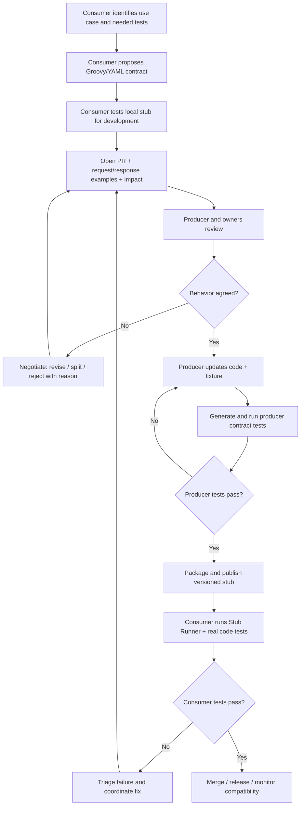
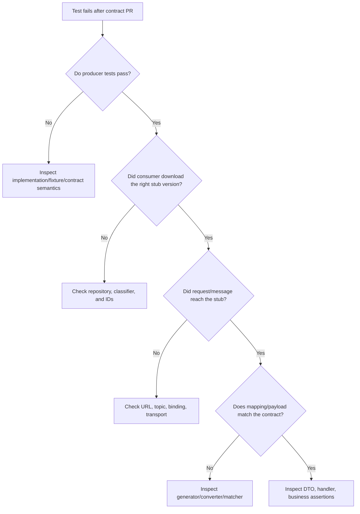

# Workflow for Consumer Contract Proposals and Producer Reviews

## 1. Why does a contract need agreement from both teams?

In **Spring Cloud Contract** (module `SPRING_CLOUD_CONTRACT`), a contract describes the behavior that a **producer** provides and one or more **consumers** expect. A contract can be an HTTP request/response or a messaging interaction, written in **Groovy DSL** or **YAML DSL**. The tool generates tests for the producer to verify actual behavior, packages versioned stubs for the consumer to run with **Stub Runner**, and helps CI detect incompatible API changes.

Technically, a contract is a set of testable rules. In terms of coordination, it is an **agreement between teams**. If a consumer writes expectations without the producer's approval, the stub may simulate an API that has never existed. Conversely, if the producer changes a response without understanding which fields consumers use, a seemingly small change can break the integrated system.

**Consumer-driven contract testing (CDC)** solves this problem by bringing the **consumer's actual needs** into the contract creation process. Consumers can proactively describe the behavior they need and submit a pull request; the producer must review, negotiate when needed, and perform producer verification before publishing a reliable stub.

Example: Checkout Service needs to know whether a SKU is in stock to decide whether to allow placing an order. Inventory Service is the producer providing the inventory check API. Checkout proposes:

```text
GET /api/inventory/SKU-001
Accept: application/json

200 OK
Content-Type: application/json
{
  "sku": "SKU-001",
  "available": true,
  "quantityAvailable": 12
}
```

The consumer can immediately write tests for the ordering flow based on this response. However, before treating this as a committed API, the producer needs to confirm:

- Do the endpoint, status, and fields fit the Inventory design?
- Is `quantityAvailable` the quantity remaining in the warehouse or the **sellable** quantity after subtracting reservations?
- How does a non-existent SKU differ from an existing SKU that is out of stock?
- Are there any volatile or sensitive fields that should not be exposed?
- Does the current implementation satisfy the contract, or is a new change required?
- Could other consumers be affected?

**The goal of this lesson** is to design a complete workflow from **proposal -> review -> producer verification -> stub publication -> consumer verification**, rather than stopping at creating a `.groovy` file.

## 2. Roles, responsibilities, and decision-making authority

CDC does not mean "whatever the consumer wants, the producer must implement exactly that". It means **the consumer contributes expectations based on use cases**, while **the producer is responsible for publishing the behavior it actually supports**.

| Role | Main responsibilities | Should not do |
| --- | --- | --- |
| **Consumer developer** | Describe use cases, propose minimal request/response, write consumer tests, explain impact | Publish a stub on their own as a producer-approved contract |
| **Producer developer** | Review semantics, implementation feasibility, compatibility impact, create fixtures, and run generated producer tests | Approve a PR just because the DSL syntax is valid |
| **API/domain owner** | Decide vocabulary, policies, business rules, and version roadmap | Let two teams have different understandings of the same field |
| **Reviewer from another consumer** | Point out existing dependencies and regression risks | Treat a new contract as a single consumer's private matter |
| **CI/release owner** | Control artifact versions, gate producer tests, publish, and provenance | Release a stub without evidence that the producer satisfies it |
| **Security/data owner** when relevant | Review access permissions, PII, and fixture data | Allow real tokens or production data into stubs |

In a small organization, one person may wear multiple hats. What matters is not the number of job titles, but that **expectations are proposed by API users and acknowledged by the API provider with evidence**.

### 2.1. Distinguishing PR authorship rights from API approval rights

A consumer may be granted permission to create branches or pull requests in the repository holding contracts. That **does not mean** the consumer has the authority to decide on their own that a new API has been released.

- **Proposal:** the consumer expresses a need using a concrete contract.
- **Review:** the producer and domain owner determine whether to accept it.
- **Implementation:** the producer writes code/fixtures for the approved behavior.
- **Verification:** generated producer tests run against the real producer.
- **Publication:** a new stub/artifact version is published after quality gates pass.
- **Consumption:** the consumer updates tests and runs against the verified artifact.

If the producer rejects an expectation, that can be the right decision: an existing API may already work, the contract may be overly constraining, or the request may violate security policy. It is important to **state the reason and offer an alternative**, rather than simply closing the PR.

## 3. Diagram of the entire coordination workflow



The diagram describes a **recommended working policy**. The exact order of merging contract sources, merging implementation, and publishing artifacts may vary across organizations. What **must not be skipped** is the distinction between:

1. The consumer **testing with a stub generated from the proposal**.
2. The producer **verifying that the real application satisfies the approved contract**.
3. The consumer **re-running against the artifact verified and published by the producer**.

If only step 1 exists, the consumer can turn green against a **wishful stub** that the producer has never been able to produce.

## 4. Preparation before the consumer writes a proposal

A request like "add a field for the frontend to use" is usually too vague. The consumer should describe the **observable behavior at the integration boundary**.

### 4.1. Minimal requirement sheet

| Question | Checkout Consumer example |
| --- | --- |
| Who is the contract user? | Checkout Service, Checkout team |
| What business behavior is needed? | Allow placing an order only when the SKU is available for sale |
| Intended producer? | Inventory Service |
| Interaction? | `GET /api/inventory/{sku}` |
| What input needs to be sent? | SKU and `Accept: application/json` |
| Minimal output? | `sku`, `available`, `quantityAvailable` |
| Important error branch? | Non-existent SKU returns `404 SKU_NOT_FOUND` |
| Other consumers? | Catalog UI, Order Service |
| Version currently in use? | Inventory `1.8.0` (illustrative) |
| Target timeline? | Before releasing the new checkout flow |
| Accountable owners? | Checkout owner and Inventory API owner |

**The value of the table** is providing context so the producer can challenge the business semantics. A syntactically valid DSL file still does not explain why `available = true` when quantity is 0, or when a field may be absent.

### 4.2. Categorizing the change

Before creating a contract, the team should identify which category the proposal belongs to:

- **Existing undocumented behavior**: adding a contract to protect what is already running.
- **New compatible behavior**: adding an endpoint or optional field according to schema policy.
- **New potentially breaking behavior**: changing types, meanings, error codes, or endpoints.
- **Implementation bug fix**: the producer already has a contract but behaves incorrectly.
- **Messaging protocol change**: topic/destination, headers, schema, stub label, or serializer.

Do not bundle changes with very different risk levels into one large PR. A PR focused on **a single testable consumer requirement** makes review and rollback easier.

## 5. Two main contract storage models

Spring Cloud Contract describes two common ways to organize Consumer-Driven Contracts:

### 5.1. Contracts located in the producer repository

```text
inventory-producer/
  pom.xml
  src/
    main/
      java/...               # Producer implementation
    test/
      java/...               # Base class + fixtures
      resources/
        contracts/
          checkout/
            get_inventory_available.groovy
            get_inventory_sku_not_found.yml
          catalog/
            get_inventory_summary.groovy
```

**Flow:** A Checkout developer clones/forks the Inventory repository according to granted permissions, creates the contract under the appropriate folder, tries a local stub if needed, and opens a PR. A producer reviewer picks up the PR, updates or adds the implementation, runs the generated verification tests, and merges.

**Pros:** Contracts sit close to the producer source; the producer can enforce review/code ownership and CI gates in the same repository.

**Limitations:** If consumers are not permitted to read producer source (different company, security boundary), this model may not fit. Consumers may also have to download a lot of unrelated code just to submit a DSL file.

### 5.2. Contracts located in a shared repository

An organization can create a repository **dedicated to storing contracts**, grouped by producer and consumer:

```text
contracts-repository/
  com/
    example/
      inventory-producer/
        checkout-consumer/
          get_inventory_available.groovy
          get_inventory_sku_not_found.yml
        catalog-consumer/
          get_inventory_summary.groovy
        pom.xml
      payments-producer/
        checkout-consumer/
          payment_succeeded.groovy
  pom.xml
```

This directory tree is an **illustrative convention** based on the shared repository model; plugin/assembly configuration must match the actual structure. It does not mean Spring Cloud Contract automatically infers consumer permissions from folder names.

In this model:

- Consumers can create PRs in the contracts repository without accessing producer source code.
- The platform/operations team packages contracts into a separate artifact.
- The producer uses `contractDependency`, `contractsMode`, and the corresponding repository configuration to fetch the **exact contract version** when generating tests.
- Consumers use stubs generated from the agreed contracts.

**Pros:** Expectations are transparent per consumer, supporting multi-repository teams or security boundaries. **Trade-off:** contract artifacts must be versioned separately, PR/CI in the shared repository must be governed, and synchronization with the producer implementation must be maintained.

### 5.3. Model selection table

| Criterion | Contracts in producer repo | Contracts in common repo |
| --- | --- | --- |
| Does consumer need to read producer source? | Usually yes while creating the PR | Not necessarily |
| Review by producer | PR in producer repo | PR in common repo with producer owner |
| Implementation evidence | Producer CI in the same repo | Producer CI downloads the exact contract artifact |
| Version management | Tied to producer code/release policy | Requires additional contract repository/artifact versioning |
| Best suited when | Teams in the same organization with relatively open access | Multiple consumers, separated access permissions |
| Main risk | Consumer depends on internal repo structure | Producer and consumer use mismatched contract versions |

**Regardless of where contracts live, the producer must still verify the contract against the real application.** Never conclude that just because a PR was merged into the common repo, the producer has been verified.

## 6. Writing an HTTP contract from the consumer's need

Suppose both teams have agreed on the Inventory endpoint `GET /api/inventory/SKU-001`.

### 6.1. Proposal in Groovy DSL

File `get_inventory_available.groovy`:

```groovy
import org.springframework.cloud.contract.spec.Contract

Contract.make {
    name 'get_inventory_available'
    description 'Checkout needs to know whether a SKU can be ordered'

    request {
        method GET()
        url '/api/inventory/SKU-001'
        headers {
            header 'Accept': 'application/json'
        }
    }

    response {
        status 200
        headers {
            contentType(applicationJson())
        }
        body([
            sku              : 'SKU-001',
            available        : true,
            quantityAvailable: 12
        ])
    }
}
```

The contract specifies the **method, URL, request header, HTTP status, response content type, and body types and values**. The consumer should include a semantic description in the proposal:

- `sku` is the identifier of the queried SKU; the producer returns the matching SKU rather than reading from a wrong cache key.
- `available` indicates orderability **at the time of checking**, not a guarantee that a reservation has succeeded.
- `quantityAvailable` is the sellable quantity under the agreed rules, not total physical stock.
- Response `200` applies only to SKUs that exist in the fixture.

This is **a concrete example**, not a description of every valid inventory payload. Separate contracts are needed for other branches that the consumer actually uses.

### 6.2. Equivalent YAML representation

```yaml
name: get_inventory_available
description: Checkout needs to know whether a SKU can be ordered
request:
  method: GET
  url: /api/inventory/SKU-001
  headers:
    Accept: application/json
response:
  status: 200
  headers:
    Content-Type: application/json
  body:
    sku: SKU-001
    available: true
    quantityAvailable: 12
```

This is an **alternative representation** of the same Groovy contract. Do not include both files describing the same request condition and response in the same build if that causes duplicate mappings/tests.

### 6.3. Adding error branches that truly need protection

File `get_inventory_sku_not_found.groovy`:

```groovy
import org.springframework.cloud.contract.spec.Contract

Contract.make {
    name 'get_inventory_sku_not_found'
    description 'A non-existent SKU differs from an out-of-stock SKU'

    request {
        method GET()
        url '/api/inventory/SKU-MISSING'
        headers {
            header 'Accept': 'application/json'
        }
    }

    response {
        status 404
        headers {
            contentType(applicationJson())
        }
        body([
            code: 'SKU_NOT_FOUND'
        ])
    }
}
```

**Do not confuse `404 SKU_NOT_FOUND` with a `404` returned because WireMock could not find a mapping.** Consumer tests must check the committed error code/body, not just the status.

### 6.4. Counter-example condition: out of stock is not the same as non-existent

If SKU `SKU-002` exists but `quantityAvailable = 0`:

```json
{
  "sku": "SKU-002",
  "available": false,
  "quantityAvailable": 0
}
```

The consumer may need **a separate `200` contract** for this scenario. Otherwise, a bug where `available` is always true or Checkout ignores quantity could go undetected. The scenario set should cover **the decisions the consumer actually makes**, not every internal state of Inventory.

## 7. What does the consumer do before submitting a PR?

The consumer can develop **test-first**:

1. Write an application test for what Checkout should do when receiving a response with `available = true`.
2. Write or update the HTTP client/DTO on the consumer side according to the proposed contract.
3. Create the Groovy/YAML contract source in the agreed location.
4. Generate a local stub from the proposed contract to run tests while the producer has not yet implemented it.
5. Attach sample requests/responses, test results, and open business questions to the PR.

### 7.1. Consumer tests must exercise real consumer code

Suppose Checkout has `InventoryClient` and `CheckoutAvailabilityService`. A consumer test uses Stub Runner:

```java
import org.junit.jupiter.api.Test;
import org.springframework.beans.factory.annotation.Autowired;
import org.springframework.boot.test.context.SpringBootTest;
import org.springframework.cloud.contract.stubrunner.StubRunnerProperties;
import org.springframework.cloud.contract.stubrunner.spring.AutoConfigureStubRunner;

import static org.assertj.core.api.Assertions.assertThat;

@SpringBootTest(properties = {
    "clients.inventory.base-url=http://localhost:8090"
})
@AutoConfigureStubRunner(
    ids = "com.example:inventory-producer:1.9.0-SNAPSHOT:stubs:8090",
    stubsMode = StubRunnerProperties.StubsMode.LOCAL
)
class CheckoutAvailabilityConsumerTest {

    @Autowired
    CheckoutAvailabilityService checkoutAvailabilityService;

    @Test
    void availableSkuCanBeOrdered() {
        AvailabilityView actual =
            checkoutAvailabilityService.check("SKU-001");

        assertThat(actual.sku()).isEqualTo("SKU-001");
        assertThat(actual.canOrder()).isTrue();
    }

    @Test
    void missingSkuIsNotTreatedAsAvailable() {
        assertThat(
            checkoutAvailabilityService.check("SKU-MISSING").canOrder()
        ).isFalse();
    }
}
```

`CheckoutAvailabilityService` and `AvailabilityView` are **illustrative components implemented by the consumer**. The behavior `check("SKU-MISSING").canOrder() == false` is an **assumed example policy**, not a Spring Cloud Contract feature. If the application chooses to throw a domain exception, the test must assert the exception instead of forcing the service to return a view.

**Execution conditions:** artifact `1.9.0-SNAPSHOT:stubs` is installed in the local Maven repository from the proposal; the consumer actually invokes the HTTP client pointing to the stub; the test context and dependencies are compatible. For release CI, use the version **already verified by the producer** instead of treating the consumer's experimental stub as the source of truth.

### 7.2. Experimental stubs vs. producer-verified stubs

| Evidence | Proves | Does not prove |
| --- | --- | --- |
| Consumer installs local stub from proposal | Consumer can develop against the desired interface | Current producer already supports the interface |
| Consumer test passes against local stub | Consumer client and logic handle the sample | Real producer returns the sample |
| Producer generated tests pass | Producer satisfies the contract under chosen fixtures | Every consumer is compatible |
| Consumer test passes against published stub | Consumer handles the producer-verified artifact | All network, security, and production data cases are covered |

Spring Cloud Contract's CDC documentation includes examples where contract authors install local stubs for early experimentation. **Temporarily skipping tests** during local stub creation does not mean it is acceptable to **skip producer verification on release**.

### 7.3. Be careful when source contracts contain multiple branches

If Checkout only proposes a single `SKU-001` example and the producer uses an overly broad regex so every SKU returns `200 available = true`, the stub can cause consumer tests to falsely pass. When an API distinguishes existing/out-of-stock/missing SKUs, request mappings should be separated by actual request data or matching conditions.

Do not replace contract scope with a `GET /api/inventory/.*` pattern returning the same response when that is not the behavior the producer commits to.

## 8. What should a contract proposal pull request contain?

A good PR does more than add new files. It helps the producer **make a decision**, helps reviewers from other consumers see the impact, and tells CI what to check.

### 8.1. PR description template

```markdown
## Consumer need
Checkout Service needs to block order placement when a SKU is out of stock.

## Proposed API
GET /api/inventory/{sku}
200: {sku, available, quantityAvailable}
404: {code: "SKU_NOT_FOUND"}

## Contract changes
- get_inventory_available.groovy
- get_inventory_out_of_stock.groovy
- get_inventory_sku_not_found.groovy

## Field semantics
- available: whether orders can be accepted at read time
- quantityAvailable: sellable quantity, not total stock

## Compatibility
- No changes to existing endpoints
- Producer needs to confirm data types and 404 condition

## Testing
- Consumer test with local stub: PASS
- Producer verification: PENDING PRODUCER REVIEW

## Owners
Consumer: Checkout Team
Producer: Inventory Team
Other consumers to notify: Catalog Team
```

In real code reviews, PRs may use the organization's template or issue tracker. Statuses like `PASS`/`PENDING` in the example are **illustrative**, not the output of an executed build.

### 8.2. Enough information to review does not mean a long PR

At a minimum, include **use case, contract diff, field definitions, error branches, compatibility impact, contacts, and test results**. If a change affects schema version, security headers, PII, or SLAs, include the corresponding risk section.

**Do not attach real tokens or production requests containing personal data** just to prove the API is being called. Use synthetic fixtures and document what matters.

## 9. Producer review: questions that must be answered

Producers should not just comment "looks good". Review needs to cover **correct behavior**, **proper boundaries**, and **maintainability**.

| Question group | What the producer needs to review |
| --- | --- |
| Business semantics | What does `available` mean, when is it computed, could there be race conditions? |
| Contract scope | Is the consumer asking for unused data, such as per-warehouse stock counts? |
| HTTP semantics | Do method, URL, status, headers, content type, and auth match API conventions? |
| Data types | Boolean/number/string, nullability, negative integers, new enums, list ordering |
| Error branches | `404`, `400`, `409`; error code body; distinguishing missing vs. out-of-stock SKUs |
| Compatibility | Does it affect existing consumers or published API/documentation? |
| Producer testing | Are there stable fixtures, base test class, valid generated assertions? |
| Stub semantics | Are request matchers overly broad or mappings overlapping? |
| Operations | Is a new version, migration period, or feature flag needed? |
| Security | Does the API expose sensitive data, and are authentication/permissions appropriate? |

### 9.1. "Can satisfy" is not enough: respond on semantics

For example, Checkout proposes `available = true` when `quantityAvailable > 0`. Inventory may already have reserved stock for other orders. The true definition may be:

```text
quantityAvailable = onHand - reserved - safetyBuffer
available = quantityAvailable > 0
```

This formula is an **example of a negotiated business rule**, not a mandatory inventory calculation. The producer must confirm the actual rule; if there is no agreement, do not merge a contract describing one meaning while consumer and producer interpret it differently.

### 9.2. Choose expectations strong enough without over-constraining

If the consumer only needs `available`, the contract does not need to constrain `warehouseInternalId`, `lastRecountJobId`, or JSON field ordering. Locking down unused details increases false failures and hinders API evolution.

On the other hand, a `.*` matcher for the entire response body will fail to catch `available` changing from boolean to string. Choose constraints based on **the consumer's real dependencies**:

- Method/URL/important headers.
- Required fields and data types.
- Distinguishing business values/branches.
- Dynamic data rules only when needed.
- Do not constrain unpublished internal details.

**Balancing principle:** *Strict enough to catch consumer-breaking bugs; narrow enough in scope so the producer is not locked into things the consumer does not use.*

## 10. Producer verification after contract approval

Once the producer agrees with the proposal, the next step is **not immediately publishing the stub**. The producer must:

1. Update the endpoint implementation if the new behavior does not yet exist.
2. Create fixtures for in-stock, out-of-stock, and non-existent SKUs.
3. Configure the Spring Cloud Contract Maven/Gradle plugin with the proper contracts root.
4. Generate producer tests from the reviewed contracts.
5. Run generated tests against the real controller/service or chosen producer boundary.
6. Verify HTTP mappings and ensure the stub artifact is packaged properly.
7. Publish a new version only when all verification gates pass.

### 10.1. Illustrative base class for an HTTP producer

With Spring MVC, JUnit 5, and MockMvc mode:

```java
package com.example.inventory.contract;

import io.restassured.module.mockmvc.RestAssuredMockMvc;
import org.junit.jupiter.api.BeforeEach;
import org.springframework.beans.factory.annotation.Autowired;
import org.springframework.boot.test.autoconfigure.web.servlet.AutoConfigureMockMvc;
import org.springframework.boot.test.context.SpringBootTest;
import org.springframework.test.web.servlet.MockMvc;

@SpringBootTest
@AutoConfigureMockMvc
public abstract class InventoryContractBase {

    @Autowired
    private MockMvc mockMvc;

    @Autowired
    private InventoryContractFixtures fixtures;

    @BeforeEach
    protected void prepareContractState() {
        fixtures.reset();
        fixtures.stock("SKU-001", 12);
        fixtures.stock("SKU-002", 0);
        fixtures.ensureMissing("SKU-MISSING");
        RestAssuredMockMvc.mockMvc(mockMvc);
    }
}
```

`InventoryContractFixtures` and the methods `reset`, `stock`, `ensureMissing` are **hypothetical test helpers implemented by the producer**. They must prepare state so the real endpoint processes requests; never replace the controller with a hard-coded response just to make generated tests pass.

### 10.2. Minimal Maven configuration

In a producer with an appropriate BOM/dependency management:

```xml
<dependencies>
  <dependency>
    <groupId>org.springframework.boot</groupId>
    <artifactId>spring-boot-starter-test</artifactId>
    <scope>test</scope>
  </dependency>
  <dependency>
    <groupId>org.springframework.cloud</groupId>
    <artifactId>spring-cloud-starter-contract-verifier</artifactId>
    <scope>test</scope>
  </dependency>
</dependencies>

<build>
  <plugins>
    <plugin>
      <groupId>org.springframework.cloud</groupId>
      <artifactId>spring-cloud-contract-maven-plugin</artifactId>
      <version>REPLACE_WITH_COMPATIBLE_VERSION</version>
      <extensions>true</extensions>
      <configuration>
        <testFramework>JUNIT5</testFramework>
        <testMode>MOCKMVC</testMode>
        <baseClassForTests>com.example.inventory.contract.InventoryContractBase</baseClassForTests>
      </configuration>
    </plugin>
  </plugins>
</build>
```

`REPLACE_WITH_COMPATIBLE_VERSION` is a placeholder; replace it with the Spring Cloud Contract version compatible with the project's Spring Boot/Cloud version. This is a condensed POM snippet, not a standalone runnable build. The Maven plugin, test runner, and dependency versions must be configured properly so **generated tests actually execute**, not merely generate Java sources.

### 10.3. False-green tests to avoid

| Situation | Why there is no proof the producer satisfies the contract |
| --- | --- |
| `generateTests` succeeds | Only proves the generator produced source files |
| Stub JAR exists, but tests were skipped | No generated assertions were executed |
| Fixture returns the exact response bypassing the service | Does not verify the real implementation |
| CI reports `BUILD SUCCESS` with 0 contract tests | Plugin may not be reading contracts or the test runner skipped them |
| Consumer test passes with proposed local stub | Sample stub may not be supported by the producer |

Reviewers should inspect **generated test counts**, logs of producer assertions, and stub artifact/version, not just the green checkmark on a PR.

## 11. Contract review when there are multiple different consumers

Suppose Inventory Service serves:

- **Checkout** needs `available` and `quantityAvailable`.
- **Catalog** only needs an "in stock / out of stock" status for display.
- **Warehouse Operations** needs physical stock, reserved quantity, and last stocktake timestamp.

Do not force a single endpoint to return **all internal fields** just because there are three consumers. Options to consider:

| Option | Pros | Risks / conditions |
| --- | --- | --- |
| Single shared API with clearly published fields | Easy to reuse | Prone to bloat, data leakage, or coupling |
| Separate endpoints per use case | Clear permissions/responsibilities, reduces unnecessary data | Requires managing multiple contracts |
| Add optional fields | Can be backward-compatible if consumers are lenient | Strict consumers may fail |
| New media type / API version | Isolates breaking changes | Cost of parallel support |
| Dedicated message/event | Suitable for asynchronous processing | Schema evolution, ordering, and routing are more complex |

### 11.1. Avoiding conflicting contracts

Example:

```text
Checkout contract:
  GET /api/inventory/SKU-001 -> 200 {"available":true}

Catalog contract:
  GET /api/inventory/SKU-001 -> 200 {"available":false}
```

If **the same request and the same fixture** yield two contradictory expected responses, the two contracts cannot simultaneously represent the same producer behavior. You need to:

1. Identify different preconditions (warehouse, timestamp, access permissions...).
2. Separate meaningful request conditions or corresponding fixtures.
3. If there is no way to distinguish them, pick one agreed semantics and update the consumer.
4. Ensure WireMock mappings do not overlap and return responses depending on matching order.

**Placing contracts in two different consumer folders does not make WireMock automatically distinguish identical requests.**

### 11.2. Changes that look like "just adding a field" still require checking with consumers

Adding `warehouseZone` to a JSON response may not break consumers using a deserializer that tolerates unknown properties. However, consumers using strict DTOs/schemas may reject the new field. The producer should proactively run consumer contract tests for supported teams rather than concluding "adding a field is definitely compatible".

## 12. Review feedback: accept, request changes, or reject

A healthy process has more valid states than "merge immediately" or "close PR".

| Review outcome | Example | Next action |
| --- | --- | --- |
| **Accept** | Clear behavior, architecturally sound, and verifiable | Producer implements if needed, runs generated tests |
| **Request changes** | Unclear unit for `quantityAvailable` or whether it can be negative | Clarify semantics, update DSL, re-test |
| **Split proposal** | PR bundles a new endpoint and an old message schema change | Split into smaller proposals for easier review/rollback |
| **Alternative offered** | API already has `/availability` providing equivalent info | Consumer tries the existing endpoint |
| **Defer** | Requires major database changes or lacks current capacity | Record dependency and re-evaluation milestone |
| **Reject with reason** | Request asks for internal warehouse data violating policy | State the reason and find another solution |

### 12.1. Example of a constructive review conversation

> **Consumer:** "We need `quantityAvailable` to block Checkout when out of stock."
>
> **Producer:** "The system handles concurrent reservations; the quantity is only a snapshot and does not guarantee reservation success. We suggest adding `available` for the UI and a `POST /reservations` endpoint for the final decision."
>
> **Consumer:** "Then the `GET` contract will be used for display, while order submission will handle `409 OUT_OF_STOCK` from reservation."
>
> **Conclusion:** Revise the proposal into two clear behaviors: preliminary check and authoritative reservation.

This is an **example of business negotiation**, not a mandatory pattern for every system. The key takeaway: a boolean field shifted from meaning "guaranteed stock lock" to "advisory status" after the producer clarified the limitation.

### 12.2. Record decisions, not just "LGTM"

For substantial requests, the PR should leave a summary record:

```text
Decision: ACCEPT_WITH_CHANGES
Consumer: checkout-consumer
Producer: inventory-producer
Contract: get_inventory_available
Semantics: available is a point-in-time indicator
Reservation: POST /api/reservations remains authoritative
Error cases: SKU_NOT_FOUND, OUT_OF_STOCK handled separately
Compatibility: additive endpoint, no removal of existing fields
Producer verification: required before publish
Owners: Checkout API Owner + Inventory API Owner
```

This record is **illustrative review documentation**, not DSL metadata to be embedded in the contract.

## 13. Coordinating on messaging contracts

With messaging, the consumer does not actively call a URL; a contract may describe a message emitted by the producer. Negotiation must clarify **destination, body, headers, content type, event semantics, and delivery assumptions**.

Suppose Orders Producer emits an event when an order is created, and Inventory Consumer needs to know in order to request a stock reservation.

### 13.1. Consumer proposes a Groovy contract

```groovy
import org.springframework.cloud.contract.spec.Contract

Contract.make {
    name 'order_created_event'
    label 'order_created'
    description 'Inventory receives an event when Orders creates an order'

    input {
        triggeredBy('publishOrderCreated()')
    }

    outputMessage {
        sentTo('orders.events')
        body([
            eventType: 'ORDER_CREATED',
            orderId  : 'ord-1001',
            productId: 'SKU-001',
            quantity : 2
        ])
        headers {
            header('eventType', 'ORDER_CREATED')
            messagingContentType(applicationJson())
        }
    }
}
```

**Note the roles:**

- `label 'order_created'` is the label that **triggers the message stub** in consumer tests when messaging integration supports it.
- `triggeredBy('publishOrderCreated()')` is a **method implemented by the producer test base** to trigger the real producer during verification.
- `sentTo('orders.events')` is the **destination** to be verified.
- `body` and `headers` are the message payload and metadata needed by the consumer.

Changing `label` does not automatically change the topic; changing `eventType` in the body does not automatically update the `eventType` header. Consumer and producer must agree on where data lives and its types.

### 13.2. Equivalent YAML DSL

```yaml
name: order_created_event
label: order_created
description: Inventory receives an event when Orders creates an order
input:
  triggeredBy: publishOrderCreated()
outputMessage:
  sentTo: orders.events
  body:
    eventType: ORDER_CREATED
    orderId: ord-1001
    productId: SKU-001
    quantity: 2
  headers:
    eventType: ORDER_CREATED
    contentType: application/json
```

The Groovy and YAML versions represent **a single contract**; do not place both in the same build as two separate scenarios if that causes duplicate generated tests.

### 13.3. What else must the producer review?

| Question | Reason |
| --- | --- |
| Is the event emitted after the **business commit**? | Avoid the consumer seeing uncommitted state |
| Are `orderId` and `eventId` stable/unique? | Supports tracing and idempotency |
| Is `quantity` an integer and can it be 0? | Consumer might mishandle the quantity |
| Is `sentTo` a logical destination or a real broker topic? | Binders/messaging integrations may map them differently |
| Are `contentType`/serializer agreed upon? | Consumer must be able to decode the payload |
| Could events be delivered more than once or out of order? | Stub tests do not prove delivery semantics |
| Is a schema version needed? | Payload evolution with older consumers |
| Are there security/tenant partition rules? | Avoid sending events outside the proper data scope |

**Do not expect Stub Runner alone to prove** exactly-once delivery, ordering, retries, or broker security. Those require additional integration/resilience tests.

### 13.4. Producer tests and consumer tests are two distinct pieces of evidence

Producer tests use `publishOrderCreated()` to run real Orders behavior and observe the message. A consumer test may invoke:

```java
assertThat(stubTrigger.trigger("order_created")).isTrue();

await().atMost(Duration.ofSeconds(5))
       .untilAsserted(() ->
           assertThat(inventoryReadModel.hasOrder("ord-1001")).isTrue()
       );
```

This is an **illustrative** snippet in a JUnit consumer test with Stub Runner, a message binder, and Awaitility; `inventoryReadModel` is an application API. Before triggering, ensure the read model **does not yet contain** `ord-1001`; otherwise the assertion could pass even if the consumer handler is broken.

## 14. API compatibility and versioning when both teams change together

After the producer verifies the contract, it should publish a stub artifact such as:

```text
com.example:inventory-producer:1.9.0:stubs
```

The consumer should **pin a verified version** when running CI for releases. A configuration using `+` or "latest" can cause the same commit to fetch different stubs across runs.

### 14.1. Changes with breaking risk

| Producer-proposed change | Risk to consumer | Coordination strategy |
| --- | --- | --- |
| Change `quantityAvailable` from number to string | DTO/comparison logic fails | Keep old type or version the contract |
| Rename `available` to `availabilityStatus` | Consumer cannot read old field | Transition period supporting both if appropriate |
| Remove `404 SKU_NOT_FOUND` response | Consumer cannot classify the error | Agree on new error schema and migration |
| Change `200` to `204` when out of stock | Consumer has no JSON to parse | New contract + consumer rollout plan |
| Add optional field | Can break strict deserializers | Consumer compatibility tests against candidate stub |
| Change `orders.events` to another topic | Consumer does not receive messages | Dual publish/routing migration if needed |
| Change label `order_created` | Consumer test stub trigger fails | Coordinate test updates or keep compatible label |
| Change content type/serializer | Consumer fails to parse payload | Schema/converter integration tests |

**Not every change requires a major version**, but breaking-change assessment must be based on **still-supported consumers**, not just the producer's view that a change is "minor".

### 14.2. Rollout strategy

A potentially breaking change typically requires:

1. The producer publishes the new contract alongside the old behavior if possible.
2. The consumer tests against the candidate stub version.
3. The consumer releases a version capable of accepting the new response.
4. The producer rolls out the new behavior behind a feature flag/version/dual format if needed.
5. Monitor compatibility during the transition period.
6. Remove the old behavior/stub only after support, rollback windows, and dependencies end.

Do not **delete old stubs** to force consumers to upgrade: that only causes `artifact not found` and breaks testing/rollback capability for still-supported versions.

## 15. CI gates for both teams

A PR should only be considered safe when **both the contract and the verification workflow are sound**.

### 15.1. Verification gates

| Stage | Accountable owner | Must pass | Evidence |
| --- | --- | --- | --- |
| Contract lint/parse | Consumer + contract repo CI | Groovy/YAML is valid and scanned | Build logs, discovered contract list |
| Consumer test with proposed stub | Consumer | Client and logic handle the desired sample | Consumer test report, marked *unverified stub* |
| Producer review | Producer/domain owner | Semantics, contract scope, security, compatibility approved | Review approvals/decision |
| Generated producer tests | Producer | Test source exists for branches needing protection | Generated classes/test count |
| Producer verification | Producer CI | Tests run against real code/fixtures and pass | Surefire/Gradle report |
| Stub packaging | Producer CI | Artifact has correct contracts/mappings/version | JAR inspection, checksum |
| Consumer compatibility | Consumer CI | Runs against **producer-verified stub** | Stub coordinates + test report |
| Publish/rollout | Release owner | Released only after quality gates | Immutable artifact, release record |

If an organization keeps contracts in a **common repository**, add a step where the producer fetches the **exact contract artifact version**. Never run producer tests against a different contract set than the one the consumer just reviewed.

### 15.2. Questions during pull request review

- Has at least one **consumer owner** described the use case/actual usage?
- Has the producer owner approved semantics/responses/error codes?
- Is the contract placed in the right folder and discovered by the plugin?
- Does the test file protect behavior, or does it only compare fixture against fixture?
- Were generated producer tests **executed**, or only generated as source?
- Do HTTP mappings have overlapping matchers?
- For messaging, have label/destination/headers/content type been agreed upon?
- Did the consumer test against the **candidate artifact version**?
- Are appropriate negative/not-found/out-of-stock branches covered?
- Do other consumers/branches need to be re-run?
- Is there sensitive data, real tokens, or excessive internal content in fixtures?

### 15.3. Example CI flow

```text
Consumer feature PR
  -> write consumer test
  -> propose contract branch / PR
  -> optional local stub test (unverified)

Producer contract review
  -> accept / negotiate / reject
  -> implement missing behavior
  -> generate producer tests
  -> run producer verification
  -> convert HTTP mappings / package message definitions
  -> publish candidate stub artifact

Consumer compatibility CI
  -> resolve exact stub version
  -> run actual consumer client/handler tests
  -> report PASS/FAIL to both owners
  -> coordinated release decision
```

**Do not skip the "actual consumer behavior" step**: if the consumer only verifies that WireMock returns JSON matching the fixture, the test does not protect the HTTP client, DTO mapping, or consumer business decisions.

## 16. Responsibility when CI detects a failure

A failure does not automatically prove either the producer or consumer is "at fault". Triaging by boundary helps both teams collaborate instead of blindly editing expected values.

| Symptom | Suspect cause | Team to check first |
| --- | --- | --- |
| DSL parse failure | Invalid syntax/contract format | Proposer + contract repo CI |
| Producer test fails `200` vs actual `404` | Missing fixture or unimplemented behavior | Producer |
| Generated test not created | Wrong contracts root/plugin filter | Producer build owner |
| Stub artifact `1.9.0` not found | Not published yet or wrong classifier/version | Producer release + consumer CI |
| Consumer receives `404` WireMock no-match | Wrong client method/path/header/body or missing mapping | Consumer + producer mapping reviewer |
| Stub `200` is right but DTO parse fails | Type/schema/content type differs from expectation | Consumer; coordinate with producer if contract is wrong |
| Messaging label fails to trigger | Different label/artifact or integration not configured | Both teams |
| Consumer test fails on new producer version | Breaking change or old consumer assumption | Both teams + API owner |
| Consumer test passes local stub, fails producer verification | Proposal not yet satisfied by real implementation | Producer implements, consumer verifies semantics |

### 16.1. Avoid "fixing the test to go green" when a real bug exists

If the producer returns `quantityAvailable` as `"12"` (string) while the contract expects number `12`, do not change the contract to `.*` without asking the consumer. The consumer may use the field for numeric comparisons. Instead:

1. Confirm the type agreed upon by both sides.
2. Check the serializer/DTO on the producer side.
3. Fix the implementation or negotiate a new version.
4. Re-run producer tests and consumer tests.

**A contract is a drift-detection tool**, not a check to be loosened every time a failure occurs.

### 16.2. When it is unclear which side is wrong

An effective debugging flow:



## 17. Managing contracts across their lifecycle, not just one PR

After a contract is merged and the stub is published, coordination continues:

1. **Version** the artifact with the producer release; record contract commit/provenance.
2. **Track consumer owners** and supported branches using which version.
3. **Announce deprecation** before removing fields/endpoints/message labels.
4. **Run regression** for critical consumers when the producer changes.
5. **Preserve contract history** to support LTS rebuilds/rollbacks per policy.
6. **Periodically retire unused contracts**, but confirm no supported consumer still depends on them.

### 17.1. A simple tracking table

| Contract | Producer owner | Consumer owners | Status | Stub version | Action |
| --- | --- | --- | --- | --- | --- |
| `get_inventory_available` | Inventory | Checkout, Catalog | Active | `1.9.0` | Monitor |
| `get_inventory_sku_not_found` | Inventory | Checkout | Active | `1.9.0` | Keep error branch |
| `legacy_stock_count` | Inventory | Warehouse LTS | Deprecated | `1.7.5` | Do not delete while LTS still uses it |
| `order_created_event` | Orders | Inventory | Active | `2.3.0` | Monitor schema/label |

This is an **illustrative table**, not live data from a real team. The key value is knowing who is responsible for responding when proposing changes or deletions to a contract.

### 17.2. Contracts do not replace API documentation

A contract tests **representative examples and specified conditions**. To understand the full API, teams may still need:

- OpenAPI/AsyncAPI/schema documentation.
- Auth, rate limit, pagination, and idempotency rules.
- Nullability, backward compatibility, and deprecation policies.
- SLOs, retries/timeouts, error budgets, and operational guidance.
- Integration tests with real transports/brokers for behaviors stubs do not simulate.

Contracts should be **consistent** with documentation, not necessarily replace all documentation.

## 18. Anti-patterns when multiple teams coordinate

| Anti-pattern | Consequence | Fix |
| --- | --- | --- |
| Consumer adds expectations and treats them as released API | Stub gets ahead of producer capabilities | Producer review + generated test gate |
| Producer changes fields without notice | Breaks consumer DTOs/logic | Run compatibility matrix, review changes |
| Only one happy-path fixture | Fails to catch wrong branching | Add meaningful error/out-of-stock/counter-example cases |
| PR contains only code, no field semantics | Both sides interpret fields differently | Document use case, semantics, error handling |
| Contract demands internal DB details | Coupling and security risk | Describe behavior only at the public boundary |
| Overly broad matchers just to pass tests | Misses breaking changes | Choose matchers based on consumer dependencies |
| Each consumer writes its own fake mappings | Stubs diverge and lack producer verification | Use a single reviewed contract source |
| `404` error branch only asserts status | Can pass due to WireMock no-match | Assert business error body |
| Stub version not pinned | CI is not reproducible | Pin artifact version |
| Using mocked client in tests to report contract test PASS | Fails to test HTTP boundary | Run real client against Stub Runner |
| Merge contract from common repo while producer uses old version | Not verifying the same contract | Pin contract artifact/version in producer CI |
| Change message label without notice | Consumer `StubTrigger` fails | Treat label as a test-facing interface |
| Delete old stubs right after new producer release | Consumer LTS/hotfix builds break | Inventory supported consumers before cleanup |
| Merge two PRs with conflicting matchers concurrently | WireMock returns unstable responses | Review mapping overlap and fixtures |
| Skip producer verification to publish quickly | Stub is unproven by producer | Block publish when generated tests fail |

## 19. Case study: Checkout proposes adding stock reservation capability

### 19.1. Problem statement

Checkout needs a new flow:

1. Display SKU availability.
2. When the user clicks place order, request to reserve the desired quantity.
3. If out of stock, display a clear error without falsely reporting success.

Inventory already has `GET /api/inventory/{sku}` returning an advisory count. Checkout initially proposes adding `reserved: true` to the `GET` response.

### 19.2. Review uncovers the issue

The producer explains: HTTP `GET` only reads state and should not create a reservation. Two concurrent order requests could both see stock and both attempt to order. Adding `reserved: true` to `GET` makes consumers likely to assume stock has been locked.

Both sides revise the proposal:

| Behavior | Request | Success response | Error branch |
| --- | --- | --- | --- |
| Advisory check | `GET /api/inventory/SKU-001` | `200`, `available`, `quantityAvailable` | `404 SKU_NOT_FOUND` |
| Effective reservation | `POST /api/reservations` with SKU and quantity | `201`, `reservationId`, `status=RESERVED` | `409 OUT_OF_STOCK` |

### 19.3. Groovy contract for successful reservation

```groovy
import org.springframework.cloud.contract.spec.Contract

Contract.make {
    name 'reserve_inventory_success'

    request {
        method POST()
        url '/api/reservations'
        headers {
            contentType(applicationJson())
        }
        body([
            sku     : 'SKU-001',
            quantity: 2
        ])
    }

    response {
        status 201
        headers {
            contentType(applicationJson())
        }
        body([
            reservationId: 'res-1001',
            status       : 'RESERVED'
        ])
    }
}
```

### 19.4. YAML contract for out-of-stock branch

```yaml
name: reserve_inventory_out_of_stock
request:
  method: POST
  url: /api/reservations
  headers:
    Content-Type: application/json
  body:
    sku: SKU-002
    quantity: 2
response:
  status: 409
  headers:
    Content-Type: application/json
  body:
    code: OUT_OF_STOCK
```

**Why not use the same request for both `201` and `409`?** If method, URL, headers, body matchers, and fixture have no observable difference, WireMock cannot tell which branch to pick; producer tests also become unstable if database state changes for identical requests.

In the example, `SKU-001` is seeded in stock and `SKU-002` is seeded out of stock. In a real API, a different request condition or separate test fixture can be used; ensure generated producer tests have matching setup.

### 19.5. Final decision

```text
Consumer request:
  "GET returns the reserved status directly so Checkout knows ordering succeeded"

Producer review:
  "Reservation cannot be guaranteed by GET; there is a race condition."

Agreed contracts:
  GET availability (advisory)
  POST reservation (authoritative)
  201 RESERVED
  409 OUT_OF_STOCK

Verification:
  Producer runs generated tests with deterministic stock fixtures.
  Consumer runs actual Checkout client against versioned stubs.
Release:
  Coordinated, with rollback/compatibility plan.
```

This case study shows **CDC is a two-way API design process**, not a consumer writing YAML and forcing the producer to match.

## 20. Hands-on exercise: organizing a contract proposal end to end

### 20.1. Context and data

Payment Service is the producer. Orders Service is the consumer needing confirmation of payment results. Currently Orders receives `PAYMENT_SUCCEEDED` with body `paymentId` and `orderId`, but needs `amount`, `currency`, and handling for `PAYMENT_FAILED`.

Teams:

| Team | Role |
| --- | --- |
| Orders Team | Consumer proposing and writing message handler tests |
| Payments Team | Producer reviewing, implementing, and running generated tests |
| Platform Team | Managing repository/stub artifact CI |

### 20.2. Requirements

1. Write the **use case** explaining why Orders needs the amount and currency.
2. Identify the **minimal fields** in body and headers for consumer processing.
3. Write a Groovy messaging contract for `PAYMENT_SUCCEEDED` with a clear `label`.
4. Write a separate YAML contract for `PAYMENT_FAILED` with `reason = DECLINED`.
5. List three questions Payments Team needs to answer regarding amount type, currency, and idempotency.
6. Create PR content with owners, semantics, compatibility, and test evidence.
7. Design a producer base test that triggers the event using **real Payment logic**.
8. Design a consumer test using Stub Runner that asserts the handler updates real state.
9. Propose a stub artifact version and how both teams verify they are using the same version.
10. Write a review outcome—accept, request changes, or defer—with reasoning.
11. Describe a plan when an older consumer cannot yet read `currency`.
12. Provide three CI conditions that will **block publish**.

### 20.3. Suggested Groovy contract for success

```groovy
import org.springframework.cloud.contract.spec.Contract

Contract.make {
    name 'payment_succeeded_event'
    label 'payment_succeeded'

    input {
        triggeredBy('publishPaymentSucceeded()')
    }

    outputMessage {
        sentTo('payments.events')
        body([
            eventType: 'PAYMENT_SUCCEEDED',
            paymentId: 'pay-1001',
            orderId  : 'ord-1001',
            amount   : 125000,
            currency : 'VND'
        ])
        headers {
            header('eventType', 'PAYMENT_SUCCEEDED')
            messagingContentType(applicationJson())
        }
    }
}
```

`publishPaymentSucceeded()` is a helper **implemented by the producer test base**, not a built-in method. The test must execute real Payment behavior with prepared fixtures.

### 20.4. Suggested YAML contract for failure

```yaml
name: payment_failed_event
label: payment_failed
input:
  triggeredBy: publishPaymentFailed()
outputMessage:
  sentTo: payments.events
  body:
    eventType: PAYMENT_FAILED
    paymentId: pay-2002
    orderId: ord-2002
    reason: DECLINED
  headers:
    eventType: PAYMENT_FAILED
    contentType: application/json
```

Failure branches may have different fields depending on Payment policy; clearly review what information is exposed, especially avoiding real card data, payment tokens, or sensitive information in contracts.

### 20.5. Definition of a complete exercise solution

A submission meets the requirements when:

- There are **two use cases** and two distinguishable contracts.
- The producer side can explain how to create both situations using fixtures.
- Generated producer tests can run against the real message producer.
- Consumer tests use stubs **and verify state after the handler runs**, not just `trigger(...) == true`.
- Someone decides on schema evolution and legacy consumers.
- Artifact version is explicitly recorded and producer verification completes before publish.

### 20.6. Self-check questions

**Question 1.** Can a consumer open a PR into the producer repo?

**Answer:** Yes, if workflow and permissions allow it. The consumer proposes the contract, while the producer owner reviews and verifies behavior before publishing.

**Question 2.** Are passing consumer tests on a stub self-generated from a PR enough to merge a new API?

**Answer:** No. That stub reflects expectations; producer approval and running generated producer tests against the real implementation are required.

**Question 3.** When using a common contract repo, what must stay synchronized?

**Answer:** The producer must fetch the **exact contract artifact version** just reviewed; the consumer must test against the **exact stub version** verified by the producer.

**Question 4.** If two consumers propose different responses for the same request, is separating contract folders enough?

**Answer:** No. Semantics must be aligned or preconditions/requests distinguished; otherwise, mappings may conflict.

**Question 5.** Is changing a messaging contract's label always a breaking change on the wire?

**Answer:** Not necessarily on the wire payload, but it can break consumer tests using `StubTrigger.trigger(label)`. Updates must be coordinated.

**Question 6.** Do passing producer tests prove every consumer can handle the API?

**Answer:** No. Consumer tests must run against versioned stub artifacts with real consumer code and relevant branches.

## 21. Consumer and producer coordination checklist

### Before submitting a proposal

- [ ] Identify producer/consumer owners and the systems being integrated.
- [ ] Have a use case and observable expected behavior.
- [ ] Know whether the contract is HTTP or messaging, with the right method/destination.
- [ ] Select only the fields, headers, content type, and error branches the consumer truly needs.
- [ ] Have sample requests/responses or messages with fixtures **containing no sensitive data**.
- [ ] Have consumer tests or a test plan exercising real client/handler code.
- [ ] If the consumer tests a local stub, clearly mark it as an **unverified proposal**.
- [ ] Identify other consumers that may be affected.

### During producer review

- [ ] Producer confirms semantics, data types, nullability, and error handling.
- [ ] Analyze backward compatibility and support for legacy consumers.
- [ ] Check for overly broad matchers, overlapping mappings, and unstable fixtures.
- [ ] Confirm implementation owner and quality gates.
- [ ] Record an accept/change/defer/reject decision with reasoning.
- [ ] For messaging, check label/destination/body/headers/content type and transport assumptions.
- [ ] Do not merge a contract where both sides understand the behavior differently.

### After agreement

- [ ] Generated producer tests are created and **executed** against the real producer implementation.
- [ ] Producer CI produces test reports and blocks publish when verification fails.
- [ ] Stub JAR contains the right versioned contracts/mappings or message definitions.
- [ ] Consumer CI downloads the exact candidate artifact version.
- [ ] Consumer tests verify **business processing outcomes**, not just fixtures.
- [ ] If breaking, include a migration/rollout/rollback plan.
- [ ] Owners and API/schema documentation are updated.
- [ ] Old release artifacts are retained while consumer LTS/rollback needs them.
- [ ] PR/release records contract version, producer commit, stub version, and approvals.

### References

- [Spring Cloud Contract — Step-by-step Guide to Consumer Driven Contracts](https://docs.spring.io/spring-cloud-contract/reference/getting-started/cdc.html): guide for consumers proposing contracts and producers receiving PRs.
- [Spring Cloud Contract — Consumer Driven Contracts with Contracts on the Producer Side](https://docs.spring.io/spring-cloud-contract/reference/using/cdc-producer-side.html): workflow with contracts stored in the producer repository.
- [Spring Cloud Contract — Consumer Driven Contracts with Contracts in an External Repository](https://docs.spring.io/spring-cloud-contract/reference/using/cdc-external-repo.html): model with contracts outside producer source code.
- [Spring Cloud Contract — Common Repository for Contracts](https://docs.spring.io/spring-cloud-contract/reference/howto/how-to-common-repo-with-contracts.html): organizing contracts by consumer in a shared repository.
- [Spring Cloud Contract — Stub Runner](https://docs.spring.io/spring-cloud-contract/reference/project-features-stubrunner/stub-runner-core.html): consuming stubs by artifact/version coordinates.
- [Spring Cloud Contract — Messaging](https://docs.spring.io/spring-cloud-contract/reference/project-features-messaging.html): messaging contracts, generated producer tests, and message stubs.

**Remember:** the workflow **consumer proposes -> producer reviews -> producer verification -> stub publication -> consumer verification** is a chain of agreements and evidence, not merely a sequence of DSL file operations. The consumer has a voice in the behavior they need; the producer is responsible for ensuring that behavior is real and compatible; both share responsibility for managing changes, versioning, CI, and support lifecycles. Spring Cloud Contract turns that agreement into repeatable tests, but **does not replace dialogue and technical decision-making between teams**.
