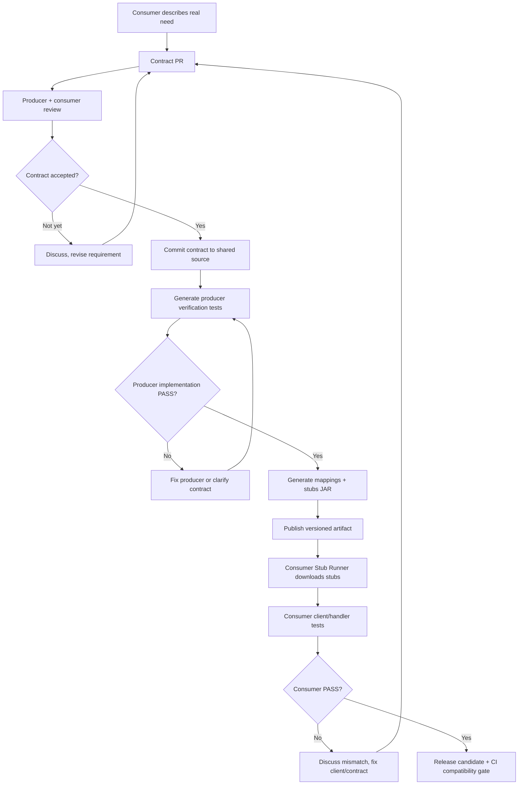
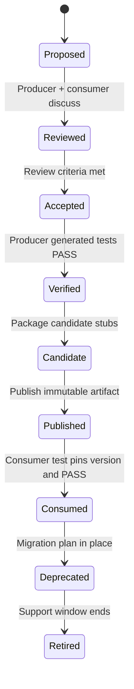
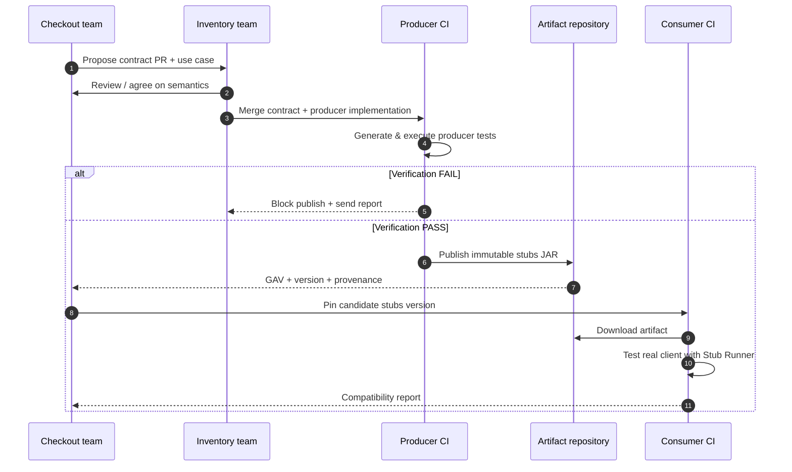
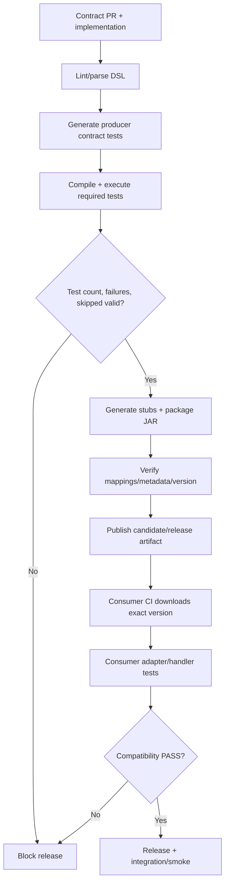

# Workflow for Producers Publishing Contracts for Consumers

> **Chapter:** Team Coordination  
> **Module:** `SPRING_CLOUD_CONTRACT` — learn contract testing between producer and consumer using Groovy/YAML DSL for HTTP or messaging, generating producer tests, publishing stubs, using Stub Runner, and integrating CI to detect incompatible API changes.

## Learning objectives

After this lesson, you will be able to:

1. Describe the **entire workflow** from a consumer requirement to a reviewed contract, passing producer verification, a published stub artifact, and usable consumer tests.
2. Distinguish between **source contracts**, **generated producer tests**, **WireMock mappings**, **stubs JAR**, and **producer application artifacts**; explain where each asset is used.
3. Assign responsibilities across the producer team, consumer team, artifact repository owner, and CI/release owner, avoiding "the other side thought we already did it".
4. Write a Spring Cloud Contract YAML/Groovy HTTP contract covering both success and error cases, and identify the evidence that the producer actually keeps its promise.
5. Set up the **publish versioned stubs** model in Maven or Gradle and understand why generating stubs is not equivalent to verifying the producer.
6. Use **Stub Runner** to fetch `LOCAL`/`REMOTE` artifacts, exercise real HTTP clients in consumer tests, and pin the exact version/candidate.
7. Coordinate PR reviews, release candidates, CI compatibility gates, change notifications, and asynchronous rollout/rollback across multiple teams.
8. Know how to handle cases where a contract is not yet accepted, the producer has not implemented it yet, artifacts are missing, or consumer and producer have different semantic interpretations.
9. Extend publishing principles to **messaging contracts** with events, destinations, schema versions, and `StubTrigger`, while recognizing the limitations of mocks/brokers.
10. Build a handoff checklist and evidence package so consumers can use stubs **without waiting for the producer to run locally**.

## 1. Why is "publishing a contract" not just sending a YAML file?

Suppose two teams work independently:

- **Inventory team** owns `inventory-service` — the producer of the inventory API.
- **Checkout team** owns `checkout-service` — the consumer calling inventory before letting users place an order.

Checkout needs to call:

```http
GET /api/stock/SKU-001 HTTP/1.1
Accept: application/json
```

And needs a meaningful response:

```http
HTTP/1.1 200 OK
Content-Type: application/json

{
  "sku": "SKU-001",
  "available": true,
  "quantity": 4
}
```

If the Inventory team sends a JSON snippet over chat, the Checkout team can start writing a client. However, that JSON snippet **fails to answer**:

- Which method/path/headers must the request use?
- Is `available` always a JSON boolean, or can it be `null`?
- If the SKU does not exist, what error status/body is committed?
- Has the producer already implemented this exact behavior?
- How does Checkout run automated tests without starting Inventory?
- A week later, how does Checkout know **which version of the promise** it is using?
- If Inventory wants to remove `quantity`, who has the authority to approve it?

A strong coordination process turns a promise into a **traceable chain**:

**Contract accepted by both teams -> Producer verification PASS -> Versioned stubs packaged -> Artifact published -> Consumer fetches exact artifact and tests real client -> CI protects subsequent changes.**

### 1.1. Two things that must be published properly

1. **Contract source** (Groovy/YAML DSL): expresses what the producer commits to and is reviewed when changed.
2. **Stub artifact** (usually a JAR with classifier `stubs`): contains the mappings/contracts needed by Stub Runner to simulate the collaborator in consumer tests.

These two are related but not identical. A syntactically valid contract **does not prove the producer implementation passes**. A stub JAR existing in a repository **does not prove by itself that it came from a verified producer build**.

### 1.2. Overall model



The workflow may be split across multiple PRs/CI jobs and is not always strictly sequential. The invariant is **never label an artifact as "producer-verified" without a corresponding PASS from producer verification**.

## 2. Role assignment: who owns what?

| Role | Primary decision authority | Verification responsibility | Deliverables |
| --- | --- | --- | --- |
| **Consumer owner** | Fields, statuses, errors, behavior the consumer needs | Real client/handler handles the contract | Proposed scenarios, consumer contract tests, feedback |
| **Producer owner** | Feasibility, implementation approach, support/deprecation | Generated producer tests must PASS; assess impact on all consumers | Accepted contract, verified build, stubs artifact |
| **API/contract reviewer** | Naming conventions, compatibility, schema invariants | Review breaking changes, semantics, auth/error behavior | PR approval/rationale |
| **CI/release owner** | Quality gates and artifact promotion | Control versions, test reports, block publish on fail/skip | Artifact with provenance, release record |
| **Consumer integration owner** | Binding/config, timeout/retry, client update plan | Integration/smoke tests beyond stub scope | Deployment and post-release observability |

In a small team, one person may hold multiple roles. Still, **contract ownership and artifact publishing authority must remain clear** so neither side silently alters a promise and declares compatibility.

### 2.1. Suggested RACI for milestones

In the table below, `R` is Responsible, `A` is Accountable, `C` is Consulted, and `I` is Informed.

| Activity | Consumer | Producer | Contract reviewer | CI/release |
| --- | --- | --- | --- | --- |
| Define consumer use case | **R/A** | C | C | I |
| Propose contract | **R** | A/C | C | I |
| Accept contract | C | **R/A** | C | I |
| Update implementation to match | C | **R/A** | I | I |
| Run producer verification | I | **R/A** | I | C |
| Build and publish verified stub | I | **R** | I | **A** |
| Test consumer against candidate | **R/A** | C | I | C |
| Decide breaking change/retirement | C | **R** | **A** per policy | C |
| Record release/rollback | I | C | I | **R/A** |

This is a **suggested matrix**, not a rigid Spring Cloud Contract requirement. Teams may adjust `A` according to internal workflows, but make sure there is no activity where everyone is merely `I`.

## 3. Contracts are lifecycle assets, not throwaway files

A possible lifecycle:



These states are **team governance conventions**, not built-in `status` values in the Spring Cloud Contract DSL.

### 3.1. Distinguishing "in progress" from "verified"

Spring Cloud Contract provides an **in progress contracts** mechanism supporting certain stub-generation flows when the producer is not ready; the documentation also describes generating stubs at runtime. That mechanism is useful to **unblock early consumer development**, but must be labeled clearly:

- **Proposed / provisional stub:** contract has not been accepted or the producer implementation has not passed yet.
- **Verified stub:** producer build ran and passed tests generated from that contract.

**Do not admit a provisional stub into a release quality gate labeled as verified**, because a consumer passing against an unimplemented promise does not prove the producer will fulfill it.

### 3.2. The source of truth must be agreed upon

Teams usually choose one of these models:

1. Contracts are stored in the **producer repository**; consumers submit PRs to add/modify them.
2. Contracts are stored in a **separate contract repository**; the producer pulls the contract dependency or SCM source and verifies against it.
3. Contracts are managed in another internal system, with a process converting them into DSL and versioned artifacts.

This lesson uses the **producer repository** as its primary example because it is simple to learn and easy to tie verification to the producer build. If using a separate contract repository, add a step ensuring producer tests and stub publication use the **exact approved revision**.

## 4. Consumer team writes requirements from real needs

Before opening a PR, the Checkout team should describe the use case in business language:

> "Checkout needs to know whether a SKU is sellable and how many units remain to decide whether to allow ordering `requestedQuantity`. If the SKU does not exist, it must receive an error with a stable identifier code."

Translate the requirement into observable cases:

| Scenario | Request | Expectation |
| --- | --- | --- |
| In stock | `GET /api/stock/SKU-001` | 200, `available: true`, `quantity: 4` |
| Out of stock | `GET /api/stock/SKU-002` | 200, `available: false`, `quantity: 0` |
| SKU missing | `GET /api/stock/SKU-404` | 404 and error code `SKU_NOT_FOUND` |
| Temporary upstream error | Per policy | Appropriate consumer retry/fallback; not necessarily a mandatory contract response |

At this step, do not force the producer to commit to **internal details** such as database column names, schedulers, or class names. Contracts should express **what the consumer actually uses across the interface**.

### 4.1. Agree on semantics, not just JSON shape

Explicitly document:

- `quantity` is the **sellable** quantity, not total physical stock.
- `available` is a boolean, not the string `"true"`.
- `quantity = 0` represents out of stock in this fixture.
- `404` means the SKU does not exist, distinct from `200` with `available: false`.
- `Content-Type` is JSON and the consumer's `Accept` header is supported.
- When data is calculated, acceptable staleness, and caching policies if business logic depends on them.

A test that merely checks `quantity` is a number will not automatically catch the producer changing its **semantics**.

## 5. YAML contract example agreed upon by both teams

For a Maven producer, contract files usually live under:

```text
inventory-service/
└── src/test/resources/contracts/
    └── checkout-service/
        ├── stock_available.yml
        ├── stock_empty.yml
        └── stock_not_found.yml
```

For the modern Gradle plugin, the default folder is `src/contractTest/resources/contracts` and base test classes live in `src/contractTest/java` or Groovy accordingly. Do not copy Maven paths directly into Gradle assuming the plugin will scan them.

### 5.1. In-stock scenario

File `stock_available.yml`:

```yaml
name: stock_available
description: "Checkout reads sellable inventory"

request:
  method: GET
  url: /api/stock/SKU-001
  headers:
    Accept: application/json

response:
  status: 200
  headers:
    Content-Type: application/json
  body:
    sku: SKU-001
    available: true
    quantity: 4
```

This is the **producer-side promise** for a specific request. When the build is configured properly, the plugin uses it to generate a producer verification test and a WireMock mapping for consumers.

### 5.2. Out-of-stock scenario

File `stock_empty.yml`:

```yaml
name: stock_empty

request:
  method: GET
  url: /api/stock/SKU-002
  headers:
    Accept: application/json

response:
  status: 200
  headers:
    Content-Type: application/json
  body:
    sku: SKU-002
    available: false
    quantity: 0
```

### 5.3. Non-existent SKU scenario

File `stock_not_found.yml`:

```yaml
name: stock_not_found

request:
  method: GET
  url: /api/stock/SKU-404
  headers:
    Accept: application/json

response:
  status: 404
  headers:
    Content-Type: application/json
  body:
    code: SKU_NOT_FOUND
    message: Stock item not found
```

**Implementation note:** the real producer needs an exception handler or controller behavior returning this exact status, header, and body. If the code just throws an exception and Spring returns a different error payload, generated producer verification must FAIL until both sides align on the actual behavior.

### 5.4. Can be written in Groovy DSL

Equivalent example **for the in-stock case only**:

```groovy
org.springframework.cloud.contract.spec.Contract.make {
    name 'stock_available'

    request {
        method 'GET'
        url '/api/stock/SKU-001'
        headers {
            header 'Accept': 'application/json'
        }
    }

    response {
        status 200
        headers {
            contentType(applicationJson())
        }
        body(
            sku: 'SKU-001',
            available: true,
            quantity: 4
        )
    }
}
```

**Keep only one DSL for the same interaction in a build.** If both YAML and Groovy share the same method/path/headers and outcome, you may generate duplicate tests or stub mappings; worse, if they demand different responses, the producer cannot simultaneously fulfill two conflicting promises for the same request.

## 6. What needs to be reviewed before the producer accepts a contract

A good PR does not just contain new files. It must include **context, impact, and acceptance criteria**.

### 6.1. Review checklist from the consumer perspective

- Which method/path/headers will the real client send?
- Which fields are required, optional, or nullable?
- Are JSON types critical: boolean, number, string, array?
- Are there enum values, formats, or timestamps the client parses with fixed rules?
- Which status/error responses does the client use to decide retries or display errors?
- If the producer adds an unknown field, does the client tolerate it?
- Is there a difference between "out of stock" and "SKU does not exist"?
- Is compatibility required with older running client versions?

### 6.2. Review checklist from the producer perspective

- Does the endpoint/event already exist or is it a new proposal?
- Can stable fixtures be created for generated producer tests to verify?
- Does the contract describe **public behavior** or accidentally lock down implementation details?
- Does it affect other consumers using the same endpoint?
- Are there conflicting contracts with the same method/path/headers demanding two different responses?
- If the change is risky, do we need to keep v1 in parallel or release v2?
- Can existing tests catch the producer violating required fields?
- Who is the owner maintaining the contract and deciding deprecation?

### 6.3. Review decision table

| Finding | Decision |
| --- | --- |
| Contract needs a new field the producer does not have yet | Can accept **conditionally on implementation**, but do not mark the stub verified until tests pass |
| Contract misses an error path the consumer truly needs | Request adding the case |
| Consumer asks for an internal non-API field | Discuss and replace with observable behavior |
| Two consumers request conflicting outputs for the same request | Design distinct requests/versions or a shared schema |
| Producer wants to remove a field an old consumer still uses | Do not accept the breaking change without a migration plan |
| Contract has dynamic UUID/timestamps | Use directional matchers, do not assert random literals |
| Stub already exists but commit/version is unknown | Not eligible to publish as a verified artifact |

### 6.4. Example information on a PR

```text
Contract PR: inventory / stock lookup
Consumer owner: Checkout team
Producer owner: Inventory team

Use cases:
  - SKU-001 has stock
  - SKU-002 out of stock
  - SKU-404 missing

Consumer depends on:
  - GET /api/stock/{sku}
  - Accept application/json
  - quantity is JSON number; available is boolean
  - SKU_NOT_FOUND on HTTP 404

Compatibility:
  - New endpoint behavior; no existing field removed
  - Existing client versions to re-check: checkout 2.7.x, catalog 1.9.x

Acceptance:
  - Producer generated contract tests PASS
  - Candidate stubs artifact is published with immutable version
  - Checkout consumer tests PASS with candidate
```

This is a **team-defined PR template**, not a Spring Cloud Contract configuration schema. Replace versions with real data when applying.

## 7. Producer: turning a promise into failable tests

After accepting the contract, the producer team is responsible for making **generated tests call the real implementation and PASS**.

### 7.1. Example controller

```java
@RestController
@RequestMapping("/api/stock")
public class StockController {

    @GetMapping(
        value = "/{sku}",
        produces = MediaType.APPLICATION_JSON_VALUE
    )
    public StockResponse get(@PathVariable String sku) {
        return switch (sku) {
            case "SKU-001" ->
                new StockResponse("SKU-001", true, 4);
            case "SKU-002" ->
                new StockResponse("SKU-002", false, 0);
            default ->
                throw new SkuNotFoundException(sku);
        };
    }

    public record StockResponse(
        String sku, boolean available, int quantity
    ) {}
}
```

This is an **illustration** in Java 17+; it requires Spring MVC imports, an exception handler for `SkuNotFoundException`, and a matching Boot project. The `404 + SKU_NOT_FOUND` behavior must be implemented by a real handler; if missing, the `stock_not_found` contract will not PASS.

### 7.2. Base test with MockMvc

```java
package com.example.inventory;

import io.restassured.module.mockmvc.RestAssuredMockMvc;
import org.junit.jupiter.api.BeforeEach;
import org.springframework.beans.factory.annotation.Autowired;
import org.springframework.boot.test.autoconfigure.web.servlet.AutoConfigureMockMvc;
import org.springframework.boot.test.context.SpringBootTest;
import org.springframework.web.context.WebApplicationContext;

@SpringBootTest
@AutoConfigureMockMvc
public abstract class ContractTestBase {

    @Autowired
    WebApplicationContext context;

    @BeforeEach
    public void setup() {
        RestAssuredMockMvc.webAppContextSetup(context);
    }
}
```

This base test uses a **real Spring web application context** in tests, suitable when Spring MVC advice, converters, or validation affect the contract. It requires a Boot application, Verifier/MockMvc dependencies, and stable fixture setup. If the controller calls a database or broker, test setup must isolate external resources without mocking away the HTTP behavior being verified.

### 7.3. Note the limits of evidence

A passing generated producer test confirms the implementation **within the test scope** satisfies the request/response described by the contract. It **does not automatically verify** the entire deployed system, gateway/TLS configuration, database transactions in other environments, or production broker reliability.

Therefore, add supplementary integration/E2E tests for remaining risks, but **do not replace** contract verification with standalone E2E tests.

## 8. Producer build: discover, generate, run, read reports

### 8.1. Maven project

With the Spring Cloud Contract Maven plugin, source contracts default to `src/test/resources/contracts`. Plugin configuration fragment:

```xml
<plugin>
  <groupId>org.springframework.cloud</groupId>
  <artifactId>spring-cloud-contract-maven-plugin</artifactId>
  <extensions>true</extensions>
  <configuration>
    <testFramework>JUNIT5</testFramework>
    <testMode>MOCKMVC</testMode>
    <baseClassForTests>
      com.example.inventory.ContractTestBase
    </baseClassForTests>
  </configuration>
</plugin>
```

This is a **fragment**, not a complete `pom.xml`: you need Maven plugin version management via parent/pluginManagement or an explicit version compatible with Spring Boot/Cloud/Contract, Verifier dependencies, JUnit 5, Surefire, and application code.

Run:

```bash
mvn clean verify
```

Three things to check in the report:

1. Contract files were discovered by the plugin and **generated test sources** were created.
2. Generated tests compiled, were picked up by the JUnit engine, and **actually executed**.
3. Assertions PASSED with no required tests skipped.

**Do not accept a green build with 0 generated tests** just because unit tests in another module succeeded.

### 8.2. Gradle project

The modern Gradle plugin uses the `contractTest` source set, where contracts default to `src/contractTest/resources/contracts`. Illustrative `build.gradle` configuration:

```groovy
plugins {
    id 'java'
    id 'org.springframework.cloud.contract' version '5.0.3'
}

contracts {
    testFramework = 'JUNIT5'
    testMode = 'MockMvc'
    baseClassForTests = 'com.example.inventory.ContractTestBase'
    contractsDslDir = file('src/contractTest/resources/contracts')
    failOnNoContracts = true
}

tasks.named('contractTest', Test) {
    useJUnitPlatform()
}
```

This snippet is **not a complete project**; it requires Spring Boot plugins/dependencies, dependency management/BOM, and a compatible Java/JUnit toolchain. If the base class uses JUnit Jupiter, place it in `src/contractTest/java` according to the Gradle source set and ensure appropriate dependencies are present.

Run:

```bash
./gradlew clean build
```

Inspect `generateContractTests`, `compileContractTestJava` (if Java), `contractTest`, and the JUnit XML/HTML reports of **`contractTest`**. `generateClientStubs` and `verifierStubsJar` do not substitute for **running** producer tests.

### 8.3. Execution verification gate

| Evidence | PASS criterion |
| --- | --- |
| Contract discovery | All accepted scenarios are present |
| Generated code | Non-empty, matches test framework/base |
| Compilation | Test sources compile |
| Execution | Test runner executes required cases |
| Assertions | No FAIL/ERROR |
| Skipped count | No required contracts skipped |
| Provenance | Report tied to commit/build |
| Stubs packaging | Mappings/contracts match the verified source |

**A JAR containing mappings without a producer test report is not enough** to be called a verified artifact.

## 9. Packaging and publishing the stub artifact

After producer verification passes, the producer team publishes a **stubs JAR** so consumers can run tests without pulling producer source code or starting a producer server.

### 9.1. Standard artifact coordinates

Example producer Maven artifact:

```text
groupId:    com.example
artifactId: inventory-service
version:    1.4.0
classifier: stubs
type:       jar
```

The actual file may be named:

```text
inventory-service-1.4.0-stubs.jar
```

Stub Runner uses a similar notation:

```text
com.example:inventory-service:1.4.0:stubs
```

If a fixed port is needed in some workflows:

```text
com.example:inventory-service:1.4.0:stubs:8090
```

The last segment `8090` is the **WireMock port**, not the artifact version. Whenever possible, let Stub Runner choose a dynamic port and read the URL/port via its API to avoid CI conflicts.

### 9.2. What does the artifact contain?

A stub JAR packaged by the plugin may contain:

```text
META-INF/
└── com.example/
    └── inventory-service/
        └── 1.4.0/
            ├── contracts/
            │   └── checkout-service/
            │       ├── stock_available.yml
            │       ├── stock_empty.yml
            │       └── stock_not_found.yml
            └── mappings/
                └── ... generated WireMock JSON ...
```

This is an **illustrative structure**; actual paths/names in the artifact depend on the plugin/build. When debugging, open the JAR and inspect `META-INF/<group>/<artifact>/<version>/contracts` or `mappings` according to the layout of the version in use.

For messaging, the artifact also contains contracts/metadata for Stub Runner to set up routes/labels, but **an HTTP WireMock mapping does not simulate Kafka/RabbitMQ on its own**.

### 9.3. Publishing with Maven

In a producer configured with the Spring Cloud Contract plugin and an artifact repository:

```bash
# Mandatory verification stage:
mvn clean verify

# With proper distributionManagement + credentials configured,
# the release stage must keep all test/verification gates enabled:
mvn deploy
```

`mvn deploy` runs the lifecycle through deploy as configured, which may re-run tests. CI should use a **release job with explicit quality gates**, never passing `-DskipTests` or disabling the plugin and still calling stubs verified. `mvn install` is useful for a consumer **on the same machine** to test stubs before pushing to a repository, not a substitute for publishing to separate CI runners.

### 9.4. Publishing with Gradle

Since Spring Cloud Contract 3.x, the **Gradle plugin does not automatically publish stubs as a default artifact**; you must configure Gradle `maven-publish` to include `verifierStubsJar` in the publication. Fragment:

```groovy
plugins {
    id 'maven-publish'
}

publishing {
    publications {
        mavenJava(MavenPublication) {
            from components.java
            artifact tasks.named('verifierStubsJar')
        }
    }
}
```

This is a **fragment**; it needs a Java component, repository, credentials, and proper version. Run publish only after `contractTest` and quality gates PASS.

```bash
./gradlew clean build
./gradlew publish
```

These two commands are a **reference workflow**, not proof that the `publish` task automatically depends on quality gates. In real CI, configure dependencies/gates so **publishing before verification is impossible**, even if someone invokes `publish` directly.

## 10. The artifact repository is the interface between two teams

The producer team should not share stubs via an unversioned local folder, email attachment, or overwritten files on a shared drive. A Maven-compatible repository like Nexus or Artifactory allows:

- Storing artifacts by **groupId/artifactId/version/classifier**.
- Distinguishing releases from release candidates/snapshots.
- Enforcing metadata and retention policies.
- Letting consumers download via dependency resolution in CI.
- Tracing artifacts back to the verified producer build.
- Granting read-only access to consumers and restricted publish permissions to pipelines.

### 10.1. Immutability rule

**Never overwrite the same release version with different stub contents.** Once `1.4.0:stubs` is published, it must remain unchanged. If the contract changes, publish `1.4.1` or a new candidate version per policy.

If using `SNAPSHOT`, understand that artifacts can change across publishes and repository metadata/caching may resolve a different build. For reproducible release gates, use a **specific, immutable version or build ID**.

### 10.2. Never expose secrets

Repository URLs can be stored in build configuration; **passwords/tokens** must never be committed to YAML contracts, POMs, Gradle scripts, or CI logs. Use a secrets manager, CI credentials, Maven settings, or Gradle properties appropriately. Enforce ACLs because contracts/mappings can reveal internal URLs, headers, and data examples.

Use only **synthetic data** in stubs; never put API keys, real customer emails, or sensitive information into fixtures that any consumer can download.

### 10.3. Artifact release record

```yaml
artifact:
  coordinates: "com.example:inventory-service:1.4.0:stubs"
  repository: "https://repo.example.org/repository/stubs-releases"
  producerCommit: "<commit-sha>"
  producerBuild: "<ci-run-id>"
  contractRevision: "<contract-revision>"
  verified: true
  verifierTestsExecuted: 3
  verifierTestsFailed: 0
  verifierTestsSkipped: 0
consumers:
  - checkout-service
  - catalog-service
```

This is a **team-defined release manifest**, not a built-in Spring Cloud Contract format. In a real pipeline, values like `verified: true` and `verifierTestsExecuted` must be extracted from **actual test reports/provenance**, never hard-coded as `PASS` just to make a notification look good.

## 11. Consumer: fetching stubs from the repository and running a real client

After the producer publishes `com.example:inventory-service:1.4.0:stubs`, the Checkout team can use Stub Runner in tests.

Stub retrieval modes:

| `StubsMode` | Source | When to use |
| --- | --- | --- |
| `LOCAL` | Maven local repository on the test machine | Producer/consumer dev on the same machine, offline testing after `mvn install` |
| `REMOTE` | Artifact repository or supported repository protocol | Separate CI runners, Nexus/Artifactory, release candidates |
| `CLASSPATH` | Stub mappings already on the classpath | Projects intentionally packaging stubs into test runtime |

**`LOCAL` inside a consumer container cannot see `~/.m2` of a producer container.** If CI uses separate runners, use a `REMOTE` repository or transfer the artifact via CI mechanisms and install it into the local repo.

### 11.1. Spring Boot consumer test

Example using Spring Cloud Contract Stub Runner:

```java
@SpringBootTest
@AutoConfigureStubRunner(
    ids = "com.example:inventory-service:1.4.0:stubs",
    stubsMode = StubRunnerProperties.StubsMode.REMOTE,
    repositoryRoot = "https://repo.example.org/repository/stubs-releases/"
)
class CheckoutInventoryContractTest {

    @StubRunnerPort("com.example:inventory-service")
    int inventoryStubPort;

    @Test
    void canReadPublishedInventoryContract() throws Exception {
        URI base = URI.create("http://localhost:" + inventoryStubPort);

        InventoryClient client = new InventoryClient(base);
        InventoryClient.Stock stock = client.fetch("SKU-001");

        assertEquals("SKU-001", stock.sku());
        assertTrue(stock.available());
        assertEquals(4, stock.quantity());
    }
}
```

This is a **structural example**; it requires imports and dependencies for Spring Boot Test, Stub Runner, the real `InventoryClient`, JUnit 5, and proper repository auth configuration. `@StubRunnerPort` is provided by Stub Runner Spring; if Stub Runner cannot download the right artifact, the test must FAIL.

### 11.2. A real HTTP client, not a mock adapter

Java 17+ sample (using Java `HttpClient` and Jackson 2) for `InventoryClient` above:

```java
public final class InventoryClient {

    private final URI base;
    private final HttpClient http = HttpClient.newHttpClient();
    private final ObjectMapper json = new ObjectMapper();

    public InventoryClient(URI base) {
        this.base = base;
    }

    public Stock fetch(String sku) throws Exception {
        // Lesson fixtures only use alphanumeric SKUs; real inputs
        // require proper URI path segment encoding.
        URI url = base.resolve("/api/stock/" + sku);

        HttpRequest request = HttpRequest.newBuilder(url)
            .header("Accept", "application/json")
            .GET()
            .build();

        HttpResponse<String> response = http.send(
            request,
            HttpResponse.BodyHandlers.ofString()
        );

        if (response.statusCode() != 200) {
            throw new IllegalStateException(
                "Inventory returned " + response.statusCode()
            );
        }

        JsonNode body = json.readTree(response.body());
        if (!body.path("available").isBoolean()
                || !body.path("quantity").isIntegralNumber()) {
            throw new IllegalArgumentException("Invalid stock schema");
        }

        return new Stock(
            body.path("sku").asText(),
            body.path("available").booleanValue(),
            body.path("quantity").intValue()
        );
    }

    public record Stock(
        String sku, boolean available, int quantity
    ) {}
}
```

This is an **illustrative snippet** omitting imports, timeouts/retries, and complete error handling. For a real project, place the Jackson dependency in the appropriate scope if the client is in `src/main/java`, apply URI encoding, handle 404/503, and configure timeouts.

**Key takeaway:** the consumer test invokes the **consumer's real HTTP adapter**, receives the response from Stub Runner, and checks both data and behavior. If you mock `InventoryClient` and only assert a fabricated return value, you are not testing the request path, headers, or JSON mapping from the contract.

### 11.3. Avoid hard-coding ports

Stub Runner can select a dynamic port. When using a Spring test, `@StubRunnerPort` provides the port; when using JUnit 5 `StubRunnerExtension`, call `findStubUrl("com.example", "inventory-service")`.

Avoid assigning port 8090 to every suite if multiple CI jobs run concurrently. **The stub port is not the producer version.**

## 12. JUnit 5 outside a Spring context can also use published artifacts

A Java SDK/consumer using JUnit Jupiter without booting Spring Boot can use `StubRunnerExtension`:

```java
@RegisterExtension
static StubRunnerExtension stubs = new StubRunnerExtension()
    .downloadStub("com.example:inventory-service:1.4.0:stubs")
    .repoRoot("https://repo.example.org/repository/stubs-releases/")
    .stubsMode(StubRunnerProperties.StubsMode.REMOTE);

@Test
void inventoryClientWorksWithPublishedStubs() throws Exception {
    URI base = stubs
        .findStubUrl("com.example", "inventory-service")
        .toURI();

    InventoryClient client = new InventoryClient(base);
    InventoryClient.Stock stock = client.fetch("SKU-001");

    assertEquals(4, stock.quantity());
}
```

This is a **test snippet** requiring JUnit 5, Stub Runner imports, and the client from the previous section. It does not run producer code; the extension downloads the verified stub artifact and manages a WireMock server within the JUnit lifecycle.

"**No Spring TestContext needed**" does not mean "no Spring Cloud Contract library used": the extension is still a Java library with its own dependencies.

If the consumer is in Node.js/Python, you need a **Stub Runner server or WireMock process/container** started by the test harness to provide an HTTP endpoint; you cannot attach a Java `@RegisterExtension` annotation directly to a Node.js test.

## 13. Communication workflow between both teams from PR to release

A reference workflow has six clear handoffs.

### Handoff 1 — Consumer requirement

Checkout creates an issue/PR with the use case, required request/response, error cases, and dependent behavior. The producer responds on feasibility, data constraints, and when the behavior can enter a candidate.

**Expected output:** reviewed contract source, not just a chat promise.

### Handoff 2 — Producer accepts the contract

Inventory reviews syntax, semantics, compatibility, and fixtures, and identifies the accountable owner. If it cannot implement the proposal as written, both sides revise the contract **before marking it accepted**.

**Expected output:** PR approval or accepted status per governance.

### Handoff 3 — Producer verification

Inventory runs generated tests against real code and inspects the report. If the contract is not yet implemented, update code or keep it provisional; never use a mock controller returning fixtures to fake a PASS.

**Expected output:** test reports tied to the producer commit, with no required tests skipped.

### Handoff 4 — Publish versioned artifact

The pipeline builds the stubs JAR from the verified revision, pushes it to the repository under unique coordinates, and verifies the artifact can be downloaded back.

**Expected output:** repository URL, coordinates, version, checksum/provenance per team process, and publication timestamp.

### Handoff 5 — Consumer compatibility

Checkout pins the exact candidate stub, runs the real HTTP client, and asserts behavior. On failure, triage: client sends wrong request, producer contract not yet accepted, stub mapping missing, or version mismatch.

**Expected output:** consumer test report tied to the candidate stub coordinates.

### Handoff 6 — Release and monitoring

Producer and consumer can deploy independently if compatibility is preserved. Document the deprecation window, consumers still on v1, and rollback procedures if needed.

**Expected output:** release notes and relevant owners/on-call contacts, not a requirement for both teams to deploy simultaneously just because they share a contract.



## 14. Publishing for multiple consumers without losing accountability

Suppose Inventory serves both Checkout and Catalog. Requirements may differ:

```text
contracts/
├── checkout-service/
│   ├── stock_available.yml
│   ├── stock_empty.yml
│   └── stock_not_found.yml
└── catalog-service/
    ├── stock_display.yml
    └── stock_missing.yml
```

Spring Cloud Contract supports **`stubsPerConsumer`** so a consumer only registers stub mappings matching its name:

```java
@AutoConfigureStubRunner(
    ids = "com.example:inventory-service:1.4.0:stubs",
    stubsMode = StubRunnerProperties.StubsMode.REMOTE,
    repositoryRoot = "https://repo.example.org/repository/stubs-releases/",
    stubsPerConsumer = true,
    consumerName = "checkout-service"
)
```

### 14.1. What stubsPerConsumer does

- Helps consumer tests load **scenarios under that consumer's directory**.
- Reduces the risk of unrelated mappings shadowing each other when multiple consumers exist.
- Shows the producer which team depends on which part of the interface.

### 14.2. What stubsPerConsumer does **not** do

- Does not allow the producer to skip verification for other supported consumers.
- Does not allow the real API to return **two contradictory results** for the same method, URL, headers, and body.
- Does not automatically upgrade consumers not participating in the pipeline.
- Does not replace a versioning/migration strategy when breaking the schema.

If Checkout asks for `quantity` while Catalog asks for `availableUnits`, you can create a shared response containing both fields or clearly separate endpoints/media types. Two contradictory responses for **the same request** cannot be treated as valid contracts simply because they live in different folders.

## 15. When contracts change: which consumers must remain compatible?

Every producer change must be classified:

| Change type | Compatibility | Coordination approach |
| --- | --- | --- |
| Add new endpoint, keep old endpoint | Usually compatible | Publish new contract and let consumers opt in |
| Add optional response field | **Conditional** | Test strict/tolerant consumer readers |
| Remove field a consumer uses | **Breaking** | Maintain v1, migrate consumer, or version the API |
| Change number to string | **Schema-breaking** | Block or negotiate a v2 contract |
| Add required request header | **Breaking** for old clients | Keep optional/default during transition period |
| Change status/error code | Potentially breaking | Consumer reviews error/fallback logic |
| Change semantics while keeping JSON shape | Potentially breaking | Business contract examples + integration tests |
| Add new event type on shared topic | Conditional | Consumers must know to ignore/route unknown events |
| Change destination or required event field | Usually breaking | Version event / broker migration |

### 15.1. Expand -> migrate -> contract

Instead of immediately deleting `quantity`, Inventory can:

1. **Expand:** support both old and new fields or endpoint `/api/v2/stock`, verifying both v1/v2 contracts.
2. **Migrate:** Checkout and Catalog use candidate stubs, update clients, and deploy on their own schedules.
3. **Contract:** retire old behavior only when no supported consumer needs it and the rollback/deprecation window has closed.

A new producer does not have to deploy simultaneously with a new consumer if backward compatibility is maintained. That is a major benefit of contract testing in microservices.

### 15.2. Do not edit old contracts to match buggy code just to make CI green

If the producer accidentally changes `quantity: 4` to `quantity: "4"`, generated tests should FAIL. Editing the contract to expect a string will make producer tests pass against the **new** promise, but old clients can still break.

**The review process must protect existing consumer needs**, not merely enforce consistency between a new contract and a new implementation.

## 16. Publishing messaging contracts: key differences to watch

Not all contracts are HTTP request/response. Spring Cloud Contract also describes producers emitting **messages/events** when a trigger occurs.

Example `OrderAccepted`:

```yaml
name: order_accepted
label: order_accepted

input:
  triggeredBy: publishAcceptedOrder()

outputMessage:
  sentTo: orders.events
  headers:
    contentType: application/json
    eventType: OrderAccepted
  body:
    eventType: OrderAccepted
    orderId: ORD-1001
    amount: 240000
    currency: VND
```

The producer needs `@AutoConfigureMessageVerifier` and test infrastructure that sends/receives on the right destination. Generated tests verify that **the message is actually emitted** with the right headers/payload within the adapter test scope; they do not prove Kafka partitioning, retries, ACKs, or production brokers.

### 16.1. Handoff for messaging consumers

The producer publishes:

- Event type, label, and destination.
- Payload fields, header types, and schema version.
- Nullability/enum rules and amount/timestamp formats.
- Versioned stubs/contract artifact.
- Behavior of old and new events when replaying/processing backlogs.

Consumers can use Stub Runner/`StubTrigger` to trigger packaged events, **provided an appropriate messaging integration/binder or adapter is configured**.

```java
boolean triggered = stubTrigger.trigger("order_accepted");
assertTrue(triggered);

// Then verify the real handler processed the event:
await().atMost(Duration.ofSeconds(5))
    .untilAsserted(() ->
        assertEquals(
            "READY_TO_BILL",
            billingState.status("ORD-1001")
        )
    );
```

This is a **test fragment** depending on `StubTrigger`, a listener/binder, Awaitility, and the application's `billingState`. `triggered == true` alone does not prove the handler updated data.

### 16.2. Event versioning and broker integration

If the producer renames `amount` to `total`, older consumers may fail to parse even if the JSON is still valid. Keep v1 events during the migration window or define a new event/schema version; test both **v1 messages remaining in the backlog** and v2 messages.

Simulating messages with Stub Runner does not test real Kafka/RabbitMQ/JMS connectivity, durability, ordering, or idempotency. Add broker integration tests when those properties are critical risks.

## 17. CI pipeline: never publish without evidence

A producer pipeline has this logic:



### 17.1. Non-negotiable gates

- Contract files exist and are parsed cleanly.
- Generated producer tests have the **expected count**, not 0.
- JUnit/Spock test runner executes them, not `SKIPPED` or `NO-SOURCE`.
- Assertions PASS on producer behavior, not on fake fixtures fabricated by the test itself.
- Stub JAR contains relevant mappings, correct version, and proper artifact name.
- Release process forbids overwriting immutable versions.
- Consumer tests download the **exact candidate stubs version** and run real clients/handlers.
- For breaking changes, there is a review/migration plan with supported consumers.

### 17.2. A vendor-agnostic logical pipeline YAML

```yaml
stages:
  - contract_review
  - producer_verify
  - package
  - consumer_compatibility
  - promote

producer_verify:
  commands:
    - "mvn clean verify"
  required:
    generated_contract_tests: ">= 3"
    failed_tests: 0
    skipped_required_tests: 0

package:
  depends_on: producer_verify
  artifact:
    coordinates: "com.example:inventory-service:1.4.0-RC1:stubs"

consumer_compatibility:
  depends_on: package
  consumes: "com.example:inventory-service:1.4.0-RC1:stubs"

promote:
  depends_on: consumer_compatibility
```

This is **pipeline pseudocode YAML**, not runnable GitHub Actions/GitLab/Jenkins syntax. Checks for test counts, versions, and report paths must be implemented using real CI features; never use pseudocode to certify that a build passed.

### 17.3. When producer and consumer CI live in two repositories

Jobs can be coordinated by:

- Publishing **candidate stubs** before the official release.
- Triggering consumer CI with the candidate coordinates.
- Waiting for compatibility results and recording them in the release record.
- Promoting/releasing only after mandatory consumers PASS.
- Retaining candidate/versioned artifacts to reproduce failures if issues arise.

Consumers do not need to pull producer source code into their builds. The artifact repository is the **controlled distribution boundary**.

## 18. Notification and handoff mechanism after publish

Notifications to consumers must answer **what, where, from which version, how it was verified, and what to do next**.

A short notification template:

```text
Inventory contract publication

Producer: inventory-service
Owner: Inventory team
Contract version / build: 1.4.0-RC1
Stub artifact: com.example:inventory-service:1.4.0-RC1:stubs
Repository: https://repo.example.org/repository/stubs-candidates/
Source revision: <commit-sha>
Verification: PASS (3 required contract tests, 0 skipped)
Changes:
  - GET /api/stock/SKU-001 => 200
  - GET /api/stock/SKU-002 => 200
  - GET /api/stock/SKU-404 => 404 / SKU_NOT_FOUND
Compatibility: No previously required fields removed
Action:
  - Checkout runs consumer tests with 1.4.0-RC1:stubs
  - Report incompatibility before release gate deadline
Rollback: Stable 1.3.x behavior remains supported
```

This is a **team-created template**; do not assume every version is a candidate. Never announce "PASS" if CI has no test reports.

### 18.1. Timelines and response policies

In real projects, teams should agree on:

- Lead time required for consumer review before removing/changing behavior.
- When candidate artifacts are published to other teams.
- Who responds when consumer compatibility FAILS.
- Incident resolution SLA and escalation owner.
- Legacy API support duration / rollback window.
- Log, report, dashboard, and artifact coordinate sources for triage.

Spring Cloud Contract enforces no default SLA durations; they are agreements between teams.

## 19. Troubleshooting: who does what when the consumer cannot run stubs?

| Symptom | Possible cause | Team to investigate first | Evidence needed |
| --- | --- | --- | --- |
| Stub Runner cannot find JAR | Not published, wrong coordinates, repository inaccessible | Release/repository owner | GAV, repository logs |
| Local dev PASS, consumer CI FAIL | Artifact only exists in dev machine's `~/.m2` | Consumer + release | Runner repository config |
| Stub Runner runs but HTTP returns 404 | Method/path/header/body does not match mapping | Consumer first, coordinate with producer | Actual request and WireMock mappings |
| Consumer fails to parse despite stub 200 | DTO/type/error schema mismatch | Consumer + producer | JSON payload and contract |
| Producer verification FAIL | Producer code breaks contract or base fixture is wrong | Producer | Generated test failure |
| Producer CI green with 0 tests | Wrong plugin/task wiring/test discovery | Producer + CI owner | Test task report/count |
| Consumer PASS with old stub, production FAIL | Version drift; new producer API is breaking | Both teams + release | Artifact and deployment versions |
| Stub exists but contract not accepted | Unlabeled provisional artifact | Producer/contract owner | PR review state |
| Two consumers demand conflicting outputs for same request | Cannot be satisfied simultaneously on one interface | API/contract reviewer | Compare request predicates |
| Messaging event does not reach handler | Missing binder/adapter/wrong destination | Consumer integration owner | Stub label, binding, logs |
| CI fails on repository credentials | Wrong secret/network/ACL | Release/repository owner | HTTP 401/403, config |
| Stub JAR contains old version despite new files | Wrong packaging/cache | Producer/CI | JAR mappings, build sha |

### 19.1. Time-saving debugging order

1. **Identify the coordinates** that the consumer test actually uses—do not guess from the current build file.
2. **Confirm the artifact exists** and contains the right mappings/contracts.
3. Inspect **Stub Runner startup logs**, WireMock port, and artifact version.
4. Compare the consumer's real request against the mapping: method, path/query, headers, body matchers.
5. When mismatched, compare back to the **reviewed contract source**.
6. If the contract is right and producer code is wrong, fix the code and run the verifier; if the contract misses a consumer need, open a follow-up PR.
7. If only integration/staging fails, inspect auth, network, DB/broker, and deployed versions—do not blame WireMock for everything.

Do not loosen a matcher from a required field to `.*` just so the consumer gets 200; doing so destroys the ability to catch breaking changes.

## 20. Anti-patterns in multi-team coordination

| Anti-pattern | Consequence | Alternative |
| --- | --- | --- |
| Sending sample JSON in chat and calling it a contract | No review/versioning/tests | Commit DSL with owners and CI |
| Producer edits contract to match buggy code | Old consumers can break | Review compatibility, keep active contracts |
| Publishing stubs when producer tests are skipped | Stubs are unverified | Block publish with test report gates |
| Consumer uses `+` in release gates | Non-reproducible results | Pin candidate/release version |
| Overwriting the same stub version | CI downloads different contents at different times | Immutable artifacts/build IDs |
| Only checking WireMock returns 200 | Real client may send wrong request or fail parsing | Test real HTTP adapter/handler |
| Writing no error contracts | Client breaks on 404/409/503 | Add cases for errors the consumer depends on |
| Verifying contracts for only one consumer | Other consumers break | Producer verifies all active contracts |
| Waiting for both teams to deploy together | Coupling, hard rollout/rollback | Expand–migrate–contract |
| Not announcing published artifact version | Consumer tests keep using old stub | Publication manifest/release notes |
| Putting real data in fixtures | Information leak when artifacts are shared | Use synthetic data and secret management |
| Equating Stub Runner with E2E | Fails to test real upstream/network | Supplementary integration/E2E tests |

## 21. End-to-end workflow practice

This exercise assumes two hypothetical repositories: `inventory-service` (producer) and `checkout-service` (consumer). Choose **Maven or Gradle** as appropriate and use your installed toolchain; the content below is guidance for learners, not commands executed while writing this lesson.

### Exercise 1 — Define responsibilities

Write a responsibility table for `stock_available`, `stock_empty`, and `stock_not_found`. Who has authority to review payload/status? Who is accountable for making generated producer tests PASS? Who must prove the client parses and handles errors properly?

### Exercise 2 — Propose contracts

Create three YAML files in `src/test/resources/contracts/checkout-service` (Maven) or `src/contractTest/resources/contracts/checkout-service` (Gradle). Write business descriptions distinguishing `available: false` from HTTP 404.

### Exercise 3 — Review breaking changes

The producer proposes renaming `quantity` to `stockCount` and removing the old field. Old Checkout still uses `quantity`. Classify this change and propose a compatible rollout for non-upgraded consumers.

### Exercise 4 — Producer verification

Create the corresponding controller/service and configure the base class for generated tests. Run the producer build and verify the report shows all three cases, none skipped. If `stock_not_found` fails, inspect the error handler before changing the contract.

### Exercise 5 — Mutation test

Intentionally change `quantity: 4` to `quantity: 0` in the producer implementation while keeping the old contract. Do generated tests FAIL? If not, investigate plugin/task/fixture wiring and generated test assertions.

### Exercise 6 — Create verified stub

After restoring producer code and passing verification, build `com.example:inventory-service:1.4.0-RC1:stubs` and verify the artifact actually contains `mappings` and `contracts`.

### Exercise 7 — Local vs. Remote

Run `LOCAL` on the machine where the artifact was installed. Then simulate two CI runners that do not share a Maven local repository. Why can't the consumer on another runner see the JAR? Design publishing/downloading via `REMOTE`.

### Exercise 8 — Properly scoped consumer test

Write `InventoryClient` making real HTTP calls, use Stub Runner, and assert `sku`, `available`, and `quantity`. For `SKU-404`, assert the client translates the response into a domain error per policy; do not merely assert WireMock returned 404.

### Exercise 9 — Multiple consumers

Add `catalog-service` with its own contracts. When `stubsPerConsumer` is enabled in a consumer test, which mappings get loaded? Which contracts must the producer verify before publishing the shared artifact?

### Exercise 10 — CI release gate

Design the flow producer CI -> artifact repository -> checkout CI -> promotion. Block publishing when (a) generated tests equal 0, (b) a required test is skipped, (c) producer verifier FAILS, or (d) the artifact is missing mappings.

### Exercise 11 — Messaging

Define `OrderAccepted` with `orderId`, `amount`, `currency`, and destination `orders.events`. List the producer message verifier components and consumer binder/`StubTrigger` needed, plus an integration test checking a real broker.

### Exercise 12 — Release incident

Checkout CI PASSES with `inventory-service:1.3.0:stubs`, yet the producer just deployed `1.4.0` having removed `quantity`. Identify why the suite was green, find the missing evidence, and propose a response/remediation process.

### Suggested answers

1. Consumer owner provides requirements and tests the client; producer owner accepts the contract and verifies implementation; CI/release owner manages publication gates.
2. Three separate contracts distinguishing out of stock (200, quantity=0) from non-existent SKU (404, error code).
3. Breaking change; keep `quantity` in v1 or create v2, migrate Checkout, and only then retire v1.
4. Read generated test reports, not just build success; fix controller advice/fixtures to satisfy the contract.
5. Generated test `stock_available` must FAIL; otherwise, check plugin/test runner/contract source setup.
6. Stub artifact needs exact version, mappings/contracts, and producer verification provenance.
7. `LOCAL` is not shared across runners; use a repository or CI artifact transfer and pin versions.
8. Real HTTP client must send the proper request, parse JSON, and map 404 to appropriate behavior.
9. `stubsPerConsumer` only filters mappings for one consumer test; the producer still verifies all active contracts.
10. Publish only after all required test cases PASS with reports; never let `skipped` or `NO-SOURCE` pass the gate.
11. Message verifier on producer, sender/receiver/binder in consumer tests, plus broker integration tests for routing/ACK/retry.
12. Old stubs do not prove the new candidate; producer must verify active contracts, consumer runs the right candidate, and rollback/expand plans must exist.

## 22. Contract publication checklist for consumers

**Before accepting a PR**

- [ ] Are consumer owner, producer owner, and use case clear?
- [ ] Are method/path/headers/body/status/error described in DSL?
- [ ] Are required/optional/nullability/types and semantics agreed upon?
- [ ] Are supported consumers impacted by breaking changes?
- [ ] Does the contract set have no conflicting mappings for the same request?
- [ ] Can a reviewer reproduce the failure case from the description?

**Before creating the stub artifact**

- [ ] Were generated producer tests created?
- [ ] Does the test base invoke the real implementation?
- [ ] Did required scenarios actually execute and PASS?
- [ ] Are there no unexpectedly skipped tests or zero-count reports?
- [ ] Do mappings in the JAR match the contract revision?
- [ ] Is there no sensitive information in fixtures?

**Before publishing**

- [ ] Does the artifact have explicit group/artifact/version/classifier?
- [ ] Are release versions immutable and candidates tracked with provenance?
- [ ] Does the publication job genuinely depend on the verification gate?
- [ ] Are repository credentials loaded from secrets rather than committed?
- [ ] Does the manifest record producer commit, contract revision, and tests executed?
- [ ] Are consumers notified of version, repository URL, and changes?

**Before consumer/release PASS**

- [ ] Does Stub Runner download the **exact** artifact and load mappings?
- [ ] Do consumer tests call the real client/handler instead of mocking them?
- [ ] Are both success and error cases the consumer depends on tested?
- [ ] Is testing running against the candidate version rather than accidentally using an old one?
- [ ] Have all mandatory consumers reported PASS/approved?
- [ ] Is there a migration/deprecation/rollback plan for risky changes?
- [ ] Are supplementary integration/E2E tests in place for boundaries outside contracts?

## 23. Summary

**Producer contract publication for consumers** is an **evidence-backed, versioned** coordination workflow—not the act of sending a YAML file or JAR. The consumer proposes real needs, the producer reviews and accepts, Contract Verifier generates and runs tests against the implementation, CI blocks failures, the producer publishes a versioned stubs artifact, and the consumer uses Stub Runner to run real clients/handlers against the chosen artifact.

Four things to remember:

1. **An accepted contract** is different from a **producer-verified stub**.
2. **Generating stubs** is different from **running generated producer tests**; publish verified artifacts only after tests PASS.
3. **Consumer Stub Runner tests** verify how the consumer uses the **selected stub version**, not the live production producer directly.
4. **Version coordination and backward compatibility** determine whether producer and consumer can deploy independently without breaking changes or dangerous rollbacks.

For HTTP, artifacts typically contain WireMock mappings; for messaging, labels/destinations and matching messaging integrations are also required. A workflow with clear owners, reviews, test reports, immutable versions, repository access, candidate compatibility checks, and release notes lets multiple teams work in parallel while keeping API promises under control.

## References

- [Spring Cloud Contract — Step-by-step Consumer Driven Contracts](https://docs.spring.io/spring-cloud-contract/reference/getting-started/cdc.html) — consumer proposes contract, submits PR to producer, and iterative review loops.
- [Spring Cloud Contract — Maven Project](https://docs.spring.io/spring-cloud-contract/reference/maven-project.html) — contract sources, generated producer verification tests, stubs packaging.
- [Spring Cloud Contract — Gradle Project](https://docs.spring.io/spring-cloud-contract/reference/gradle-project.html) — `contractTest` source set, `contractTest` task, `verifierStubsJar`, and publication configuration.
- [Spring Cloud Contract — Publishing Stubs as JARs](https://docs.spring.io/spring-cloud-contract/reference/project-features-stubrunner/stub-runner-publishing-stubs-as-jars.html) — storing/distributing stub artifacts via Maven-compatible repositories.
- [Spring Cloud Contract — Stub Runner Core](https://docs.spring.io/spring-cloud-contract/reference/project-features-stubrunner/stub-runner-core.html) — `LOCAL`, `REMOTE`, `CLASSPATH`, and WireMock mappings.
- [Spring Cloud Contract — Stub Runner JUnit](https://docs.spring.io/spring-cloud-contract/reference/project-features-stubrunner/stub-runner-junit.html) — `@AutoConfigureStubRunner`, JUnit extension, and finding stub ports.
- [Spring Cloud Contract — Stubs Per Consumer](https://docs.spring.io/spring-cloud-contract/reference/project-features-stubrunner/stub-runner-stubs-per-consumer.html) — organizing and filtering contracts/mappings per consumer.
- [Spring Cloud Contract — Common Top-Level Elements: Contracts in Progress](https://docs.spring.io/spring-cloud-contract/reference/project-features-contract/common-top-elements.html) — `inProgress` allows generating stubs before producer tests are generated; control `failOnInProgress` before release.
- [Spring Cloud Contract — Generating Stubs at Runtime](https://docs.spring.io/spring-cloud-contract/reference/project-features-stubrunner/stub-runner-generate-stubs-at-runtime.html) — cases where consumers need stubs before producer implementation completes.
- [Spring Cloud Contract — Messaging](https://docs.spring.io/spring-cloud-contract/reference/project-features-messaging.html) — message contract verification and messaging Stub Runner.
