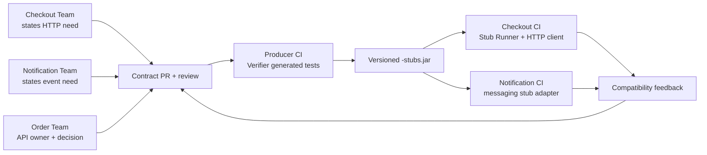
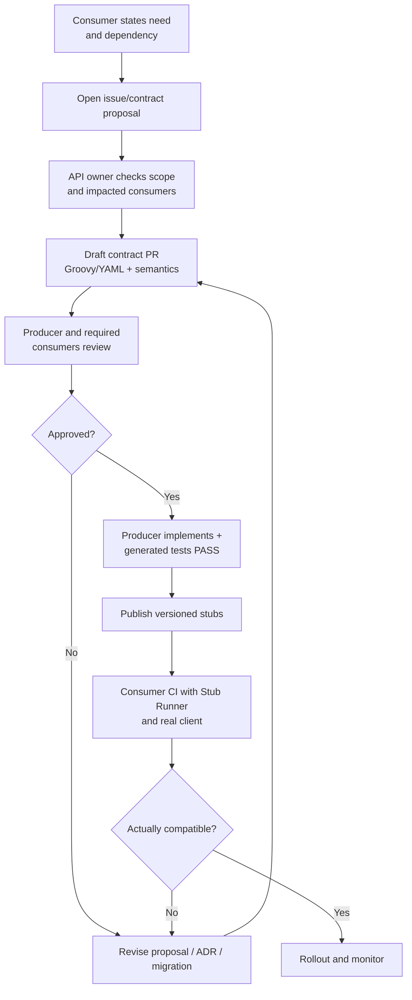
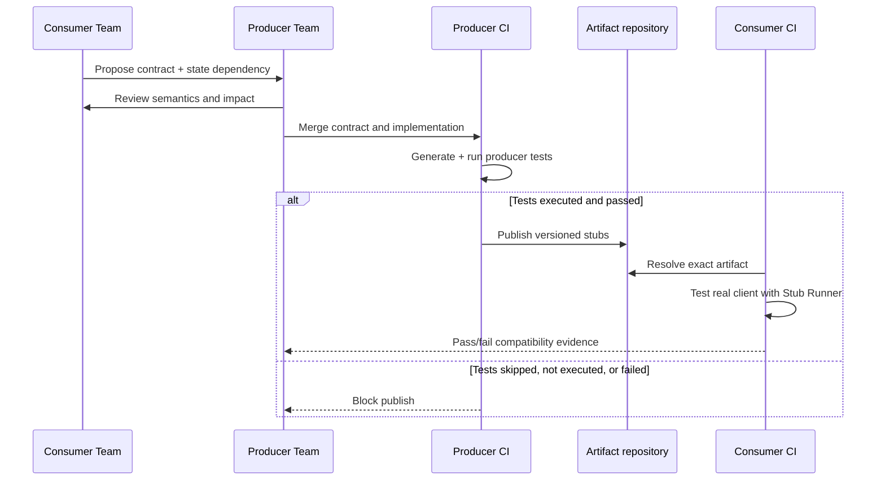

# Ownership Agreement for Each Contract

## 1. Why is contract testing a multi-team coordination problem?

In **Spring Cloud Contract**, producer and consumer teams define HTTP or messaging behavior using **Groovy/YAML DSL**. The Verifier tool generates tests to verify the **real producer**; stubs are packaged and published for **Stub Runner** so consumers can test their clients. CI can detect incompatible API changes before deployment.

However, tools do not automatically answer organizational questions:

- Who has the authority to modify a contract that consumers already depend on?
- Who ensures new requirements accurately reflect consumer needs?
- When a generated test fails because the producer changed an API, which team must fix it?
- Who reviews and approves removing a field, changing an HTTP status, or changing a message destination?
- If three consumers have conflicting expectations, who makes the final decision?
- Who publishes `-stubs.jar` and who bumps the stub version in consumer CI?
- When a team hands over a service, who takes over maintaining legacy contracts?

Without a clear agreement, a contract can become an **unowned file**: the producer thinks the consumer wrote it so the consumer must fix it; the consumer thinks the producer publishes it so the producer decides everything. An even more dangerous case is one team "fixing the contract to go green" after the API changed, causing tests to stop protecting users of the interface.

**Lesson goal:** design an **ownership agreement per identifiable contract or scenario group**, distinguishing the proposer, decision maker, implementer, and verifier, then turn that agreement into a traceable PR, review, CI, and release workflow.

This is a **team working convention**, not mandatory Spring Cloud Contract syntax. The DSL describes technical behavior; ownership, review responsibilities, and decision history must be managed through the organization's processes and repositories.

## 2. One contract does not mean one person "owns everything"

Let us distinguish five responsibilities:

| Responsibility | Question to answer | Typically held by |
|---|---|---|
| **API owner** | Who is accountable for stability, semantics, and availability of the interface? | Producer team |
| **Contract decision owner** | Who makes the final call on contract changes after gathering input? | Clearly assigned person/team, usually the API owner |
| **Requirement owner** | Who states which fields/statuses/messages a consumer depends on? | Relevant consumer team(s) |
| **Implementation & verification owner** | Who updates the producer and keeps generated producer tests passing? | Producer team |
| **Consumer test owner** | Who integrates the right stub version and keeps consumer tests passing? | Each consumer team |

A contract may be **proposed by a consumer**, **agreed to and implemented by the producer**, and **reviewed by both**. Therefore, do not equate:

> "The team that created the `.groovy` file first" = "the team allowed to unilaterally change any API behavior later".

**Design principle:** every contract must have **a single accountable final decision point**, while multiple people can participate in authoring, reviewing, testing, and being informed. Decision authority does not eliminate the duty to consult dependent consumers.

### 2.1. A contract is an agreed interface, not a copy of the implementation

An API contract describes **externally observable behavior**:

- HTTP: method, path, key query/headers/body, status, error schema, response body, and field semantics.
- Messaging: input trigger or inbound message, destination, headers, body, event format, and committed behavior.

Contracts should not lock down purely internal details such as repository class names, SQL queries, thread pools, or how a service structures its modules when consumers do not depend on them. **Implementation changes** can be decided solely by the producer if committed behavior is unaffected; **changes to the committed interface** require review by the owner and affected consumers.

### 2.2. Owning a contract differs from owning a stub

The maintainer of the contract source and the maintainer of the artifact pipeline may be two separate roles:

| Asset | Responsibility |
|---|---|
| Contract source | Maintain representative examples and assertions for the API commitment |
| Producer generated tests | Run against real producer code, prepare fixtures/base tests |
| Stub mappings and artifact | Package verified contracts accurately, publish version/classifier |
| Consumer stub tests | Use the right artifact and exercise real client/business logic |
| Compatibility policy | Determine whether a change needs review, deprecation, or versioning |

Never infer that "whoever publishes `-stubs.jar`" has authority to alter any contract without talking to dependent teams.

## 3. Practical context: three teams depending on `order-service`

Suppose an e-commerce platform has three teams:

| Team | Role | Related interfaces |
|---|---|---|
| **Order Team** | Producer of `order-service` APIs and events | `GET /api/orders/{id}`, `OrderPaid` |
| **Checkout Team** | HTTP consumer | Reads `id`, `state`, `currency` to allow issuing receipts |
| **Notification Team** | Messaging consumer | Receives `OrderPaid` to send notifications |
| **Platform/CI Team** | Supports build/repository infrastructure, if present in the org | Maven/Gradle runners, artifact repository, CI templates |

One `order-service` can publish multiple contracts, yet **ownership and the set of impacted consumers must be identified per scenario group**, not merely by service name:

```text
order-service contracts
├── HTTP /api/orders/{id}
│   ├── order-success           → Checkout Team depends on it
│   ├── order-not-found         → Checkout Team depends on it
│   └── order-payment-details   → Billing Team (if applicable)
└── Messaging OrderPaid
    ├── event destination/body → Notification Team depends on it
    └── idempotency semantics  → consumers that handle duplicates
```

If the Checkout Team wants to add `estimatedDeliveryDate` to the response, the Notification Team **does not necessarily need to review every detail** of the HTTP contract. But if the Order Team changes the meaning of `state=PAID` and that also affects the event, the notification team must be consulted.

### 3.1. Interaction diagram of responsibilities



The arrows represent a **recommended coordination flow**, not default permissions enforced by Spring Cloud Contract. An organization may choose contracts in the producer repo or a separate contract repo, provided ownership is clear and CI verifies against the right producer/consumers.

## 4. Unit of ownership: service, endpoint, or individual scenario?

Saying "Order Team owns all contracts" is a starting point, but sometimes not enough. One endpoint has multiple behaviors:

```text
GET /api/orders/{id}
  200 - order PAID
  200 - order PENDING
  404 - ORDER_NOT_FOUND
  400 - invalid ID format
  401/403 - authorization if committed by the interface
```

One consumer may specifically depend on the **404 error schema**, while another only uses the success branch. Changing the 404 body may impact different teams than adding a field to 200.

Two levels should be maintained:

1. **API/domain-level owner**: accountable for stability and governance of all behaviors belonging to the API, ensuring no orphaned contracts.
2. **Contract scenario-level owner/collaborators**: proposer, teams required to sign off, list of dependent consumers, and test maintainers.

**Do not fragment down to assigning one unique individual per file** if the organization lacks headcount; team ownership is more resilient than an individual's name. However, when a scenario has multiple sensitive consumers, explicitly record which teams must review before changing it.

### 4.1. Filenames do not define owners automatically

For example, `get-order-not-found.groovy` sitting in the producer repo does not mean the author of the latest commit is the sole approver. Ownership should be published via **repo policy, CODEOWNERS, service catalog, or contract registry**, and reviewed when teams change.

Do not add an `owner` field to lesson metadata file `team-coordination-003.yml`: the assigned YAML file only has `menuLevel1`, `menuLevel2`, and `status` per the content workflow. Owner metadata in this example belongs to the **illustrative project's contract governance process**, not a new lesson field.

## 5. RACI matrix for a contract change

RACI is an assignment framework:

- **R — Responsible:** directly performs the work.
- **A — Accountable:** accountable for the final decision/ensuring the outcome.
- **C — Consulted:** must be consulted before a decision is made.
- **I — Informed:** needs to be notified.

Example policy among Order Team (producer), Checkout Team (HTTP consumer), Notification Team (messaging consumer), and Platform Team:

| Task | Order Team | Checkout Team | Notification Team | Platform Team |
|---|---|---|---|---|
| Define semantics of `GET /orders` | **A/R** | C | I | I |
| Propose HTTP fields needed for checkout | A/C | **R** | I | I |
| Review HTTP change breaking checkout | **A/R** | **Mandatory C** | I | I |
| Propose `OrderPaid` schema for notification | A/C | I | **R** | I |
| Review message destination/body change | **A/R** | C if affected | **Mandatory C** | I |
| Update controller/publisher and run producer tests | **A/R** | C | C | I |
| Write/run checkout client tests with new stub | C | **A/R** | I | I |
| Write/run notification consumer tests | C | I | **A/R** | I |
| Maintain CI templates/artifact repository | C | I | I | **A/R** if assigned |
| Approve new API rollout after compatibility review | **A** | C | C | C |

This is an **example matrix that teams should adapt**. Each activity should have **one A**, though multiple R/C are allowed. `Mandatory C` does not mean the consumer owns the whole implementation; it is a rule **not to bypass review by a team with a real dependency**.

### 5.1. "Approvers" vs. "veto power"

An agreement should clearly answer:

- Can a consumer facing a breaking change **block the PR**, or only give feedback?
- If the owner and consumer disagree, what compatibility criteria or escalation mechanism exists?
- Can an urgent security fix use an exception workflow, who approves it, and how is it communicated/remediated?
- If a consumer does not respond within the agreed review SLA, how is the PR handled?

Do not default to "every consumer must approve every PR": with many teams, that creates bottlenecks. Define an **impact-based review policy**. An internal implementation change that does not affect the contract may not need consumer review; changing HTTP status, JSON types, or destinations must be reviewed by impacted teams.

## 6. Minimal agreement record for each contract

An ownership record should include:

| Attribute | Example for `get-paid-order` | Why it is needed |
|---|---|---|
| Contract ID/path | `http/orders/get-paid-order.groovy` | Trace the file and generated test |
| Producer/API | `order-service`, Order Team | Clear contact for behavior and implementation |
| Decision owner | Order Team API maintainer | Clear final decision maker |
| Consumer dependency | Checkout Team reads `id/state/currency` | Know who is impacted |
| Reviewers | Order + Checkout when changing response semantics | Avoid overlooking interface users |
| Compatibility policy | Preserve existing fields, data types, error semantics | Criteria for evaluating breaking changes |
| Verification owner | Order Team runs generated producer tests | Avoid generating stubs while skipping tests |
| Consumer test owner | Checkout Team runs client tests with Stub Runner | Catch deserialization/business bugs |
| Artifact coordinates | `com.example:order-service:1.4.0:stubs` | Trace exact version |
| Deprecation contact | Order Team + consumer contacts | Established end-of-support process |

One storage option is **ownership documentation in the repository or organization catalog**, linking to each contract path. PR metadata, issue trackers, and path-based CODEOWNERS can also be used. Spring Cloud Contract does not mandate this table format; what matters is that it is **discoverable, reviewable, and updatable** during ownership handovers.

### 6.1. Short agreement template for PRs/ADRs

```text
Contract: http/orders/get-paid-order.groovy
Producer: order-service (Order Team)
Decision owner: Order Team API maintainer
Consumer(s): checkout-service (Checkout Team)
Consumer needs: id:number; state:string; currency:string;
                HTTP 200 + Content-Type application/json
Required reviewers for breaking change: Order + Checkout
Producer verification: Maven/Gradle generated contract tests
Consumer verification: Stub Runner + real checkout HTTP client
Artifact: com.example:order-service:<release-version>:stubs
Change/deprecation policy: discuss before removing/renaming
Links: PR, CI report, release decision (fill in for real projects)
```

This is an **illustrative template**; placeholders like `<release-version>` and links must be replaced with actual project data. Never include tokens, personal data, or confidential URLs in ownership manifests.

## 7. Source of truth: contracts in the producer repo or a separate repo?

There is no single storage layout for every team. Two common approaches:

### 7.1. Contracts living alongside producer code

```text
order-service/
├── pom.xml
├── src/main/java/...
└── src/test/resources/contracts/
    ├── http/orders/get-paid-order.groovy
    ├── http/orders/get-order-not-found.yml
    └── messaging/order-paid.groovy
```

**Pros:** easy to run generated producer tests alongside code and publish stub artifacts with producer releases; Order Team has clear operational ownership.

**Risks:** consumers may find it harder to edit directly or lack PR permissions; if the producer merges contract changes without consumer review, testing degrades into "the producer confirming itself".

**Mitigation:** allow consumers to propose PRs and use code review policies/CODEOWNERS to require impacted teams to review.

### 7.2. Contracts living in a separate repository

```text
api-contracts/
├── order-service/
│   ├── http/
│   │   └── orders/get-paid-order.groovy
│   └── messaging/
│       └── order-paid.groovy
└── payment-service/
    └── http/...
```

**Pros:** consumers can contribute directly, centralizing review and interface catalog, making multi-producer governance easier.

**Risks:** requires a mechanism to **pull the exact contract commit/version into the producer build**; if the contract repo changes independently and producer verification does not use the right version, stubs may be published that diverge from the real API.

**Operational requirement:** if contracts are fetched from a separate repo or artifact source, pin a specific revision/version in producer CI, run generated tests against producer code, and publish stubs with provenance. Never let a pipeline blindly pull "latest main branch" on every run without recording the revision.

### 7.3. Avoid two independent sources of truth

An anti-pattern:

```text
Producer repo: contract A (response id/state/currency)
Consumer repo: contract A' (response id/state)
Contract repo: contract A'' (response id/state/currency/paymentStatus)
```

Without synchronization and clear versioning, the three files can drift apart. "Green" tests in each repo do not mean they describe the same interface.

**Recommendation:** designate **one canonical source per contract/version**, and have other places **reference, consume, or generate** from it. If consumer-specific contracts exist, explicitly mark them as **consumer dependency declarations** and define how the producer validates/assembles them into a verifiable set.

## 8. Enforcing ownership through repository policies

Verbal agreements are easily lost during turnover. Repositories can use **CODEOWNERS**, branch protection, review checklists, and automated checks to maintain consultation.

### 8.1. Path-based CODEOWNERS

Example in a repository supporting GitHub-style CODEOWNERS syntax:

```text
# Illustrative file: .github/CODEOWNERS
/src/test/resources/contracts/http/orders/ @org/order-team @org/checkout-team
/src/test/resources/contracts/messaging/ @org/order-team @org/notification-team
/pom.xml @org/order-team @org/platform-team
```

Team names like `@org/...` are **placeholders**, not real accounts. Exact syntax, pattern precedence, and review rules depend on your Git hosting platform. **CODEOWNERS only suggests/requests reviewers per policy**; it does not guarantee everyone agrees on new semantics—enforced branch protection and review rules are still required.

In particular, some platforms apply **last matching pattern wins** or require **one approval from the owners set**, not approvals from every owner. Therefore, if a breaking change needs **sign-off from both producer and consumer**, configure appropriate rules and controls rather than putting two teams on one line and assuming both approvals are enforced.

### 8.2. Pull request template

```markdown
### Contract change
- Contract path / scenario:
- Producer/API owner:
- Consumer(s) affected:
- Nature: additive / behavioral / breaking / deprecation:
- Contract diff (method/path/status/headers/body/message destination):
- Consumer dependency and compatibility evidence:
- Producer generated tests (report link):
- Consumer Stub Runner tests (artifact version + report link):
- Rollout/rollback plan:
- Reviewer acknowledgements:
```

A PR template forces the proposer to state **who is impacted** and **which tests ran**, rather than just writing "added a field". PRs can also link ADRs/issues when semantic changes are complex.

### 8.3. Do not use `status: WRITTEN` as a contract approval workflow

In this lesson documentation system, `status: WRITTEN` only marks **that the article content has been written** per STEP_4. It is **not** a review status of an API contract. When designing real governance, use states like Draft/Review/Approved/Verified/Released/Deprecated in the appropriate tool, avoiding equating file creation with multi-team API approval.

## 9. Review conventions to determine who must agree

Contract changes can be categorized by impact:

| Change type | Example | Who must be consulted | Recommended policy |
|---|---|---|---|
| **Description edit without behavior change** | Update description, docs | API owner | Light review, no new consumer tests needed if behavior is truly unchanged |
| **Add response field** | `estimatedDeliveryDate` | API owner + relevant consumers | Check strict parsers/schemas, run old clients against new stub |
| **Add new endpoint** | `GET /api/orders/{id}/tracking` | API owner + proposing consumer | Add contract/tests without altering old endpoints |
| **Change field type** | `id: number` -> `id: string` | All consumers using the field | Assess breaking impact, requires migration/versioning plan |
| **Change error schema/status** | `404 ORDER_NOT_FOUND` -> `200 null` | Error-handling consumers | Mandatory review, verify negative paths |
| **Remove/rename field** | Remove `currency` | Dependent consumers | Deprecation/versioning or coordinated upgrade |
| **Change messaging destination/header** | `orders.paid` -> `orders.completed` | Relevant message consumers | Routing-breaking, verify subscriptions |
| **Change behavior without changing JSON** | `PAID` takes on a new meaning | Consumers relying on semantics | Business contract review, not just schema |
| **Internal implementation change** | Change repository/database schema | API owner | No consumer review needed if committed behavior holds |

"Adding a response field" is often *potentially* compatible, yet strict consumers can fail. **Never label a change non-breaking from the diff shape alone**; inspect dependencies and test against **real consumers**.

### 9.1. Review SLA agreements

A team might establish guidelines such as:

- Pure documentation PRs: API owner reviews during normal workflow cadence.
- Additive API PRs: API owner reviews, notifies consumers, runs compatibility tests; impacted consumer review per policy.
- Breaking PRs: open a proposal/ADR, list consumers, require approval or migration plan before merging.
- Security hotfixes: exception workflow with designated approvers and post-hoc notification/review plan.

Exact timelines depend on the organization; **do not mistake an arbitrary SLA for a default Spring Cloud Contract feature**. The agreement must also state how to proceed when reviewers do not respond or when two teams disagree.

## 10. An HTTP contract and the teams required to verify it

For example, Order Team provides `GET /api/orders/42`. Checkout Team depends on status, content type, `id`, `state`, and `currency`.

### 10.1. Groovy DSL

```groovy
import org.springframework.cloud.contract.spec.Contract

Contract.make {
    description 'Paid order for checkout'

    request {
        method GET()
        url '/api/orders/42'
        headers {
            header 'Accept', 'application/json'
        }
    }

    response {
        status OK()
        headers {
            contentType(applicationJson())
        }
        body(
            id: 42,
            state: 'PAID',
            currency: 'VND'
        )
    }
}
```

**Who owns what in this example?**

1. **Checkout Team** explains why `state=PAID` and `currency` matter for issuing receipts; may open the initial PR.
2. **Order Team** confirms the promised response, prepares fixtures, implements it, and runs generated producer tests.
3. **Order Team** publishes the stub artifact after producer verification passes.
4. **Checkout Team** uses the exact stub version with its real client to test deserialization and checkout decisions.
5. If `currency` is renamed, **Order Team does not unilaterally edit the contract to match the producer** without a plan for the dependent Checkout Team.

### 10.2. Equivalent YAML DSL

```yaml
description: Paid order for checkout
request:
  method: GET
  url: /api/orders/42
  headers:
    Accept: application/json
response:
  status: 200
  headers:
    Content-Type: application/json
  body:
    id: 42
    state: PAID
    currency: VND
```

These are **two representations of the same scenario**; do not place both in the same contract set if doing so creates duplicate mappings. Teams may standardize on one DSL to lower maintenance costs; **contract ownership does not depend on Groovy vs. YAML**.

### 10.3. Error-branch contracts also need owners

A consumer often depends on `404` and an error code:

```json
{
  "code": "ORDER_NOT_FOUND",
  "message": "Order does not exist"
}
```

If the producer changes the error body to plain text while Checkout Team reads `code`, that is a **breaking change** even though the HTTP status remains `404`. Therefore, ownership reviews must cover **error contracts**, not just the happy path.

## 11. Messaging contracts: owning both routing and semantics

With messaging, the consumer might not call an endpoint on demand; it **subscribes** to a topic/queue, receives events, and acts based on body/headers. Thus, the contract must clarify:

- **Who owns the event**: Order Team owns the `OrderPaid` event.
- **Who owns the producer implementation**: Order Team maintains transactions/outbox/publisher and generated verification.
- **Who depends on the event**: Notification Team needs `orderId` and `state` to send alerts; other consumers may need `eventId` for deduplication.
- **Who decides destination/schema**: API/event owner in coordination with consumers and platform rules.
- **Who verifies transport and listeners**: producer verifies the message is emitted; each consumer tests its real listener with a stub/adapter or suitable integration environment.

### 11.1. Groovy contract for an outbound message

```groovy
import org.springframework.cloud.contract.spec.Contract

Contract.make {
    description 'Successful payment emits OrderPaid'
    label 'order_paid'

    input {
        triggeredBy('publishPaidOrderForContract()')
    }

    outputMessage {
        sentTo('orders.paid')
        headers {
            header('eventType', 'OrderPaid')
            header('correlationId', 'CORR-42')
        }
        body(
            eventId: 'EVT-42',
            orderId: 42,
            state: 'PAID',
            currency: 'VND'
        )
    }
}
```

**Technical note:** `triggeredBy('publishPaidOrderForContract()')` requires the producer base test to have a callable method with that exact signature that triggers the real message-emitting flow. `sentTo('orders.paid')` describes the expected output destination. It does not configure a Kafka/RabbitMQ broker by itself; tests need an appropriate message verifier/adapter. Fixed values `EVT-42`/`CORR-42` illustrate deterministic fixtures; for dynamic IDs, the contract should use proper matchers and the stub needs consistent samples.

**Review responsibilities:**

| Proposed change | Order Team | Notification Team | Platform Team if present |
|---|---|---|---|
| Add optional field in event | Verify publisher, compatibility | Test real listener/parser | Informed if serialization affected |
| Rename `orders.paid` to `orders.completed` | Decide after review, migration plan | Mandatory routing/subscription review | May need topic/broker ACL adjustments |
| Change `orderId` number to string | Producer verification and versioning | Mandatory DTO/handler check | I/C per schema policy |
| Remove `eventId` | Do not change unilaterally if consumers dedup | Verify idempotency | C if tracing/routing policy exists |
| Change delivery policy/retries | Evaluate producer behavior | Evaluate consumer duplicate handling | C if broker/infra is centrally managed |

Do not look only at the body. Changing topic, content type, message key, headers, or delivery semantics can **break consumers** even if the JSON body stays identical.

### 11.2. Inbound messages differ from trigger methods

If a producer processes an inbound message and emits another message, the contract may use:

```groovy
input {
    messageFrom('orders.created')
    messageBody(orderId: 42)
}
outputMessage {
    sentTo('inventory.reservation.requested')
    body(orderId: 42)
}
```

Here, teams must agree on **who owns the input schema and who owns the output schema**. The producer of `orders.created` may be Order Team, while the handler/output producer of `inventory.reservation.requested` belongs to Inventory Team. A pipeline test on Inventory's side does not transfer full decision authority over `orders.created` to Inventory Team.

Principle: **event ownership follows the interface published by the producer**, and **consumers own their dependencies/tests**. When one service is a producer in one flow and a consumer in another, assign ownership per interface rather than applying a blanket label "Team A is producer of everything".

## 12. Change workflow: from consumer need to published contract

A change should have clear milestones:



Workflow state names may be `DRAFT`, `UNDER_REVIEW`, `APPROVED`, `PRODUCER_VERIFIED`, `PUBLISHED`, `CONSUMER_VERIFIED`, `DEPRECATED`. These are **contract workflow states**, not required keys to add into the DSL or lesson metadata files.

### 12.1. Before opening a PR

The proposer (producer or consumer) should write:

1. **Business scenario**: what happens and what decision must the consumer make?
2. **Current contract**: corresponding method/path/status/body or destination/message.
3. **Desired new behavior**: observable difference, e.g., adding `estimatedDeliveryDate` or keeping error `code`.
4. **Consumer list**: running versions, parsing/validation rules, and contacts.
5. **Impact classification**: additive, breaking, error schema, semantic change, removal, deprecation.
6. **Compatibility plan**: running old consumers with new stubs, or version negotiation/deprecation when needed.
7. **Definition of done**: generated producer tests, consumer tests, docs, and artifacts.

Do not write a contract first and force consumer clients to adapt without notice. Nor should consumers build contracts from a random staging response that the producer has not committed to maintain.

### 12.2. During review

Reviewers must verify **meaning**, not just syntax:

- What does `state=PAID` mean and when does it appear?
- Does `404` consistently include body `ORDER_NOT_FOUND`?
- Is `id` a number or string; what is its `null`/missing behavior?
- Is the message emitted to the right destination with sufficient correlation/idempotency headers?
- Are any consumers using strict schemas or still running older versions?
- Does the contract cover critical errors without creating overly broad mappings?
- What needs version pinning, migration, or ordered rollout?

Reviewers should have **authority to request tests or extra scenarios** when a real dependency is unprotected.

### 12.3. After approval

Approval does not prove the producer satisfies the contract. The producer team must:

1. Implement or confirm existing code satisfies the behavior.
2. Configure the base class/fixtures for generated tests.
3. Run real tests; verify **executed > 0**, with zero skipped/failed.
4. Package the proper stub artifact and inspect mappings and body files.
5. Publish a version traceable to the commit/CI report.

Afterward, each consumer team must run its **real client/listener** against that stub version, verify its own behavior, and feed results into the rollout decision.

## 13. When is a change considered breaking?

Do not use "few changed lines in the contract file" as your criterion. A change typically risks breaking compatibility when:

| Example | Impacted consumer dependency | Outcome to evaluate |
|---|---|---|
| Remove `currency` field | Checkout displays currency unit | Possible null/deserialization error |
| Change `id` type | Integer DTO/validation | Parsing failure or precision loss |
| Add response field | Strict parser/schema | May break consumer even though additive |
| Change `404` to `200` with `null` | Client handles errors by status | Alters business branching |
| Change `orders.paid` destination | Notification listener/subscription | Stops receiving events |
| Change `eventType` header | Consumer dispatch | Fails to select handler |
| Stop emitting `eventId` | Consumer deduplication | Dangerous duplicate processing |
| Change meaning of `PAID` | Multi-team business decisions | Wrong outcomes even with valid JSON schema |

**Final classification depends on supported consumers and agreed contracts**, not just the technical diff. If an existing consumer is strict, even an added field can be breaking; test that consumer directly.

### 13.1. Splitting responsibility when a breaking change is detected

For example, Checkout Team reports "after the new deploy, the client fails to parse the response":

- **Checkout Team** supplies evidence: HTTP request, actual response, stack trace or failing contract test, and running version.
- **Order Team** identifies the new producer behavior, contract version, and root cause; never "edit expected values" to hide the failure.
- **Both teams** decide on rollback, keeping v1, or updating the client on a verified plan.
- **Platform Team**, if managing CI/repositories, assists with artifact pinning, logs, and pipeline recovery; they must not alter API schemas without owners.

Ownership is not about assigning blame. It clarifies **who decides and who acts next** when fast resolution is needed.

## 14. Producer verification: work that cannot be delegated to consumers

Even when a consumer writes the contract file, the producer team must still prove **production code generates the matching response/message**.

For HTTP:

```text
Contract GET /api/orders/42 → 200 JSON
            |
            v
Spring Cloud Contract Verifier
            |
            v
Generated producer test
            |
            v
Real controller + serialization + service
            |
            v
Assert status, headers, body
```

For messaging, generated producer tests can call `triggeredBy(...)` or feed an inbound message and assert the outbound message via a message verifier/binder. Test infrastructure must trigger real producer logic, **not merely emit a fake message from test code**.

### 14.1. Who owns the base class?

Usually the **Producer Team** owns the base class because it knows:

- How to boot the Spring application context.
- Database/fixture state before contracts run.
- How to mock external dependencies without bypassing core API logic.
- How to configure MockMvc, a real HTTP port, or a message verifier.
- How to clean up state after tests and avoid test order dependencies.

Consumers have the right to request behaviors to be tested, but should not be asked to debug a producer's Spring context if they do not own that codebase.

### 14.2. Generated tests must not silently disappear

Producer CI must check:

| Milestone | Evidence |
|---|---|
| Contracts discovered | Plugin reads the right source in the module |
| Generated tests produced | Generated classes/methods exist |
| Tests compile | No missing base class/methods/imports |
| JUnit/Surefire/Failsafe executes tests | Report lists generated tests, executed > 0 |
| Assertions pass | Failures/errors equal 0, none skipped |
| Stubs publishable | Artifact contains right mappings/body and version |

If Maven reports `BUILD SUCCESS` while generated tests were excluded by `-DskipTests` or runner filters, **no producer contract verification took place**. This is the producer's build/verification responsibility (with Platform Team support if assigned), not something to push onto consumers with "just trust our stubs".

## 15. Consumer verification: responsibility of every interface consumer

Stub Runner lets consumers test against stub artifacts published by producers. For example, Checkout Team can configure:

```java
import org.junit.jupiter.api.Test;
import org.springframework.boot.test.context.SpringBootTest;
import org.springframework.cloud.contract.stubrunner.StubRunnerProperties;
import org.springframework.cloud.contract.stubrunner.spring.AutoConfigureStubRunner;
import org.springframework.cloud.contract.stubrunner.spring.StubRunnerPort;

@SpringBootTest
@AutoConfigureStubRunner(
    ids = "com.example:order-service:1.4.0:stubs",
    stubsMode = StubRunnerProperties.StubsMode.LOCAL
)
class CheckoutConsumerContractTest {

    @StubRunnerPort("com.example:order-service")
    int orderStubPort;

    @Test
    void paidOrderEnablesReceipt() {
        // Configure the consumer's real client with:
        // http://localhost:<orderStubPort>
        // Call GET /api/orders/42 through that client.
        // Assert DTO state=PAID and the decision to issue a receipt.
    }
}
```

This is an **illustrative skeleton**, not a complete test: it needs the Stub Runner dependency, a consumer `OrderClient`, concrete assertions, and the `1.4.0:stubs` archive installed for `LOCAL` mode. For CI fetching artifacts from a shared repository, use `REMOTE` and proper repository configuration.

**Consumer Team owns the following:**

1. Selecting the stub version representing the producer they must remain compatible with.
2. Wiring the **runtime base URL/port of that stub** into the HTTP client, never hard-coding the real producer port.
3. Running the client/listener used by the real application, rather than calling WireMock with a separate fake client.
4. Verifying deserialization, status/error mapping, and business decisions.
5. Reporting clear results to the API owner when a new stub breaks the existing client.

The producer can assist, but **cannot declare consumers unaffected** solely because generated producer tests passed.

### 15.1. Messaging consumers require different tests from HTTP

For `OrderPaid`, Notification Team needs listener/message handling tests with an appropriate messaging adapter or test binder. HTTP Stub Runner does not turn itself into a Kafka/RabbitMQ producer. Verify the sample event reaches the listener, body/headers parse cleanly, and notification behavior works.

If the producer uses `label 'order_paid'` to support stub message triggering, the consumer team must configure the integration properly and verify **the message genuinely flows through the listener**. Stub Runner starting cleanly alone does not prove the notification consumer processes the event.

## 16. Artifact versions and the contract between two CI pipelines

A contract meant for multiple teams must carry a **version trail**:

```text
Producer:
  groupId    = com.example
  artifactId = order-service
  version    = 1.4.0
  classifier = stubs

Stub artifact:
  order-service-1.4.0-stubs.jar

Consumer:
  resolve com.example:order-service:1.4.0:stubs
  run client tests, record resolved artifact + report
```

**Version** identifies the contract set; **classifier `stubs`** identifies the stub artifact. The WireMock port is chosen when consumer tests run, **not** baked into the published JAR.

### 16.1. CI responsibility matrix

| CI stage | Accountable/Responsible team | Condition to fail when unmet |
|---|---|---|
| Parse/generate contracts | Producer | Contract syntax error or scenarios not discovered |
| Generated producer tests | Producer | Compile failure, skipped, 0 generated tests, assertion failure |
| Stub package/attach | Producer | Missing mapping/body files, wrong classifier |
| Artifact publish | Producer or release owner per agreement | Missing verification report or wrong version/provenance |
| Consumer HTTP test | Checkout | Parser/logic breaks against target stub version |
| Consumer message test | Notification | Event fails to parse/route properly |
| Shared CI infrastructure | Platform if present | Cannot resolve repository due to infra misconfiguration |
| Compatibility decision | API owner after consulting consumers | Unresolved breaking change without mitigation plan |

If the Platform Team maintains repositories or runner templates, they may fix infra failures but **must not alter contract semantics** just to turn pipelines green.

### 16.2. Illustrative CI workflow



Do not ask consumers to use an unverified stub version without clearly marking it as a **candidate contract under review**. For candidates, a temporary CI artifact with an explicit commit/version can be used; once criteria are met, publish the official version.

### 16.3. Pinned versions vs. canary

- **Release gate:** pin a specific version like `1.4.0`, store artifact provenance, and test the exact contract intended for release.
- **Canary compatibility:** may test newer/`SNAPSHOT` or `+` versions if the resolver supports it, while logging the actual resolved version; never use an untracked "latest" result to certify an older release.
- **Incident/rollback:** know which artifact the consumer tested against, which build the producer deployed, and who approved the change.

A pipeline that only logs "stub test pass" without a version is very hard to investigate during an incident weeks later.

## 17. Handling disagreements, handovers, and orphaned contracts

### 17.1. Two consumers request conflicting schemas

Suppose Checkout Team wants `amount` as a JSON number, while a legacy consumer expects `amount` as a string. Do not create two mappings that both match `GET /api/orders/42` yet return different responses without a request discriminator; WireMock may pick an unexpected mapping.

Resolution workflow:

1. List **current dependencies** and client test evidence from both sides.
2. Determine canonical semantics and support scope for legacy versions.
3. Evaluate versioned endpoints/media types or client-side conversion.
4. Pick one official interface per published version/condition.
5. Add contracts per branch with distinguishing request matchers.
6. Run producer verification and consumer tests for all supported branches.
7. Record the decision in an ADR/issue, specifying owners and a deprecation plan.

The API owner is the **decision point**, but should not dismiss an agreed consumer dependency just to reduce test count.

### 17.2. Consumer team no longer exists

If a legacy client is still running in production while its original team disbanded:

- The API owner and service catalog must identify the client's **current operational owner**.
- If nobody accepts handover, treat that as an **ownership risk**, not proof the client is gone.
- Keep the contract protecting the interface until there is evidence the client has stopped using it or an approved deprecation plan completes.
- Assign a new owner, update review routing, and maintain consumer tests if possible.

Never delete a contract just because "a CODEOWNERS tag has no active members" without checking real traffic and dependencies.

### 17.3. Producer changes teams

When `order-service` transfers from Order Team to Commerce Platform Team:

1. Hand over the list of contract paths and consumer contacts.
2. Hand over generated test infrastructure, base tests, and fixtures.
3. Hand over stub artifact coordinates, pipelines, and repository permissions.
4. Hand over deprecation/compatibility policies and open issues.
5. Update CODEOWNERS/ownership registry without arbitrarily changing semantics or artifact coordinates.
6. Run a full round of producer + consumer compatibility tests under the new owner.

**Ownership changes must be controlled; contracts must never lose accountability simply because the organization renamed teams.**

## 18. Metrics and signs that the ownership workflow is working

You do not need a complex system from day one. A few indicators reveal gaps:

| Observation | Interpretation | Action when abnormal |
|---|---|---|
| % of contracts with clear API owner | Clear accountability | Assign owners to unowned contracts |
| % of breaking PRs with consumer impact review | Compatibility governance | Gate merges/review workflows |
| % of generated producer tests executed & passing | Genuine producer verification | Investigate 0 tests, skipped, failures |
| % of consumer CI using pinned stub releases | Reproducibility | Pin artifacts and log resolved versions |
| Contract changes without migration plans | Risk of sudden breakage | Require ADRs/deprecation plans |
| Review response time | Coordination bottlenecks | Adjust reviewers or escalation paths |
| Duplicate/conflicting contracts | Multiple sources of truth | Consolidate or intentionally version |
| "Stub passed yet production API broke" incidents | Verification/provenance gap | Audit CI gates and generated reports |

Metrics should **surface risks and improve workflows**, not evaluate individuals by DSL line counts or PR review counts. A team having more contracts reflects API scope, not necessarily better or worse performance.

### 18.1. Periodic ownership audits

A periodic review on a team-chosen cadence should ask:

- Which contracts have no remaining consumers yet are still maintained?
- Which contracts still have consumers yet lack automated tests?
- Which owners changed teams or lost repository access?
- Which consumers are pinning a stub version far behind the deployed producer?
- Are any deprecations approaching deadlines without a migration plan?
- Are any error branches or message destinations missing an explicit accountable owner?

Delete a contract only after an **interface lifecycle decision**; "no recent test failures" is not enough proof that a contract is unused.

## 19. Hands-on exercise: signing off ownership for three contracts

**Context:** Order Team manages `order-service`. Checkout Team calls HTTP; Notification Team receives `OrderPaid`. Three changes are upcoming:

1. Add `estimatedDeliveryDate` to the HTTP `200` response.
2. Change the `404` body from `{"code":"ORDER_NOT_FOUND"}` to plain text.
3. Move the message destination from `orders.paid` to `orders.completed`.

The project manager suggests "combining into one PR and letting Order Team approve since all files live in order-service". You must design the proper responsibility-aligned review and contract testing workflow.

### 19.1. Step 1 — Build an inventory

| Contract | API owner | Dependent consumer | Risk |
|---|---|---|---|
| `http/orders/get-paid-order` | Order Team | Checkout Team | New field may break strict parsers |
| `http/orders/get-order-not-found` | Order Team | Checkout Team | Error code body removed |
| `messaging/order-paid` | Order Team | Notification Team | Listener stops receiving on expected topic |

**Never mark other consumers as merely "Informed" if they face a direct breaking change.** Define mandatory reviewers per contract.

### 19.2. Step 2 — Fill in RACI

For each change, learners should specify:

- Who is **R** to propose/write the contract?
- Who is **A** for the final API decision?
- Who is **C** because their code depends on the behavior?
- Who is **R** to implement and run producer verification?
- Who is **A/R** to run consumer tests?
- Who is **I** upon release/deprecation?

A sound answer: Order Team is **API decision owner** and producer verification owner; Checkout review is mandatory for changes 1–2, Notification review is mandatory for change 3; Platform supports CI/artifacts if holding infrastructure duties.

### 19.3. Step 3 — Design verification

For HTTP:

1. Preserve method/path and `id/state/currency` fields from the existing contract.
2. For the new field, run the **old Checkout client against the new stub version**, not just inspect producer code.
3. For `404` errors, check whether the consumer parses `code`; if so, switching to plain text is breaking.

For messaging:

1. Order Team updates the contract and message producer code/tests.
2. Notification Team tests the real listener against the candidate stub/event.
3. To change topics, consider **dual-publishing** during the transition window or a coordinated migration. Dual-publishing can produce duplicates; the consumer must verify idempotency.
4. Retire the old topic only after evidence confirms consumers have migrated.

### 19.4. Step 4 — PR and CI

Each PR or related PR group should record:

```text
Contract path:
Decision owner:
Affected consumer(s):
Dependency changed:
Approval / decision link:
Producer generated test report:
Candidate/new stub artifact coordinates:
Consumer compatibility report:
Rollout and rollback:
```

These fields are **not mandatory DSL keys**. They are a change record for reviewers and CI gates. Store them in whatever format fits the team's tracking system.

### 19.5. Counter-argument scenario

Suppose Checkout Team reports its strict deserializer fails when `estimatedDeliveryDate` is added. Order Team says "adding a field cannot be breaking". Learners should argue:

- Compatibility is a relationship between the new producer and **actual consumers**.
- Jackson/schema validation/exact JSON assertions can reject unknown fields.
- Passing generated producer tests on P2 does not guarantee C1 tolerates P2.
- Either upgrade C1 to tolerate the new field, or preserve the old format/version before rolling out together.
- Every decision must record owners, reviews, and test evidence.

For changing destination `orders.paid`, learners must explain why **an unchanged message body can still be breaking**: subscribers listening on the old topic never receive new events.

### 19.6. Self-assessment questions

| Question | Answer |
|---|---|
| Does whoever writes the contract first automatically decide all future changes? | **No**, an ownership policy is needed |
| Can a contract be proposed by a consumer while the producer owns verification? | **Yes** |
| Does CODEOWNERS alone guarantee approval from both teams? | **No**, check hosting/branch policy |
| Do passing producer tests prove Checkout's client can parse the new stub? | **No**, consumer tests must run |
| Is adding a response field always non-breaking? | **No**, strict consumers may fail |
| Can changing a message destination while keeping the body be breaking? | **Yes**, consumers listen on the old topic |
| Who makes the final decision when two consumers have conflicting needs? | **The agreed decision owner**, after consultation/escalation |
| Do contracts in a separate repo automatically stay aligned with producer code? | **No**, pin revisions and run producer verification |
| Is a release artifact with classifier `stubs` enough proof that contracts pass? | **No**, inspect generated test reports |
| Can a contract be deleted just because its former owner left? | **No**, hand it over and assess dependencies |

## 20. Pre-merge ownership agreement checklist

- [ ] Each contract or scenario group has a clear **API owner** and final decision point.
- [ ] Dependent consumers and the fields/statuses/errors/message semantics they rely on are listed.
- [ ] Proposer, reviewers, implementers, and owners of producer/consumer tests are clearly distinguished.
- [ ] RACI or equivalent responsibility mapping has **one A** for key decisions.
- [ ] Repo/registry holds **a single versioned source of truth** per published interface.
- [ ] If contracts live in a separate repo, the producer build pins the exact revision and runs generated verification.
- [ ] CODEOWNERS/branch policies/PR checklists reflect required review teams; never assume approval counts from team names.
- [ ] Changes are classified by behavior, not just line/field count; strict parsers and migrations are evaluated if needed.
- [ ] HTTP contracts cover both success and error schemas used by consumers.
- [ ] Messaging contracts define owners for destination, headers, body, triggers, and delivery/idempotency expectations.
- [ ] Base classes, fixtures, message verifiers, or HTTP adapters are maintained by the producer and exercise real code.
- [ ] Generated producer tests are generated, compiled, **executed, and passing**, not skipped or missing.
- [ ] Stub artifacts are packaged after producer verification with traceable group/artifact/version/classifier.
- [ ] Every supported consumer runs its **real client/listener** against the exact stub version.
- [ ] When a consumer is incompatible, an owner decides rollback, versioning, dual-run, or migration.
- [ ] Escalation mechanisms exist for conflicts/slow reviews, along with exception processes for emergencies.
- [ ] Deprecation plans, end-of-support dates, and consumer acknowledgements precede contract deletion.
- [ ] During team handovers, contacts, CI, artifacts, and test ownership are transferred.
- [ ] CI stores reports alongside commits/versions and blocks release when contract verification is missing or failing.
- [ ] Teams periodically audit orphaned contracts, overlooked consumers, and multiple sources of truth.

**Remember:** A well-maintained contract needs **an accountable decision maker, consumers stating their dependencies, and teams genuinely verifying behavior**. In Spring Cloud Contract, Groovy/YAML DSL describes the interface, generated tests let producers prove code compliance, and Stub Runner lets consumers verify compatibility. **Contract-level ownership agreements, impact-based reviews, and evidence-backed CI** are the coordination layer that turns those tools into reliable multi-team commitments.
