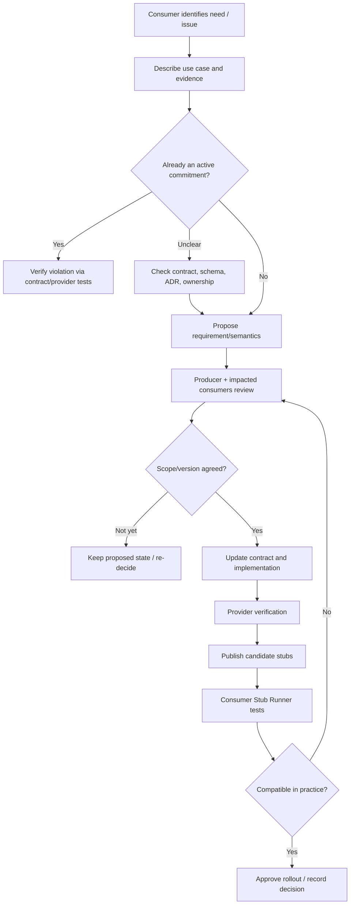
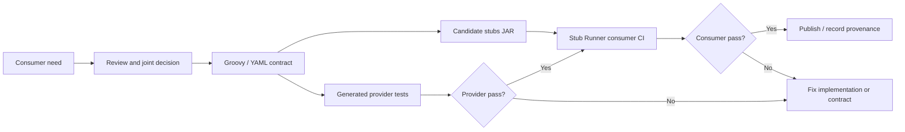

# Distinguishing Valid Expectations from Unagreed Requirements in Multi-Team Coordination

In a microservices system, a single API may serve multiple teams concurrently. `order-producer` provides order information; `checkout-consumer` needs payment status; `billing-consumer` needs amount and currency; `analytics-consumer` wants marketing campaign attribution. All three may use the same HTTP endpoint or `OrderCreated` event, yet not everything they **want** has become something the producer **commits** to.

This is a common root cause of contract disputes: the consumer says "the API must always return this field", while the producer replies "we never agreed to that field"; or the producer deletes a field assuming nobody uses it, while a consumer has long depended on it. **Spring Cloud Contract (SCC)** helps express agreed interactions using **Groovy/YAML DSL**, generate **provider verification tests**, publish **stubs JARs**, and let consumers verify using **Stub Runner**. However, the tool does not automatically decide whether a business requirement has been approved by the teams.

This lesson belongs to the **Team Coordination** chapter and focuses on **distinguishing valid expectations from unagreed requirements**: identification criteria, required evidence, HTTP/messaging examples, handling undocumented assumptions, negotiation workflows, and turning joint decisions into contracts, stubs, and CI.

## 1. Why distinguish before writing more matchers?

Suppose the producer currently returns:

```http
GET /api/orders/1001 HTTP/1.1
Accept: application/json
```

```http
HTTP/1.1 200 OK
Content-Type: application/json

{"id":1001,"status":"CREATED","currency":"VND"}
```

A consumer team just wrote a test demanding `customerName`, even though the producer never agreed to expose the customer's name. When the test fails, there are two very different conclusions:

- **Contract violation:** the producer no longer satisfies an agreed and verified behavior.
- **Unagreed requirement:** the consumer is demanding new behavior or extrapolating from sample data without a corresponding commitment.

The two situations require two different responses. For a contract violation, prioritize fixing the implementation or running a compatible change workflow. For a new requirement, **discuss the need, identify owners, assess risk, and update the contract after all sides agree**.

**Do not edit a contract just to make tests go green; nor dismiss a valid expectation just because it lacks an automated test yet.**

### 1.1. The cost of confusion

| Misconception | Consequence |
| --- | --- |
| Treating every consumer assumption as a commitment | Producer gets locked down by unreviewed requests |
| Treating every producer change as an internal right | Consumers break despite green producer tests |
| Treating a stub example as a full specification of all values | Tests become overly brittle, blocking compatible changes |
| Assuming anything without a contract has no users | Important live behavior gets deleted by mistake |
| Looking at only one green build | Overlooking old artifacts, unverified consumers, or missing scenarios |
| Changing APIs via chat with no recorded decision | Teams interpret the interface differently in later sprints |

## 2. Definitions: valid expectations vs. unagreed requirements

A **valid expectation** in contract testing is behavior a consumer has a reasonable basis to rely on, backed by evidence of **an active interface commitment** and **agreed semantics**. Evidence typically resides in reviewed contracts, approved API/schema docs, versioning/compatibility policies, or traceable design decisions.

An **unagreed requirement** is something one side wants, infers, or is already using, yet **lacks sufficient evidence** that the producer is responsible for guaranteeing it. It may be a legitimate business proposal, but it **should not yet become a mandatory assertion against the producer**.

For example:

| Statement | Status to verify |
| --- | --- |
| "200 response always has numeric `id`" | Valid if specified by the current contract/schema |
| "In the stub `id=1001`, so production must always return 1001" | Usually confusing a concrete example with a rule |
| "Consumer needs `customerName` for display" | Real need, but requires data-access and interface agreement |
| "Producer published `404 ORDER_NOT_FOUND` in contract" | Valid expectation for the declared scenario |
| "Every 404 must have the exact same English message" | Invalid if only `code` is committed, not `message` |
| "`OrderCreated` event needs a stable `eventId` across redeliveries" | Must check the contract and agreed delivery/idempotency policy |
| "Producer must respond under 150 ms in every case" | Requires a separate SLO/SLA; cannot be inferred from an HTTP stub |

### 2.1. Three levels worth recording explicitly

To avoid binary "right/wrong" arguments, classify into:

1. **AGREED / agreed commitment:** has an owner, scope/version, and approval evidence; should have corresponding tests.
2. **PROPOSED / under proposal:** has a consumer need, but schema, semantics, or timeline are not yet finalized.
3. **UNSUPPORTED / outside current commitment:** producer does not provide it or decided not to support it; consumer must adjust its design or open a new proposal.

These labels are **illustrative internal coordination conventions**, not a status enum provided automatically by Spring Cloud Contract.

### 2.2. No test yet does not mean no commitment

An already published API actively relied upon by consumers may carry commitments through documentation or organizational policy even before a DSL contract exists. In that case, the right action is to **turn the existing commitment into tests**, not claim the consumer is making a brand-new demand.

Conversely, simply seeing a field appear once in production logs **does not prove that field is permanently guaranteed**.

## 3. Four questions to evaluate an expectation

Before adding an assertion to provider verification or consumer CI, ask:

1. **Source of commitment:** which contract, API schema, doc, or policy defines this behavior? At which revision was it approved?
2. **Scope:** which method, endpoint, status, headers, fields, event versions, and request conditions does it apply to?
3. **Owners:** who has authority to approve changes and which consumers depend on it?
4. **Execution evidence:** is there a provider test proving the producer and a consumer test proving the client/listener uses the committed behavior properly?

If an answer is missing, do not necessarily reject it outright. Mark it as **insufficient evidence**, write down what still needs negotiation, and identify the accountable owner.

### 3.1. Evidence ladder for reviews

| Evidence type | Value | Limitation |
| --- | --- | --- |
| Reviewed and published Groovy/YAML contract | Strong for the specific behavior in the contract | Does not cover undeclared behaviors |
| Approved OpenAPI/AsyncAPI docs | Strong for published schema/interface | Can drift from implementation if unverified |
| Approved compatibility/versioning policy | Strong for how public changes are handled | Does not replace concrete field definitions |
| Provider verification passing on exact commit | Proves implementation satisfies executed tests | Does not prove consumers agreed to the contract |
| Consumer Stub Runner tests passing on candidate stubs | Proves consumer handles tested stub cases | Does not prove real producer or all scenarios |
| Ticket/ADR with decision and approvers | Records agreement, rationale, effective scope | Must be translated into executable artifacts/tests |
| Production log containing field | Shows field was once returned | Does not prove continuous presence or stability |
| Hand-written mock in consumer repo | Shows consumer's assumption | Does not prove producer committed to it |
| Verbal chat or scattered messages | Starts a discussion | Easily loses version, scope, and decision maker |

**Good evidence is traceable and tied to a clear scope**, not an anecdote remembered differently by different people.

## 4. Layers of commitment: interface, semantics, operations

An issue may belong to different layers:

| Layer | Example | Primary tool/evidence |
| --- | --- | --- |
| HTTP syntax/protocol | `GET`, URL, status, `Content-Type` | SCC contract, provider tests, Stub Runner |
| Data schema | `id` is number, `currency` is string | Contract, matchers, schema registry if used |
| Business semantics | What `CREATED` means; when to return 404 | Product/domain decisions and contract cases |
| Compatibility | Can fields be added? New enums? When to deprecate? | Versioning policy and consumer compatibility tests |
| Operations | p95 latency, availability, retry budget | SLO/SLA, metrics, load/resilience tests |
| Security/data access | Who can see customer names, token/tenant scope | Security/privacy review, integration tests |
| Messaging delivery | Ack, retry, DLQ, ordering, transactions | Broker/listener/DB integration tests |

**Do not try to cram every expectation into an HTTP response matcher.** A regex matcher can protect the format of `eventId`, but it cannot prove broker at-least-once delivery or DB transaction atomicity.

### 4.1. One sample value is not a global rule

A contract with `body(status: 'CREATED')` typically verifies **the described case**. It does not state that every order has status `CREATED` or that the producer never emits `PAID` or `CANCELLED`. To commit to a set of valid values, you need clear schemas/semantics and appropriate tests.

Do not generalize a single request/response fixture into the entire business state machine.

## 5. Scenario: three consumers on one producer

Suppose `order-producer` exposes:

```http
GET /api/orders/1001 HTTP/1.1
Accept: application/json
```

Returning:

```json
{
  "id": 1001,
  "status": "CREATED",
  "currency": "VND",
  "totalMinor": 125000
}
```

Different consumer needs:

| Consumer | Actually uses | Stated requirement | Analysis |
| --- | --- | --- | --- |
| Checkout UI | `id`, `status` | "Status must exist and have consistent meaning" | Can be a valid expectation if already published |
| Billing | `totalMinor`, `currency` | "Money must be in minor units, never randomly rounded" | Needs explicit commitment on units and data types |
| Analytics | `campaignId` | "Add campaign ID for segmentation" | New proposal if not yet in current schema |
| Fraud | `customerEmail` | "Return customer email in every response" | Needs security/privacy review; cannot be demanded by default |
| Legacy batch | JSON field order | "`status` always follows right after `id`" | Usually a wrong assumption about JSON objects unless committed |
| Support dashboard | Error `message` | "Message must match exact old English text" | Distinguish stable error codes from mutable display text |

An unagreed proposal **does not mean useless**. Analytics may have a completely legitimate business need; however, before requiring the producer to emit `campaignId`, teams must discuss data sources, optionality, access permissions, versioning, and rollout.

### 5.1. Both sides must be protected

- **Consumers do not demand uncommitted behavior** via unsourced assertions.
- **Producers do not break existing commitments** by deleting or changing the meaning of fields that valid consumers still rely on.

Multi-team coordination is neither the producer making unilateral decisions nor the consumer forcing arbitrary fields; it is **governing a shared interface**.

## 6. Using Groovy DSL to capture an agreed behavior

For example, producer and checkout agree that `GET /api/orders/1001` returns `id`, `status`, `currency`, and `totalMinor` in the sample scenario:

```groovy
import org.springframework.cloud.contract.spec.Contract

Contract.make {
    description 'Successful order read: agreed public fields'

    request {
        method GET()
        url '/api/orders/1001'
        headers {
            header('Accept', 'application/json')
        }
    }

    response {
        status OK()
        headers {
            contentType(applicationJson())
        }
        body(
            id: 1001,
            status: 'CREATED',
            currency: 'VND',
            totalMinor: 125000
        )
    }
}
```

This contract is valuable because:

- `GET` and URL specify the scenario scope.
- `Accept` and `Content-Type` protect client content negotiation.
- `status=200` and the sample body verify the producer for one scenario.
- `totalMinor` is represented as a JSON number, not a formatted string with decimals.

**However, the snippet does not by itself specify** the full set of statuses, customer data permissions, list sorting, latency SLAs, or that every response contains `totalMinor`. Those commitments must be stated explicitly and tested in the proper places.

### 6.1. Equivalent YAML DSL

```yaml
description: "Successful order read: agreed public fields"
request:
  method: GET
  url: /api/orders/1001
  headers:
    Accept: application/json
response:
  status: 200
  headers:
    Content-Type: application/json
  body:
    id: 1001
    status: CREATED
    currency: VND
    totalMinor: 125000
```

In a real build, choose **one of Groovy or YAML for the same scenario** to avoid duplicate generated tests/stub mappings. Plugin configuration, versions, and test base determine how contracts are processed.

### 6.2. Do not add `campaignId` just because a consumer asked

If the analytics consumer opens a pull request adding:

```yaml
response:
  body:
    campaignId: BLACK_FRIDAY
```

that snippet is **still only a proposed change** without agreement. It does not become a commitment merely because YAML parses cleanly. Review must determine which API, which resource, whether the field is optional or required, data permissions, value when no campaign applies, and compatibility.

After approval, the contract can be updated and producer verification checks the new implementation.

## 7. Request contracts: is the consumer asking for more or sending invalid input?

The distinction between valid expectations and new requirements also applies to **requests sent by consumers**.

For example, the producer has committed to:

```http
POST /api/orders HTTP/1.1
Content-Type: application/json

{"externalRef":"EXT-100001","quantity":2}
```

A consumer wants to also send `priority=EXPRESS` and assumes the producer will expedite processing. If that field is not part of the API, the server may ignore or reject it per policy. The consumer cannot treat the producer accepting a sample request as a commitment to support `EXPRESS` behavior.

### 7.1. Four questions for new request fields

1. Does the producer publish this field/query/header?
2. Does the field have clear type, value domain, and default semantics?
3. Does the producer commit to rejecting unknown values or ignoring extra fields?
4. Which response/status must the consumer handle for that request scenario?

If answers are missing, open an **interface change proposal** instead of forcing the expectation into mandatory producer tests.

### 7.2. A contract matches only what is declared

In WireMock, a mapping without a `priority` query condition can still match a request containing that query parameter. Therefore, **a stub returning 200 for a request with an extra query** does not prove the real producer understands or committed to executing the new query.

Do not take a request matching a broad stub as proof that the producer approved the feature.

## 8. Required, optional, null, and absent fields

This is the most frequent source of conflict among multiple consumers.

Suppose analytics wants `campaignId`, but not every order belongs to a campaign. Three distinct definitions:

| Rule | JSON example | Behavior consumers need to know |
| --- | --- | --- |
| Always required field | `"campaignId":"CMP-42"` | Consumer can rely on the field existing |
| Optional field, may be absent | JSON omits `campaignId` | Consumer must handle the absent case |
| Present field, nullable | `"campaignId":null` | Consumer must distinguish `null` from a valid string |

**"Optional" and "nullable" are not always synonymous.** Some deserializers distinguish absent vs. null; some apply different defaults. Contracts and schemas must describe what is committed, rather than leaving a single fixture with the field and assuming every team interprets it the same way.

### 8.1. A proposal needs a decision checklist

When adding `campaignId`, agree on:

- JSON name and data type.
- When the field is present, absent, or null.
- Value range, format, and stability.
- Whether special access permissions are required.
- If older consumers do not know the field, whether they ignore unknown properties.
- If new consumers require the field, when the producer guarantees full population.
- Which API version or event schema version applies.
- Whether there is a transition period and valid fallback.

Without agreement on these points, writing `assertNotNull(campaignId)` for every response **turns a private assumption into a public constraint**.

### 8.2. Do not treat a JSON object as an ordered string

JSON objects must not have field order treated as semantics by consumers unless a specific protocol intentionally defines ordering. Tests comparing raw JSON strings byte-for-byte can fail when serialization reorders fields even though the data object is equivalent.

Prefer asserting **committed fields, values, and semantics**, not whitespace or unspecified field ordering.

## 9. Enums, business states, and changes that look like "just adding a value"

The producer adds state `ON_HOLD`. That is a small database change, yet it can break consumers:

```java
enum OrderStatus {
    CREATED,
    PAID,
    CANCELLED
}
```

If a consumer strictly deserializes enums and encounters `ON_HOLD`, it may throw an exception or hit an unhandled branch.

### 9.1. Distinguish three levels of commitment

1. **A single example:** `status: CREATED` in the GET order 1001 contract.
2. **Value set:** currently published public statuses allow `CREATED|PAID|CANCELLED`.
3. **Evolution rule:** are consumers required to tolerate future values, or must the producer version the API before adding enums?

Example #1 **does not automatically resolve** #2 and #3. Both sides need a decision on forward compatibility. If a consumer uses an exhaustive switch without an unknown branch, adding an enum value can be breaking in practice.

### 9.2. How to negotiate

- Consumer lists business branches driven by status.
- Producer explains why and when the new state is needed.
- Both sides agree on handling `UNKNOWN`, fallbacks, or a new endpoint/version.
- Update schemas/contracts and consumer tests with concrete scenarios.
- Run candidate stubs against relevant consumers before rollout.

**Never state "adding an enum value is always backward-compatible" as an absolute rule.** Compatibility depends on committed behavior and what deployed consumers actually support.

## 10. Status codes and errors: do not agree only on the happy path

A consumer might expect every non-existent order to return `404` with JSON error code `ORDER_NOT_FOUND`, while the producer only ever committed to HTTP 404 without committing to an error body. Two different commitment levels:

| Claim | What the producer must verify |
| --- | --- |
| "Not found returns 404" | HTTP status |
| "404 has `code=ORDER_NOT_FOUND`" | Status and `code` field |
| "404 always has exact `message=Order does not exist`" | Also exact text, if truly committed |
| "404 response has `requestId`" | Header/body field and format if agreed |
| "404 shares the same structure across all endpoints" | Multiple scenarios and a shared error policy |

Example Groovy contract for an agreed 404:

```groovy
import org.springframework.cloud.contract.spec.Contract

Contract.make {
    description 'Non-existent order returns a stable error code'

    request {
        method GET()
        url '/api/orders/9999'
    }

    response {
        status NOT_FOUND()
        headers {
            contentType(applicationJson())
        }
        body(
            code: 'ORDER_NOT_FOUND'
        )
    }
}
```

If `message` is only for display and may be localized, do not force consumers to assert an exact English string unless explicitly agreed as part of the contract.

### 10.1. WireMock's default 404 is not always a contract

Stub Runner/WireMock returns a default 404 when a request **matches no mapping at all**. That differs from a valid mapping deliberately returning 404 with `ORDER_NOT_FOUND`. When a consumer reports an error, inspect the request journal and matched mapping before concluding the producer broke a commitment.

## 11. Pagination, sorting, and things easily assumed implicitly

Endpoint:

```text
GET /api/orders?customerId=CUS-42
```

The consumer displays a list and silently assumes records are sorted by `createdAt` descending. If the producer never committed to an ordering, changing a query plan or database index can alter the order without changing the HTTP schema.

Expectations that need explicit agreement:

- Default sort if the client omits `sort`.
- Allowed sort fields and tie-breaker for deterministic ordering.
- Meaning of `page`, `size`, or cursor.
- How the next cursor is represented and stability while new records arrive.
- Whether snapshot consistency across pages is guaranteed.
- Whether invalid queries return 400 or are ignored.
- Page size limits and fallback ordering.

**A stub returning a list in one specific order does not make that order an API contract.** If consumers depend on ordering, make a decision and add contracts/tests for that scenario.

### 11.1. When the consumer only displays items

If the UI merely lists items without depending on order, assert the expected set of items or required constraints rather than hard-coding the first element. That reduces false alarms when the producer changes unconstrained behavior.

### 11.2. When business logic requires ordering

If the system must prioritize newest shipments, sorting is a **real requirement** to formalize on the interface: e.g., `sort=createdAt,desc` with a tie-breaker rule; then both provider and consumer verify it.

## 12. HTTP headers and security: where contracts easily overreach

A consumer team might want:

- `Content-Type` always `application/json`.
- `ETag` present for caching.
- `Retry-After` to control retries.
- `X-Correlation-Id` echoed back.
- `Authorization` using a token with a specific scope.
- `X-Tenant-Id` identifying the tenant.

**Not every header that has ever appeared is guaranteed.** In particular, headers injected by gateways, tracing agents, or proxies may vary across environments.

| Header or behavior | Kind of agreement needed |
| --- | --- |
| `Content-Type` | HTTP contract / media type |
| `ETag` and `If-None-Match` | Cache semantics / versioned resource policy |
| `Retry-After` | Error contract and consumer retry policy |
| Correlation ID | Observability / cross-service tracing convention |
| `Authorization` | Authentication / security interface |
| Tenant context | Authorization / isolation policy, not just a header string |

### 12.1. WireMock does not verify security implementations

A stub can match an `Authorization` header or return 401/403, yet it **does not execute JWT verification, permission checks, or tenant isolation** of the real producer. Security teams rightly require separate integration/security tests; a contract header matcher is never complete security proof.

### 12.2. Sensitive data is a deciding factor

Requesting `customerEmail`, `fullAddress`, or tokens in payloads is not just a convenience for consumers. It impacts access control, data minimization, retention, and sharing rules. Even with a valid consumer use case, exposing data must follow the organization's security and privacy policies.

## 13. Dynamic values: distinguishing guaranteed formats from sample literals

A common mistake is consumers treating a stub literal as a producer commitment to return that exact literal.

For example:

```json
{
  "eventId": "EVT-100001",
  "occurredAt": "2026-11-24T03:15:30.123Z",
  "correlationId": "corr-111"
}
```

A valid consumer may need:

- `eventId` is a non-empty identifier string matching a pattern.
- `occurredAt` is an ISO 8601 timestamp with offset/UTC.
- `correlationId` is propagated/mapped per tracing rules if committed.

However, tests must not require every event to have `eventId=EVT-100001` or occur at one fixed sample timestamp.

### 13.1. Use matchers when the contract protects a rule

Illustrative intent of a Groovy contract for a request with a dynamic `externalRef`:

```groovy
import org.springframework.cloud.contract.spec.Contract

Contract.make {
    request {
        method POST()
        url '/api/orders'
        headers {
            contentType(applicationJson())
        }
        body(
            externalRef: 'EXT-100001',
            quantity: 2
        )
        bodyMatchers {
            jsonPath('$.externalRef',
                byRegex('^EXT-[0-9]{6}$'))
        }
    }

    response {
        status CREATED()
        headers {
            contentType(applicationJson())
        }
        body(
            id: 1001,
            status: 'CREATED'
        )
    }
}
```

Equivalent YAML for the request matcher:

```yaml
request:
  method: POST
  url: /api/orders
  headers:
    Content-Type: application/json
  body:
    externalRef: EXT-100001
    quantity: 2
  matchers:
    body:
      - path: $.externalRef
        type: by_regex
        value: '^EXT-[0-9]{6}$'
response:
  status: 201
  headers:
    Content-Type: application/json
  body:
    id: 1001
    status: CREATED
```

These examples express the rule **externalRef follows `EXT` plus six digits**, rather than requiring every request to use `EXT-100001`. Verify how DSL/matchers are generated against your actual plugin version.

### 13.2. Matchers also need review

An overly broad regex like `.*` can allow invalid payloads through. An overly strict regex can fail the producer despite a valid change. **A matcher is also a contract decision**, not purely a technical choice by the test author.

## 14. Messaging: agreeing on schema, destination, and delivery semantics

For an `OrderCreated` event, the producer may have a contract:

```groovy
import org.springframework.cloud.contract.spec.Contract

Contract.make {
    description 'OrderCreated v1 event has eventId and orderId'
    label 'order_created_v1'

    input {
        triggeredBy('publishOrderCreated()')
    }

    outputMessage {
        sentTo('orders.created')
        headers {
            messagingContentType(applicationJson())
        }
        body(
            eventId: 'EVT-1001',
            eventType: 'OrderCreated',
            schemaVersion: 1,
            orderId: 'ORD-1001'
        )
    }
}
```

Parts that can go into a message agreement:

- `eventType` and `schemaVersion`.
- `eventId`: format, semantics, dedupe key.
- `orderId`: domain identifier, data type.
- `sentTo`: logical destination per adapter.
- Headers and content type relied upon by consumers.
- Required/optional field rules and event evolution.

Things **not automatically proven** by a message contract:

- Kafka offset commits or RabbitMQ ack/nack.
- Redelivery counts and retry backoff.
- DLQ routing, retention, ordering, or partitioning.
- Transactions spanning database and broker.
- Exactly-once business side effects.

### 14.1. "Messages always arrive exactly once" is a separate requirement

If `notification-consumer` says "we need the producer to guarantee exactly-once delivery", separate the concerns:

1. Does the producer commit to creating one **logical event** per business action?
2. Does the transport support at-least-once, at-most-once, or transactions within what scope?
3. Can the consumer tolerate duplicates by `eventId`?
4. Do side effects like sending emails or charging money have idempotency?
5. Which fault-injection/integration tests are needed?

**Do not put an exactly-once claim in the contract just because `StubTrigger` succeeded.** Agree on scope and verify against the real broker/database runtime.

### 14.2. When multiple consumers want different data

For instance, billing needs `totalMinor` and `currency` in the event, while analytics wants `campaignId`. Teams should discuss whether to:

- Extend `OrderCreated` v1 with an optional field and clear semantics.
- Create a dedicated event for analytics if ownership differs.
- Emit a new event version and migrate consumers.
- Use a query API instead of stuffing every piece of data into one event.

One event does not have to satisfy every demand from every consumer; the design should balance coupling, privacy, compatibility, and business needs.

## 15. Which operational expectations need a different agreement?

Statements like these often get mixed into request/response contracts:

- "The endpoint must respond under 150 ms in all cases."
- "Consumers can retry POST infinitely without creating duplicates."
- "Message ordering must hold across all partitions."
- "The producer will always be 99.99% available."
- "Any 503 error recovers within three attempts."

They require **SLOs/SLAs, resilience policies, idempotency designs, or integration/load tests**, not just a static Groovy/YAML contract.

### 15.1. Classify before assigning responsibility

| Expectation | Owners to involve | Appropriate evidence |
| --- | --- | --- |
| p95 latency within budget | Producer/SRE/platform | SLO and measurement under load |
| Retry 503 up to three attempts | Consumer and producer if `Retry-After` policy applies | Consumer resilience tests |
| Idempotent POST by key | Producer + consumer | Header contract and producer duplicate-request integration tests |
| Event ordering on a key | Producer, broker team, consumer | Partition/routing policy and broker integration tests |
| DLQ after retries exhausted | Consumer/platform | Broker/listener integration tests |
| JWT scope to read PII | Security/privacy + producer | Authorization tests and threat review |

**A valid operational requirement can still be unagreed in scope or ownership.** Record it as a concrete proposal rather than silently expecting stubs to enforce it.

## 16. Workflow: propose -> agree -> verify -> publish

An effective coordination sequence:



**This is a recommended team workflow**, not states automatically managed by Spring Cloud Contract.

### 16.1. Do not conflate "proposed" with "approved"

A PR may contain a syntactically valid Groovy contract yet still be **awaiting business, security, or compatibility review**. Never auto-merge a contract simply because the parser accepts it.

Conversely, an existing committed contract whose provider test fails must be prioritized as a regression, not pushed into a new-proposal backlog to delay fixing it.

### 16.2. Who should participate

- **Consumer owner:** states the behavior genuinely needed and code paths using it.
- **Producer owner:** confirms feasibility and data-source semantics.
- **Other consumers:** assess how changes affect the shared interface.
- **API/platform architect when needed:** versioning, schema governance, repositories.
- **Security/privacy when sensitive data or access permissions are involved.**
- **SRE/operations when SLAs, retries, brokers, DLQs, or rollouts are affected.**

Not every minor change needs a large committee; use risk criteria to select the right reviewers.

## 17. Change request template to avoid guesswork

A ticket or PR describing a **pending requirement** should include at least:

```yaml
changeProposal:
  id: API-142
  state: PROPOSED
  producer: order-producer
  affectedConsumers:
    - analytics-consumer
    - checkout-consumer
  interface:
    type: HTTP
    method: GET
    path: /api/orders/{id}
  requestedBehavior:
    field: campaignId
    jsonType: string
    required: false
    absentWhenNoCampaign: true
  justification: "Display campaign group in reports"
  compatibility:
    needsUnknownFieldToleranceReview: true
    rollout: "Producer adds optional field before consumer relies on it"
  ownerDecision: PENDING
  verification:
    producerContractTest: PENDING
    consumerCandidateStubTest: PENDING
```

The YAML above is a **business documentation template**, not Spring Cloud Contract DSL, and has no automated execution meaning unless the project builds custom tooling.

What matters is recording the decision together with:

- **Who approved** and the effective date/version.
- **Which consumers depend on it** and risk when the field is absent.
- **Testable acceptance criteria**.
- **Compatible rollout approach** for legacy consumers.
- **Support duration and deprecation plan** if replacing an old field.

### 17.1. Acceptance criteria must state clear conditions

"API supports campaign" is too vague. Better:

> For orders with a valid campaign, the GET order response includes `campaignId` as a normalized string; for orders without a campaign, this field is absent; older consumers are not required to understand the new field. Effective starting from the producer release recorded in the decision.

If the team chooses `null` instead of absent, update that sentence before writing contracts or tests. This is **why semantics must be agreed before generating code**.

## 18. Dispute resolution workflow: check evidence first, debate second

For example, a consumer reports: "The producer broke the API because the response added field `discountMinor`."

Instead of immediately rolling back or editing matchers, do:

1. **Capture actual request and response:** method, URL, status, headers, and body with sensitive data redacted.
2. **Identify the candidate/release:** producer commit, stubs JAR version/classifier, and build.
3. **Check the current contract:** is an added field forbidden? Does the schema allow unknown properties?
4. **Inspect consumer logic:** is the JSON parser strict, or does the DTO reject unknown fields?
5. **Apply the agreed compatibility policy:** is adding an optional field considered compatible in this ecosystem?
6. **Assess impact on other consumers:** one strict team can make an "additive" change breaking in practice.
7. **Make an owner-backed decision:** fix the producer, fix the consumer, introduce a new migration/version, or establish a dual-support period.
8. **Update the commitment source and tests:** do not merely edit an expected body in one repo.
9. **Record lessons learned:** which field/schema/version caused the misunderstanding so it is not repeated.

### 18.1. Do not assume "adding a field is always safe"

Many JSON clients ignore unknown fields, but not all. Consumer code may use a strict deserializer or schema validation that forbids unknown fields. Compatibility must rest on **agreed policy and testing active consumers**, not solely on "additive" theory.

### 18.2. Do not assume "a consumer uses it, so the producer must keep it forever"

A consumer might rely on undocumented behavior after spotting an internal field. That creates a **real migration risk that needs coordination**, yet it does not turn every implementation detail into a perpetual commitment. Weigh user impact, business risk, and migration cost.

## 19. Backward compatibility and interface change rules

A useful review table:

| Proposed change | Risk | What must be agreed |
| --- | --- | --- |
| Add optional JSON field | Usually low, though strict parsers may fail | Unknown-field policy, nullable/absent |
| Remove a field used by a consumer | High | Deprecation, migration, versioning |
| Change `id` number -> string | High | DTO compatibility and versioning |
| Rename `status` -> `state` | High | Dual-write/alias or API v2 |
| Add enum `ON_HOLD` | Depends on consumers | Unknown value handling |
| Change 404 -> 200 with error body | High | Error semantics and handling branches |
| Add required query parameter | High | Default, compatibility with old clients |
| Change default `currency` | High if money is affected | Units, locale, business semantics |
| Change event destination | High | Subscriber routing and migration |
| Add field to v1 message | Depends on deserializer | Schema compatibility and rollout |
| Remove correlation ID header | Depends on tracing and contract | Header ownership / observability |
| Change p95 latency target | Not a schema change | SLO / operations agreement |

Not every "high-risk" change is always forbidden. They require a **versioning/rollout plan and consumption evidence**. Nor is every "low-risk" change automatically safe to merge.

### 19.1. Ways to reduce breaking changes

- Add fields as optional and clarify absent vs. null.
- Keep the old field alongside the new one during transition if feasible.
- Mark deprecations with dates/versions and consumer ownership.
- Introduce a new API version or event schema version when changes cannot remain compatible.
- Share candidate stubs with consumers before rollout.
- Measure actual endpoint/field usage and verify active consumers.
- Retire behavior only after approved end-of-support conditions are met.

## 20. How do Spring Cloud Contract and Stub Runner help validate agreements?

A sound workflow:

1. Producer and consumers **agree on interaction behavior**.
2. Behavior is captured in a **Groovy/YAML contract** with concrete request/response or input/output messages.
3. **Contract Verifier** generates provider tests; the producer runs them against the real implementation.
4. Producer packages a **stubs JAR** and publishes a versioned candidate artifact.
5. Consumer uses **Stub Runner** to run stubs from that exact candidate, calls its real client or listener, and checks outcomes.
6. CI uses evidence from both sides as a compatibility gate before release.



### 20.1. What does each kind of test prove?

| Evidence | Valid conclusion | Invalid conclusion |
| --- | --- | --- |
| Contract DSL approved | Agreement exists on the described cases | Producer implemented it right |
| Generated provider tests pass | Producer satisfies executed cases | Every consumer can handle it |
| Stubs JAR exists | Stub data exists for consumers | Provider tests actually ran |
| Stub Runner consumer tests pass | Consumer handles candidate stub cases | Production infra/gateway/broker is right |
| Full integration tests pass | A set of runtime behaviors was tested | All SLAs or failure modes are protected |
| Production monitoring | Real operational observation | Replaces contract/schema reviews completely |

### 20.2. Pin candidate stubs so debates use the same facts

If one team uses `order-producer:1.4.0:stubs` while another uses `1.5.0-SNAPSHOT`, both sides may be arguing over **two different interfaces**. During triage, record the full GAV/classifier, repository, hash if available, and producer commit. **Do not try to resolve a "broken contract" before confirming both teams are running against the same candidate.**

## 21. CI cannot decide for humans what has not been agreed

Automation is valuable, yet has limits:

- CI detects when a producer violates a contract **that has already been written**.
- CI detects when a consumer cannot handle a stub **that has been published**.
- CI can check contract/test counts, schema validation, and artifact versions.
- CI can run mutations to verify gates fail on dangerous changes.

However, CI cannot decide on its own whether `campaignId` should be exposed, whether it contains PII, or when a producer may drop support for older consumers.

### 21.1. Review gates and execution gates are distinct

**Review gate:** producer owner, consumer owners, and stakeholders approve semantics, compatibility, security, and rollout.

**Execution gate:** Contract Verifier/provider tests, Stub Runner/consumer tests, and scoped integration/security tests.

Both gates are necessary. A contract with wrong business rules can still be verified cleanly by generated tests if the implementation reproduces the same mistake.

### 21.2. CI must prevent "false green" tests

Cases to block:

- Zero generated provider tests despite contract changes.
- Provider tests skipped or undiscovered by the test engine.
- Consumer still picking up an old stubs JAR from the Maven cache.
- Consumer tests only verifying WireMock booted without calling the real client.
- Overly broad mappings causing invalid requests to still receive 200.
- Tests covering only the happy path while missing error paths consumers depend on.
- Candidate published before provider verification passed.
- A requirement still in `PROPOSED` state treated as a finalized contract.

## 22. Exercise: classify 12 statements and resolve a dispute

Set up three roles: `order-producer`, `checkout-consumer`, and `analytics-consumer`. Assume the current contract only publishes:

```text
GET /api/orders/1001
  200 application/json
  body: id(number), status(string), currency(string), totalMinor(number)

GET /api/orders/9999
  404 application/json
  body.code = ORDER_NOT_FOUND

OrderCreated v1:
  eventId, orderId, eventType, schemaVersion
```

Classify the statements:

| # | Team statement | Initial classification direction |
| --- | --- | --- |
| 1 | GET order 1001 must have numeric `id` | Supported by current contract |
| 2 | Every order has `id=1001` | Wrong inference from fixture |
| 3 | 404 response has `code=ORDER_NOT_FOUND` in case 9999 | Supported by current contract |
| 4 | Every error `message` must match the exact old English string | Insufficient evidence |
| 5 | Analytics needs optional `campaignId` | New proposal needing review |
| 6 | Fraud wants `customerEmail` | Proposal needing security/privacy review |
| 7 | JSON fields must appear in stub order | Usually a false assumption |
| 8 | `status` can add `ON_HOLD` anytime | Must check enum evolution policy |
| 9 | Producer responds under 150 ms every time | Needs SLO, cannot infer from contract |
| 10 | Consumer can retry POST without duplicates | Needs idempotency agreement and integration test |
| 11 | `OrderCreated` has `eventId` in the published case | Supported by message contract |
| 12 | Kafka delivers the event exactly once without redelivery | Not proven by message stubs |

Practice steps:

1. For each statement, write the **evidence source and scope** instead of simply marking true/false.
2. Pick `campaignId` and write a **change proposal** following the template in Section 17.
3. Determine whether the field is **optional or required**, absent or null, and who has read access.
4. Have the producer and two consumers simulate a review meeting; write a **decision record** with owners, semantics, and effective timeline.
5. Update a Groovy or YAML contract **after agreement is reached**.
6. Run generated provider tests in a real project if a compatible environment is available.
7. Build the candidate stubs JAR and have consumers run Stub Runner with the exact version.
8. Test a strict JSON parser on a consumer to determine whether adding the field breaks compatibility.
9. Try changing `id` from number to string; explain why migration/versioning is required.
10. Have a consumer assert an unagreed field; explain why this is not yet a producer regression.
11. Write a 404 `ORDER_NOT_FOUND` test and distinguish a valid 404 mapping from an unmatched WireMock 404.
12. Discuss the "latency under 150 ms" request; choose SLO/load tests rather than stuffing it into a response body contract.
13. For messaging, extend the `OrderCreated` proposal with `campaignId` and examine schema evolution for subscribers.
14. Write a CI checklist covering review gates, provider test counts, candidate stub version, and consumer assertions.
15. Summarize the evidence that must be saved when two teams report a "breaking change".

### 22.1. Self-assessment rubric

| Competency | Evidence of mastery |
| --- | --- |
| Classify requirements | Identify active commitments, proposed, and unsupported items |
| Trace evidence | Locate source, owner, version, and applicability conditions |
| Separate fixture from semantics | Avoid turning every sample literal into a global rule |
| Optional data | Distinguish absent, null, and required |
| Review compatibility | Know when adding a field or enum can break consumers |
| Resolve disputes | Follow evidence -> review -> decision workflow |
| Use SCC within proper scope | Groovy/YAML provider verification and Stub Runner |
| Messaging | Do not confuse event schema with broker delivery semantics |
| CI | Prevent false greens, pin candidate stubs, ensure tests execute |
| Rollout | Define owners, migration, and deprecation plans when needed |

## 23. Summary: agree first, turn into tests second

When multiple teams coordinate, a **valid expectation** is behavior backed by a **commitment source, applicability scope, and clear accountability**; an **unagreed requirement** is a desire or assumption not yet approved by the parties. Consumers have the right to raise new needs, producers are accountable for keeping existing promises, and both share responsibility for governing changes to the shared interface.

Remember five principles:

1. **Do not treat stub literals as a comprehensive spec.** A `CREATED` sample does not prove every order is `CREATED`.
2. **Do not force consumers to guess producer intent.** Required/optional, null/absent, enums, status/errors, headers, and versioning must have explicit semantics.
3. **Do not treat a proposed need as a producer bug.** Record the proposal, evaluate impact, assign owners, and make a decision before turning it into an acceptance test.
4. **Do not substitute green tests for consensus.** Provider verification and Stub Runner enforce what was written—they do not decide business rules, privacy, or SLOs.
5. **Do not alter public commitments unilaterally.** Use candidate stubs, consumer CI, migration/deprecation, and traceable decisions.

When **Groovy/YAML DSL, generated producer tests, stubs JARs, Stub Runner, and CI** sit behind a clear negotiation workflow, teams can tell a **real API regression** apart from an **expectation that was never agreed upon**. As a result, changes are verified in the right place, disputes decrease, and impactful incompatibilities are caught early.
