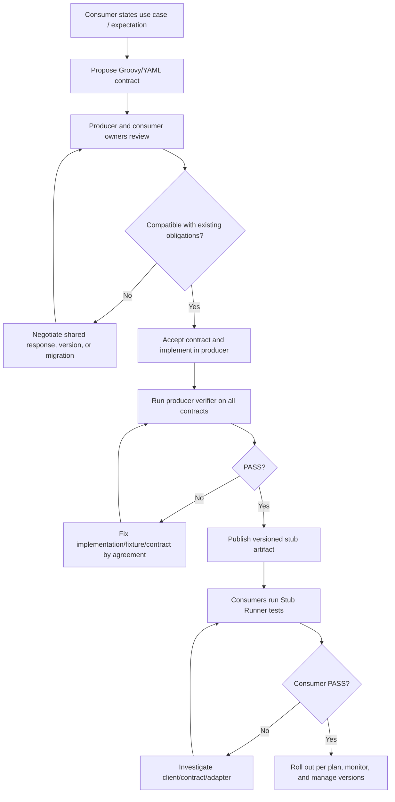
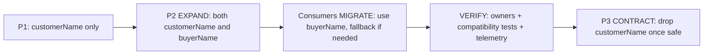
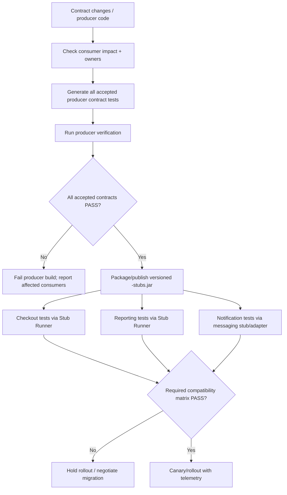

# Managing Multiple Consumers with Different Expectations

## 1. The problem: one producer, multiple promises to keep

In a microservices system, a service rarely has only one consumer. For example, `Order Service` (producer) simultaneously serves:

- **Checkout Service**: needs to know whether an order is confirmed to move the customer to payment.
- **Reporting Service**: needs the amount and currency to compute reports.
- **Notification Service**: needs the `OrderConfirmed` event to send notifications.
- **Partner applications**: may use an older API version and cannot upgrade on the internal team's schedule.

When Order Service changes a field, URL, status code, or message schema, each consumer can be affected differently. A request to "add a field for Reporting" looks small yet can cause Checkout to fail deserialization if Checkout rejects unknown JSON properties. Conversely, Checkout wants a minimal response with only `orderId` and `status`, whereas Reporting also needs `totalAmount`.

In **Spring Cloud Contract**, Groovy/YAML DSL describes HTTP or messaging interactions. **Contract Verifier** generates tests to verify the real producer; the producer publishes a stub artifact; **Stub Runner** lets each consumer test sending requests, receiving responses, or processing messages. However, the tool does not automatically decide **which expectations are valid, when two contracts conflict, who has authority to change the interface, or when support for an old consumer can end**. That is the cross-team technical coordination part.

This lesson belongs to the **Team Coordination** chapter and focuses on turning separate demands into a compatible, testable, and operable set of commitments.

After this lesson, you will be able to:

1. Build a **consumer and expectation map** by endpoint, event, and version.
2. Distinguish **different expectations that can be satisfied simultaneously** from **genuinely conflicting contracts**.
3. Organize contracts per consumer while protecting a single consistent behavior on the producer.
4. Use Groovy/YAML, producer verification, `stubsPerConsumer`, and Stub Runner in their proper roles.
5. Design workflows for proposing, reviewing, accepting, publishing, and retiring contracts.
6. Build a multi-consumer CI matrix, monitoring, and safe migration plans.

## 2. Three concepts to distinguish from the start

| Concept | Meaning | Example |
| --- | --- | --- |
| **Consumer expectation** | What a consumer needs or assumes about the interface | Checkout reads `status` |
| **Accepted contract** | Interaction agreed upon by producer and consumer, expressed in DSL/tests | `GET /api/orders/42` returns `200` with `orderId`, `status` |
| **Producer behavior** | What the application actually does at runtime | Controller returns a specific JSON response |

A consumer may **want** the producer to return a new structure, yet writing a DSL file does not make the producer implement that structure automatically. Conversely, a producer may change its implementation without consulting consumers, breaking behaviors consumers depend on.

**The source of truth must be two-way:** an accepted contract must reflect real consumer needs **and** be verified against the producer implementation. You cannot treat a contract edited just to turn tests green as proof that all consumers agreed.

### 2.1. Distinguish data requirements from policy requirements

Expectations are not just lists of JSON fields:

| Expectation type | Example | What needs protection |
| --- | --- | --- |
| Structure | `orderId` is numeric, `status` is string | Data types, required/optional fields |
| HTTP behavior | `GET` returns `200`, missing returns `404` | Status, method, URL, headers |
| Semantics | `CONFIRMED` means order is confirmed | Business state meaning |
| Messaging | `OrderConfirmed` emitted to `orders.confirmed` | Event type, destination, schema |
| Compatibility | Legacy consumers still read `customerName` | Rollout/migration |
| Operations | Timeouts, retries, message ordering, latency | Usually requires additional integration/resilience tests |
| Security | Token needs a specific scope | Security tests, not just stub header matchers |

**Spring Cloud Contract only verifies aspects expressed and executed in tests.** Latency SLAs, real token validation, Kafka durability, and cross-service transactions require appropriate supplementary tests and observability.

## 3. Map your consumers before changing an API

For each shared endpoint or message, maintain a concise **consumer dependency matrix**:

| Consumer | Interface | Needed fields/behaviors | Owner | Upgrade cadence |
| --- | --- | --- | --- | --- |
| Checkout | `GET /api/orders/{id}` | `orderId`, `status`, HTTP `404` | Checkout Team | Weekly |
| Reporting | `GET /api/orders/{id}/report` | `totalAmount`, `currency` | Data Team | Batched |
| Notification | `OrderConfirmed` event | `orderId`, `eventId`, `customerId` | Notification Team | Weekly |
| Partner Portal | `/api/v1/orders/{id}` | `customerName`, `status` | Integrations Team | Separate schedule |

This is an **illustrative matrix**, not metadata auto-generated by Spring Cloud Contract. Store it in API governance docs or an issue tracker; when proposing changes, re-verify with owners.

Each entry should include:

1. Stable **consumer identity**: application/service name, not just team name.
2. **Interface and version** in use: URL/method, media type, event topic/schema.
3. **Critical fields and error branches**: avoid vague claims like "consumer needs JSON".
4. **Contract status**: proposed, accepted, deprecated, retired.
5. **Owner and communication channel**: who confirms changes.
6. **Integration evidence**: contract tests, consumer tests, telemetry, or partner confirmation.
7. **Transition timeline/threshold**: avoid guessing when old fields can be removed.

### 3.1. What if consumers are unknown?

A consumer missing from a registry does not mean it does not exist. For public APIs, SDKs, mobile apps, or partners, combine release docs, gateway/access logs, versioned endpoints, and published support windows. Avoid concluding "nobody uses it anymore" just because there is no test or no traffic appeared over a very brief window.

## 4. Different expectations are not necessarily conflicts

Suppose two consumers both call:

```http
GET /api/orders/42
Accept: application/json
```

Checkout needs:

```json
{
  "orderId": 42,
  "status": "CONFIRMED"
}
```

Reporting also needs:

```json
{
  "orderId": 42,
  "totalAmount": 125000,
  "currency": "VND"
}
```

Both sides **care about different subsets of fields**, yet the producer can return one shared response:

```json
{
  "orderId": 42,
  "status": "CONFIRMED",
  "totalAmount": 125000,
  "currency": "VND"
}
```

If both consumers tolerate extra fields and share the same semantics, this single response satisfies both simultaneously. There is no need for a producer to "identify" Checkout to return body A and Reporting to return body B.

**However, adding fields is not always compatible.** A client configured with Jackson `FAIL_ON_UNKNOWN_PROPERTIES`, closed schema validators, or exact raw JSON comparisons can reject an expanded response. Consumer tests must verify real parser behavior.

### 4.1. Classify changes before deciding

| Scenario | Can both be satisfied simultaneously? | Approach |
| --- | --- | --- |
| Checkout only needs `status`, Reporting needs `amount` | Usually yes | Shared response with verified additive fields |
| Checkout wants `status=CONFIRMED`, Reporting wants `status=APPROVED` for the same order | No, if same meaning/request | Align vocabulary or version the API |
| Two consumers need the same data in different types, number vs. string | Possible via new field/endpoint | Expand–migrate–contract or versioning |
| Two consumers need different responses for different `Accept` headers | Yes, if producer truly implements it | Content negotiation / media type versioning |
| One consumer expects `200`, another expects `202` for the same operation | Usually semantic conflict | Clarify sync/async and new flow |
| Old consumer reads message schema v1, new consumer uses v2 | Yes, with transition support | Dual-format, schema rules, or topic/event versioning |

Focus on **the valid request set and observable behavior**. Two contract files in two folders do not magically create two execution paths in the producer.

## 5. True conflict: same request yet two incompatible responses

For instance, a Checkout contract requires:

```http
GET /api/orders/42
Accept: application/json

HTTP/1.1 200 OK
Content-Type: application/json

{"orderId":42,"status":"CONFIRMED"}
```

While a Reporting contract requires for **the exact same method, URL, headers, query, and state**:

```http
GET /api/orders/42
Accept: application/json

HTTP/1.1 200 OK
Content-Type: application/json

{"orderId":42,"status":"PENDING"}
```

If `status` carries the same meaning, the producer cannot return both `CONFIRMED` and `PENDING` for an identical request and condition.

**Two risks emerge:**

1. **Producer contract verification** will have contradictory assertions that cannot both pass against the real implementation.
2. Generating two WireMock mappings matching the same request causes the stub server to pick one by priority/order, making one consumer test receive the other consumer's response.

### 5.1. Sound resolution paths

**Option A — Agree on a single shared semantics.** If `CONFIRMED` is the true order status, Reporting must update its business interpretation or use a distinct, accurately named field such as `settlementStatus`.

**Option B — Differentiate requests through a real API mechanism.** For example:

```http
GET /api/orders/42
Accept: application/vnd.example.order.v1+json
```

and:

```http
GET /api/orders/42
Accept: application/vnd.example.order.v2+json
```

if the producer **genuinely implements** content negotiation. Or introduce a dedicated endpoint such as `/api/orders/42/report`.

**Option C — Parallel support phase.** Producer exposes old and new fields or endpoints while consumers migrate, then retires the old interface once evidence is sufficient.

**Do not:** merely turn on `stubsPerConsumer` so each consumer sees a different fake response and claim the API is compatible. That mechanism **isolates mappings**; it does not change real producer behavior.

## 6. Rules for organizing contracts by consumer

Spring Cloud Contract lets you organize contracts by consumer name, for example:

```text
order-service/
  src/test/resources/contracts/
    checkout-service/
      get_order_status.groovy
      order_not_found.yml
    reporting-service/
      get_order_report.yml
    notification-service/
      order_confirmed.groovy
```

Benefits:

- Easy to identify **which consumer owns the requirement**.
- PRs changing files under `checkout-service` can require review from the Checkout owner.
- Easy to assess which consumers are at risk when changing a field or destination.
- Stub Runner can select stub mappings belonging to a consumer group when `stubsPerConsumer` is configured appropriately.

**A consumer name is a logical identifier in the contract layout, not an authentication mechanism.** A request to WireMock or the real producer is not authenticated simply because it matches the `checkout-service` folder.

### 6.1. Where should shared contracts live?

There are two distinct needs:

- **A behavior shared by multiple consumers:** maintain one canonical representative contract or semantically consistent contracts, with clear file/group conventions and separate consumer tests.
- **An interaction specific to one consumer:** place it under that consumer's branch while still reflecting real producer behavior.

Do not assume files under a `common/` folder are automatically loaded by Stub Runner for every consumer when `stubsPerConsumer=true`. Filtering rules depend on paths and Stub Runner version/config; if using a shared group, verify which mappings actually register for each consumer. A practical approach is maintaining non-overlapping, compatible per-consumer contracts and inspecting the final artifact.

### 6.2. Do not organize by team name instead of application name

For example, the Data team owns `reporting-service`. If you name the folder `data-team` while the application sets `spring.application.name=reporting-service`, stubs-per-consumer may fail to select the right mappings. Keep naming consistent; if a different name is needed, explicitly set `consumerName` in test configuration.

## 7. Groovy DSL: contract for Checkout

For Checkout, the interface needs to check order status:

```text
src/test/resources/contracts/checkout-service/get_order_status.groovy
```

```groovy
import org.springframework.cloud.contract.spec.Contract

Contract.make {
    description 'Checkout views confirmed order status'

    request {
        method GET()
        url '/api/orders/42'
        headers {
            header('Accept', 'application/json')
        }
    }

    response {
        status OK()
        headers {
            contentType(applicationJson())
        }
        body(
            orderId: 42,
            status: 'CONFIRMED',
            totalAmount: 125000,
            currency: 'VND'
        )
    }
}
```

Because the **canonical** response returns the shared fields too, the producer has one clear observable behavior. Checkout tests may assert only `orderId` and `status`, while verifying its JSON client **does not fail on the extra fields**.

Contract Verifier on the producer runs against the real API to verify conditions generated from the DSL. The stub artifact holds the sample HTTP mapping for consumers. **A contract is only a requirement, not the implementation.**

### 7.1. Contract when the order does not exist

Another YAML contract in the same folder:

```yaml
description: Checkout receives 404 when order does not exist
request:
  method: GET
  url: /api/orders/999
  headers:
    Accept: application/json
response:
  status: 404
  headers:
    Content-Type: application/json
  body:
    code: ORDER_NOT_FOUND
```

For the consumer, `404` is also a critical expectation: the UI may need to display "Order not found" rather than timing out or throwing a JSON decoding error.

**Distinction:** a WireMock `404` due to **no matching mapping** differs from a `404` **deliberately specified by a contract**. Inspect the response body and request journal when debugging.

## 8. YAML DSL: contract for Reporting

Reporting reads reporting data at **a separate endpoint genuinely provided by the producer**:

```text
src/test/resources/contracts/reporting-service/get_order_report.yml
```

```yaml
description: Reporting reads order details to generate report
request:
  method: GET
  url: /api/orders/42/report
  headers:
    Accept: application/json
response:
  status: 200
  headers:
    Content-Type: application/json
  body:
    orderId: 42
    totalAmount: 125000
    currency: VND
    settlementStatus: NOT_SETTLED
```

Endpoint `/api/orders/42/report` uses `settlementStatus` instead of overloading `status` with another meaning. That cleanly separates **order status** (`CONFIRMED`) from **settlement status** (`NOT_SETTLED`).

Do not invent a new endpoint solely to turn stub tests green; the producer must **implement and publish** this endpoint, and generated producer tests must verify it.

### 8.1. When you do not want an extra endpoint

If Reporting can use the shared response from `GET /api/orders/42`, there is no need to create `/report` just because Reporting cares about different fields. Interface design should reflect domain boundaries, performance, permissions, and existing APIs. You can keep one shared endpoint, one aligned contract, and distinct consumer tests as long as all expectations are compatible.

## 9. Messaging: one producer emitting events to multiple subscribers

For `Notification Service`, the need does not have to be HTTP. `Order Service` can emit an `OrderConfirmed` event:

```text
src/test/resources/contracts/notification-service/order_confirmed.groovy
```

```groovy
import org.springframework.cloud.contract.spec.Contract

Contract.make {
    description 'Notification receives confirmed order event'
    label 'order_confirmed'

    input {
        triggeredBy('confirmOrderAndPublish()')
    }

    outputMessage {
        sentTo('orders.confirmed')
        body(
            eventType: 'OrderConfirmed',
            schemaVersion: 1,
            eventId: 'evt-order-42',
            orderId: 42,
            customerId: 7
        )
        headers {
            header('eventType', 'OrderConfirmed')
        }
    }
}
```

The producer's base test class must provide `confirmOrderAndPublish()` triggering **real publisher logic**, along with a suitable message verifier/adapter or binder. The DSL does not start Kafka/RabbitMQ on its own and does not execute order confirmation logic by itself.

### 9.1. When Notification and Analytics need different payloads

Suppose Notification only uses `orderId` and `customerId`, while Analytics needs `totalAmount` and `currency`. Three options:

1. **One shared event with enough data:** if data is non-sensitive and the schema lets consumers ignore unused fields.
2. **Two semantically distinct event types:** `OrderConfirmed` and `OrderSalesRecorded` if they are truly different domain events.
3. **Multiple versions/formats during transition:** if schema changes break older readers and must coexist.

Never emit "consumer-tailored" payloads on the same topic/event type without an explicit schema/versioning mechanism, or subscribers may read messages in an unexpected format.

### 9.2. Same field name with different meanings is a danger sign

If `amount` in an event sometimes means major currency units and sometimes minor units, two consumers can parse it cleanly while computing wrong revenue. Introduce `amountInMinorUnits` or specify `currency` and units explicitly, then migrate under control. Contract matching only protects semantics when expectations are expressed accurately.

### 9.3. Beyond schema, there is delivery

Stub Runner messaging can trigger a message stub by `label`, but does not prove Kafka partition ordering, RabbitMQ retries/DLQs, broker ACLs, idempotency, or exactly-once effects. When changing topics or dual-publishing strategies, teams need supplementary broker integration tests and consumer handling tests.

## 10. Stub Runner and `stubsPerConsumer`: its real purpose

When a producer packages multiple contracts in one `-stubs.jar`, a consumer may want to load only mappings belonging to its group. Spring Cloud Contract Stub Runner provides **stubs-per-consumer** mode.

Example Spring Boot test in Checkout:

```java
import org.junit.jupiter.api.Test;
import org.springframework.boot.test.context.SpringBootTest;
import org.springframework.cloud.contract.stubrunner.spring.AutoConfigureStubRunner;
import org.springframework.cloud.contract.stubrunner.spring.StubRunnerProperties;

@SpringBootTest(properties = {
    "order.client.base-url=http://localhost:8091"
})
@AutoConfigureStubRunner(
    ids = "com.example:order-service:1.4.0:stubs:8091",
    stubsMode = StubRunnerProperties.StubsMode.LOCAL,
    stubsPerConsumer = true,
    consumerName = "checkout-service"
)
class CheckoutOrderClientContractTest {

    @Test
    void readsOrderStatus() {
        // Call the REAL OrderClient against localhost:8091.
        // Assert orderId, status, and consumer behavior against the sample JSON.
    }
}
```

This is a **code skeleton**, not a complete test: it needs the Stub Runner dependency, the stub artifact installed locally in Maven, and real assertions. Property `order.client.base-url` is an example; the project's HTTP client must actually read it.

Equivalent Spring Boot test configuration:

```yaml
spring:
  application:
    name: checkout-service
  cloud:
    contract:
      stubrunner:
        stubs-mode: LOCAL
        stubs-per-consumer: true
        consumer-name: checkout-service
        ids:
          - "com.example:order-service:1.4.0:stubs:8091"
```

**Key points to understand accurately:**

- `ids` points to the **producer's artifact** (`order-service`), not Checkout's artifact.
- `consumerName` determines which mapping group **gets loaded**. If not overridden, Stub Runner may use `spring.application.name` depending on configuration/version.
- `stubsPerConsumer` is not an authentication or authorization mechanism.
- The producer must still run **every generated test for all accepted contracts**, even if each consumer loads only one subset of stubs.
- Filtering only works if the stub artifact layout preserves **consumer-identifying paths**.
- If a consumer group has no matching mappings, tests must fail loudly or via deliberate assertions; never conclude there are no breaking changes just because the test app started.

### 10.1. When not to use stubs-per-consumer?

It may be unnecessary when there is one shared contract set, mappings do not conflict, and consumers share the same sample responses. Enabling filtering before aligning folder paths can leave a consumer **without the stubs** it needs.

### 10.2. The most important limitation

`stubsPerConsumer` **isolates consumer test suites**. It does **not** make production Order Service identify Checkout vs. Reporting and return two different bodies for the exact same request. When expectations genuinely conflict, fix the **interface design** or **versioning convention**, not just Stub Runner configuration.

## 11. Producer verification is where all expectations converge

A producer accepting contracts from multiple consumers must **protect the entire set of accepted obligations**. For example:

| Contract group | What producer verification must protect |
| --- | --- |
| Checkout | `GET /api/orders/42` and `404 ORDER_NOT_FOUND` |
| Reporting | `GET /api/orders/42/report` with amount and currency |
| Notification | `OrderConfirmed` event emitted with right payload/headers |

On the producer side:

1. The plugin reads all source contracts across configured groups.
2. Generated tests are produced for HTTP or messaging interactions.
3. Base test classes prepare **real** context, transport, fixtures, or triggers.
4. The producer implementation is invoked or triggered.
5. Assertions must pass before the stub artifact is published as verified.

**One consumer requesting a change does not allow the producer to drop another consumer's contract.** If a change for Reporting breaks Checkout, failing producer verification is a valuable signal: negotiate the design before releasing.

### 11.1. Beware of tests that "pass" by dropping obligations

Dangerous mistakes:

- Deleting Checkout's contract while Checkout still depends on old fields.
- Disabling messaging test groups because starting a broker/adapter is inconvenient.
- Updating stub samples to match broken implementation without consumer review.
- Publishing `-stubs.jar` from CI with `skipTests` or zero generated tests run.
- Checking only the count of generated stub files without checking executed test counts.

Producer tests are only meaningful for **contracts that remain present and actually execute**.

## 12. Multi-team contract change proposal workflow

Use a traceable workflow:



Concrete steps:

1. **Consumer creates proposal**, describing use case, request, response, business rules, and error scenarios.
2. **Producer assesses feasibility** and impact on existing consumers.
3. **Both sides review DSL**, avoiding overly broad matchers or meaningless sample responses.
4. **Accept the contract** into version-controlled source; record owners and design decisions.
5. **Producer implements and verifies** across all accepted contracts.
6. **Publish the stub artifact** only after verification passes, with explicit coordinates/version.
7. **Consumers run tests against real clients** with the exact stub version, not just booting WireMock.
8. **Deploy and monitor**, updating the dependency inventory post-release.

Whether contracts live in the producer repo, a common repo, or a separate artifact only changes **how source governance works**. Regardless of model, make sure everyone knows who approves and which pipeline runs generated tests against the real producer.

## 13. Ownership and approval: stop anyone from rewriting someone else's promise

A practical responsibility model:

| Activity | Consumer owner | Producer owner | Operations/CI |
| --- | --- | --- | --- |
| Define use case and needed data | Lead | Consulted | — |
| Discuss format, semantics, and security | Co-approver | Co-approver | Consulted |
| Author new contract | Propose/lead per model | Review | — |
| Accept contract into producer build | Confirm expectations | **Ultimately accountable for feasibility** | Enforce gates |
| Run producer verification | Monitor results | Responsible for fixing producer | Ensure tests execute |
| Consumer Stub Runner tests | Accountable | Supply verified stubs | Configure CI |
| Remove legacy field/endpoint | Confirm no remaining dependency | Propose and execute | Monitor traffic/rollback |

Critical rule: **a contract editor must never delete an accepted consumer expectation just to make a build pass**. Require approval from that consumer's owner or follow an announced deprecation policy.

### 13.1. Suggested PR checklist

Every PR changing a contract can state:

```text
Producer: Order Service
Contract(s): checkout-service/get_order_status.groovy
Consumer(s): Checkout, Reporting, Notification, Partner Portal
Change type: additive / breaking / deprecation / fix
Affected HTTP request or message destination:
Current behavior:
Proposed behavior:
Compatibility with older versions:
Migration/rollback plan:
Producer verification result:
Consumer stub test result:
Owner approvals:
```

This is a **governance template**, not Spring Cloud Contract DSL keys. It helps reviewers understand impacts not obvious from reading `*.groovy` files alone.

## 14. Negotiating when consumers have conflicting expectations

Do not resolve disputes by arguing "who gets to pick the right JSON". Use concrete criteria:

1. **Domain semantics:** do the fields/states truly describe the same concept?
2. **Coexistence:** can a superset response satisfy all consumers?
3. **Data policy:** is it permitted to expose extra sensitive data to a consumer?
4. **Change cost:** updating one producer vs. dozens of consumers, including clients unable to update immediately?
5. **Versioning options:** can `Accept`, API paths, event types, or schema versions separate them?
6. **Performance:** should large responses or complex reporting endpoints be split out?
7. **Parallel support window:** can both interfaces coexist during migration?
8. **Evidence:** what do contract tests, consumer tests, and telemetry show?

### 14.1. Conflict example: `amount` in two units

Checkout wants:

```json
{"amount":125000,"currency":"VND"}
```

Reporting wants:

```json
{"amount":1250,"currency":"VND"}
```

If one side treats `amount` as major units and the other as scaled units under a different rule, **same field name hides conflicting semantics**. You cannot solve this by creating two different stub responses and hoping production guesses the caller.

A unified solution is publishing `amountMinorUnits` with explicit units and calculation rules, or a separate API version/endpoint during transition. **Never pick an arbitrary example value to paper over a business discrepancy.**

### 14.2. Never use consumer name as authorization

If an API has two response shapes based on user privileges, the producer must verify identity and permissions via the real security layer. A header like `X-Consumer-Name: checkout` may be used for test routing **only if it is genuinely a published interface handled properly by the producer**, never as proof that the consumer is authenticated.

## 15. Transition phases when releases cannot be synchronized

A breaking change, such as renaming `customerName` to `buyerName`, needs an **expand -> migrate -> contract** strategy:



| Phase | Producer | Consumer | Gate |
| --- | --- | --- | --- |
| **P1 — Legacy** | Returns `customerName` | Reads old field | Baseline contracts |
| **P2 — Expand** | Temporarily returns `customerName` and `buyerName` | Old version keeps working, new uses new field | Producer verification + C1/P2 tests |
| **Migrate** | Keeps both fields | Gradually upgrade all affected consumers | C2/P2, C2/P1 if rollback needed |
| **Verify** | Keeps old field | Owners confirm zero remaining dependencies | Test matrix + usage monitoring |
| **P3 — Contract** | Drops old field in breaking release/new version if needed | Only compatible clients remain | Rollout/rollback plan |

**Do not delete the old contract as soon as the new consumer passes.** Mobile/partner versions, infrequent cron jobs, or uncataloged consumers may still exist.

### 15.1. Compatibility is more than JSON parsing

Even if a client ignores unknown fields, changing `200` to `202`, altering the definition of `PAID`, or dropping a `Location` header can break workflows. Preserve both the **shape** and **semantic behavior** expected by consumers.

### 15.2. Messaging also involves replay and dual-publish

When event schemas change, consumers may replay older messages from the broker. Adding a field is not always compatible with Avro/Protobuf if reader/writer schemas and defaults fail policy. If dual-publishing v1/v2 events, enforce event identity and idempotency so subscribers do not apply side effects twice.

## 16. Managing stub versions and compatibility matrices

A stub artifact carries the producer's version, for example:

```text
com.example:order-service:1.4.0:stubs
```

When Order Service updates, consumers do not necessarily upgrade at the same time. Track explicitly:

| Consumer | Running version | Producer stub under test | Status to verify |
| --- | --- | --- | --- |
| Checkout C1 | 2.6.0 | Order 1.4.0 | Pass |
| Checkout C2 | 2.7.0 | Order 1.4.0 and 1.5.0 | Pass if runtime may encounter both |
| Reporting R1 | 3.1.0 | Order 1.5.0 | Failing, needs investigation |
| Notification N1 | 1.8.0 | Order 1.5.0 messaging | Verify subscriber handling |

Versions and statuses above **merely illustrate an internal report**, not live data. The goal is confirming **which producer/consumer pairs can run together**.

### 16.1. When should new consumers be tested against old producer stubs?

If infrastructure uses rolling deployments or allows producer rollbacks, **a new consumer may talk to an old producer**. In that case, testing C2/P1 belongs in your compatibility plan. If deployment ordering guarantees that pair cannot exist, testing every historical version is unnecessary—just document the assumption explicitly.

### 16.2. Dynamic versions and snapshots

Do not rely on `+` or mutable snapshots as baselines for release CI: the same configuration can resolve different artifacts over time. Pin producer-verified versions, store resolved coordinates, and keep commit/contract revision metadata for incident reproduction.

### 16.3. Downloadable artifacts do not guarantee the producer is right

Stub Runner downloading a JAR from Maven local/Nexus/Artifactory does not prove the live Order Service running in production still complies. Link **producer build verification results -> stub artifact version -> consumer test results**.

## 17. CI strategy when one producer has multiple consumers



**Producer CI** must:

1. Verify Groovy/YAML contract files across **all accepted consumer groups** are discovered.
2. Generate and actually execute producer tests, not just generate mappings.
3. Validate expected test/destination counts to avoid `NO-SOURCE` or `SKIPPED` green pipelines.
4. Ensure test bases and fixtures exercise real producer code.
5. Block stub publishing if contract verification fails.
6. Tag stub artifacts with exact versions and verified commits.

**Consumer CI** must:

1. Pin producer artifacts and configure `consumerName`/required mappings.
2. Invoke real HTTP clients or process messages in real subscribers.
3. Verify success **and** critical error paths (`404`, invalid schema, etc.).
4. Test producer/consumer version pairs critical for rollout and rollback.
5. Report exactly which consumer failed, not just a generic `contract tests failed` status.

**CI is a risk filter, not an automated business decision-maker.** If a proposed contract has not yet been accepted by the producer, a test failure signals a need to negotiate; if an accepted contract fails implementation, the producer must fix it or agree on a controlled change.

## 18. Production observability: avoid declaring consumers gone too soon

Before deleting an old field or endpoint, inspect evidence from:

- **API gateway/access metrics** by version, route, and reliable client ID.
- **Release records** from internal consumers and owner confirmations.
- **Partner/mobile support windows** or published deprecation policies.
- **Broker consumer groups/offsets**, lag, and subscribers still reading old schemas.
- **Deserialization errors, 4xx/5xx rates**, latencies, and consumer alerts post-rollout.
- **Rollback/compatibility tests** for version pairs that can meet at runtime.

Never log raw bearer tokens, PII, or sensitive message payloads just to identify which consumer calls an API. Choose bounded-cardinality metric labels with proper access controls.

### 18.1. When is it safe to end support?

A sound decision threshold usually requires **all of the following simultaneously**:

1. All supported consumers have deployed the new version.
2. Owners/partners acknowledged and confirmed the retirement schedule.
3. CI compatibility tests for required version pairs pass.
4. Telemetry window is long enough for usage cadence and shows zero legacy dependency.
5. Rollback or roll-forward plans do not depend on the interface being removed.

Never treat "zero v1 requests in 24 hours" as absolute proof if a monthly batch job or infrequent partner still calls it.

## 19. Troubleshooting when multiple consumers evolve together

| Symptom | Common cause | Resolution |
| --- | --- | --- |
| Checkout tests pass, Reporting tests fail | Consumers use different stub versions or different expectations | Compare resolved artifacts and contracts |
| Producer verification fails after Reporting PR | New contract conflicts with existing behavior | Review semantics, separate endpoint/media type, or migrate |
| Stub Runner loads another consumer's mappings | `stubsPerConsumer` disabled or wrong group name | Check `consumerName` and artifact layout |
| Consumer enables filtering yet finds no stubs | Consumer folder name differs from application name | Align naming or override explicitly |
| Same request gets unstable responses in WireMock | Multiple mappings match the same request | Check priority, contract design, remove conflicts |
| New consumer breaks against old producer | Rollback version pair untested | Add fallback or adjust rollout order |
| Old consumer breaks after adding a field | Strict JSON parser | Verify client and plan compatibility |
| Message schema change breaks Notification | Old reader cannot decode or wrong destination | Schema compatibility / messaging contract tests |
| Producer passes yet partner production fails | Partner expectations missing from contract suite | Update inventory, contracts, and release policy |
| Unclear who approves changes | Missing ownership/review workflow | Add owners and PR approval rules |
| CI green because old contract was deleted | Test suite lost accepted obligations | Review contract diffs, require owner sign-off |
| Two consumers interpret `amount` in different units | Valid schema yet conflicting domain semantics | Rename field / define units explicitly |

### 19.1. Separate contract bugs from environment bugs

If a consumer receives the wrong response, investigate in order:

1. **Which stub artifact** is loaded: GAV, version, classifier?
2. **Which mappings** loaded: which consumer group do they belong to?
3. **Actual request** from client: method, URL, query, headers, body?
4. **Does the stub response** match the producer-accepted contract?
5. **Did the corresponding producer verification** execute and pass?
6. **Is client parsing/behavior** failing on extra fields, types, or statuses?
7. If messaging, are binder, adapter, topic, label, and consumer handler configured right?

Investigating in order separates **artifact resolution**, **mapping mismatch**, **client bugs**, **producer violations**, and **unagreed contracts**.

## 20. Hands-on exercise: coordinating three consumers of Payment Service

Suppose `Payment Service` serves:

- **Checkout** calls `GET /api/payments/42`, needs `paymentId` and `status`.
- **Reporting** calls `GET /api/payments/42`, needs `amount` and `currency`.
- **Notification** receives `PaymentCompleted` message, needs `paymentId`, `eventId`, and `customerId`.

The producer currently returns:

```json
{
  "paymentId": 42,
  "status": "PAID",
  "amount": 125000,
  "currency": "VND"
}
```

Reporting proposes changing `amount` to a string (e.g., `"125000"`) for reporting compatibility, while Checkout still uses numeric `amount` in a pricing branch. Notification wants to add `schemaVersion` to the event.

### 20.1. Requirements

1. Build a matrix of consumers, interfaces, fields, and owners.
2. Explain why two consumers **should not** create two conflicting response types for the same request.
3. Propose a Reporting-compatible design that does not break Checkout.
4. Write a YAML contract for the agreed HTTP response.
5. Write a Groovy contract for the `PaymentCompleted` event with `schemaVersion` added.
6. Describe how to organize contracts by consumer and configure Stub Runner for Checkout.
7. Design a producer verification pipeline and at least two consumer test jobs.
8. Propose when old fields or schemas can be retired and how to monitor.

### 20.2. Suggested HTTP solution

If all consumers agree, keep `amount` numeric and add a new field **with explicit semantics** only when genuinely needed, e.g.:

```json
{
  "paymentId": 42,
  "status": "PAID",
  "amount": 125000,
  "currency": "VND",
  "formattedAmount": "125000"
}
```

`formattedAmount` is only meaningful if the contract defines format, locale, decimal separator, and purpose. Never reuse `amount` with two different types. If Reporting only needs number-to-string conversion for a report, **mapping inside the consumer** may be simpler than changing the API.

Suggested YAML contract:

```yaml
description: Payment response compatible with Checkout and Reporting
request:
  method: GET
  url: /api/payments/42
response:
  status: 200
  headers:
    Content-Type: application/json
  body:
    paymentId: 42
    status: PAID
    amount: 125000
    currency: VND
    formattedAmount: '125000'
```

Note that **the contract must reflect the API Payment Service actually implements**; do not add `formattedAmount` to the file merely to make stubs pass.

### 20.3. Suggested messaging contract

```groovy
import org.springframework.cloud.contract.spec.Contract

Contract.make {
    label 'payment_completed'
    input {
        triggeredBy('completePaymentAndPublish()')
    }
    outputMessage {
        sentTo('payments.completed')
        body(
            eventType: 'PaymentCompleted',
            schemaVersion: 1,
            eventId: 'evt-payment-42',
            paymentId: 42,
            customerId: 7
        )
        headers {
            header('eventType', 'PaymentCompleted')
        }
    }
}
```

When adding `schemaVersion`, verify whether legacy Notification ignores the new field and whether serializers/schema registries permit it. Do not bump the version to `2` without agreement on schema v2.

### 20.4. Suggested test matrix

| Test | Objective |
| --- | --- |
| Payment producer HTTP contract tests | Response preserves `amount` type and accepted fields |
| Payment producer messaging contract tests | Real event includes `schemaVersion`, right destination, and headers |
| Checkout + Payment stub tests | HTTP client handles both old and extended responses as needed |
| Reporting + Payment stub tests | Report data maps cleanly without forcing producer to mis-type `amount` |
| Notification + messaging stub tests | Subscriber parses and handles events with supported schemas |
| Broker/schema integration tests | Verify transport/schema registry when strict formats are used |

Publish the new stub version only after producer verification passes; consumer jobs use that version to validate upgrade readiness. If old consumer versions remain live, maintain compatibility tests per the supported matrix.

## 21. Pre-merge checklist for contracts impacting multiple consumers

- Listed **all critical consumers**, owners, and interfaces/versions they use?
- Distinguished which fields are **required**, **optional**, or **consumer-internal only**?
- Confirmed no two contracts conflict on the same request/message schema?
- Checked whether one canonical response or real request differentiator resolves differences?
- Tested consumer strict deserialization before adding JSON fields?
- Kept stable folder names and non-conflicting mappings for per-consumer contracts?
- Used `stubsPerConsumer` properly for **stub filtering**, not as proof of distinct producer behaviors?
- Verified producer verification executes **all accepted contracts** with zero skips?
- Published stub artifacts only after producer tests pass, with clear version and commit?
- Configured Consumer Stub Runner tests to exercise real HTTP clients/subscribers and key error branches?
- Defined a version-pair matrix for rolling upgrades and rollbacks?
- Evaluated replay, default fields, idempotency, and broker integration for event schema changes?
- Included producer/consumer owner approvals, migration plan, and retirement criteria in PRs?
- Configured CI to report **which consumer** failed rather than hiding behind one generic status?
- Established sufficient telemetry and deprecation policies before ending support for active consumers?

**References for version-specific checks:**

- [Spring Cloud Contract — Reference](https://docs.spring.io/spring-cloud-contract/reference/).
- [Spring Cloud Contract — Contract DSL](https://docs.spring.io/spring-cloud-contract/reference/project-features-contract.html).
- [Spring Cloud Contract — Stub Runner](https://docs.spring.io/spring-cloud-contract/reference/project-features-stubrunner.html).
- [Spring Cloud Contract — Stubs Per Consumer](https://docs.spring.io/spring-cloud-contract/reference/project-features-stubrunner/stub-runner-stubs-per-consumer.html).
- [Spring Cloud Contract — Messaging](https://docs.spring.io/spring-cloud-contract/reference/project-features-messaging.html).

**Remember:** When one producer serves multiple consumers, **different needs are not automatically conflicts**: a shared response, distinct endpoints/media types, or parallel support windows can satisfy everyone. However, **two conflicting contracts for the same request cannot be "fixed" merely by splitting folders or enabling `stubsPerConsumer`**. Manage expectations through a consumer inventory, multi-team reviews, producer verification across all accepted contracts, versioned stub artifacts, compatibility-matrix CI, and telemetry-backed deprecation and rollouts.
