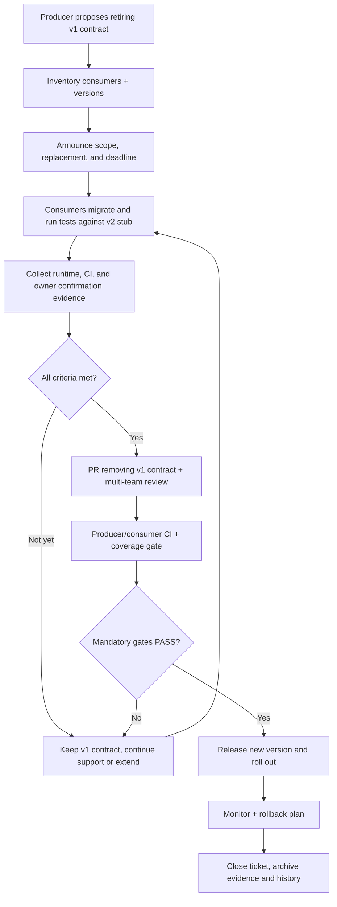
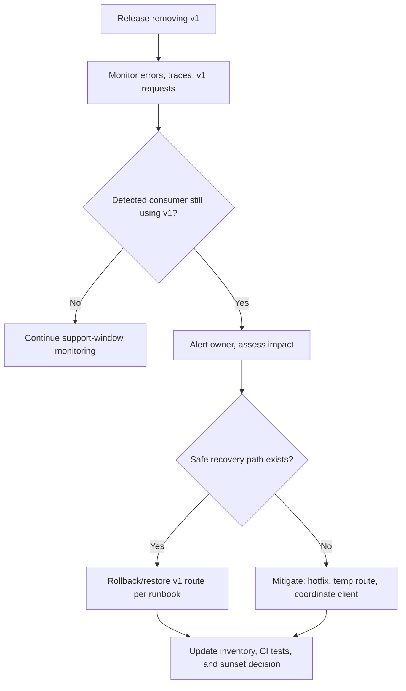
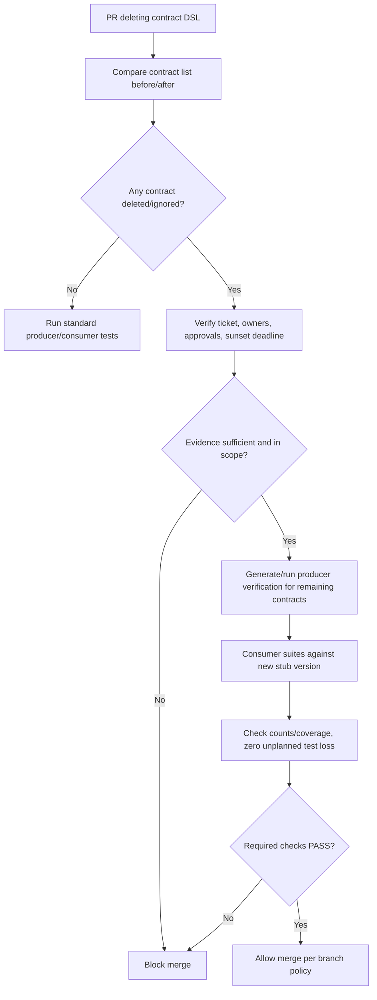

# Retiring Old Contracts with Consumer Confirmation

## 1. Why can't a contract be deleted just because the producer wants to clean up code?

In **Spring Cloud Contract (SCC)**, the **producer** exposes HTTP APIs or emits messages; the **consumer** calls the APIs or consumes the events. Both sides capture expectations in **Groovy/YAML DSL**, generate **producer verification tests**, package a **stub artifact**, and use **Stub Runner** on the consumer side, connecting these steps into **CI** to catch incompatible API changes early.

In a multi-team system, a long-standing contract may look "no longer needed". For example, `payment-service` still has a contract for:

```text
GET /api/v1/payments/{paymentId}
```

while the producer team has already implemented:

```text
GET /api/v2/payments/{paymentId}
```

Perhaps the new `checkout-service` has moved to v2, yet a reconciliation batch job running only at month-end, a consumer deployed in another region, or a partner still calls v1. **Deleting an old contract file without knowing who still uses it can make producer tests look greener precisely because the protective constraint was removed.**

This is a **multi-team coordination problem**, not simply deleting a file.

> **Lesson rule:** Retire an old contract only after identifying its impact scope, obtaining explicit confirmation from remaining relevant consumers, verifying actually deployed versions, providing an adequate transition window, and having CI protect both migration and deletion.

### Learning objectives

After this lesson, you will be able to:

1. Distinguish **deleting a contract**, **stopping support for an API/message behavior**, **stopping stub publication**, and **deleting historical documentation**.
2. Inventory consumers and versions still using a contract.
3. Collect verifiable confirmations from consumer owners, never treating silence as consent.
4. Use SCC producer verification and Stub Runner to prove **consumers have migrated to the replacement contract**.
5. Define acceptance conditions, deprecation/sunset dates, and rollback plans.
6. Design PRs, release notes, and CI gates so deletion does not accidentally strip out critical tests.
7. Handle unresponsive consumers, uncataloged consumers, infrequent batch jobs, mobile clients, or messages still in backlogs.
8. Practice the workflow of retiring a v1 contract with multiple dependent teams.

## 2. Four actions often lumped together as "dropping a contract"

| Action | Actual change | Potential impact |
|---|---|---|
| **Remove contract file from source** | Delete YAML/Groovy from the source read by SCC generator | Producer loses generated tests/mappings protecting that case in the next build |
| **Stop supporting old API/event** | Remove endpoint, field, error response, event type, or route | Older consumer versions may hit real runtime errors |
| **Stop publishing stubs for old case** | New stub artifact no longer contains matching mappings/contracts | Consumer tests pinning the new version cannot simulate old interactions |
| **Delete historical artifacts/docs** | Delete old `-stubs.jar`, old version docs, or release records | Hard to reproduce tests, audit, or support rollbacks/old consumers |

**These four actions do not have to happen simultaneously.** A producer may continue supporting API v1 for migrating teams while announcing no new consumers should adopt v1. A sunset API can still keep historical documentation and immutable published stub JARs for debugging or test reproduction.

In this lesson, **"retiring an old contract"** is a controlled **support-scope change decision**, whose final step may be removing the contract DSL from the active test/stub generation set. It does **not** mean destroying Git history or deleting every published artifact.

### 2.1. A tiny-looking change can destroy fault detection

Suppose `legacy-payment-status.yml` checks that the producer returns `200` and `state: CAPTURED`. If a developer deletes the file and runs:

```bash
./mvnw verify
```

the build can still **PASS**, because no generated test demands the v1 endpoint anymore. That result **does not prove v1 is safe to delete**; it only shows the remaining tests passed.

SCC only protects behaviors **still described and actually tested**. A disappearing test can make a suite faster and greener while reducing protection quality.

### 2.2. "Deprecated" does not mean "safe to delete"

**Deprecated:** notice that behavior will be removed; consumers have time to prepare and usually remain supported for a window.

**Sunset:** the announced date when support ends per policy.

**Removed:** old behavior is no longer guaranteed; the corresponding contract can be withdrawn from the active verification set.

If something is only marked deprecated while still within its support window, or consumers have not finished migrating, **do not delete the contract before the old behavior leaves the support commitment**.

## 3. Running story: who still uses Payment API v1?

Suppose `payment-service` provides two endpoints:

```text
Legacy:
  GET /api/v1/payments/PAY-42
  → {"paymentId":"PAY-42","state":"CAPTURED","legacyCode":"S01"}

Replacement:
  GET /api/v2/payments/PAY-42
  → {"id":"PAY-42","status":"CAPTURED","reasonCode":"SUCCESS"}
```

Known consumers:

| Consumer | Running version (hypothetical) | Behavior used | Cadence |
|---|---|---|---|
| `checkout-service` | `2.8.0` on some instances, `3.1.0` on newer instances | Old calls v1, new calls v2 | Continuous |
| `reconciliation-batch` | `1.6.0` | v1 for transaction reconciliation | Month-end |
| `partner-gateway` | Multiple client versions | May call v1 via gateway | Irregular |
| `reporting-service` | `2.0.0` | Already on v2 | Daily |

Even if the checkout team confirms `3.1.0` uses v2, **you still cannot conclude** v1 is unused. Checkout `2.8.0` may still receive routed traffic, the batch job may not have run during the observation window, and the partner gateway may serve clients outside the company's source control.

**Never substitute "the main consumer upgraded" for "all supported consumers confirmed and verified".**

### 3.1. Three groups of evidence to cross-check

- **Ownership evidence:** which team owns the consumer, who has authority to confirm retirement, and which versions are involved.
- **Technical evidence:** source/client tests migrated, deployment inventory updated to the new version, logs/traces show legacy requests/events stopped over an adequate observation window.
- **Process evidence:** announcements, deadlines, PRs/reviews/tickets, and recorded release/rollback decisions.

No single evidence group suffices alone. A merged PR does not prove code is deployed; zero traffic over one day of telemetry does not prove a monthly batch stopped; an "OK" omitting version/endpoint may only mean agreement on direction.

## 4. Lifecycle: propose -> confirm -> retire



This flow is an **illustrative coordination template**, not a default workflow enforced automatically by Spring Cloud Contract. Each organization's SCM/issue tracker/CI may differ; what matters are **evidence-backed stage transitions**.

### 4.1. Roles and responsibilities

| Role | Primary responsibility | Should not do |
|---|---|---|
| **Producer owner** | Propose, list replacement APIs, assess risks, preserve old API within support window | Delete contracts knowing only producer code |
| **Consumer owner** | Confirm actual needs/versions, migrate clients, provide test/deployment evidence | Reply "done" before deploying |
| **API/platform governance** | Manage support policies, consumer inventory, broad announcements, exceptions | Assume missing telemetry means zero users |
| **CI/release owner** | Run producer verification, consumer matrix, coordinate releases, keep logs/checksums | Bypass failed gates just to hit a deadline |
| **Operations/on-call** | Monitor traffic, routing, errors, rollouts, and rollbacks | Rely solely on PR approval to declare production safe |
| **External partner contact** | Confirm migration plans and support cross-org testing | Treat unanswered emails as consent |

One person may wear multiple hats in a small team, yet responsibilities and evidence must remain distinct.

## 5. Minimum prerequisites before requesting deletion confirmation

Before asking consumers for confirmation, the producer must provide an **evaluable proposal**:

1. **Contract ID and logical location:** contract name, endpoint/event, API version, and protected fields/statuses/headers.
2. **Replacement behavior:** which path/event/fields the new contract uses and how semantics differ.
3. **Current support scope:** list of consumers, versions, environments, batch schedules, partners.
4. **Target timeline:** deprecation notice, end of support, planned removal date.
5. **Testing plan:** which producer tests stay; which consumer tests must switch to the new stub.
6. **Rollback impact:** if reverting an old consumer or rolling back the producer, must API v1 still remain available?
7. **Confirmation criteria:** who must respond, what evidence is required, and how exceptions work.
8. **Halt procedure:** if confirmations are missing or CI fails, do not delete; notify owners to decide on an extension.

Do not simply post "our team is deleting the v1 endpoint soon, speak up if you still use it". Questions lacking deadlines, scope, and versions produce vague, unverifiable replies.

### 5.1. Using a per-consumer contract inventory

With Spring Cloud Contract, contracts can be organized by consumer:

```text
src/test/resources/contracts/
  checkout-service/
    legacy-payment-status.yml
    new-payment-status.yml
  reconciliation-batch/
    legacy-payment-reconcile.yml
  reporting-service/
    new-payment-summary.yml
```

Consumer-named folders make it visible which team relies on which interactions. SCC's **`stubsPerConsumer`** feature also lets Stub Runner filter mappings by consumer name when structured properly.

However, **folder names do not prove real ownership or runtime usage**. External consumers, older shipped versions, or gateway callers may have no contract in the repository. Contract folders should serve as an **inventory starting point**, not the sole approval source for deletion.

### 5.2. Confirmation matrix — a decision tool

| Consumer | Owner identified? | Still using v1? | Code moved to v2? | Deployed? | Tested v2? | Confirmed retirement? |
|---|---|---|---|---|---|---|
| Checkout 2.8/3.1 | Yes | Yes on old version | Yes on new version | Partial | Yes | **Not yet** |
| Reconciliation 1.6 | Yes | Yes | In progress | No | No | **Not yet** |
| Reporting 2.0 | Yes | No per inventory | Yes | Yes | Yes | Yes, needs telemetry cross-check |
| Partner gateway | Incomplete | Unclear | Unclear | Unclear | Unclear | **Not yet** |

This is an **illustrative hypothetical table**. Seeing "Yes" in the "confirmed" column is insufficient while deployment/testing/usage columns remain incomplete. Final decisions should rest on **composite acceptance criteria**, not a single checkbox.

## 6. How specific must consumer confirmation be?

A useful response must explicitly answer:

- **Who confirms?** Team/owner name, accountable person, and channel/ticket.
- **What is confirmed?** Contract ID, exact API/event, including error branches/headers/fields if relevant.
- **Which consumer versions?** Live versions, supported versions, batch/partner versions.
- **What replaced it?** v2 API path, new event type, or flow removing the old need.
- **When was code deployed?** Commit/release/deployment references.
- **Which tests passed?** Consumer tests against the exact stub version and integration tests if needed.
- **Any rollback risk?** Could a rollback revert to a version calling v1 after the removal date?
- **Which milestone is approved?** The date/version from which the producer may stop guarding and remove the old API.

**Never treat silence, emoji reactions, a viewed PR, or "we don't think anyone uses it" as explicit approval.**

### 6.1. Written confirmation template example

```text
CONTRACT RETIREMENT CONFIRMATION

Producer: payment-service
Legacy contract: GET /api/v1/payments/{id}
Replacement contract: GET /api/v2/payments/{id}
Consumer: checkout-service
Owner: Checkout team

Active versions:
- checkout 3.1.0+ uses v2.
- checkout 2.8.0 has been decommissioned from all supported
  environments; no rollback to 2.8.0 is scheduled.

Evidence:
- Consumer tests with payment-service:1.5.0:stubs: PASS
- Deployment reference: <internal-change-id>
- Observed v1 traffic over appropriate window: zero requests
  from checkout-service (verified via route/metrics).

Approval:
- Checkout team no longer requires the v1 contract after the
  agreed sunset date.
- Approver and date: <name/date>
```

Values in this template are **placeholders**, not real evidence. Another team like Reconciliation must provide **its own confirmation**; Checkout's email cannot speak for all consumers.

### 6.2. Evidence depth proportional to impact

| Change | Recommended evidence |
|---|---|
| Clean up strictly duplicate contract, behavior unchanged | Contract equivalence review + generated test/mapping diff |
| Drop field used by a single consumer | Owner confirmation + client tests + producer tests for remainder |
| Remove public v1 endpoint | Consumer inventory, deprecation window, partners, deployment telemetry, release review |
| Stop emitting old event | Owner confirmations, broker backlog/replay, consumer migration, integration tests |
| Remove payment transaction behavior | Owner sign-off, semantics/idempotency, stricter rollout/rollback & observability |

Avoid turning trivial cleanups into heavy bureaucracy, yet never lower standards for APIs impacting payments, data integrity, or consistency.

## 7. PR review confirmation is not deployment evidence

A consumer owner may approve a PR switching their client to v2. That proves **source code was reviewed**, but does not prove:

- The new version is deployed across all supported regions/environments.
- Scheduled jobs run the new binary.
- Autoscaling or rollbacks cannot spin up an older version.
- Mobile/external clients have received the update.
- Gateway/caches are no longer routing old paths.

Therefore, separate:

1. **Code approval:** migration prepared cleanly in code.
2. **Test approval:** consumer/integration tests pass against the right artifact.
3. **Operational confirmation:** all serving versions migrated and stopped needing the old contract.
4. **Sunset approval:** relevant owners confirm the producer may end support after the published deadline.

Systems with release trains or external partner SLAs must wait out the **support window** even when new code is ready.

### 7.1. What if a team has not responded?

Never flip `UNKNOWN` to `APPROVED` automatically upon timeout. Instead:

- Resend the request with concrete scope, version, and deadline.
- Identify the escalation owner or management contact if the consumer is unmaintained.
- Check ownership via repositories, service catalogs, deployment records, and authorized telemetry.
- Assess risk if unconfirmed; continue maintaining the contract or obtain an **authorized policy exception**.
- Document the decision and risk acceptance explicitly if the organization chooses to sunset an unmanaged consumer.

**Never turn silence into implicit approval.** If an organization exercises contractual sunset authority, record it as an **explicit governance decision**, not "consumer confirmed".


## 8. v1 and v2 contracts in Spring Cloud Contract

To see the impact clearly, consider two HTTP contracts simultaneously supported by `payment-service` during migration.

### 8.1. Old contract that must continue to be protected

Illustrative file `contracts/checkout-service/legacy-payment-status.yml`:

```yaml
name: legacy_payment_status_for_checkout
description: "Legacy Checkout looks up payment status via API v1"
request:
  method: GET
  url: /api/v1/payments/PAY-42
  headers:
    Accept: application/json
response:
  status: 200
  headers:
    Content-Type: application/json
  body:
    paymentId: "PAY-42"
    state: "CAPTURED"
    legacyCode: "S01"
```

It protects the exact HTTP path, status, content type, and three response fields. While `checkout-service 2.8.0` still calls `/api/v1`, **do not delete the contract** just because the producer already exposes v2.

### 8.2. Replacement contract

File `contracts/checkout-service/payment-status-v2.yml`:

```yaml
name: payment_status_v2_for_checkout
description: "New Checkout looks up payment status via API v2"
request:
  method: GET
  url: /api/v2/payments/PAY-42
  headers:
    Accept: application/json
response:
  status: 200
  headers:
    Content-Type: application/json
  body:
    id: "PAY-42"
    status: "CAPTURED"
    reasonCode: "SUCCESS"
```

These two YAML files illustrate **two separate files**, not mandatory paths for every Maven/Gradle project. SCC resolves contract locations per the producer's plugin/version configuration; e.g., Maven defaults to `src/test/resources/contracts`, while Gradle has its own convention. Never guess that the plugin scans the right folder from sample path lists alone.

### 8.3. Coexistence during migration

During transition:

- Producer P2 must answer properly for **both v1 and v2** while both remain supported.
- Generated producer tests must include cases for both and **actually execute**.
- P2's stub artifact can contain mappings for both when packaged properly.
- Consumer C1 uses Stub Runner to test the old client; C2 tests the new client.
- API v1 is removed only after dependent parties confirm and sunset criteria are satisfied.

**Pitfall to avoid:** if while introducing v2 the team alters the type of `legacyCode` in v1, old consumers can break even if the v2 file is spotless. That is why the v1 contract retains protective value throughout parallel support.

### 8.4. Groovy DSL does not change coordination rules

Illustrative Groovy equivalent for the same legacy API:

```groovy
import org.springframework.cloud.contract.spec.Contract

Contract.make {
    name('legacy_payment_status_for_checkout')
    description('Legacy Checkout looks up payment via API v1')
    request {
        method GET()
        url '/api/v1/payments/PAY-42'
        headers { accept(applicationJson()) }
    }
    response {
        status OK()
        headers { contentType(applicationJson()) }
        body(
            paymentId: 'PAY-42',
            state: 'CAPTURED',
            legacyCode: 'S01'
        )
    }
}
```

Removing a YAML or Groovy file ultimately means **removing a source of generated verification**. Do not switch from Groovy to YAML and mistake removing the old file for "retiring the contract"; if behavior stays in support, ensure equivalent new tests exist before cleaning up the old file.

## 9. Use `stubsPerConsumer` to trace needs, not as the whole truth

SCC supports **stubs per consumer**, letting contracts be grouped by consumer name so Stub Runner loads only matching mappings. Example:

```text
contracts/
  checkout-service/
    legacy-payment-status.yml
    payment-status-v2.yml
  reconciliation-batch/
    legacy-payment-reconcile.yml
  reporting-service/
    payment-summary-v2.yml
```

On the consumer side:

```java
@SpringBootTest
@AutoConfigureStubRunner(
    ids = "com.acme.billing:payment-service:1.5.0:stubs",
    stubsMode = StubRunnerProperties.StubsMode.REMOTE,
    repositoryRoot = "https://repo.example.org/repository/maven-releases/",
    stubsPerConsumer = true,
    consumerName = "checkout-service"
)
class CheckoutPaymentContractTest {
    // Call CheckoutService and the consumer's real HTTP client.
}
```

This example depends on appropriate JUnit/Spring test dependencies/config and a **properly laid-out stub artifact**. `consumerName` is not the consumer version; it selects the stub subset for that consumer name via SCC's filtering mechanism.

**Benefits when evaluating deletion:**

1. The producer sees which contracts belong to Checkout, Reconciliation, and Reporting.
2. Teams can re-run consumer-specific tests against new artifacts.
3. PRs clearly show which folders changed and which reviewers own them.
4. Mappings from unrelated consumers are filtered out during one group's test run, reducing collisions.

**Limitation:** it is a **test-organization convention**, not a complete runtime consumer discovery system. An unowned contract in a folder, or an older consumer outside CI, can still generate real traffic. Always cross-check deletion decisions with inventories, deployments, and telemetry.

### 9.1. Do not equate "no failing tests" with "no users"

SCC documentation notes that organizing contracts per consumer helps reveal where fields are used; if deleting a field breaks no generated tests, removal might be considered. That conclusion is only reliable when:

- The consumer list is **complete across the support window**.
- Existing contracts accurately reflect **live fields/flows in use**.
- Generated tests actually execute on the new producer build.
- Older supported consumer versions are also evaluated.
- No partners or runtime callers sit outside contract management.

Without these conditions, **zero red tests only means missing evidence**, not approval to delete. For this lesson's topic, **consumer owner confirmation** remains mandatory.

## 10. Test evidence before and after migration

An old-contract retirement plan should distinguish **pre-migration**, **post-migration**, and **post-removal**.

| Stage | Producer verification | Consumer Stub Runner | Runtime evidence |
|---|---|---|---|
| Pre-migration | **V1 + V2** if v2 exists | C1/v1 still runs; C2/v2 experimental | v1 traffic present |
| Migrating | Keep **v1 + v2** | Test C1/v1 and C2/v2 per version | v1 traffic declining; old instances still exist |
| After consumer confirmations | Keep v1 until approved sunset; v2 must PASS | Supported consumers pass on v2 | Zero v1 traffic over sufficient window |
| v1 removal PR | Verify **v2 contracts still generate and run** | Consumer suites with new stub version PASS | Clear rollback and monitoring plan |
| After release dropping v1 | No v1 commitment in new build | Do not require new build to serve v1 | Zero errors from supported consumers |

**Note:** PASS in the table represents **required gates to satisfy**, not executions performed inside this lesson. Removing v1 can affect older producer instances still serving v1 during a rolling deploy; support windows, routing, and release policies must govern the overlap phase.

### 10.1. Producer verification before deletion

Before the deletion PR, run the current contract suite:

```bash
# Example Maven producer using Spring Cloud Contract plugin
./mvnw clean verify
```

Or Gradle producer:

```bash
./gradlew clean contractTest
```

These commands are **guidance**, not executed during authoring. Task/phase names and contract paths must match your plugin version.

Record:

- Source contract count and generated test count before deletion.
- Which tests guard v1 vs. v2.
- Tested producer build/commit/version.
- Evidence fixtures and assertions actually executed, not `0 tests`.

### 10.2. Consumer uses Stub Runner with an explicit artifact version

Example after the producer prepares `1.6.0` supporting v2:

```java
@SpringBootTest
@AutoConfigureStubRunner(
    ids = "com.acme.billing:payment-service:1.6.0:stubs",
    stubsMode = StubRunnerProperties.StubsMode.REMOTE,
    repositoryRoot = "https://repo.example.org/repository/maven-releases/"
)
class CheckoutConsumerContractTest {
    @Autowired CheckoutService checkout;

    @Test
    void checkoutUsesPaymentV2() {
        CheckoutDecision result = checkout.evaluate("PAY-42");
        assertEquals("READY", result.reason());
    }
}
```

This example is meaningful only if **CheckoutService and its HTTP client actually call the v2 endpoint on the stub URL**. Configure the URL/port via `@StubRunnerPort` or `StubFinder` (or appropriate discovery integration). If the test mocks `PaymentHttpClient` or hits the production producer URL, it **does not prove the client migrated to stub v2**.

Pin the **Stub Runner ID version** for release gates. `+:stubs` can resolve the newest snapshot at runtime and produce non-reproducible results; reserve it for dedicated monitoring jobs if needed, logging the exact resolved version.

### 10.3. Deliberately break it to expose false greens

In an isolated branch/test environment, run a controlled **negative check**:

1. Point the consumer test base URL to a non-existent stub address.
2. Or change the v2 path to an invalid path.
3. Or alter a required body field in a separate test stub.
4. Run consumer integration tests.

If tests **stay green**, the HTTP client may be mocked, a cache returned stale data, assertions are too weak, or the test bypassed the contract path. Never run destructive checks on production infrastructure.

## 11. Count contracts and generated tests before/after to stay in control

A PR removing 3 contracts should state **which 3 constraint sources disappear** and how generated tests/stub mappings change.

**Difference report template**:

```text
Before PR:
  active HTTP contracts: 18
  active v1 contracts: 3
  generated producer tests: 18 (example)
  v2 consumer test scenarios: 5

After PR:
  active HTTP contracts: 15
  active v1 contracts: 0
  generated producer tests: 15 (example)
  v2 consumer test scenarios: 5

Explanation:
  3 v1 contracts removed per approved retirement ticket RET-42.
  Consumer confirmations listed in PR.
  V2 contracts and test cases untouched.
```

Counts are **illustrative assumptions**, not a rule that one contract always yields one test; plugins may generate more or fewer tests depending on DSL/config. Use actual counts from your project's build.

### 11.1. Gate against unplanned coverage loss

A CI/PR policy may enforce:

- Every diff **removing or marking `ignored`** a contract must link to an approved retirement ticket.
- Consumer owner confirmations matching scope are attached.
- Compare contract names/paths before and after, not just total file count.
- Generated producer tests still **execute**, with no zero-test discovery.
- Consumer v2 suites must PASS against the exact new artifact.
- If contracts drop outside the approved retirement list, block the PR.

**SCC does not enforce this multi-team review rule automatically.** It requires SCM branch protection, CI scripts, or organizational governance. Do not assume a single plugin setting proves every consumer agreed to deletion.

### 11.2. "No contracts found" is not silent success

Deleting the last contract or misconfiguring the source directory can leave a build with zero generated verification tests. Spring Cloud Contract provides settings controlling missing contracts/stubs; preserve **fail when expected contracts are absent** appropriate to your plugin/version.

Do not flip `failOnNoContracts` or `failOnNoStubs` to `false` just to make CI green after deletion, unless that module **truly stops using SCC** and the change is approved. Removing SCC from a module is a **separate build-policy change** requiring review and explicit scope.

## 12. Avoid misusing `ignored` and `inProgress` for "soft deletion"

SCC supports top-level flags such as `ignored: true` and `inProgress: true` in YAML DSL (with Groovy equivalents). However, these are **not confirmation states that consumers stopped using an interface**.

### 12.1. `ignored` is not a policy deprecation command

Example:

```yaml
name: legacy_payment_status
ignored: true
request:
  method: GET
  url: /api/v1/payments/PAY-42
response:
  status: 200
```

Marking `ignored` instructs the **generator to skip the contract per SCC/version semantics**—it does not notify consumers that the API will end, nor prove the contract was replaced.

If the contract guards legacy consumers, adding `ignored: true` strips test coverage **before consumers finish migrating**. Apply it only for an approved temporary technical reason with a resolution deadline; never use it to "silence red tests" for breaking changes.

### 12.2. `inProgress` is for contracts not yet verified by the producer

```yaml
name: payment_status_v3_in_development
inProgress: true
request:
  method: GET
  url: /api/v3/payments/PAY-42
response:
  status: 200
```

SCC docs describe in-progress contracts as **generating stubs without generating corresponding producer verification tests**; `failOnInProgress` blocks releases per configuration, typically defaulting to `true`.

Therefore, **never mark a production v1 contract as `inProgress`** just to stop producer tests from failing. That distorts technical semantics and can produce false compatibility results rather than communicating deprecation.

### 12.3. Adding comments/tickets does not replace migration

You can track deprecation status in docs or issue trackers, yet while v1 stays supported, the contract must continue protecting behavior. Adding a `TODO remove` comment does not alter producer accountability.

## 13. Should deleting contracts and removing endpoints be two PRs or one?

Three common strategies:

### A. Separate PRs — easiest to review and trace

1. **Migration PR:** add v2, keep v1, producer + consumer tests pass.
2. **Deprecation/docs PR:** announce sunset, update inventory, preserve v1 behavior.
3. **Retirement PR:** after confirmations and deadline, remove v1 contract and v1 code/route in approved order, verifying zero dependencies.

This is usually easiest to control across multiple teams.

### B. Single retirement PR after teams migrated

If v1 has left its support window and all evidence is assembled, removing the contract and endpoint can share one scoped PR—provided **approvals precede breaking changes**, remaining test coverage passes, and rollback is evaluated.

### C. Remove contract while keeping endpoint temporarily (transition)

In some organizations, the contract commitment ends while the endpoint stays up temporarily for observation or rollout prep. When doing so:

- Documentation must state API v1 **is no longer guaranteed** in new builds.
- Do not cite green producer contract tests as proof v1 works.
- If real consumers still call it, consider keeping the contract longer instead of creating silent risk.
- Never let an existing endpoint imply consumers may rely on v1 forever.

Choosing A, B, or C should reflect **support contracts and real risk**. No SCC rule mandates a specific PR count.

## 14. Sunset notices and policies suited for multiple consumers

A retirement notice should include at least:

| Field | Example content |
|---|---|
| **Producer/API** | `payment-service /api/v1/payments/{id}` |
| **Contract IDs** | `legacy_payment_status_for_checkout`, `legacy_payment_reconcile` |
| **Purpose** | Consolidate support onto API v2 |
| **Breaking scope** | Remove v1 path; v2 renames `paymentId` -> `id` and `state` -> `status` |
| **Replacement** | `GET /api/v2/payments/{id}` and corresponding error contracts |
| **Consumer owners** | Checkout, Reconciliation, partner contact |
| **Migration guide** | Client configuration, DTO/status mapping, and stub testing |
| **Parallel support period** | Duration matching SLAs and batch schedules |
| **Proposed sunset date** | Absolute timestamp with timezone and adjustment rules |
| **Confirmation required** | Owner sign-off with version/CI/deployment evidence |
| **Risks/rollback** | May need to restore v1 route; preserve artifact/feature flag |
| **Contacts** | Producer team / accountable point of contact |

**Do not treat example deadlines as a universal SCC rule.** Support windows depend on SLAs, external clients, batch cadences, and organizational policy. For a monthly batch, observing less than one batch cycle cannot prove usage stopped.

### 14.1. Use deprecation headers when helpful, but do not rely on them alone

For HTTP APIs, teams can emit standard headers like `Deprecation` or `Sunset` **per protocol version and policy** alongside migration docs. Still, some clients never log or inspect headers or run older libraries. A deprecation header is a **supplementary notification channel**, never a consumer sign-off.

### 14.2. External consumers

For mobile apps and external partners:

- You cannot reliably force-upgrade every old client binary.
- You do not always have access to consumer repos/CI to run Stub Runner.
- Telemetry may show only a gateway ID, not the binary version.
- Commercial contracts/SLAs may specify minimum support periods.

In such cases, retirement requires **API owner, partner manager, and governance** participation. Never use "all internal teams approved" alone to delete a public API.

## 15. Rollback plan must be decided before the deletion PR

Once the v1 contract and endpoint are removed, rolling back the producer may be simple, yet **rolling back the new consumer to an older version** still needs v1. Conversely, if v2 wrote data in a new schema, the old producer might not read it.

Before deleting, answer:

1. **Producer rollback:** Can a v1-capable binary be redeployed? Are artifacts, DB/schemas, and configs still compatible?
2. **Consumer rollback:** Might ops revert to C1 calling v1, or is C1 permanently retired?
3. **Routing:** Is there a gateway/feature flag to temporarily restore `/v1` without breaking v2?
4. **Database:** Do migrations support mixed-version code and rollback?
5. **Messaging:** Are there old consumers/events needing replay post-rollout?
6. **Response time:** Which metrics quickly expose new errors, and who decides rollback?



**Do not delete historical stub JARs and contracts just to keep repos "clean"**: historical assets reproduce regressions and enable rollbacks. For Maven repositories, favor immutable release artifacts; if deletion is mandated by other rules, treat it as a separate decision with explicit scope/backups.


## 16. With messaging, "zero consumers" is even harder to prove than HTTP

For messaging, a contract may specify a producer emitting `PaymentCaptured` with `outputMessage.sentTo`, headers, and body. Consumers might not receive events immediately due to **queue backlogs, retention, replays, or batch schedules**.

Example legacy messaging contract:

```yaml
description: "Payment v1 event for reconciliation system"
label: payment_captured_legacy
input:
  triggeredBy: emitLegacyPaymentCaptured()
outputMessage:
  sentTo: payments.events.v1
  headers:
    eventType: PAYMENT_CAPTURED_V1
    contentType: application/json
  body:
    paymentId: "PAY-42"
    amount: 150000
    currency: "VND"
    legacyCode: "S01"
```

Producer wants to switch to event v2:

```yaml
description: "Payment v2 event"
label: payment_captured_v2
input:
  triggeredBy: emitPaymentCapturedV2()
outputMessage:
  sentTo: payments.events.v2
  headers:
    eventType: PAYMENT_CAPTURED_V2
    contentType: application/json
  body:
    paymentId: "PAY-42"
    amount: 150000
    currency: "VND"
    reasonCode: "SUCCESS"
```

These are **two illustrative contracts for two logical destinations**; SCC does not automatically create topics, queues, or exchanges or guarantee broker routing.

### 16.1. Consumers must verify both code and retained data

Before stopping v1 emission:

- Have all consumer handlers subscribed to `payments.events.v1` upgraded or terminated?
- Are v1 events still retained in Kafka topics or RabbitMQ queues for replay?
- Do new consumers still need to read data **emitted earlier by producer P1**?
- Do reprocessing/backfill or dead-letter replay jobs rely on v1 payloads?
- Does a message schema registry enforce versions/compatibility policies to keep?
- Does dual publishing v1/v2 risk duplicate side effects in consumers?
- Could broker ACLs, retries, DLQs, or retention hide a still-active subscription from metrics?

**Never infer from zero v1 production traffic that v1 events no longer exist or will never be re-read.**

### 16.2. Test suite for message retirement

| Test level | What to verify |
|---|---|
| SCC producer message contracts | Producer emits v1 properly during support window; v2 matches schema/headers/destination |
| Consumer Stub Runner / message adapter | New consumer processes simulated v2 event |
| Consumer replay test | Can the new consumer still read retained v1 events? |
| Broker integration test | Topics/queues/bindings, keys/partitions, ack/retry/DLQ work during migration |
| Idempotency test | Dual publishing or replay produces zero duplicate side effects |
| Operational readiness | Backlogs, consumer group lag, dead-letter queues, and retention verified |

If stopping v1 emission while historical events still require processing, **you may retire the v1 producer emission contract once criteria pass** while **keeping v1 consumer deserialization/replay tests**. Do not bundle both into deleting every v1 definition.

## 17. Batch jobs, offline clients, and external consumers

An API may receive zero calls for **days** and then get invoked at reporting period close. Counting requests over too short a window leads to false conclusions.

### 17.1. Infrequently scheduled consumers

For example, `reconciliation-batch 1.6.0` runs on month-end:

- Observing 7 days of traffic with zero v1 requests cannot confirm the batch stopped using v1.
- If source code migrated yet the scheduler still points to the old container image, inspect deployment/scheduler state.
- If the batch has annual retry or backfill paths, evaluate those execution paths.
- v2 tests need sample data and error branches matching **reconciliation**, not only Checkout's happy-path contract.

The observation window should cover **at least the relevant usage cycles and committed support duration**; no single day count fits every system.

### 17.2. Mobile and partners cannot be force-upgraded together

For clients outside your deployment control:

- Publish **deprecation and sunset schedules** per support agreements.
- Provide test environments, such as WireMock stubs or a v2 sandbox, plus migration docs.
- Maintain a support contact to collect version/plan confirmations.
- Track usage by client ID/token/tenant where **permitted and compliant with data policy**.
- Consider keeping a compatibility layer at the gateway or older API version if consumers cannot upgrade immediately.
- If sunsetting contractually anyway, record the **governance decision and accepted risk**, never calling it "all consumers confirmed".

An older mobile client can run offline and send requests after reconnecting. That is a real rollout risk that deleting YAML quickly will not solve.

## 18. A retirement PR template for multi-team review

A contract-deletion pull request needs a **self-contained** description. Template:

```markdown
# Retire payment API v1 contracts — RET-42

## Proposed changes
- Remove contract: legacy_payment_status_for_checkout
- Remove contract: legacy_payment_reconcile
- Producer: payment-service
- Replacement: GET /api/v2/payments/{id}

## Why can support end?
- Checkout owner: <confirmation link + deployed version>
- Reconciliation owner: <confirmation link + batch cycle>
- Partner owner/governance: <confirmation link or sunset decision>
- Runtime evidence: <dashboard + observation window>
- Support window ended: <date/time and timezone>

## Test evidence
- Producer v2 verification report: <CI link>
- Checkout code tests with P2 stub version: <CI link>
- Reconciliation code tests with P2 stub version: <CI link>
- Coverage diff: <before/after, contract names>
- Artifact/version/checksum: <release reference>

## Release plan
- Canary/rollout: <description>
- Monitoring: <dashboard + alerts>
- Rollback: <runbook + owner>
- v1 removal milestone: <approved date>

## Required reviewers
- Producer owner
- Each remaining relevant consumer owner
- API/platform governance if changing external/public APIs

## Blocking conditions
- Missing confirmation, old client still in support window,
  insufficient telemetry, or failing CI → DO NOT MERGE/RELEASE.
```

All `<...>` are template placeholders, **not existing proof**. On repositories supporting CODEOWNERS/required reviewers, use rules to request the right teams; yet **CODEOWNERS does not automatically know all runtime consumers** and does not replace usage investigation.

### 18.1. Separate mandatory approvers from informed stakeholders

- **Mandatory approvers:** impacted parties authorized to confirm end of usage, plus producer/API owners.
- **Technical reviewers:** reviewers evaluating generated tests, migration compatibility, and release strategy.
- **Informed stakeholders:** support, operations, product/partner teams as needed.
- **Exception decision maker:** authorized governance owner when a consumer does not respond yet the support agreement permits sunsetting.

Never list everyone CC'd on an announcement as having approved.

## 19. Designing a CI gate for contract-deletion pull requests

**Spring Cloud Contract verifies contracts still included in the build; it does not manage consumer sign-off workflows.** Therefore, alongside generated tests, CI/branch protection needs a gate inspecting **removed contracts**.

### 19.1. Recommended verification flow



This is **organization-implemented policy logic**, not a built-in SCC task named `retireContract`.

### 19.2. Example consumer test config with strict stub resolution

```yaml
spring:
  cloud:
    contract:
      stubrunner:
        stubs-mode: REMOTE
        repository-root: "https://repo.example.org/repository/maven-releases/"
        ids:
          - "com.acme.billing:payment-service:1.6.0:stubs"
        fail-on-no-stubs: true
```

When a suite **requires stubs**, never set `fail-on-no-stubs: false` to excuse deleted mappings. Per SCC docs, Stub Runner normally fails when no stubs are found; keep that check as a safeguard.

**However:** `fail-on-no-stubs` only reports whether the stub bundle loaded; **it does not prove a specific v1 or v2 mapping exists** if the artifact contains many other mappings. Thus you still need scenario-specific consumer tests/assertions and inspection of mapping/contract lists.

### 19.3. Verification gate pseudocode example

```text
deletedContracts = diffContracts(baseRevision, currentRevision)

if deletedContracts is not empty:
    requireApprovedRetirementTicket(deletedContracts)
    requireConsumerOwnerConfirmations(deletedContracts)
    requireSupportWindowElapsed(deletedContracts)
    requireDeploymentAndUsageEvidence(deletedContracts)
    requireRollbackPlan(deletedContracts)

runProducerContractTests()
assertExpectedContractCoverage()
runRequiredConsumerMatrixWithPinnedStubs()

if any required gate failed or not executed:
    blockMergeOrRelease()
```

This pseudocode **is not an SCC/SCM API** and will not run if pasted into a build file. It illustrates how an internal script or workflow can coordinate **Git diff + issue tracker + code reviews + CI test reports**.

Never treat a PR comment like `APPROVED=true` as real evidence without authenticating the approver, scope, and version. Enterprise systems need proper permissions/branch rules so nobody can self-mark approval.

### 19.4. Never publish stubs not yet verified by the producer

If a new v2 contract is created with `inProgress: true`, SCC can generate stubs before the producer implementation satisfies them; convenient for consumer development, yet **insufficient for a release gate**. Before allowing v1 deletion, producer v2 must have generated tests actually executing and PASSING, or an **explicitly documented exception decision with specific risks**.

A sound workflow links **producer source commit, contract revision, stub artifact version, and consumer test reports**. Consumer tests using `1.5.0` do not protect release `1.6.0` if the API changed in the new version.

## 20. Example three-team coordination timeline

Below is a **hypothetical timeline** for learning gate placement, not a specific company's schedule.

| Milestone | Producer | Checkout | Reconciliation/Partner | Decision |
|---|---|---|---|---|
| **T0 – propose** | Announce intent to retire v1 | Confirm C1 still exists | Report batch/partner schedule | Keep supporting v1 |
| **T1 – expand** | Both v1 + v2 with contract tests | C2 integrates v2 | Start migration | Do not delete v1 |
| **T2 – transition** | Supply pinned v2 stubs | Deploy C2, remove C1 | Run v2 batch and inspect results | Collect evidence |
| **T3 – confirm** | Check inventory/telemetry | Owner signs off | Owner signs off; partner handled per SLA | Assess eligibility |
| **T4 – retirement PR** | Remove v1 contract/route per plan | Test C2 with new artifact | Test batch v2, verify zero v1 | Merge once all gates PASS |
| **T5 – rollout** | Canary/monitor/rollback ready | Monitor HTTP errors | Monitor batch/events | Close ticket or trigger rollback |

**Never assume T2 -> T3 takes 24 hours.** For month-end jobs, mobile partners, or Kafka replays, the window can be much longer. Real milestones depend on inventory, SLAs, and risk.

### 20.1. A case blocked despite finished code

Checkout C2 deployed and producer P2 tests passed, yet Reconciliation 1.6 is still scheduled monthly without a v2 release yet. At T3, Checkout confirmed, Reconciliation has not.

**Right decision:** do not delete reconciliation's v1 contract or remove the v1 endpoint while the batch remains supported. You may release v2 capabilities and maintain dual support, decoupling finished features from retiring the old API.

### 20.2. A case requiring an exception decision

Partner A never replied after repeated outreach. The service agreement specifies an explicit v1 end-of-support date that has passed, and API management holds authority to sunset per policy. Record an **exception/decision record and remaining risks**, but **do not write "Partner A confirmed"** when they never confirmed.

Distinguishing **authority to end support** from **confirmation received from users** is an honesty requirement in multi-team coordination.

## 21. Table of common coordination mistakes

| Mistake | Consequence | Fix |
|---|---|---|
| Deleting contract because no commit touched the file for months | Consumers still use old behavior | Consumer inventory and live usage checks |
| Producer owner self-approves deleting another consumer's contract | Lacks authoritative confirmation | Require consumer owner approval |
| Checking only the latest deployment | Old/rolled-back instances still use v1 | Inventory all active versions |
| Observing traffic for only one day | Misses periodic batches and offline mobile clients | Observe across matching usage cycles |
| Treating silence as consent | Overlooks critical consumers | Escalation/exception governance, no fake confirmation |
| Marking red test `ignored: true` | Loses producer verification | Keep tests until retirement is approved |
| Marking old API `inProgress: true` | Generates stubs without verifying producer | Never use in-progress as a deprecation flag |
| Deleting old contract before replacement contract exists | New consumers lack test baselines | Expand v2, run tests, then migrate |
| Checking only green producer tests after deletion | Shrinking test count creates false green | Coverage diffs and required scenario lists |
| Consumer test uses `+` without recording resolved version | Unclear which bundle was tested | Pin versions for releases |
| Setting `failOnNoStubs=false` when stubs are required | CI passes despite missing artifact | Fail on missing stubs and assert required mappings |
| Deleting old stub JAR versions from repository | Breaks test reproduction and rollback | Retain historical artifacts per retention policy |
| Stopping old event emission immediately on new code deploy | Consumer replays/backlogs fail | Check broker lag, retention, and schemas |
| Confirming only `200` happy path | Legacy error contracts still called | Test `404/409`, headers, and error bodies |
| Consumer code merged but not deployed | Runtime still calls v1 | Collect deployment evidence |
| One region migrated while another remains on C1 | Rolling traffic causes failures | Check all supported regions/shards |
| Removing API v1 and old DB column together immediately | Breaks producer/consumer rollbacks | Expand–migrate–contract for both DB and API |
| PR requires a single CODEOWNERS approval | Misses other consumers | Align owner inventory and branch policies |
| Looking only at `BUILD SUCCESS` without test counts | Generated tests may not have run | Check test reports and zero-test guards |
| Announcing "v1 deprecated" without a deadline | Consumers have no clear timeline | Publish sunset date, migration guide, escalation |


## 22. Hands-on exercise: retiring Payment API v1 with an unconfirmed consumer

### 22.1. Context

A team wants to remove YAML contracts for:

```text
GET /api/v1/payments/{id}
```

and keep only:

```text
GET /api/v2/payments/{id}
```

Producer is `payment-service 1.6.0`. Current consumers:

| Consumer | Version / schedule | Migration status |
|---|---|---|
| `checkout-service` | `3.1.0` deployed; `2.8.0` rollback possible | Switched to v2, owner confirmed code merged |
| `reconciliation-batch` | `1.6.0` runs at month-end | `2.0.0` coded, has not run a batch cycle yet |
| `reporting-service` | `2.0.0` | Already on v2, CI passing |
| `partner-gateway` | Heterogeneous client versions | Full consumer list unclear; no response yet |

The producer team created `payment-status-v2.yml`, ran generated tests for v2, and wants to delete `legacy-payment-status.yml` immediately. **You are coordinating the contract change across teams.**

### 22.2. Tasks

1. Explain why **v1 is not yet eligible for deletion**, even though producer v2 tests pass.
2. List the parties required to confirm and the minimum evidence each must provide.
3. Draft a confirmation request with contract IDs, replacement, deadline, and migration instructions.
4. Design the **consumer versions x stub artifact matrix** to run before the deletion PR.
5. Identify which checks can use SCC and which require telemetry/deployment/broker tools outside SCC.
6. Describe how to guard **generated test counts / contract diffs** against unplanned coverage loss.
7. Decide the action while `reconciliation-batch 2.0.0` has not yet completed a real cycle.
8. Decide the action while `partner-gateway` has not responded and its support agreement has not expired.
9. Propose rollout, rollback, and ticket-closing criteria for retirement.
10. Explain why you **must not** put `ignored: true` or `inProgress: true` on v1 to make CI green.

### 22.3. Short confirmation request template

```text
Subject: Confirmation to retire Payment API v1 — RET-42

The Payment team plans to retire contracts for
GET /api/v1/payments/{id}; the replacement API is
GET /api/v2/payments/{id}.

Please explicitly confirm:
1. Your consumer/service and all still-supported versions.
2. Whether any v1 request/error cases are still used.
3. Versions and environments already migrated to v2.
4. CI test links using payment-service:<version>:stubs.
5. Any batch/partner/backfill/rollback schedules needing v1.
6. Approval of the proposed sunset date, or reasons if blocked.

No response will not be treated as approval.
If migration is incomplete, propose a target date or risks to address.

Contact: Payment Team / API Owner.
```

`<version>` is a placeholder. In a real process, include ticket links and concrete timestamps rather than copying the template verbatim.

### 22.4. Suggested confirmation matrix

| Consumer | Criteria to confirm | Current state per prompt | Decision |
|---|---|---|---|
| Checkout | No C1 left in support window or rollback controlled; C2 passes with P2 stub | Only C2 merged/deployed, C1 rollback still possible | **Not met** |
| Reconciliation | Batch v2 runs/tests all scenarios; no v1 scheduler or v1 backfill left | New batch cycle not yet run | **Not met** |
| Reporting | Owner confirms zero v1 usage, v2 tests and deployment evidence | Passing v2 tests; confirm scope/telemetry | **Needs verification** |
| Partner | Client inventory + confirmation, or transparent contractual sunset applied | No response, support still active | **Not met** |

Conclusion at this point: **do not delete the v1 contract or v1 behavior yet**. Proceed with releasing v2 and parallel support while completing migration and confirmations.

### 22.5. Consumer test matrix to prepare

Suppose producer release candidate `1.6.0` serves both v1 and v2; include at least:

```text
checkout 2.8.0   × payment 1.5.x stub  → v1 baseline
checkout 2.8.0   × payment 1.6.0 stub  → backward compatibility during rollout
checkout 3.1.0   × payment 1.6.0 stub  → v2 behavior
reconciliation 1.6.0 × payment 1.6.0 stub → v1 branch while supported
reconciliation 2.0.0 × payment 1.6.0 stub → v2 behavior
reporting 2.0.0 × payment 1.6.0 stub → v2 behavior
```

**This is a matrix to test, not PASS results.** Any pair proven impossible by routing/deprecation policy may be marked `UNSUPPORTED` with rationale and owner sign-off.

### 22.6. Suggested answer: conditions to open the final deletion PR

A retirement PR may be proposed **after**:

- Relevant consumer owners provide written approval citing contract IDs, versions, and milestones.
- Deployed versions and batch/rollback schedules retain no v1 dependency within the support window.
- Telemetry/consumer inventory is trustworthy and shows zero in-scope v1 traffic; partner exceptions follow SLAs.
- Producer v2 verification and consumer v2 tests against the exact stub version pass with zero skips.
- A coverage diff lists the exact v1 contracts being removed.
- PR carries reviews from producer, each relevant consumer owner, and API governance if needed.
- An incident runbook exists for residual v1 traffic, historical data, and rollback.
- Release/monitoring steps complete per policy.

**You do not have to keep the v1 endpoint forever.** Yet removing it must result from a **coordinated and verified support decision**, not a side effect of a cleanup PR.

## 23. "Definition of Done" checklist for retiring a contract

- [ ] Identified exact **contract names, endpoints/events, versions, statuses/headers/fields** to retire.
- [ ] Distinguished deleting YAML/Groovy, stopping producer behavior, stopping new mappings, and retaining historical artifacts.
- [ ] Inventoried **all still-supported consumers**, including batches, partners, mobile apps, and older versions.
- [ ] Every consumer has an accountable owner for confirmation.
- [ ] A migration path and replacement contract are agreed upon by both sides.
- [ ] Legacy contract remains guarded by producer verification throughout the support window.
- [ ] New consumer code genuinely invokes the replacement interface rather than mocking the client.
- [ ] Consumer tests run against the **exact stub artifact/version**, not uncontrolled `+`.
- [ ] CI test reports confirm generated producer tests actually executed.
- [ ] No `inProgress` contract is used as proof of producer verification.
- [ ] `ignored` is never used to disable constraints not yet approved for retirement.
- [ ] Important error/header/body branches are tested, not just the happy path.
- [ ] If using `stubsPerConsumer`, consumer names/layouts and mappings are verified.
- [ ] Verified no **uncataloged users** still require the old behavior within support scope.
- [ ] Owner confirmations cite contract IDs, versions, deployment evidence, sunset dates, and rollback plans.
- [ ] No team is treated as consenting due to silence or lack of recent commits.
- [ ] Runtime telemetry spans enough time for batches/partners, not just a brief window.
- [ ] Message backlogs/replays/schema registries are assessed if messaging is involved.
- [ ] Sunset/deprecation milestones were communicated per SLA and governance policy.
- [ ] PR/ticket attaches evidence, mandatory reviewers, and exception approvers if needed.
- [ ] Coverage diff shows **the exact deleted contracts** and affected generated tests.
- [ ] Remaining producer contracts and consumer test suites all PASS prior to release.
- [ ] CI fails loudly when required stubs, mappings, or verification are missing; fail flags are not blindly disabled.
- [ ] Canary/monitoring plan and rollback runbook are approved by owners.
- [ ] Released stub artifact versions remain immutable per retention policy.
- [ ] Retirement ticket closes only after rollout finishes, owners are notified, and evidence is archived.

**Closing principle:** Do not stop at asking "will deleting this contract break the build?" Ask: **"Do we have enough evidence and confirmation to end our commitment to this behavior for every consumer within our support scope?"**

## 24. Key takeaways and references

Retiring an old contract in Spring Cloud Contract **is not just deleting a YAML/Groovy file**. It is changing a commitment between a producer and consumers with differing versions, deploy schedules, and risk profiles.

**Responsible approach:**

1. Identify which consumers and versions the contract still protects.
2. Put the replacement contract into producer verification and consumer Stub Runner tests.
3. Track real migration progress and obtain **explicit confirmation from each relevant consumer**.
4. Cross-check telemetry, batch schedules, messaging backlogs, support windows, and rollback readiness.
5. Only then open the retirement PR, verify diffs/coverage, and release through CI gates.
6. Preserve artifact history, decisions, CI reports, and sunset dates for traceability.

**Specifically:** `stubsPerConsumer` organizes contracts by group; `ignored` and `inProgress` control technical generator state; `failOnNoStubs` catches missing bundles. **None of these features confirms on its own that users agreed to drop an interface.**

### Official documentation

- [Spring Cloud Contract — Consumer-Driven Contracts: Stubs Per Consumer](https://docs.spring.io/spring-cloud-contract/reference/project-features-stubrunner/stub-runner-stubs-per-consumer.html).
- [Spring Cloud Contract — Common Top-Level Elements: ignored, inProgress](https://docs.spring.io/spring-cloud-contract/reference/project-features-contract/common-top-elements.html).
- [Spring Cloud Contract — How Can I Mark That a Contract Is in Progress](https://docs.spring.io/spring-cloud-contract/reference/howto/how-to-mark-contract-in-progress.html).
- [Spring Cloud Contract — Stub Runner: Fail On No Stubs](https://docs.spring.io/spring-cloud-contract/reference/project-features-stubrunner/stub-runner-fail-on-no-stubs.html).
- [Spring Cloud Contract — Stub Runner Core: artifacts and mappings](https://docs.spring.io/spring-cloud-contract/reference/project-features-stubrunner/stub-runner-core.html).
- [Spring Cloud Contract — Stub Runner Common Properties: IDs and versions](https://docs.spring.io/spring-cloud-contract/reference/project-features-stubrunner/stub-runner-common.html).
- [Spring Cloud Contract — Maven Project: producer verifier, failOnNoContracts and failOnInProgress](https://docs.spring.io/spring-cloud-contract/reference/maven-project.html).
- [Spring Cloud Contract — Reference Documentation](https://docs.spring.io/spring-cloud-contract/reference/index.html).

These docs describe SCC's **technical** capabilities; owner approvals, deprecation, retirement, and SLAs are **organization-defined coordination workflows** that must be governed transparently alongside test evidence.


