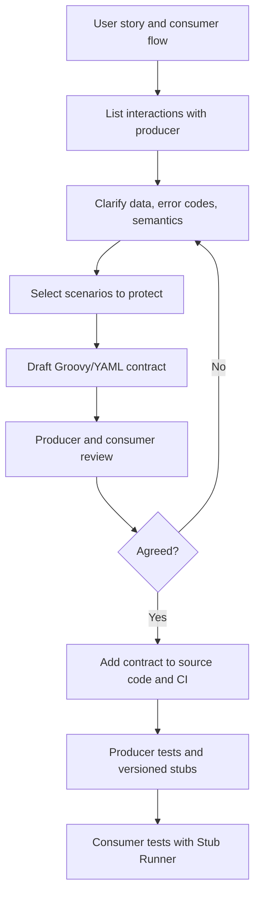
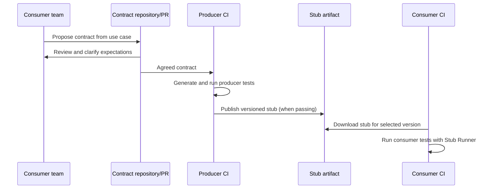

# From Consumer Requirements to Contract Proposals

## 1. Why Must the Contract Lifecycle Start from the Consumer?

In a multi-service system, the **consumer** is the application or service that uses an API/message; the **producer** is the party that provides the API or emits the message. The consumer knows exactly which data it needs to complete a use case, while the producer knows which data and behaviors it can provide. The gap between these two perspectives often causes integration errors: mismatched field names, differently interpreted status codes, changed date formats, or a field assumed to be optional turning out to be required by the user interface.

**Spring Cloud Contract (SCC)** helps turn agreed-upon communication expectations into executable contracts. For HTTP, a contract describes the request the consumer will send and the response the producer must fulfill; for messaging, a contract describes message inputs/outputs along with their corresponding constraints. Contracts can be written in **Groovy DSL or YAML DSL**, used to generate producer-side tests and create stubs for the consumer. **Stub Runner** helps the consumer test against those stubs; CI helps detect deviations between the implementation and the agreed-upon interface early.

In the early stage of the **contract lifecycle**, the primary task is not rushing to write YAML. First, the team needs to translate **consumer business needs** into **clear, minimal, and verifiable communication expectations**, then send them to the producer for review. A request that has not yet been approved by the producer is only a **contract proposal**, not a commitment that the current API supports that behavior.

After this lesson, learners will be able to:

- Extract the HTTP or message interactions that a consumer truly depends on from a user story.
- Distinguish expectations that need to be protected by a contract from internal implementation details or incidental data.
- Write a Spring Cloud Contract proposal using YAML DSL for both success and error flows.
- Describe state, assumptions, sample data, and acceptance criteria so the producer can respond.
- Take a proposal through review, producer testing, stub publishing, and consumer testing without mistaking a draft for a confirmed contract.

## 2. Running Example: Order Details Page

Suppose the **Web Order** team (consumer) is building an order details page, while the **Order Service** team (producer) manages orders. The initial user story only states:

> When opening a paid order, the user needs to see the order ID, payment status, and total amount. If the order does not exist, the application must display an appropriate message.

This is a functional requirement, **not yet sufficient to write a testable contract**. The consumer needs to clarify questions such as: which endpoint to call, which HTTP method to use, what unit represents the monetary amount, what values `status` can take, whether a missing order returns `404` or `200` with an empty body, and which data source the paid status comes from?

To illustrate, suppose **the two teams are proposing**, not yet confirming, the following decisions:

| Consumer need | Proposed communication expectation | Points needing producer confirmation |
|---|---|---|
| Open order details by ID | `GET /api/orders/{id}` | Endpoint and how `id` is represented |
| Display order ID | JSON with numeric field `id` | Value range and data type stability |
| Display status | JSON with field `status`, e.g., `PAID` | List of statuses, meaning of each value |
| Display total amount | JSON with `totalAmount` and `currency` | Unit of amount, rounding method, currency code |
| Handle non-existent order | HTTP `404`, body with `code: ORDER_NOT_FOUND` | Unified error format across the system |
| Deserialize response | Header `Content-Type: application/json` | Content negotiation and required headers |

**Key distinction:** `GET /api/orders/{id}`, `totalAmount`, and `ORDER_NOT_FOUND` here are **candidate designs** that the parties need to agree on, not default behaviors generated by Spring Cloud Contract. The tool only checks what is expressed in the contract and tests; it does not decide on a sensible API design on behalf of the team.

## 3. Process for Turning Requirements into a Contract Proposal



### Step 1 — Identify the consumer and business scenario

Name the specific consumer, such as `web-order-ui`, along with its task: displaying a paid order and showing a message when the order does not exist. Avoid vague descriptions like “API returns standard JSON”. A producer may serve multiple consumers with different needs; not every field provided by the producer needs to appear in this consumer's contract.

Document **who is responsible** for the use case, which consumer version is being protected, and where the team can be reached for feedback. If multiple consumers share the same endpoint, determine which expectations are shared and which belong to only one client.

### Step 2 — List the interactions on the actual execution path

Observe the consumer's call flow and write it down as repeatable scenarios:

1. The consumer sends a request to fetch an existing order.
2. The consumer receives the data and displays the order ID, status, and total amount.
3. The consumer requests a non-existent order.
4. The consumer receives a distinguishable error code and displays the “not found” state.

If the UI involves authorization, pagination, or authentication error handling, record these paths to prioritize them. Do not assume that a success contract automatically protects all error cases. For messaging systems, an “interaction” might be the consumer receiving an `OrderPaid` event, requiring an event type header and specific payload fields; the emission source, emission conditions, and expected data must still be clarified.

### Step 3 — Turn each need into something observable

A contract should describe the **externally visible** parts of the communication, such as method, path, parameters, headers, HTTP status code, JSON fields, or message payload. Details like database table names, internal Java methods, caching algorithms, or DTO class names are not necessarily consumer constraints and generally do not belong in the contract.

Define **semantics** as well, not just data types. `totalAmount: 125000` is an integer, but that is not clear enough if the two sides do not know whether this represents **125,000 VND**, rather than 125,000 cents or an internal unit. Similarly, what state should `status: PAID` represent: transaction confirmed, funds settled, or merely a payment request created?

### Step 4 — Choose a representative set of examples and test conditions

From the user story, choose at least one success example and one error example. Each example needs a **deterministic input**, a **verifiable response**, and **data conditions** so the producer can set up stable tests.

In this illustration, the test data convention is:

- Order `42` **exists** and is paid, with a total amount of `125000` VND.
- Order `9999` **does not exist** in the corresponding test state.

These IDs are **illustrative fixtures**. The producer needs to create/mock the appropriate data state for the tests generated from the contract. If a test only passes because the response is hard-coded regardless of data state, it may give a green signal while protecting very little real behavior.

## 4. Writing the First Proposal with Spring Cloud Contract YAML DSL

A simple HTTP contract has a `request` section and a `response` section. Each document below represents **one communication scenario**. Place them in the contract directory configured for the producer project or a shared contract repository according to the agreed convention.

### 4.1. Success scenario: retrieving a paid order

Example file `order-details-found.yml`:

```yaml
name: order-details-found
description: "Consumer retrieves details of a paid order"
request:
  method: GET
  url: /api/orders/42
  headers:
    Accept: application/json
response:
  status: 200
  headers:
    Content-Type: application/json
  body:
    id: 42
    status: PAID
    totalAmount: 125000
    currency: VND
```

Meaning of each part:

| Component | What is proposed to be protected |
|---|---|
| `request.method` and `request.url` | Consumer sends `GET /api/orders/42` |
| `request.headers.Accept` | Consumer accepts JSON |
| `response.status` | Producer returns HTTP `200` in this scenario |
| `response.headers.Content-Type` | Response uses `application/json` |
| `response.body` | Consumer receives the fields needed for display |

The YAML above chooses **concrete values** so learners can clearly see the interaction. In real projects, consider matchers when values are dynamic such as IDs, timestamps, transaction codes, or random data. Do not hard-code a value just because the current fixture happens to produce it; likewise, do not use overly broad matchers if the consumer actually requires a specific format or enum set.

### 4.2. Error scenario: order not found

Example file `order-details-not-found.yml`:

```yaml
name: order-details-not-found
description: "Consumer receives a notification when the order does not exist"
request:
  method: GET
  url: /api/orders/9999
  headers:
    Accept: application/json
response:
  status: 404
  headers:
    Content-Type: application/json
  body:
    code: ORDER_NOT_FOUND
    message: Order not found
```

Here, `404` and `code: ORDER_NOT_FOUND` are expectations **needing producer confirmation**. If the actual producer uses a different error model, both sides must negotiate before recognizing this as a contract. The consumer might only need `code` to decide how to display the state; in that case, consider whether `message` is truly a stable commitment or just descriptive text that may be translated/reworded.

Avoid cramming too many scenarios into one example and implicitly assuming they are all covered. Two separate contracts help reviewers clearly see the **happy path** and the **error path**, while making test results easier to read.

### 4.3. Correctly understanding the assertion scope of the two contracts

These two examples only require the producer to fulfill the described request when tests run in the prepared state. They **do not verify**:

- That every valid ID returns the right data, or that every non-existent ID produces the same result.
- That the consumer has sufficient permission to read the order, or that the endpoint safely handles unauthorized access.
- The correctness of payment data in the database and the business rules behind the response.
- Performance, timeouts, load capacity, availability, or deployment network configuration.
- That producer/consumer versions other than the tested pair remain compatible.

If those requirements matter, the team needs to add appropriate contracts and/or dedicated test layers such as unit, integration, security, end-to-end, and performance tests.

## 5. What Makes a Proposal Clear Enough for Producer Review?

The two YAML files are the technical part, but the proposal should also include decision-making context. An accompanying pull request description or issue can be written as follows:

> **Consumer:** `web-order-ui`.
>
> **Use case:** Display details of a paid order; identify a non-existent order.
>
> **Proposal:** `GET /api/orders/{id}` returns `id`, `status`, `totalAmount`, `currency`; for a non-existent order, returns `404` and error code `ORDER_NOT_FOUND`.
>
> **Needs confirmation:** Meaning of `PAID`, unit of `totalAmount`, type of `id`, authorization rules, stable error content, and supported client versions.
>
> **Verification examples:** Order `42` is paid; order `9999` does not exist in the test fixture.
>
> **Acceptance criteria:** Producer approves semantics, implementation satisfies the contract, generated producer tests pass; consumer tests response handling via the correctly versioned stub.

This content helps both sides distinguish **what is known**, **what is being proposed**, and **what remains open**. A proposal with concrete scenarios helps the producer offer a feasible solution far better than a vague request to “please ensure backward compatibility”.

### Mandatory information that should be agreed upon

| Review question | Why it must be answered |
|---|---|
| Who is the consumer, and which fields do they use? | Prevents the contract from over-specifying or missing real needs |
| Which interactions are most critical? | Prioritizes testing and defines protection scope |
| Does the producer already have the endpoint or need to create a new one? | Clarifies whether this is an existing change or a new feature |
| What are the values, types, and meanings of each field? | Avoids structural compatibility with wrong semantics |
| What are the test data setup conditions? | Ensures generated producer tests can run repeatably |
| How are errors, authentication, and versioning handled? | Protects real-world flows instead of only happy paths |
| Where will contracts and stubs be published from? | Ensures the consumer uses the right artifact and tests the right version |
| Who approves the change and when is the release? | Prevents contracts from changing before affected consumers are ready |

## 6. Negotiating When Consumer and Producer Have Different Expectations

A proposal may conflict with an existing API. For example, the consumer wants `status: PAID`, while the producer currently uses `paymentState: COMPLETED`. Do not “fix it just to make tests green” by forcing the producer to rename a field or forcing the consumer to understand an unagreed format.

The following options can be considered, depending on the situation:

1. **Consumer adapts to the current API:** suitable when the existing representation is already stable and meets business requirements; update the proposal accordingly.
2. **Producer adds compatibility support:** for example, temporarily maintaining `paymentState` while also supporting `status`; requires a clear policy to deprecate and remove the old field later.
3. **Design a new endpoint or version:** consider when semantics genuinely change and compatibility cannot be maintained without causing confusion.
4. **Agree on a translation layer at the consumer boundary:** when producer data has the right meaning but the consumer UI needs a different shape, the client or an adapter can transform it under test coverage.

The criteria for choosing an option are **maintainable and verifiable behavior**, impact on other consumers, and operational/versioning cost. Not every change is a breaking change: adding an optional field may be safe for clients that ignore unknown fields, but break clients with strict deserialization. Each consumer's actual setup must be evaluated.

If not yet agreed upon, record the unresolved points in the proposal and keep its status as **draft/under review**. Never treat a disputed contract as the producer-approved source of truth.

## 7. How Is a Contract Proposal Confirmed?

After review, a common Spring Cloud Contract integration workflow can proceed as follows:

1. **Agree on the contract and storage location.** Contracts can be managed alongside producer code or via a shared contract workflow. The team defines branches, review permissions, and an appropriate versioning approach.
2. **Prepare the producer's test state.** Set up data or mock dependencies so the contract's request produces a verifiable response. For example: `42` is paid, `9999` does not exist.
3. **Generate and run producer tests.** Spring Cloud Contract generates tests from Groovy/YAML DSL; the tests must run against an appropriate application configuration. When the producer deviates from expectations, the build/CI must fail.
4. **Package and publish the verified stub.** The stub reflects the contract interactions; keep commit/build/version traceability to know which producer version the stub belongs to.
5. **Consumer uses the stub via Stub Runner.** The consumer tests HTTP calls or message handling, response deserialization, and real error flows. A test that merely starts Stub Runner without verifying how the client uses the data proves very little.
6. **Establish CI gates and version upgrade policies.** Producer tests and required consumer tests must run without ignoring failures; releases must be linked to verified artifacts.



**Note:** Spring Cloud Contract's ability to generate tests and stubs does not mean these steps happen automatically in every project. The team must configure the build/plugin, test base, artifact repository, Stub Runner, and CI accordingly. A stub matching the contract can still pass on the consumer side even if the real producer implementation is wrong; therefore, testing on **both sides complements each other**.

If the system uses message contracts instead of HTTP, also start from consumption needs: which event is emitted when, which payload/headers the consumer needs, and which field types and meanings are stable. The contract verifies the described message interface; whether the broker delivers in order, retries, avoids duplicate delivery, or enforces access control requires additional testing when outside the contract's scope.

## 8. Common Mistakes When Going from Requirements to YAML

| Error-prone practice | Consequence | How to improve |
|---|---|---|
| Copying the producer's entire JSON response into a contract | Tightly couples the consumer to unused fields | Select only fields the consumer actually depends on; make constraints strong enough |
| Creating only a single `200 OK` contract | Misses `404`, `401`, `403`, or important abnormal flows | Choose negative scenarios based on client needs |
| Using overly broad matchers for every value | Enum, unit, or format changes can slip through | Specify the exact type, value, or semantics the consumer truly needs |
| Hard-coding random timestamps/IDs | Tests become flaky due to fluctuating data | Use stable fixtures or appropriate matchers |
| Producer writing contracts alone without asking the consumer | Contract reflects what the producer wants to return, missing what the client needs | Use user stories and client behavior as review inputs |
| Treating a merged contract as already verified | Producer code may still fail to satisfy it | Require generated tests to run and pass on the exact build |
| Consumer running any arbitrary stub version | Green results may be unrelated to the upcoming release | Manage stub versions and a supported version matrix |
| Describing `totalAmount` merely as `number` | Producer changes units while still matching the type | Lock down unit, rounding rules, currency, and semantic test cases |

## 9. Practice: Drafting a Proposal from a User Story

**Context:** A delivery app (consumer) needs to display the delivery status of a parcel managed by Shipping Service (producer). When the tracking ID exists, the page needs `trackingId`, `deliveryStatus`, `updatedAt`. When the ID is not found, the page shows a “not found” state.

Follow these steps in order:

1. Write one sentence stating the **specific use case and consumer**.
2. Propose the required method, path, headers, and JSON structure; clearly note that this is a design needing producer confirmation.
3. Choose one tracking ID with stable data as the **success scenario** and one non-existent ID as the **error scenario**.
4. Draft two YAML contracts with `request` and `response`; specify `200` for success and propose an appropriate error reporting format.
5. Record at least three questions the producer must answer before approval: for example, timezone/format of `updatedAt`, value set of `deliveryStatus`, and lookup authorization.
6. Describe the definition of done: producer tests pass, a versioned stub is published, and the consumer has assertions when running against Stub Runner.

**Self-check criteria:** Someone reading the proposal must be able to tell *what the consumer needs*, *which request is sent*, *which response is expected*, *which test conditions must be set up*, and *which decisions are not yet agreed upon by both sides*. If there is only a sample JSON snippet without semantics, error scenarios, or review status, the proposal is not yet ready to become a reliable contract.

## 10. Takeaways

A good contract proposal originates from **actual consumer needs**, expressed as small, testable interactions containing enough context for the producer to evaluate. Spring Cloud Contract lets you write those interactions in **Groovy/YAML DSL**, generate tests to verify the producer, publish stubs, and use **Stub Runner** for consumer testing; CI connects these steps into an early-warning mechanism for incompatible changes.

The value of the proposal stage lies in **explicitly agreeing on what both sides commit to**: request/response or message shape, data semantics, success and error cases, test data conditions, versioning, and review responsibilities. Only after being agreed upon, executed, and verified across the relevant versions does a proposal become useful evidence of communication compatibility.
