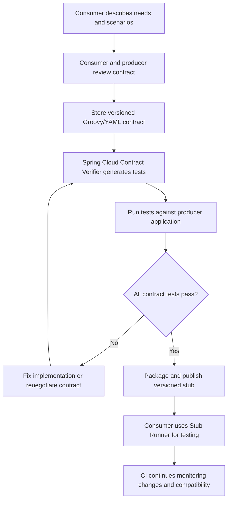

# Producer Verifying Contract Compliance

In the **Spring Cloud Contract** **contract lifecycle**, the producer does not merely state that its API meets the consumer's requirements; the producer must **prove it with tests running against actual code**. A contract agreed upon from consumer needs becomes the input for Spring Cloud Contract Verifier to generate producer-side tests. When a change causes producer behavior to deviate from the commitment, the build can fail before the change is released.

Spring Cloud Contract supports contracts for HTTP and message-based communication, defined using Groovy/YAML DSL, generates provider-side tests, packages stubs for the consumer to use with Stub Runner, and integrates into CI. This lesson focuses on **the verification step on the producer side**, including how to prepare the environment, read test results, and use those results to decide whether a stub or API change can be released.

After this lesson, you will be able to:

- Distinguish between the contract, auto-generated tests, producer implementation code, and the stub provided to the consumer.
- Set up a basic workflow to run HTTP contract tests on a Spring Boot application.
- Explain why tests pass or fail, and how to handle dynamic data and business error cases.
- Integrate contract testing into CI, tying stub artifacts to verified producer versions.
- Recognize what contract tests cannot guarantee on their own and where additional testing is needed.

## 1. What Does the Producer Actually Need to Prove?

Suppose `OrderService` is the consumer and `InventoryService` is the producer. Both teams agree that a successful stock reservation request must:

1. Accept `POST /api/v1/reservations` with JSON containing `sku` and `quantity`.
2. Return `201 Created` with a JSON body.
3. Provide `reservationId` so the consumer can reference the reservation and `status = HELD` so the consumer knows it can proceed to payment.

These requirements are **observable behaviors at the integration boundary**. The producer needs to verify that its application satisfies the exact method, path, input, status code, headers, structure, and response values that the consumer depends on. The producer does not have to prove the entire system is correct through a single contract test.

| Component | Role | Who is primarily responsible? |
| --- | --- | --- |
| Consumer needs | Defines the data and behavior required by the business flow | Consumer proposes; both teams agree |
| Groovy/YAML contract | Describes the committed interaction using Spring Cloud Contract syntax | Both teams review and manage versions together |
| Producer code | Implements controllers, validation, business logic, and response formatting | Producer |
| Verifier-generated tests | Sends requests and compares producer responses against the contract | Tool-generated; producer must run and handle failures |
| Stub artifact | Simulates the described behaviors for consumer development/testing | Built and published by the contract pipeline |
| CI | Automatically checks before merging or releasing | Pipeline-owning team |

A passing test only proves that **the conditions encoded in the contract and executed by the test** match the producer version running in the test environment. If the consumer needs an extra field that is not mentioned in the contract, a green test will not catch that omission.

## 2. Where Verification Fits in the Lifecycle



This sequence ensures that the published stub corresponds to behavior the producer has verified in the same build. If the consumer team requests a contract change, the producer must assess feasibility and re-run tests. If the producer wants to change an API, it must evaluate the contracts of dependent consumers before removing old behavior.

The workflow can be implemented with contracts living in the producer repository, in a separate repository, or proposed by the consumer via pull request. Storage locations may vary, but **the producer must pull the exact agreed-upon contract** to generate tests.

## 3. Example: HTTP Contract as Input to the Producer

Assume both sides have agreed on a successful stock reservation contract. In a producer project using the default layout, the file can be placed at:

```text
src/test/resources/contracts/reserve_stock_success.groovy
```

Illustrative content:

```groovy
import org.springframework.cloud.contract.spec.Contract

Contract.make {
    name 'reserve_stock_success'
    description 'OrderService requests reserving 2 units of stock'

    request {
        method 'POST'
        url '/api/v1/reservations'
        headers {
            contentType(applicationJson())
        }
        body([
            sku     : 'SKU-001',
            quantity: 2
        ])
    }

    response {
        status 201
        headers {
            contentType(applicationJson())
        }
        body([
            reservationId: 'RES-001',
            status       : 'HELD'
        ])
    }
}
```

This is an **example contract for a hypothetical application**, not an endpoint or status code dictated by Spring Cloud Contract itself. During testing, Verifier must send the request to the producer and then check the expectations in `response`.

Key points to note:

- `request` describes the request the producer test must send. The test can use sample values `SKU-001` and `quantity = 2` to establish a verifiable state.
- `response` describes the result the producer must return. If the implementation returns `200` instead of `201`, or `status` differs from `HELD`, the corresponding test will fail.
- The value `RES-001` is fixed data to keep the example easy to follow. If the application generates random IDs, use a **matcher** or a stable test fixture instead of forcing real IDs to always equal a hard-coded string.
- If the consumer must handle an out-of-stock case, add a **separate contract for the error branch**, such as a `409` response with an error code agreed upon by both sides. One success contract does not cover error behavior.

### A contract for the insufficient stock branch

Example file `reserve_stock_insufficient.groovy`:

```groovy
import org.springframework.cloud.contract.spec.Contract

Contract.make {
    name 'reserve_stock_insufficient'

    request {
        method 'POST'
        url '/api/v1/reservations'
        headers {
            contentType(applicationJson())
        }
        body([
            sku     : 'SKU-OUT-OF-STOCK',
            quantity: 2
        ])
    }

    response {
        status 409
        headers {
            contentType(applicationJson())
        }
        body([
            code: 'INSUFFICIENT_STOCK'
        ])
    }
}
```

Choosing `409` and `INSUFFICIENT_STOCK` is an **API design decision in this example**. Other systems may use different conventions; what matters is that consumer and producer agree on the same semantics.

## 4. Setting Up Verifier in the Producer

For a Spring Boot application built with Maven, you need to integrate the contract test generation plugin and testing libraries. The Spring Cloud Contract version must be compatible with the project's Spring Boot/Spring Cloud release train; the example below uses a version property managed by the project.

In `pom.xml`, a minimal configuration looks like:

```xml
<dependencies>
    <!-- Other application dependencies -->
    <dependency>
        <groupId>org.springframework.boot</groupId>
        <artifactId>spring-boot-starter-test</artifactId>
        <scope>test</scope>
    </dependency>
    <dependency>
        <groupId>org.springframework.cloud</groupId>
        <artifactId>spring-cloud-starter-contract-verifier</artifactId>
        <scope>test</scope>
    </dependency>
</dependencies>

<build>
    <plugins>
        <plugin>
            <groupId>org.springframework.cloud</groupId>
            <artifactId>spring-cloud-contract-maven-plugin</artifactId>
            <version>${spring-cloud-contract.version}</version>
            <extensions>true</extensions>
            <configuration>
                <testFramework>JUNIT5</testFramework>
                <testMode>MOCKMVC</testMode>
                <baseClassForTests>
                    com.example.inventory.ContractVerifierBase
                </baseClassForTests>
            </configuration>
        </plugin>
    </plugins>
</build>
```

The snippet above is an integration section to merge into an existing POM, **not a standalone `pom.xml`**. You must declare `spring-cloud-contract.version` using version management appropriate for your project, and configure repositories if your environment requires them. Gradle projects also have a corresponding Spring Cloud Contract plugin following the same test generation and execution principles.

Main configuration options:

| Setting | Meaning |
| --- | --- |
| `spring-cloud-starter-contract-verifier` | Provides tools for contract testing |
| `spring-cloud-contract-maven-plugin` | Reads contracts, generates tests, and supports building stub artifacts |
| `testFramework = JUNIT5` | Generates tests using JUnit 5 |
| `testMode = MOCKMVC` | Executes HTTP tests via Spring MVC test support without opening a real HTTP port |
| `baseClassForTests` | Binds generated tests to the producer's test environment setup class |

If the code uses WebFlux, another protocol, or message contracts, the bootstrap approach and test mode must match the actual stack. Do not copy a MockMvc configuration verbatim for a producer that does not use Spring MVC.

## 5. Preparing the Base Class for Auto-Generated Tests

Generated tests need to know how to start the application and route HTTP requests into the controller. With Spring MVC and `MOCKMVC`, you can create the following class in the producer's test sources:

```text
src/test/java/com/example/inventory/ContractVerifierBase.java
```

```java
package com.example.inventory;

import io.restassured.module.mockmvc.RestAssuredMockMvc;
import org.junit.jupiter.api.BeforeEach;
import org.springframework.beans.factory.annotation.Autowired;
import org.springframework.boot.test.context.SpringBootTest;
import org.springframework.test.context.ActiveProfiles;
import org.springframework.web.context.WebApplicationContext;

@SpringBootTest(
    webEnvironment = SpringBootTest.WebEnvironment.MOCK
)
@ActiveProfiles("contract")
public abstract class ContractVerifierBase {

    @Autowired
    private WebApplicationContext context;

    @BeforeEach
    void setUpContractTest() {
        RestAssuredMockMvc.webAppContextSetup(context);
    }
}
```

This example uses **Rest Assured MockMvc** to send test requests into the Spring `WebApplicationContext`. Depending on your application structure and library version, you can use another bootstrap approach compatible with `testMode`; the goal is for tests to invoke the **real controller** and verify its response.

The base class should not return a fake JSON matching the contract by itself, because tests would pass without verifying the producer's controller. In the stock reservation example, test data can be prepared in one of these ways:

- Use the `contract` profile with a test dataset containing `SKU-001` in sufficient stock and `SKU-OUT-OF-STOCK` out of stock.
- Isolate out-of-scope external integrations (such as an external warehouse system) using a stateful, deterministic test double, while still executing the producer's controller, validation, and result mapping.
- Reset data before each scenario so results are independent of execution order; do not rely on a shared database or production data.

**Choose test scope intentionally:** for HTTP-layer contract tests, mocking external dependencies may be appropriate. If you need to prove correctness of reservation transactions, concurrency locking, idempotency, or real broker connectivity, dedicated integration tests outside the contract test layer are required.

### Handling dynamic values

IDs, timestamps, and server-generated data are sources of flaky tests if contracts use fixed values. In the DSL, Spring Cloud Contract supports **matchers** and ways to describe values from both consumer and producer perspectives. For responses, you can require the producer to return an ID matching a pattern rather than a hard-coded value; the stub side still needs a concrete value to return to the consumer.

Conceptual verification examples: `reservationId` must be a non-empty string, `status` must equal `HELD`, `expiresAt` must follow an agreed timestamp format. Choose matchers appropriate for your DSL version and practical guarantees. A regex matching a timestamp format **does not prove** that the reservation has not expired.

When a fixture intentionally fixes `RES-001`, keeping the exact value as in the example is reasonable. When running against dynamic data, switch expectations to matchers for the properties that truly need to be guaranteed rather than removing the field check altogether.

## 6. Generating, Running, and Reading Test Results

With Maven configured and contracts in the default location, run from the producer project root:

```bash
mvn -B -ntp clean verify
```

During the build, the Spring Cloud Contract plugin reads contract files and generates test code. Tests are compiled, executed during the Maven test lifecycle, and contribute to the build's pass/fail outcome. In common Maven layouts, you can inspect generated test code under `target/generated-test-sources/contracts`; the exact path depends on the plugin, configuration, and version used.

To understand what an auto-generated test does, imagine it performing these steps:

```text
1. Initialize the test environment via ContractVerifierBase.
2. Send POST /api/v1/reservations with the JSON described in request.
3. Receive the response from the producer application's controller.
4. Compare HTTP status, headers, and body against response in the contract.
5. Report failure if any condition does not match.
```

This is a behavioral description, not an exact copy of the Java code the plugin generates. Class names, helpers, assertion libraries, and generated code structure depend on configuration.

### Reading a failing test

Suppose the implementation is changed to:

```java
return ResponseEntity.ok(reservationResponse);
```

The controller still returns JSON containing `reservationId` and `status`, but the status code changed from `201` to `200`. Under the agreed contract, this is an **observable violation**: the test must catch the difference, and CI must not treat the producer as compatible just because the API still returns `2xx`.

To handle a contract test failure:

1. Open the test report and identify **which contract, which condition, and which actual value** caused the failure.
2. Compare the DSL scenario with the agreed consumer requirements.
3. If the producer is wrong, fix the implementation or fixture and re-run tests.
4. If requirements genuinely changed, coordinate with the consumer, evaluate compatibility across active versions, and update the contract through the review process.
5. Only accept a passing result after confirming the test actually exercises the code under verification.

Do not change the contract from `201` to `200` just to make the pipeline green while the consumer still relies on `201`. Contract changes must be based on compatibility agreements, not on current implementation output.

## 7. Which Changes Can Contract Tests Detect?

| Producer change | Expectation with example contract | Explanation |
| --- | --- | --- |
| `201` to `200` | Fail | Status code mismatch |
| Removing `reservationId` from body | Fail | Missing committed field |
| Changing `status` from `HELD` to `PENDING` | Fail | Value does not match expectation |
| Changing path or removing old route | Fail | No longer handles the request in the contract |
| Adding `traceId` field to response | May pass | Usually does not break stated expectations, depending on matchers/assertions and configuration |
| Making API slower while returning the same body | May pass | No dedicated performance or timeout test |
| Reservation logic double-deducting inventory on retry | May pass | A single request-response in a contract does not verify full state transitions |
| Changing meaning of `HELD` while returning the same string | May pass | Tests do not infer business semantics outside checked conditions |

Both teams need to distinguish **interface compatibility** from **full business correctness**. Contract tests protect the interface and described behaviors; unit tests, integration tests, security, performance, state, and concurrency tests still play their own essential roles.

## 8. Contract Testing for Message-Based Communication

Beyond HTTP, Spring Cloud Contract supports specifying interactions via messages. For example, `PaymentService` emits a payment succeeded event and `OrderService` consumes that event. The producer can commit to:

- Message emission point/destination, according to the chosen integration mechanism.
- Required headers, such as event type and schema version.
- Payload structure, data types, required fields, and values meaningful to the consumer.
- Scenarios that trigger event emission when business logic completes.

For message contracts, verification is no longer sending HTTP and checking status. Generated tests must **trigger the message emission behavior**, capture the message passing through the configured integration mechanism, and compare headers/payload against the contract. Depending on the stack, the producer must configure Spring Cloud Contract message verification, integrate with the supported binder or messaging mechanism, and prepare appropriate fixtures.

What matters is testing the **message that real producer code actually emits**. A test that merely constructs a static payload and compares it to the contract itself will not detect if the producer stopped emitting the event or changed its emission schema. Meanwhile, asserting that an event has the right structure does not prove ordering, redelivery, deduplication, or broker persistence durability.

## 9. After Verification: Publishing Stubs for the Consumer

Once the producer passes contract tests, the build pipeline can package stubs from approved contracts. With a common Maven setup, the output can be an artifact with the `stubs` classifier, typically named similar to:

```text
inventory-service-1.4.0-stubs.jar
```

The consumer uses Spring Cloud Contract Stub Runner to download and run stubs by published artifact coordinates, such as combining `groupId`, `artifactId`, `version`, and the `stubs` classifier. How versions, repositories, and artifact resolution scopes are managed depends on project configuration.

Example of how pipeline stages connect:

| Step | Input | Output |
| --- | --- | --- |
| Generate tests | Agreed contract | Producer-side tests |
| Run tests | Auto-generated tests + producer app | Verification result for code version |
| Package | Contracts/stubs created in build | `-stubs.jar` artifact |
| Publish | Passing build and finalized version | Stub retrievable from artifact repository |
| Consumer tests | Stub matching target producer version | Early detection of consumer expectation mismatches |

Tie stubs to a **specific version** verified by the producer. If the consumer continuously pulls the latest build using dynamic version notation, CI results can become hard to reproduce; using controlled versions or an agreed update policy makes change traceability much easier.

Never publish stubs from a build whose contract tests failed: otherwise, the stub would simulate promises the real producer cannot fulfill.

## 10. Putting Verification into CI

For a producer repository using Maven, a minimal pipeline should run all contract tests alongside necessary tests on every pull request that modifies application code or contracts.

Example GitHub Actions job snippet (adjust JDK version and Maven setup for your project):

```yaml
name: Producer contract verification

on:
  pull_request:
  push:
    branches: [main]

jobs:
  verify:
    runs-on: ubuntu-latest
    steps:
      - uses: actions/checkout@v4
      - uses: actions/setup-java@v4
        with:
          distribution: temurin
          java-version: '21'
          cache: maven
      - name: Verify producer contracts and tests
        run: mvn -B -ntp clean verify
```

This is an example of a **verification gate**. A production release pipeline also needs repository credential management, versioning, publishing permissions, and mechanisms to block releases when the job fails; never embed credentials or tokens inside contract files.

A complete pipeline typically applies these principles:

1. **PR:** check out the exact code and contract, generate tests, run tests, and attach clear failure reports.
2. **Merge:** require the verification job to pass before accepting changes to APIs with active consumers.
3. **Release:** rebuild and re-verify on the released commit/version; only publish artifacts and stubs when all gates pass.
4. **Consumer CI:** download the matching stub version via Stub Runner, run consumer tests, and fail early when depending on unverified producer behavior.

If contracts are stored in a separate repository, the pipeline must specify **which revision** of the contract is used to generate tests. Having producer and consumer run against two different contract revisions can make both pipelines green while real integration still breaks.

## 11. Diagnosing Common Failures

| Symptom | Possible cause | What to check |
| --- | --- | --- |
| Green build but zero tests generated | Wrong `contracts` path, plugin not activated, or test generation config did not run | Check plugin logs, generated test count, and output directory |
| Tests generated but not executed | Missing base class, incompatible JUnit config, or test runner not picking up tests | Check `baseClassForTests`, framework, and test reports |
| Tests fail with `404` | Wrong URL/method or controller not loaded into context | Compare DSL request with actual route mappings |
| Tests fail with `500` | Missing fixture, bean fails to start, or business logic throws exception | Read stack trace, `contract` profile config, and test data |
| Tests pass locally but fail in CI | Unstable data, timezone, test order, env vars, or external services | Stabilize fixtures, isolate dependencies, unify config |
| Tests fail on IDs or timestamps | Dynamic values compared with hard-coded data | Use appropriate matchers or deterministic test data |
| Producer changes API yet tests stay green | Contract lacks the expectation the consumer needs, or tests only check a pre-canned mock | Review contract scope, actual execution path, and test reports |
| Stub published yet consumer still fails | Wrong stub version, missing scenario, or stub-producer difference outside contract scope | Pin specific version, add scenarios, and run integration tests |

When fixing failures, keep one principle intact: **a contract is a mutually agreed commitment**, so changing a contract must be justified by integration needs. Editing auto-generated test code directly is rarely sustainable: the next generation run can overwrite those edits. Fix the DSL, test generation configuration, base class, or implementation depending on the root cause.

## 12. Pre-Release Verification Checklist

- [ ] Contracts originate from consumer needs and are accepted by the producer.
- [ ] Both happy paths and error branches the consumer must handle are covered.
- [ ] The plugin actually generated tests; test count is not unexpectedly zero.
- [ ] Tests invoke the producer's controller/message path, not just compare payloads against a static mock.
- [ ] Test data is isolated and stable enough to re-run in CI.
- [ ] Status codes, headers, body, required fields, and dynamic values are verified at the right level.
- [ ] Contract failures are resolved in the implementation or through an agreed contract update.
- [ ] Supplemental integration/concurrency/security/performance tests cover guarantees outside contract scope when needed.
- [ ] CI blocks merges/releases when contract tests fail.
- [ ] Stubs are published from a verified build with a clear version for consumer use.

### Practice Exercise

You maintain `InventoryService`. The success contract requires `201`, `reservationId`, and `status = HELD`, while the out-of-stock branch requires `409` and `code = INSUFFICIENT_STOCK`.

1. Create the two corresponding contracts in `src/test/resources/contracts`, integrate Verifier, and prepare a test profile containing the two SKUs from the example.
2. Run `mvn -B -ntp clean verify`. Check how many tests are generated, see which requests they send, and which responses they verify.
3. Intentionally modify the controller to return `200` on success. Observe the failure, pinpoint the violated contract clause, and revert the implementation to `201`.
4. Intentionally omit `reservationId` from the response. Observe the test failure and explain how the consumer would be affected.
5. Add an optional extra field to the response, re-run tests, and discuss whether doing so breaks the contract.
6. Suppose `reservationId` is dynamically generated in production: choose how to create a deterministic fixture or matcher to verify the required property without depending on a specific ID.
7. Design a CI step that only publishes stubs after contract tests and all other mandatory checks pass.

Expected outcome: you can identify **the exact behaviors the producer has proven**, which situations block the build, and which tests still need to be added. At that point, the contract becomes a mechanism for catching incompatible changes between producer and consumer, rather than just API documentation.
