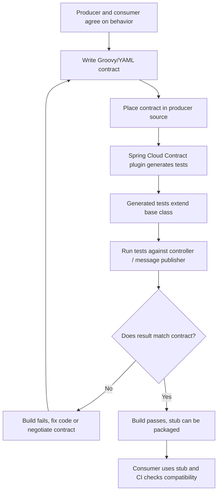
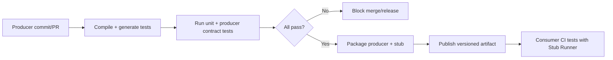

# Generating and Running Producer-Side Tests

## 1. The Role of Producer Verification in the Contract Lifecycle

In a microservice system, the **consumer** is the party that calls an API or consumes a message, while the **producer** is the party that provides that HTTP API or emits that message. A consumer may build its software around an agreed-upon JSON structure or status code while the producer continues developing and deploying independently. Problems arise when the producer renames fields, changes data types, modifies HTTP statuses, or alters event payloads without knowing that a consumer depends on the old behavior.

**Spring Cloud Contract** turns the agreement between both sides into executable contract files written in Groovy or YAML DSL. On the producer side, the Spring Cloud Contract plugin **automatically generates tests from the contracts**, then runs those tests against the producer application code. If the producer no longer meets the described expectations, the build fails before the change is released. After passing verification, the producer can package and publish stubs so the consumer can test using Stub Runner in another step of the lifecycle.

This lesson belongs to the **Contract Lifecycle** chapter and focuses on **generating and running producer-side tests**. The goal is to properly understand the responsibility of each component and set up a verification workflow for HTTP, while also knowing how to extend it to messaging and CI.

After studying this lesson, you will be able to:

- Identify which contracts the producer must verify and place them in the right project location.
- Configure the Spring Cloud Contract test generator for Maven or Gradle.
- Write a base class that prepares MockMvc and input data for generated tests.
- Run and interpret producer verification results, recognizing when tests fail because an API breaks a contract.
- Distinguish HTTP verification from verifying a messaging event and connect producer verification to CI.

> **Principle:** A contract is a commitment about observable behavior at a service boundary. Generated tests verify that the producer fulfills that commitment; they do not automatically replace unit tests, integration tests, security tests, or end-to-end tests.

## 2. Processing Flow: From Contract to Generated Tests



Three components are often confused:

| Component | Who writes or creates it? | Role |
| --- | --- | --- |
| Contract DSL | Developers or both teams together | Describes requests, responses, messages, and what consumers are entitled to expect |
| Generated test | Spring Cloud Contract plugin | Turns the DSL into runnable producer checks |
| Base test class | Producer developer | Initializes Spring test context, MockMvc or messaging mechanism, and prepares data/state for generated tests to run |

**The plugin does not automatically create valid business data for you.** If a contract requests looking up order `ORD-123`, the application under test must have a way to return that order: a fixture, mock dependency, data in a test database, or another setup mechanism. Without the right state, tests can fail even when the HTTP endpoint exists.

## 3. Running Example: Producer Exposing an Order Lookup API

Suppose `Order Service` has the endpoint:

```http
GET /api/orders/ORD-123
Accept: application/json
```

The result a consumer agreed to use:

```http
HTTP/1.1 200 OK
Content-Type: application/json

{
  "orderId": "ORD-123",
  "status": "CONFIRMED",
  "totalAmount": 199000
}
```

Here, the consumer depends on `orderId`, `status`, `totalAmount`, and HTTP status `200`. If the producer removes `totalAmount` or returns `status: "DONE"` instead of `"CONFIRMED"`, the consumer can break even though the producer's Java code still compiles cleanly.

For a concise illustration, a Spring Boot-style Maven project structure looks like:

```text
order-service/
├── pom.xml
└── src/
    ├── main/java/com/example/orders/
    │   ├── OrderController.java
    │   ├── OrderQuery.java
    │   └── OrderView.java
    └── test/
        ├── java/com/example/orders/
        │   └── ContractVerifierBase.java
        └── resources/contracts/
            └── order/
                └── get_order_by_id.groovy
```

The default path commonly used for source contracts is `src/test/resources/contracts`. Subdirectories are a way to group contracts by feature or consumer, depending on project conventions. Do not place DSL files in a regular Java source directory and expect the plugin to discover them automatically.

### 3.1. Writing an HTTP contract with Groovy DSL

File `src/test/resources/contracts/order/get_order_by_id.groovy`:

```groovy
import org.springframework.cloud.contract.spec.Contract

Contract.make {
    description 'Returns order details used by the consumer'

    request {
        method 'GET'
        url '/api/orders/ORD-123'
        headers {
            accept(applicationJson())
        }
    }

    response {
        status OK()
        headers {
            contentType(applicationJson())
        }
        body(
            orderId: 'ORD-123',
            status: 'CONFIRMED',
            totalAmount: 199000
        )
    }
}
```

The contract describes a success case: a `GET` request with a specific path and a JSON response containing the fields the consumer needs. This is **illustrative contract data**, not a rule that every order API must use `ORD-123` or `199000`.

An equivalent contract can be written in YAML DSL:

```yaml
description: Returns order details used by the consumer
request:
  method: GET
  url: /api/orders/ORD-123
  headers:
    Accept: application/json
response:
  status: 200
  headers:
    Content-Type: application/json
  body:
    orderId: ORD-123
    status: CONFIRMED
    totalAmount: 199000
```

A project can choose Groovy or YAML according to team conventions. Whichever DSL is used, **what the producer must satisfy is the same**. Avoid creating two duplicate contracts just to keep both formats; in this example, choose one of the two files.

### 3.2. Ensuring the application has the behavior to test

An illustrative controller (Spring MVC) queries data through an application port instead of hard-coding JSON in the controller:

```java
package com.example.orders;

import org.springframework.web.bind.annotation.GetMapping;
import org.springframework.web.bind.annotation.PathVariable;
import org.springframework.web.bind.annotation.RequestMapping;
import org.springframework.web.bind.annotation.RestController;

@RestController
@RequestMapping("/api/orders")
class OrderController {
    private final OrderQuery orderQuery;

    OrderController(OrderQuery orderQuery) {
        this.orderQuery = orderQuery;
    }

    @GetMapping("/{id}")
    OrderView findById(@PathVariable String id) {
        return orderQuery.findById(id);
    }
}
```

The two minimal data types used in the example can be placed in two separate Java files in the same package:

```java
// OrderQuery.java
package com.example.orders;

interface OrderQuery {
    OrderView findById(String id);
}
```

```java
// OrderView.java
package com.example.orders;

record OrderView(
    String orderId,
    String status,
    long totalAmount
) {}
```

In a real application, `OrderQuery` needs a Spring-managed implementation; in the slice test below, this dependency is replaced with a mock to focus on verifying the controller's HTTP behavior. If the real application has important logic in the service layer or custom serialization, adjust context loading scope and fixtures so you do not bypass the behavior that needs verification.

## 4. Writing the Base Class for Generated Tests

Spring Cloud Contract generates test code, but it does not know ahead of time which Spring context to load or which data to place in memory. The **base class** is the connection point between generated tests and the producer's test configuration.

Example `src/test/java/com/example/orders/ContractVerifierBase.java` for Spring MVC with JUnit 5:

```java
package com.example.orders;

import io.restassured.module.mockmvc.RestAssuredMockMvc;
import org.junit.jupiter.api.BeforeEach;
import org.springframework.beans.factory.annotation.Autowired;
import org.springframework.boot.test.autoconfigure.web.servlet.WebMvcTest;
import org.springframework.test.context.bean.override.mockito.MockitoBean;
import org.springframework.test.web.servlet.MockMvc;

import static org.mockito.BDDMockito.given;

@WebMvcTest(OrderController.class)
public abstract class ContractVerifierBase {

    @Autowired
    MockMvc mockMvc;

    @MockitoBean
    OrderQuery orderQuery;

    @BeforeEach
    void setUp() {
        given(orderQuery.findById("ORD-123"))
            .willReturn(
                new OrderView("ORD-123", "CONFIRMED", 199000L)
            );

        RestAssuredMockMvc.mockMvc(mockMvc);
    }
}
```

**Meaning of the configuration:**

1. `@WebMvcTest(OrderController.class)` loads the web layer under test and related MVC components, providing faster feedback than booting the entire application.
2. `@MockitoBean` creates a mock for `OrderQuery`, allowing a case with a deterministic result to be set up.
3. `given(...).willReturn(...)` prepares the input state so the endpoint returns the value required by the contract.
4. `RestAssuredMockMvc.mockMvc(mockMvc)` connects the HTTP calls in generated tests to the initialized MockMvc.

`@MockitoBean` belongs to Spring Test on Spring Framework 6.2+/corresponding Spring Boot versions. If the project uses an older Spring Boot version, the mocking annotation may be `@MockBean`; use the API appropriate for your project version. **Do not arbitrarily mix versions of Spring Boot, Spring Cloud, and Spring Cloud Contract.**

In projects with security filters where authentication or authorization is part of the contract, do not disable filters to make tests pass; set up appropriate test requests, principals, or tokens. If only testing the controller with mocks, be clear about which components you have isolated.

### 4.1. Why shouldn't everything go into the base class?

The base class should provide the runtime environment and required data. Do not manually duplicate all the assertions that the contract DSL already describes. If you have both generated tests and hand-written tests checking the exact same JSON/status, the test suite easily becomes redundant and hard to maintain.

When multiple groups of contracts require different initialization (such as HTTP and messaging), use **a base class suited to each contract group** and configure the corresponding mapping rather than stuffing every setup type into one shared class.

## 5. Configuring the Maven Plugin

With Maven, the producer side typically needs `spring-cloud-starter-contract-verifier` in test scope and `spring-cloud-contract-maven-plugin` to generate tests. Below are the key `pom.xml` configuration sections; the application needs its appropriate Spring Boot configuration, repositories, and business dependencies.

```xml
<dependencies>
    <dependency>
        <groupId>org.springframework.boot</groupId>
        <artifactId>spring-boot-starter-web</artifactId>
    </dependency>

    <dependency>
        <groupId>org.springframework.boot</groupId>
        <artifactId>spring-boot-starter-test</artifactId>
        <scope>test</scope>
    </dependency>

    <dependency>
        <groupId>org.springframework.cloud</groupId>
        <artifactId>spring-cloud-starter-contract-verifier</artifactId>
        <scope>test</scope>
    </dependency>
</dependencies>

<build>
    <plugins>
        <plugin>
            <groupId>org.springframework.cloud</groupId>
            <artifactId>spring-cloud-contract-maven-plugin</artifactId>
            <version>${spring-cloud-contract.version}</version>
            <extensions>true</extensions>
            <configuration>
                <baseClassForTests>
                    com.example.orders.ContractVerifierBase
                </baseClassForTests>
                <testFramework>JUNIT5</testFramework>
                <testMode>MOCKMVC</testMode>
            </configuration>
        </plugin>
    </plugins>
</build>
```

In a real `pom.xml`, the `spring-cloud-contract.version` property must be declared or inherited intentionally. Manage dependency versions using a Spring Cloud release train compatible with the Spring Boot version in use; do not copy version numbers from examples targeting a different platform. The Maven plugin has its own version and must match the chosen Spring Cloud Contract line.

Key configuration settings:

| Property | Meaning |
| --- | --- |
| `spring-cloud-contract-maven-plugin` | Plugin that generates tests from DSL during a Maven build |
| `<extensions>true</extensions>` | Enables Maven extensions to integrate related goals into the build lifecycle per plugin configuration |
| `<baseClassForTests>` | Name of the base class that generated tests extend |
| `<testFramework>JUNIT5</testFramework>` | Generates tests targeting JUnit 5 |
| `<testMode>MOCKMVC</testMode>` | Uses MockMvc for Spring MVC HTTP cases |
| `spring-cloud-starter-contract-verifier` | Test-side components for producer verification |

This is a **MockMvc configuration for Spring MVC**. Applications running on a reactive stack, JAX-RS, or needing to start a server on a real HTTP port must select the appropriate mode/configuration for the plugin version. Only set `MOCKMVC` when the producer's request path is tested using Spring MVC MockMvc.

## 6. Generating and Running Producer-Side Tests

From the producer root directory, run the Maven wrapper:

```bash
# macOS / Linux
./mvnw clean verify
```

On Windows:

```powershell
.\mvnw.cmd clean verify
```

Main build steps:

1. The plugin scans contract files in the configured location, typically `src/test/resources/contracts` by default.
2. The plugin generates Java test code, for example into `target/generated-test-sources/contracts` in common Maven setups.
3. Maven compiles both team-written test code and generated test code.
4. JUnit executes generated tests. Each test uses the base class to get the application/MockMvc or required messaging environment.
5. If response, status, headers, or message do not match the contract, the test fails, causing the build to fail.

In Maven, you can run the test generation step separately using the appropriate plugin goal to inspect output when diagnosing issues. For standard verification in CI, `clean verify` covers test generation, compilation, and execution within the build lifecycle.

### 6.1. What does a generated test look like?

Depending on the version and test mode, the generated Java code varies. Conceptually, an HTTP test performs checks equivalent to the following snippet:

```java
RestAssuredMockMvc
    .given()
    .header("Accept", "application/json")
    .get("/api/orders/ORD-123")
    .then()
    .statusCode(200)
    .header("Content-Type", org.hamcrest.Matchers.containsString("application/json"))
    .body("orderId", org.hamcrest.Matchers.equalTo("ORD-123"))
    .body("status", org.hamcrest.Matchers.equalTo("CONFIRMED"))
    .body("totalAmount", org.hamcrest.Matchers.equalTo(199000));
```

This snippet is only for **understanding the meaning of a generated test**, not exact verbatim code the plugin will emit. Real generated code may use static imports, different matchers, or different method names. Developers should not edit files in `target/generated-test-sources`: the next test generation run will overwrite that output. The sustainable fix is changing the **contract, base class, or producer code**.

### 6.2. What causes producer verification to fail?

Suppose the team changes the controller model to:

```java
record OrderView(
    String orderId,
    String state,       // renamed from status
    long totalAmount
) {}
```

Jackson will serialize the `state` field instead of `status`. The generated test still expects `status: "CONFIRMED"` per the contract and will fail. This signals that the producer is changing an interface used by a consumer; the design must be coordinated or compatibility maintained.

Another example: the producer returns `404` because the base class did not set up data for `ORD-123`. This error may be due to a bad **fixture/setup** rather than necessarily a breaking change in production code. To interpret results accurately, compare the actual response received, fixture, setup, and real controller behavior.

## 7. Equivalent Configuration with Gradle

If the project uses Gradle, the Maven plugin is not needed. The example below uses Gradle Groovy DSL; replace version placeholders with compatible versions for your project:

```groovy
plugins {
    id 'org.springframework.boot' version '<boot-version>'
    id 'io.spring.dependency-management' version '<dependency-management-version>'
    id 'org.springframework.cloud.contract' version '<contract-plugin-version>'
}

dependencyManagement {
    imports {
        mavenBom "org.springframework.cloud:spring-cloud-dependencies:<cloud-release-train>"
    }
}

dependencies {
    implementation 'org.springframework.boot:spring-boot-starter-web'
    testImplementation 'org.springframework.boot:spring-boot-starter-test'
    testImplementation 'org.springframework.cloud:spring-cloud-starter-contract-verifier'
}

contracts {
    baseClassForTests = 'com.example.orders.ContractVerifierBase'
    testFramework =
        org.springframework.cloud.contract.verifier.config.TestFramework.JUNIT5
    testMode =
        org.springframework.cloud.contract.verifier.config.TestMode.MOCKMVC
}

tasks.named('test') {
    useJUnitPlatform()
}
```

Illustrative command:

```bash
./gradlew clean build
```

To check only the test generation phase, you can run the contract test generation task provided by the plugin, typically `generateContractTests`. The path for generated sources and task names/dependencies may vary by plugin version; check your project's build output to confirm.

What Maven and Gradle have in common:

- **Source of truth** is the contract DSL files.
- **Plugin** converts contracts into test code.
- **Base class** prepares the producer environment.
- **Test task** runs generated tests and turns deviations into build failures.

You only need to configure the **single build tool** your project uses.

## 8. Dynamic Data and Matchers: Avoiding Misguided Tests

In real systems, `orderId`, timestamps, or correlation IDs often vary across runs. If every dynamic value is hard-coded in the contract, generated tests will fail on valid changes. Conversely, if a matcher is too broad, tests can let consumer-breaking changes slip through.

Spring Cloud Contract supports declaring values and matchers from consumer/producer perspectives. Example for a **response body in Groovy DSL**:

```groovy
body(
    orderId: $(consumer('ORD-123'), producer(regex('ORD-[0-9]+'))),
    status: 'CONFIRMED'
)
```

In this example, the value `ORD-123` can be used on the stub side for the consumer, while producer verification accepts any ID matching the pattern `ORD-[0-9]+`. How matchers are applied depends on whether a field is in the **request** or **response**; be clear about which side provides a concrete value and which side matches a pattern.

| Data | Reasonable strategy |
| --- | --- |
| HTTP status `200` or `404` handled by consumer | Exact match |
| `status: CONFIRMED` used for business decisions | Match committed value/status set |
| Auto-generated UUID/correlation ID | Check format if the consumer requires that format |
| Dynamic timestamp | Check type/format; only fix exact value when justified |
| New field ignored by consumer | Avoid locking down the entire JSON like a snapshot unnecessarily |

For business constraints such as `amount > 0`, a numeric regex does not guarantee a positive value in every case. Contract tests should work alongside unit/domain tests to verify deeper rules.

## 9. Generating Tests for Error Branches Is Equally Important

Success contracts are usually not enough. If the consumer relies on `404` to display “order not found”, the producer must commit to that branch.

Example of adding a separate Groovy file for `GET /api/orders/ORD-404`:

```groovy
import org.springframework.cloud.contract.spec.Contract

Contract.make {
    description 'Returns 404 for a non-existent order'

    request {
        method 'GET'
        url '/api/orders/ORD-404'
    }

    response {
        status NOT_FOUND()
        headers {
            contentType(applicationJson())
        }
        body(
            code: 'ORDER_NOT_FOUND'
        )
    }
}
```

Generated tests for this case must be supported by the base class: `OrderQuery` returns an error or throws an exception resulting in a `404` response and an `ORDER_NOT_FOUND` error code body. **Creating an error contract without configuring error behavior on the producer will cause tests to fail**, even if the contract describes a sensible desired API.

Choose error branches based on consumer needs; there is no need to create tests for every conceivable HTTP status code.

## 10. Producer Verification for Messaging

Spring Cloud Contract can also generate tests for **messages**. The difference from HTTP is that there is no synchronous request/response: the producer may emit an event to a channel/topic and the consumer receives it later.

For example, `Payment Service` needs to emit `PaymentAuthorized` after confirming a payment. Groovy contract:

```groovy
import org.springframework.cloud.contract.spec.Contract

Contract.make {
    description 'Emits event when payment is authorized'
    label 'paymentAuthorized'

    input {
        triggeredBy('publishAuthorizedPayment()')
    }

    outputMessage {
        sentTo('payments.authorized')
        headers {
            header('contentType', 'application/json')
        }
        body(
            eventType: 'PaymentAuthorized',
            orderId: 'ORD-123',
            paymentId: 'PAY-456',
            amount: 199000
        )
    }
}
```

What the contract requires of the producer:

- When `publishAuthorizedPayment()` is triggered in the test, the producer must **emit a message**.
- The message must go to destination `payments.authorized` via the application's messaging integration.
- Headers and body must match the consumer's agreed expectations.

A base class for messaging typically provides the method referenced by the DSL:

```java
// Illustrative method in the messaging base class
@Autowired
PaymentPublisher paymentPublisher;

public void publishAuthorizedPayment() {
    paymentPublisher.publishAuthorized("ORD-123", "PAY-456", 199000L);
}
```

The names `PaymentPublisher` and `publishAuthorized` are **illustrative application APIs**, not built-in Spring Cloud Contract classes/methods. The base class must also configure the send/receive environment and message observation (such as the corresponding message verifier/binder components) for the Spring Cloud Contract version and messaging system in use.

A generated messaging test basically will:

1. Invoke the trigger defined in the contract.
2. Wait for or retrieve the output message at the declared destination.
3. Match headers and payload.
4. Report failure if the producer fails to emit the expected event or data.

Depending on configuration, messages can be verified using an in-memory test mechanism or by integrating with a real messaging environment. **A payload-matching test does not prove that the broker guarantees delivery, ordering, retries, or duplicate message handling**; those properties require appropriate integration/resilience tests.

If a producer has both HTTP and messaging contracts, the base class for each group may differ. In real projects, configure mappings from contract groups to appropriate base classes instead of making every test extend the MockMvc `ContractVerifierBase`.

## 11. Distinguishing Producer Tests, Consumer Stub Tests, and Integration Tests

| Test type | Where does it run? | What defects does it catch? |
| --- | --- | --- |
| Generated producer contract test | Producer build | Producer no longer meets the committed interface |
| Consumer test with stub/Stub Runner | Consumer build | Consumer sends requests or handles responses inconsistently with the agreed stub |
| Integration test between services/brokers | Appropriate integration environment | Network misconfiguration, real serialization, routing, transactions, retries, broker errors, etc. |
| Unit/domain test | Within feature module | Pricing calculations, state transitions, business rule checks |

A green producer test proves the producer satisfies **the contracts that were selected and executed**. It does not by itself prove the consumer handles every response or event, or that all teams are using the right stub version.

In a typical release lifecycle, once producer verification passes, the build can create a **versioned stub artifact** for the consumer to run Stub Runner. Only publish stubs from contracts matching verified producer behavior; stub creation and publishing can be configured with dedicated plugins/tasks in the same pipeline.

## 12. Integrating Producer Testing into CI

A minimal pipeline can follow this flow:



Example build command in a Maven CI job:

```bash
./mvnw -B clean verify
```

To make CI meaningful, ensure:

1. **Contract DSLs are version-controlled alongside producer changes or according to the agreed contract exchange workflow.**
2. Test generation runs before test compilation; do not accidentally disable the plugin or skip the module containing contracts.
3. Generated tests are actually discovered and executed by the test runner. A green build with **0 contract tests** must be investigated, not assumed successful.
4. Test context configuration uses stable data without unnecessarily depending on mutable external databases.
5. Artifacts/stubs are versioned and published only after producer verification succeeds.
6. The responsible team evaluates breaking changes instead of merely editing contracts to make tests green before the consumer agrees.

Scenario example: A pull request renames `status` in JSON to `state`. If generated tests from the existing contract fail, CI must block the merge so the team can assess compatibility. Solutions may include keeping the old field during a transition period, updating the consumer on a schedule, or negotiating a new contract/API version.

## 13. Reading Errors and Common Troubleshooting

| Symptom | Possible cause | What to check / how to fix |
| --- | --- | --- |
| No generated tests found | Wrong DSL path, missing plugin, goal/task did not run | Check `contracts` folder, plugin config, and test generation logs |
| Compiler cannot find base class | Wrong FQCN, package, or `src/test/java` location | Compare `baseClassForTests` with `package` declaration and class name |
| JUnit or dependency compile error | Incompatible JUnit, Boot, Cloud Contract versions | Align dependency management, test framework, and plugin version |
| HTTP test returns `404` instead of `200` | Wrong mapping or missing fixture | Check controller mapping, request path, data mock/stub |
| Body missing field or wrong type | DTO/serializer changed; mock returns wrong data | Compare actual JSON received with contract and consumer expectations |
| Test fails on dynamic timestamp/ID | Overly strict fixed value | Use matchers appropriate for the format actually committed |
| Unexpected `401/403` test failure | Security filter active, request lacks principal/token | Set up auth data and check whether contract constrains auth |
| Messaging test sees no message | Trigger did not emit, destination mismatch, or message verifier unconfigured | Check trigger, binder/channel, routing, and observation timeout |
| Green build misses API change | Contract missing branch, overly broad matchers, or skipped tests | Check test count and tighten constraints per consumer needs |

When encountering errors, read the **first meaningful error** in the build log and inspect in order: source contract → generated test code → base class/setup → actual response/message. Do not edit generated Java files directly to “patch” failures.

## 14. Guided Practice

Given a producer `Catalog Service` providing:

```http
GET /api/products/P-100
Accept: application/json
```

Expected response:

```json
{
  "productId": "P-100",
  "name": "Wireless Mouse",
  "price": 350000,
  "available": true
}
```

The consumer uses `productId`, `price`, and `available` to decide whether ordering is allowed.

**Practice requirements:**

1. Create `get_product.groovy` in `src/test/resources/contracts/catalog`, describing `GET /api/products/P-100`, status `200`, JSON media type, and the four response fields.
2. Create a base class for generated tests, loading the controller and mocking the product query service for product `P-100`.
3. Configure the corresponding plugin for Maven or Gradle and run the build executing generated tests.
4. Rename `available` to `inStock` in the producer response while keeping the contract unchanged. Observe the generated test fail.
5. Restore compatibility (for example, continue returning `available`), re-run tests, and confirm the build passes.
6. Add a contract for `404` when a product is not found if the consumer has a branch handling that case.

### Self-check hint

```groovy
import org.springframework.cloud.contract.spec.Contract

Contract.make {
    description 'Fetches a product so the consumer can decide whether it can be ordered'

    request {
        method 'GET'
        url '/api/products/P-100'
    }

    response {
        status OK()
        headers {
            contentType(applicationJson())
        }
        body(
            productId: 'P-100',
            name: 'Wireless Mouse',
            price: 350000,
            available: true
        )
    }
}
```

The answer is not merely “generating a test file”, but **running tests that verify producer behavior** and proving a breaking change fails the build. For `name`, only constrain it to a fixed value if the consumer truly requires an exact name in this scenario; otherwise, use a data type matcher.

## 15. Checklist Before Considering Producer Verification Complete

- [ ] Contracts accurately reflect consumer expectations, with clear ownership and source-controlled state.
- [ ] Contracts reside in the path the configured plugin reads.
- [ ] Build tool uses Spring Cloud Contract plugin and dependencies compatible with Spring Boot/Spring Cloud.
- [ ] `baseClassForTests` points to a class capable of loading the controller or messaging mechanism under verification.
- [ ] Fixtures and mocks create business states matching contracts without relying on random data.
- [ ] Generated tests are both generated **and executed** in `verify`/`build`, not merely compiled.
- [ ] There is proof that a contract-breaking change causes the build to fail.
- [ ] Error branches the consumer depends on have appropriate contracts.
- [ ] Matchers are flexible enough for dynamic data while still catching critical interface changes.
- [ ] CI blocks merges or releases when producer verification fails.
- [ ] Stubs are published only from producers that passed required verifications.
- [ ] Risks outside contract test scope are covered by integration, security, or resilience tests.

**Conclusion:** In Spring Cloud Contract, **generating** tests is only the step that translates DSL into test code. Real value comes from **running** those tests against the producer, preparing proper state via the base class, and letting CI catch incompatible changes before the producer is deployed. Once verification passes, stubs can continue serving the consumer throughout the rest of the contract lifecycle.
