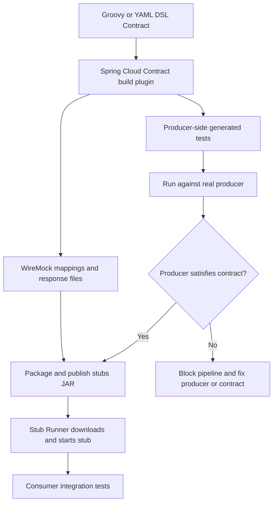

# Generating Stubs from the Same Contract Source

## 1. Why Must Producer Tests and Consumer Stubs Share the Same Source?

In **Spring Cloud Contract**, a contract describes the behavior that a **producer** commits to providing and a **consumer** expects to use. For HTTP, a contract can describe the request and response method, path, headers, body, status code, and data matching rules. For asynchronous messages, a contract can describe input or output messages. Spring Cloud Contract supports defining these behaviors in Groovy or YAML DSL.

When two teams develop independently, manual approaches often create **two out-of-sync descriptions**:

- The producer maintains tests verifying the real API.
- The consumer hand-writes mocks/stubs based on example responses they remember or copied from documentation.

For example, the consumer uses a stub returning `status: "CONFIRMED"`, while the producer just renamed that field to `state`. Consumer-side tests stay green because the hand-written stub never changed, yet real integration fails. Conversely, the producer might accidentally change HTTP `200` to `204` without any test reflecting the consumer's expectations.

**Generating stubs from the same contract source** eliminates this drift: a single contract version serves as the input for both **producer verification tests** and **stubs consumed by the consumer**. As a result, both sides test the exact same agreed-upon behavior.

> **A single source of truth does not mean every component must live in the same repository.** Contracts can reside in the producer repository or be managed via a dedicated contract repository. What matters is that producer tests and consumer stubs are generated from the **same set of contracts, at the same version**, traceably and reproducibly.

## 2. Flow from Contract to Both Test Types



Each output has a distinct responsibility:

| Component | Generated from? | Where does it run? | What is verified? |
| --- | --- | --- | --- |
| **Contract** | Teams agree on behavior, written in Groovy/YAML DSL | Stored and versioned with source code or contract repo | Describes the compatibility commitment |
| **Generated producer test** | Contract and plugin configuration | Producer pipeline/build | Does the implemented API satisfy the commitment? |
| **WireMock stub** | That exact contract | Stub Runner/WireMock in consumer tests | Does the consumer properly handle the committed request/response? |
| **Stubs JAR** | Packaged mappings and response data | Artifact repository or local Maven cache | Distributes a verified stub version |

Do not treat a stub as proof that the producer works properly: a stub only simulates the responses declared in the contract. Producer tests are what bind the contract to the real implementation. Conversely, passing producer tests does not guarantee every business branch in the consumer is right; the consumer must run its own tests against the stub.

## 3. A Single HTTP Contract as the Source

Suppose `order-service` exposes `GET /api/orders/42`. The consumer needs the order ID and status to display. On the producer side, we store the file:

```text
order-service/
└── src/
    └── test/
        └── resources/
            └── contracts/
                └── orders/
                    └── order-confirmed.groovy
```

Contents of `order-confirmed.groovy`:

```groovy
import org.springframework.cloud.contract.spec.Contract

Contract.make {
    description 'Look up a confirmed order'

    request {
        method GET()
        url '/api/orders/42'
        headers {
            accept(applicationJson())
        }
    }

    response {
        status OK()
        headers {
            contentType(applicationJson())
        }
        body([
            orderId: 42,
            status : 'CONFIRMED'
        ])
    }
}
```

Here, the DSL defines a clear scenario:

1. Consumer sends `GET /api/orders/42` and accepts JSON.
2. Producer must return HTTP `200` with `Content-Type: application/json`.
3. The scenario's body contains `orderId` equal to `42` and `status` equal to `CONFIRMED`.

These are **sample values for the test scenario**, not a rule that every order has ID `42`. If the consumer depends on other important behaviors such as non-existent order (`404`) or unconfirmed order (`PENDING`), add the corresponding contracts.

### How does one contract produce two outputs?

After the Spring Cloud Contract plugin processes the DSL, the system produces artifacts with equivalent purposes like the following (the snippets below **illustrate the meaning**, not guaranteed verbatim generated code):

**Producer side:**

```java
// Illustrates the logic that the generated producer test will verify.
given()
    .header("Accept", "application/json")
.when()
    .get("/api/orders/42")
.then()
    .statusCode(200)
    .body("orderId", equalTo(42))
    .body("status", equalTo("CONFIRMED"));
```

**Consumer side:** a semantically corresponding WireMock mapping:

```json
{
  "request": {
    "method": "GET",
    "url": "/api/orders/42",
    "headers": {
      "Accept": { "contains": "application/json" }
    }
  },
  "response": {
    "status": 200,
    "headers": { "Content-Type": "application/json" },
    "jsonBody": {
      "orderId": 42,
      "status": "CONFIRMED"
    }
  }
}
```

Exact mapping structure, filenames, header matching rules, and generated test code may vary by version or configuration. **Do not hand-write the mapping above to replace stub generation**: it only helps visualize how the same request in the contract leads to the same response in the stub.

The biggest benefit: if you edit the contract so `status` becomes `state`, both the expectations in producer tests and the response served by the consumer stub are updated from that change. Consumer tests can catch code still reading `status`, while producer tests compel the implementation API to meet the new contract.

## 4. Configuring Test and Stub Generation in the Producer

For a Maven project using Spring Cloud Contract, the producer usually declares the test dependency and the contract test generation plugin. Example abbreviated configuration in `pom.xml`:

```xml
<dependency>
    <groupId>org.springframework.cloud</groupId>
    <artifactId>spring-cloud-starter-contract-verifier</artifactId>
    <scope>test</scope>
</dependency>
```

```xml
<plugin>
    <groupId>org.springframework.cloud</groupId>
    <artifactId>spring-cloud-contract-maven-plugin</artifactId>
    <version>${spring-cloud-contract.version}</version>
    <extensions>true</extensions>
    <configuration>
        <baseClassForTests>com.example.orders.ContractVerifierBase</baseClassForTests>
    </configuration>
</plugin>
```

`spring-cloud-contract.version` must be declared by the project with a version compatible with the Spring Boot/Spring Cloud version in use. `ContractVerifierBase` is a class provided by the producer team to set up the runtime environment for generated tests, such as starting the application or configuring `RestAssuredMockMvc` with the controller under verification. The plugin only generates test code; for tests to run, the test environment and corresponding dependencies must still be configured properly.

In a fully configured Maven project, you can run:

```bash
mvn clean verify
```

The build process typically goes through these stages:

1. Read configured contracts (typically `src/test/resources/contracts` by default).
2. Generate test classes for the producer and compile/run them during the Maven test lifecycle.
3. Convert HTTP contracts into stub definitions, typically WireMock mappings along with required body files.
4. Package stubs into an artifact with the `stubs` classifier via the build plugin mechanism.

Temporary generated folder names under `target/`, goal configurations, and artifact attachment timing can vary across plugin versions; inspect your actual build instead of relying on temporary paths. Gradle also has corresponding contract test/stub generation and artifact packaging tasks, though task names and configuration depend on the Gradle plugin used.

Control point to enforce: **only publish stubs from a build after generated producer tests have passed**. Merely generating mapping files is not enough to prove the implementation complies with the contract.

## 5. Packaging, Identifying, and Publishing the Stubs JAR

With standard Maven organization, stubs are published under artifact coordinates like:

```text
groupId:artifactId:version:classifier
com.example:order-service:1.2.0:stubs
```

Many projects package the artifact with a name like:

```text
order-service-1.2.0-stubs.jar
```

The stubs JAR contains data allowing Stub Runner to spin up a mock server, typically including WireMock mappings and response files. It can be installed into the local Maven repository during build/install or published to the team's artifact repository. For instance, once the plugin and repositories are properly configured:

```bash
mvn clean deploy
```

The `deploy` command belongs to the Maven lifecycle; it only pushes artifacts to a repository when plugin steps, access credentials, and `distributionManagement` or equivalent configuration are fully set up. Do not assume running this command in any arbitrary project will automatically generate and publish stubs.

When managing artifacts, keep these principles:

- **Same version:** the application JAR and stubs JAR are built from the same source/contract revision, e.g., `1.2.0`.
- **Never mutate published artifacts:** a version must have reproducible, traceable content; avoid overwriting a different stubs JAR onto the same immutable version.
- **Separate snapshots/releases:** snapshots are useful during integration development, while fixed releases keep regression testing stable.
- **Tie quality to publishing:** if producer tests fail, the pipeline must not publish that change's stub as a valid contract.

Stub Runner supports fetching stubs from the classpath, local Maven repository, or remote repository as configured. Thus, a consumer can test against the exact contract artifact published by the producer without copying JSON files into its own repository.

## 6. Consumer Using the Same Stub Version via Stub Runner

The consumer integrates the Stub Runner test support library and references the producer's stubs JAR. With Spring Boot, you can configure an integration test like the following (assuming `OrderClient` uses the `orders.base-url` property):

```java
import static org.assertj.core.api.Assertions.assertThat;

import org.junit.jupiter.api.Test;
import org.springframework.beans.factory.annotation.Autowired;
import org.springframework.boot.test.context.SpringBootTest;
import org.springframework.cloud.contract.stubrunner.StubRunnerProperties;
import org.springframework.cloud.contract.stubrunner.spring.AutoConfigureStubRunner;

@SpringBootTest(properties = "orders.base-url=http://localhost:9090")
@AutoConfigureStubRunner(
    ids = "com.example:order-service:1.2.0:stubs:9090",
    stubsMode = StubRunnerProperties.StubsMode.LOCAL
)
class OrderClientContractTest {

    @Autowired
    OrderClient orderClient;

    @Test
    void shouldReadConfirmedOrder() {
        OrderView order = orderClient.findById(42L);

        assertThat(order.orderId()).isEqualTo(42L);
        assertThat(order.status()).isEqualTo("CONFIRMED");
    }
}
```

This example assumes the consumer project already has `OrderClient`, `OrderView`, and required test dependencies. The client must be configured to use `orders.base-url` so requests actually hit the stub on port `9090`. `LOCAL` mode requires the stub artifact to already exist in the local Maven repository; if the consumer runs on a separate CI or needs to fetch from an artifact repository, configure a remote stubs mode and the corresponding repository URL. Dynamic ports can be used instead of `9090` in parallel test suites, as long as the client receives the port opened by Stub Runner.

Stub Runner locates the stubs JAR using the declared coordinates, reads the stub definitions, and starts a server simulating the endpoints. When `OrderClient` calls `GET /api/orders/42` with a matching request, the stub returns the response generated from the contract. This allows tests to run without deploying a real `order-service` in the consumer's test environment.

**Three questions to distinguish when tests are green:**

| Question | Which test answers it? |
| --- | --- |
| Does the current producer return the promised response? | Generated producer tests |
| Does the consumer read and handle the promised response? | Consumer tests running with Stub Runner |
| Are both sides using the same commitment version? | Artifact coordinates, version pinning, and CI process |

Stub Runner uses published stubs; it **does not run the real producer** and cannot detect if a producer changed after the stub was built without being re-verified.

## 7. Contract Lifecycle and Checkpoints in CI

A typical lifecycle includes the stages: **contract proposal → agreement → producer implementation → producer verification → stub publishing → consumer testing → next change/version**. Every stage uses the same versioned contract source.

Example CI steps:

| Step | Task | Gate condition |
| --- | --- | --- |
| 1. Contract review | Consumer and producer agree on HTTP method, data, and error rules | No unresolved breaking changes |
| 2. Producer build | Generate and run contract tests from current commit | Tests pass on producer under deployment |
| 3. Package/publish | Package `stubs` with release version | Artifact stored, retrievable, commit-traceable |
| 4. Consumer CI | Run tests with Stub Runner using agreed artifact | Client handles request/response properly |
| 5. Compatibility gate | Evaluate producers/consumers needing version upgrades | Catch and resolve breaking changes before rollout |

For an API with multiple consumers, one consumer upgrading to a new contract does not mean all other consumers are ready. You must test against supported versions or maintain a clear migration process. A practical approach is for the producer to accept both old and new representations during a transition window, and stop serving the old representation only after consumers have upgraded.

### Example of catching incompatible changes

With the original `order-confirmed.groovy` contract:

```json
{ "orderId": 42, "status": "CONFIRMED" }
```

Producer changes implementation to:

```json
{ "orderId": 42, "state": "CONFIRMED" }
```

If **the contract has not changed**, generated producer tests still expect `status` and will catch the mismatch. Do not automatically edit the contract to match the producer just to make the pipeline green, because active consumers may still require `status`.

If **the contract intentionally changes** after agreeing on a migration, generated tests will verify `state` and the new stub will also return `state`. Consumer tests for old client code will then fail, showing that consumer updates or a backward-compatibility strategy are needed. This is the exact value of generating both sides from one source: contract changes become visible in both test pipelines.

## 8. Common Mistakes When Generating Stubs

### 8.1. Maintaining hand-written stubs alongside contracts

The consumer keeps a manual WireMock JSON file while the producer generates stubs from Groovy DSL. The two files drift over time, defeating the benefit of a shared source of truth. Let consumer tests pull the stub artifact generated from contracts, and use separate stubs only when intentionally testing out-of-contract scenarios, with clear justification.

### 8.2. Generating stubs while skipping generated producer tests

The build produces `stubs.jar`, yet the producer never runs verification tests. In that case, the consumer tests against an unfulfilled promise. Require producer tests to pass before any stub build is considered valid to publish.

### 8.3. Using uncontrolled dynamic versions

Using continuously shifting version specifiers can cause consumer CI today to pull a different stub than yesterday. While useful in certain continuous compatibility pipelines, it makes reproducing failures difficult. Pin versions for stable regression suites; if intentionally using dynamic versions, log the exact resolved artifact version.

### 8.4. Fixing random values in contracts

For instance, the producer returns `createdAt` using the current timestamp, while the contract enforces a single fixed timestamp. Generated producer tests will fail due to non-deterministic data. Use DSL matchers/dynamic values when the consumer only depends on **type or format**, while specifying the exact sample value returned by the stub. Do not relax critical business assertions like status codes or total amounts just to pass tests.

### 8.5. Stub returns the right JSON but fails to match the consumer's request

A request with a mismatched path, query, header, or body will not match the mapping, causing WireMock to return an unexpected error. When debugging, inspect the request the client actually sends, the generated matchers, and the stub port before editing responses. Do not strip away all request conditions just to make the mock respond.

### 8.6. Treating HTTP stubs as a complete model for messaging

Spring Cloud Contract also defines message contracts and provides testing/stubbing mechanisms suited for messaging systems. However, the WireMock HTTP mappings in this lesson describe **HTTP**; for Kafka, RabbitMQ, or other messaging systems, configure messaging support and the corresponding trigger/message mechanisms. You cannot use an HTTP WireMock stub to directly replace broker behavior or event ordering.

## 9. Practice Exercise: Verifying One Contract Source for Both Sides

Suppose a payment API has the contract:

```yaml
description: Successful payment lookup
request:
  method: GET
  url: /api/payments/pay-101
response:
  status: 200
  headers:
    Content-Type: application/json
  body:
    paymentId: pay-101
    state: SETTLED
    amount: 150000
    currency: VND
```

Perform these steps in order on a practice project configured with Spring Cloud Contract:

1. Place the contract in the source location read by the plugin. Generate producer tests and stubs. Identify in the build output which files are test code and which are mappings; do not edit either output directly.
2. Run producer tests when the endpoint returns `state: SETTLED`, then change the endpoint to `status: SETTLED` while keeping the contract unchanged. Note whether the test catches the field rename.
3. Restore the producer to match the contract, build, and store the `stubs` artifact with a specific version.
4. Configure the consumer to use Stub Runner with that artifact. Write a test calling through the consumer's real HTTP client and assert `state`, `amount`, and `currency`.
5. Try editing the contract to `state: FAILED`, regenerate stubs, and re-run consumer tests. Identify where the consumer assumes `SETTLED`, and whether a separate contract is needed for the failed state.

**Expected outcome:** modifying the producer away from the old contract fails producer tests; modifying the contract updates the stub accordingly and fails consumer tests if the consumer has not adapted. This proves both sides are genuinely bound by **the same contract version**, rather than by independent mocks.

## 10. Checklist Before Publishing Stubs

- Contracts describe the behavior used by the consumer, including requests, responses, and key conditions.
- Generated producer tests pass against the real producer or an appropriately configured controller environment.
- Stubs are generated by the plugin from the exact contract version, not manually copied to another source.
- The stubs JAR has traceable coordinates and version; the repository allows the consumer to fetch the right artifact.
- Stub Runner starts the stub and consumer tests send requests matching the mapping.
- CI blocks releases when producer tests fail and records which stub version the consumer tested against.
- Additional scenarios such as HTTP errors, missing data, authorization, or messaging are added if the consumer actually relies on them.

When producer tests and consumer stubs are generated together from one versioned contract, every API change has a place for discussion, a verification mechanism on the producer, and an artifact for the consumer to test against. That is the foundation for Spring Cloud Contract, Stub Runner, and CI to detect incompatible changes early before services connect in a live environment.
