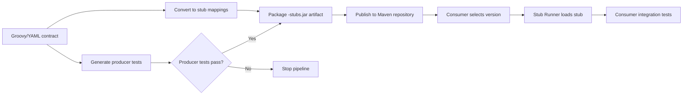

# Packaging, Publishing, and Fetching Versioned Stubs

## 1. Why Must Stubs Carry a Version?

In **Spring Cloud Contract** (module `SPRING_CLOUD_CONTRACT`), producer and consumer use contracts to agree on HTTP or messaging behavior prior to integration. Contracts can be written in **Groovy DSL** or **YAML DSL**. Based on those contracts, the tool generates producer-side tests and stubs for the consumer to run via **Stub Runner**. As a result, CI can detect API changes that violate published behavior early.

Writing contracts is only half the work. The consumer needs to answer three questions: *Which service's stub? Which producer version does the stub correspond to? Where is the stub fetched from?* Without managing this information, a test might run against the latest stub today and fail tomorrow even though the consumer's source code never changed.

The goal of this lesson is to establish a repeatable workflow:

1. Producer defines contracts and generates tests verifying actual behavior.
2. Build creates a **stub artifact**, typically a JAR with the `stubs` classifier.
3. Pipeline publishes the artifact to a Maven repository with specific coordinates and version.
4. Consumer declares the required version; Stub Runner downloads the artifact and starts the stub server.
5. Both pipelines use test results to decide whether to release or upgrade the integration version.

### 1.1. Lifecycle diagram



The contract serves as the shared behavior specification, yet **a stub does not replace producer verification**: a stub can return the exact defined JSON while the real application returns something different. Therefore, producer verification must precede publishing a trustworthy artifact.

## 2. Distinguishing Contracts, Stubs, and Artifacts

| Concept | Role | Used by |
| --- | --- | --- |
| **Contract DSL** | Defines expected request/message and response/output | API designers, test and stub generators |
| **Generated producer test** | Sends requests to the real producer or inspects emitted messages | Producer pipeline |
| **Stub mapping** | Describes how a mock server matches requests and returns responses, typically WireMock for HTTP | Stub Runner |
| **Stub artifact** | Package containing mappings and contract metadata, with retrievable coordinates and version | Maven repository, consumer |
| **Stub Runner** | Resolves artifacts, loads mappings, starts HTTP stub or corresponding mechanism | Consumer tests |

### 2.1. Maven coordinates of the artifact

Suppose the producer has:

```text
groupId    = com.example
artifactId = orders-producer
version    = 1.4.2
```

The regular application artifact might be:

```text
com.example:orders-producer:1.4.2
```

The stub artifact is a **separate artifact with the `stubs` classifier**, for example:

```text
com.example:orders-producer:1.4.2:stubs
```

In a Maven repository, the corresponding file is typically named:

```text
orders-producer-1.4.2-stubs.jar
```

A stub JAR produced by Spring Cloud Contract typically contains contracts and mappings under a metadata layout tied to `groupId`, `artifactId`, `version`, such as:

```text
META-INF/
  com.example/
    orders-producer/
      1.4.2/
        contracts/
          get_order_success.yml
        mappings/
          get_order_success.json
```

This is an illustrative structure; exact filenames and paths depend on plugin configuration, DSL, and tool version. What must be verified when packaging is that **the JAR contains expected mappings and Stub Runner can read them**. Merely seeing a `.jar` file exist is not sufficient proof.

## 3. Preparing the Producer Example and Contract

Running example: producer `orders-producer` exposes `GET /api/orders/{id}`. For order `ord-1001`, the API returns `200` and a body containing `id`, `status`. These values are **assumed fixtures for this lesson**; when applying in practice, replace them with data your tests can prepare and clean up.

Place the YAML contract in the default location commonly used in Maven projects:

```text
orders-producer/
  src/
    test/
      resources/
        contracts/
          get_order_success.yml
```

Contract content:

```yaml
name: get_order_success
description: Returns existing order details
request:
  method: GET
  url: /api/orders/ord-1001
response:
  status: 200
  headers:
    Content-Type: application/json
  body:
    id: ord-1001
    status: CREATED
```

If the producer renames `status` to another field or changes the HTTP status, the producer test generated from this contract must detect the mismatch. The consumer can use the corresponding stub to exercise the order-found scenario without booting the real service.

For a real producer, add a supplementary contract for the `404` branch of a non-existent order. Each mapping needs sufficiently specific request conditions for Stub Runner to distinguish the two branches; avoid an overly broad URL matcher that causes requests meant to return `404` to match the `200` mapping first.

## 4. Packaging Stubs from the Producer

### 4.1. Producer-side plugin configuration

A **Maven** project can use `spring-cloud-contract-maven-plugin` to generate tests from DSL and build the stub artifact. Abbreviated configuration:

```xml
<build>
  <plugins>
    <plugin>
      <groupId>org.springframework.cloud</groupId>
      <artifactId>spring-cloud-contract-maven-plugin</artifactId>
      <extensions>true</extensions>
      <configuration>
        <baseClassForTests>
          com.example.orders.contract.ContractVerifierBase
        </baseClassForTests>
      </configuration>
    </plugin>
  </plugins>
</build>
```

This is an **illustrative snippet**, not a complete `pom.xml`. The project also needs the plugin version, test dependencies, and compatible Java/Spring Boot and Spring Cloud Contract versions. Manage versions centrally via a BOM or `pluginManagement` matching your ecosystem rather than picking plugin versions arbitrarily.

`baseClassForTests` points to the base class that generated tests extend. For HTTP endpoints, the base class must start the application or controller under test, configure the request mechanism (such as Rest Assured MockMvc), create the `ord-1001` fixture, and isolate state between tests. If the base class does not set up the data expected by the contract, producer tests may fail even when the DSL is valid.

For message contracts, configure how inputs are triggered and outputs are observed to match your project's binder or message broker. Do not assume an HTTP configuration can test messages.

### 4.2. Building and verifying output

In a Maven project with wrapper and plugin properly configured:

```bash
./mvnw -B clean verify
```

Depending on lifecycle configuration, the build generates and runs producer tests, converts contracts into mappings, and packages the stub artifact during the corresponding phases. If the project uses Gradle, tasks such as `generateContractTests`, `contractTest`, and `verifierStubsJar` serve similar roles; exact task names and wiring depend on the plugin, so check the current build configuration.

Before publishing the artifact, check:

- **Producer tests pass**: the real endpoint or message producer matches the contracts.
- **Stub artifact is created with the proper classifier**: filename usually ends with `-stubs.jar`.
- **Mappings are non-empty**: inside the JAR are valid request/response mappings or message definitions.
- **Correct version**: the stub JAR carries the same `groupId`, `artifactId`, and `version` as the producer release being built.
- **No sensitive data**: real customer data, production URLs, tokens, or credentials must never be placed in fixtures or artifacts.

Example inspecting JAR contents on a system with a JDK:

```bash
jar tf target/orders-producer-1.4.2-stubs.jar
```

The command above only illustrates the artifact path. If the file is not created at the expected location, check packaging/plugin configuration before proceeding to publish.

## 5. Publishing Stubs to a Maven Repository

A Maven artifact repository (such as Nexus, Artifactory, or a compatible Maven registry) enables consumers to download the exact stub without copying files directly across source repositories.

Example producer distribution configuration:

```xml
<distributionManagement>
  <repository>
    <id>contracts-releases</id>
    <url>https://artifacts.example.org/repository/maven-releases</url>
  </repository>
  <snapshotRepository>
    <id>contracts-snapshots</id>
    <url>https://artifacts.example.org/repository/maven-snapshots</url>
  </snapshotRepository>
</distributionManagement>
```

The URLs above are examples, not live repositories. Each `id` must match credentials configured in Maven `settings.xml` in the build environment or CI secrets management.

Once the producer is fully configured:

```bash
./mvnw -B clean deploy
```

In a standard Maven pipeline, the `deploy` phase runs through test and packaging phases before uploading artifacts to the repository. This protects the workflow only if producer tests are not skipped and the stub plugin runs properly. Never use `-DskipTests` to publish an unverified stub bundle.

After publishing, verify in the repository that **the two expected artifacts exist**, assuming the project publishes both app and stub under the same version: the main artifact and the artifact with the `stubs` classifier. Inspect the `POM`, version `1.4.2`, classifier, and artifact size. A publish is only operationally successful when the consumer can actually resolve and load the stub.

### 5.1. Ensuring traceable releases

A sound workflow typically ties each release to:

| Component | Example | Purpose |
| --- | --- | --- |
| Git revision/tag | `v1.4.2` | Identifies artifact origin |
| Producer artifact | `orders-producer:1.4.2` | Deployed implementation version |
| Stub artifact | `orders-producer:1.4.2:stubs` | Corresponding simulated behavior |
| CI build | `producer-build-184` | Traces producer tests and publish step |
| Repository | `maven-releases` | Location where consumer downloads artifact |

For releases, avoid overwriting an already published artifact at the same coordinates: having different contents under the same name and version breaks test reproducibility. `SNAPSHOT` builds can change per build and suit continuous experimentation; when strict reproducibility is required, consumer CI should use a pinned release version or a uniquely identified build artifact.

## 6. Consumer Fetching Versioned Stubs with Stub Runner

Spring Cloud Contract **Stub Runner** can locate stubs from a Maven repository and start HTTP stubs for consumer tests. Typically, the consumer project declares the `spring-cloud-starter-contract-stub-runner` test dependency compatible with its Spring Boot and Spring Cloud Contract versions.

### 6.1. Understanding the stub identifier string

Example:

```text
com.example:orders-producer:1.4.2:stubs:8090
```

| Part | Value | Meaning |
| --- | --- | --- |
| `groupId` | `com.example` | Group owning the artifact |
| `artifactId` | `orders-producer` | Producer name |
| `version` | `1.4.2` | Stub version to use |
| `classifier` | `stubs` | Selects the stub JAR instead of the app JAR |
| `port` | `8090` | Stub server port during the test |

**The version here is the producer artifact version**, not the Spring Cloud Contract library version. Distinguish these two concepts when reading dependency errors.

### 6.2. Three common stub resolution modes

| `StubsMode` | Where are stubs fetched from? | When to use? | Caveats |
| --- | --- | --- | --- |
| `CLASSPATH` | Artifact already on test classpath | Tests needing no repository access at runtime | Must configure dependency/classpath containing stub |
| `LOCAL` | Local Maven repository on test machine | Producer and consumer developed on same machine or artifact installed locally | Must run `mvn install` on producer first |
| `REMOTE` | Configured Maven repository | CI, independent consumer, or multiple teams sharing published stubs | Requires valid repository URL, read permissions, and version |

These modes affect **where artifacts are resolved**; they do not alter the contracts served by Stub Runner.

### 6.3. Running consumer tests against a pinned release

Suppose the consumer configured its client with base URL `orders.api.base-url`. The conceptual test example below uses Stub Runner to start a mock producer on port `8090`:

```java
import org.junit.jupiter.api.Test;
import org.springframework.beans.factory.annotation.Autowired;
import org.springframework.boot.test.context.SpringBootTest;
import org.springframework.cloud.contract.stubrunner.StubRunnerProperties;
import org.springframework.cloud.contract.stubrunner.spring.AutoConfigureStubRunner;

import static org.assertj.core.api.Assertions.assertThat;

@SpringBootTest(properties = {
    "orders.api.base-url=http://localhost:8090"
})
@AutoConfigureStubRunner(
    ids = "com.example:orders-producer:1.4.2:stubs:8090",
    stubsMode = StubRunnerProperties.StubsMode.REMOTE,
    repositoryRoot = "https://artifacts.example.org/repository/maven-releases"
)
class OrdersConsumerContractTest {

    @Autowired
    private OrdersGateway ordersGateway;

    @Test
    void readsOrderUsingVersionedStub() {
        OrderView order = ordersGateway.findOrder("ord-1001");

        assertThat(order.status()).isEqualTo("CREATED");
    }
}
```

`OrdersGateway` and `OrderView` are **hypothetical types belonging to the consumer application**: in practice, replace them with your real HTTP client/service. The test class only demonstrates how to configure Stub Runner and verify how the consumer handles stubbed responses. The example also assumes required test dependencies, beans, and HTTP client configuration are present.

With `REMOTE`, `repositoryRoot` must point to a real artifact repository. To use `LOCAL`, switch mode to `StubsMode.LOCAL` and install the producer artifact into the local Maven repository first:

```bash
./mvnw -B clean install
```

Run the command above in the **producer project** with the plugin configured. Only then run consumer tests in the consumer project. If the consumer uses `CLASSPATH`, the stub JAR must be declared as a test dependency in the build; simply switching to `CLASSPATH` without the artifact on the classpath will cause stub loading errors.

In parallel test runs, a fixed port `8090` can collide. Projects with multiple suites should let Stub Runner allocate ports or manage port ranges and pass the started stub URL to the client rather than assuming every process can bind the same port.

### 6.4. Why pin versions?

If a consumer declares a dynamic version like `+` or an alias always pointing to the latest release, today's test might run against `1.4.2` while tomorrow's runs against `1.5.0`. When a failure occurs, it becomes hard to tell whether the error came from a consumer commit or an artifact change since the previous run.

Using a specific version such as `1.4.2` helps:

- Reproduce failures: same consumer code, same stub artifact.
- Investigate compatibility changes: intentionally test a matrix of `1.4.2` and `1.5.0` before upgrading.
- Track dependencies: know which producer contract version the consumer tests against.
- Prevent CI from silently swapping stubs unexpectedly.

Dynamic versions or `SNAPSHOT` can still be useful in exploratory compatibility pipelines against an in-development producer, but should be kept separate from release-blocking tests that demand high repeatability.

## 7. Versioning Strategy and Contract Changes

No rule guarantees that simply bumping a SemVer number keeps an API compatible. Compatibility must be evaluated against what consumers actually depend on, including HTTP codes, headers, payloads, error codes, event schemas, and data semantics.

| Producer change | Example | Risk to consumer | How to handle |
| --- | --- | --- | --- |
| Implementation fix preserving behavior | Optimizing order query | Low if tests still pass | Re-run producer tests and release patch per policy |
| Adding optional field | Adding `currency` to JSON | May affect consumers with strict deserialization | Verify with consumers and update contract if needed |
| Adding independent endpoint | `GET /api/orders/{id}/events` | Usually does not break old clients | Add contracts for the new endpoint |
| Renaming required field | `status` to `state` | Old consumers may break | Keep old field during transition or release new API |
| Changing HTTP status/error code | `404` to `204` | Consumer takes wrong branch | Discuss and check all dependent consumers |
| Changing message structure | Removing `orderId` from event | Async consumers may become incompatible | Consider schema/event versioning or migration strategy |

A safe upgrade path:

1. Producer proposes the new contract with corresponding tests.
2. Identify consumers using the modified branch.
3. During a transition period, the producer can support both old and new behavior simultaneously if design permits.
4. Publish the stub for the **new version** under new coordinates; do not overwrite the published stub of the old version.
5. Consumer tests against the new stub, adjusts handling if needed, then explicitly updates its `ids` version.
6. Remove old behavior only per compatibility policy and after affected consumers have migrated.

Example: consumer A pins `1.4.2`, while consumer B trials `1.5.0`. The producer publishing stub `1.5.0` does not automatically alter consumer A's tests. This is the desired property: changes are introduced in a controlled manner.

## 8. Integrating into CI

### 8.1. Producer pipeline

A producer pipeline can be organized as follows:

```text
Checkout exact commit/tag
  -> Restore dependencies and validate contract format
  -> Generate producer tests
  -> Run producer tests + unit/integration tests
  -> Build stub JAR, inspect mappings
  -> Publish main artifact and -stubs.jar when conditions pass
  -> Record artifact coordinates and build provenance
```

With Maven, the command in a release job is typically:

```bash
./mvnw -B --no-transfer-progress clean deploy
```

This command only succeeds when the project, deploy permissions, and plugins are configured; do not treat it as a drop-in CI script for every repository. CI needs repository credentials via secrets, verification of publish results, and must never print credentials to logs.

### 8.2. Consumer pipeline

A consumer can maintain two test modes:

1. **PR/release-blocking tests** using a pinned, chosen stub version, e.g., `1.4.2`.
2. **Compatibility tests against an upcoming producer release** using a candidate stub version, e.g., `1.5.0-rc1` if the organization follows that candidate release convention.

In both modes, tests should invoke real consumer code and assert its behavior. For instance, when the stub returns `404 ORDER_NOT_FOUND`, does the consumer properly render the not-found state? If a test merely sends a request and checks that Stub Runner returned a fixed JSON, it only verified the stub, not the consumer application's handling.

### 8.3. Avoiding circular dependency between publish and test

A common question: *The producer must publish the stub before the consumer tests, yet the producer wants consumer tests to pass before releasing — how does that work?*

You can separate stages:

- **Verification on producer PR:** run producer tests first; build a candidate artifact in a temporary environment or staging repository if consumer validation is needed.
- **Consumer verification:** run consumer tests against that exact built candidate artifact.
- **Official release:** promote or publish the release only after required approvals and checks complete.

Staging/promotion depends on your Maven repository capabilities and team infrastructure. The core point is that the consumer must test **the exact artifact intended for release**, not another artifact that merely happens to share the same version string.

## 9. Common Errors and Diagnostics

| Symptom | Common cause | How to investigate |
| --- | --- | --- |
| `Could not resolve artifact` / HTTP 404 | Wrong `groupId`, `artifactId`, `version`, `classifier`, or repository URL | Compare `ids` string with artifact path and metadata in repository |
| HTTP 401/403 when downloading JAR | Missing repository read permission or credential mismatch | Check Maven settings/secrets and CI account permissions |
| Stub Runner starts but returns 404 for expected request | JAR lacks mapping, mapping expects different URL/method/header/body, or wrong version | List JAR contents, inspect mappings and actual request sent |
| Producer test fails even though stub looks right | Real producer drifted from contract or test fixture/setup is wrong | Inspect generated test and data setup in base class |
| Consumer test passes locally but fails in CI | Locally ran `install` to `~/.m2`, CI lacks that artifact | Use `REMOTE` with an accessible repository or install artifact in job |
| Two tests collide on the same port | Multiple Stub Runners use the same fixed port | Allocate dynamic ports or configure non-overlapping ports |
| Test results change without code changes | Using `SNAPSHOT` that updated or dynamic version | Pin specific artifact version/build for reproducible CI |
| Stub artifact exists yet consumer misses expected endpoint | Contract not picked up by plugin or wrong mapping path | Check contracts directory, plugin lifecycle, and JAR contents |

When errors happen, split diagnostics into three layers: **artifact resolution** (can the JAR be downloaded?), **mapping loading** (is the right contract inside the JAR?), and **request matching** (did the client send the exact request described by the mapping?). This narrows down root causes much faster than immediately editing consumer code.

## 10. Practice Exercise: Upgrading a Stub from 1.4.2 to 1.5.0

**Context:** `orders-producer` version `1.4.2` already has a stub for `GET /api/orders/ord-1001` returning `200`. Version `1.5.0` adds an optional `currency` field in the response; consumer B wants to use the new field while consumer A has not upgraded yet.

### Requirements

1. Add `currency: VND` to the new version's contract, checking whether consumer A uses strict JSON deserialization.
2. Run producer tests with `1.5.0` behavior. If the producer still returns a response missing `currency` under the new contract, the build must fail before publishing.
3. Package and publish `com.example:orders-producer:1.5.0:stubs`; keep the already published `1.4.2:stubs` intact.
4. Keep consumer A pinned to `1.4.2`; switch consumer B to `1.5.0`, run Stub Runner, and assert the `currency` field B needs.
5. Verify intentional failure: change `ids` to a non-existent version such as `1.5.99`, and confirm CI fails with a clear artifact resolution error instead of falling back silently to another version.
6. Write an upgrade note listing artifact coordinates, changed fields, tests executed, and results for each consumer.

### Completion criteria

- Producer builds mappings and a stub JAR for the exact verified version.
- Stubs `1.4.2` and `1.5.0` are two independent, retrievable artifacts.
- Consumers A and B select versions explicitly.
- CI fails if the producer violates the contract or the consumer cannot process responses from the selected stub.
- Published artifacts can be traced back to source version and build run.

## 11. Checklist Before Publishing and Using Stubs

| Responsible party | Check |
| --- | --- |
| Producer | Groovy/YAML contracts reflect behaviors agreed upon with the consumer |
| Producer | Generated tests run against the real producer and pass |
| Producer | Stub JAR contains valid mappings, is non-empty, and has no secrets |
| Release pipeline | Main artifact and `stubs` classifier carry the matching version |
| Release pipeline | Repository serves artifacts at stable coordinates; releases are never overwritten |
| Consumer | `ids` declares the right group/artifact/version/classifier and appropriate mode |
| Consumer | Tests invoke real consumer integration logic using stub responses |
| CI | Jobs record artifact versions, test results, and halt on incompatible changes |

**Remember:** contract testing quality depends on both the DSL content **and** reliably distributing the right verified artifact. When producers publish stubs under stable versions and consumers explicitly select versions in Stub Runner, systems catch incompatible API changes earlier while keeping test results reproducible and traceable.
