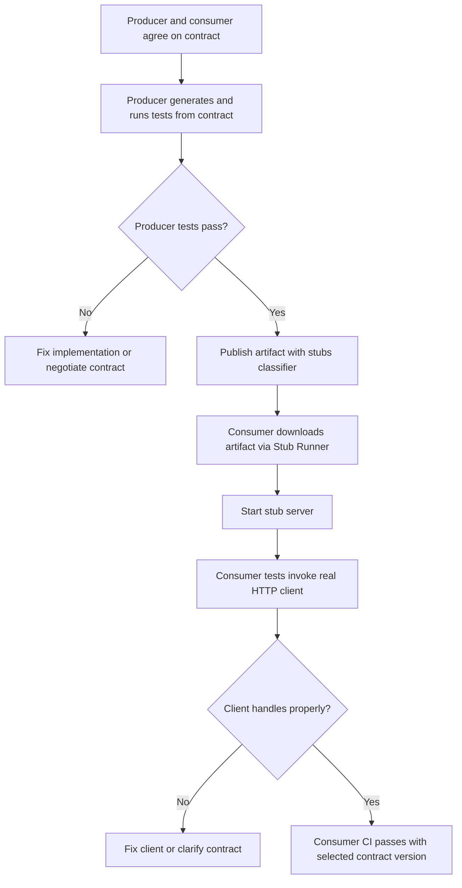
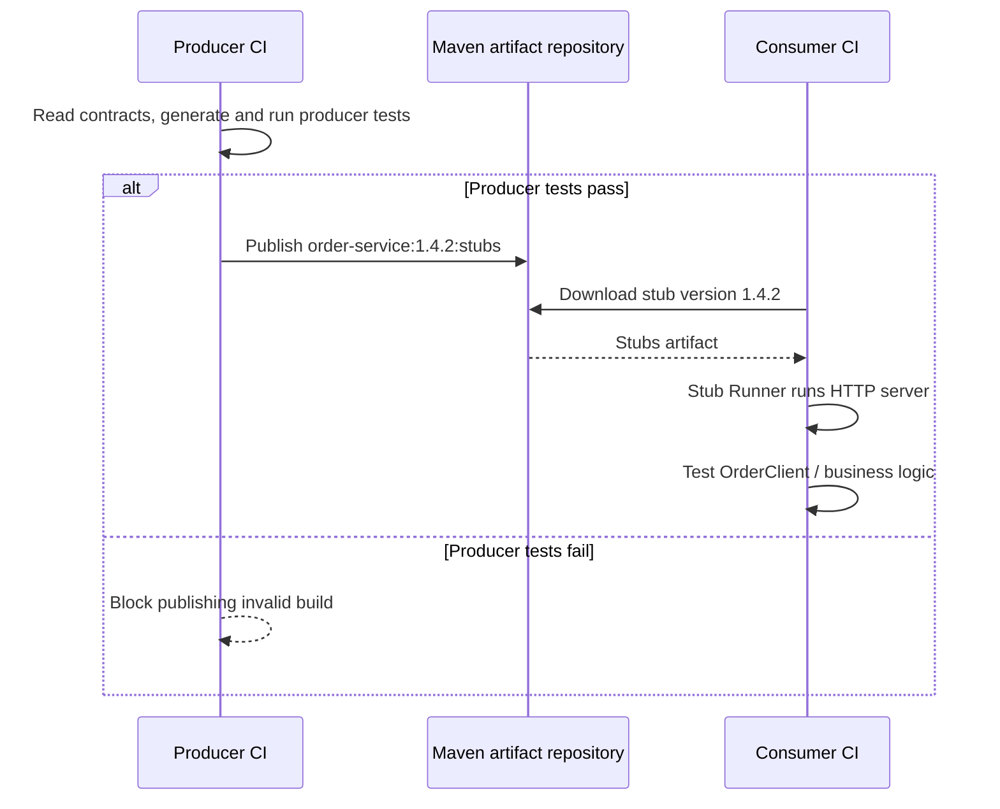

# Consumer Testing Client Code Against Published Stubs

When a **consumer** calls an API provided by another service, unit tests with an in-process mock object are often insufficient to catch wrong HTTP methods, paths, headers, JSON structures, or error-handling logic. Waiting to boot the entire system for testing is slow and heavily environment-dependent. **Spring Cloud Contract** allows consumers to test their calling code against **stubs published by the producer**: a mock service simulating interactions described in Groovy/YAML DSL contracts.

This lesson belongs to the **Contract Lifecycle** chapter. The focus is on the phase *after the producer defines contracts, generates and verifies tests, and publishes the stub artifact*: the consumer fetches that exact artifact, starts **Stub Runner**, points its HTTP client to the stub, and asserts that the consumer code handles responses correctly. This is one part of the contract testing workflow between producer and consumer, not a way to automatically generate all consumer business tests.

After this lesson, you should be able to do four things: accurately identify the published stub version; wire the consumer's real client to the stub in tests; distinguish API invocation errors from stub download/startup errors; and integrate this check into CI to catch incompatible interface changes before deployment.

## 1. Where the Consumer Fits in the Contract Lifecycle

Suppose **Order Service** provides order data, and **Billing Service** needs to read order status to decide whether to issue an invoice. Both teams agree on the HTTP behavior:

```http
GET /api/orders/42
Accept: application/json
```

```http
HTTP/1.1 200 OK
Content-Type: application/json

{"id":42,"status":"PAID"}
```

The contract describing this interaction can be stored in the producer project using Groovy or YAML DSL. When the producer runs Spring Cloud Contract Verifier, the tool can generate **producer tests** to compare implementation behavior with the contract, while also creating **HTTP stubs** (usually WireMock mappings) simulating that response. After producer tests pass, the build pipeline should publish the stub-containing artifact to a shared repository.



Three checks serve different roles:

| Component | Question answered | Limitation |
| --- | --- | --- |
| **Contract** | Which method, URL, data, and responses did the producer commit to? | A contract file alone does not prove producer code implements it properly. |
| **Generated producer test** | Does the producer execute the scenarios in the contract properly? | Only checks cases described and executed in tests. |
| **Consumer test with stub** | Do the consumer's HTTP client and processing flow interact properly with published behavior? | A stub does not prove the real producer is running properly or that the deployed system works end-to-end. |

**Common misconception:** Spring Cloud Contract generates producer verification tests and stub data; **the consumer team still writes the assertions in consumer tests**. Stub Runner is responsible for locating and starting the stub, not knowing invoicing business logic to assert outcomes on behalf of the Billing team.

## 2. What Is a "Published Stub" Actually?

A stub artifact is usually a JAR file appearing in a Maven repository, tied to the producer's artifact and version, using the `stubs` classifier. For example, producer `order-service` publishes version `1.4.2` with coordinates:

```text
groupId    = com.acme
artifactId = order-service
version    = 1.4.2
classifier = stubs
```

You can picture the artifact as `order-service-1.4.2-stubs.jar`. For HTTP, inside it are typically WireMock mappings and response resources so WireMock can serve the specified scenarios. The consumer **does not need** to start the Order Service source code; the consumer needs the right stub version and a test that invokes its own HTTP client code.

**Published** means the artifact has been placed somewhere accessible to consumers/CI, such as an internal Maven repository. A stub file newly built on a producer developer's machine but not yet uploaded to a shared repository is not yet an artifact ready for an independent consumer pipeline.

Spring Cloud Contract Stub Runner commonly uses the following coordinate format to know which stub to fetch and which port to run on:

```text
groupId:artifactId:version:classifier:port

com.acme:order-service:1.4.2:stubs:8089
```

In this example, `1.4.2` is the **artifact version**, `stubs` is the **classifier**, and `8089` is the **HTTP stub port** the consumer test will call. The port is not part of the underlying Maven coordinates; it is Stub Runner configuration. Pin a deterministic version in tests and CI so every run traces back to the exact same set of expectations. Notation for fetching the latest version such as `+` can be convenient when experimenting, but can easily cause build outcomes to change without any consumer code changes.

## 3. Preparing the Consumer Before Writing Tests

The steps below assume the consumer uses **Spring Boot with JUnit 5**, making synchronous HTTP calls via `RestClient` (available in Spring Framework 6.1 / Spring Boot 3.2 and later). If the project uses `WebClient`, `RestTemplate`, OpenFeign, or another HTTP client, the principle remains the same: the consumer's real client must accept a **configurable base URL** so tests can point it at the stub.

In the consumer application, add the Stub Runner library in **test scope**. Maven example:

```xml
<dependency>
    <groupId>org.springframework.cloud</groupId>
    <artifactId>spring-cloud-starter-contract-stub-runner</artifactId>
    <scope>test</scope>
</dependency>
```

Or the Gradle equivalent:

```groovy
dependencies {
    testImplementation 'org.springframework.cloud:spring-cloud-starter-contract-stub-runner'
}
```

The example omits a hard-coded dependency version because the project must select a **Spring Cloud BOM compatible with the Spring Boot version** in use. JUnit 5, AssertJ, and the application's HTTP client library must be available; in standard Spring Boot projects, they are declared via appropriate starters.

The HTTP client code must read a property that varies by environment, for example:

```yaml
# application.yml of Billing Service
orders:
  base-url: https://orders.example.internal
```

When running tests, we will **override** `orders.base-url` to `http://localhost:8089`. Always reading the URL from configuration lets the exact same production code be verified against stubs without modifying source code or building a test-only fake client.

## 4. Complete Example: Calling Real Client Code Against the Stub

### 4.1. Billing Service client code

The client example below accepts `RestClient.Builder` from Spring Boot, issues an HTTP GET, and deserializes JSON into a `record`. The `orders.base-url` property determines whether the call goes to the real server or the stub.

```java
import org.springframework.beans.factory.annotation.Value;
import org.springframework.stereotype.Component;
import org.springframework.web.client.RestClient;

@Component
public class OrderClient {
    private final RestClient http;

    public OrderClient(RestClient.Builder builder,
                       @Value("${orders.base-url}") String baseUrl) {
        this.http = builder.baseUrl(baseUrl).build();
    }

    public OrderView getOrder(long id) {
        return http.get()
                .uri("/api/orders/{id}", id)
                .retrieve()
                .body(OrderView.class);
    }

    public record OrderView(Long id, String status) {}
}
```

This is the code the consumer runs in production; therefore, the test exercises the exact same request construction, URL resolution, and response deserialization path. If the client mistypes an endpoint or maps JSON incorrectly, the test has the opportunity to catch the defect immediately on the developer's machine or in CI.

### 4.2. Configuring Stub Runner and the test

Suppose artifact `com.acme:order-service:1.4.2:stubs` has been published to a Maven repository the test environment has permission to read. The snippet below illustrates a JUnit 5 test:

```java
import org.junit.jupiter.api.Test;
import org.springframework.beans.factory.annotation.Autowired;
import org.springframework.boot.test.context.SpringBootTest;
import org.springframework.cloud.contract.stubrunner.spring.AutoConfigureStubRunner;
import org.springframework.cloud.contract.stubrunner.spring.StubRunnerProperties;

import static org.assertj.core.api.Assertions.assertThat;

@SpringBootTest(properties = "orders.base-url=http://localhost:8089")
@AutoConfigureStubRunner(
        ids = "com.acme:order-service:1.4.2:stubs:8089",
        stubsMode = StubRunnerProperties.StubsMode.REMOTE,
        repositoryRoot = "https://repo.example.org/maven/releases"
)
class OrderClientStubTest {

    @Autowired
    OrderClient orderClient;

    @Test
    void docDuocTrangThaiDaThanhToan() {
        OrderClient.OrderView order = orderClient.getOrder(42L);

        assertThat(order).isNotNull();
        assertThat(order.id()).isEqualTo(42L);
        assertThat(order.status()).isEqualTo("PAID");
    }
}
```

**Replace example values with your project's real details**: `com.acme`, `order-service`, version, repository URL, and client base URL. `repo.example.org` is only an illustrative address; the code will fail to download stubs until a real artifact repository is configured. The example assumes the Spring Boot context registers `OrderClient` and `RestClient.Builder` as shown in section 4.1.

How it works when the test runs:

1. Spring Boot initializes the test context with `orders.base-url=http://localhost:8089`.
2. `@AutoConfigureStubRunner` resolves the specified artifact from the Maven repository and starts an HTTP stub server on port `8089`.
3. The test calls **`orderClient.getOrder(42L)`**, Billing's actual client code, instead of writing a standalone WireMock call.
4. The stub matches the request against the contract-derived mapping and returns JSON; the client deserializes the JSON and the test asserts `id` and `status`.
5. If the request does not match the contract, the response format is wrong, or the client misinterprets data, the test can fail and block the consumer build.

A prerequisite is that the published artifact **actually contains** a mapping for `GET /api/orders/42` returning the stated JSON. The test does not create this mapping; it consumes the stub published by the producer.

**Regarding fixed ports:** using `8089` makes the example easy to follow, but when multiple tests/pipelines run on the same machine, that port may already be in use. In larger projects, let Stub Runner allocate ports dynamically and retrieve the assigned port to configure the client; what matters is that **the client URL and stub port stay synchronized**, avoiding reliance on a shared fixed port during parallel runs.

## 5. Choosing Where to Load Stubs and Versioning Strategy

Stub Runner supports different artifact resolution modes. Your choice must match where stubs are stored and how CI has access to them.

| Mode | Common situation | What must be prepared |
| --- | --- | --- |
| `LOCAL` | Producer ran `install` to place the stub artifact into local Maven; developer wants a quick test before publishing. | Exact artifact/version present in the test machine's local repo. |
| `REMOTE` | Consumer/CI consumes **published** artifacts from a shared Maven repository. | Valid repository URL, version, read permissions, and network connectivity. |
| `CLASSPATH` | Stubs are already placed on the test environment's classpath per project config. | Stub resources reside on the classpath and are structured so Stub Runner finds them. |

For this lesson's purpose, **`REMOTE` is the primary illustrative choice** because it verifies against the exact artifact published by the producer. `LOCAL` is convenient for rapid development loops, but can hide a forgotten publish: a developer's machine passes while consumer CI fails to find the artifact.

A pragmatic versioning policy includes:

- **Pin versions** (`1.4.2`) in stable tests/CI; when testing a new producer version, update intentionally and review impact.
- **Maintain traceability between source, contracts, and stubs artifacts**: versions or build metadata must allow tracing back to which contracts generated the stub.
- **Never overwrite immutable release artifacts**; if a contract changes, release a distinguishable version. With snapshots, account for caching and lower reproducibility.
- **Protect repository credentials** via proper Maven/CI configuration mechanisms; never hardcode usernames/tokens in source code or test docs.

A valid artifact does not imply compatibility with **every** consumer. A contract updated to only retain `state` may let both producer tests and new consumers pass, while an old consumer still needs `status`. To catch breaking changes, maintain active contracts or run a consumer compatibility matrix against supported producer versions.

## 6. What Must Tests Assert to Be Valuable?

Consumer tests should not merely assert `statusCode == 200` using a throwaway HTTP client. The goal is to **verify real consumer logic** across critical interactions:

| What to verify | Billing example | Defects it can catch |
| --- | --- | --- |
| Method, path, query, headers | `OrderClient` sends `GET /api/orders/42` and proper `Accept` when required by contract. | Wrong `POST`, missing `/api` prefix, missing required header. |
| JSON deserialization and usage | Parses `id` as `Long`, reads `status == "PAID"`. | Reading wrong `state`, type mismatch, mapper missing needed field. |
| Behavior on business errors | With a **clearly defined stub** returning 404 and error body, client translates to a domain error like `OrderNotFound`. | Client swallows error, misinterprets status, or ignores error code. |
| API-dependent business rules | When receiving `PAID`, Billing allows invoicing; when receiving `PENDING`, it disallows it. | Client reads data right but takes the wrong business branch. |

For error cases, publish a **dedicated contract and stub for the error-inducing request**. If a client calls a path without a mapping, WireMock may return HTTP 404 due to **no stub match**, rather than the producer's business 404 response. Consequently, a test expecting only `404` can **pass falsely**. Assert the specific body/headers/error code described, or verify the request matched the right mapping, rather than conflating the two kinds of 404.

On the other hand, a stub only simulates declared scenarios: it does not automatically reproduce all authentication rules, deadlines, network latency, infrastructure anomalies, or out-of-contract data. Supplement with unit, integration, or end-to-end tests for remaining risks.

## 7. When a Test Fails, Locating Where the Fault Lies

Not every failure in a consumer test proves the producer broke the contract. Separate errors into **stub preparation**, **request matching**, and **response handling**.

| Symptom | Cause to check first | How to resolve |
| --- | --- | --- |
| Failed to download artifact (`404`, `401`, dependency resolution error). | Wrong group/artifact/version/classifier; not published yet; wrong repository URL or credentials. | Verify the `stubs` artifact actually exists in the repo and CI has read access. |
| Stub Runner fails to start or port is already in use. | Port collision, mispackaged mappings/resources, wrong Stub Runner config. | Inspect startup logs, try another port, or configure dynamic ports. |
| Client gets `Connection refused` or hits real server. | Consumer base URL does not point to the listening stub port. | Verify which property the client actually reads and which port Stub Runner uses. |
| Stub returns `404` when `200` was expected. | Request fails to match method, path, query, header, or body in mapping; or contract is missing. | Compare sent request against mappings inside the downloaded artifact; distinguish unmatched 404 from business 404. |
| Stub returns right JSON yet assertions fail. | Consumer uses wrong DTO, mapper, or processing logic. | Fix consumer code or renegotiate contract expectations if description was inaccurate. |
| Test passes on dev machine but fails in CI. | Dev uses different local stub/cache; CI lacks credentials; inconsistent port or version. | Run with the same version, repository, and stubs mode; check artifact publishing. |

If the consumer needs new behavior not yet described by the artifact, the proper flow is to **propose a contract**, have the producer accept/implement it, run generated producer tests, and publish a new stub version. Never hand-edit stubs in consumer tests to “make them green” without bringing changes back to the contract source, because then both sides would test different specifications.

## 8. Bringing Consumer Tests into CI/CD

A common pipeline has two linked streams, possibly across two separate repositories:



Specific configuration depends on the CI system, but must satisfy these conditions:

1. **Producer tests must pass before publishing stubs used as a trusted baseline.** Build tools might generate stub files during a build even when tests fail; the pipeline itself is responsible for gating when artifacts are published.
2. **Consumer tests must fetch the real artifact** from a repository accessible to CI, not accidentally rely on a developer's local build.
3. **The version in consumer tests must be deterministic and traceable.** When testing compatibility against an upcoming producer release, CI can run an extra test suite with the candidate stub version alongside the supported baseline.
4. **Test results must block breaking changes on the consumer side**, with logs clear enough to distinguish stub download errors, request mismatches, and assertion failures.
5. **Do not equate green tests with absolute backward compatibility**: when old contracts are edited or deleted, review active consumers and upgrade policies.

For example, this JUnit test group can run with `mvn test` or Gradle's `test` task (depending on test discovery and profile configuration). If stubs are published by another pipeline, ensure the publish step finishes and the artifact is available in the repository before consumer CI starts fetching it.

## 9. Deliberate Practice

In a sandbox setup that already has a producer and a consumer, practice in this order:

1. **Prepare the contract** `GET /api/orders/42` returning `id=42`, `status=PAID`. Run generated tests on the producer and publish a `stubs` artifact with a specific version, e.g., `1.4.2`.
2. **Create `OrderClient`** in the consumer reading its base URL from configuration. Run `OrderClientStubTest` with Stub Runner fetching the artifact from the repository, verifying `PAID` and `42`.
3. **Introduce consumer-side drift**: change the client URL to `/orders/42` or map `status` to a non-existent field; run tests and observe the failure.
4. **Fix the consumer**, re-run tests, and confirm they pass once client code matches the published contract.
5. **Simulate a producer change**: suppose the producer wants to replace `status` with `state`. Keep the existing contract and modify producer code to watch producer tests fail. Then evaluate impact before publishing a new contract/stub; do not delete the old contract just to make the build pass.
6. **Add tests to CI**, pin the stub version, and check logs when intentionally configuring a non-existent version to distinguish repository errors from client integration failures.

The expected outcome is that you can point out **which consumer code actually ran**, which artifact/version supplied the behavior, how tests fail when the consumer violates the interface, and why producer verification must precede publishing trustworthy stubs.

## 10. Self-Check Questions

- What are the five parts of `com.acme:order-service:1.4.2:stubs:8089`? Which part only sets the stub runtime port and is not part of the basic Maven coordinates?
- Why must tests invoke the consumer's real `OrderClient` instead of sending a raw HTTP test request directly to the stub?
- Why can consumer tests pass against a stub even when the real producer implements the contract incorrectly?
- When receiving 404 from WireMock, what must you verify before concluding the producer has an "order not found" business response?
- If a consumer edits a JSON stub locally in tests to match new code, what divergence can arise between the two teams?
- When preparing a producer upgrade, how do you preserve the ability to detect risks for older consumers still in production?

**Takeaway:** consumers test **their own real calling code** by pointing it at **stubs generated from contracts and published with versions**. Stub Runner handles downloading and starting the stub; assertions in consumer tests prove the consumer properly uses the agreed behavior. The quality of this check depends on whether contracts cover necessary scenarios, whether the producer actually verified the contracts before publishing, and whether CI maintains the right artifacts/versions for supported consumers.
