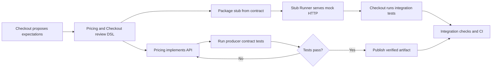
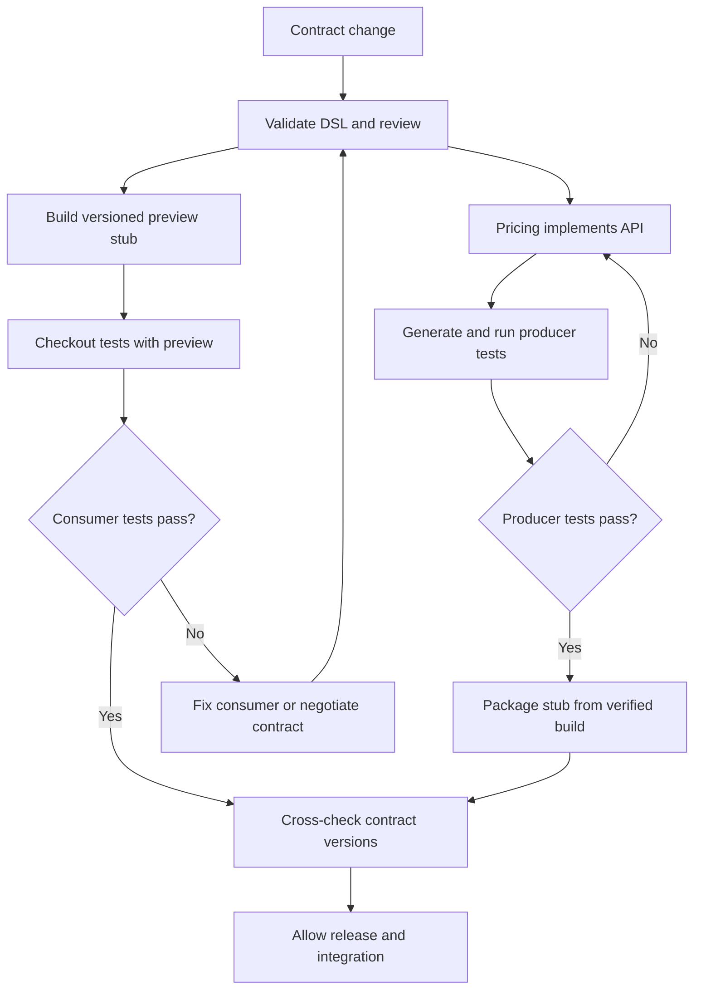

# Handling New Contracts Before the Producer Is Implemented

In a microservices architecture, one team may need to call another service's API before that service is finished. For example, **Checkout** needs to fetch product prices from **Pricing**, yet Pricing has only agreed on the business requirements and does not have `GET /v1/prices/{sku}` yet. If Checkout has to wait for Pricing to run live, the two teams develop sequentially, integrate late, and often uncover disagreements right before release.

**Spring Cloud Contract** lets teams start from a **communication behavior contract**: both teams agree on requests, responses, error codes, and relevant data using Groovy or YAML DSL; from the contract, they can generate **stubs** for consumer development as well as **producer contract tests** for when the implementation is ready. This approach is often called *contract-first* within a *consumer-driven contract testing* (CDC) workflow.

The key takeaway: **a consumer passing tests against a stub does not prove the real producer complies with the contract**. While the producer is still unfinished, you must clearly manage contract status, stub provenance, and release verification gates before shipping the API.

## 1. Clarifying What Exists and What Does Not

Suppose Checkout needs to display prices at the order confirmation step:

| Component | Initial status | Need |
|---|---|---|
| Checkout (consumer) | UI built, Pricing not yet integrated | Call API and handle price success or errors |
| Pricing (producer) | Controller/service not yet finished | Accept requests and return committed data |
| Contract | Not yet agreed upon | Precisely describe interactions at the HTTP boundary |
| Stub | Not yet available | Let Checkout test without running Pricing live |
| Producer contract test | Can be generated from contract, cannot pass yet | Verify Pricing once implementation code and test data are ready |

In this situation, the immediate goal is to **lock down expectations and test the consumer early**. The goal before releasing the integration is to **prove the producer implements those exact expectations**.

Questions to align on before writing DSL:

1. Which fields does the consumer actually use, and what are their data types?
2. What HTTP method, path, headers, permissions, or parameters does the request require?
3. What HTTP status code and response body represent the success case?
4. Which error scenarios change how the consumer behaves, such as `404` or `503`?
5. Which values are stable enough to use as examples, and which require matchers because they vary over time?
6. Who approves contract changes, and which stub versions are allowed in CI?

There is no need to describe Pricing's entire database or internal pricing algorithms. The contract focuses on **what Checkout observes and depends on at the API boundary**.

## 2. Agreeing on the Contract Before Writing the Endpoint

Both teams confirm a minimal scenario:

- `GET /v1/prices/SKU-42` with header `Accept: application/json`.
- If a price exists, return `200 OK`, `Content-Type: application/json`, containing `sku` (string), `currency` (currency code), and `amount` (integer, in VND in this example).
- If the SKU does not exist, return `404 Not Found` with the error structure agreed upon in a separate contract.
- Checkout uses `currency` and `amount` for display, so neither field may be arbitrarily removed or have its type changed.

Example HTTP contract in **Groovy DSL**, saved under a name such as `shouldReturnPriceForKnownSku.groovy` in the contract folder configured for the Spring Cloud Contract build:

```groovy
import org.springframework.cloud.contract.spec.Contract

Contract.make {
    description 'Pricing returns the price of a valid SKU for Checkout'

    request {
        method GET()
        url '/v1/prices/SKU-42'
        headers {
            header 'Accept', 'application/json'
        }
    }

    response {
        status OK()
        headers {
            contentType(applicationJson())
        }
        body(
            sku: 'SKU-42',
            currency: 'VND',
            amount: 150000
        )
    }
}
```

The same scenario can be expressed in **YAML DSL**:

```yaml
description: Pricing returns the price of a valid SKU for Checkout
request:
  method: GET
  url: /v1/prices/SKU-42
  headers:
    Accept: application/json
response:
  status: 200
  headers:
    Content-Type: application/json
  body:
    sku: SKU-42
    currency: VND
    amount: 150000
```

**Choose one format as the primary contract source** for the scenario in the project; the two snippets above are alternatives, and you do not need to register both simultaneously as that would create duplicate definitions.

The values `SKU-42` and `150000` are **fixed fixtures** for illustration, not a rule that every SKU has that price. In real projects, if prices or identifiers are dynamic, design consistent test data and use appropriate **matchers** to check type, format, or value range. Matchers must preserve the constraints Checkout actually requires; do not loosen them so much that an invalid currency or wrong `amount` type slips through.

### 2.1. Writing the error path too

Having only a `200` response easily leaves the consumer working properly in the happy path while mishandling missing products. Another contract can specify:

```http
GET /v1/prices/UNKNOWN-SKU
Accept: application/json

HTTP/1.1 404 Not Found
Content-Type: application/json

{"code":"PRICE_NOT_FOUND","message":"Price not found"}
```

This is an **illustration of behavior both teams need to agree on**, not a default response generated automatically by Spring Cloud Contract. Turn this scenario into a separate contract file, and add Checkout tests for the corresponding error display or handling. If there are authentication, timeouts, retries, required headers, or asynchronous messages, negotiate separately any part that directly affects the consumer.

## 3. Who Owns the Contract When the Producer Has No Code Yet?

There are two common organizational models:

| Management approach | Change flow | Key considerations |
|---|---|---|
| **Contracts live in the producer repository** | Consumer opens a pull request into Pricing's repo; Pricing reviews and accepts | Producer retains control over the interface; consumer must be involved in reviews early |
| **Contracts live in a separate repository** | Both teams review contracts in a shared repo; consumer/producer builds fetch the same contract version | Must control versioning and ensure the producer actually pulls the exact approved contract |

There is no requirement that a controller must exist before teams can **discuss or accept** a DSL. However, a contract written by the consumer alone and not yet approved by the producer should not be treated as a final commitment. At a minimum, every change needs an owner, an approver, sample data, and compatibility review rules.

A practical workflow:

1. **Consumer proposes** the needed behavior, including success and error scenarios.
2. **Producer confirms feasibility**: paths, schemas, data semantics, edge cases, and security constraints.
3. **Both teams lock the contract** at a specific commit or version, unblocking consumer development with stubs.
4. **Producer implements** the endpoint, configures test data, and runs tests generated from the exact same contract.
5. **CI verifies and publishes** the verified stub/API before considering the change ready for integration or deployment.

If the producer responds that the price must use `amountMinor` instead of `amount`, update the contract through review and then update the consumer. Never silently tweak a stub to make consumer tests green while the producer implements a different schema.

## 4. Letting the Consumer Use Stubs Before the Producer Finishes

Spring Cloud Contract can **convert DSL into stub mappings** so a stub server returns defined responses, typically running via **Stub Runner** backed by WireMock for HTTP interactions. Generating stubs does not require a running Pricing endpoint. The requirement is an appropriate contract/stub build workflow and consumer access to that exact stub artifact or stub mappings.



### 4.1. Creating early stubs while accurately reflecting status

While the producer is unfinished, teams can separate **building a stub for development** from **publishing a producer-verified release**:

- Build a *preview* stub artifact from the mutually approved contract; clearly record the commit, version, and DSL source. It can be packaged via a dedicated contract build workflow or appropriate plugin configuration to generate mappings without yet depending on passing producer tests.
- Let the consumer use the preview stub in development branches or early test pipelines. If using an artifact repository, choose a distinct, traceable pre-release name/version.
- Once Pricing is finished, run producer contract tests and publish the stub tied to the passing producer build/version. Only from that moment onward is there evidence that the producer implementation satisfies the tested contract.

**Do not bypass quality gates by skipping producer tests and claiming the stub is verified.** Skipping tests may be acceptable in a clearly labeled *preview stub* job; it never replaces the pre-release verification step.

### 4.2. Running Stub Runner on the consumer side

Example configuration for a Checkout Spring Boot test, assuming artifact `com.example:pricing-service:1.0.0-SNAPSHOT:stubs` has been installed into the local Maven repository and port `8085` is free:

```java
import org.springframework.boot.test.context.SpringBootTest;
import org.springframework.cloud.contract.stubrunner.spring.AutoConfigureStubRunner;
import org.springframework.cloud.contract.stubrunner.spring.StubRunnerProperties;

@SpringBootTest
@AutoConfigureStubRunner(
    ids = "com.example:pricing-service:1.0.0-SNAPSHOT:stubs:8085",
    stubsMode = StubRunnerProperties.StubsMode.LOCAL
)
class PricingClientContractTest {
    // Configure Checkout's real HTTP client to call http://localhost:8085.
    // Verify the 200 response, data, and how Checkout handles the result.
}
```

The snippet above only shows **stub startup configuration**, not a complete test. In a real project, you need the Spring Cloud Contract Stub Runner dependency compatible with your Spring Boot version, a `@Test` method, assertions, and client configuration targeting the stub server address. When fetching artifacts from a remote registry, configure repository coordinates and `stubsMode` for the environment. A fixed port is convenient for illustration; parallel test environments should use dynamic ports and read the port from Stub Runner to avoid collisions.

Tests on the Checkout side should **go through the application's real adapter/client**, such as calling `pricingClient.getPrice("SKU-42")`, then verifying that `currency` and `amount` are parsed correctly and used properly in business logic. Calling the stub directly with a raw HTTP client bypassing Checkout code may check mappings but misses bugs in the real adapter.

Example test expectations, presented in pseudocode since class names vary by project:

```text
given: Stub Runner is serving the agreed contract version
when:  Checkout calls pricingClient.getPrice("SKU-42")
then:  returned price has currency == "VND" and amount == 150000

given: SKU has no price and stub returns 404 PRICE_NOT_FOUND
when:  Checkout calls pricingClient.getPrice("UNKNOWN-SKU")
then:  Checkout handles the missing-price scenario per agreed rules
```

**A stub does not simulate the entire Pricing system**: it responds according to defined mappings. If Checkout calls the wrong path or sends inputs outside written scenarios, the stub may fail to find a mapping. That is a signal to add or fix contracts, not a reason to add a catch-all default `200` response for every request.

## 5. How Does the Producer Test While Implementation Is Missing?

When using Spring Cloud Contract on the producer, the plugin uses the DSL to generate **provider-side tests**. Depending on project version and configuration, generated tests may use MockMvc, RestAssured, or the corresponding HTTP test mechanism. The team must configure a **test base class**, start necessary components, and create data state so the contract request produces the expected outcome.

For an endpoint not yet written, generated tests may fail with `404`, wrong body, or missing configuration. In test-driven development, that is an **intentional red state** for incomplete work; it is not grounds to edit the contract to match the current wrong response.

| Stage | Consumer test with stub | Producer contract test | Meaning |
|---|---|---|---|
| After contract approved, producer has no API yet | May pass | Fails or cannot run fully yet | Consumer can develop; producer is unverified |
| Producer partially written | May pass | May fail on status, headers, body, or setup | Complete implementation and test fixtures |
| Producer implements contract accurately | Passes against matching stub version | Passes against real implementation | Eligible to pass contract gate |
| Both pass checks yet real workflow fails | Passes | Passes | Add integration/end-to-end tests for data, auth, network, and business flows |

For example, Pricing implemented the endpoint but returns:

```json
{
  "sku": "SKU-42",
  "currency": "VND",
  "price": 150000
}
```

Since the approved contract requires `amount`, the producer contract test must catch the mismatch. The right fix is updating the implementation to return `amount`, or negotiating a contract change with Checkout and updating dependent parties. **Do not manually edit generated tests**, because the next generation step will overwrite them and compatibility bugs will remain.

If you cannot create a test fixture with `SKU-42`, set up controlled test data or choose a mutually agreed dataset. Do not let tests rely on an arbitrary record in a shared environment, making test runs non-repeatable.

## 6. Designing CI While the Producer Is Still in Progress

Distinguish **CI that supports early development** from **CI that gates releases**. Both are useful, but they serve different purposes:

| Pipeline/stage | Primary check | Allowed while producer is unfinished? |
|---|---|---|
| Contract review | Valid DSL, required fields, error scenarios, dual-team review | Yes |
| Preview stub build | Converts approved contract into versioned mappings/artifact | Yes, if explicitly marked unverified against producer |
| Consumer CI | Runs Checkout adapter/integration tests against pinned preview stub | Yes |
| Producer CI | Generates/runs tests against Pricing implementation and stable fixtures | Tests may be red on feature branches; must be green before release |
| Release gate | Producer contract tests pass, consumer tests pass against corresponding stub, traceable artifacts | Cannot be bypassed |

Example minimal flow:



When the producer is unfinished, you do not have to turn **every** consumer pipeline red: the consumer is allowed to use a preview stub to make progress. However, the producer release pipeline or final integration bundle must block when producer contract tests have not passed. If contracts and code live in separate repositories, CI must record **contract commit, stub version, producer commit, and test results** to trace artifact provenance.

Rules to keep results reproducible:

- **Pin the stub version** tested in CI. Selectors meaning “latest” such as `+` can help during quick experiments, yet easily make today's build behave differently from tomorrow's.
- **Do not use an old stub to draw conclusions about a new API**. When a contract changes, the consumer must select the corresponding artifact and the producer must verify that exact content.
- **Never accidentally publish a preview build as an official release**. Separate naming/versioning or repositories and clearly record provenance.
- **Never delete red tests to make a build green**. Categorize in-progress feature tests appropriately and enforce mandatory release gates.

## 7. Handling Changes While Both Teams Develop in Parallel

Suppose after Checkout has used the stub for a week, Pricing discovers `amount` may need decimal places. Do not unilaterally change `integer` to `string` or alter the response structure on a branch Checkout knows nothing about. Evaluate whether the change breaks consumer code, amend the contract through review, and re-run both sides.

| Situation | How to handle |
|---|---|
| Consumer needs an additional `discountAmount` field | Propose a new scenario, producer confirms calculation, then update contract/stub/tests |
| Producer wants to rename `amount` to `price` | Check consumers reading `amount`; preserve compatibility or agree on migration/new version |
| Producer does not yet support agreed `404` | Keep contract and tests as completion criteria; implement error handling on producer |
| Initial contract misunderstood currency unit | Fix semantics/unit via review; update both tests and descriptions, avoid changing fixtures alone |
| Producer tests pass yet consumer tests still fail | Check stub address, version, input mappings, adapter logic, and consumer expectations |

**Adding fields is usually easier to keep compatible than removing or changing types of fields already in use**, though you must still verify whether consumers perform strict JSON parsing or custom validation. Maintaining compatibility must always be judged against actual consumers and active contracts.

If an existing contract is slated for retirement, identify which consumers depend on it, which versions are still active, and when support ends. For teams releasing on staggered schedules, maintaining both old and new behaviors during a transition period may be necessary.

## 8. Common Mistakes

**“Having a stub means the API is finished.”** False. Stubs can be generated directly from DSL before the producer has any implementation. Only when producer tests run against real code and pass is there proof the producer keeps that promise.

**“The consumer writing its own stub is enough.”** Insufficient. A stub guessed by the consumer may diverge from the producer's design. Both sides must jointly review the contract source, especially HTTP statuses, error conditions, and data semantics.

**“If producer tests are red, edit the DSL to make them green.”** Wrong if the DSL reflects mutually agreed requirements. Investigate whether the implementation is wrong, fixtures are wrong, or expectations need renegotiation; never alter contracts just to hide defects.

**“Testing with stubs eliminates the need for integration testing.”** False. Stubs do not verify real network connections, permissions, databases, performance, or multi-service workflows. Contract tests complement integration and end-to-end tests.

**“Skipping all tests while backend is unfinished saves time.”** This pushes mismatches to surface late during final integration. Let the consumer test with stubs early, keep producer contract tests mandatory before release, and track incomplete work transparently.

## 9. Practice Exercise: Parallel Development of Checkout and Pricing

Follow the exercise in order without needing Pricing running live in the initial steps:

1. Acting as the consumer, write expectations for `GET /v1/prices/SKU-42` and `GET /v1/prices/UNKNOWN-SKU`. Define fields, HTTP statuses, and how Checkout handles them.
2. Acting as the producer, review feasibility. Agree on one Groovy/YAML contract source and commit it at a specific revision.
3. Build a preview stub from the DSL per your project's Spring Cloud Contract setup, serve it with Stub Runner, and write tests using Checkout's **real client**. Verify both success and error scenarios.
4. Implement the Pricing endpoint intentionally returning a wrong structure, e.g., `price` instead of `amount`. Generate and run producer contract tests and observe the failure reason.
5. Fix Pricing to match the contract, prepare stable test data, re-run producer contract tests, and confirm they pass.
6. Build a stub artifact from the verified producer build, pin this version in Checkout's CI, and re-run tests.
7. Change `amount` to a string on an experimental branch, see which test catches it, and explain whether this is a compatible or breaking change.

**Completion criteria:** A mutually accepted contract exists, consumer tests run while the producer is unfinished, producer contract tests catch schema mismatches, and only when the producer fixes the implementation is the release pipeline allowed to proceed. Document the distinction between a preview stub and a verified stub.

## 10. Self-Check Questions

1. **Can a contract be written before the producer has an endpoint?** Yes. Both teams can agree on the DSL first, then use it as the acceptance target for implementation.
2. **Why can the consumer run tests without the real producer running?** Because Stub Runner serves simulated responses built from mappings generated out of the contract.
3. **Do consumer tests passing against a preview stub guarantee the producer is correct?** No. The producer still must execute generated contract tests against its real implementation.
4. **If the producer returns `price` while the contract requires `amount`, what should be fixed?** Investigate and fix the implementation to match the contract; change the contract only if both teams agree and update affected consumers.
5. **Should `+` be used to fetch the latest stub in every CI pipeline?** Not in pipelines requiring reproducibility. Pin traceable versions.
6. **Which step prevents an unfinished API from reaching release?** Producer contract tests and release gates verifying results against the approved contract version.

## Conclusion

When the producer has not finished implementation, **Spring Cloud Contract helps both teams lock down behavior upfront, build stubs for parallel consumer development, and turn the contract into mandatory producer tests**. A safe workflow clearly separates the **agreed contract**, **development stubs**, and **verified producer behavior**. By controlling versions, running both Stub Runner consumer tests and producer contract tests, and enforcing CI release gates, teams catch API mismatches early while upholding compatibility commitments.
