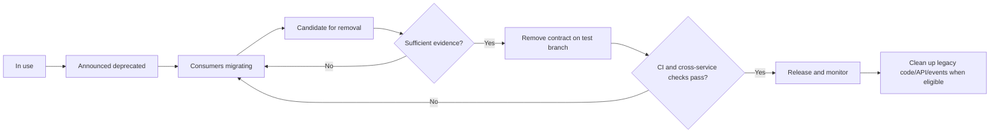
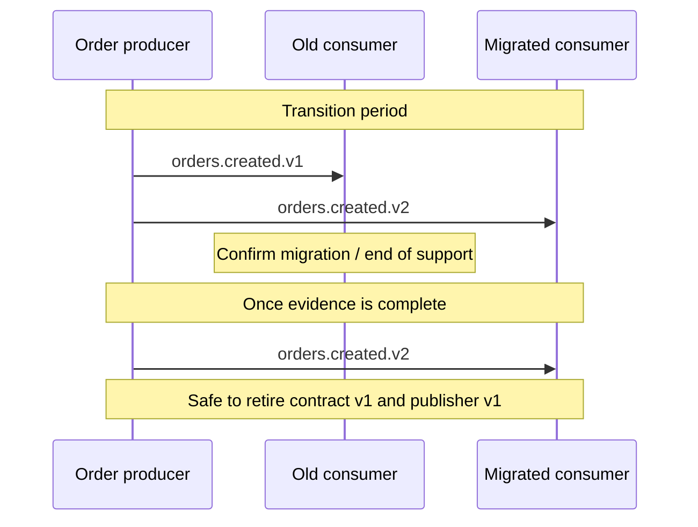
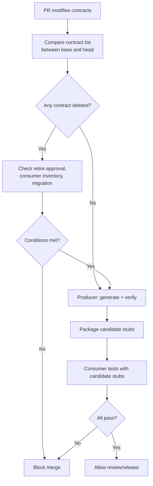

# Retiring Contracts No Longer Used by Consumers in Spring Cloud Contract

In **Spring Cloud Contract (SCC)**, a contract describes the behavior that a **producer** commits to providing to **consumers**: HTTP method, URL, status, headers, response body; or the destination, headers, and payload of a message. Contracts can be written in **Groovy DSL or YAML DSL**, then used to generate producer verification tests and package **stubs** for consumers to run with **Stub Runner**.

When a contract becomes obsolete, deleting the definition file is not merely documentation cleanup. If any consumer still depends on that behavior, deleting the contract **removes a compatibility protection check**. Conversely, keeping unused contracts forever increases the maintenance cost of tests, stubs, and API change processes. The goal of this lesson is to determine **when**, **based on what evidence**, and **in what order** you can stop maintaining a contract while keeping risks under control for producers, consumers, and CI.

This lesson uses a running example: `order-producer` used to serve the HTTP endpoint `GET /api/orders/1001/summary`; consumers gradually migrate to `GET /api/orders/1001`. Then we extend the same workflow to the message `orders.created.v1` being replaced by `orders.created.v2`.

## 1. Understanding Exactly What Is Being Retired

There are at least four distinct things in a system using Spring Cloud Contract:

| Artifact | Role | What happens when removed |
| --- | --- | --- |
| Groovy/YAML contract file | Behavior specification source for generating tests and stubs | Future builds no longer generate tests/stubs for that behavior |
| Generated producer test | Verifies producer code satisfies the contract | Loses automated detection if producer breaks committed behavior |
| Stub mapping/message stub | Allows consumers to simulate the producer | New stubs JAR no longer includes the removed scenario |
| Real HTTP endpoint, publisher, topic, or subscription | Live runtime functionality in the system | Remaining consumers receive real errors or miss messages |

**Deleting a contract does not automatically delete the endpoint or topic**, nor does it mean that endpoint or topic is safe to remove. SCC has no automatic visibility into every consumer across an organization, especially consumers in other repositories, external partners, scheduled batch jobs, or apps still running older deployed versions.

Example existing HTTP contract on the producer:

```yaml
# src/test/resources/contracts/http/get_order_summary_legacy.yml
description: Retrieve order summary via legacy API
request:
  method: GET
  url: /api/orders/1001/summary
response:
  status: 200
  headers:
    Content-Type: application/json
  body:
    orderId: 1001
    total: 125000
```

This contract promises that the specified HTTP call returns a JSON response with `orderId` and `total`. When the file is deleted, the test generated from it and the stub for that call will disappear from the **next build**. However, **already published** `*-stubs.jar` versions typically remain in the artifact repository; a consumer successfully downloading an old stub does not prove the new producer version still supports the legacy endpoint.

> Principle: Only delete a contract after confirming that the behavior is no longer a commitment required by any supported consumer.

## 2. Lifecycle from Active Use to Retirement

A contract can move through the following governance states. These are **team-process states**, not default attributes in the YAML/Groovy DSL:



**Deprecated** means the team has announced a replacement path and end-of-support plan. **Unused** is only an assessment based on currently available information. **Retired** must be a confirmed decision with a clear scope and timestamp.

Do not treat a fixed number of days as a universal rule. An API with only end-of-quarter traffic may show zero hits in a 30-day log; an event whose subscriber replays after incidents may not appear during a short observation window. The evaluation window must span the longest supported usage cycle, including batch jobs, staged rollouts, and recovery mechanisms.

## 3. How Do You Know There Are No Remaining Consumers?

You cannot safely infer this merely by searching for contract names in the producer's source code. You must combine **consumer owners**, **actual usage traces**, and **automated verification**.

### 3.1. Cataloging potentially affected consumers

Starting from the API/event slated for removal, list every known consumption path:

- Internal services calling HTTP directly or through a gateway.
- Frontends, mobile apps, SDKs, and older supported client versions.
- Hourly/daily/monthly/quarterly batch jobs; manually executed operational tools.
- External partners using API keys or integration platforms.
- Message queue consumers, consumer groups, connectors, ETL jobs, or event replay systems.
- Consumer tests pinning previous stub versions.

Use a reviewable tracking table:

| Consumer | Owner | How it consumes | Migrated to new behavior? | Evidence |
| --- | --- | --- | --- | --- |
| `billing-service` | Billing Team | Legacy GET summary | Yes | PR and new deployment; traffic by client-id |
| `reporting-job` | Data Team | End-of-month aggregation job | Unconfirmed | No run yet since migration date |
| `partner-portal` | Partner X | HTTP API via gateway | In progress | Confirmed upgrade schedule and gateway logs |

In this example, **you cannot conclude the contract has no consumers yet** because `reporting-job` has not gone through a new execution cycle and `partner-portal` is still migrating.

### 3.2. Gathering evidence from multiple sources

| Source | What it tells you | Limitations to keep in mind |
| --- | --- | --- |
| Code search across consumer repos | Whether HTTP calls, subscriptions, or DTOs still use the old contract | May miss runtime configs, SDKs, partners, or inaccessible repos |
| Tracing, gateway logs, access logs, or HTTP metrics | Which consumers actually called the legacy endpoint during the observation window | Zero requests does not disprove periodic jobs or temporarily offline clients |
| Broker subscriptions, consumer groups, lag, publish history | Which consumers still read the legacy message/topic | Consumers may be offline, replaying, or using other connectors |
| Consumer CI builds/tests and Stub Runner config | Which consumers test against which stubs JAR versions | Consumers lacking tests or still pinning old stubs can be missed |
| Owner sign-off and release plans | Whether consumers migrated, deployed, or officially decommissioned | Must be cross-checked against actual deployments |

For HTTP, if infrastructure allows, log **method + normalized route + service/client-id + client version + timestamp**. Never log sensitive request body data. If caller identity cannot be determined, observing “0 requests” carries lower confidence than explicit sign-off from all client owners.

Example monitoring questions you can translate into queries on your team's logging platform:

```text
Within the agreed observation window:
- Are there any GET /api/orders/{id}/summary calls?
- Who is calling? Which application version or credential?
- Are there incomplete rollouts or offline clients?
- Are there batch/DR/replay schedules outside this window?
- Who is responsible for signing off that it is no longer used?
```

For messaging, “no events published today” is different from “no subscribers left”. Inspect subscription/consumer group lists, lag, retention, retry topics, dead-letter queues, and historical replay capabilities. Very old events can still be read during system recovery.

### 3.3. Defining clear exit criteria

Before removing a contract, the team should have all of the following confirmations:

1. **Scope:** clearly know the affected contracts, endpoints/topics, environments, and producer versions.
2. **Ownership:** have a consumer inventory and corresponding signers, including partners or consumers outside the repository.
3. **Migration:** supported consumers already use the replacement API/message or have been formally decommissioned.
4. **Observation:** log/metric windows cover committed usage cycles with no unexplained legacy consumption traces.
5. **Verification:** tests using stubs of the **intended producer release version** pass for all consumers that remain supported.
6. **Recovery:** a rollback plan exists for the producer version and restoring contracts/code if a missed consumer surfaces.

If you cannot confirm whether a consumer is still supported, keep the contract or escalate a decision to owners instead of deleting on guesswork.

## 4. Step-by-Step HTTP Contract Retirement Process

Consider the scenario: the old endpoint `GET /api/orders/{id}/summary` has been replaced by `GET /api/orders/{id}`. The transition may also rename JSON fields, so more than the URL changes; consumers also need to update response parsing logic.

### Step 1 — Announce deprecation and migration path

Update API documentation and notify consumers:

```text
Old behavior: GET /api/orders/{id}/summary
Replacement behavior: GET /api/orders/{id}
Deprecation start date: date approved by team
Target end-of-support date: after agreed migration window
Consumer action required: update URL and field mappings
Support contacts: producer owner, migration guide, test environment
```

If the system uses standard `Deprecation` or `Sunset` headers and the gateway supports them, they can provide an extra signal; headers **do not replace** direct consumer notification or proof of migration.

### Step 2 — Update consumers and test against the new contract

Suppose the old consumer calls:

```java
OrderSummary summary = restTemplate.getForObject(
    producerBaseUrl + "/api/orders/{id}/summary",
    OrderSummary.class,
    orderId
);
```

The updated consumer switches to:

```java
OrderDto order = restTemplate.getForObject(
    producerBaseUrl + "/api/orders/{id}",
    OrderDto.class,
    orderId
);

// Use the fields defined by the new contract instead of the legacy mapping.
```

`OrderSummary` and `OrderDto` are merely illustrative DTOs; real mappings depend on the response agreed upon in the new contract. Deploy and observe the updated consumer before removing protection for the old API.

On the producer side, there must be a **new contract** describing the replacement behavior, such as:

```yaml
# src/test/resources/contracts/http/get_order.yml
description: Retrieve order details via new API
request:
  method: GET
  url: /api/orders/1001
response:
  status: 200
  headers:
    Content-Type: application/json
  body:
    id: 1001
    totalAmount: 125000
    status: CREATED
```

Run provider tests generated from the new contract to ensure the producer properly implements the replacement API. From this point on, consumers should use the **new stub** for the happy path as well as any error cases they depend on (e.g., `404`, validation, authentication if applicable).

### Step 3 — Create a test branch deleting only the old contract

Once evidence is strong enough, remove **specifically** the contract file no longer committed to:

```bash
git rm src/test/resources/contracts/http/get_order_summary_legacy.yml
```

If the team uses Groovy DSL instead of YAML, do the same for `*.groovy`. Avoid deleting an entire contracts directory just because one endpoint retired; the directory may hold `404` cases, authorization checks, or other contracts still protecting active behavior.

Removing a contract reduces the number of generated tests, so **a green build alone is not enough to confirm safe deletion**. Inspect build output against the remaining active contract set and consumer test results.

### Step 4 — Generate new tests and stubs JAR on the producer

For a Maven project configured with `spring-cloud-contract-maven-plugin` and Contract Verifier:

```bash
mvn clean verify
mvn install
```

`verify` runs generated tests per build configuration; `install` places artifacts, including the stubs JAR when configured properly, into the local Maven repository. In CI, replace `install`/local cache with publishing a candidate artifact carrying deterministic coordinates and version.

Verify two aspects:

- **Provider verification** still generates and runs tests for all remaining active contracts; the disappearance of the legacy test is intentional.
- **The new stubs JAR** no longer contains the legacy HTTP mapping, still contains the new API mapping, and did not accidentally drop stubs used by other consumers.

The artifact `order-producer-2.4.0-stubs.jar` exemplifies naming with the `stubs` classifier; the actual name and version depend on your project's `groupId`, `artifactId`, and version.

### Step 5 — Run consumers against **candidate stubs**, not old ones

In consumer tests, Stub Runner downloads the stubs JAR using configured coordinates, for example:

```java
@SpringBootTest
@AutoConfigureStubRunner(
    ids = "com.example:order-producer:2.4.0:stubs:8085",
    stubsMode = StubRunnerProperties.StubsMode.LOCAL
)
class OrderConsumerContractTest {
    // Client test calls GET /api/orders/1001 from Stub Runner on port 8085.
}
```

The example above assumes version `2.4.0` has been installed via `mvn install` into the local repository. If CI pulls candidates from a Maven repository, configure `REMOTE` and the corresponding repository root. Ensure tests pull **the exact artifact just generated after removing the contract**, not a stale cached version.

Run consumer tests covering at least two scenarios:

- Migrated consumers call the new endpoint, parse the new JSON, and succeed.
- A consumer test simulating legacy behavior (used to detect missed dependencies) will no longer be served by the new Stub Runner under the old contract. This is only a signal to review; unless a breaking change has been formally authorized, do not treat that failure as acceptable.

If a consumer still uses the old API in production while its tests pin an old stubs JAR, CI can stay green even though runtime will fail when upgrading the producer. Therefore, **link the candidate producer version with consumer verification**.

### Step 6 — Decide on the scope of runtime code removal

There are three independent choices:

| Choice | When appropriate | Consequence |
| --- | --- | --- |
| Remove contract, temporarily keep endpoint | Testing commitment ended, but time is needed for code cleanup | Endpoint remains live without contract test protection; requires clear justification and cleanup deadline |
| Remove contract and endpoint in the same release | Confirmed all supported consumers migrated; rollback ready | Runtime stops serving old URL; verify all deployments |
| Keep both old contract and endpoint | Insufficient evidence or consumers still depend on it | Continues compatibility protection; plan migration |

Normally, **maintain the contract for as long as the endpoint is promised support**. Never drop tests just to shorten CI while consumers still rely on it.

### Step 7 — Release, monitor, and finalize

Once approved, release the producer through your organization's workflow and monitor old/new behavior:

- Did `404`, `410`, or `5xx` errors at the gateway or clients spike after release?
- Did any client-id or consumer group previously marked as migrated reappear?
- Are consumer tests running against stubs from the exact producer version slated for release?
- Has any owner or partner reported they still have a legacy call path?

Close the retirement ticket only after post-deployment verification and recording the change audit trail: contract-removal commit, stubs version, producer version, confirming consumers, and rollback steps if needed.

## 5. Differences When Retiring Message Contracts

With asynchronous communication, consumers typically subscribe to a **destination/topic** and process events per schema. Example Groovy contract for the old publisher:

```groovy
import org.springframework.cloud.contract.spec.Contract

Contract.make {
    description 'Legacy order created event'
    label 'order_created_v1'

    input {
        triggeredBy('publishLegacyOrderCreated()')
    }

    outputMessage {
        sentTo('orders.created.v1')
        headers {
            messagingContentType(applicationJson())
        }
        body(
            orderId: 1001,
            status: 'CREATED'
        )
    }
}
```

For this contract type, producer verification tests check the message emitted by the producer through the configured message verifier integration. Stub Runner can trigger message stubs by label `order_created_v1` so consumers can test their listeners.

When migrating to `orders.created.v2`, only remove contract `v1` after verifying:

1. All `v1` consumer groups/subscriptions have migrated or been formally decommissioned.
2. Producer and consumers have agreed on **schema v2**, field formats, and field semantics; consumer tests pass against v2 message stubs.
3. No hidden paths remain through retries, dead-letter queues, replay pipelines, event archives, or connectors that only understand v1 payloads.
4. Retention policies and recovery schedules are accounted for; offline consumers are included in the inventory.
5. A contingency plan exists if an old consumer still needs historical events or records.

Distinguish three actions: **removing the message contract**, **stopping emission to destination v1**, and **deleting topic/subscription v1 on the broker**. These three actions carry different blast radii and may occur across separate releases. Deleting a topic requires separate evaluation of stored message loss or operational tool impact. Never equate “no new messages” with “no remaining data to read”.

### Illustrating phased message migration



The diagram depicts **temporary dual-publishing**, suitable only if the team accepts its cost and dual-delivery semantics. You must agree on deduplication mechanisms on the consumer side when transitioning from v1 to v2. Another option is upgrading subscribers sequentially and stopping the old route once all are confirmed, if the architecture allows.

## 6. Designing CI Gates to Protect Retirement

Contract Verifier and Stub Runner work best when related branches run through the same verification chain. However, **SCC does not automatically block contract deletion**: a deleted contract simply means no test is generated from it anymore. Therefore, the pipeline should also verify the retirement decision itself.



Example control logic, **pseudocode** adaptable to GitHub Actions, GitLab CI, or Jenkins:

```text
on_pull_request:
  deleted_contracts = diff(base, head, "src/test/resources/contracts/")
  if deleted_contracts is not empty:
      require_review_from_contract_owners()
      require_retirement_record_for_each(deleted_contracts)
      require_consumer_migration_evidence()
  generate_and_run_provider_verification_tests()
  publish_candidate_stub_artifact_to_test_repository()
  run_supported_consumer_tests(candidate_stub_version)
  require_all_checks_green()
```

A minimal retirement record can live in an issue/PR without adding unsupported fields to Spring Cloud Contract DSL:

```text
Contract: http/get_order_summary_legacy.yml
Behavior: GET /api/orders/{id}/summary
Replacement API: GET /api/orders/{id}
Producer owner: Order Platform
Verified consumers: billing-service, reporting-job, partner-portal
Evidence: migration PRs, deployments, periodic traffic observation
Candidate stubs version: com.example:order-producer:2.4.0:stubs
Approvals: producer owner + affected consumer owners
Rollback: restore controller, contract, and artifact if needed
```

Key CI gates to keep in mind:

- **Check expected contract count and set.** When a contract is removed, record the intentional change; never accept dozens of tests silently vanishing.
- **Separate unit tests from consumer verification.** A passing producer build does not guarantee consumers remain valid against candidate stubs.
- **Pin stub versions when testing.** Use explicit versions or immutable artifact identifiers; avoid depending on uncontrolled latest versions.
- **Protect active contracts.** Never relax matchers/expectations arbitrarily just to make tests pass.
- **Verify deployment outside CI.** Stub-based builds are only simulations; observe live runtime behavior post-release.

## 7. Rollback When a Missed Consumer Surfaces

Suppose after removing the old contract and endpoint, a quarterly batch job unexpectedly calls `GET /api/orders/1001/summary` and receives an error. How you respond depends on what was removed:

| What changed | What must be restored |
| --- | --- |
| Only contract deleted, endpoint still running | Restore contract file, regenerate tests/stubs in next build |
| Contract and endpoint code deleted | Restore runtime code, contract, tests, and release an appropriate producer version |
| Stopped emitting v1 messages | Restore v1 publisher/route if consumer is still supported; check duplicate handling |
| Deleted broker topic/records | Must evaluate restoring data from backup/replay; restoring a contract does not recover lost messages |

Never overwrite a published stubs JAR under the same version if your repository enforces immutable artifacts. Release a new patch version, or roll back the producer via your team's deployment mechanism, and re-run consumer verification. Record the missed consumer to improve your inventory and observation window for the next retirement.

Rolling back a contract also **does not automatically restore runtime behavior**; both sides must match for provider verification to mean anything.

## 8. Common Mistakes

**“Zero requests in 7 days, safe to delete.”** Ignores monthly jobs, infrequently updated devices, or traffic routed through another gateway. Combine observation windows with owner confirmation.

**“I deleted the contract and `mvn verify` is still green.”** The test disappeared, so there is no check left to fail. Add a diff gate and consumer verification.

**“Consumer tests pass with Stub Runner so there are no dependencies left.”** Tests may still be pinning an old stubs JAR version. Verify artifact coordinates and the candidate version actually loaded.

**“Contract deleted, so delete the endpoint immediately.”** Runtime code and contracts have separate lifecycles; end-of-support sequencing must follow compatibility commitments.

**“No online subscribers left, so delete the event topic.”** Offline consumers, DLQs, retries, historical archives, or replay jobs may still need the data. Check retention and recovery plans.

**“Only migrate one sample consumer.”** A contract may serve multiple consumers. One migrated consumer does not represent all of them.

**“Edit the new response and mark the old API compatible.”** Check field renames, types, enums, status codes, and errors against real consumer requirements. Adding a field is sometimes compatible, whereas renaming or deleting a field still read by a consumer is a direct risk.

## 9. Self-Verifiable Practice Exercise

Create an experimental branch in a `order-producer` project configured with Spring Cloud Contract and an `order-consumer` project with Stub Runner:

1. **Create two HTTP contracts:** `get_order_summary_legacy.yml` for the old endpoint and `get_order.yml` for the new endpoint. Build the producer and confirm both generated tests run.
2. **Write a legacy consumer test:** call `GET /api/orders/1001/summary` via Stub Runner, asserting `orderId` and `total`. Record the stub version used in the test.
3. **Migrate the consumer to the new endpoint:** change request and DTO to `GET /api/orders/1001`; test with candidate stubs. Add assertions for the response per the new contract.
4. **Build a retirement evidence table:** assume a monthly batch consumer runs at month-end. Decide what additional observations are needed before marking the legacy contract unused.
5. **Test removing just the old contract:** inspect the generated tests list and mappings inside the stubs JAR after building. Verify the test for the new endpoint remains intact.
6. **Re-run consumer tests:** intentionally run a legacy consumer test against candidate stubs to observe the dependency failure; then run the migrated test and confirm it passes.
7. **Extend to messaging:** write `orders.created.v1` and `v2` contracts; list checks required before removing v1, including consumer groups, DLQ, retention, and replay.
8. **Write a mock CI gate:** if a PR deletes a contract file without a consumer sign-off record, CI must require review before merging.

Self-assessment rubric:

| Criterion | Proof of completion |
| --- | --- |
| Understand change scope | Clearly distinguishes removing a contract, removing a new stub, and removing a runtime API/event |
| Verify consumers no longer use it | Has owner inventory, usage evidence, observation window, and migration records |
| Preserve new contracts | Remaining generated provider tests and stub mappings run/generate accurately |
| Verify consumer | Stub Runner uses candidate artifact; new client passes |
| CI control | Contract deletion changes require evidence and review |
| Recovery on wrong assumptions | Has suitable rollback plan for runtime code and contracts |

**Conclusion:** a contract is truly ready for retirement when the organization has confirmed supported consumers **no longer depend** on the old behavior, replacement contracts have active verification tests, CI tests the candidate stubs version slated for release, and a clear recovery plan exists. At that point, deleting the Groovy/YAML file is the final technical step in a **contract lifecycle** decision, not the first piece of evidence that the old interface has run out of users.
